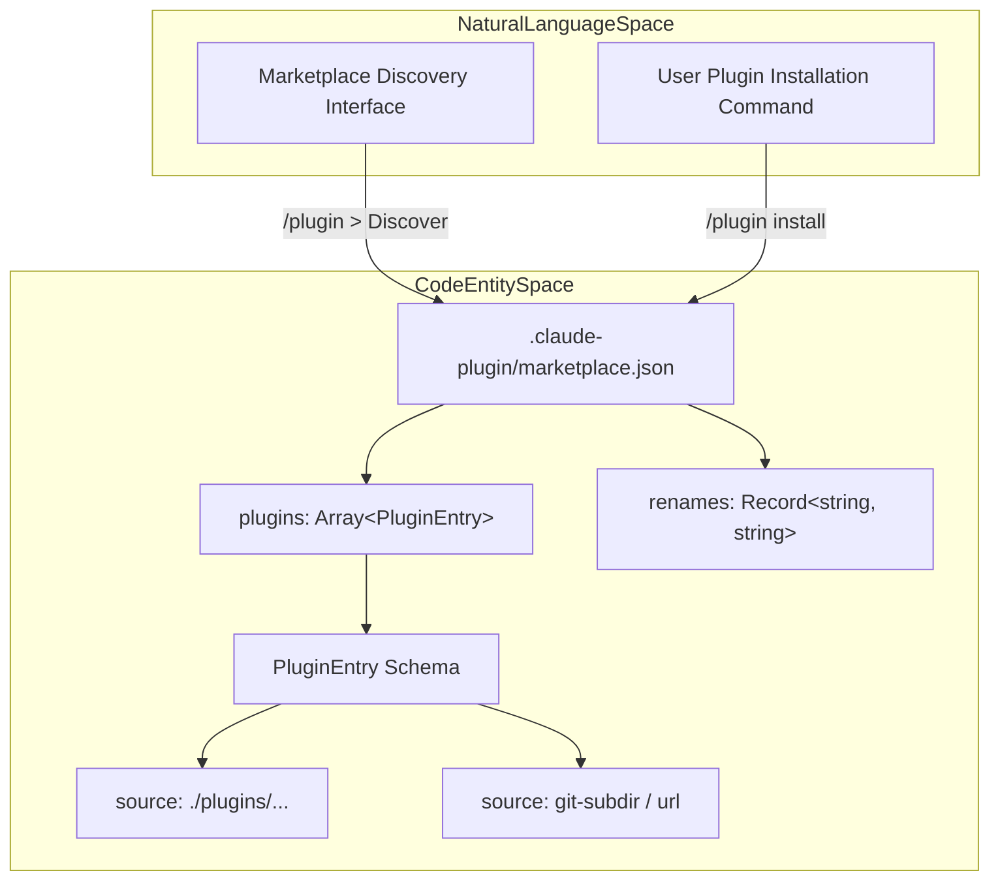
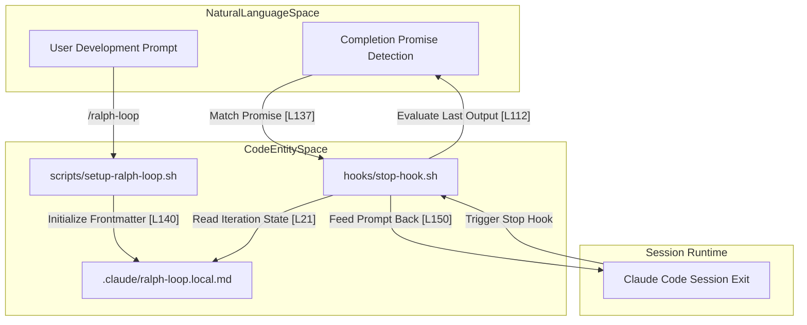

<!-- source: DeepWiki mcp.deepwiki.com · repo anthropics/claude-plugins-official · page 1 Overview · fetched 2026-10-26 -->

# Overview

Relevant source files

The following files were used as context for generating this wiki page:

- [.claude-plugin/marketplace.json](.claude-plugin/marketplace.json)
- [README.md](README.md)
- [plugins/plugin-dev/.claude-plugin/plugin.json](plugins/plugin-dev/.claude-plugin/plugin.json)
- [plugins/ralph-loop/README.md](plugins/ralph-loop/README.md)
- [plugins/ralph-loop/hooks/stop-hook.sh](plugins/ralph-loop/hooks/stop-hook.sh)
- [plugins/ralph-loop/scripts/setup-ralph-loop.sh](plugins/ralph-loop/scripts/setup-ralph-loop.sh)
- [plugins/security-guidance/.claude-plugin/plugin.json](plugins/security-guidance/.claude-plugin/plugin.json)
- [plugins/security-guidance/hooks/diffstate.py](plugins/security-guidance/hooks/diffstate.py)
- [plugins/security-guidance/hooks/gitutil.py](plugins/security-guidance/hooks/gitutil.py)
- [plugins/security-guidance/hooks/security_reminder_hook.py](plugins/security-guidance/hooks/security_reminder_hook.py)
- [plugins/security-guidance/tests/test_git_index_locks.py](plugins/security-guidance/tests/test_git_index_locks.py)
- [plugins/security-guidance/tests/test_temp_index_cleanup.py](plugins/security-guidance/tests/test_temp_index_cleanup.py)

The `claude-plugins-official` repository serves as the official plugin marketplace and comprehensive development system for Claude Code [README.md:1-3](). It provides a centralized registry (`[.claude-plugin/marketplace.json]`) that catalogs over 55 internal and external plugins [README.md:9-10](), development tools for creating new extensions, and automated quality assurance systems to maintain ecosystem standards. This repository enables developers to extend Claude Code with custom commands, autonomous agents, context-aware skills, event-driven hooks, and Model Context Protocol (MCP) server integrations.

For quick start instructions, see [Getting Started](#1.1). For details on the registry schema and management, see [Plugin Marketplace](#1.2).

## Repository Purpose and Ecosystem Structure

The repository functions as a multi-layered extensibility ecosystem for Claude Code:

1. **Marketplace Distribution**: Centralized cataloging and distribution of first-party and third-party plugins via `[.claude-plugin/marketplace.json]()` [README.md:14-18]().
2. **Development Toolkit**: Scaffolding systems like `[plugins/plugin-dev/.claude-plugin/plugin.json]()` and specialized scripts for building custom components [README.md:24]().
3. **Validation and Quality Assurance**: Automated GitHub Actions workflows ensuring strict frontmatter and marketplace schema adherence.
4. **Reference Implementations**: Advanced patterns such as iterative development loops (`[plugins/ralph-loop/README.md]()`) and real-time security reviews (`[plugins/security-guidance/.claude-plugin/plugin.json]()`).

Plugins are organized into distinct directories based on their maintenance model:

| Directory Path | Ownership | Description |
| :--- | :--- | :--- |
| `[plugins/]()` | Anthropic (Internal) | Core tooling, language servers, and developer utilities [README.md:9]() |
| `[external_plugins/]()` | Community / Partners | Third-party integrations and partner-contributed services [README.md:10]() |

Sources: [README.md:1-30](), [.claude-plugin/marketplace.json:1-123]()

## Central Registry System

The registry system links natural language intents and discovery interfaces directly to code entities within the repository. The authoritative catalog is defined in `[.claude-plugin/marketplace.json]()`, which manages plugin metadata, source mappings, and slug renames to ensure seamless installation via Claude Code.

**Registry Architecture: Natural Language to Code Entities**

Sources: [.claude-plugin/marketplace.json:1-161](), [README.md:12-18]()

For detailed documentation on the registry schema, plugin categorization, and slug mutability rules, see [Plugin Marketplace](#1.2).

## Plugin Component Architecture

Claude Code plugins are composed of modular directories defining specialized behaviors. A standard plugin layout integrates commands, agents, skills, hooks, and MCP servers.

| Component Type | Canonical Path | Execution Role |
| :--- | :--- | :--- |
| **Plugin Manifest** | `.claude-plugin/plugin.json` | Defines metadata, version, and author details [README.md:36-37]() |
| **Commands** | `commands/*.md` | Custom user-invoked slash commands [README.md:39]() |
| **Agents** | `agents/*.md` | Specialized sub-personalities with scoped tools [README.md:40]() |
| **Skills** | `skills/*/SKILL.md` | Context-triggered instructions and progressive disclosure [README.md:41]() |
| **Hooks** | `hooks/hooks.json` | Event-driven triggers (`PreToolUse`, `Stop`, etc.) [plugins/ralph-loop/hooks/stop-hook.sh:1-10]() |
| **MCP Integration** | `.mcp.json` | External Model Context Protocol server configurations [README.md:38]() |

### Implementation Case Study: Ralph Loop

The `ralph-loop` plugin illustrates the "Stop Hook" execution pattern, which intercepts session exit attempts to drive continuous, self-referential iteration [plugins/ralph-loop/README.md:13-27]().

**Ralph Loop Execution: Natural Language to Code Entity Mapping**

Sources: [plugins/ralph-loop/README.md:1-28](), [plugins/ralph-loop/scripts/setup-ralph-loop.sh:130-151](), [plugins/ralph-loop/hooks/stop-hook.sh:9-171]()

---

