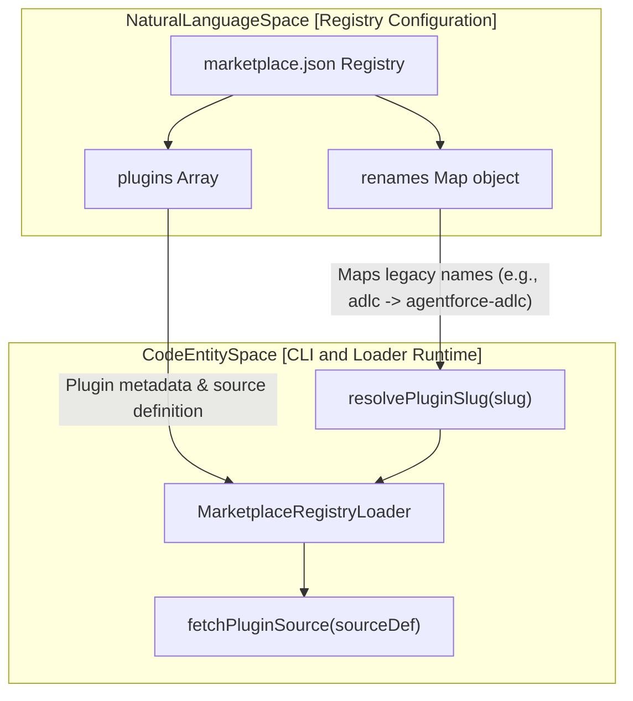
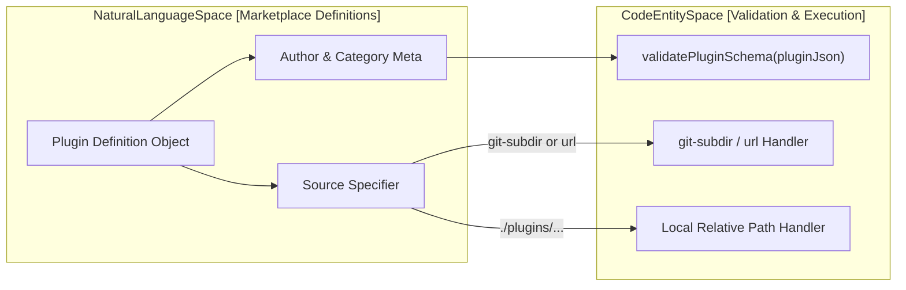

<!-- source: DeepWiki mcp.deepwiki.com · repo anthropics/claude-plugins-official · page 1.2 Plugin Marketplace · fetched 2026-10-26 -->

# Plugin Marketplace

Relevant source files

The following files were used as context for generating this wiki page:

- [.claude-plugin/marketplace.json](.claude-plugin/marketplace.json)
- [external_plugins/context7/.claude-plugin/plugin.json](external_plugins/context7/.claude-plugin/plugin.json)
- [external_plugins/context7/.mcp.json](external_plugins/context7/.mcp.json)
- [external_plugins/context7/README.md](external_plugins/context7/README.md)
- [external_plugins/firebase/.claude-plugin/plugin.json](external_plugins/firebase/.claude-plugin/plugin.json)
- [external_plugins/github/.claude-plugin/plugin.json](external_plugins/github/.claude-plugin/plugin.json)
- [external_plugins/gitlab/.claude-plugin/plugin.json](external_plugins/gitlab/.claude-plugin/plugin.json)
- [external_plugins/laravel-boost/.claude-plugin/plugin.json](external_plugins/laravel-boost/.claude-plugin/plugin.json)
- [plugins/security-guidance/.claude-plugin/plugin.json](plugins/security-guidance/.claude-plugin/plugin.json)
- [plugins/security-guidance/hooks/diffstate.py](plugins/security-guidance/hooks/diffstate.py)
- [plugins/security-guidance/hooks/gitutil.py](plugins/security-guidance/hooks/gitutil.py)
- [plugins/security-guidance/hooks/security_reminder_hook.py](plugins/security-guidance/hooks/security_reminder_hook.py)
- [plugins/security-guidance/tests/test_git_index_locks.py](plugins/security-guidance/tests/test_git_index_locks.py)
- [plugins/security-guidance/tests/test_temp_index_cleanup.py](plugins/security-guidance/tests/test_temp_index_cleanup.py)

## Purpose and Scope
The Plugin Marketplace is the central registry system that catalogs and manages all available Claude Code extensions, tools, and integrations [.claude-plugin/marketplace.json:1-4](). It is defined as a single JSON file (`.claude-plugin/marketplace.json`) that acts as the authoritative directory for internal Anthropic plugins and external community/partner plugins. This page documents the marketplace registry structure, schema definitions, plugin categorization, rename maps, and how the system resolves and manages internal versus external plugin sources.

Sources: [.claude-plugin/marketplace.json:1-20]()

---

## Marketplace Registry Structure

The marketplace registry is stored at `.claude-plugin/marketplace.json` [.claude-plugin/marketplace.json:1-4](). It adheres to an explicit JSON schema (`https://anthropic.com/claude-code/marketplace.schema.json`) [.claude-plugin/marketplace.json:2]() and includes metadata, a rename mapping dictionary for legacy slug migration, and a comprehensive `plugins` array [.claude-plugin/marketplace.json:3-21]().

Title: Marketplace Registry and Slug Resolution

### Registry Root Fields

| Field | Type | Required | Description |
|-------|------|----------|-------------|
| `$schema` | string | Yes | JSON schema validator reference endpoint [.claude-plugin/marketplace.json:2]() |
| `name` | string | Yes | Identifier for the registry (`"claude-plugins-official"`) [.claude-plugin/marketplace.json:3]() |
| `owner` | object | Yes | Registry maintainer contact details (`name`, `email`) [.claude-plugin/marketplace.json:5-8]() |
| `renames` | object | No | Dictionary mapping deprecated plugin slugs to canonical slugs [.claude-plugin/marketplace.json:9-20]() |
| `plugins` | array | Yes | Collection of plugin entries cataloged in the marketplace [.claude-plugin/marketplace.json:21-4427]() |

Sources: [.claude-plugin/marketplace.json:1-21]()

---

## Plugin Metadata Schema

Each entry inside the `plugins` array describes an individual extension, specifying its identity, description, authorship, categorization, and source repository or path [.claude-plugin/marketplace.json:21-37]().

Title: Plugin Schema and Source Resolution Architecture

### Core Plugin Fields

| Field | Type | Description |
|-------|------|-------------|
| `name` | string | Immutable slug identifying the plugin [.claude-plugin/marketplace.json:23]() |
| `displayName` | string | Optional human-friendly display name [.claude-plugin/marketplace.json:114]() |
| `description` | string | Detailed explanation of capabilities and integration behavior [.claude-plugin/marketplace.json:24]() |
| `author` | object | Creator metadata containing `name` and optional `email` [.claude-plugin/marketplace.json:25-27]() |
| `category` | string | Classification tag (`security`, `development`, `design`, `productivity`) [.claude-plugin/marketplace.json:28]() |
| `source` | string / object | Location specification (local path or remote repository definition) [.claude-plugin/marketplace.json:29-35]() |
| `homepage` | string | Documentation or project website URL [.claude-plugin/marketplace.json:36]() |

Sources: [.claude-plugin/marketplace.json:21-37]()

---

## Source Configuration Patterns

The marketplace supports two primary source mechanisms to manage internal and external plugins uniformly:

### 1. Internal / Local Sources
Internal plugins maintained directly within the official repository use a relative path string pointing to their directory [.claude-plugin/marketplace.json:60-61]().
- **Example:** `"source": "./plugins/agent-sdk-dev"` [.claude-plugin/marketplace.json:60-61]()

### 2. External Git Subdirectory / URL Sources
Third-party and partner plugins hosted externally must specify a source object with explicit pinning to guarantee reproducibility and supply-chain security [.claude-plugin/marketplace.json:29-35]().

- `source`: `"git-subdir"` (for monorepos) or `"url"` (for standalone repositories) [.claude-plugin/marketplace.json:29-30, 69-70]()
- `url`: HTTPS URL of the Git repository [.claude-plugin/marketplace.json:31]()
- `path`: Subdirectory path inside the repository containing the plugin manifest [.claude-plugin/marketplace.json:32]()
- `ref`: Branch, tag, or reference commit (e.g., `"v1.5.5"`, `"main"`) [.claude-plugin/marketplace.json:33, 49]()
- `sha`: Immutable commit SHA required for integrity verification [.claude-plugin/marketplace.json:34]()

Sources: [.claude-plugin/marketplace.json:28-35, 68-74]()

---

## Legacy Slug Renames and Migration

The `renames` object at the root of `marketplace.json` facilitates seamless slug evolution without breaking existing user installations or pinned references [.claude-plugin/marketplace.json:9-20](). When a plugin is renamed (for example, `"adlc"` to `"agentforce-adlc"` or `"airwallex"` to `"airwallex-agentos"`), the client runtime consults this dictionary to automatically map old identifiers to their current canonical slugs [.claude-plugin/marketplace.json:10-11]().

Sources: [.claude-plugin/marketplace.json:9-20]()

---

