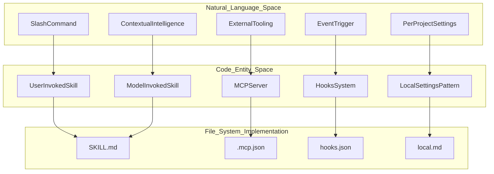
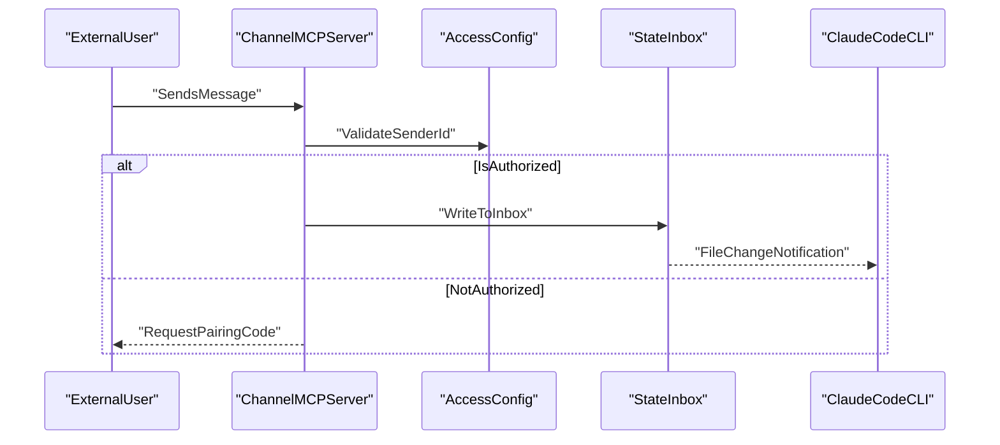

<!-- source: DeepWiki mcp.deepwiki.com · repo anthropics/claude-plugins-official · page 10 Glossary · fetched 2026-10-26 -->

# Glossary

Relevant source files

The following files were used as context for generating this wiki page:

- [.claude-plugin/marketplace.json](.claude-plugin/marketplace.json)
- [plugins/code-modernization/README.md](plugins/code-modernization/README.md)
- [plugins/code-modernization/assets/topology-viewer.html](plugins/code-modernization/assets/topology-viewer.html)
- [plugins/code-modernization/commands/modernize-assess.md](plugins/code-modernization/commands/modernize-assess.md)
- [plugins/code-modernization/commands/modernize-brief.md](plugins/code-modernization/commands/modernize-brief.md)
- [plugins/code-modernization/commands/modernize-harden.md](plugins/code-modernization/commands/modernize-harden.md)
- [plugins/code-modernization/commands/modernize-map.md](plugins/code-modernization/commands/modernize-map.md)
- [plugins/code-modernization/commands/modernize-preflight.md](plugins/code-modernization/commands/modernize-preflight.md)
- [plugins/code-modernization/commands/modernize-reimagine.md](plugins/code-modernization/commands/modernize-reimagine.md)
- [plugins/code-modernization/commands/modernize-status.md](plugins/code-modernization/commands/modernize-status.md)
- [plugins/code-modernization/commands/modernize-transform.md](plugins/code-modernization/commands/modernize-transform.md)
- [plugins/code-modernization/commands/modernize-uplift.md](plugins/code-modernization/commands/modernize-uplift.md)
- [plugins/code-modernization/commands/modernize.md](plugins/code-modernization/commands/modernize.md)
- [plugins/security-guidance/.claude-plugin/plugin.json](plugins/security-guidance/.claude-plugin/plugin.json)
- [plugins/security-guidance/README.md](plugins/security-guidance/README.md)
- [plugins/security-guidance/hooks/_base.py](plugins/security-guidance/hooks/_base.py)
- [plugins/security-guidance/hooks/diffstate.py](plugins/security-guidance/hooks/diffstate.py)
- [plugins/security-guidance/hooks/ensure_agent_sdk.py](plugins/security-guidance/hooks/ensure_agent_sdk.py)
- [plugins/security-guidance/hooks/extensibility.py](plugins/security-guidance/hooks/extensibility.py)
- [plugins/security-guidance/hooks/gitutil.py](plugins/security-guidance/hooks/gitutil.py)
- [plugins/security-guidance/hooks/llm.py](plugins/security-guidance/hooks/llm.py)
- [plugins/security-guidance/hooks/patterns.py](plugins/security-guidance/hooks/patterns.py)
- [plugins/security-guidance/hooks/security_reminder_hook.py](plugins/security-guidance/hooks/security_reminder_hook.py)
- [plugins/security-guidance/hooks/session_state.py](plugins/security-guidance/hooks/session_state.py)
- [plugins/security-guidance/hooks/sg-python.sh](plugins/security-guidance/hooks/sg-python.sh)
- [plugins/security-guidance/tests/test_git_index_locks.py](plugins/security-guidance/tests/test_git_index_locks.py)
- [plugins/security-guidance/tests/test_prompt_cache.py](plugins/security-guidance/tests/test_prompt_cache.py)
- [plugins/security-guidance/tests/test_review_model.py](plugins/security-guidance/tests/test_review_model.py)
- [plugins/security-guidance/tests/test_temp_index_cleanup.py](plugins/security-guidance/tests/test_temp_index_cleanup.py)

This glossary defines technical terms, architectural concepts, and domain-specific jargon used within the Claude Code Plugins repository (`https://github.com/anthropics/claude-plugins-official`). It is intended to help onboarding engineers navigate the intersection of the Claude Code CLI and its extensible plugin ecosystem, providing precise file pointers and implementation details.

## Core Concepts

### Marketplace
The central registry of all available plugins. It is defined by a single JSON file that catalogs internal and external plugins, their metadata, renames, and source locations.
*   **Implementation**: Defined in `[ .claude-plugin/marketplace.json:1-20 ]()` following the official marketplace schema.
*   **Data Flow**: Claude Code fetches this file to populate discovery interfaces and resolve plugin names during installation, honoring the `renames` map (`[ .claude-plugin/marketplace.json:9-20 ]()`).
*   **Categories**: Plugins are organized by functional domain such as `security` (`[ .claude-plugin/marketplace.json:28 ]()`), `development` (`[ .claude-plugin/marketplace.json:62 ]()`), and `productivity` (`[ .claude-plugin/marketplace.json:102 ]()`).

### Plugin
A self-contained directory containing metadata, logic, and configuration that extends Claude Code's capabilities.
*   **Structure**: Requires a manifest file such as `[ plugins/security-guidance/.claude-plugin/plugin.json:1-10 ]()`.
*   **Components**: Can include Commands, Agents, Skills, Hooks, and MCP Servers.
*   **Immutability & Renames**: Plugin names are immutable slugs; historical renames are tracked via the `renames` object in `[ .claude-plugin/marketplace.json:9-20 ]()`.

### Skill
A Markdown-based definition that provides contextual guidance or adds user-invoked slash commands to Claude Code. Skills use a "progressive disclosure" pattern where they are only activated when relevant to the current task execution context.
*   **Format**: Defined in `SKILL.md` files equipped with YAML frontmatter.

### Model Context Protocol (MCP)
An open standard that enables Claude to interact with external tools, APIs, and data sources.
*   **Configuration**: Defined in `.mcp.json` configuration blocks within plugin directories.
*   **Server Integration**: Used extensively across domain integrations such as messaging bridges and security scanners.

### Hook
An event-driven script that intercepts Claude Code lifecycle events.
*   **Hook Types**: Configured in `hooks.json` files. Common hooks include `UserPromptSubmit`, `PostToolUse`, and `Stop` (`[ plugins/security-guidance/hooks/security_reminder_hook.py:5-16 ]()`).
*   **Stop Hook**: Intercepts session completion to trigger post-execution code reviews or enforce loop continuations (`[ plugins/security-guidance/hooks/security_reminder_hook.py:17-22 ]()`).

Sources: `[ .claude-plugin/marketplace.json:1-20 ]()`, `[ plugins/security-guidance/.claude-plugin/plugin.json:1-10 ]()`, `[ plugins/security-guidance/hooks/security_reminder_hook.py:5-22 ]()`

## System Architecture Diagrams

### Plugin Component Mapping
This diagram bridges natural language feature requests to their concrete code entities and file system implementations.

Sources: `[ plugins/security-guidance/.claude-plugin/plugin.json:1-10 ]()`, `[ plugins/security-guidance/hooks/security_reminder_hook.py:5-16 ]()`

### Messaging Channel Architecture
How external messaging platforms integrate with Claude Code via the channel contract.

Sources: `[ plugins/security-guidance/hooks/security_reminder_hook.py:24-36 ]()`

## Specialized Terminology

### Ralph Loop
An iterative development technique where Claude's output is fed back as input in a self-referential cycle until a completion goal is met.
*   **State Management**: Tracked in local state files containing iteration counts and completion promises.
*   **Stop Hook**: Intercepts `Stop` events; if a loop is active, it re-injects the prompt until the completion promise is fulfilled.

### Security Guidance Layers
The `security-guidance` plugin implements a multi-layer analysis pipeline (`[ plugins/security-guidance/hooks/security_reminder_hook.py:8-53 ]()`):
1.  **Pattern-based rules**: Fast regex checks running on every file write (`PostToolUse`) (`[ plugins/security-guidance/hooks/security_reminder_hook.py:12-15 ]()`).
2.  **Stop hook review**: Uses `git diff` against a baseline SHA to perform LLM-powered analysis on session changes (`[ plugins/security-guidance/hooks/security_reminder_hook.py:17-22 ]()`).
3.  **Agentic Commit Reviewer**: An advanced layer that uses the Claude Agent SDK to catch complex vulnerabilities (`[ plugins/security-guidance/hooks/llm.py:127-142 ]()`).
4.  **Git Baseline**: On `UserPromptSubmit`, the plugin captures a `git stash create` snapshot SHA to represent the starting state for diffing (`[ plugins/security-guidance/hooks/security_reminder_hook.py:24-36 ]()`, `[ plugins/security-guidance/hooks/gitutil.py:78-95 ]()`).

Sources: `[ plugins/security-guidance/hooks/security_reminder_hook.py:8-53 ]()`, `[ plugins/security-guidance/hooks/llm.py:127-142 ]()`, `[ plugins/security-guidance/hooks/gitutil.py:78-95 ]()`

### Modernization Workflow
A sequence of commands used in the `code-modernization` plugin to migrate legacy codebases (COBOL, Java, .NET) (`[ plugins/code-modernization/README.md:34-46 ]()`):
*   **Sequence**: `modernize` → `modernize-preflight` → `modernize-assess` → `modernize-map` → `modernize-extract-rules` → `modernize-brief` → (`reimagine` | `transform` | `uplift`) → `modernize-verify` → `modernize-harden` (`[ plugins/code-modernization/README.md:34-46 ]()`).
*   **COCOMO Index**: A relative size measure computed as `2.94 × KSLOC^1.10` used to rank systems for modernization priority (`[ plugins/code-modernization/commands/modernize-assess.md:45-48 ]()`).
*   **Modernization Methods**: 
    *   `transform`: Cross-stack rewrite from extracted intent (`[ plugins/code-modernization/README.md:43 ]()`).
    *   `reimagine`: Greenfield rebuild on a new architecture (`[ plugins/code-modernization/README.md:43 ]()`, `[ plugins/code-modernization/commands/modernize-reimagine.md:11-13 ]()`).
    *   `uplift`: Same-stack version bump preserving underlying structure (`[ plugins/code-modernization/README.md:43 ]()`, `[ plugins/code-modernization/commands/modernize-uplift.md:7-14 ]()`).

Sources: `[ plugins/code-modernization/README.md:34-46 ]()`, `[ plugins/code-modernization/commands/modernize-assess.md:45-48 ]()`, `[ plugins/code-modernization/commands/modernize-reimagine.md:11-13 ]()`, `[ plugins/code-modernization/commands/modernize-uplift.md:7-14 ]()`

### Pairing and Allowlisting
Security mechanisms for Messaging Channel plugins.
*   **Pairing**: A temporary verification state where a user provides a matching code to link their external chat identifier to the local Claude session.
*   **Allowlist**: A permanent list of authorized `senderId` or `chatId` values stored in `access.json`.
*   **Static Mode**: A deployment mode where access configuration is snapshotted at boot and pairing is disabled.

Sources: `[ external_plugins/telegram/server.ts ]()`

### LSP Plugin
A plugin that provides Language Server Protocol (LSP) support for specific programming languages across the Claude Code environment.
*   **Implementation**: Configured via `lspServers` blocks in the marketplace registry, defining command/argument setups, startup timeouts, and `extensionToLanguage` mappings.

Sources: `[ .claude-plugin/marketplace.json:1-20 ]()`