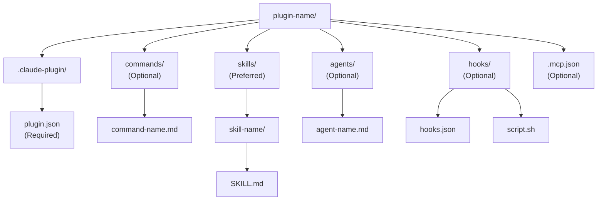
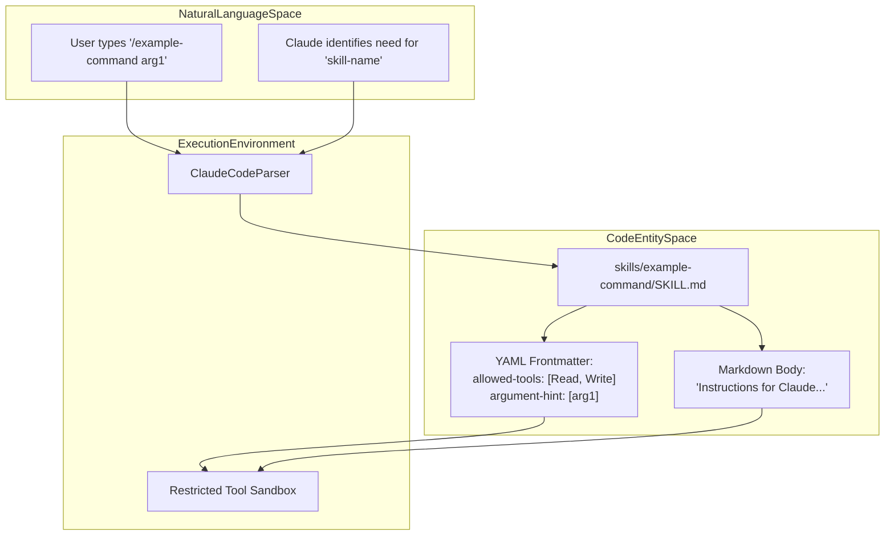
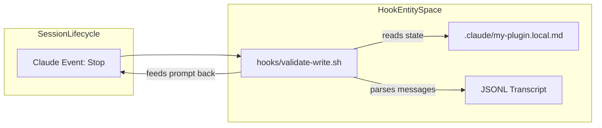

<!-- source: DeepWiki mcp.deepwiki.com · repo anthropics/claude-plugins-official · page 2 Plugin Architecture · fetched 2026-10-26 -->

# Plugin Architecture

Relevant source files

The following files were used as context for generating this wiki page:

- [plugins/agent-sdk-dev/.claude-plugin/plugin.json](plugins/agent-sdk-dev/.claude-plugin/plugin.json)
- [plugins/code-review/.claude-plugin/plugin.json](plugins/code-review/.claude-plugin/plugin.json)
- [plugins/example-plugin/.claude-plugin/plugin.json](plugins/example-plugin/.claude-plugin/plugin.json)
- [plugins/explanatory-output-style/.claude-plugin/plugin.json](plugins/explanatory-output-style/.claude-plugin/plugin.json)
- [plugins/feature-dev/.claude-plugin/plugin.json](plugins/feature-dev/.claude-plugin/plugin.json)
- [plugins/frontend-design/.claude-plugin/plugin.json](plugins/frontend-design/.claude-plugin/plugin.json)
- [plugins/hookify/.claude-plugin/plugin.json](plugins/hookify/.claude-plugin/plugin.json)
- [plugins/hookify/skills/writing-rules/SKILL.md](plugins/hookify/skills/writing-rules/SKILL.md)
- [plugins/learning-output-style/.claude-plugin/plugin.json](plugins/learning-output-style/.claude-plugin/plugin.json)
- [plugins/plugin-dev/README.md](plugins/plugin-dev/README.md)
- [plugins/plugin-dev/skills/hook-development/SKILL.md](plugins/plugin-dev/skills/hook-development/SKILL.md)
- [plugins/plugin-dev/skills/plugin-settings/SKILL.md](plugins/plugin-dev/skills/plugin-settings/SKILL.md)
- [plugins/plugin-dev/skills/plugin-structure/SKILL.md](plugins/plugin-dev/skills/plugin-structure/SKILL.md)
- [plugins/plugin-dev/skills/skill-development/SKILL.md](plugins/plugin-dev/skills/skill-development/SKILL.md)
- [plugins/pr-review-toolkit/.claude-plugin/plugin.json](plugins/pr-review-toolkit/.claude-plugin/plugin.json)

This document provides a technical overview of the Claude Code plugin architecture. It explains the core components, directory structures, and integration patterns used to extend Claude Code's capabilities.

For detailed information on specific components, see:
- [Plugin Structure and Manifest](#2.1) — Standard plugin directory layout, `plugin.json` manifest format, required/optional fields, and auto-discovery.
- [Commands](#2.2) — Slash command development, frontmatter configuration, dynamic arguments, file references, and bash execution.
- [Agents and Subagents](#2.3) — Agent architecture, frontmatter fields, system prompts, triggering mechanisms, and subagent patterns.
- [Skills System](#2.4) — Skill development, `SKILL.md` structure, progressive disclosure, frontmatter requirements, and context triggering.
- [Hooks System](#2.5) — Event-driven hooks, `hooks.json` configuration, hook types, event types, and hook output format.
- [MCP Server Integration](#2.6) — Model Context Protocol integration, `.mcp.json` configuration, server types, and authentication patterns.
- [Plugin Settings and Configuration](#2.7) — The `.claude/*.local.md` configuration pattern, YAML frontmatter settings, parsing, lifecycle, and per-project customization.

## Core Plugin Structure

Claude Code plugins follow a standardized directory layout. While most components are optional, the `.claude-plugin/plugin.json` manifest is the required entry point for discovery and metadata [plugins/plugin-dev/README.md:95-106](), [plugins/example-plugin/.claude-plugin/plugin.json:1-8]().

### Standard Directory Layout

Title: "Plugin Directory Structure"

Sources: [plugins/plugin-dev/README.md:95-106](), [plugins/example-plugin/.claude-plugin/plugin.json:1-8]()

### Component Types

| Component | Path | Role |
| :--- | :--- | :--- |
| **Manifest** | `.claude-plugin/plugin.json` | Defines name, version, author, and metadata. [plugins/example-plugin/.claude-plugin/plugin.json:1-8]() |
| **Skills** | `skills/<name>/SKILL.md` | **Preferred** format for modular capabilities with progressive disclosure. [plugins/plugin-dev/skills/skill-development/SKILL.md:25-40]() |
| **Commands** | `commands/<name>.md` | Legacy format for slash commands, defining user-facing actions. [plugins/plugin-dev/README.md:135-146]() |
| **Agents** | `agents/<name>.md` | Defines specialized subagents with distinct system prompts and tools. [plugins/plugin-dev/README.md:154-161]() |
| **Hooks** | `hooks/hooks.json` | Configures scripts that trigger on session lifecycle events. [plugins/plugin-dev/README.md:56-67]() |
| **MCP** | `.mcp.json` | Configures external Model Context Protocol servers (stdio/http/SSE). [plugins/plugin-dev/README.md:76-87]() |

Sources: [plugins/plugin-dev/README.md:56-161](), [plugins/plugin-dev/skills/skill-development/SKILL.md:25-40](), [plugins/example-plugin/.claude-plugin/plugin.json:1-8]()

## Bridging Natural Language to Code

The architecture maps high-level intent (Natural Language Space) to specific code entities and execution environments (Code Entity Space).

### Command and Skill Execution Flow

Title: "Intent-to-Entity Mapping"

Sources: [plugins/plugin-dev/README.md:135-152](), [plugins/plugin-dev/skills/skill-development/SKILL.md:25-40]()

### Event-Driven Hook Architecture

The hooks system allows plugins to intercept the session lifecycle. A hook is defined by an event type (e.g., `Stop`) and a corresponding action configuration [plugins/plugin-dev/README.md:56-67]().

Title: "Hook Lifecycle Integration"

Sources: [plugins/plugin-dev/skills/plugin-settings/SKILL.md:60-95](), [plugins/plugin-dev/README.md:56-67]()

## Architectural Patterns

### 1. Skills-First Development
The architecture favors the "Skills" pattern. A `SKILL.md` file uses YAML frontmatter to define its interface and Markdown to define its logic, supporting progressive disclosure across metadata, body, and bundled resources [plugins/plugin-dev/skills/skill-development/SKILL.md:77-86]().

### 2. Local Configuration Persistence
Plugins manage user settings and transient state using `.claude/*.local.md` files, which combine YAML frontmatter for structured variables and markdown for contextual instructions [plugins/plugin-dev/skills/plugin-settings/SKILL.md:11-20]().

### 3. Instruction-Based Commands
Commands and skills are structured as direct instructions **TO Claude** about what actions to perform and which tools are permitted via frontmatter control declarations [plugins/plugin-dev/skills/plugin-settings/SKILL.md:99-117]().

---

