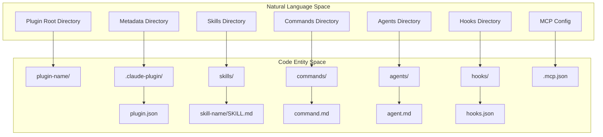
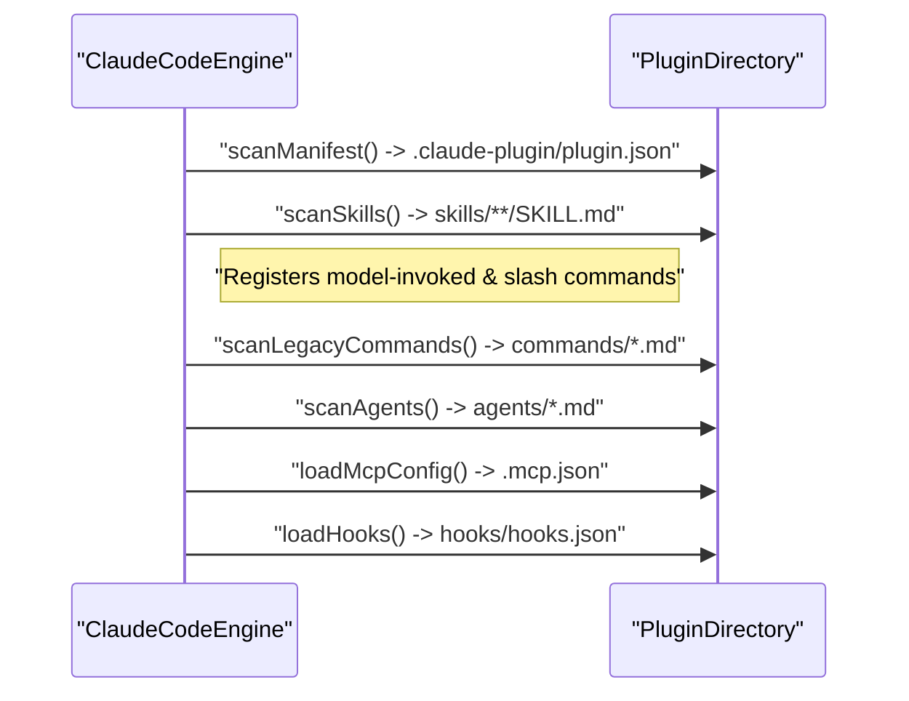

<!-- source: DeepWiki mcp.deepwiki.com · repo anthropics/claude-plugins-official · page 2.1 Plugin Structure and Manifest · fetched 2026-10-26 -->

# Plugin Structure and Manifest

<details>
<summary>Relevant source files</summary>

The following files were used as context for generating this wiki page:

- [plugins/agent-sdk-dev/.claude-plugin/plugin.json](plugins/agent-sdk-dev/.claude-plugin/plugin.json)
- [plugins/code-review/.claude-plugin/plugin.json](plugins/code-review/.claude-plugin/plugin.json)
- [plugins/example-plugin/.claude-plugin/plugin.json](plugins/example-plugin/.claude-plugin/plugin.json)
- [plugins/explanatory-output-style/.claude-plugin/plugin.json](plugins/explanatory-output-style/.claude-plugin/plugin.json)
- [plugins/feature-dev/.claude-plugin/plugin.json](plugins/feature-dev/.claude-plugin/plugin.json)
- [plugins/frontend-design/.claude-plugin/plugin.json](plugins/frontend-design/.claude-plugin/plugin.json)
- [plugins/hookify/.claude-plugin/plugin.json](plugins/hookify/.claude-plugin/plugin.json)
- [plugins/hookify/skills/writing-rules/SKILL.md](plugins/hookify/skills/writing-rules/SKILL.md)
- [plugins/learning-output-style/.claude-plugin/plugin.json](plugins/learning-output-style/.claude-plugin/plugin.json)
- [plugins/plugin-dev/README.md](plugins/plugin-dev/README.md)
- [plugins/plugin-dev/skills/hook-development/SKILL.md](plugins/plugin-dev/skills/hook-development/SKILL.md)
- [plugins/plugin-dev/skills/plugin-settings/SKILL.md](plugins/plugin-dev/skills/plugin-settings/SKILL.md)
- [plugins/plugin-dev/skills/plugin-structure/SKILL.md](plugins/plugin-dev/skills/plugin-structure/SKILL.md)
- [plugins/plugin-dev/skills/skill-development/SKILL.md](plugins/plugin-dev/skills/skill-development/SKILL.md)
- [plugins/pr-review-toolkit/.claude-plugin/plugin.json](plugins/pr-review-toolkit/.claude-plugin/plugin.json)

</details>


This page documents the standardized directory structure and metadata format for Claude Code plugins. All plugins follow this structure to ensure automatic component discovery, consistent installation, and seamless integration with the Claude Code environment.

## Purpose and Scope

This document details:
- The standard plugin directory layout and file conventions.
- The `.claude-plugin/plugin.json` manifest format, including required and optional fields.
- Component discovery mechanisms for skills, commands, agents, and hooks.
- Legacy vs. modern file layouts for user-invoked capabilities.
- The role of the `.mcp.json` configuration file.
- Per-project configuration using the `.local.md` pattern.

Sources: [plugins/example-plugin/README.md:7-19](), [plugins/plugin-dev/README.md:95-113]()

## Standard Directory Structure

Claude Code plugins use a conventional directory structure. While only the manifest is strictly required for the directory to be recognized as a plugin, specific subdirectories are reserved for auto-discovery of functional components.

### Directory Layout and Code Entities

Title: "Plugin Directory Layout to Code Entity Mapping"

Sources: [plugins/example-plugin/README.md:7-19](), [plugins/plugin-dev/README.md:95-113]()

### Component Locations

| Component | Location | Description |
| :--- | :--- | :--- |
| **Manifest** | `.claude-plugin/plugin.json` | Core metadata (`name`, `version`, `author`). |
| **Skills** | `skills/<name>/SKILL.md` | **Preferred** format for both model-invoked and user-invoked capabilities. |
| **Commands** | `commands/*.md` | **Legacy** format for slash commands. Loaded identically to skills. |
| **Agents** | `agents/*.md` | Definitions for autonomous subagents. |
| **Hooks** | `hooks/hooks.json` | Configuration for event-driven automation (`PreToolUse`, etc.). |
| **MCP** | `.mcp.json` | Configuration for Model Context Protocol servers. |

Sources: [plugins/example-plugin/README.md:25-52](), [plugins/plugin-dev/README.md:95-113]()

## Plugin Manifest (`plugin.json`)

The `plugin.json` file is the central metadata file for every plugin. It must be located within the `.claude-plugin/` directory.

### Manifest Schema

| Field | Type | Required | Description |
| :--- | :--- | :--- | :--- |
| `name` | string | Yes | Unique kebab-case identifier for the plugin. |
| `description` | string | No | Brief explanation of the plugin's purpose. |
| `version` | string | No | Semantic versioning string (e.g., `"1.0.0"`). |
| `author` | object | No | Contains `name` and `email` of the developer. |

Sources: [plugins/example-plugin/.claude-plugin/plugin.json:1-8](), [plugins/learning-output-style/.claude-plugin/plugin.json:1-9]()

### Example Manifest
```json
{
  "name": "example-plugin",
  "version": "1.0.0",
  "description": "A comprehensive example plugin demonstrating all Claude Code extension options",
  "author": {
    "name": "Anthropic",
    "email": "support@anthropic.com"
  }
}
```
Sources: [plugins/example-plugin/.claude-plugin/plugin.json:1-8]()

## Auto-Discovery and Component Loading

Claude Code employs an auto-discovery mechanism that scans the plugin directory for specific file patterns.

### The Discovery Workflow

Title: "Auto-Discovery Engine Scan Workflow"

Sources: [plugins/example-plugin/README.md:23-52](), [plugins/plugin-dev/README.md:95-113]()

### Skills vs. Commands Discovery
Modern plugins consolidate user-invoked "slash commands" and model-invoked "skills" into the `skills/` directory. 
- A directory `skills/my-command/SKILL.md` with `name: my-command` and `argument-hint` in its frontmatter will be registered as the `/my-command` slash command.
- The legacy `commands/my-command.md` layout is supported but discouraged for new development.

Sources: [plugins/plugin-dev/README.md:135-152](), [plugins/plugin-dev/README.md:95-113]()

## Model Context Protocol (`.mcp.json`)

External tool integration is handled via the Model Context Protocol (MCP). The `.mcp.json` file defines how Claude Code should connect to these servers.

```json
{
  "server-name": {
    "type": "http",
    "url": "https://mcp.example.com/api"
  }
}
```
Sources: [plugins/plugin-dev/README.md:76-94]()

## Plugin Settings and Configuration

Plugins use the `.claude/plugin-name.local.md` pattern to store per-project configuration and state. These files utilize YAML frontmatter for structured data and Markdown for additional context.

### File Structure
```markdown
---
enabled: true
setting1: value1
---
# Additional Context
This body can contain task descriptions or prompts.
```
Sources: [plugins/plugin-dev/skills/plugin-settings/SKILL.md:22-40]()

### Parsing in Scripts
Bash scripts within plugins often parse these settings using `sed` or `awk` to extract frontmatter values for conditional logic.
```bash
# Extract frontmatter between --- markers
FRONTMATTER=$(sed -n '/^---$/,/^---$/{ /^---$/d; p; }' "$STATE_FILE")
# Extract field
ENABLED=$(echo "$FRONTMATTER" | grep '^enabled:' | sed 's/enabled: *//')
```
Sources: [plugins/plugin-dev/skills/plugin-settings/SKILL.md:78-83](), [plugins/plugin-dev/skills/plugin-settings/SKILL.md:141-143]()

## Best Practices for Structure

1. **Path Portability**: Use `${CLAUDE_PLUGIN_ROOT}` when referring to files within the plugin directory to ensure paths work regardless of where the plugin is installed.
2. **KISS (Keep It Simple, Skill)**: Prefer the `skills/` directory over the legacy `commands/` directory for better organization.
3. **Git Integration**: Project-specific state files in `.claude/` should be ignored by version control.

Sources: [plugins/plugin-dev/README.md:95-113](), [plugins/plugin-dev/skills/plugin-settings/SKILL.md:18]()

---

