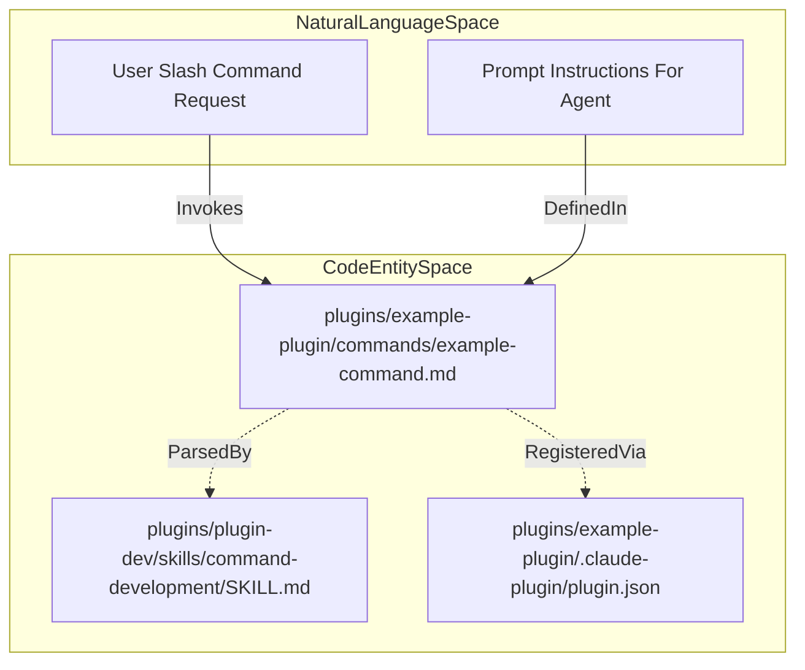
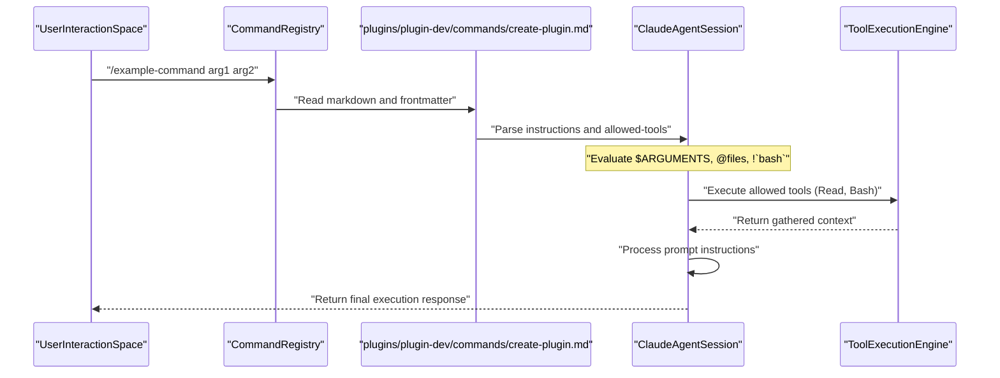

<!-- source: DeepWiki mcp.deepwiki.com · repo anthropics/claude-plugins-official · page 2.2 Commands · fetched 2026-10-26 -->

# Commands

<details>
<summary>Relevant source files</summary>

The following files were used as context for generating this wiki page:

- [.gitignore](.gitignore)
- [plugins/example-plugin/README.md](plugins/example-plugin/README.md)
- [plugins/example-plugin/commands/example-command.md](plugins/example-plugin/commands/example-command.md)
- [plugins/example-plugin/skills/example-command/SKILL.md](plugins/example-plugin/skills/example-command/SKILL.md)
- [plugins/plugin-dev/commands/create-plugin.md](plugins/plugin-dev/commands/create-plugin.md)
- [plugins/plugin-dev/skills/command-development/SKILL.md](plugins/plugin-dev/skills/command-development/SKILL.md)

</details>


## Purpose and Scope

This document details the architecture, configuration, and execution lifecycle of slash commands within the Claude Code plugin system. Slash commands are user-invoked capabilities defined as Markdown files that execute predefined prompts and workflows (e.g., `/example-command`) [plugins/plugin-dev/skills/command-development/SKILL.md:11-38](). 

Commands serve as instructions **for Claude**, rather than messages to the user [plugins/plugin-dev/skills/command-development/SKILL.md:34-38](). When invoked, they combine YAML frontmatter configuration, dynamic arguments, file references, and inline bash execution to orchestrate complex tasks [plugins/plugin-dev/skills/command-development/SKILL.md:13-21]().

For related extension models, see **Plugin Structure and Manifest (2.1)**, **Agents and Subagents (2.3)**, and **Skills System (2.4)**.

Sources: [plugins/plugin-dev/skills/command-development/SKILL.md:1-52]()

## Command Locations and Discovery

Commands can be stored across three distinct directory tiers, defining their scope and precedence [plugins/plugin-dev/skills/command-development/SKILL.md:61-83]():

### Command Location Types

| Location | Scope | Label in `/help` | Use Case |
|----------|-------|----------------|----------|
| `.claude/commands/` | Project | `(project)` | Team workflows, project-specific tasks [plugins/plugin-dev/skills/command-development/SKILL.md:63-68]() |
| `~/.claude/commands/` | Global | `(user)` | Personal workflows, cross-project utilities [plugins/plugin-dev/skills/command-development/SKILL.md:70-75]() |
| `plugin-name/commands/` | Plugin | `(plugin-name)` | Plugin-specific functionality [plugins/plugin-dev/skills/command-development/SKILL.md:77-82]() |

> **Note on Modern Format:** The `commands/*.md` layout is a legacy format [plugins/example-plugin/README.md:48-50](). For new plugins, user-invoked slash commands are preferentially implemented as skills under `skills/<name>/SKILL.md` [plugins/plugin-dev/skills/command-development/SKILL.md:9-10](). Both formats are parsed and loaded identically by Claude Code [plugins/plugin-dev/commands/create-plugin.md:72-73]().

Sources: [plugins/plugin-dev/skills/command-development/SKILL.md:54-83](), [plugins/example-plugin/README.md:48-50](), [plugins/plugin-dev/commands/create-plugin.md:72-73]()

## Command File Structure

Commands consist of individual Markdown files where the file name (excluding the `.md` extension) establishes the command identifier [plugins/plugin-dev/skills/command-development/SKILL.md:87-95]().

```
plugin-name/
├── .claude-plugin/
│   └── plugin.json
└── commands/
    ├── example-command.md    → /example-command
    └── utils/
        └── helper.md         → /helper (plugin:plugin-name:utils)
```

Each command file contains an optional YAML frontmatter header followed by a Markdown body containing instructions for Claude [plugins/plugin-dev/skills/command-development/SKILL.md:110-123]().

### Natural Language Space to Code Entity Space: Definition Mapping

Title: Command Definition Mapping


Sources: [plugins/plugin-dev/skills/command-development/SKILL.md:34-123](), [plugins/example-plugin/README.md:9-18]()

## Frontmatter Configuration

The YAML frontmatter section configures command metadata and behavior, delimited by `---` markers at the top of the command file [plugins/plugin-dev/skills/command-development/SKILL.md:112-124]().

### Frontmatter Fields

| Field | Type | Default | Purpose |
|-------|------|---------|---------|
| `description` | String | First line | Brief description displayed in `/help` [plugins/plugin-dev/skills/command-development/SKILL.md:126-132]() |
| `argument-hint` | String | None | Usage pattern shown in autocomplete [plugins/plugin-dev/skills/command-development/SKILL.md:178-183]() |
| `allowed-tools` | String/Array | Inherits | Whitelist of tools Claude can use [plugins/plugin-dev/skills/command-development/SKILL.md:140-145]() |
| `model` | String | Inherits | Model override (`sonnet`, `opus`, `haiku`) [plugins/plugin-dev/skills/command-development/SKILL.md:160-164]() |
| `disable-model-invocation` | Boolean | `false` | Prevent programmatic call via `SlashCommand` tool [plugins/plugin-dev/skills/command-development/SKILL.md:197-201]() |

Sources: [plugins/plugin-dev/skills/command-development/SKILL.md:112-209]()

### allowed-tools Patterns

Specifies tool access restrictions to minimize permission prompts:
- `Read, Write, Edit`: Specific core tools [plugins/plugin-dev/skills/command-development/SKILL.md:154]()
- `Bash(git:*)`: Bash restricted to git command patterns [plugins/plugin-dev/skills/command-development/SKILL.md:155]()
- `*`: Unrestricted tool access [plugins/plugin-dev/skills/command-development/SKILL.md:157]()

Sources: [plugins/plugin-dev/skills/command-development/SKILL.md:140-158]()

## Dynamic Arguments and Context Injection

Commands capture user-provided inputs and runtime context via variable expansion tokens [plugins/plugin-dev/skills/command-development/SKILL.md:210-212]().

### Variable Expansion Mechanics

- **`$ARGUMENTS`**: Captures all trailing arguments as a single unparsed string [plugins/plugin-dev/skills/command-development/SKILL.md:212-215]().
- **Positional Arguments (`$1`, `$2`, `$3`...)**: Captures individual whitespace-delimited arguments [plugins/plugin-dev/skills/command-development/SKILL.md:239-242]().
- **File References (`@path`)**: Embeds file content directly into the command stream [plugins/plugin-dev/skills/command-development/SKILL.md:266-268]().
- **Bash Execution (`!`bash``)**: Executes inline shell scripts to dynamically generate prompt context [plugins/plugin-dev/skills/command-development/SKILL.md:317-321]().
- **`${CLAUDE_PLUGIN_ROOT}`**: Resolves to the absolute path of the executing plugin [plugins/plugin-dev/skills/mcp-integration/SKILL.md:171-176]().

Sources: [plugins/plugin-dev/skills/command-development/SKILL.md:210-327](), [plugins/plugin-dev/skills/mcp-integration/SKILL.md:171-176]()

## Implementation and Data Flow

Title: Runtime Command Execution Sequence


Sources: [plugins/plugin-dev/skills/command-development/SKILL.md:112-327](), [plugins/plugin-dev/commands/create-plugin.md:1-16]()

---

