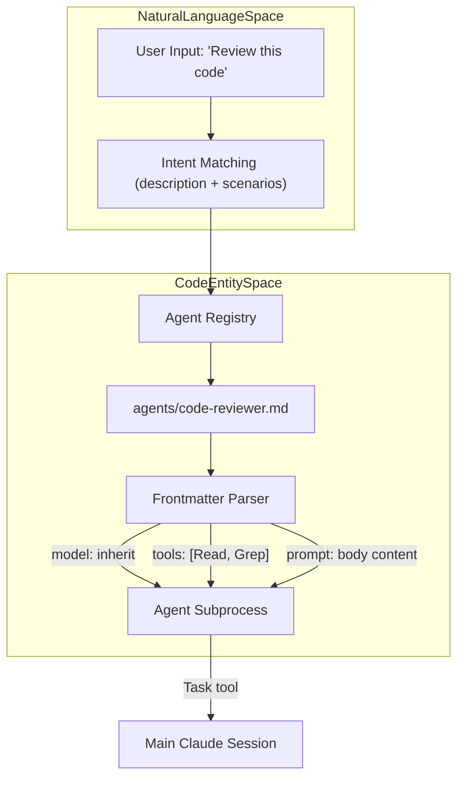
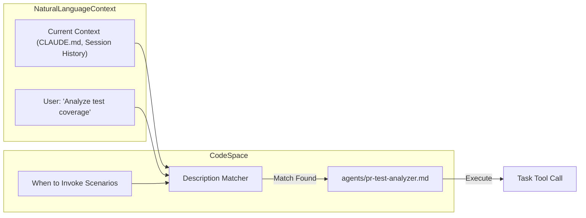

<!-- source: DeepWiki mcp.deepwiki.com · repo anthropics/claude-plugins-official · page 2.3 Agents and Subagents · fetched 2026-10-26 -->

# Agents and Subagents

<details>
<summary>Relevant source files</summary>

The following files were used as context for generating this wiki page:

- [plugins/hookify/agents/conversation-analyzer.md](plugins/hookify/agents/conversation-analyzer.md)
- [plugins/plugin-dev/skills/agent-development/SKILL.md](plugins/plugin-dev/skills/agent-development/SKILL.md)
- [plugins/plugin-dev/skills/agent-development/examples/agent-creation-prompt.md](plugins/plugin-dev/skills/agent-development/examples/agent-creation-prompt.md)
- [plugins/plugin-dev/skills/agent-development/examples/complete-agent-examples.md](plugins/plugin-dev/skills/agent-development/examples/complete-agent-examples.md)
- [plugins/plugin-dev/skills/agent-development/references/agent-creation-system-prompt.md](plugins/plugin-dev/skills/agent-development/references/agent-creation-system-prompt.md)
- [plugins/plugin-dev/skills/agent-development/references/triggering-examples.md](plugins/plugin-dev/skills/agent-development/references/triggering-examples.md)
- [plugins/pr-review-toolkit/agents/code-reviewer.md](plugins/pr-review-toolkit/agents/code-reviewer.md)
- [plugins/pr-review-toolkit/agents/comment-analyzer.md](plugins/pr-review-toolkit/agents/comment-analyzer.md)
- [plugins/pr-review-toolkit/agents/pr-test-analyzer.md](plugins/pr-review-toolkit/agents/pr-test-analyzer.md)
- [plugins/pr-review-toolkit/agents/type-design-analyzer.md](plugins/pr-review-toolkit/agents/type-design-analyzer.md)

</details>


## Purpose and Scope

This page documents the agent architecture in Claude Code plugins, covering frontmatter configuration, system prompts, triggering mechanisms, and subagent patterns. Agents are autonomous subprocesses that handle complex, multi-step tasks independently with their own context windows and tool access [plugins/plugin-dev/skills/agent-development/SKILL.md:9-11]().

Sources: [plugins/plugin-dev/skills/agent-development/SKILL.md:9-11]()

---

## What Are Agents?

Agents are specialized Claude instances that run autonomously in response to natural language triggers. Unlike commands (which users invoke explicitly with `/command-name`) or skills (which provide context), agents operate as independent subprocesses with dedicated resources [plugins/plugin-dev/skills/agent-development/SKILL.md:13-18]().

### Core Characteristics

*   **Autonomous operation**: Agents execute multi-step workflows without user intervention once triggered [plugins/plugin-dev/skills/agent-development/SKILL.md:11-11]().
*   **Isolated context**: Each agent has its own context window, preventing context pollution of the main session [plugins/plugin-dev/skills/agent-development/SKILL.md:11-11]().
*   **Specialized expertise**: System prompts define agent expertise, making them domain-specific specialists [plugins/plugin-dev/skills/agent-development/references/agent-creation-system-prompt.md:8-11]().
*   **Parallel execution**: Multiple agents can run simultaneously, each in its own subprocess.

### Agent vs Other Component Types

| Component | Invocation | Execution | Context | Use Case |
| :--- | :--- | :--- | :--- | :--- |
| **Agent** | Description-matched | Autonomous subprocess | Own window | Complex multi-step tasks |
| **Command** | User `/command` | Main session | Shared | Frequently-used prompts |
| **Skill** | Context-triggered | Main session | Shared | Knowledge/guidance |
| **Hook** | Event-driven | Script execution | Event-specific | Validation/automation |

Sources: [plugins/plugin-dev/skills/agent-development/SKILL.md:13-18](), [plugins/plugin-dev/skills/agent-development/references/agent-creation-system-prompt.md:8-11]()

---

## Agent File Format

### File Structure

Agents are Markdown files with YAML frontmatter located in the `agents/` directory of a plugin [plugins/plugin-dev/skills/agent-development/SKILL.md:20-31]():

```
plugin-name/
└── agents/
    ├── code-reviewer.md
    ├── test-generator.md
    └── security-analyzer.md
```

### Complete Format Template

The agent file consists of a YAML frontmatter block followed by a comprehensive system prompt [plugins/plugin-dev/skills/agent-development/SKILL.md:24-50]().

```markdown
---
name: agent-identifier
description: |
  Use this agent when [triggering conditions]. Typical triggers include [scenario 1], [scenario 2], and [scenario 3]. See "When to invoke" in the agent body for worked scenarios.
model: inherit
color: blue
tools: ["Read", "Write", "Grep"]
---

You are [agent role description]...

## When to invoke

- **[Scenario name].** [Situation description and agent action].
- **[Scenario name].** [Same].

**Your Core Responsibilities:**
1. [Responsibility 1]
2. [Responsibility 2]

**Analysis Process:**
[Step-by-step workflow]

**Output Format:**
[What to return]
```

Sources: [plugins/plugin-dev/skills/agent-development/SKILL.md:20-50]()

---

## Frontmatter Fields

### Required Fields

#### name
Agent identifier for namespacing and invocation.
*   **Format rules**: Lowercase letters, numbers, hyphens only; must start and end with alphanumeric [plugins/plugin-dev/skills/agent-development/SKILL.md:58-60]().
*   **Length**: 3-50 characters [plugins/plugin-dev/skills/agent-development/SKILL.md:59-59]().

#### description
Defines triggering conditions using natural language. This is the most critical field as it is loaded into context to decide when to dispatch the agent [plugins/plugin-dev/skills/agent-development/SKILL.md:76-76]().
*   **Required structure**: Must start with "Use this agent when...", include a short prose summary of typical triggers, and point to the "When to invoke" section [plugins/plugin-dev/skills/agent-development/SKILL.md:79-82]().

#### model
Specifies which Claude model the agent uses.
*   **Options**: `inherit` (recommended), `sonnet`, `opus`, `haiku` [plugins/plugin-dev/skills/agent-development/SKILL.md:99-105]().

#### color
Visual identifier for the agent in the UI.
*   **Options**: `blue`, `cyan`, `green`, `yellow`, `magenta`, `red` [plugins/plugin-dev/skills/agent-development/SKILL.md:111-111]().
*   **Conventions**: `blue`/`cyan` for analysis/review, `green` for success-oriented tasks, `yellow` for validation, `red` for security/critical, `magenta` for creative/generation [plugins/plugin-dev/skills/agent-development/SKILL.md:114-120]().

### Optional Fields

#### tools
Restricts the agent to a specific set of tools (Principle of Least Privilege) [plugins/plugin-dev/skills/agent-development/SKILL.md:134-135]().
*   **Format**: Array of tool names (e.g., `["Read", "Write", "Grep"]`) [plugins/plugin-dev/skills/agent-development/SKILL.md:128-130]().
*   **Default**: If omitted, agent has access to all tools [plugins/plugin-dev/skills/agent-development/SKILL.md:132-132]().

Sources: [plugins/plugin-dev/skills/agent-development/SKILL.md:52-141]()

---

## Agent Architecture Diagram

This diagram bridges the Natural Language triggers to the code entities that execute the agent.

### Agent Invocation Flow

Sources: [plugins/plugin-dev/skills/agent-development/SKILL.md:76-86](), [plugins/plugin-dev/skills/agent-development/references/agent-creation-system-prompt.md:12-48]()

---

## System Prompt Design

The Markdown body after the frontmatter becomes the agent's system prompt. It is written in the second person, addressing the agent directly [plugins/plugin-dev/skills/agent-development/SKILL.md:144-144]().

### Content Requirements
1.  **Role and Expertise**: Establish a clear expert identity (e.g., "You are an elite AI agent architect") [plugins/plugin-dev/skills/agent-development/references/agent-creation-system-prompt.md:8-8]().
2.  **When to Invoke**: A section listing 2-4 representative scenarios written as prose bullets [plugins/plugin-dev/skills/agent-development/SKILL.md:35-39]().
3.  **Core Responsibilities**: A numbered list of fundamental tasks [plugins/plugin-dev/skills/agent-development/SKILL.md:152-156]().
4.  **Analysis Process**: Step-by-step methodology for execution [plugins/plugin-dev/skills/agent-development/SKILL.md:157-161]().
5.  **Output Format**: Expectations for how the agent should present its findings [plugins/plugin-dev/skills/agent-development/SKILL.md:167-170]().
6.  **Edge Case Handling**: Guidance for unexpected or vague situations [plugins/plugin-dev/skills/agent-development/SKILL.md:172-175]().

Sources: [plugins/plugin-dev/skills/agent-development/SKILL.md:143-176](), [plugins/plugin-dev/skills/agent-development/references/agent-creation-system-prompt.md:8-64]()

---

## Triggering Mechanisms

Agents are triggered when Claude's main session determines that a specialized sub-task is required. This is driven by the `description` field and its examples.

### Triggering Logic Diagram

Sources: [plugins/plugin-dev/skills/agent-development/references/triggering-examples.md:1-50](), [plugins/pr-review-toolkit/agents/pr-test-analyzer.md:1-6]()

---

## Common Subagent Patterns

### Validation and Review
*   **code-reviewer**: Reviews code for adherence to project guidelines (CLAUDE.md) with confidence scoring [plugins/pr-review-toolkit/agents/code-reviewer.md:8-41]().
*   **pr-test-analyzer**: Reviews pull requests for behavioral test coverage quality and critical gaps [plugins/pr-review-toolkit/agents/pr-test-analyzer.md:19-41]().
*   **comment-analyzer**: Protects codebases from comment rot by analyzing documentation comments for accuracy [plugins/pr-review-toolkit/agents/comment-analyzer.md:8-56]().
*   **type-design-analyzer**: Evaluates type encapsulation, invariant expression, usefulness, and enforcement [plugins/pr-review-toolkit/agents/type-design-analyzer.md:18-55]().

### Workflow Automation
*   **conversation-analyzer**: Identifies problematic behaviors in transcripts to generate hook rules via `/hookify` [plugins/hookify/agents/conversation-analyzer.md:9-25]().

Sources: [plugins/pr-review-toolkit/agents/code-reviewer.md:1-41](), [plugins/pr-review-toolkit/agents/pr-test-analyzer.md:1-41](), [plugins/pr-review-toolkit/agents/comment-analyzer.md:1-56](), [plugins/pr-review-toolkit/agents/type-design-analyzer.md:1-55](), [plugins/hookify/agents/conversation-analyzer.md:1-25]()

---

## Validation Standards

Agents must adhere to strict quality standards to ensure reliability. Validation checks include:

| Check Category | Validation Criteria |
| :--- | :--- |
| **Naming** | Lowercase, hyphens, 3-50 chars; alphanumeric start/end [plugins/plugin-dev/skills/agent-development/SKILL.md:58-60](). |
| **Description** | Starts with "Use this agent when...", includes summary of triggers [plugins/plugin-dev/skills/agent-development/SKILL.md:79-82](). |
| **System Prompt** | Substantial content, clear responsibilities, and "When to invoke" section [plugins/plugin-dev/skills/agent-development/SKILL.md:148-176](). |
| **Model** | Valid identifier (`inherit`, `sonnet`, `opus`, `haiku`) [plugins/plugin-dev/skills/agent-development/SKILL.md:99-103](). |
| **Color** | Valid UI color (`blue`, `cyan`, `green`, `yellow`, `magenta`, `red`) [plugins/plugin-dev/skills/agent-development/SKILL.md:111-111](). |

Sources: [plugins/plugin-dev/skills/agent-development/SKILL.md:52-141]()

---

## Agent-to-Code Entity Mapping

| System Name | Code Entity / File Path | Role |
| :--- | :--- | :--- |
| **Code Reviewer** | `plugins/pr-review-toolkit/agents/code-reviewer.md` | Reviews code against CLAUDE.md guidelines [plugins/pr-review-toolkit/agents/code-reviewer.md:1-8]() |
| **PR Test Analyzer** | `plugins/pr-review-toolkit/agents/pr-test-analyzer.md` | Analyzes test coverage and critical gaps [plugins/pr-review-toolkit/agents/pr-test-analyzer.md:1-8]() |
| **Comment Analyzer** | `plugins/pr-review-toolkit/agents/comment-analyzer.md` | Verifies factual accuracy of comments [plugins/pr-review-toolkit/agents/comment-analyzer.md:1-8]() |
| **Type Design Analyzer** | `plugins/pr-review-toolkit/agents/type-design-analyzer.md` | Evaluates type encapsulation and invariants [plugins/pr-review-toolkit/agents/type-design-analyzer.md:1-8]() |
| **Conversation Analyzer** | `plugins/hookify/agents/conversation-analyzer.md` | Analyzes transcripts for hook generation [plugins/hookify/agents/conversation-analyzer.md:1-10]() |

Sources: [plugins/pr-review-toolkit/agents/code-reviewer.md:1-8](), [plugins/pr-review-toolkit/agents/pr-test-analyzer.md:1-8](), [plugins/pr-review-toolkit/agents/comment-analyzer.md:1-8](), [plugins/pr-review-toolkit/agents/type-design-analyzer.md:1-8](), [plugins/hookify/agents/conversation-analyzer.md:1-10]()

---

