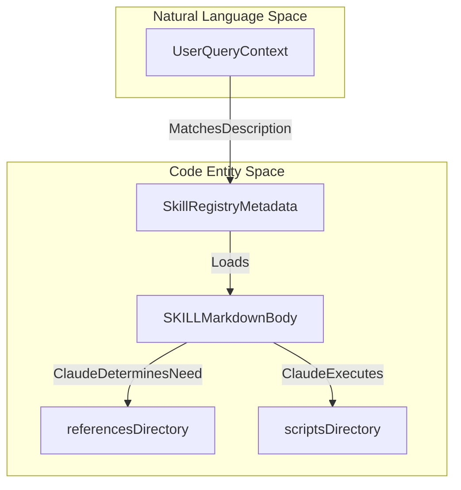
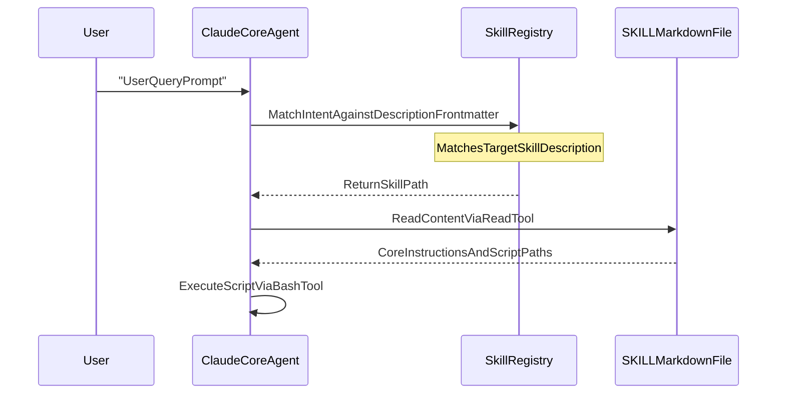

<!-- source: DeepWiki mcp.deepwiki.com · repo anthropics/claude-plugins-official · page 2.4 Skills System · fetched 2026-10-26 -->

# Skills System

<details>
<summary>Relevant source files</summary>

The following files were used as context for generating this wiki page:

- [plugins/hookify/skills/writing-rules/SKILL.md](plugins/hookify/skills/writing-rules/SKILL.md)
- [plugins/plugin-dev/README.md](plugins/plugin-dev/README.md)
- [plugins/plugin-dev/skills/hook-development/SKILL.md](plugins/plugin-dev/skills/hook-development/SKILL.md)
- [plugins/plugin-dev/skills/plugin-settings/SKILL.md](plugins/plugin-dev/skills/plugin-settings/SKILL.md)
- [plugins/plugin-dev/skills/plugin-structure/SKILL.md](plugins/plugin-dev/skills/plugin-structure/SKILL.md)
- [plugins/plugin-dev/skills/skill-development/SKILL.md](plugins/plugin-dev/skills/skill-development/SKILL.md)
- [plugins/skill-creator/skills/skill-creator/SKILL.md](plugins/skill-creator/skills/skill-creator/SKILL.md)
- [plugins/skill-creator/skills/skill-creator/agents/analyzer.md](plugins/skill-creator/skills/skill-creator/agents/analyzer.md)
- [plugins/skill-creator/skills/skill-creator/references/schemas.md](plugins/skill-creator/skills/skill-creator/references/schemas.md)
- [plugins/skill-creator/skills/skill-creator/scripts/aggregate_benchmark.py](plugins/skill-creator/skills/skill-creator/scripts/aggregate_benchmark.py)
- [plugins/skill-creator/skills/skill-creator/scripts/improve_description.py](plugins/skill-creator/skills/skill-creator/scripts/improve_description.py)
- [plugins/skill-creator/skills/skill-creator/scripts/run_loop.py](plugins/skill-creator/skills/skill-creator/scripts/run_loop.py)

</details>


This page documents the Skills System in Claude Code plugins. Skills are modular, self-contained knowledge packages that extend Claude's capabilities by providing specialized domain expertise, workflows, and tools. Unlike commands (which are user-invoked with `/` syntax) or agents (which run as autonomous subprocesses), skills are **context-triggered** based on user queries and conversational context.

For information about user-invoked slash commands, see [Commands](4.2). For autonomous agents, see [Agents and Subagents](4.3). For skill configuration patterns, see [Plugin Settings and Configuration](4.7).

Sources: [plugins/plugin-dev/skills/skill-development/SKILL.md:11-24](), [plugins/plugin-dev/README.md:7-17]()

## Overview

Skills transform Claude from a general-purpose assistant into a specialized agent equipped with procedural knowledge that no model can fully possess. When a user asks a question matching a skill's trigger conditions, Claude automatically loads that skill's content to provide expert guidance.

**Key characteristics:**
- **Context-triggered**: Loaded when YAML frontmatter `description` matches user query context. [plugins/plugin-dev/skills/skill-development/SKILL.md:43-45]()
- **Progressive disclosure**: Implements a three-level loading system (Metadata → SKILL.md → Resources) to manage the context window efficiently. [plugins/plugin-dev/skills/skill-development/SKILL.md:77-85]()
- **Bundled resources**: Co-locates `scripts/`, `references/`, and `assets/` with the core `SKILL.md` file. [plugins/plugin-dev/skills/skill-development/SKILL.md:25-40]()
- **Auto-discovered**: Automatically found and registered within the `skills/` directory of an installed plugin. [plugins/plugin-dev/skills/plugin-structure/SKILL.md:166-168]()

Sources: [plugins/plugin-dev/skills/skill-development/SKILL.md:11-24](), [plugins/plugin-dev/README.md:7-17]()

## Skill File Structure

### Directory Layout

Each skill resides in its own directory containing a required `SKILL.md` file and optional bundled resources.

```
plugin-name/skills/
└── skill-name/
    ├── SKILL.md              # Required: skill definition and metadata
    ├── references/           # Optional: documentation loaded into context as needed
    │   ├── api_docs.md
    │   └── patterns.md
    ├── scripts/              # Optional: executable code (Python/Bash)
    │   └── rotate_pdf.py
    └── assets/               # Optional: templates/icons used in Claude's output
        └── logo.png
```

Sources: [plugins/plugin-dev/skills/skill-development/SKILL.md:25-40](), [plugins/plugin-dev/skills/plugin-structure/SKILL.md:170-183]()

### SKILL.md Format

Skills use Markdown files with YAML frontmatter. The frontmatter controls skill triggering, while the markdown body provides procedural knowledge and instructions.

```markdown
---
name: skill-name
description: This skill should be used when the user asks to "phrase 1", "phrase 2", or needs guidance on [key concepts].
version: 1.0.0
---

# Skill Title

## Core Instructions
When this skill is active, perform the following steps...
```

Sources: [plugins/plugin-dev/skills/skill-development/SKILL.md:42-45](), [plugins/plugin-dev/skills/plugin-structure/SKILL.md:185-191]()

## YAML Frontmatter Requirements

### name (required)
The unique identifier for the skill, formatted in kebab-case. [plugins/plugin-dev/skills/plugin-structure/SKILL.md:188-188]()

### description (required)
**The most critical field.** It determines when Claude will use the skill. It should use the third-person (e.g., "This skill should be used when...") and include specific trigger phrases. [plugins/plugin-dev/skills/skill-development/SKILL.md:43-45]() To combat "undertriggering," descriptions should be slightly "pushy," explicitly listing contexts where the skill is useful even if not directly requested. [plugins/skill-creator/skills/skill-creator/SKILL.md:67-67]() The description has a hard limit of **1024 characters**; descriptions exceeding this length are truncated. [plugins/skill-creator/skills/skill-creator/scripts/improve_description.py:132-132]()

### compatibility (optional)
Lists required tools or dependencies (rarely needed). [plugins/skill-creator/skills/skill-creator/SKILL.md:68-68]()

Sources: [plugins/plugin-dev/skills/skill-development/SKILL.md:42-45](), [plugins/skill-creator/skills/skill-creator/SKILL.md:62-69](), [plugins/skill-creator/skills/skill-creator/scripts/improve_description.py:132-132]()

## Progressive Disclosure Pattern

Skills manage the context window by loading information only when necessary. This pattern ensures that high-token documentation or complex scripts do not bloat every query.

Title: "Natural Language Space to Code Entity Space Loading Flow"


| Level | Component | Loading Trigger | Context Cost |
| :--- | :--- | :--- | :--- |
| **1** | Metadata | Always in context | ~100 words [plugins/plugin-dev/skills/skill-development/SKILL.md:81-81]() |
| **2** | `SKILL.md` | Match on trigger description | < 5,000 words (Ideal < 500 lines) [plugins/plugin-dev/skills/skill-development/SKILL.md:82-82](), [plugins/skill-creator/skills/skill-creator/SKILL.md:96-96]() |
| **3** | Resources | As needed by Claude | Unlimited (scripts execute externally) [plugins/plugin-dev/skills/skill-development/SKILL.md:83-85]() |

Sources: [plugins/plugin-dev/skills/skill-development/SKILL.md:77-85](), [plugins/skill-creator/skills/skill-creator/SKILL.md:86-92]()

## Bundled Resources

### References (`references/`)
Documentation intended to be loaded into context only when Claude determines it is needed. This keeps the core `SKILL.md` lean. For large files (>300 lines), include a table of contents. [plugins/plugin-dev/skills/skill-development/SKILL.md:57-67](), [plugins/skill-creator/skills/skill-creator/SKILL.md:98-98]()

### Scripts (`scripts/`)
Executable code (Python/Bash) for tasks that require deterministic reliability or are repeatedly rewritten. Scripts can be executed via the `Bash` tool without loading their source code into the context window. [plugins/plugin-dev/skills/skill-development/SKILL.md:48-56]()

### Assets (`assets/`)
Files not intended for context loading, but used as output (e.g., brand logos, boilerplate templates, fonts). [plugins/plugin-dev/skills/skill-development/SKILL.md:68-76]()

Sources: [plugins/plugin-dev/skills/skill-development/SKILL.md:46-76]()

## Skill Triggering Mechanism and Execution Flow

Skills are activated based on task context rather than explicit calls. Claude evaluates the user's intent against the `description` field in all registered skills.

Title: "System Name to Code Entity Execution Mapping"


Sources: [plugins/plugin-dev/skills/skill-development/SKILL.md:115-119](), [plugins/skill-creator/skills/skill-creator/SKILL.md:79-81]()

## Skill Optimization and Evaluation

The repository includes a `skill-creator` plugin designed to iteratively improve skill triggering and performance through automated evaluation loops.

### Evaluation Loop Architecture

The `run_loop.py` script in `skill-creator` automates the process of testing a skill against a set of prompts to measure triggering accuracy and execution quality.

1.  **Split Set**: `split_eval_set` splits an evaluation set into `train` and `test` (holdout) sets, stratified by `should_trigger`. [plugins/skill-creator/skills/skill-creator/scripts/run_loop.py:24-44]()
2.  **Evaluate**: Runs `run_eval` to check if the skill triggers for relevant queries and ignores irrelevant ones. [plugins/skill-creator/skills/skill-creator/scripts/run_loop.py:89-99]()
3.  **Improve**: If accuracy is low, `improve_description.py` calls Claude via `_call_claude` (using `claude -p`) to rewrite the `description` frontmatter based on failed triggers and false triggers. [plugins/skill-creator/skills/skill-creator/scripts/improve_description.py:20-47](), [plugins/skill-creator/skills/skill-creator/scripts/improve_description.py:62-69]()
4.  **Aggregate**: `aggregate_benchmark.py` calculates mean, stddev, and pass rates across multiple runs using `calculate_stats`. [plugins/skill-creator/skills/skill-creator/scripts/aggregate_benchmark.py:45-64](), [plugins/skill-creator/skills/skill-creator/scripts/aggregate_benchmark.py:176-182]()

Sources: [plugins/skill-creator/skills/skill-creator/scripts/run_loop.py:1-7](), [plugins/skill-creator/skills/skill-creator/scripts/improve_description.py:1-7](), [plugins/skill-creator/skills/skill-creator/scripts/aggregate_benchmark.py:1-14]()

## Development Best Practices

### Writing Style
- **Instructions for Claude**: Skills are written as directives TO Claude.
- **Third-Person Description**: The `description` frontmatter must use the third-person (e.g., "This skill should be used when...") to help Claude's internal routing logic. [plugins/plugin-dev/skills/skill-development/SKILL.md:44-45]()
- **Imperative Phrasing**: Descriptions should focus on user intent (e.g., "Use this skill for...") rather than implementation details. [plugins/skill-creator/skills/skill-creator/scripts/improve_description.py:135-136]()
- **Domain Organization**: When a skill supports multiple frameworks (e.g., AWS vs GCP), use a selection logic in `SKILL.md` that points to specific reference files in `references/`. [plugins/skill-creator/skills/skill-creator/SKILL.md:100-109]()

### Skill Creation Process
1.  **Capture Intent**: Understand when the skill should trigger and what the expected output format is. [plugins/skill-creator/skills/skill-creator/SKILL.md:47-54]()
2.  **Research**: Check available MCPs and existing skills to avoid duplication. [plugins/skill-creator/skills/skill-creator/SKILL.md:56-61]()
3.  **Plan Resources**: Identify which parts should be deterministic scripts vs. context references vs. boilerplate assets. [plugins/plugin-dev/skills/skill-development/SKILL.md:108-132]()
4.  **Iterate**: Use the `skill-creator` tools to run evals and optimize the description for better triggering accuracy. [plugins/skill-creator/skills/skill-creator/SKILL.md:12-20]()

Sources: [plugins/plugin-dev/skills/skill-development/SKILL.md:87-159](), [plugins/skill-creator/skills/skill-creator/SKILL.md:45-69]()

---

