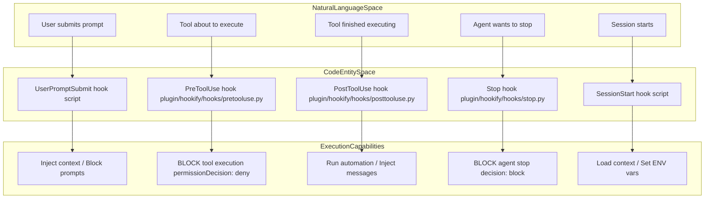
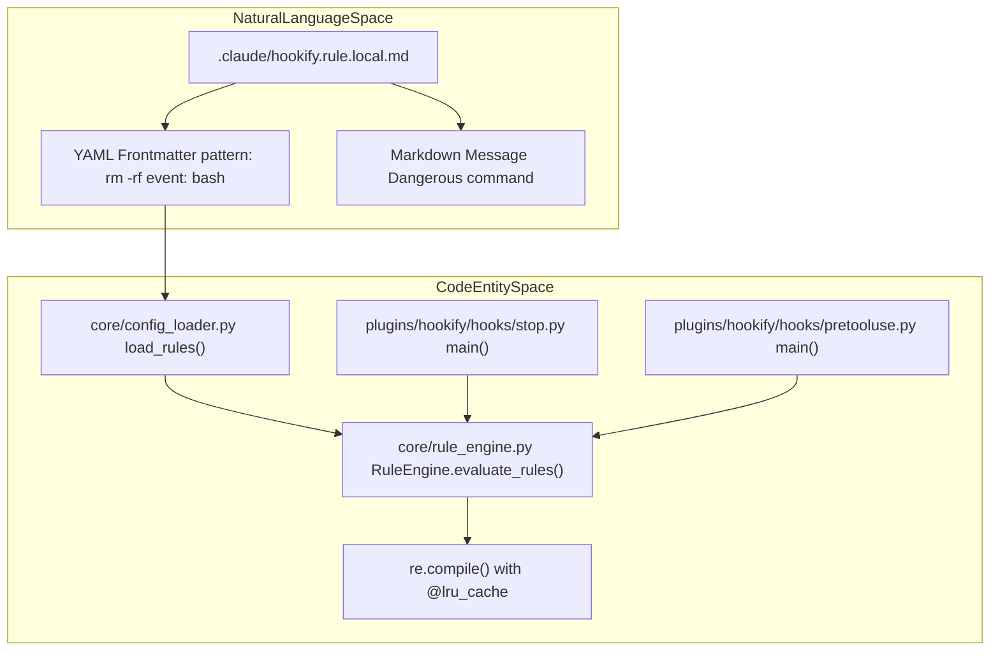

<!-- source: DeepWiki mcp.deepwiki.com · repo anthropics/claude-plugins-official · page 2.5 Hooks System · fetched 2026-10-26 -->

# Hooks System

<details>
<summary>Relevant source files</summary>

The following files were used as context for generating this wiki page:

- [plugins/explanatory-output-style/hooks/hooks.json](plugins/explanatory-output-style/hooks/hooks.json)
- [plugins/hookify/core/rule_engine.py](plugins/hookify/core/rule_engine.py)
- [plugins/hookify/hooks/posttooluse.py](plugins/hookify/hooks/posttooluse.py)
- [plugins/hookify/hooks/pretooluse.py](plugins/hookify/hooks/pretooluse.py)
- [plugins/hookify/hooks/stop.py](plugins/hookify/hooks/stop.py)
- [plugins/hookify/hooks/userpromptsubmit.py](plugins/hookify/hooks/userpromptsubmit.py)
- [plugins/learning-output-style/hooks/hooks.json](plugins/learning-output-style/hooks/hooks.json)
- [plugins/ralph-loop/.claude-plugin/plugin.json](plugins/ralph-loop/.claude-plugin/plugin.json)
- [plugins/ralph-loop/hooks/hooks.json](plugins/ralph-loop/hooks/hooks.json)

</details>


Hooks are event-driven automation scripts that execute in response to Claude Code lifecycle events. They enable automated enforcement (blocking dangerous operations), post-processing (auto-formatting code), and context injection. Hooks read input from `stdin` as JSON, evaluate conditions, and output decisions or messages to `stdout`.

---

## Purpose and Scope

This document details the Claude Code hooks architecture, configuration schemas, event lifecycle types, output formats, and the internal implementation of declarative meta-hook engines like `hookify`. It is targeted at developers configuring custom security policies, test automation loops, and workflow extensions.

Sources: [plugins/plugin-dev/skills/hook-development/SKILL.md:1-40](), [plugins/hookify/hooks/pretooluse.py:1-63]()

---

## Hook Types

Claude Code supports two primary implementation patterns for hooks: prompt-based and command-based.

### Prompt-Based Hooks (Recommended)
Prompt-based hooks use LLM-driven decision making for context-aware validation. They are ideal for complex evaluations that require natural language reasoning rather than deterministic logic. They are highly flexible and better at handling edge cases compared to bash scripts [plugins/plugin-dev/skills/hook-development/SKILL.md:22-40]().

**Supported events:** `Stop`, `SubagentStop`, `UserPromptSubmit`, `PreToolUse` [plugins/plugin-dev/skills/hook-development/SKILL.md:34-34]().

```json
{
  "type": "prompt",
  "prompt": "Evaluate if this tool use is appropriate: $TOOL_INPUT",
  "timeout": 30
}
```

### Command Hooks
Command hooks execute bash commands or scripts for deterministic checks. They are best for fast validations, file system operations, or integrating external CLI tools. Examples include `ralph-loop` using a bash script for its `Stop` hook [plugins/ralph-loop/hooks/hooks.json:8-9]() or `learning-output-style` using a script for `SessionStart` [plugins/learning-output-style/hooks/hooks.json:8-9]().

```json
{
  "type": "command",
  "command": "bash ${CLAUDE_PLUGIN_ROOT}/scripts/validate.sh",
  "timeout": 60
}
```

Sources: [plugins/plugin-dev/skills/hook-development/SKILL.md:22-59](), [plugins/ralph-loop/hooks/hooks.json:1-15](), [plugins/learning-output-style/hooks/hooks.json:1-15](), [plugins/explanatory-output-style/hooks/hooks.json:1-15]()

---

## Hook Event Types

Claude Code fires hooks at specific points in the execution lifecycle. Each event receives different input data and can influence different aspects of behavior.

### Event Lifecycle and Capabilities



| Event Type | Timing | Can Block | Primary Use Cases |
|------------|--------|-----------|-------------------|
| `PreToolUse` | Before tool execution | ✓ Yes | Block sensitive file edits, prevent dangerous commands [plugins/plugin-dev/skills/hook-development/SKILL.md:123-125]() |
| `PostToolUse` | After tool execution | ✗ No | Auto-format code, run tests, react to results [plugins/plugin-dev/skills/hook-development/SKILL.md:155-157]() |
| `UserPromptSubmit` | When user sends message | ✓ Yes | Log prompts, inject context, block prompts [plugins/plugin-dev/skills/hook-development/SKILL.md:217-219]() |
| `Stop` | When agent attempts to stop | ✓ Yes | Iterative loops (`ralph-loop`), require completion standards [plugins/ralph-loop/hooks/hooks.json:4-13](), [plugins/plugin-dev/skills/hook-development/SKILL.md:181-183]() |
| `SessionStart` | When session begins | ✗ No | Load project context, set environment variables [plugins/plugin-dev/skills/hook-development/SKILL.md:238-240]() |
| `SubagentStop` | When subagent stops | ✓ Yes | Subagent task verification [plugins/plugin-dev/skills/hook-development/SKILL.md:211-213]() |
| `PreCompact` | Before context compaction | ✗ No | Preserve critical context [plugins/plugin-dev/skills/hook-development/SKILL.md:270-272]() |

Sources: [plugins/plugin-dev/skills/hook-development/SKILL.md:121-277](), [plugins/ralph-loop/hooks/hooks.json:4-13]()

---

## Hook Configuration

Hooks are configured in the plugin's `hooks/hooks.json` file.

### Plugin hooks.json Format
For hooks bundled in a plugin, use the `hooks` wrapper format. The `hooks` key contains event types, each mapping to an array of hook configurations [plugins/ralph-loop/hooks/hooks.json:3-14]().

```json
{
  "description": "Validation hooks for code quality",
  "hooks": {
    "PreToolUse": [
      {
        "matcher": "Write|Edit",
        "hooks": [
          {
            "type": "command",
            "command": "bash ${CLAUDE_PLUGIN_ROOT}/hooks/validate.sh"
          }
        ]
      }
    ]
  }
}
```

### Settings Format (Direct)
When configured directly in user settings (e.g., `.claude/settings.json`), the events are placed at the top level without the `hooks` wrapper [plugins/plugin-dev/skills/hook-development/SKILL.md:104-111]().

Sources: [plugins/ralph-loop/hooks/hooks.json:1-15](), [plugins/plugin-dev/skills/hook-development/SKILL.md:62-119]()

---

## Hook Output Format

Hooks must output JSON to `stdout`. The structure varies based on the desired effect.

### Standard Output (All Hooks)
```json
{
  "continue": true,
  "suppressOutput": false,
  "systemMessage": "Message for Claude"
}
```
- `continue`: If false, halt further hook processing (default true) [plugins/plugin-dev/skills/hook-development/SKILL.md:290-290]().
- `systemMessage`: Message included in Claude's context [plugins/plugin-dev/skills/hook-development/SKILL.md:292-292]().

### Blocking Output (PreToolUse)
To deny a tool execution, return `hookSpecificOutput` with `permissionDecision: "deny"` [plugins/plugin-dev/skills/hook-development/SKILL.md:148-148]().

```json
{
  "hookSpecificOutput": {
    "permissionDecision": "deny"
  },
  "systemMessage": "Modification of .env files is prohibited."
}
```

### Stop Decision Output
To prevent Claude from finishing a task, return `decision: "block"` [plugins/plugin-dev/skills/hook-development/SKILL.md:205-205]().

```json
{
  "decision": "block",
  "reason": "You must run tests before stopping.",
  "systemMessage": "Additional context for Claude."
}
```

Sources: [plugins/plugin-dev/skills/hook-development/SKILL.md:278-300](), [plugins/hookify/core/rule_engine.py:60-91]()

---

## Hookify Rule Engine and Execution Flow

The `hookify` plugin provides a declarative way to create hooks using YAML rules in `.claude/hookify.*.local.md` files. It acts as a meta-hook that dispatches events to a Python-based engine (`plugins/hookify/core/rule_engine.py`).

### Rule Engine Architecture and Data Flow



### Rule Evaluation Logic
The `RuleEngine` class evaluates rules against incoming `input_data` from Claude Code [plugins/hookify/hooks/stop.py:37-37]().

1. **Event Filtering**: Rules are filtered by event type (e.g., `bash`, `file`, `stop`, `prompt`) during loading [plugins/hookify/hooks/stop.py:33-33]().
2. **Condition Evaluation**: All conditions in a rule must match. Supported operators include `regex_match`, `contains`, `equals`, `not_contains`, `starts_with`, and `ends_with` [plugins/hookify/core/rule_engine.py:166-177]().
3. **Decision Priority**: If any rule with `action: "block"` matches, the engine returns a blocking response (`deny` for tools, `block` for stop events) [plugins/hookify/core/rule_engine.py:61-80](). Otherwise, matching warning rules are combined into a single `systemMessage` [plugins/hookify/core/rule_engine.py:87-91]().

Sources: [plugins/hookify/hooks/stop.py:26-55](), [plugins/hookify/core/rule_engine.py:35-94](), [plugins/hookify/skills/writing-rules/SKILL.md:1-100]()

---

## Implementation Best Practices

### 1. The Exit 0 Rule
Hooks **must always exit with status 0**, even if an error occurs. A non-zero exit code may disrupt the Claude Code execution flow. Use `try/except` blocks in scripts to ensure a clean exit [plugins/hookify/hooks/stop.py:42-51]().

### 2. Path Portability
Always use `${CLAUDE_PLUGIN_ROOT}` when referencing scripts within a plugin. This ensures the plugin remains portable across different user environments [plugins/plugin-dev/skills/hook-development/SKILL.md:66-67]().

### 3. Environment Context
Hooks receive the plugin root via the `CLAUDE_PLUGIN_ROOT` environment variable [plugins/hookify/hooks/stop.py:13-13](). In `SessionStart` hooks, you can persist environment variables for the entire session by appending to the file pointed to by `$CLAUDE_ENV_FILE` [plugins/plugin-dev/skills/hook-development/SKILL.md:259-261]().

### 4. Settings Integration
Plugins can store user-configurable settings in `.claude/plugin-name.local.md`. Hooks can read these files to dynamically enable or disable behavior without requiring a full `hooks.json` update (which requires a restart) [plugins/plugin-dev/skills/plugin-settings/SKILL.md:175-201]().

Sources: [plugins/plugin-dev/skills/hook-development/SKILL.md:1-300](), [plugins/plugin-dev/skills/plugin-settings/SKILL.md:11-40](), [plugins/hookify/hooks/stop.py:13-15]()

---

