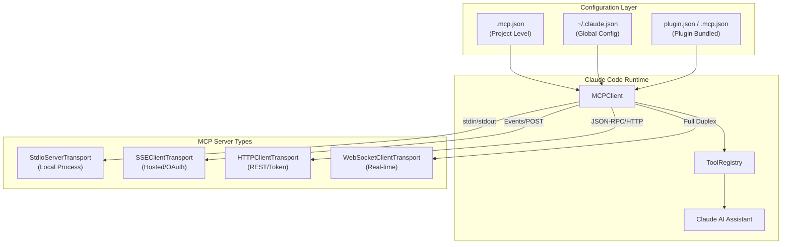
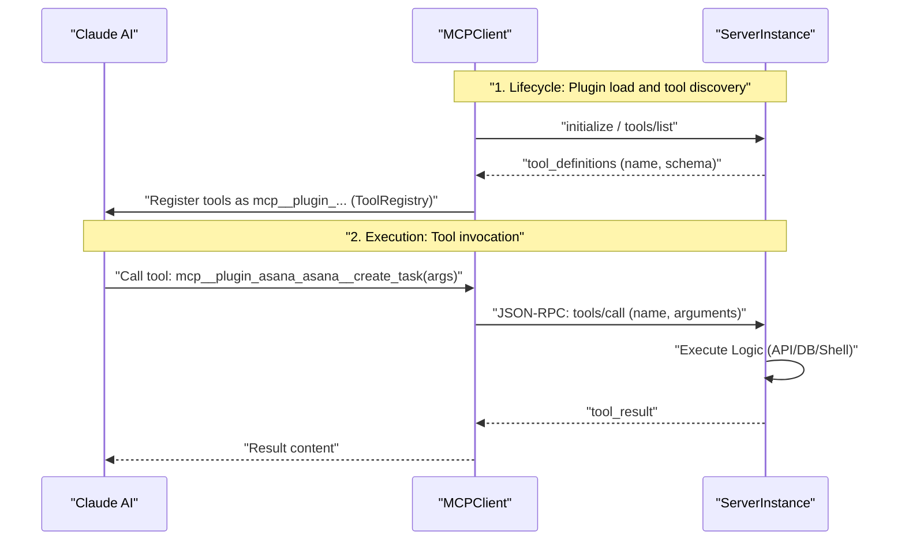

<!-- source: DeepWiki mcp.deepwiki.com · repo anthropics/claude-plugins-official · page 2.6 MCP Server Integration · fetched 2026-10-26 -->

# MCP Server Integration

<details>
<summary>Relevant source files</summary>

The following files were used as context for generating this wiki page:

- [external_plugins/asana/.claude-plugin/plugin.json](external_plugins/asana/.claude-plugin/plugin.json)
- [external_plugins/asana/README.md](external_plugins/asana/README.md)
- [external_plugins/asana/commands/asana-setup.md](external_plugins/asana/commands/asana-setup.md)
- [plugins/mcp-server-dev/skills/build-mcp-server/SKILL.md](plugins/mcp-server-dev/skills/build-mcp-server/SKILL.md)
- [plugins/mcp-server-dev/skills/build-mcp-server/references/auth.md](plugins/mcp-server-dev/skills/build-mcp-server/references/auth.md)
- [plugins/mcp-server-dev/skills/build-mcp-server/references/tool-design.md](plugins/mcp-server-dev/skills/build-mcp-server/references/tool-design.md)
- [plugins/mcp-server-dev/skills/build-mcpb/SKILL.md](plugins/mcp-server-dev/skills/build-mcpb/SKILL.md)
- [plugins/plugin-dev/skills/mcp-integration/SKILL.md](plugins/plugin-dev/skills/mcp-integration/SKILL.md)
- [plugins/plugin-dev/skills/mcp-integration/examples/sse-server.json](plugins/plugin-dev/skills/mcp-integration/examples/sse-server.json)
- [plugins/plugin-dev/skills/mcp-integration/references/authentication.md](plugins/plugin-dev/skills/mcp-integration/references/authentication.md)
- [plugins/plugin-dev/skills/mcp-integration/references/server-types.md](plugins/plugin-dev/skills/mcp-integration/references/server-types.md)

</details>


## Purpose and Scope

The Model Context Protocol (MCP) is the foundational standard used by Claude Code to integrate with external services, APIs, and local tools. This integration allows plugins to expose structured capabilities ("tools") to Claude, enabling the model to perform actions like creating issues, searching repositories, or interacting with local databases.

This page details:
- MCP server architecture and the data flow between Claude and servers.
- Configuration patterns using `.mcp.json` and `plugin.json`.
- Supported transport types: stdio, SSE, HTTP, and WebSocket.
- Authentication patterns including OAuth and environment variable tokens.
- Lifecycle management and tool naming conventions.

---

## MCP Server Architecture

MCP servers are standalone processes or remote services that implement the Model Context Protocol. They act as a bridge between Claude's reasoning and external state.

### System Overview

Title: MCP Client and Server Architecture Integration



Sources: [plugins/plugin-dev/skills/mcp-integration/SKILL.md:224-236](), [plugins/plugin-dev/skills/mcp-integration/references/server-types.md:38-43]()

### Registration and Execution Flow

Title: MCP Initialization and Tool Call Dispatch Flow



Sources: [plugins/plugin-dev/skills/mcp-integration/SKILL.md:224-236](), [plugins/plugin-dev/skills/mcp-integration/references/server-types.md:38-43]()

---

## Configuration

Plugins bundle MCP servers using two primary methods. Both support environment variable expansion for portability.

### Method 1: Dedicated .mcp.json (Recommended)
A `.mcp.json` file at the plugin root separates server configuration from the main plugin manifest [plugins/plugin-dev/skills/mcp-integration/SKILL.md:23-37]().

```json
{
  "database-tools": {
    "command": "${CLAUDE_PLUGIN_ROOT}/servers/db-server",
    "args": ["--config", "${CLAUDE_PLUGIN_ROOT}/config.json"],
    "env": {
      "DB_URL": "${DB_URL}"
    }
  }
}
```

### Method 2: Inline in plugin.json
Simple plugins can define servers directly in the `mcpServers` field of `plugin.json` [plugins/plugin-dev/skills/mcp-integration/SKILL.md:44-59]().

### Environment Variable Expansion
Claude Code expands specific variables to ensure portability [plugins/plugin-dev/skills/mcp-integration/SKILL.md:167-186]():
- `${CLAUDE_PLUGIN_ROOT}`: Resolves to the absolute path of the plugin directory.
- `${USER_VAR}`: Resolves to variables from the user's shell environment (e.g., `${API_KEY}`).

Sources: [plugins/plugin-dev/skills/mcp-integration/SKILL.md:23-59](), [plugins/plugin-dev/skills/mcp-integration/SKILL.md:167-186]()

---

## Server Types and Transports

| Type | Communication | Use Case | Implementation Details |
| :--- | :--- | :--- | :--- |
| **stdio** | Local stdin/stdout | Local files, custom scripts, NPM packages. | Spawns child process; JSON-RPC via pipe [plugins/plugin-dev/skills/mcp-integration/references/server-types.md:5-9](). |
| **SSE** | Server-Sent Events | Hosted services (e.g. GitHub) with OAuth. | HTTP connection for events; POST for tool calls [plugins/plugin-dev/skills/mcp-integration/references/server-types.md:101-106](). |
| **HTTP** | JSON-RPC over HTTP | Stateless API backends, RESTful MCP. | Standard HTTP GET (discovery) and POST (invocation) [plugins/plugin-dev/skills/mcp-integration/references/server-types.md:203-207](). |
| **WebSocket** | Full Duplex | Real-time streaming or low-latency needs. | Bidirectional `wss://` connection [plugins/plugin-dev/skills/mcp-integration/references/server-types.md:301-305](). |

### stdio (Standard Input/Output)
Best for local tools. Claude Code manages the process lifecycle, terminating the server when the session ends [plugins/plugin-dev/skills/mcp-integration/SKILL.md:90-93]().
- **Best Practice**: Set `PYTHONUNBUFFERED=1` for Python servers to avoid logging delays [plugins/plugin-dev/skills/mcp-integration/references/server-types.md:83]().
- **Logging**: Servers must log to `stderr`; `stdout` is reserved for the MCP protocol [plugins/plugin-dev/skills/mcp-integration/references/server-types.md:86]().

### SSE (Server-Sent Events)
The primary transport for cloud-hosted MCP servers. It supports automatic OAuth flows handled by Claude Code [plugins/plugin-dev/skills/mcp-integration/references/authentication.md:9-20]().

Sources: [plugins/plugin-dev/skills/mcp-integration/references/server-types.md:1-332]()

---

## Authentication Patterns

### OAuth (Automatic)
Claude Code handles the complete OAuth 2.0 flow for SSE and HTTP servers. On the first tool use, the user is prompted to authorize in their browser [plugins/plugin-dev/skills/mcp-integration/references/authentication.md:9-20]().
- **Storage**: Tokens are encrypted and managed by Claude Code, not the plugin [plugins/plugin-dev/skills/mcp-integration/references/authentication.md:56-62]().
- **Example**: GitHub and Google services [plugins/plugin-dev/skills/mcp-integration/references/authentication.md:37-40]().

### Token-Based (Headers)
For servers requiring static tokens or API keys, configuration is passed via the `headers` field [plugins/plugin-dev/skills/mcp-integration/references/authentication.md:79-96]().
- **Configuration**:
  ```json
  "headers": {
    "Authorization": "Bearer ${API_TOKEN}"
  }
  ```
- **External Example**: Context7 uses an optional `CONTEXT7_API_KEY` passed via HTTP headers [external_plugins/context7/.mcp.json:1-8]().

### Manual Setup (e.g. Asana V2)
Some servers require manual OAuth app registration. The `asana` plugin provides a `/asana-setup` command to guide users through creating a Client ID/Secret and adding the server via `claude mcp add` [external_plugins/asana/commands/asana-setup.md:1-42]().

Sources: [plugins/plugin-dev/skills/mcp-integration/references/authentication.md:1-310](), [external_plugins/asana/commands/asana-setup.md:1-42]()

---

## Tool Naming and Access

### Prefixed Tool Names
To avoid collisions between multiple plugins and servers, MCP tools are automatically namespaced by Claude Code [plugins/plugin-dev/skills/mcp-integration/SKILL.md:190-200]().
- **Format**: `mcp__plugin_<plugin-name>_<server-name>__<tool-name>`
- **Example**: `mcp__plugin_asana_asana__asana_create_task`

### Command Integration
Commands must explicitly allow the MCP tools they intend to use in their YAML frontmatter [plugins/plugin-dev/skills/mcp-integration/SKILL.md:202-222]().
- **Specific**: `allowed-tools: ["mcp__plugin_asana_asana__asana_create_task"]`
- **Wildcard**: `allowed-tools: ["mcp__plugin_asana_asana__*"]` (Use sparingly for security)

Sources: [plugins/plugin-dev/skills/mcp-integration/SKILL.md:190-222]()

---

## Lifecycle and Management

1. **Discovery**: Claude Code parses `.mcp.json` or `plugin.json` on startup.
2. **Connection**: Connections are established before the first tool invocation [plugins/plugin-dev/skills/mcp-integration/SKILL.md:226-229]().
3. **Inspection**: Users can run the `/mcp` slash command to view the status (Connected/Disconnected) of all registered servers [plugins/plugin-dev/skills/mcp-integration/SKILL.md:238-239]().
4. **Removal**: Servers added via CLI can be removed using `claude mcp remove <name>` [external_plugins/asana/README.md:62]().

Sources: [plugins/plugin-dev/skills/mcp-integration/SKILL.md:224-240](), [external_plugins/asana/README.md:62]()

---

