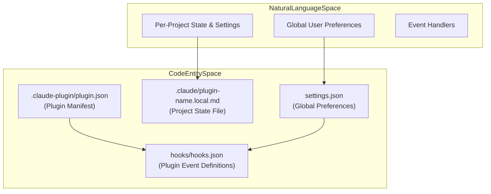
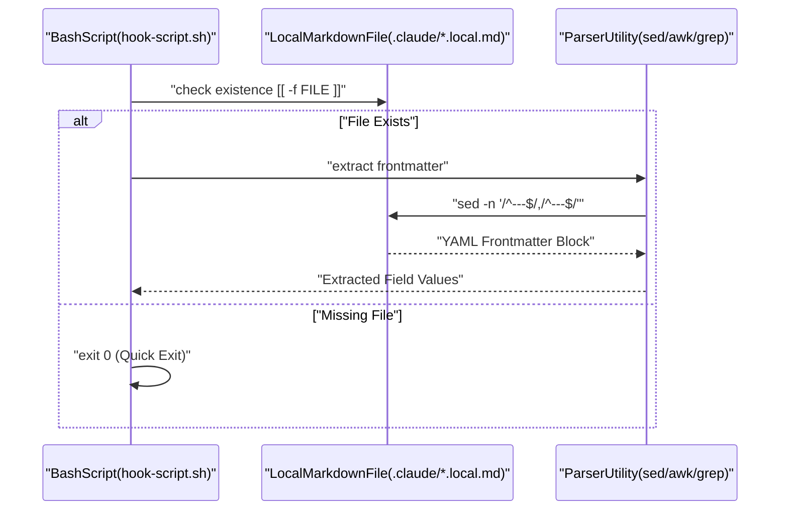

<!-- source: DeepWiki mcp.deepwiki.com · repo anthropics/claude-plugins-official · page 2.7 Plugin Settings and Configuration · fetched 2026-10-26 -->

# Plugin Settings and Configuration

<details>
<summary>Relevant source files</summary>

The following files were used as context for generating this wiki page:

- [plugins/hookify/skills/writing-rules/SKILL.md](plugins/hookify/skills/writing-rules/SKILL.md)
- [plugins/plugin-dev/README.md](plugins/plugin-dev/README.md)
- [plugins/plugin-dev/skills/hook-development/SKILL.md](plugins/plugin-dev/skills/hook-development/SKILL.md)
- [plugins/plugin-dev/skills/plugin-settings/SKILL.md](plugins/plugin-dev/skills/plugin-settings/SKILL.md)
- [plugins/plugin-dev/skills/plugin-settings/references/real-world-examples.md](plugins/plugin-dev/skills/plugin-settings/references/real-world-examples.md)
- [plugins/plugin-dev/skills/plugin-structure/SKILL.md](plugins/plugin-dev/skills/plugin-structure/SKILL.md)
- [plugins/plugin-dev/skills/skill-development/SKILL.md](plugins/plugin-dev/skills/skill-development/SKILL.md)
- [plugins/ralph-loop/commands/cancel-ralph.md](plugins/ralph-loop/commands/cancel-ralph.md)
- [plugins/ralph-loop/commands/help.md](plugins/ralph-loop/commands/help.md)
- [plugins/ralph-loop/commands/ralph-loop.md](plugins/ralph-loop/commands/ralph-loop.md)

</details>


This document defines the configuration patterns for Claude Code plugins, focusing on the `.claude/*.local.md` file pattern, YAML frontmatter settings, and lifecycle management. It covers how plugins store per-project state, manage user-configurable preferences, and parse decentralized configuration files.

For information about plugin metadata, see [Plugin Structure and Manifest](plugins/plugin-dev/skills/plugin-structure/SKILL.md:46-107)(). For details on event-driven automation, see [Hooks System](plugins/plugin-dev/skills/hook-development/SKILL.md:20-60)().

---

## Configuration Architecture

Claude Code plugins use a decentralized configuration model. While global settings reside in `settings.json`, plugin-specific state and project-level overrides are stored in specialized Markdown files combining YAML frontmatter and markdown bodies.

### Configuration Hierarchy

Title: "Plugin Configuration Scopes and Code Entities"


**Sources:** [plugins/plugin-dev/skills/plugin-settings/SKILL.md:9-18](), [plugins/plugin-dev/skills/plugin-structure/SKILL.md:46-48](), [plugins/plugin-dev/skills/plugin-structure/SKILL.md:235-237]()

---

## The .local.md Pattern

The primary mechanism for per-project plugin configuration is the `.claude/plugin-name.local.md` file. This pattern combines structured YAML data with unstructured Markdown context.

### File Structure and Schema

A standard configuration file consists of two parts:
1.  **YAML Frontmatter**: For machine-readable settings (booleans, strings, lists, numbers) [plugins/plugin-dev/skills/plugin-settings/SKILL.md:25-31]().
2.  **Markdown Body**: For human-readable context, prompts, or task descriptions [plugins/plugin-dev/skills/plugin-settings/SKILL.md:33-40]().

```markdown
---
enabled: true
mode: "strict"
max_retries: 3
allowed_extensions: [".js", ".ts"]
---

# Project Context
This section contains instructions that Claude reads when this plugin is active.
```

**Key Characteristics:**
*   **Location**: Always stored in the `.claude/` directory at the project root [plugins/plugin-dev/skills/plugin-settings/SKILL.md:14-14]().
*   **Lifecycle**: These files are user-managed and typically added to `.gitignore` as they contain local state or user-specific preferences [plugins/plugin-dev/skills/plugin-settings/SKILL.md:18-18]().
*   **Accessibility**: Settings can be read by hooks (via Bash scripts), commands (via the `Read` tool), and agents (via system prompt instructions) [plugins/plugin-dev/skills/plugin-settings/SKILL.md:60-134]().

**Sources:** [plugins/plugin-dev/skills/plugin-settings/SKILL.md:20-40](), [plugins/plugin-dev/skills/plugin-settings/SKILL.md:113-134]()

---

## Implementation and Parsing

Since many plugins rely on Bash-based hooks or commands, parsing these configuration files requires robust shell techniques to bridge the gap between file storage and runtime logic.

### Data Flow: Settings to Execution

Title: "Runtime Settings Extraction Flow"


**Sources:** [plugins/plugin-dev/skills/plugin-settings/SKILL.md:62-95](), [plugins/plugin-dev/skills/plugin-settings/SKILL.md:136-172]()

### Parsing Techniques

Plugins use standard Unix utilities like `sed`, `awk`, and `grep` to extract data without requiring heavy YAML parsers [plugins/plugin-dev/skills/plugin-settings/SKILL.md:117-124]().

| Task | Command Pattern | File Reference |
| :--- | :--- | :--- |
| **Extract Frontmatter** | `sed -n '/^---$/,/^---$/{ /^---$/d; p; }' "$FILE"` | [plugins/plugin-dev/skills/plugin-settings/SKILL.md:79-79]() |
| **Read String Field** | `grep '^key:' \| sed 's/key: *//' \| sed 's/^"\(.*\)"$/\1/'` | [plugins/plugin-dev/skills/plugin-settings/SKILL.md:149-149]() |
| **Read Markdown Body** | `awk '/^---$/{i++; next} i>=2' "$FILE"` | [plugins/plugin-dev/skills/plugin-settings/SKILL.md:170-170]() |
| **Boolean Check** | `ENABLED=$(echo "$FRONTMATTER" | grep '^enabled:' | sed 's/enabled: *//')` | [plugins/plugin-dev/skills/plugin-settings/SKILL.md:154-154]() |

**Sources:** [plugins/plugin-dev/skills/plugin-settings/SKILL.md:62-95](), [plugins/plugin-dev/skills/plugin-settings/SKILL.md:136-172]()

---

## Real-World Configuration Examples

### 1. Ralph Loop State Management
The `ralph-loop` plugin uses `.claude/ralph-loop.local.md` to track iterations and completion criteria.

*   **Iteration Tracking**: Stores `iteration: N` and `max_iterations: M` [plugins/ralph-loop/commands/cancel-ralph.md:16-18]().
*   **Completion Promises**: Defines a `completion_promise` string that the `Stop` hook searches for in the assistant's output [plugins/plugin-dev/skills/plugin-settings/references/real-world-examples.md:173-195]().
*   **Command Control**: The `/cancel-ralph` command specifically targets this file for deletion to break the loop [plugins/ralph-loop/commands/cancel-ralph.md:1-18]().

**Sources:** [plugins/ralph-loop/commands/cancel-ralph.md:1-18](), [plugins/plugin-dev/skills/plugin-settings/references/real-world-examples.md:130-228]()

### 2. Multi-Agent Swarm Coordination
The `multi-agent-swarm` pattern utilizes settings for inter-session communication.

*   **Coordination**: Stores `coordinator_session` names to allow subagents to send notifications to specific `tmux` panes [plugins/plugin-dev/skills/plugin-settings/references/real-world-examples.md:16-18]().
*   **State Updates**: Uses `sed` to dynamically update fields like `pr_number` once a pull request is created [plugins/plugin-dev/skills/plugin-settings/references/real-world-examples.md:120-127]().

**Sources:** [plugins/plugin-dev/skills/plugin-settings/references/real-world-examples.md:5-116]()

### 3. Hookify Rules
The `hookify` plugin allows users to define custom hook rules using a similar `.local.md` pattern.

*   **Rule Schema**: Rules are stored in `.claude/hookify.{rule-name}.local.md` and include fields for `event`, `pattern`, and `action` [plugins/hookify/skills/writing-rules/SKILL.md:11-23]().
*   **Event Matching**: Rules can trigger on `bash`, `file`, `stop`, or `prompt` events [plugins/hookify/skills/writing-rules/SKILL.md:41-47]().

**Sources:** [plugins/hookify/skills/writing-rules/SKILL.md:11-56]()

---

## Configuration Lifecycle Management

Plugins provide commands to manage their own configuration lifecycle, ensuring users don't have to manually edit YAML.

### The "Quick Exit" Pattern
To maintain performance, hooks associated with configurable plugins implement a "Quick Exit" strategy:
1.  Check if `.claude/plugin-name.local.md` exists [plugins/plugin-dev/skills/plugin-settings/SKILL.md:74-76]().
2.  If not, `exit 0` immediately (plugin is not configured).
3.  If it exists, parse `enabled: true` [plugins/plugin-dev/skills/plugin-settings/SKILL.md:86-89]().
4.  If `false`, `exit 0` immediately.

### Creation and Updates
Plugins often include setup scripts like `setup-ralph-loop.sh` which use `cat` and heredocs to initialize the configuration file with default values and user-provided prompts [plugins/plugin-dev/skills/plugin-settings/references/real-world-examples.md:231-252](). Commands can also prompt users for preferences and then write the `.local.md` file using the `Write` tool [plugins/plugin-dev/skills/plugin-settings/SKILL.md:278-285]().

**Sources:** [plugins/plugin-dev/skills/plugin-settings/SKILL.md:62-95](), [plugins/plugin-dev/skills/plugin-settings/SKILL.md:274-286](), [plugins/plugin-dev/skills/plugin-settings/references/real-world-examples.md:231-252]()

---

