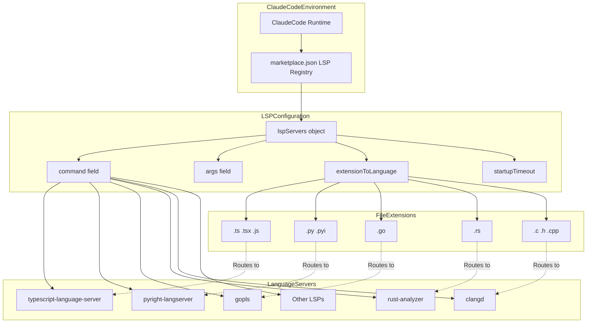
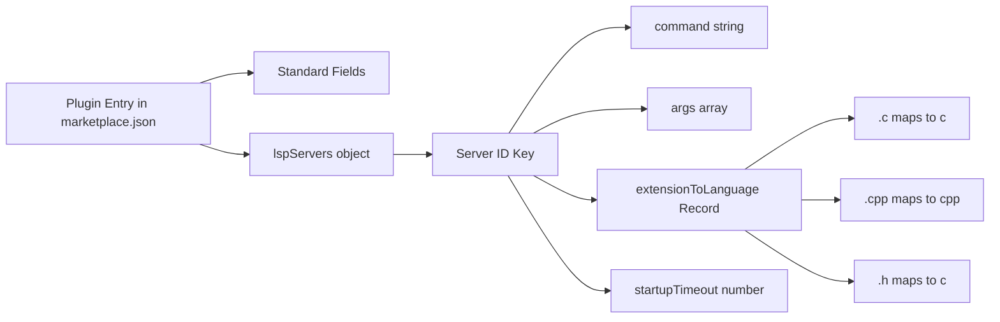
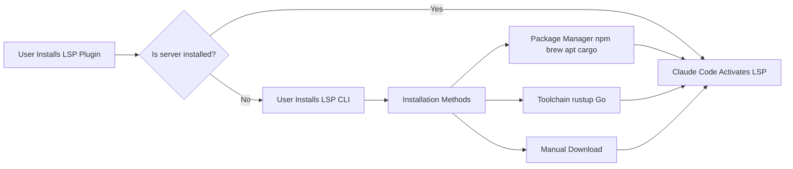

<!-- source: DeepWiki mcp.deepwiki.com · repo anthropics/claude-plugins-official · page 3 Language Server Integration · fetched 2026-10-26 -->

# Language Server Integration

<details>
<summary>Relevant source files</summary>

The following files were used as context for generating this wiki page:

- [.claude-plugin/marketplace.json](.claude-plugin/marketplace.json)
- [plugins/clangd-lsp/README.md](plugins/clangd-lsp/README.md)
- [plugins/csharp-lsp/README.md](plugins/csharp-lsp/README.md)
- [plugins/gopls-lsp/README.md](plugins/gopls-lsp/README.md)
- [plugins/jdtls-lsp/README.md](plugins/jdtls-lsp/README.md)
- [plugins/lua-lsp/README.md](plugins/lua-lsp/README.md)
- [plugins/php-lsp/README.md](plugins/php-lsp/README.md)
- [plugins/pyright-lsp/README.md](plugins/pyright-lsp/README.md)
- [plugins/rust-analyzer-lsp/README.md](plugins/rust-analyzer-lsp/README.md)
- [plugins/security-guidance/.claude-plugin/plugin.json](plugins/security-guidance/.claude-plugin/plugin.json)
- [plugins/security-guidance/hooks/diffstate.py](plugins/security-guidance/hooks/diffstate.py)
- [plugins/security-guidance/hooks/gitutil.py](plugins/security-guidance/hooks/gitutil.py)
- [plugins/security-guidance/hooks/security_reminder_hook.py](plugins/security-guidance/hooks/security_reminder_hook.py)
- [plugins/security-guidance/tests/test_git_index_locks.py](plugins/security-guidance/tests/test_git_index_locks.py)
- [plugins/security-guidance/tests/test_temp_index_cleanup.py](plugins/security-guidance/tests/test_temp_index_cleanup.py)
- [plugins/swift-lsp/README.md](plugins/swift-lsp/README.md)
- [plugins/typescript-lsp/README.md](plugins/typescript-lsp/README.md)

</details>


## Purpose and Scope

This document explains how Claude Code integrates Language Server Protocol (LSP) implementations to provide code intelligence features across 12+ programming languages. LSP servers enable capabilities like go-to-definition, find references, error checking, code completion, and refactoring support within the Claude Code environment.

Claude Code uses a centralized registry in `marketplace.json` to manage these integrations, mapping file extensions to specific language server executables.

For information about other types of plugin integrations, see [MCP Server Integration](#2.6). For the broader plugin architecture, see [Plugin Architecture](#2).

---

## LSP Architecture Overview

Claude Code uses the Language Server Protocol to integrate language-specific code intelligence tools. Each LSP plugin is registered in `marketplace.json` with configuration that maps file extensions to language servers.

**Diagram: LSP Integration Architecture**



Sources: [.claude-plugin/marketplace.json:1-100]()

---

## LSP Configuration Schema

Each LSP plugin in `marketplace.json` includes an `lspServers` object that defines how Claude Code should spawn and communicate with the language server.

**Diagram: lspServers Configuration Structure**



Sources: [.claude-plugin/marketplace.json:1-146]()

### Configuration Fields

| Field | Type | Required | Description |
|-------|------|----------|-------------|
| `command` | `string` | Yes | CLI executable name or path for the language server |
| `args` | `string[]` | No | Command-line arguments passed to the server (e.g., `["--stdio"]`) |
| `extensionToLanguage` | `Record<string, string>` | Yes | Maps file extensions (e.g., `".c"`) to LSP language IDs (e.g., `"c"`) |
| `startupTimeout` | `number` | No | Maximum milliseconds to wait for server initialization |

For deep technical details on these fields, see [LSP Architecture and Configuration](#3.1).

Sources: [.claude-plugin/marketplace.json:1-146]()

---

## Available Language Servers

Claude Code currently supports multiple official LSP implementations. These plugins require the underlying language server binary to be installed on the host system (e.g., via `npm`, `brew`, or `rustup`).

**Table: Core LSP Plugin Inventory**

| Plugin Name | LSP Server | Command | Primary Extensions |
|-------------|-----------|---------|---------------------|
| `typescript-lsp` | TypeScript Language Server | `typescript-language-server` | `.ts`, `.tsx`, `.js` |
| `pyright-lsp` | Pyright | `pyright-langserver` | `.py`, `.pyi` |
| `gopls-lsp` | gopls | `gopls` | `.go` |
| `rust-analyzer-lsp` | rust-analyzer | `rust-analyzer` | `.rs` |
| `clangd-lsp` | clangd | `clangd` | `.c`, `.cpp`, `.h` |
| `jdtls-lsp` | Eclipse JDT.LS | `jdtls` | `.java` |
| `php-lsp` | Intelephense | `intelephense` | `.php` |
| `lua-lsp` | Lua Language Server | `lua-language-server` | `.lua` |
| `csharp-lsp` | C# Language Server | `csharp-ls` | `.cs` |
| `swift-lsp` | SourceKit-LSP | `sourcekit-lsp` | `.swift` |

For a full list of all supported languages and their specific installation requirements, see [Available Language Servers](#3.2).

Sources: [plugins/lua-lsp/README.md:1-32](), [plugins/php-lsp/README.md:1-24](), [plugins/swift-lsp/README.md:1-25](), [plugins/rust-analyzer-lsp/README.md:1-34](), [plugins/jdtls-lsp/README.md:1-33]()

---

## Extension-to-Language Mapping

The `extensionToLanguage` field determines which language server handles files with specific extensions. This allows a single LSP to handle multiple related file types.

**Example: Clangd Mapping**
```json
"extensionToLanguage": {
  ".c": "c",
  ".h": "c",
  ".cpp": "cpp",
  ".cc": "cpp",
  ".cxx": "cpp",
  ".hpp": "cpp",
  ".hxx": "cpp",
  ".C": "cpp",
  ".H": "cpp"
}
```

This mapping ensures that both C and C++ files are routed to the `clangd` executable with the correct language identifier.

Sources: [.claude-plugin/marketplace.json:1-146]()

---

## Installation Requirements

LSP plugins in Claude Code act as bridges. The user must install the actual language server binaries separately on their local machine.

**Diagram: LSP Installation Workflow**



Sources: [plugins/rust-analyzer-lsp/README.md:8-30](), [plugins/jdtls-lsp/README.md:8-30]()

---

## Child Pages

- [LSP Architecture and Configuration](#3.1) — Detail the `lspServers` configuration in `marketplace.json`, command/args setup, `extensionToLanguage` mappings, and `startupTimeout` handling.
- [Available Language Servers](#3.2) — List all LSP plugins, their supported extensions, and installation requirements.

---

