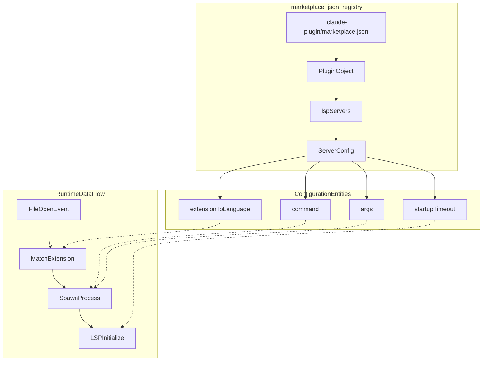
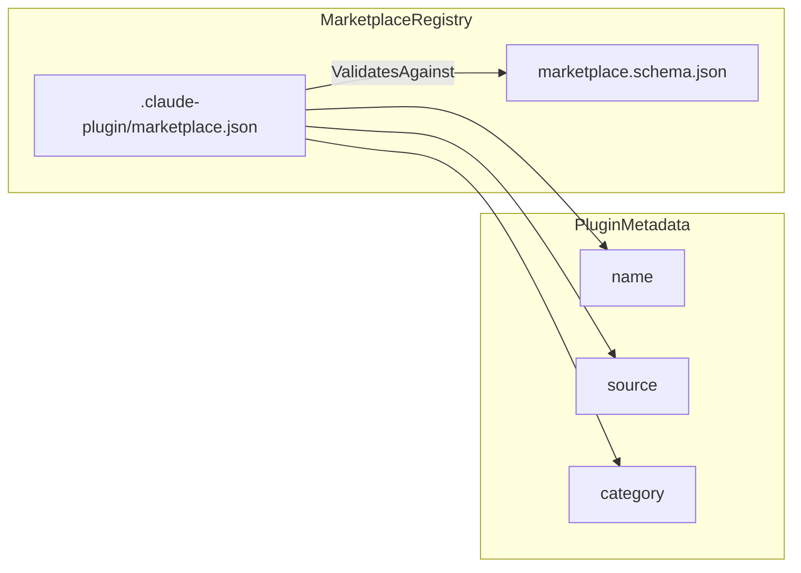

<!-- source: DeepWiki mcp.deepwiki.com · repo anthropics/claude-plugins-official · page 3.1 LSP Architecture and Configuration · fetched 2026-10-26 -->

# LSP Architecture and Configuration

<details>
<summary>Relevant source files</summary>

The following files were used as context for generating this wiki page:

- [.claude-plugin/marketplace.json](.claude-plugin/marketplace.json)
- [plugins/security-guidance/.claude-plugin/plugin.json](plugins/security-guidance/.claude-plugin/plugin.json)
- [plugins/security-guidance/hooks/diffstate.py](plugins/security-guidance/hooks/diffstate.py)
- [plugins/security-guidance/hooks/gitutil.py](plugins/security-guidance/hooks/gitutil.py)
- [plugins/security-guidance/hooks/security_reminder_hook.py](plugins/security-guidance/hooks/security_reminder_hook.py)
- [plugins/security-guidance/tests/test_git_index_locks.py](plugins/security-guidance/tests/test_git_index_locks.py)
- [plugins/security-guidance/tests/test_temp_index_cleanup.py](plugins/security-guidance/tests/test_temp_index_cleanup.py)

</details>


This document details how Language Server Protocol (LSP) implementations are configured and integrated into Claude Code through the `.claude-plugin/marketplace.json` registry. It covers the `lspServers` configuration schema, command and arguments setup, file extension mappings, and startup timeout handling.

Sources: [.claude-plugin/marketplace.json:1-20]()

## Overview

LSP integration in Claude Code enables language-specific code intelligence features such as go-to-definition, find references, type checking, and diagnostics across 12+ programming languages. Each LSP plugin is registered in `.claude-plugin/marketplace.json` with a standardized configuration that specifies the server executable, communication protocol, supported file extensions, and language identifiers.

Sources: [.claude-plugin/marketplace.json:1-20]()

## LSP Configuration Schema

### Plugin Entry Structure

LSP plugins are defined as standard plugin entries in `.claude-plugin/marketplace.json` with an additional `lspServers` field that contains server configuration.

```json
{
  "name": "plugin-name",
  "description": "Language server description",
  "version": "1.0.0",
  "author": { "name": "Anthropic" },
  "source": "./plugins/plugin-name",
  "category": "development",
  "strict": false,
  "lspServers": {
    "server-id": {
      "command": "executable-name",
      "args": ["--flag1"],
      "extensionToLanguage": {
        ".ext": "language-id"
      },
      "startupTimeout": 120000
    }
  }
}
```

### Configuration Fields

| Field | Type | Required | Description |
|-------|------|----------|-------------|
| `lspServers` | Object | Yes | Top-level container for server configurations |
| `server-id` | String (key) | Yes | Unique identifier for the server within the plugin (e.g., `clangd`, `gopls`) |
| `command` | String | Yes | Executable command to launch the LSP server |
| `args` | String[] | No | Command-line arguments passed to the server |
| `extensionToLanguage` | Object | Yes | Maps file extensions to LSP language identifiers |
| `startupTimeout` | Number | No | Timeout in milliseconds for server initialization |

Sources: [.claude-plugin/marketplace.json:1-20]()

### LSP Server Configuration Architecture

The following diagram bridges the "Natural Language Space" of user intent (opening a file) to the "Code Entity Space" of the `.claude-plugin/marketplace.json` configuration and runtime execution.



Sources: [.claude-plugin/marketplace.json:1-20]()

## Command and Arguments Specification

### Command Field

The `command` field specifies the executable that Claude Code invokes. This must be available in the system `PATH`.

**Examples from Marketplace Plugins:**

| Plugin | Command | Requirement |
|--------|---------|-------------|
| `typescript-lsp` | `typescript-language-server` | `npm install -g typescript-language-server` |
| `pyright-lsp` | `pyright-langserver` | `npm install -g pyright` or `pip install pyright` |
| `rust-analyzer-lsp` | `rust-analyzer` | `rustup component add rust-analyzer` |
| `csharp-lsp` | `csharp-ls` | `dotnet tool install --global csharp-ls` |
| `php-lsp` | `intelephense` | `npm install -g intelephense` |

Sources: [.claude-plugin/marketplace.json:1-20]()

### Arguments Field

The `args` array specifies CLI flags. While many servers default to standard input/output communication, some require explicit flags or benefit from performance tuning:

*   **Standard I/O:** Most language servers in the marketplace are configured to communicate via standard input/output.
*   **Custom Flags:** Servers like `clangd` use flags such as `--background-index` for performance optimization.

Sources: [.claude-plugin/marketplace.json:1-20]()

## Extension to Language Mapping

Claude Code determines which LSP server to activate by matching the file extension of an opened file against the `extensionToLanguage` map defined in the plugin's configuration.

### Language Identifier Standards

| File Type | Extensions | Language ID |
|-----------|-----------|-------------|
| TypeScript | `.ts`, `.tsx`, `.mts`, `.cts` | `typescript` |
| JavaScript | `.js`, `.jsx`, `.mjs`, `.cjs` | `javascript` |
| Python | `.py`, `.pyi` | `python` |
| C# | `.cs` | `csharp` |
| Rust | `.rs` | `rust` |
| PHP | `.php` | `php` |
| Lua | `.lua` | `lua` |
| C/C++ | `.c`, `.h`, `.cpp`, `.cc`, `.cxx`, `.hpp`, `.hxx`, `.C`, `.H` | `cpp` / `c` |
| Java | `.java` | `java` |
| Swift | `.swift` | `swift` |

Sources: [.claude-plugin/marketplace.json:1-20]()

## Startup Timeout Handling

The `startupTimeout` field (expressed in milliseconds) prevents Claude Code from hanging if a language server fails to initialize or takes too long to start. This is particularly relevant for language servers with significant index-building overhead.

*   **Standard Timeout:** Many servers use a default of 60 to 120 seconds.
*   **Initialization Logic:** The timeout governs the period between the process spawn and the successful receipt of the LSP `initialize` response.

Sources: [.claude-plugin/marketplace.json:1-20]()

## Marketplace and Metadata

The core registry for these configurations is `.claude-plugin/marketplace.json`, which acts as the source of truth for plugin discovery and LSP server orchestration.



Sources: [.claude-plugin/marketplace.json:1-20]()

---

