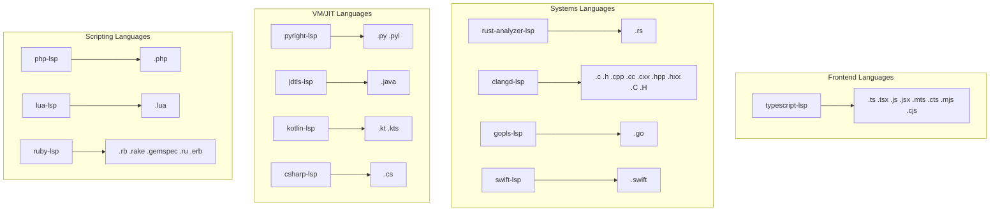
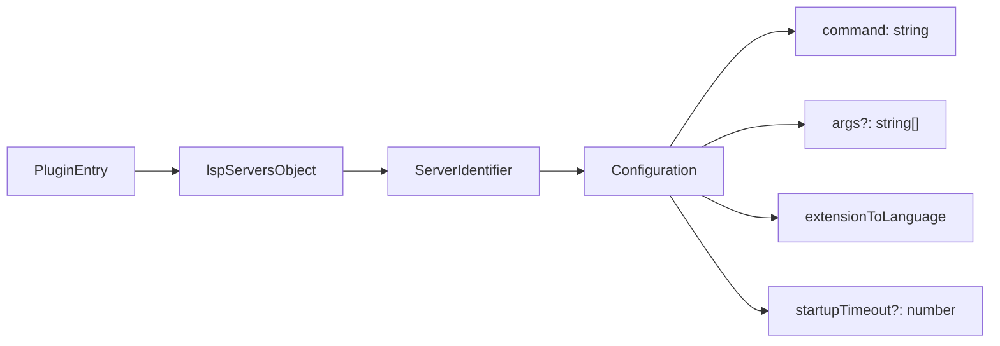
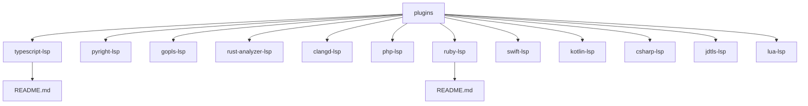

<!-- source: DeepWiki mcp.deepwiki.com · repo anthropics/claude-plugins-official · page 3.2 Available Language Servers · fetched 2026-10-26 -->

# Available Language Servers

<details>
<summary>Relevant source files</summary>

The following files were used as context for generating this wiki page:

- [plugins/clangd-lsp/README.md](plugins/clangd-lsp/README.md)
- [plugins/csharp-lsp/README.md](plugins/csharp-lsp/README.md)
- [plugins/gopls-lsp/README.md](plugins/gopls-lsp/README.md)
- [plugins/jdtls-lsp/README.md](plugins/jdtls-lsp/README.md)
- [plugins/kotlin-lsp/README.md](plugins/kotlin-lsp/README.md)
- [plugins/lua-lsp/README.md](plugins/lua-lsp/README.md)
- [plugins/php-lsp/README.md](plugins/php-lsp/README.md)
- [plugins/pyright-lsp/README.md](plugins/pyright-lsp/README.md)
- [plugins/ruby-lsp/README.md](plugins/ruby-lsp/README.md)
- [plugins/rust-analyzer-lsp/README.md](plugins/rust-analyzer-lsp/README.md)
- [plugins/swift-lsp/README.md](plugins/swift-lsp/README.md)
- [plugins/typescript-lsp/README.md](plugins/typescript-lsp/README.md)

</details>


This page catalogs the 12 Language Server Protocol (LSP) plugins available in the Claude Code Plugins repository, detailing their supported file extensions, installation requirements, and configuration properties. For information about how these LSP servers integrate with Claude Code's architecture, see [LSP Architecture and Configuration]().

## LSP Plugin Catalog

The repository provides LSP plugins for 12 programming languages, each registered with specific configuration for command execution, file extension mapping, and startup behavior.

### Complete LSP Listing

| Plugin Name | Language Server | Supported Extensions | Command | Args | Special Config |
|-------------|----------------|---------------------|---------|------|----------------|
| `typescript-lsp` | typescript-language-server | `.ts`, `.tsx`, `.js`, `.jsx`, `.mts`, `.cts`, `.mjs`, `.cjs` | `typescript-language-server` | `["--stdio"]` | - |
| `pyright-lsp` | pyright-langserver | `.py`, `.pyi` | `pyright-langserver` | `["--stdio"]` | - |
| `gopls-lsp` | gopls | `.go` | `gopls` | - | - |
| `rust-analyzer-lsp` | rust-analyzer | `.rs` | `rust-analyzer` | - | - |
| `clangd-lsp` | clangd | `.c`, `.h`, `.cpp`, `.cc`, `.cxx`, `.hpp`, `.hxx`, `.C`, `.H` | `clangd` | `["--background-index"]` | - |
| `php-lsp` | intelephense | `.php` | `intelephense` | `["--stdio"]` | - |
| `ruby-lsp` | ruby-lsp | `.rb`, `.rake`, `.gemspec`, `.ru`, `.erb` | `ruby-lsp` | `["--stdio"]` | - |
| `swift-lsp` | sourcekit-lsp | `.swift` | `sourcekit-lsp` | - | - |
| `kotlin-lsp` | kotlin-lsp | `.kt`, `.kts` | `kotlin-lsp` | `["--stdio"]` | `startupTimeout: 120000` |
| `csharp-lsp` | csharp-ls | `.cs` | `csharp-ls` | - | - |
| `jdtls-lsp` | jdtls | `.java` | `jdtls` | - | `startupTimeout: 120000` |
| `lua-lsp` | lua-language-server | `.lua` | `lua-language-server` | - | - |

Sources: [plugins/ruby-lsp/README.md:1-7](), [plugins/kotlin-lsp/README.md:1-6](), [plugins/rust-analyzer-lsp/README.md:1-6](), [plugins/lua-lsp/README.md:1-6](), [plugins/clangd-lsp/README.md:1-7](), [plugins/gopls-lsp/README.md:1-7](), [plugins/typescript-lsp/README.md:1-7](), [plugins/pyright-lsp/README.md:1-7](), [plugins/csharp-lsp/README.md:1-7](), [plugins/php-lsp/README.md:1-7](), [plugins/jdtls-lsp/README.md:1-7](), [plugins/swift-lsp/README.md:1-7]()

### Language to Extension Mapping



**Diagram: File Extension to LSP Plugin Mapping**

Sources: [plugins/ruby-lsp/README.md:5-7](), [plugins/kotlin-lsp/README.md:3-5](), [plugins/rust-analyzer-lsp/README.md:5-6](), [plugins/lua-lsp/README.md:5-6](), [plugins/clangd-lsp/README.md:5-6](), [plugins/gopls-lsp/README.md:5-6](), [plugins/typescript-lsp/README.md:5-6](), [plugins/pyright-lsp/README.md:5-6](), [plugins/csharp-lsp/README.md:5-6](), [plugins/php-lsp/README.md:5-6](), [plugins/jdtls-lsp/README.md:5-6](), [plugins/swift-lsp/README.md:5-6]()

## Configuration Structure

Each LSP plugin follows a standard configuration schema mapping language server identifiers to their runtime properties.

### Standard Configuration Pattern



**Diagram: LSP Configuration Schema**

Sources: [plugins/typescript-lsp/README.md:1-14]()

## Installation Requirements by Language

### TypeScript/JavaScript
**Package:** `typescript-language-server` + `typescript`
Install globally via npm or yarn:
```bash
npm install -g typescript-language-server typescript
```
Sources: [plugins/typescript-lsp/README.md:8-21]()

### Python
**Package:** `pyright`
Install globally via npm, pip, or pipx (recommended):
```bash
pipx install pyright
```
Sources: [plugins/pyright-lsp/README.md:8-27]()

### Go
**Package:** `gopls`
Install using the Go toolchain:
```bash
go install golang.org/x/tools/gopls@latest
```
Sources: [plugins/gopls-lsp/README.md:8-17]()

### Rust
**Package:** `rust-analyzer`
Recommended installation via `rustup`:
```bash
rustup component add rust-analyzer
```
Sources: [plugins/rust-analyzer-lsp/README.md:8-31]()

### C/C++
**Package:** `clangd`
Available via LLVM. On macOS: `brew install llvm`. On Ubuntu: `sudo apt install clangd`.
Sources: [plugins/clangd-lsp/README.md:8-33]()

### Ruby
**Package:** `ruby-lsp`
Requires Ruby 3.0 or later.
```bash
gem install ruby-lsp
```
Sources: [plugins/ruby-lsp/README.md:8-28]()

### PHP
**Package:** `intelephense`
Install globally via npm or yarn:
```bash
npm install -g intelephense
```
Sources: [plugins/php-lsp/README.md:8-21]()

### Swift
**Package:** `sourcekit-lsp`
Included with the Swift toolchain. On macOS, install via Xcode or `brew install swift`.
Sources: [plugins/swift-lsp/README.md:8-22]()

### Kotlin
**Package:** `kotlin-lsp`
```bash
brew install JetBrains/utils/kotlin-lsp
```
Sources: [plugins/kotlin-lsp/README.md:7-13]()

### C#
**Package:** `csharp-ls`
Requires .NET SDK 6.0 or later.
```bash
dotnet tool install --global csharp-ls
```
Sources: [plugins/csharp-lsp/README.md:8-22]()

### Java
**Package:** `jdtls` (Eclipse JDT Language Server)
Requires Java 17 or later (JDK). On macOS: `brew install jdtls`.
Sources: [plugins/jdtls-lsp/README.md:8-30]()

### Lua
**Package:** `lua-language-server`
On macOS: `brew install lua-language-server`. On Linux: `sudo pacman -S lua-language-server` (Arch) or snap.
Sources: [plugins/lua-lsp/README.md:8-29]()

## Special Configuration Properties

### Startup Timeout

LSP servers based on heavy runtimes (like the JVM) may require extended startup timeouts:

| Server | Timeout (ms) | Reason |
|--------|--------------|--------|
| `kotlin-lsp` | 120000 | JVM startup + language server initialization |
| `jdtls` | 120000 | JVM startup + Eclipse JDT components loading |

Sources: [plugins/kotlin-lsp/README.md:1-6](), [plugins/jdtls-lsp/README.md:28-30]()

### Command Arguments

LSP servers use various argument patterns for communication and performance:

| Server | Args | Purpose |
|--------|------|---------|
| `typescript-language-server` | `["--stdio"]` | Standard input/output communication |
| `pyright-langserver` | `["--stdio"]` | Standard input/output communication |
| `clangd` | `["--background-index"]` | Background indexing for better performance |
| `intelephense` | `["--stdio"]` | Standard input/output communication |
| `kotlin-lsp` | `["--stdio"]` | Standard input/output communication |
| `ruby-lsp` | `["--stdio"]` | Standard input/output communication |

Sources: [plugins/typescript-lsp/README.md:1-3](), [plugins/pyright-lsp/README.md:1-3](), [plugins/clangd-lsp/README.md:1-3](), [plugins/php-lsp/README.md:1-3](), [plugins/kotlin-lsp/README.md:1-6](), [plugins/ruby-lsp/README.md:1-3]()

## Extension to Language ID Mapping

### Multi-Variant Extensions

**TypeScript/JavaScript** supports the most file extension variants:
- TypeScript: `.ts`, `.mts`, `.cts`
- TypeScript React: `.tsx`
- JavaScript: `.js`, `.mjs`, `.cjs`
- JavaScript React: `.jsx`
Sources: [plugins/typescript-lsp/README.md:5-7]()

**Ruby** supports various DSL and template files:
- `.rb`, `.rake`, `.gemspec`, `.ru`, `.erb`
Sources: [plugins/ruby-lsp/README.md:5-7]()

**C/C++** distinguishes between C and C++ files:
- C files: `.c`, `.h`
- C++ files: `.cpp`, `.cc`, `.cxx`, `.hpp`, `.hxx`, `.C`, `.H`
Sources: [plugins/clangd-lsp/README.md:5-7]()

## LSP Plugin Directory Structure



**Diagram: LSP Plugin Directory Organization**

Each LSP plugin follows the standard plugin structure with documentation in `README.md`.

Sources: [plugins/ruby-lsp/README.md:1-3](), [plugins/typescript-lsp/README.md:1-3](), [plugins/kotlin-lsp/README.md:1-3]()

---

