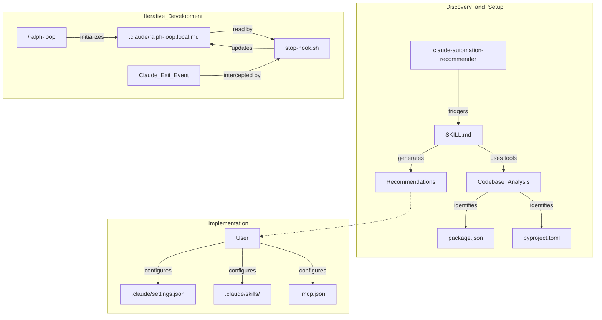
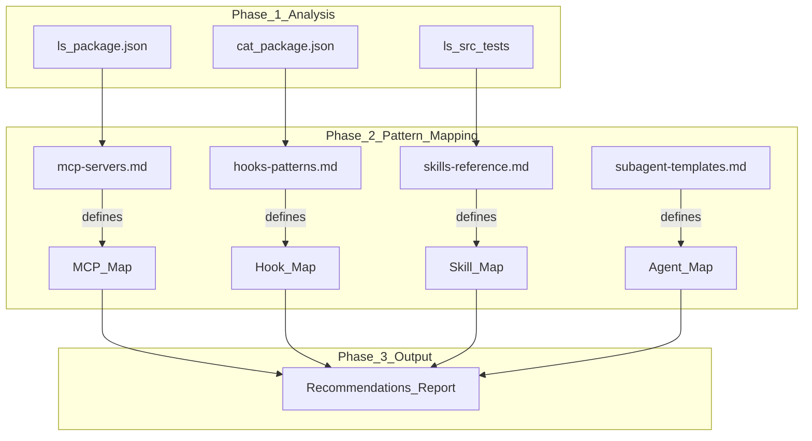
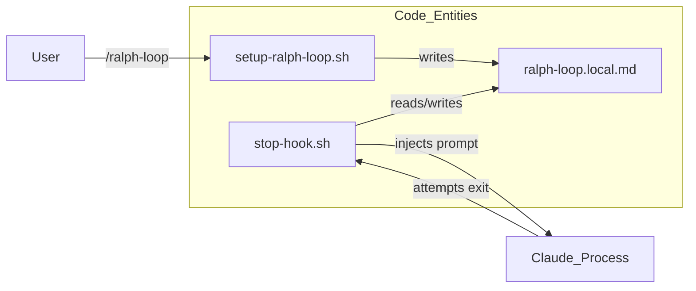

<!-- source: DeepWiki mcp.deepwiki.com · repo anthropics/claude-plugins-official · page 4 Automation Systems · fetched 2026-10-26 -->

# Automation Systems

Relevant source files

The following files were used as context for generating this wiki page:

- [README.md](README.md)
- [plugins/claude-code-setup/.claude-plugin/plugin.json](plugins/claude-code-setup/.claude-plugin/plugin.json)
- [plugins/claude-code-setup/README.md](plugins/claude-code-setup/README.md)
- [plugins/claude-code-setup/automation-recommender-example.png](plugins/claude-code-setup/automation-recommender-example.png)
- [plugins/claude-code-setup/skills/claude-automation-recommender/SKILL.md](plugins/claude-code-setup/skills/claude-automation-recommender/SKILL.md)
- [plugins/claude-code-setup/skills/claude-automation-recommender/references/hooks-patterns.md](plugins/claude-code-setup/skills/claude-automation-recommender/references/hooks-patterns.md)
- [plugins/claude-code-setup/skills/claude-automation-recommender/references/mcp-servers.md](plugins/claude-code-setup/skills/claude-automation-recommender/references/mcp-servers.md)
- [plugins/claude-code-setup/skills/claude-automation-recommender/references/plugins-reference.md](plugins/claude-code-setup/skills/claude-automation-recommender/references/plugins-reference.md)
- [plugins/claude-code-setup/skills/claude-automation-recommender/references/skills-reference.md](plugins/claude-code-setup/skills/claude-automation-recommender/references/skills-reference.md)
- [plugins/claude-code-setup/skills/claude-automation-recommender/references/subagent-templates.md](plugins/claude-code-setup/skills/claude-automation-recommender/references/subagent-templates.md)
- [plugins/claude-md-management/.claude-plugin/plugin.json](plugins/claude-md-management/.claude-plugin/plugin.json)
- [plugins/plugin-dev/.claude-plugin/plugin.json](plugins/plugin-dev/.claude-plugin/plugin.json)
- [plugins/ralph-loop/README.md](plugins/ralph-loop/README.md)
- [plugins/ralph-loop/hooks/stop-hook.sh](plugins/ralph-loop/hooks/stop-hook.sh)
- [plugins/ralph-loop/scripts/setup-ralph-loop.sh](plugins/ralph-loop/scripts/setup-ralph-loop.sh)

The Claude Code Plugins repository includes specialized automation systems designed to enhance development workflows through intelligent analysis and iterative development patterns. These systems help developers discover optimal automations for their codebase and enable continuous improvement through self-referential feedback loops.

This page covers two major automation systems:
- **Automation Recommender** ([Automation Recommender](#4.1)): Analyzes codebases to recommend tailored Claude Code automations.
- **ralph-loop** ([ralph-loop (Iterative Development)](#4.2)): Implements iterative development through continuous self-referential loops.

These systems work together to help developers set up effective Claude Code workflows and execute complex development tasks through iteration.

## System Overview

The automation systems in this repository provide two complementary capabilities for enhancing development workflows:

| System | Purpose | Location | Key Features |
|--------|---------|----------|--------------|
| **Automation Recommender** | Codebase analysis and automation suggestions | `plugins/claude-code-setup/` | Detects patterns, recommends hooks/skills/MCP servers, provides implementation guidance |
| **ralph-loop** | Iterative development with continuous loops | `plugins/ralph-loop/` | Stop hook interception, iteration tracking, completion promise detection |

**Automation Systems Architecture**

Sources:
- [plugins/claude-code-setup/skills/claude-automation-recommender/SKILL.md:1-11]()
- [plugins/ralph-loop/README.md:1-10]()
- [plugins/ralph-loop/hooks/stop-hook.sh:1-13]()

## Automation Recommender System

The `claude-automation-recommender` skill is located at [plugins/claude-code-setup/skills/claude-automation-recommender/SKILL.md]() and provides intelligent codebase analysis to suggest tailored automations. For full technical details and implementation references, see [Automation Recommender](#4.1).

**Automation Recommender Workflow**

### Detection and Recommendation Logic

The recommender uses file presence and content patterns to generate recommendations:

| Detected Pattern | Example Detection | Recommended Automation |
|-----------------|-------------------|----------------------|
| `package.json` with `prettier` | `grep '"prettier"' package.json` | PostToolUse hook: auto-format on edit |
| `package.json` with `react` | `grep '"react"' package.json` | Playwright MCP for browser testing |
| `.env` files present | `ls .env 2>/dev/null` | PreToolUse hook: block `.env` edits |
| `tests/` directory exists | `ls tests/ 2>/dev/null` | PostToolUse hook: run related tests |
| Database in dependencies | `grep '"prisma"\|"supabase"'` | Database MCP server integration |
| Large codebase (>500 files) | `find . -type f \| wc -l` | Subagent: `code-reviewer` for parallel review |

Sources:
- [plugins/claude-code-setup/skills/claude-automation-recommender/SKILL.md:32-64]()
- [plugins/claude-code-setup/skills/claude-automation-recommender/references/mcp-servers.md:38-49]()
- [plugins/claude-code-setup/skills/claude-automation-recommender/references/hooks-patterns.md:124-137]()

## ralph-loop System

The `ralph-loop` plugin implements the Ralph Wiggum technique—an iterative development methodology based on continuous AI loops. The plugin is located at [plugins/ralph-loop/]() and consists of commands, hooks, and state management. For complete technical details, see [ralph-loop (Iterative Development)](#4.2).

**Ralph Loop Components**

### Core Mechanism

Ralph-loop works by intercepting Claude's exit attempts using a Stop hook:

1. User runs `/ralph-loop "Task description" --max-iterations 20 --completion-promise "DONE"`
2. Command creates `.claude/ralph-loop.local.md` via `setup-ralph-loop.sh` [plugins/ralph-loop/scripts/setup-ralph-loop.sh:130-151]().
3. Claude works on the task.
4. When Claude tries to exit, `hooks/stop-hook.sh` is triggered [plugins/ralph-loop/hooks/stop-hook.sh:1-5]().
5. Hook checks iteration count and completion promise [plugins/ralph-loop/hooks/stop-hook.sh:60-65]().
6. If not complete, hook blocks exit and feeds the same prompt back [plugins/ralph-loop/hooks/stop-hook.sh:144-171]().

Sources:
- [plugins/ralph-loop/README.md:13-33]()
- [plugins/ralph-loop/hooks/stop-hook.sh:12-25]()
- [plugins/ralph-loop/scripts/setup-ralph-loop.sh:140-151]()

### State File and Completion Promises

The state file at `.claude/ralph-loop.local.md` uses YAML frontmatter to track the loop lifecycle. A critical feature is the **Completion Promise**, a specific string Claude must output within `<promise>` tags to signal successful task completion and break the loop [plugins/ralph-loop/scripts/setup-ralph-loop.sh:180-204]().

| Field | Purpose | Updated By |
|-------|---------|-----------|
| `iteration` | Current iteration counter | `hooks/stop-hook.sh` |
| `max_iterations` | Safety limit before auto-stop | `setup-ralph-loop.sh` |
| `completion_promise` | Phrase to detect for exit | `setup-ralph-loop.sh` |
| `session_id` | Isolates loop to specific session | `setup-ralph-loop.sh` |

Sources:
- [plugins/ralph-loop/hooks/stop-hook.sh:20-35]()
- [plugins/ralph-loop/scripts/setup-ralph-loop.sh:140-148]()
- [plugins/ralph-loop/README.md:50-61]()

---

