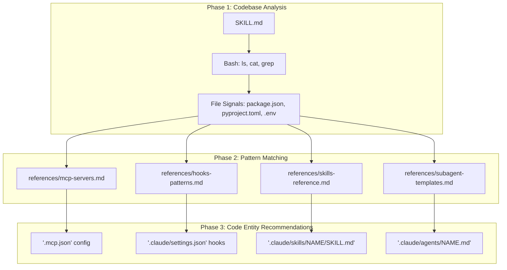
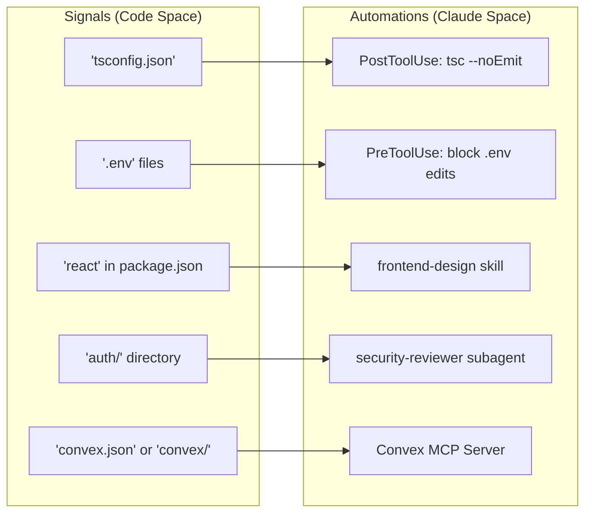

<!-- source: DeepWiki mcp.deepwiki.com · repo anthropics/claude-plugins-official · page 4.1 Automation Recommender · fetched 2026-10-26 -->

# Automation Recommender

Relevant source files

The following files were used as context for generating this wiki page:

- [plugins/claude-code-setup/.claude-plugin/plugin.json](plugins/claude-code-setup/.claude-plugin/plugin.json)
- [plugins/claude-code-setup/README.md](plugins/claude-code-setup/README.md)
- [plugins/claude-code-setup/automation-recommender-example.png](plugins/claude-code-setup/automation-recommender-example.png)
- [plugins/claude-code-setup/skills/claude-automation-recommender/SKILL.md](plugins/claude-code-setup/skills/claude-automation-recommender/SKILL.md)
- [plugins/claude-code-setup/skills/claude-automation-recommender/references/hooks-patterns.md](plugins/claude-code-setup/skills/claude-automation-recommender/references/hooks-patterns.md)
- [plugins/claude-code-setup/skills/claude-automation-recommender/references/mcp-servers.md](plugins/claude-code-setup/skills/claude-automation-recommender/references/mcp-servers.md)
- [plugins/claude-code-setup/skills/claude-automation-recommender/references/plugins-reference.md](plugins/claude-code-setup/skills/claude-automation-recommender/references/plugins-reference.md)
- [plugins/claude-code-setup/skills/claude-automation-recommender/references/skills-reference.md](plugins/claude-code-setup/skills/claude-automation-recommender/references/skills-reference.md)
- [plugins/claude-code-setup/skills/claude-automation-recommender/references/subagent-templates.md](plugins/claude-code-setup/skills/claude-automation-recommender/references/subagent-templates.md)
- [plugins/claude-md-management/.claude-plugin/plugin.json](plugins/claude-md-management/.claude-plugin/plugin.json)

The **Automation Recommender** is a technical analysis skill (`claude-automation-recommender`) housed within the `claude-code-setup` plugin (`[plugins/claude-code-setup/.claude-plugin/plugin.json:1-9]()`). Its purpose is to perform static analysis on a target codebase and provide tailored recommendations for Claude Code extensibility options, including hooks, subagents, skills, plugins, and Model Context Protocol (MCP) servers `[plugins/claude-code-setup/skills/claude-automation-recommender/SKILL.md:1-5]()`.

The recommender operates entirely in a **read-only mode**, gathering project context and outputting recommendations without directly writing or modifying any files on the filesystem `[plugins/claude-code-setup/skills/claude-automation-recommender/SKILL.md:11-12]()`.

---

## System Architecture and Data Flow

The recommender bridges natural language and codebase state into concrete "Code Entity Space" configurations (such as `.mcp.json`, `.claude/settings.json`, or `SKILL.md` files).

### Logic Flow: From Analysis to Recommendation
The following diagram illustrates how the `claude-automation-recommender` skill processes codebase signals into specific Claude Code entities.

Title: "Automation Recommender Data Flow"

Sources: [plugins/claude-code-setup/skills/claude-automation-recommender/SKILL.md:31-64](), [plugins/claude-code-setup/skills/claude-automation-recommender/SKILL.md:65-151]()

---

## Technical Implementation

### Phase 1: Codebase Analysis
The skill uses built-in tools (`Read`, `Glob`, `Grep`, `Bash`) to inspect project files and locate dependency indicators `[plugins/claude-code-setup/skills/claude-automation-recommender/SKILL.md:4]()`.

| Category | Technical Detection Method | Target Entities |
| :--- | :--- | :--- |
| **Project Type** | `ls -la package.json pyproject.toml Cargo.toml go.mod` | Language-specific LSPs |
| **Dependencies** | `grep` for `"react"`, `"supabase"`, `"stripe"`, `"aws-sdk"` | MCP Servers, Frontend Skills |
| **Existing Config** | `ls -la .claude/ CLAUDE.md` | Incremental improvements |
| **Project Layout** | `ls -la src/ tests/ components/ api/` | Subagents (e.g., `api-documenter`) |

Sources: [plugins/claude-code-setup/skills/claude-automation-recommender/SKILL.md:36-64]()

### Phase 2: Recommendation Mapping
The recommender maps specific code repository signals to automation configuration entities.

Title: "Signal-to-Automation Mapping"

Sources: [plugins/claude-code-setup/skills/claude-automation-recommender/references/hooks-patterns.md:61-67](), [plugins/claude-code-setup/skills/claude-automation-recommender/references/hooks-patterns.md:81-89](), [plugins/claude-code-setup/skills/claude-automation-recommender/references/subagent-templates.md:24-37](), [plugins/claude-code-setup/skills/claude-automation-recommender/references/mcp-servers.md:75-85]()

---

## Automation Categories

### MCP Server Recommendations
MCP servers connect Claude to external tools. The recommender evaluates dependency lists against common API patterns `[plugins/claude-code-setup/skills/claude-automation-recommender/references/mcp-servers.md:3-5]()`.

| Codebase Signal | Recommended MCP | Value |
| :--- | :--- | :--- |
| `react`, `next`, `express` | **context7** | Fetches live documentation instead of training data `[plugins/claude-code-setup/skills/claude-automation-recommender/references/mcp-servers.md:20-32]()` |
| `tests/`, UI components | **Playwright** | Browser automation and screenshots `[plugins/claude-code-setup/skills/claude-automation-recommender/references/mcp-servers.md:38-49]()` |
| `@supabase/supabase-js` | **Supabase MCP** | Direct database and auth management `[plugins/claude-code-setup/skills/claude-automation-recommender/references/mcp-servers.md:64-73]()` |
| `convex` in deps | **Convex MCP** | Introspect live deployments, logs, and env vars `[plugins/claude-code-setup/skills/claude-automation-recommender/references/mcp-servers.md:75-85]()` |
| `.git` with GitHub remote | **GitHub MCP** | Manage issues, PRs, and GitHub Actions `[plugins/claude-code-setup/skills/claude-automation-recommender/references/mcp-servers.md:107-118]()` |

Sources: [plugins/claude-code-setup/skills/claude-automation-recommender/references/mcp-servers.md:1-209]()

### Hooks Recommendations
Hooks execute automatic validation or formatting scripts on `PreToolUse` or `PostToolUse` lifecycle events `[plugins/claude-code-setup/skills/claude-automation-recommender/references/hooks-patterns.md:3]()`.

*   **Formatting:** If `.prettierrc` or `ruff.toml` is present, recommend a `PostToolUse` hook on `Edit/Write` `[plugins/claude-code-setup/skills/claude-automation-recommender/references/hooks-patterns.md:9-15]`, `[plugins/claude-code-setup/skills/claude-automation-recommender/references/hooks-patterns.md:33-39]`.
*   **Protection:** If `.env` or lock files (`package-lock.json`) are present, recommend a `PreToolUse` hook to block direct edits `[plugins/claude-code-setup/skills/claude-automation-recommender/references/hooks-patterns.md:81-89]`, `[plugins/claude-code-setup/skills/claude-automation-recommender/references/hooks-patterns.md:91-98]`.
*   **Notifications:** Recommends `Notification` hooks with matchers like `permission_prompt` or `idle_prompt` for multitasking workflows `[plugins/claude-code-setup/skills/claude-automation-recommender/references/hooks-patterns.md:144-159]`.

Sources: [plugins/claude-code-setup/skills/claude-automation-recommender/references/hooks-patterns.md:1-226]()

### Subagent Recommendations
Subagents are specialized Claude instances defined in `.claude/agents/` `[plugins/claude-code-setup/skills/claude-automation-recommender/references/subagent-templates.md:153-161]()`.

*   **`code-reviewer`**: Recommended for large codebases (>500 files) `[plugins/claude-code-setup/skills/claude-automation-recommender/references/subagent-templates.md:9-20]()`.
*   **`security-reviewer`**: Recommended when `auth/`, `stripe`, or `pii` patterns are detected `[plugins/claude-code-setup/skills/claude-automation-recommender/references/subagent-templates.md:24-37]()`.
*   **`performance-analyzer`**: Recommended when raw SQL or complex ORM usage is found `[plugins/claude-code-setup/skills/claude-automation-recommender/references/subagent-templates.md:73-86]()`.

Sources: [plugins/claude-code-setup/skills/claude-automation-recommender/references/subagent-templates.md:1-181]()

### Custom Skill Recommendations
The recommender suggests creating project-specific `SKILL.md` files under `.claude/skills/<name>/` `[plugins/claude-code-setup/skills/claude-automation-recommender/references/skills-reference.md:67-74]()`.

*   **`api-doc`**: Uses an OpenAPI template to generate endpoint documentation `[plugins/claude-code-setup/skills/claude-automation-recommender/references/skills-reference.md:107-132]()`.
*   **`create-migration`**: Bundles a validation script (`validate-migration.sh`) to ensure schema integrity `[plugins/claude-code-setup/skills/claude-automation-recommender/references/skills-reference.md:156-189]()`.
*   **`new-component`**: Uses template files to scaffold React/Vue components with tests and stories `[plugins/claude-code-setup/skills/claude-automation-recommender/references/skills-reference.md:227-257]()`.

Sources: [plugins/claude-code-setup/skills/claude-automation-recommender/references/skills-reference.md:1-251]()

---

## Output Guidelines
The `claude-automation-recommender` adheres to strict output guidelines:
1.  **Top 1-2 per type**: Focuses on high-value recommendations to prevent user fatigue `[plugins/claude-code-setup/skills/claude-automation-recommender/SKILL.md:15]()`.
2.  **Installation Instructions**: Provides specific commands (`/plugin install` or configuration snippets) `[plugins/claude-code-setup/skills/claude-automation-recommender/references/plugins-reference.md:79-88]()`.
3.  **Custom Templates**: Includes boilerplate for `.claude/settings.json` or `SKILL.md` frontmatter `[plugins/claude-code-setup/skills/claude-automation-recommender/references/skills-reference.md:83-93]()`.

Sources:
- [plugins/claude-code-setup/.claude-plugin/plugin.json:1-9]()
- [plugins/claude-code-setup/skills/claude-automation-recommender/SKILL.md:1-151]()
- [plugins/claude-code-setup/skills/claude-automation-recommender/references/mcp-servers.md:1-209]()
- [plugins/claude-code-setup/skills/claude-automation-recommender/references/hooks-patterns.md:1-226]()
- [plugins/claude-code-setup/skills/claude-automation-recommender/references/subagent-templates.md:1-181]()
- [plugins/claude-code-setup/skills/claude-automation-recommender/references/skills-reference.md:1-251]()
- [plugins/claude-code-setup/skills/claude-automation-recommender/references/plugins-reference.md:1-98]()

---

