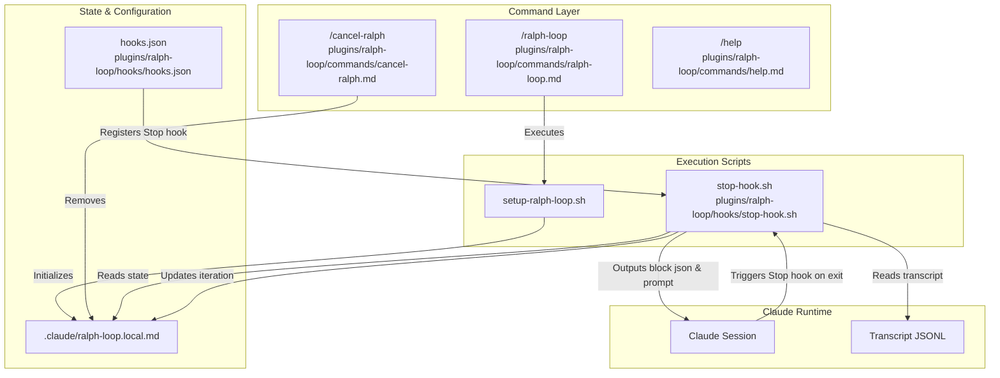
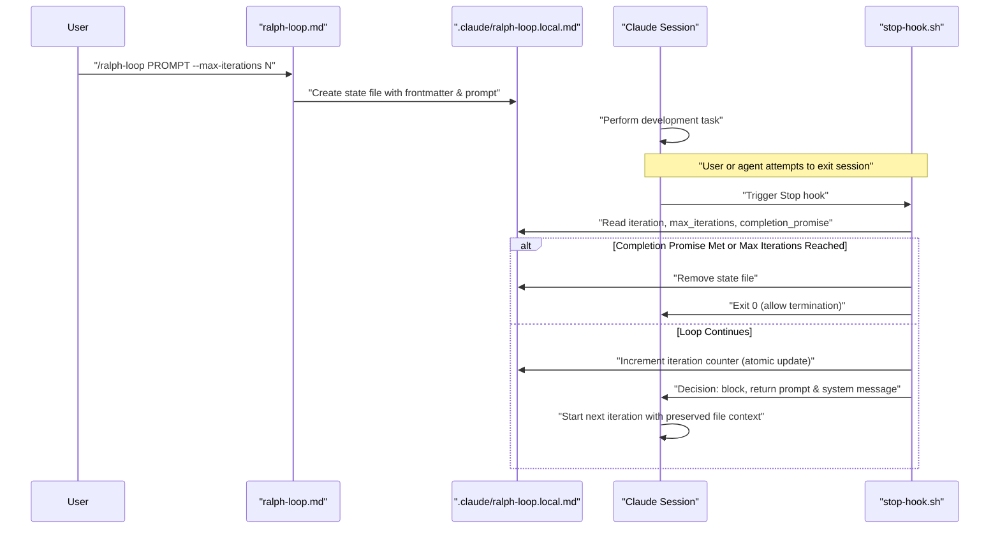

<!-- source: DeepWiki mcp.deepwiki.com · repo anthropics/claude-plugins-official · page 4.2 ralph-loop (Iterative Development) · fetched 2026-10-26 -->

# ralph-loop (Iterative Development)

<details>
<summary>Relevant source files</summary>

The following files were used as context for generating this wiki page:

- [plugins/explanatory-output-style/hooks/hooks.json](plugins/explanatory-output-style/hooks/hooks.json)
- [plugins/learning-output-style/hooks/hooks.json](plugins/learning-output-style/hooks/hooks.json)
- [plugins/plugin-dev/skills/plugin-settings/references/real-world-examples.md](plugins/plugin-dev/skills/plugin-settings/references/real-world-examples.md)
- [plugins/ralph-loop/.claude-plugin/plugin.json](plugins/ralph-loop/.claude-plugin/plugin.json)
- [plugins/ralph-loop/commands/cancel-ralph.md](plugins/ralph-loop/commands/cancel-ralph.md)
- [plugins/ralph-loop/commands/help.md](plugins/ralph-loop/commands/help.md)
- [plugins/ralph-loop/commands/ralph-loop.md](plugins/ralph-loop/commands/ralph-loop.md)
- [plugins/ralph-loop/hooks/hooks.json](plugins/ralph-loop/hooks/hooks.json)

</details>


## Purpose and Scope

This document details the `ralph-loop` plugin, an iterative development system built for Claude Code that implements the Ralph Wiggum technique [plugins/ralph-loop/commands/help.md:9-11](). The plugin orchestrates continuous, self-referential AI development loops by intercepting session exit attempts via a `Stop` hook and feeding the original prompt back repeatedly until task completion or iteration thresholds are reached [plugins/ralph-loop/.claude-plugin/plugin.json:1-9](), [plugins/ralph-loop/hooks/hooks.json:1-15](). This page covers its core architecture, state management via `.claude/ralph-loop.local.md`, the Stop hook execution flow, completion promises, and control commands.

Sources: [plugins/ralph-loop/.claude-plugin/plugin.json:1-9](), [plugins/ralph-loop/commands/help.md:9-18](), [plugins/ralph-loop/hooks/hooks.json:1-15]()

---

## Architecture and System Flow

The `ralph-loop` plugin relies on a project-scoped state file, a registered `Stop` hook configuration, and control commands that initialize or cancel the loop.

### Component Association Diagram



Sources: [plugins/ralph-loop/hooks/hooks.json:1-15](), [plugins/ralph-loop/commands/ralph-loop.md:1-14](), [plugins/ralph-loop/commands/cancel-ralph.md:1-18]()

### Execution Sequence



Sources: [plugins/ralph-loop/commands/ralph-loop.md:1-14](), [plugins/plugin-dev/skills/plugin-settings/references/real-world-examples.md:150-219]()

---

## State Management Pattern (`ralph-loop.local.md`)

The loop state is maintained within the project directory at `.claude/ralph-loop.local.md` [plugins/plugin-dev/skills/plugin-settings/references/real-world-examples.md:133-146](). It uses YAML frontmatter to store numeric counters and string matchers, followed by a markdown body containing the active prompt.

### State File Structure

```markdown
---
iteration: 1
max_iterations: 10
completion_promise: "All tests passing and build successful"
started_at: "2025-01-15T14:30:00Z"
---

Fix all the linting errors in the project.
Make sure tests pass after each fix.
```

### Atomic Updates

To prevent file corruption during frequent hook invocations, `stop-hook.sh` updates state variables by writing to a temporary file in the same directory using the current process ID (`$$`) before performing an atomic `mv` replacement:

```bash
TEMP_FILE="${RALPH_STATE_FILE}.tmp.$$"
sed "s/^iteration: .*/iteration: $NEXT_ITERATION/" "$RALPH_STATE_FILE" > "$TEMP_FILE"
mv "$TEMP_FILE" "$RALPH_STATE_FILE"
```

Sources: [plugins/plugin-dev/skills/plugin-settings/references/real-world-examples.md:133-206]()

---

## Stop Hook Mechanism

The plugin registers a `Stop` hook in `plugins/ralph-loop/hooks/hooks.json` [plugins/ralph-loop/hooks/hooks.json:1-15]() that invokes `${CLAUDE_PLUGIN_ROOT}/hooks/stop-hook.sh`.

### Hook Logic Implementation

When an exit attempt occurs, `stop-hook.sh` evaluates the following steps:
1. **Quick Exit**: If `.claude/ralph-loop.local.md` does not exist, the hook exits immediately with status `0` [plugins/plugin-dev/skills/plugin-settings/references/real-world-examples.md:160-165]().
2. **Configuration Parsing**: Parses YAML frontmatter to extract `iteration`, `max_iterations`, and `completion_promise` [plugins/plugin-dev/skills/plugin-settings/references/real-world-examples.md:167-174]().
3. **Threshold Enforcement**: If `max_iterations` is greater than zero and `iteration` reaches or exceeds it, the script cleans up the state file and allows exit [plugins/plugin-dev/skills/plugin-settings/references/real-world-examples.md:175-180]().
4. **Transcript Analysis**: Inspects the session transcript JSONL file provided via `HOOK_INPUT` to locate the latest assistant output block [plugins/plugin-dev/skills/plugin-settings/references/real-world-examples.md:182-185]().
5. **Promise Detection**: Scans the assistant response for `<promise>` tags and matches against `completion_promise` [plugins/plugin-dev/skills/plugin-settings/references/real-world-examples.md:187-195]().
6. **Block & Feedback**: If neither termination condition is met, it increments the iteration counter, reads the markdown prompt body, and outputs a JSON response instructing Claude Code to block exit and continue with the prompt [plugins/plugin-dev/skills/plugin-settings/references/real-world-examples.md:197-219]().

Sources: [plugins/ralph-loop/hooks/hooks.json:1-15](), [plugins/plugin-dev/skills/plugin-settings/references/real-world-examples.md:150-219]()

---

## Completion Promises and Commands

### Completion Promises

Completion promises enforce deterministic stopping criteria. Claude is instructed via system constraints never to output a false promise tag just to escape the loop prematurely [plugins/ralph-loop/commands/ralph-loop.md:16-18](). Termination requires an exact match between the text inside the `<promise>` tag and the `completion_promise` configuration parameter [plugins/ralph-loop/commands/help.md:76-84](), [plugins/plugin-dev/skills/plugin-settings/references/real-world-examples.md:187-194]().

### Slash Commands

- **`/ralph-loop`**: Defined in `plugins/ralph-loop/commands/ralph-loop.md`, it executes the setup script with custom arguments such as `--max-iterations` and `--completion-promise` [plugins/ralph-loop/commands/ralph-loop.md:1-14]().
- **`/cancel-ralph`**: Defined in `plugins/ralph-loop/commands/cancel-ralph.md`, it verifies the existence of `.claude/ralph-loop.local.md`, reads the current iteration count, and deletes the file to abort the loop [plugins/ralph-loop/commands/cancel-ralph.md:1-18]().
- **`/help`**: Explains the methodology, options, and usage examples for operators [plugins/ralph-loop/commands/help.md:1-126]().

Sources: [plugins/ralph-loop/commands/ralph-loop.md:1-18](), [plugins/ralph-loop/commands/cancel-ralph.md:1-18](), [plugins/ralph-loop/commands/help.md:1-126]()

---

