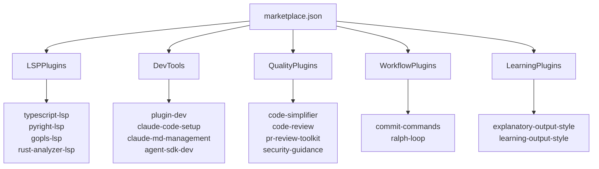
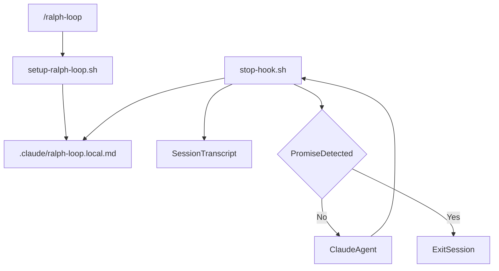

<!-- source: DeepWiki mcp.deepwiki.com · repo anthropics/claude-plugins-official · page 5 Internal Plugins · fetched 2026-10-26 -->

# Internal Plugins

Relevant source files

The following files were used as context for generating this wiki page:

- [plugins/agent-sdk-dev/.claude-plugin/plugin.json](plugins/agent-sdk-dev/.claude-plugin/plugin.json)
- [plugins/code-review/.claude-plugin/plugin.json](plugins/code-review/.claude-plugin/plugin.json)
- [plugins/example-plugin/.claude-plugin/plugin.json](plugins/example-plugin/.claude-plugin/plugin.json)
- [plugins/explanatory-output-style/.claude-plugin/plugin.json](plugins/explanatory-output-style/.claude-plugin/plugin.json)
- [plugins/feature-dev/.claude-plugin/plugin.json](plugins/feature-dev/.claude-plugin/plugin.json)
- [plugins/frontend-design/.claude-plugin/plugin.json](plugins/frontend-design/.claude-plugin/plugin.json)
- [plugins/hookify/.claude-plugin/plugin.json](plugins/hookify/.claude-plugin/plugin.json)
- [plugins/learning-output-style/.claude-plugin/plugin.json](plugins/learning-output-style/.claude-plugin/plugin.json)
- [plugins/pr-review-toolkit/.claude-plugin/plugin.json](plugins/pr-review-toolkit/.claude-plugin/plugin.json)

This document catalogs all Anthropic-maintained plugins in the `plugins/` directory. These first-party extensions demonstrate best practices for Claude Code plugin development and provide core functionality across language intelligence, development workflows, code quality, and productivity automation.

## Overview

Internal plugins are registered in [.claude-plugin/marketplace.json:9-440]() with `"source": "./plugins/*"` paths. Each entry specifies plugin metadata, categorization, and optional LSP configuration. All internal plugins share consistent authorship: `"author": { "name": "Anthropic", "email": "support@anthropic.com" }` [plugins/example-plugin/.claude-plugin/plugin.json:1-8]().

**Sources:** [.claude-plugin/marketplace.json:9-440](), [plugins/example-plugin/.claude-plugin/plugin.json:1-8]()

### Internal vs External Plugins

| Aspect | Internal Plugins | External Plugins |
|--------|------------------|------------------|
| **Registry Source** | `"source": "./plugins/*"` | `"source": "./external_plugins/*"` or `"source": "url"` |
| **Author Field** | `"name": "Anthropic"` | Various organizations |
| **Count** | 28+ plugins | 30+ plugins |
| **Maintenance** | Anthropic team | Community/partners |
| **Submission** | Direct commit access | Google Form submission |

**Sources:** [.claude-plugin/marketplace.json:9-684]()

## Plugin Catalog

The internal plugins are organized into functional categories. Each category has dedicated documentation pages for detailed specifications.

| Category | Count | Marketplace Category | Documentation |
|----------|-------|---------------------|---------------|
| Language Server Plugins | 11 | `development` | [Language Server Plugins](#5.3) |
| Development & Setup Tools | 5 | `development`, `productivity` | [Development & Setup Tools](#5.1) |
| Code Quality & Development Agents | 5 | `productivity`, `security` | [Code Quality & Development Agents](#5.2) |
| Workflow Automation | 2 | `development` | [Workflow and Utility Plugins](#5.5) |
| Learning Enhancements | 2 | `learning` | [Workflow and Utility Plugins](#5.5) |
| Security Scanning | 2 | `security` | [Security Plugins](#5.6) |

**Sources:** [.claude-plugin/marketplace.json:9-440]()

## Key System: Ralph Loop

The `ralph-loop` plugin implements the "Ralph Wiggum" technique for iterative, self-referential development [plugins/ralph-loop/README.md:1-10](). It uses a **Stop hook** to intercept Claude's exit attempts and feed output back as input until a task is complete or a limit is reached [plugins/ralph-loop/README.md:11-27]().

**Sources:** [plugins/ralph-loop/hooks/stop-hook.sh:1-180](), [plugins/ralph-loop/README.md:1-34]()

## Plugin Categories Detailed

### Development & Setup Tools (5.1)
Plugins for plugin development, codebase setup, project documentation management, and skill creation. Includes `plugin-dev`, `claude-code-setup`, `claude-md-management`, `skill-creator`, and `mcp-server-dev`.
**For details, see [Development & Setup Tools](#5.1).**

### Code Quality & Development Agents (5.2)
AI agents for code quality, plugin validation, skill review, agent generation, feature development, and PR review. Includes `feature-dev`, `agent-sdk-dev`, `code-review`, and `pr-review-toolkit` [plugins/feature-dev/.claude-plugin/plugin.json:1-8](), [plugins/code-review/.claude-plugin/plugin.json:1-8](), [plugins/pr-review-toolkit/.claude-plugin/plugin.json:1-8]().
**For details, see [Code Quality & Development Agents](#5.2).**

### Language Server Plugins (5.3)
All LSP plugins for code intelligence across the supported languages (TypeScript, Python, Go, Rust, C++, PHP, Swift, Kotlin, C#, Java, Lua).
**For details, see [Language Server Plugins](#5.3).**

### Playground System (5.4)
The playground plugin for interactive HTML review interfaces and its templates (`design-playground`, `data-explorer`, `concept-map`, `document-critique`, `diff-review`, `code-map`).
**For details, see [Playground System](#5.4).**

### Workflow and Utility Plugins (5.5)
Includes `commit-commands`, `hookify`, `explanatory-output-style` [plugins/explanatory-output-style/.claude-plugin/plugin.json:1-9](), `learning-output-style` [plugins/learning-output-style/.claude-plugin/plugin.json:1-9](), `frontend-design` [plugins/frontend-design/.claude-plugin/plugin.json:1-8](), and `mcp-tunnels`.
**For details, see [Workflow and Utility Plugins](#5.5).**

### Security Plugins (5.6)
The security-focused plugins: `security-guidance` (hook-based real-time review) and `claude-security` (agentic scanning).
**For details, see [Security Plugins](#5.6).**

### Code Modernization Plugin (5.7)
Overview of the `code-modernization` plugin for migrating legacy codebases using a command suite, multi-agent orchestration, and HITL gates.
**For details, see [Code Modernization Plugin](#5.7).**

### Reporting and Analysis Plugins (5.8)
Includes `receipts` (impact reports), `session-report` (token usage analysis), and `project-artifact` (living status pages).
**For details, see [Reporting and Analysis Plugins](#5.8).**

### Specialized Domain Plugins (5.9)
Domain-specific tools including `math-olympiad` (competition math with adversarial verification), `math-proof` (proof search with worker/judge agents), `mcp-tunnels`, and `cwc-makers`.
**For details, see [Specialized Domain Plugins](#5.9).**

## Core Patterns

### Command Logic
Slash commands can be implemented as Markdown files in `commands/` or `skills/`. They use YAML frontmatter to define behavior such as `allowed-tools`, `argument-hint`, and `model`.

### Stop Hook Mechanism
The Stop hook pattern allows plugins to intercept the end of a Claude session, tracking iterations and completion promises via local state files.

**Sources:** [plugins/ralph-loop/hooks/stop-hook.sh:1-65]()

---

