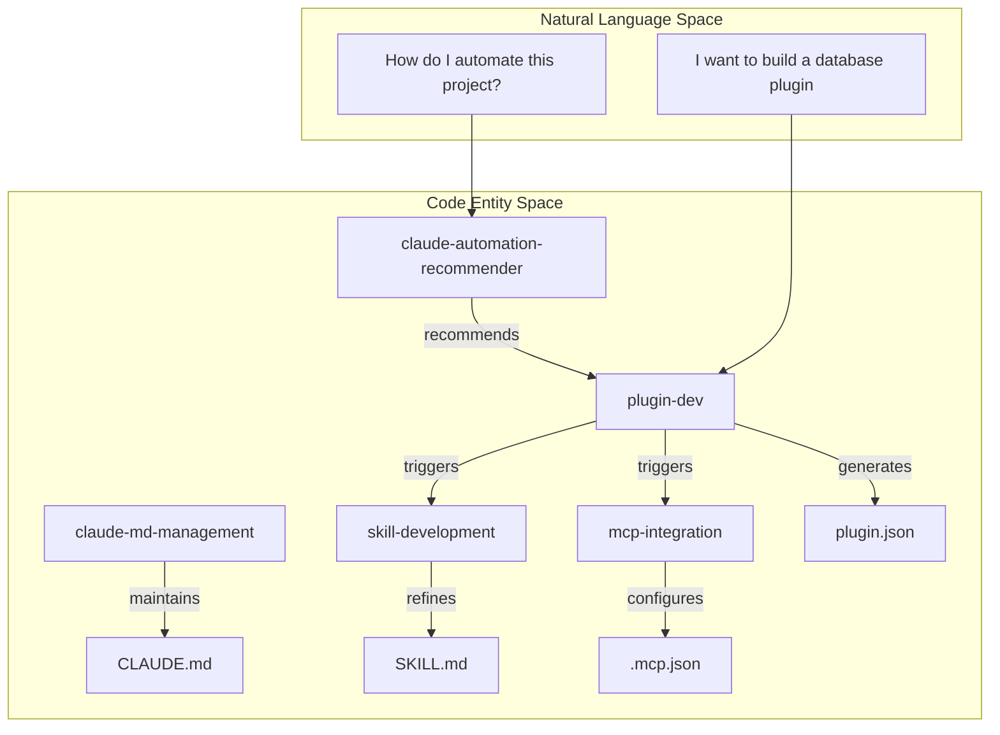
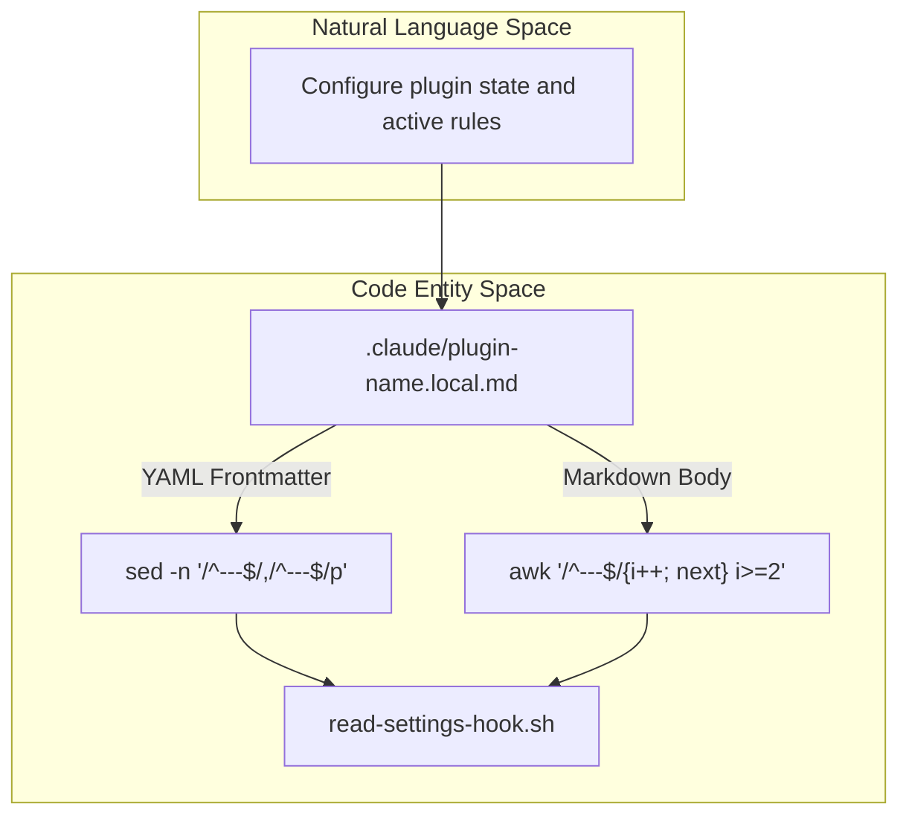

<!-- source: DeepWiki mcp.deepwiki.com · repo anthropics/claude-plugins-official · page 5.1 Development & Setup Tools · fetched 2026-10-26 -->

# Development & Setup Tools

Relevant source files

The following files were used as context for generating this wiki page:

- [plugins/claude-code-setup/.claude-plugin/plugin.json](plugins/claude-code-setup/.claude-plugin/plugin.json)
- [plugins/claude-code-setup/README.md](plugins/claude-code-setup/README.md)
- [plugins/claude-code-setup/automation-recommender-example.png](plugins/claude-code-setup/automation-recommender-example.png)
- [plugins/claude-code-setup/skills/claude-automation-recommender/SKILL.md](plugins/claude-code-setup/skills/claude-automation-recommender/SKILL.md)
- [plugins/claude-code-setup/skills/claude-automation-recommender/references/hooks-patterns.md](plugins/claude-code-setup/skills/claude-automation-recommender/references/hooks-patterns.md)
- [plugins/claude-code-setup/skills/claude-automation-recommender/references/mcp-servers.md](plugins/claude-code-setup/skills/claude-automation-recommender/references/mcp-servers.md)
- [plugins/claude-code-setup/skills/claude-automation-recommender/references/plugins-reference.md](plugins/claude-code-setup/skills/claude-automation-recommender/references/plugins-reference.md)
- [plugins/claude-code-setup/skills/claude-automation-recommender/references/skills-reference.md](plugins/claude-code-setup/skills/claude-automation-recommender/references/skills-reference.md)
- [plugins/claude-code-setup/skills/claude-automation-recommender/references/subagent-templates.md](plugins/claude-code-setup/skills/claude-automation-recommender/references/subagent-templates.md)
- [plugins/claude-md-management/.claude-plugin/plugin.json](plugins/claude-md-management/.claude-plugin/plugin.json)
- [plugins/hookify/skills/writing-rules/SKILL.md](plugins/hookify/skills/writing-rules/SKILL.md)
- [plugins/plugin-dev/README.md](plugins/plugin-dev/README.md)
- [plugins/plugin-dev/skills/hook-development/SKILL.md](plugins/plugin-dev/skills/hook-development/SKILL.md)
- [plugins/plugin-dev/skills/plugin-settings/SKILL.md](plugins/plugin-dev/skills/plugin-settings/SKILL.md)
- [plugins/plugin-dev/skills/plugin-structure/SKILL.md](plugins/plugin-dev/skills/plugin-structure/SKILL.md)
- [plugins/plugin-dev/skills/skill-development/SKILL.md](plugins/plugin-dev/skills/skill-development/SKILL.md)

This page covers internal Anthropic-developed plugins that assist with the lifecycle of Claude Code development, including plugin creation, codebase analysis, documentation management, skill engineering, and Model Context Protocol (MCP) server construction. These tools provide the foundational infrastructure for extending Claude Code's capabilities.

## Overview

The Development & Setup category comprises five primary toolkits designed to automate the "meta-development" process—using Claude to build better tools for Claude.

| Plugin | Primary Purpose | Key Components |
| :--- | :--- | :--- |
| **[plugin-dev Toolkit](#5.1.1)** | End-to-end plugin engineering | 8-phase workflow, 7 specialized skills |
| **[claude-code-setup](#5.1.2)** | Codebase analysis & onboarding | `claude-automation-recommender` skill |
| **[claude-md-management](#5.1.3)** | Project memory & documentation | Audit and learning capture tools |
| **[skill-creator](#5.1.4)** | High-quality skill engineering | Iterative improvement & eval framework |
| **[mcp-server-dev](#5.1.5)** | MCP server & app construction | `build-mcp-server`, `build-mcp-app` |

Sources: [plugins/claude-code-setup/.claude-plugin/plugin.json:1-9](), [plugins/claude-md-management/.claude-plugin/plugin.json:1-9](), [plugins/plugin-dev/README.md:1-15]()

## System Architecture: Natural Language to Code Entity Space

The following diagram illustrates how user intentions map across the natural language interface to specific code entities within the development and setup toolkits.

### From Codebase to Automation

Sources: [plugins/plugin-dev/README.md:21-34](), [plugins/claude-code-setup/skills/claude-automation-recommender/SKILL.md:1-11](), [plugins/claude-md-management/.claude-plugin/plugin.json:1-4](), [plugins/plugin-dev/README.md:76-87]()

## Sub-Topic Overviews

### plugin-dev Toolkit (5.1.1)
The `plugin-dev` toolkit is the comprehensive engineering suite for building Claude Code plugins. It features a guided 8-phase workflow accessible via the command `/plugin-dev:create-plugin` [plugins/plugin-dev/README.md:21-23](). It provides specialized skills for hook development, MCP integration, plugin structuring, settings patterns, command development, agent creation, and skill engineering [plugins/plugin-dev/README.md:7-15]().

For details, see [plugin-dev Toolkit](#5.1.1).

Sources: [plugins/plugin-dev/README.md:1-16]()

### claude-code-setup (5.1.2)
The `claude-code-setup` plugin analyzes a user's codebase to provide tailored automation recommendations [plugins/claude-code-setup/.claude-plugin/plugin.json:2-3](). It identifies opportunities to implement specific MCP servers (like `Supabase MCP` or `context7`), skills, hooks, and subagents that match the project's tech stack [plugins/claude-code-setup/skills/claude-automation-recommender/SKILL.md:69-87]().

For details, see [claude-code-setup](#5.1.2).

Sources: [plugins/claude-code-setup/.claude-plugin/plugin.json:1-9](), [plugins/claude-code-setup/skills/claude-automation-recommender/SKILL.md:1-11]()

### claude-md-management (5.1.3)
This plugin focuses on maintaining "project memory" through `CLAUDE.md` files [plugins/claude-md-management/.claude-plugin/plugin.json:2-3](). It includes tools to audit documentation quality and capture session learnings—insights gained during a development session that should be persisted for future context [plugins/claude-md-management/.claude-plugin/plugin.json:3-4]().

For details, see [claude-md-management](#5.1.3).

Sources: [plugins/claude-md-management/.claude-plugin/plugin.json:1-9]()

### skill-creator (5.1.4)
The `skill-creator` plugin provides a specialized framework for developing `SKILL.md` files. It emphasizes the "Progressive Disclosure" design principle: keeping core instructions lean while linking to detailed references and scripts [plugins/plugin-dev/skills/skill-development/SKILL.md:77-86](). It includes an evaluation framework to benchmark skill performance and iteratively improve trigger phrases and instructions [plugins/plugin-dev/skills/skill-development/SKILL.md:87-106]().

For details, see [skill-creator](#5.1.4).

Sources: [plugins/plugin-dev/skills/skill-development/SKILL.md:77-106]()

### mcp-server-dev (5.1.5)
The `mcp-server-dev` plugin assists in designing and building MCP servers. It provides skills for building standard MCP servers (`build-mcp-server`), interactive MCP apps (`build-mcp-app`), and specialized tools for deployment models and authentication flows (OAuth, tokens) [plugins/plugin-dev/README.md:76-87]().

For details, see [mcp-server-dev](#5.1.5).

Sources: [plugins/plugin-dev/README.md:76-87]()

## Configuration Patterns & State Management

These tools utilize the `.local.md` pattern for state management and user preferences, allowing plugins to be configurable without polluting the main codebase or Git history.

### Configuration Intent to Code Entity Mapping

Sources: [plugins/plugin-dev/skills/plugin-settings/SKILL.md:11-18](), [plugins/plugin-dev/skills/plugin-settings/SKILL.md:78-82](), [plugins/plugin-dev/skills/plugin-settings/SKILL.md:166-170]()

### Comparison of Configuration Formats

| Feature | `plugin.json` | `.mcp.json` | `.local.md` |
| :--- | :--- | :--- | :--- |
| **Location** | `.claude-plugin/` | Plugin Root | `.claude/` |
| **Scope** | Global Plugin Metadata | Server Definitions | Per-Project Settings |
| **Format** | JSON | JSON | YAML + Markdown |
| **Git Status** | Committed | Committed | Ignored (`.gitignore`) |

Sources: [plugins/plugin-dev/skills/plugin-structure/SKILL.md:41-45](), [plugins/plugin-dev/README.md:81-82](), [plugins/plugin-dev/skills/plugin-settings/SKILL.md:11-18]()

---

