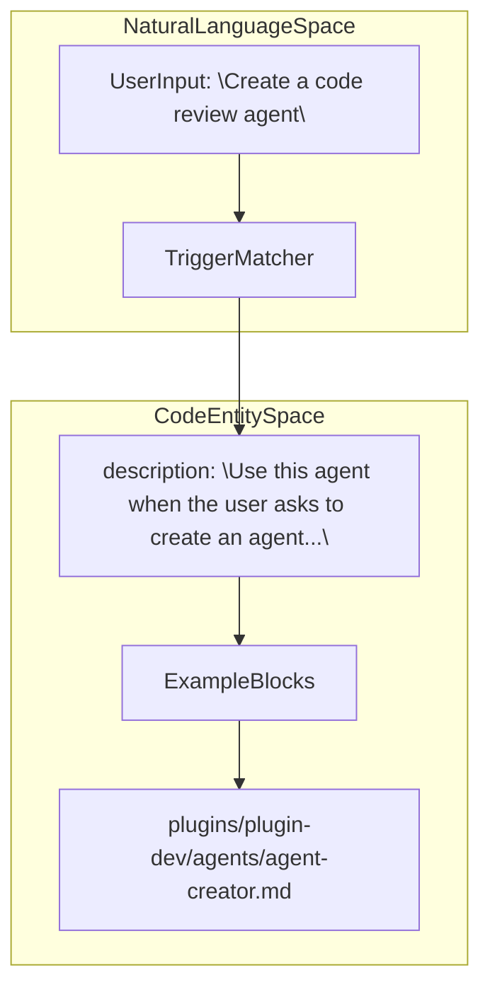
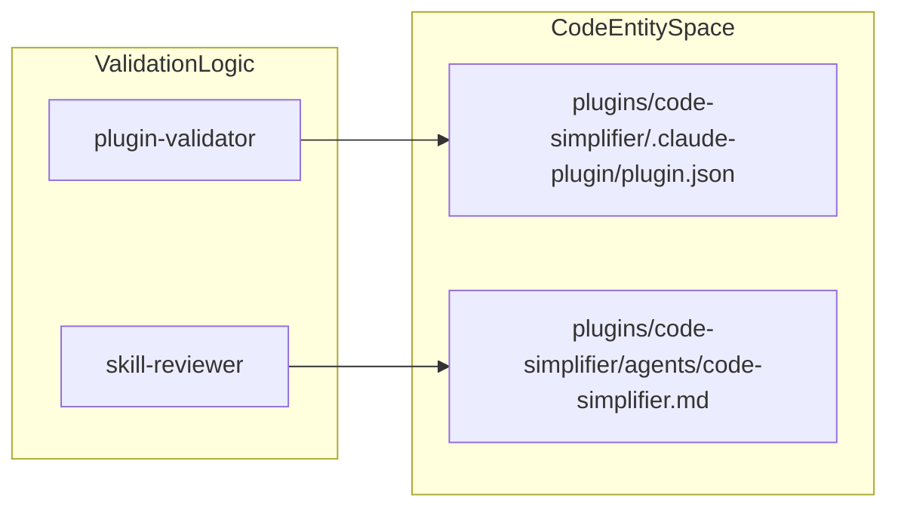

<!-- source: DeepWiki mcp.deepwiki.com · repo anthropics/claude-plugins-official · page 5.2 Code Quality & Development Agents · fetched 2026-10-26 -->

# Code Quality & Development Agents

Relevant source files

The following files were used as context for generating this wiki page:

- [plugins/code-simplifier/.claude-plugin/plugin.json](plugins/code-simplifier/.claude-plugin/plugin.json)
- [plugins/code-simplifier/agents/code-simplifier.md](plugins/code-simplifier/agents/code-simplifier.md)
- [plugins/plugin-dev/agents/agent-creator.md](plugins/plugin-dev/agents/agent-creator.md)
- [plugins/plugin-dev/agents/plugin-validator.md](plugins/plugin-dev/agents/plugin-validator.md)
- [plugins/plugin-dev/agents/skill-reviewer.md](plugins/plugin-dev/agents/skill-reviewer.md)
- [plugins/pr-review-toolkit/agents/code-simplifier.md](plugins/pr-review-toolkit/agents/code-simplifier.md)

This document covers the specialized AI agents in the Claude Code Plugins repository that ensure plugin quality and assist with plugin development. These agents automate best practices, validation, and code refinement to maintain high standards across the plugin ecosystem.

This is a **PARENT** page. For detailed technical specifications of these systems, see the following child pages:
- **[Development Agent System](#5.2.1)**: Detailed documentation on the `agent-creator`, `plugin-validator`, and `skill-reviewer` agents.
- **[code-simplifier and PR Review Toolkit](#5.2.2)**: Documentation for the `code-simplifier` agent and specialized review agents.
- **[feature-dev and agent-sdk-dev](#5.2.3)**: Coverage of the phased feature development workflow and SDK scaffolding tools.
- **[code-review Plugin](#5.2.4)**: Documentation for the automated PR review plugin using parallel specialized agents and confidence scoring.

---

## Overview

The repository includes specialized agents that work together to maintain plugin quality and assist developers. These agents are typically invoked through Claude Code's `Agent` or `Task` tools and operate autonomously based on triggers defined in their markdown frontmatter.

| Agent | Location | Primary Function | Model |
|-------|----------|-----------------|-------|
| `agent-creator` | `plugins/plugin-dev/agents/` | Generate well-structured agent configurations | `sonnet` |
| `plugin-validator` | `plugins/plugin-dev/agents/` | Validate plugin structure and components | `inherit` |
| `skill-reviewer` | `plugins/plugin-dev/agents/` | Review skill quality and effectiveness | `inherit` |
| `code-simplifier` | `plugins/code-simplifier/agents/` | Refine code for clarity and maintainability | `opus` |

Sources: [plugins/plugin-dev/agents/agent-creator.md:1-35](), [plugins/plugin-dev/agents/plugin-validator.md:1-37](), [plugins/plugin-dev/agents/skill-reviewer.md:1-36](), [plugins/code-simplifier/agents/code-simplifier.md:1-41]()

---

## Agent Categories

### Development Agents
These agents assist with the creation and verification of plugin components. They ensure that new agents, skills, and manifests follow the repository's strict architectural standards.
- **agent-creator**: Translates user requirements into expert personas and system prompts, generating the standard `agents/[identifier].md` file structure [plugins/plugin-dev/agents/agent-creator.md:112-123]().
- **plugin-validator**: Performs a comprehensive validation checking `plugin.json` syntax, directory organization, and component-specific metadata [plugins/plugin-dev/agents/plugin-validator.md:49-135]().
- **skill-reviewer**: Evaluates `SKILL.md` files for trigger effectiveness, imperative writing style, and proper implementation of progressive disclosure [plugins/plugin-dev/agents/skill-reviewer.md:47-98]().

For details, see **[Development Agent System](#5.2.1)**.

### Code Quality & Review Agents
These agents focus on the source code itself, ensuring it is maintainable and adheres to project standards.
- **code-simplifier**: Focuses on recently modified code to enhance clarity and consistency (e.g., enforcing ES module patterns or reducing nesting) while strictly preserving functionality [plugins/code-simplifier/agents/code-simplifier.md:43-52]().
- **PR Review Toolkit**: A suite of specialized review agents for deep analysis of type design, test coverage, and comment accuracy.

For details, see **[code-simplifier and PR Review Toolkit](#5.2.2)**.

---

## Agent Architecture

### Frontmatter and Triggering
All agents follow a standard markdown-based configuration format. The YAML frontmatter defines the agent's identity and its triggering logic via the `description` field, which contains prose scenarios and `<example>` blocks.

**Triggering Logic Diagram**

Sources: [plugins/plugin-dev/agents/agent-creator.md:1-35]()

### System Prompt Structure
The body of each agent file contains a comprehensive system prompt that defines its behavior.
- **Expert Persona**: Establishes domain knowledge and role [plugins/plugin-dev/agents/agent-creator.md:37-39]().
- **Core Responsibilities**: Defines the primary mission and boundaries [plugins/plugin-dev/agents/plugin-validator.md:41-47]().
- **Analysis Process**: Provides a step-by-step workflow for the agent to follow [plugins/plugin-dev/agents/skill-reviewer.md:47-98]().

Sources: [plugins/plugin-dev/agents/agent-creator.md:37-123](), [plugins/plugin-dev/agents/plugin-validator.md:39-135](), [plugins/plugin-dev/agents/skill-reviewer.md:37-98]()

---

## Development Lifecycle Integration

The quality agents are integrated into the standard plugin development workflow, primarily through the development toolkits and manifests like `plugins/code-simplifier/.claude-plugin/plugin.json`.

**Validation and Review Workflow**

Sources: [plugins/plugin-dev/agents/plugin-validator.md:52-73](), [plugins/code-simplifier/.claude-plugin/plugin.json:1-9](), [plugins/code-simplifier/agents/code-simplifier.md:1-52]()

### Integration Points
- **Implementation Phase**: `agent-creator` assists in generating new agents [plugins/plugin-dev/agents/agent-creator.md:75-123](), while `code-simplifier` proactively refines code after logical chunks are written [plugins/code-simplifier/agents/code-simplifier.md:1-52]().
- **Validation Phase**: `plugin-validator` and `skill-reviewer` are triggered proactively after modifications to ensure compliance with architectural standards [plugins/plugin-dev/agents/plugin-validator.md:1-37](), [plugins/plugin-dev/agents/skill-reviewer.md:1-36]().

Sources: [plugins/plugin-dev/agents/agent-creator.md:1-176](), [plugins/plugin-dev/agents/plugin-validator.md:1-184](), [plugins/plugin-dev/agents/skill-reviewer.md:1-184](), [plugins/code-simplifier/.claude-plugin/plugin.json:1-9](), [plugins/code-simplifier/agents/code-simplifier.md:1-52]()

---

