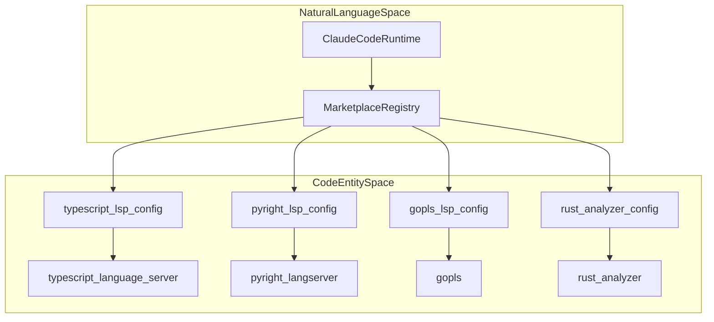
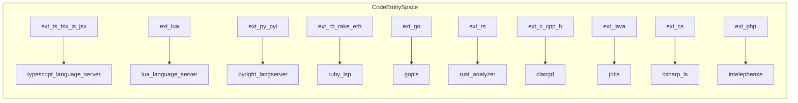

<!-- source: DeepWiki mcp.deepwiki.com · repo anthropics/claude-plugins-official · page 5.3 Language Server Plugins · fetched 2026-10-26 -->

# Language Server Plugins

<details>
<summary>Relevant source files</summary>

The following files were used as context for generating this wiki page:

- [plugins/clangd-lsp/README.md](plugins/clangd-lsp/README.md)
- [plugins/csharp-lsp/README.md](plugins/csharp-lsp/README.md)
- [plugins/gopls-lsp/README.md](plugins/gopls-lsp/README.md)
- [plugins/jdtls-lsp/README.md](plugins/jdtls-lsp/README.md)
- [plugins/lua-lsp/README.md](plugins/lua-lsp/README.md)
- [plugins/php-lsp/README.md](plugins/php-lsp/README.md)
- [plugins/pyright-lsp/README.md](plugins/pyright-lsp/README.md)
- [plugins/ruby-lsp/LICENSE](plugins/ruby-lsp/LICENSE)
- [plugins/rust-analyzer-lsp/README.md](plugins/rust-analyzer-lsp/README.md)
- [plugins/swift-lsp/README.md](plugins/swift-lsp/README.md)
- [plugins/typescript-lsp/README.md](plugins/typescript-lsp/README.md)

</details>


This page documents the Language Server Protocol (LSP) plugins maintained within the repository that provide code intelligence features across supported languages. These plugins enable Claude Code to understand syntax, provide semantic information, and offer language-specific features through standardized LSP implementations.

## Overview

Language Server Plugins bridge Claude Code with external language servers that implement the Language Server Protocol. Each plugin registers one or more language servers in the marketplace, mapping file extensions to language identifiers and specifying the command-line invocation needed to start the server.

All LSP plugins share a common structure:
- Located in `plugins/{plugin-name}/` directories [plugins/typescript-lsp/README.md:1-3]()
- Configured via the `lspServers` field in marketplace entries
- Support specific file extensions through extension-to-language mappings
- Execute external binaries that must be installed separately [plugins/ruby-lsp/LICENSE:1-25]()

Sources: [plugins/typescript-lsp/README.md:1-24](), [plugins/ruby-lsp/LICENSE:1-25]()

## LSP Plugin Architecture

The following diagram bridges the Natural Language Space (marketplace registry and runtime context) to Code Entity Space (specific server binaries and command routines such as `typescript-language-server` and `pyright-langserver`).

### Title: LSP Integration Flow


Sources: [plugins/typescript-lsp/README.md:1-24](), [plugins/pyright-lsp/README.md:1-31](), [plugins/gopls-lsp/README.md:1-20](), [plugins/rust-analyzer-lsp/README.md:1-34]()

## File Extension to Language Server Mapping

The following diagram maps specific code entities (file extensions) to their respective language server implementations in Code Entity Space.

### Title: Extension Routing Map


Sources: [plugins/typescript-lsp/README.md:5-7](), [plugins/ruby-lsp/LICENSE:1-25](), [plugins/pyright-lsp/README.md:5-7](), [plugins/clangd-lsp/README.md:5-7](), [plugins/lua-lsp/README.md:5-6](), [plugins/csharp-lsp/README.md:5-6](), [plugins/jdtls-lsp/README.md:5-6](), [plugins/swift-lsp/README.md:5-6](), [plugins/php-lsp/README.md:5-6](), [plugins/gopls-lsp/README.md:5-6](), [plugins/rust-analyzer-lsp/README.md:5-6]()

## Available Language Servers

The following table lists the supported LSP plugins and their primary configuration details:

| Plugin Name | Primary Command | Supported Extensions | Source |
|-------------|-----------------|----------------------|--------|
| **typescript-lsp** | `typescript-language-server` | `.ts`, `.tsx`, `.js`, `.jsx`, `.mts`, `.cts`, `.mjs`, `.cjs` | [plugins/typescript-lsp/README.md:1-24]() |
| **pyright-lsp** | `pyright-langserver` | `.py`, `.pyi` | [plugins/pyright-lsp/README.md:1-31]() |
| **ruby-lsp** | `ruby-lsp` | `.rb`, `.rake`, `.gemspec`, `.ru`, `.erb` | [plugins/ruby-lsp/LICENSE:1-25]() |
| **gopls-lsp** | `gopls` | `.go` | [plugins/gopls-lsp/README.md:1-20]() |
| **rust-analyzer-lsp** | `rust-analyzer` | `.rs` | [plugins/rust-analyzer-lsp/README.md:1-34]() |
| **clangd-lsp** | `clangd` | `.c`, `.h`, `.cpp`, `.cc`, `.cxx`, `.hpp`, `.hxx`, `.C`, `.H` | [plugins/clangd-lsp/README.md:1-36]() |
| **php-lsp** | `intelephense` | `.php` | [plugins/php-lsp/README.md:1-24]() |
| **swift-lsp** | `sourcekit-lsp` | `.swift` | [plugins/swift-lsp/README.md:1-25]() |
| **csharp-lsp** | `csharp-ls` | `.cs` | [plugins/csharp-lsp/README.md:1-25]() |
| **jdtls-lsp** | `jdtls` | `.java` | [plugins/jdtls-lsp/README.md:1-33]() |
| **lua-lsp** | `lua-language-server` | `.lua` | [plugins/lua-lsp/README.md:1-32]() |

Sources: [plugins/typescript-lsp/README.md:1-24](), [plugins/pyright-lsp/README.md:1-31](), [plugins/gopls-lsp/README.md:1-20](), [plugins/rust-analyzer-lsp/README.md:1-34](), [plugins/clangd-lsp/README.md:1-36](), [plugins/php-lsp/README.md:1-24](), [plugins/swift-lsp/README.md:1-25](), [plugins/csharp-lsp/README.md:1-25](), [plugins/jdtls-lsp/README.md:1-33](), [plugins/lua-lsp/README.md:1-32]()

## Installation Requirements

Each LSP plugin requires its corresponding language server binary to be installed on the system.

### Web & Scripting
**TypeScript/JavaScript**
```bash
npm install -g typescript-language-server typescript
```
[plugins/typescript-lsp/README.md:12-14]()

**Lua**
```bash
brew install lua-language-server
```
[plugins/lua-lsp/README.md:12-13]()

### Python & Ruby
**Python (Pyright)**
```bash
npm install -g pyright
```
[plugins/pyright-lsp/README.md:10-14]()

### Systems & Compiled
**Go**
```bash
go install golang.org/x/tools/gopls@latest
```
[plugins/gopls-lsp/README.md:12-14]()

**Rust**
```bash
rustup component add rust-analyzer
```
[plugins/rust-analyzer-lsp/README.md:12-13]()

**C/C++ (clangd)**
```bash
brew install llvm
```
[plugins/clangd-lsp/README.md:10-14]()

**Swift**
Included with the Swift toolchain [plugins/swift-lsp/README.md:10-10]().

### JVM & Enterprise
**Java (JDT.LS)**
```bash
brew install jdtls
```
[plugins/jdtls-lsp/README.md:10-13]()

**C#**
```bash
dotnet tool install --global csharp-ls
```
[plugins/csharp-lsp/README.md:10-13]()

**PHP (Intelephense)**
```bash
npm install -g intelephense
```
[plugins/php-lsp/README.md:10-14]()

Sources: [plugins/typescript-lsp/README.md:12-14](), [plugins/lua-lsp/README.md:12-13](), [plugins/pyright-lsp/README.md:10-14](), [plugins/gopls-lsp/README.md:12-14](), [plugins/rust-analyzer-lsp/README.md:12-13](), [plugins/clangd-lsp/README.md:10-14](), [plugins/swift-lsp/README.md:10-10](), [plugins/jdtls-lsp/README.md:10-13](), [plugins/csharp-lsp/README.md:10-13](), [plugins/php-lsp/README.md:10-14]()

## Implementation Details

### JVM-Based Servers
The `jdtls-lsp` server provides code intelligence and refactoring for Java projects.
- **Java Requirements**: Java 17 or later (JDK, not just JRE) is required for `jdtls-lsp` [plugins/jdtls-lsp/README.md:29-29]().

### C/C++ Indexing
The `clangd-lsp` implementation provides diagnostics, code intelligence, and formatting. Users on macOS should ensure `llvm` is in their `PATH` to allow Claude Code to locate the `clangd` binary [plugins/clangd-lsp/README.md:10-14]().

### Swift Integration
SourceKit-LSP is part of the standard Swift toolchain and is typically available in the `PATH` after installing Xcode or the Swift package [plugins/swift-lsp/README.md:10-22]().

Sources: [plugins/jdtls-lsp/README.md:29-29](), [plugins/clangd-lsp/README.md:10-14](), [plugins/swift-lsp/README.md:10-22]()

---

