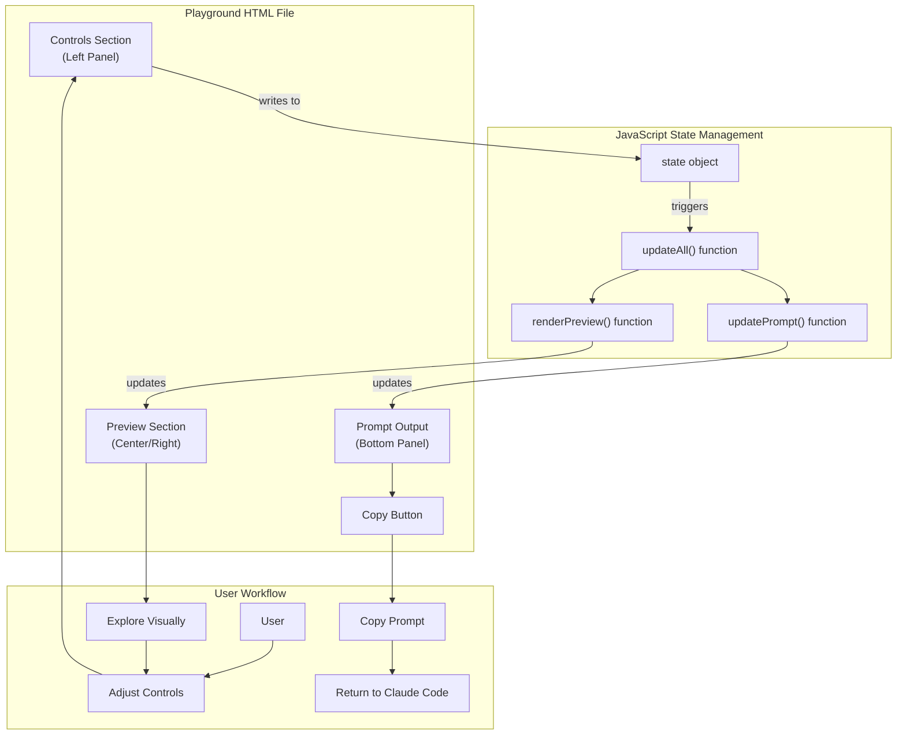
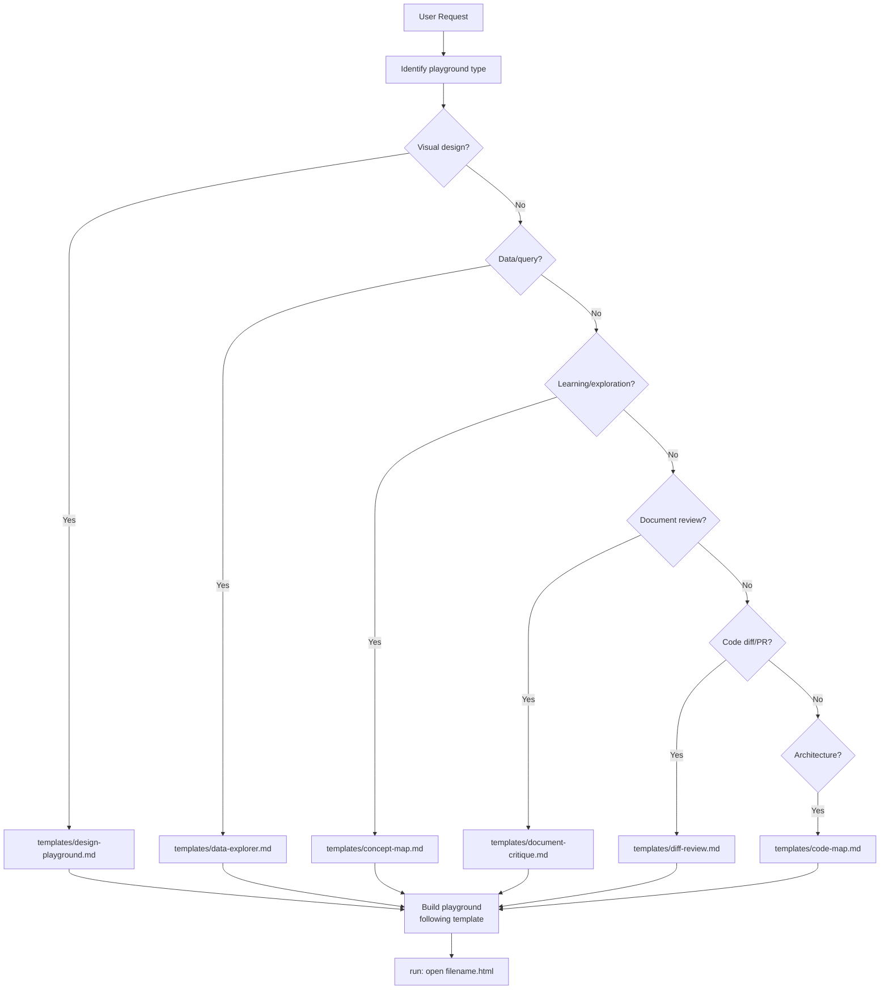

<!-- source: DeepWiki mcp.deepwiki.com · repo anthropics/claude-plugins-official · page 5.4 Playground System · fetched 2026-10-26 -->

# Playground System

<details>
<summary>Relevant source files</summary>

The following files were used as context for generating this wiki page:

- [plugins/playground/.claude-plugin/plugin.json](plugins/playground/.claude-plugin/plugin.json)
- [plugins/playground/README.md](plugins/playground/README.md)
- [plugins/playground/skills/playground/SKILL.md](plugins/playground/skills/playground/SKILL.md)
- [plugins/playground/skills/playground/templates/code-map.md](plugins/playground/skills/playground/templates/code-map.md)
- [plugins/playground/skills/playground/templates/concept-map.md](plugins/playground/skills/playground/templates/concept-map.md)
- [plugins/playground/skills/playground/templates/data-explorer.md](plugins/playground/skills/playground/templates/data-explorer.md)
- [plugins/playground/skills/playground/templates/design-playground.md](plugins/playground/skills/playground/templates/design-playground.md)
- [plugins/playground/skills/playground/templates/diff-review.md](plugins/playground/skills/playground/templates/diff-review.md)
- [plugins/playground/skills/playground/templates/document-critique.md](plugins/playground/skills/playground/templates/document-critique.md)

</details>


## Purpose and Scope

The Playground System creates interactive HTML playgrounds—self-contained single-file explorers with visual controls, live preview, and prompt output functionality. This system enables users to configure complex inputs visually, see results in real-time, and generate natural language prompts that capture their choices for use in Claude Code.

This page documents the playground plugin architecture, template system, and implementation patterns. For details on the templates themselves, see [Playground Templates](#5.4.1).

## Overview

The playground plugin provides a `playground` skill that generates standalone HTML files combining three key components: interactive controls for user input, a live preview area showing real-time results, and a prompt output section with a copy button. Users adjust controls to explore possibilities visually, then copy the generated prompt back into Claude Code for execution.

The system is designed for scenarios where the input space is large, visual, or structural—situations where expressing requirements as plain text is difficult, such as UI design, complex data queries, or architectural mapping.

Sources: [plugins/playground/README.md:1-28](), [plugins/playground/skills/playground/SKILL.md:1-13]()

## Plugin Structure

The playground plugin follows the standard plugin architecture with a metadata file and skill definition:

```
plugins/playground/
├── .claude-plugin/
│   └── plugin.json          # Plugin metadata [plugins/playground/.claude-plugin/plugin.json:1-8]()
├── skills/
│   └── playground/
│       ├── SKILL.md         # Skill definition [plugins/playground/skills/playground/SKILL.md:1-76]()
│       └── templates/       # Playground templates
│           ├── design-playground.md [plugins/playground/skills/playground/templates/design-playground.md:1-67]()
│           ├── data-explorer.md [plugins/playground/skills/playground/templates/data-explorer.md:1-67]()
│           ├── concept-map.md [plugins/playground/skills/playground/templates/concept-map.md:1-73]()
│           ├── document-critique.md [plugins/playground/skills/playground/templates/document-critique.md:1-171]()
│           ├── diff-review.md [plugins/playground/skills/playground/templates/diff-review.md:1-179]()
│           └── code-map.md [plugins/playground/skills/playground/templates/code-map.md:1-158]()
└── README.md
```

Sources: [plugins/playground/.claude-plugin/plugin.json:1-8](), [plugins/playground/skills/playground/SKILL.md:17-23]()

## Playground Architecture

A playground is a single HTML file with no external dependencies, containing inline CSS and JavaScript for complete portability.

### Component Architecture



**Diagram: Playground Component Architecture and User Flow**

The architecture enforces a unidirectional data flow: controls modify the `state` object, triggering `updateAll()`, which calls `renderPreview()` and `updatePrompt()` to refresh the visual and prompt outputs simultaneously.

Sources: [plugins/playground/skills/playground/SKILL.md:27-48]()

### Template Selection Flow



**Diagram: Template Selection and Generation Flow**

Sources: [plugins/playground/skills/playground/SKILL.md:14-25]()

## Core Technical Requirements

Every playground must satisfy these requirements regardless of template:

### Structural Requirements
1. **Single HTML file**: All CSS and JavaScript must be inline; no external dependencies. [plugins/playground/skills/playground/SKILL.md:29-29]()
2. **Live preview**: Updates instantly on every control change; no "Apply" button. [plugins/playground/skills/playground/SKILL.md:30-30]()
3. **Prompt output**: Natural language format, not a value dump. [plugins/playground/skills/playground/SKILL.md:31-31]()
4. **Copy button**: Clipboard copy with brief "Copied!" feedback. [plugins/playground/skills/playground/SKILL.md:32-32]()
5. **Sensible defaults + presets**: Functional on first load; includes 3-5 named presets. [plugins/playground/skills/playground/SKILL.md:33-33]()
6. **Dark theme**: System font for UI, monospace for code/values. [plugins/playground/skills/playground/SKILL.md:34-34]()

### State Management Pattern
The skill enforces a centralized state pattern to maintain consistency:
```javascript
const state = { /* all configurable values */ };

function updateAll() {
  renderPreview(); // update the visual
  updatePrompt();  // rebuild the prompt text
}
// Every control calls updateAll() on change
```
Sources: [plugins/playground/skills/playground/SKILL.md:36-48]()

## Implementation Guidelines

### Prompt Generation Pattern
The prompt output must be natural language that provides actionable instructions without requiring the playground for context. The pattern emphasizes mentioning only non-default values and using qualitative language.

Sources: [plugins/playground/skills/playground/SKILL.md:50-67]()

### Common Mistakes to Avoid
- **Value Dumps**: Prompt output should be natural instructions. [plugins/playground/skills/playground/SKILL.md:71-71]()
- **External Dependencies**: If a CDN is down, the playground fails. [plugins/playground/skills/playground/SKILL.md:75-75]()
- **Delayed Updates**: Every control change must trigger immediate re-render. [plugins/playground/skills/playground/SKILL.md:73-73]()

## Playground Templates
For detailed documentation on each template, including layout, control types, and code patterns, see [Playground Templates](#5.4.1).

Available templates include:
- **design-playground**: Visual design and layout decisions (spacing, color, typography). [plugins/playground/skills/playground/templates/design-playground.md:1-3]()
- **data-explorer**: Data queries, APIs, pipelines, or structured configuration (SQL, regex). [plugins/playground/skills/playground/templates/data-explorer.md:1-3]()
- **concept-map**: Learning, exploration, or mapping relationships (knowledge gaps, scope mapping). [plugins/playground/skills/playground/templates/concept-map.md:1-3]()
- **document-critique**: Reviewing documents with approve/reject/comment workflows (specs, READMEs). [plugins/playground/skills/playground/templates/document-critique.md:1-3]()
- **diff-review**: Interactive code diff and PR feedback with line-by-line commenting. [plugins/playground/skills/playground/templates/diff-review.md:1-3]()
- **code-map**: Visualizing codebase architecture, component relationships, and data flow. [plugins/playground/skills/playground/templates/code-map.md:1-3]()

Sources: [plugins/playground/README.md:18-24](), [plugins/playground/skills/playground/SKILL.md:17-23]()

---

