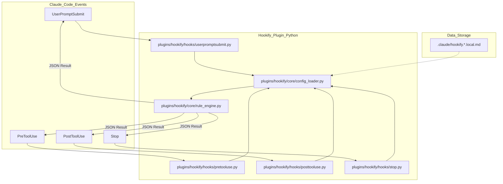
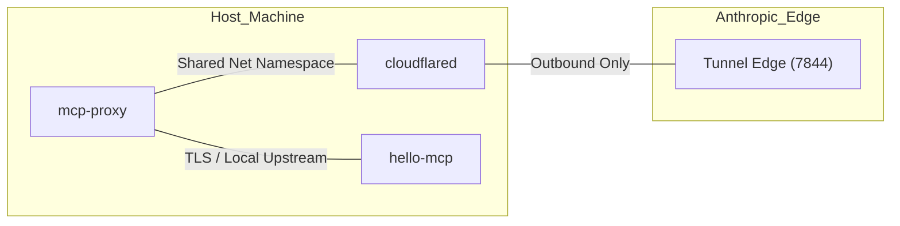
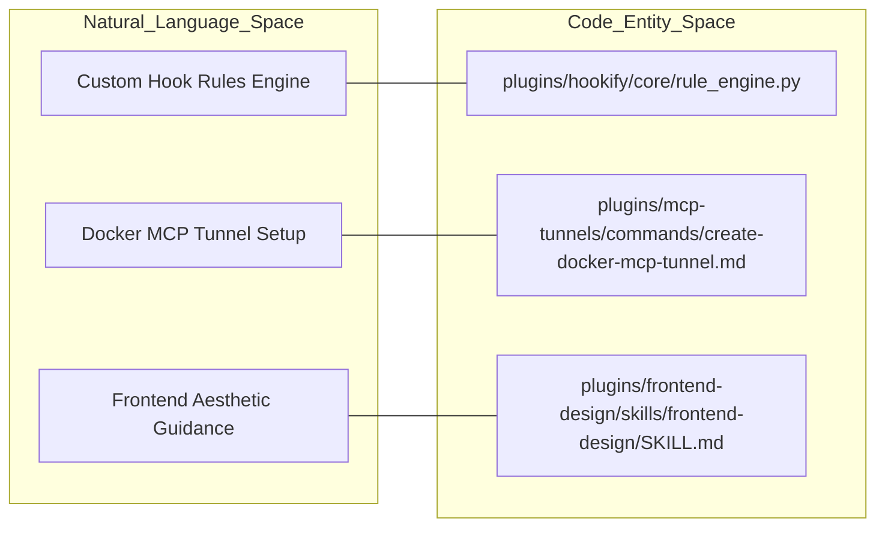

<!-- source: DeepWiki mcp.deepwiki.com · repo anthropics/claude-plugins-official · page 5.5 Workflow and Utility Plugins · fetched 2026-10-26 -->

# Workflow and Utility Plugins

Relevant source files

The following files were used as context for generating this wiki page:

- [plugins/frontend-design/skills/frontend-design/LICENSE.txt](plugins/frontend-design/skills/frontend-design/LICENSE.txt)
- [plugins/frontend-design/skills/frontend-design/SKILL.md](plugins/frontend-design/skills/frontend-design/SKILL.md)
- [plugins/hookify/core/rule_engine.py](plugins/hookify/core/rule_engine.py)
- [plugins/hookify/hooks/posttooluse.py](plugins/hookify/hooks/posttooluse.py)
- [plugins/hookify/hooks/pretooluse.py](plugins/hookify/hooks/pretooluse.py)
- [plugins/hookify/hooks/stop.py](plugins/hookify/hooks/stop.py)
- [plugins/hookify/hooks/userpromptsubmit.py](plugins/hookify/hooks/userpromptsubmit.py)
- [plugins/mcp-tunnels/.claude-plugin/plugin.json](plugins/mcp-tunnels/.claude-plugin/plugin.json)
- [plugins/mcp-tunnels/LICENSE](plugins/mcp-tunnels/LICENSE)
- [plugins/mcp-tunnels/README.md](plugins/mcp-tunnels/README.md)
- [plugins/mcp-tunnels/commands/create-docker-mcp-tunnel.md](plugins/mcp-tunnels/commands/create-docker-mcp-tunnel.md)

This page documents internal Anthropic-maintained workflow and utility plugins that extend Claude Code with specialized capabilities: `commit-commands`, `hookify`, `explanatory-output-style`, `learning-output-style`, `frontend-design`, and `mcp-tunnels`. These plugins focus on enhancing developer productivity, establishing secure local infrastructure tunnels, enforcing custom event hooks, and guiding user interaction and aesthetic design choices.

## Hookify: Custom Hook Creation

The `hookify` plugin enables users to create dynamic custom hooks to prevent unwanted behaviors or enforce local coding standards without writing complex TypeScript plugins [plugins/hookify/.claude-plugin/plugin.json:2-3](). It evaluates tool usage and user prompts against rules defined in `.claude/hookify.*.local.md` files [plugins/hookify/hooks/stop.py:5-6]().

### Implementation and Data Flow

Hookify uses a Python-based execution engine that plugs into Claude Code lifecycle events (`UserPromptSubmit`, `PreToolUse`, `PostToolUse`, `Stop`). It reads input from `stdin`, loads matching rules via `load_rules()` [plugins/hookify/hooks/stop.py:33-33](), and passes them to `RuleEngine` [plugins/hookify/hooks/stop.py:36-37]() for pattern evaluation against compiled regexes [plugins/hookify/core/rule_engine.py:14-24]().

**Hookify Event Processing Flow**

Sources: [plugins/hookify/hooks/stop.py:1-55](), [plugins/hookify/hooks/posttooluse.py:1-62](), [plugins/hookify/hooks/pretooluse.py:1-62](), [plugins/hookify/hooks/userpromptsubmit.py:1-50](), [plugins/hookify/core/rule_engine.py:14-95]().

### Key Functions and Classes

- **`RuleEngine.evaluate_rules(rules, input_data)`**: Defined in `plugins/hookify/core/rule_engine.py`, it iterates through active rules, accumulates matches, and prioritizes blocking rules over warnings [plugins/hookify/core/rule_engine.py:35-95]().
- **`load_rules(event)`**: Located in `plugins/hookify/core/config_loader.py`, this function parses `.local.md` rule configurations filtered by lifecycle event type.
- **Error Handling & Exit Guarantee**: Hook scripts wrap execution in try-except blocks, outputting JSON system messages and always exiting with status code `0` to prevent runtime failures from blocking the main agent loop [plugins/hookify/hooks/stop.py:42-51](), [plugins/hookify/hooks/pretooluse.py:53-62]().

Sources: [plugins/hookify/core/rule_engine.py:27-95](), [plugins/hookify/hooks/stop.py:26-52](), [plugins/hookify/hooks/pretooluse.py:27-62]().

---

## MCP Tunnels (`mcp-tunnels`)

The `mcp-tunnels` plugin connects Claude to private MCP servers running inside local or internal networks through an Anthropic MCP tunnel without exposing inbound ports or public IP allowlists [plugins/mcp-tunnels/README.md:1-6]().

### Command Architecture and Quickstart

The plugin is primarily driven by the `/create-docker-mcp-tunnel` command, which automates setup via Docker Compose and manual credentials [plugins/mcp-tunnels/commands/create-docker-mcp-tunnel.md:1-13]().

**MCP Tunnels Container Stack**

Sources: [plugins/mcp-tunnels/commands/create-docker-mcp-tunnel.md:30-41](), [plugins/mcp-tunnels/README.md:84-96]().

### Stack Components and Requirements
- **`mcp-proxy`**: Terminates inner TLS handshakes using user-controlled certificates, validates upstream IPs, and routes requests by hostname [plugins/mcp-tunnels/commands/create-docker-mcp-tunnel.md:32-35]().
- **`cloudflared`**: Acts as the outbound-only tunnel agent sharing the proxy's network namespace [plugins/mcp-tunnels/commands/create-docker-mcp-tunnel.md:35-36]().
- **`hello-mcp`**: Optional sample FastMCP server provided for initial validation tests [plugins/mcp-tunnels/commands/create-docker-mcp-tunnel.md:36-38]().
- **Preflight Checks**: Verifies Docker, Docker Compose, and OpenSSL 1.1.1+ compatibility [plugins/mcp-tunnels/commands/create-docker-mcp-tunnel.md:43-52]().

Sources: [plugins/mcp-tunnels/commands/create-docker-mcp-tunnel.md:1-169](), [plugins/mcp-tunnels/README.md:1-122]().

---

## Frontend Design Skill

The `frontend-design` plugin provides a content-driven skill (`plugins/frontend-design/skills/frontend-design/SKILL.md`) that guides Claude in making opinionated, deliberate visual design and typography choices that avoid generic, templated AI aesthetics [plugins/frontend-design/skills/frontend-design/SKILL.md:1-9]().

### Design Process and Two-Pass Workflow
1. **Grounding**: Establish a concrete subject, target audience, and primary job-to-be-done before starting implementation [plugins/frontend-design/skills/frontend-design/SKILL.md:11-13]().
2. **Two-Pass Execution**:
   - *Pass 1*: Brainstorm a compact token system specifying color palettes (4-6 named hex values), typography roles, layout concepts, and high-level principles [plugins/frontend-design/skills/frontend-design/SKILL.md:47-51]().
   - *Pass 2*: Review the generated plan against common AI design defaults (e.g., warm cream backgrounds, generic SaaS card kits, tracked-out ALL-CAPS eyebrows) and revise before writing code [plugins/frontend-design/skills/frontend-design/SKILL.md:38-53]().

Sources: [plugins/frontend-design/skills/frontend-design/SKILL.md:1-58]().

---

## Workflow Utilities & Output Styles

### Commit Commands (`commit-commands`)
Provides streamlined git workflow shortcuts and commands (`/commit`, `/push`, `/commit-push-pr`) for staging, committing changes, and opening pull requests.

### Explanatory Output Style (`explanatory-output-style`)
Modifies Claude's output persona during sessions via lifecycle hooks to provide educational insights into implementation choices and design patterns.

### Learning Output Style (`learning-output-style`)
Establishes an interactive learning mode where Claude prompts the user for meaningful code contributions at decision points rather than completing all tasks autonomously.

Sources: [plugins/explanatory-output-style/.claude-plugin/plugin.json:1-9](), [plugins/learning-output-style/.claude-plugin/plugin.json:1-9]().

---

## Code Entity Mapping

The diagram below bridges natural language requirements for workflow and utility plugins to their underlying code implementations.

**Natural Language to Code Entity Space Bridge**

Sources: [plugins/hookify/core/rule_engine.py:27-95](), [plugins/mcp-tunnels/commands/create-docker-mcp-tunnel.md:1-169](), [plugins/frontend-design/skills/frontend-design/SKILL.md:1-9]().

---

