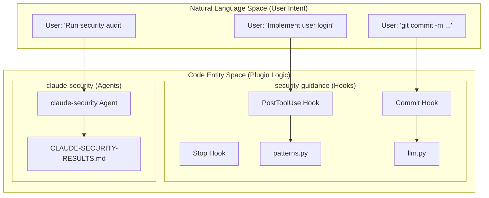
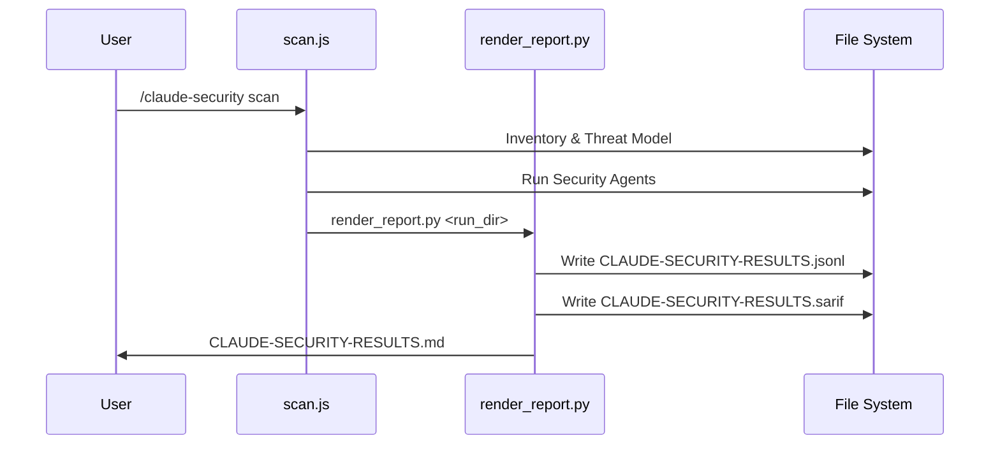

<!-- source: DeepWiki mcp.deepwiki.com · repo anthropics/claude-plugins-official · page 5.6 Security Plugins · fetched 2026-10-26 -->

# Security Plugins

Relevant source files

The following files were used as context for generating this wiki page:

- [plugins/claude-security/README.md](plugins/claude-security/README.md)
- [plugins/claude-security/agents/scan-researcher.md](plugins/claude-security/agents/scan-researcher.md)
- [plugins/claude-security/scripts/lib/finding.py](plugins/claude-security/scripts/lib/finding.py)
- [plugins/claude-security/scripts/lib/sarif.py](plugins/claude-security/scripts/lib/sarif.py)
- [plugins/claude-security/scripts/render_report.py](plugins/claude-security/scripts/render_report.py)
- [plugins/claude-security/skills/claude-security/jobs/suggest-patches.md](plugins/claude-security/skills/claude-security/jobs/suggest-patches.md)
- [plugins/claude-security/skills/claude-security/specs/report-spec.md](plugins/claude-security/skills/claude-security/specs/report-spec.md)
- [plugins/claude-security/workflows/scan.js](plugins/claude-security/workflows/scan.js)
- [plugins/security-guidance/README.md](plugins/security-guidance/README.md)
- [plugins/security-guidance/hooks/_base.py](plugins/security-guidance/hooks/_base.py)
- [plugins/security-guidance/hooks/ensure_agent_sdk.py](plugins/security-guidance/hooks/ensure_agent_sdk.py)
- [plugins/security-guidance/hooks/extensibility.py](plugins/security-guidance/hooks/extensibility.py)
- [plugins/security-guidance/hooks/llm.py](plugins/security-guidance/hooks/llm.py)
- [plugins/security-guidance/hooks/patterns.py](plugins/security-guidance/hooks/patterns.py)
- [plugins/security-guidance/hooks/session_state.py](plugins/security-guidance/hooks/session_state.py)
- [plugins/security-guidance/hooks/sg-python.sh](plugins/security-guidance/hooks/sg-python.sh)
- [plugins/security-guidance/tests/test_prompt_cache.py](plugins/security-guidance/tests/test_prompt_cache.py)
- [plugins/security-guidance/tests/test_review_model.py](plugins/security-guidance/tests/test_review_model.py)

The security plugins in the Claude Code ecosystem provide multi-layered defense and auditing capabilities, ranging from real-time development guardrails to deep agentic security scans. These plugins integrate directly into the development lifecycle via the hooks system and agents to identify vulnerabilities before they reach production.

## Overview of Security Capabilities

The security offering is split into two primary plugins with distinct operational models:

| Plugin | Primary Model | Trigger Mechanism | Focus |
| :--- | :--- | :--- | :--- |
| **security-guidance** | Real-time Guardrails | Event-based Hooks | Developer feedback during active coding and commits. |
| **claude-security** | Agentic Auditing | Manual/Scheduled Jobs | Deep codebase scanning, verification, and patch generation. |

For a list of all security-related plugins including third-party integrations, see the plugin marketplace.

### Security Workflow Integration

Sources: [plugins/security-guidance/hooks/llm.py:1-50](), [plugins/security-guidance/hooks/patterns.py:1-30]()

---

## security-guidance Plugin

The `security-guidance` plugin is a hook-based system designed to guide Claude toward writing secure code in real-time. It operates across three layers of analysis to provide immediate feedback without interrupting the developer's flow.

### Three-Layer Analysis Pipeline
1.  **Pattern-based Rules**: Fast regex checks defined in `patterns.py` that run on tool uses via `PostToolUse` hooks [plugins/security-guidance/hooks/patterns.py:1-40]().
2.  **LLM Diff Review**: Triggered on the `Stop` hook, this layer analyzes changes made during the current session using robust model integrations [plugins/security-guidance/hooks/llm.py:1-50]().
3.  **Agentic Commit Review**: An asynchronous background review triggered by git operations via hooks.

### Core Components
- **`sg-python.sh`**: A bootstrap shim that ensures a compatible Python 3.10+ interpreter is found and forces UTF-8 mode via `PYTHONUTF8=1` [plugins/security-guidance/hooks/sg-python.sh:1-40]().
- **`ensure_agent_sdk.py`**: A session start bootstrap that ensures `claude_agent_sdk` is importable, creating a localized venv fallback under `~/.claude/security/` when needed [plugins/security-guidance/hooks/ensure_agent_sdk.py:1-40]().
- **`_base.py`**: Low-level shared utilities, state directory resolvers (`state_dir()`), and thread-safe usage metrics tracking [plugins/security-guidance/hooks/_base.py:1-50]().

For details, see [security-guidance Plugin](#5.6.1).

---

## claude-security Plugin

The `claude-security` plugin provides a full agentic security scanning suite. Unlike the real-time guidance plugin, `claude-security` is designed for comprehensive audits and automated remediation.

### Agentic Scanning Architecture

The plugin utilizes multi-agent verification pipelines and workflow executors (such as `workflows/scan.js`) to reduce false positives and generate reliable security findings:

- **Scan Pipeline**: Coordinates inventory, threat modeling, research, and sweep phases over a repository [plugins/claude-security/workflows/scan.js:1-15]()
- **Report Generation**: Assembles human-readable markdown reports and machine-readable artifacts (`render_report.py`) including SARIF logs and JSONL records [plugins/claude-security/scripts/render_report.py:1-25](), [plugins/claude-security/skills/claude-security/specs/report-spec.md:1-20]()

### System Architecture: Scanning & Remediation

Sources: [plugins/claude-security/workflows/scan.js:1-15](), [plugins/claude-security/scripts/render_report.py:1-25]()

### Key Features
- **Structured Reporting**: Findings are written to `CLAUDE-SECURITY-RESULTS.md` with impact, exploit scenarios, and CVSS-aligned severity ratings [plugins/claude-security/skills/claude-security/specs/report-spec.md:1-20]().
- **Automated Artifact Rendering**: Python scripts parse run directories to output standardized SARIF and JSONL formats for IDE and CI/CD consumption [plugins/claude-security/scripts/render_report.py:1-30]().

For details, see [claude-security Plugin](#5.6.2).

---
Sources:
- [plugins/security-guidance/hooks/llm.py:1-50]()
- [plugins/security-guidance/hooks/ensure_agent_sdk.py:1-40]()
- [plugins/security-guidance/hooks/_base.py:1-50]()
- [plugins/security-guidance/hooks/sg-python.sh:1-40]()
- [plugins/security-guidance/hooks/patterns.py:1-40]()
- [plugins/claude-security/README.md:1-40]()
- [plugins/claude-security/workflows/scan.js:1-15]()
- [plugins/claude-security/scripts/render_report.py:1-30]()
- [plugins/claude-security/skills/claude-security/specs/report-spec.md:1-20]()

---

