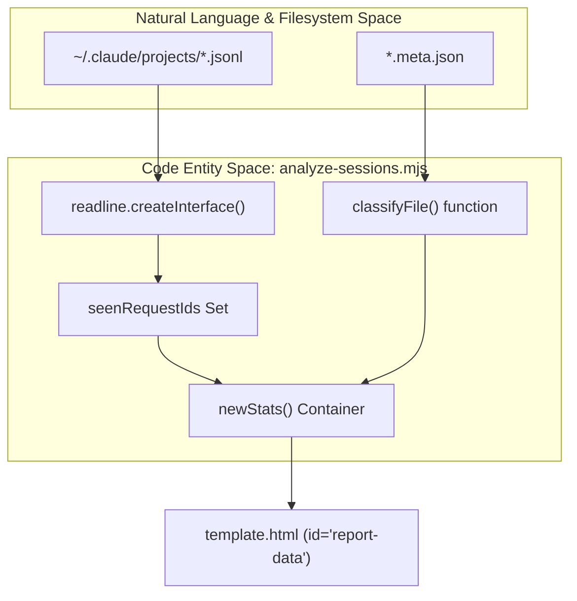
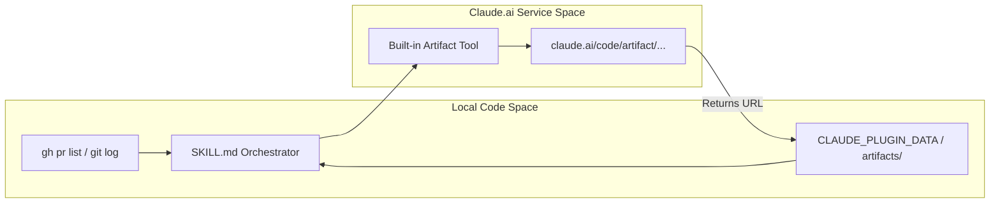

<!-- source: DeepWiki mcp.deepwiki.com · repo anthropics/claude-plugins-official · page 5.8 Reporting and Analysis Plugins · fetched 2026-10-26 -->

# Reporting and Analysis Plugins

Relevant source files

The following files were used as context for generating this wiki page:

- [plugins/project-artifact/.claude-plugin/plugin.json](plugins/project-artifact/.claude-plugin/plugin.json)
- [plugins/project-artifact/LICENSE](plugins/project-artifact/LICENSE)
- [plugins/project-artifact/README.md](plugins/project-artifact/README.md)
- [plugins/project-artifact/skills/project-artifact/SKILL.md](plugins/project-artifact/skills/project-artifact/SKILL.md)
- [plugins/project-artifact/skills/project-artifact/swe.md](plugins/project-artifact/skills/project-artifact/swe.md)
- [plugins/project-artifact/skills/project-artifact/template.html](plugins/project-artifact/skills/project-artifact/template.html)
- [plugins/receipts/LICENSE](plugins/receipts/LICENSE)
- [plugins/receipts/README.md](plugins/receipts/README.md)
- [plugins/receipts/assets/make-sample.mjs](plugins/receipts/assets/make-sample.mjs)
- [plugins/receipts/assets/sample-receipt.png](plugins/receipts/assets/sample-receipt.png)
- [plugins/receipts/skills/receipts/SKILL.md](plugins/receipts/skills/receipts/SKILL.md)
- [plugins/receipts/skills/receipts/scripts/mine-transcripts.mjs](plugins/receipts/skills/receipts/scripts/mine-transcripts.mjs)
- [plugins/session-report/skills/session-report/SKILL.md](plugins/session-report/skills/session-report/SKILL.md)
- [plugins/session-report/skills/session-report/analyze-sessions.mjs](plugins/session-report/skills/session-report/analyze-sessions.mjs)
- [plugins/session-report/skills/session-report/template.html](plugins/session-report/skills/session-report/template.html)

The Reporting and Analysis plugins provide Claude Code with the ability to reflect on its own usage, quantify developer impact, and maintain high-level project visibility. These tools bridge the gap between low-level session transcripts and high-level project management by aggregating token usage, git activity, and workstream status.

## 1. Receipts Plugin (`/receipts`)

The `receipts` plugin generates a personal impact report ("receipt") from local session transcripts. It is designed to justify Claude Code usage to managers or for personal self-review by answering "was this worth it?" in terms of files touched, lines changed, and PRs opened [plugins/receipts/README.md:76-77]().

### Data Flow and Mining
The plugin operates entirely offline using local data sources. It avoids network calls to preserve privacy and minimize token spend [plugins/receipts/README.md:54-55]().

1.  **Transcript Scanning**: The `mine-transcripts.mjs` script scans `~/.claude/projects/**/*.jsonl` [plugins/receipts/skills/receipts/SKILL.md:11-12]().
2.  **Git Cross-referencing**: It runs `git rev-parse` and `git log` locally to match session activity with actual commits authored by the user [plugins/receipts/README.md:56-60]().
3.  **Aggregation**: Data is aggregated into a JSON summary containing `totals` (sessions, prompts, lines touched) and `byRepo` breakdowns [plugins/receipts/skills/receipts/SKILL.md:79-112]().
4.  **Reporting**: A final model call performs a write-up of the JSON summary into a Markdown report and a self-contained HTML receipt [plugins/receipts/skills/receipts/SKILL.md:41-48]().

### Key Implementation Details
| Component | Path | Role |
| :--- | :--- | :--- |
| **Miner Script** | `plugins/receipts/skills/receipts/scripts/mine-transcripts.mjs` | Aggregates JSONL logs and Git data [plugins/receipts/skills/receipts/scripts/mine-transcripts.mjs:1-8](). |
| **Skill Definition** | `plugins/receipts/skills/receipts/SKILL.md` | Orchestrates the mining process and final report generation [plugins/receipts/skills/receipts/SKILL.md:1-4](). |
| **Sample Generator** | `plugins/receipts/assets/make-sample.mjs` | Builds synthetic history for testing/documentation [plugins/receipts/assets/make-sample.mjs:1-6](). |

Sources: [plugins/receipts/README.md:1-77](), [plugins/receipts/skills/receipts/SKILL.md:1-126](), [plugins/receipts/skills/receipts/scripts/mine-transcripts.mjs:1-160]()

---

## 2. Session Report Plugin (`/session-report`)

While `receipts` focuses on impact, `session-report` focuses on efficiency. It analyzes transcripts to identify where tokens are being wasted, highlighting expensive prompts, cache hit rates, and subagent activity [plugins/session-report/skills/session-report/SKILL.md:3]().

### Analysis Pipeline
The analysis is performed by `analyze-sessions.mjs`, which implements deduplication logic to handle the nuances of the Claude Code JSONL format [plugins/session-report/skills/session-report/analyze-sessions.mjs:4-28]().

*   **Assistant Message Deduplication**: One API response is often split into multiple blocks. The analyzer dedupes by `requestId` and keeps only the max `output_tokens` to prevent overcounting [plugins/session-report/skills/session-report/analyze-sessions.mjs:14-18]().
*   **Human Message Detection**: Filters out `isSidechain`, `isMeta`, and `isCompactSummary` entries to identify actual user intent [plugins/session-report/skills/session-report/analyze-sessions.mjs:19-22]().
*   **Cache Break Analysis**: Tracks timestamps where `input_tokens` (uncached) exceed a threshold (default 100k), indicating a cache miss [plugins/session-report/skills/session-report/analyze-sessions.mjs:49-49]().

### Reporting Structure
The plugin generates an interactive HTML dashboard using `template.html` [plugins/session-report/skills/session-report/SKILL.md:8-23](). The dashboard includes:
*   **Hero Stats**: Total tokens, cache hit percentage, and active time [plugins/session-report/skills/session-report/template.html:63-71]().
*   **Gantt Chart**: Visualizes session activity over time [plugins/session-report/skills/session-report/template.html:119-140]().
*   **Anomalies**: Narrative findings (e.g., "Skill X consumed 40% of tokens") [plugins/session-report/skills/session-report/SKILL.md:27-31]().

Sources: [plugins/session-report/skills/session-report/analyze-sessions.mjs:1-192](), [plugins/session-report/skills/session-report/SKILL.md:1-42](), [plugins/session-report/skills/session-report/template.html:1-156]()

---

## 3. Project Artifact Plugin (`/project-artifact`)

The `project-artifact` plugin manages "living status pages" for complex projects. It uses Claude Code's built-in `Artifact` tool to publish structured HTML pages to `claude.ai` [plugins/project-artifact/README.md:3-9]().

### Living Status Architecture
Unlike static reports, project artifacts are designed to be refreshed throughout the project lifecycle [plugins/project-artifact/README.md:13-19]().

1.  **Live State Gathering**: For software projects, it uses the `gh` CLI to pull live PR status, CI check results, and unresolved review threads [plugins/project-artifact/skills/project-artifact/SKILL.md:38-44]().
2.  **Redeployment**: When "refreshing," the plugin re-gathers state and redeploys to the **same URL** recorded during initial creation [plugins/project-artifact/README.md:17-19]().

### Domain Logic Structure
| File | Purpose |
| :--- | :--- |
| `plugins/project-artifact/skills/project-artifact/SKILL.md` | Core workflow: Tab selection, HTML generation, and Artifact publishing [plugins/project-artifact/skills/project-artifact/SKILL.md:1-85](). |
| `plugins/project-artifact/skills/project-artifact/swe.md` | Logic for PR-driven projects: `gh pr list` queries and commit table formatting [plugins/project-artifact/skills/project-artifact/SKILL.md:20-23](). |
| `plugins/project-artifact/skills/project-artifact/template.html` | The HTML/CSS skeleton with tab-switching logic and status pill styling [plugins/project-artifact/skills/project-artifact/SKILL.md:54-58](). |

Sources: [plugins/project-artifact/README.md:1-39](), [plugins/project-artifact/skills/project-artifact/SKILL.md:1-94]()

---

## 4. Technical Architecture and Data Flow

The following diagrams illustrate how these plugins translate raw filesystem data into structured reports and artifacts, bridging natural language spaces with exact code entity identifiers.

Title: "Session Report Data Processing Architecture"

Sources: [plugins/session-report/skills/session-report/analyze-sessions.mjs:30-45](), [plugins/session-report/skills/session-report/analyze-sessions.mjs:111-138](), [plugins/session-report/skills/session-report/SKILL.md:25-26]()

Title: "Artifact Generation and Refresh Workflow"

Sources: [plugins/project-artifact/README.md:17-19](), [plugins/project-artifact/README.md:34-35](), [plugins/project-artifact/skills/project-artifact/SKILL.md:38-84]()

---

## 5. Comparison of Reporting Plugins

| Feature | `receipts` | `session-report` | `project-artifact` |
| :--- | :--- | :--- | :--- |
| **Primary Goal** | Business Impact / ROI | Token & Cache Optimization | Project Status Visibility |
| **Data Sources** | JSONL + Git Log | JSONL | `gh` CLI + Design Docs |
| **Output Format** | Markdown + Static HTML | Interactive HTML Dashboard | Tabbed claude.ai Artifact |
| **Key Metric** | Lines Touched / PRs | Cache Hit % / Token Spend | Workstream Completion |
| **Privacy** | 100% Local Mining | 100% Local Mining | Requires claude.ai login |

Sources: [plugins/receipts/README.md:70-77](), [plugins/session-report/skills/session-report/SKILL.md:1-4](), [plugins/project-artifact/README.md:1-9]()

---

