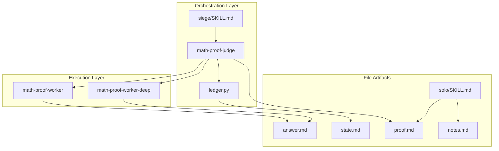
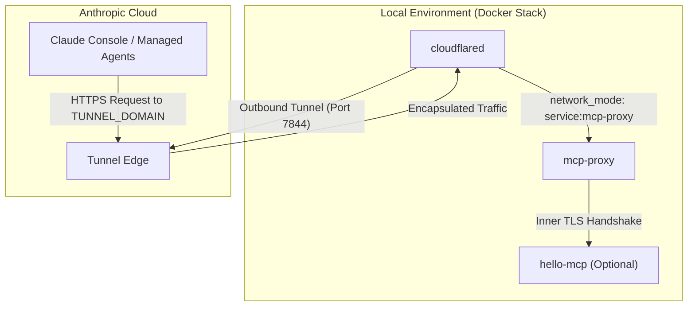
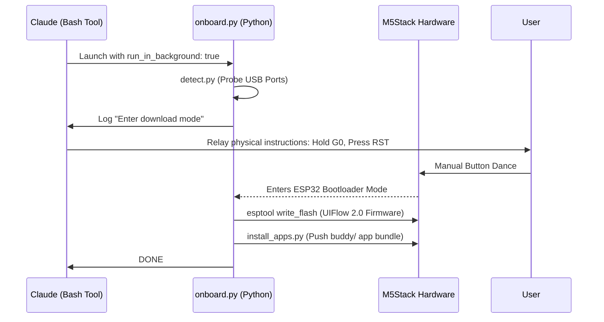

<!-- source: DeepWiki mcp.deepwiki.com · repo anthropics/claude-plugins-official · page 5.9 Specialized Domain Plugins · fetched 2026-10-26 -->

# Specialized Domain Plugins

Relevant source files

The following files were used as context for generating this wiki page:

- [plugins/cwc-makers/.claude-plugin/plugin.json](plugins/cwc-makers/.claude-plugin/plugin.json)
- [plugins/cwc-makers/LICENSE](plugins/cwc-makers/LICENSE)
- [plugins/cwc-makers/README.md](plugins/cwc-makers/README.md)
- [plugins/cwc-makers/commands/maker-setup.md](plugins/cwc-makers/commands/maker-setup.md)
- [plugins/cwc-makers/skills/cardputer-buddy/SKILL.md](plugins/cwc-makers/skills/cardputer-buddy/SKILL.md)
- [plugins/cwc-makers/skills/m5-onboard/SKILL.md](plugins/cwc-makers/skills/m5-onboard/SKILL.md)
- [plugins/math-olympiad/.claude-plugin/plugin.json](plugins/math-olympiad/.claude-plugin/plugin.json)
- [plugins/math-olympiad/LICENSE](plugins/math-olympiad/LICENSE)
- [plugins/math-olympiad/README.md](plugins/math-olympiad/README.md)
- [plugins/math-olympiad/skills/math-olympiad/SKILL.md](plugins/math-olympiad/skills/math-olympiad/SKILL.md)
- [plugins/math-olympiad/skills/math-olympiad/evals/trigger_eval.json](plugins/math-olympiad/skills/math-olympiad/evals/trigger_eval.json)
- [plugins/math-olympiad/skills/math-olympiad/references/adversarial_prompts.md](plugins/math-olympiad/skills/math-olympiad/references/adversarial_prompts.md)
- [plugins/math-olympiad/skills/math-olympiad/references/attempt_agent.md](plugins/math-olympiad/skills/math-olympiad/references/attempt_agent.md)
- [plugins/math-olympiad/skills/math-olympiad/references/known_constructions.md](plugins/math-olympiad/skills/math-olympiad/references/known_constructions.md)
- [plugins/math-olympiad/skills/math-olympiad/references/model_tier_defaults.md](plugins/math-olympiad/skills/math-olympiad/references/model_tier_defaults.md)
- [plugins/math-olympiad/skills/math-olympiad/references/presentation_prompts.md](plugins/math-olympiad/skills/math-olympiad/references/presentation_prompts.md)
- [plugins/math-olympiad/skills/math-olympiad/references/solver_heuristics.md](plugins/math-olympiad/skills/math-olympiad/references/solver_heuristics.md)
- [plugins/math-olympiad/skills/math-olympiad/references/verifier_patterns.md](plugins/math-olympiad/skills/math-olympiad/references/verifier_patterns.md)
- [plugins/math-proof/.claude-plugin/plugin.json](plugins/math-proof/.claude-plugin/plugin.json)
- [plugins/math-proof/LICENSE](plugins/math-proof/LICENSE)
- [plugins/math-proof/README.md](plugins/math-proof/README.md)
- [plugins/math-proof/agents/math-proof-judge.md](plugins/math-proof/agents/math-proof-judge.md)
- [plugins/math-proof/agents/math-proof-worker-deep.md](plugins/math-proof/agents/math-proof-worker-deep.md)
- [plugins/math-proof/agents/math-proof-worker.md](plugins/math-proof/agents/math-proof-worker.md)
- [plugins/math-proof/assets/how-a-run-unfolds.png](plugins/math-proof/assets/how-a-run-unfolds.png)
- [plugins/math-proof/skills/siege/SKILL.md](plugins/math-proof/skills/siege/SKILL.md)
- [plugins/math-proof/skills/siege/scripts/ledger.py](plugins/math-proof/skills/siege/scripts/ledger.py)
- [plugins/math-proof/skills/solo/SKILL.md](plugins/math-proof/skills/solo/SKILL.md)
- [plugins/mcp-tunnels/.claude-plugin/plugin.json](plugins/mcp-tunnels/.claude-plugin/plugin.json)
- [plugins/mcp-tunnels/LICENSE](plugins/mcp-tunnels/LICENSE)
- [plugins/mcp-tunnels/README.md](plugins/mcp-tunnels/README.md)
- [plugins/mcp-tunnels/commands/create-docker-mcp-tunnel.md](plugins/mcp-tunnels/commands/create-docker-mcp-tunnel.md)

This section documents plugins designed for specialized domains, including competition mathematics, automated formal proof search, private network infrastructure, and hardware onboarding. These plugins demonstrate how Claude Code can be extended to handle complex reasoning workflows, manage external containerized stacks, and interact with physical hardware via serial protocols.

## Math Olympiad Solver

The `math-olympiad` plugin is a specialized reasoning system designed to solve high-level competition math problems (IMO, Putnam, USAMO, AIME). It implements an adversarial verification workflow that separates discovery from verification to eliminate the confirmation bias common in LLM reasoning [plugins/math-olympiad/skills/math-olympiad/SKILL.md:1-13]().

### Core Architecture: Adversarial Verification

The system follows a strict multi-phase pipeline that isolates the "Solver" context from the "Verifier" context. This isolation is the primary mechanism for catching subtle logical gaps [plugins/math-olympiad/skills/math-olympiad/SKILL.md:21-22]().

#### Data Flow: The Solver Pipeline

| Phase | Entity | Role | Key Constraint |
| :--- | :--- | :--- | :--- |
| **1. Interpretation** | Solver | Identify potential "trap" readings of the problem [plugins/math-olympiad/skills/math-olympiad/SKILL.md:71-79](). | Must choose the hardest plausible reading. |
| **2. Generation** | `attempt_agent` | Launch 8-12 parallel agents with different "starting angles" (e.g., invariants, extremal cases) [plugins/math-olympiad/skills/math-olympiad/SKILL.md:83-117](). | **NO TOOLS.** Pure reasoning only [plugins/math-olympiad/skills/math-olympiad/references/attempt_agent.md:3-4](). |
| **3. Cleaning** | Orchestrator | Strip all thinking traces, false starts, and "internal monologue" [plugins/math-olympiad/skills/math-olympiad/SKILL.md:142-150](). | Prevents verifier bias toward the solver's effort. |
| **4. Verification** | `adversarial_verifier` | Fresh-context agents attempt to break the proof using specific failure patterns [plugins/math-olympiad/skills/math-olympiad/references/adversarial_prompts.md:1-8](). | Verifiers do not know how others voted [plugins/math-olympiad/skills/math-olympiad/references/adversarial_prompts.md:10-13](). |
| **5. Presentation** | Presentation Agent | Fresh agent converts the verified proof into clean LaTeX [plugins/math-olympiad/skills/math-olympiad/references/presentation_prompts.md:3-6](). | Removes "discovery debris" [plugins/math-olympiad/skills/math-olympiad/references/presentation_prompts.md:35-39](). |

Sources: [plugins/math-olympiad/skills/math-olympiad/SKILL.md:1-150](), [plugins/math-olympiad/skills/math-olympiad/references/attempt_agent.md:1-10]()

### Verification Patterns
Verifiers are instructed to look for specific "Reasons to REFUTE," including:
*   **Proves Too Much (Pattern #4)**: Testing if the argument's skeleton would prove a known false or open problem (e.g., Riemann Hypothesis) [plugins/math-olympiad/skills/math-olympiad/references/adversarial_prompts.md:80-98](), [plugins/math-olympiad/skills/math-olympiad/references/verifier_patterns.md:13-26]().
*   **Tautological Reduction (Pattern #18)**: Checking if the solution argues in a circle by substituting proven identities back into the "final gap" [plugins/math-olympiad/skills/math-olympiad/references/adversarial_prompts.md:152-166](), [plugins/math-olympiad/skills/math-olympiad/references/verifier_patterns.md:88-101]().
*   **2x2 Counterexamples (Pattern #40)**: Extracting a general lemma from a short proof step and testing it against minimal nontrivial cases [plugins/math-olympiad/skills/math-olympiad/references/adversarial_prompts.md:114-138](), [plugins/math-olympiad/skills/math-olympiad/references/verifier_patterns.md:162-175]().

Sources: [plugins/math-olympiad/skills/math-olympiad/references/adversarial_prompts.md:1-166](), [plugins/math-olympiad/skills/math-olympiad/references/verifier_patterns.md:1-175]()

### Model Tiering
The plugin scales its "budget" (parallel solvers and verifiers) based on the model being used (Haiku, Sonnet, or Opus) to account for varying noise floors and reasoning depth [plugins/math-olympiad/skills/math-olympiad/references/model_tier_defaults.md:1-6](). For example, Opus utilizes dedicated verifiers for every pattern in `verifier_patterns.md` [plugins/math-olympiad/skills/math-olympiad/references/model_tier_defaults.md:42-45]().

Sources: [plugins/math-olympiad/skills/math-olympiad/references/model_tier_defaults.md:1-45]()

---

## Math Proof System (`math-proof`)

The `math-proof` plugin provides two advanced skills for researching and structuring rigorous mathematical proofs: `/math-proof:solo` and `/math-proof:siege` [plugins/math-proof/README.md:3-6](). Each run operates within a dedicated directory and concludes with a self-contained `proof.md` [plugins/math-proof/README.md:3-6]().

### Solo Proof Search (`/math-proof:solo`)
The `solo` skill executes a single-session proof workflow without subagents [plugins/math-proof/skills/solo/SKILL.md:10-13](). 
*   **Notes Maintenance**: It records intermediate steps, lemmas, reductions, and dead ends in `DIR/notes.md` to ensure progress is preserved across message truncations [plugins/math-proof/skills/solo/SKILL.md:34-61]().
*   **Deliverable**: It produces `DIR/proof.md`, which is fully self-contained so that a referee evaluating it without access to intermediate notes can verify every argument [plugins/math-proof/skills/solo/SKILL.md:63-65]().

Sources: [plugins/math-proof/skills/solo/SKILL.md:1-69]()

### Siege Protocol (`/math-proof:siege`)
The `siege` skill is an unattended multi-round multi-agent orchestration engine for complex mathematical problems [plugins/math-proof/skills/siege/SKILL.md:10-38](). 

#### Key Components and Roles
*   **Orchestrator**: Manages round loops up to `MAX_ROUNDS` (default 14) and executes actions based on verdicts returned by bookkeeping scripts [plugins/math-proof/skills/siege/SKILL.md:31-37]().
*   **`math-proof-judge`**: Plans each round's questions, reads worker answers, updates the running summary and ledger, and compiles `proof.md` [plugins/math-proof/agents/math-proof-judge.md:1-17]().
*   **`math-proof-worker` / `math-proof-worker-deep`**: Independent stateless subagents that answer self-contained query files in parallel without sharing context [plugins/math-proof/agents/math-proof-worker.md:1-15](), [plugins/math-proof/agents/math-proof-worker-deep.md:1-15]().
*   **`ledger.py`**: The bookkeeping script that tracks claims marked `PROVED`, `REFUTED`, or `OPEN`, determining round progression [plugins/math-proof/skills/siege/SKILL.md:20-37]().

### Math Proof Entity Space Architecture

*Sources: [plugins/math-proof/skills/siege/SKILL.md:20-71](), [plugins/math-proof/agents/math-proof-judge.md:1-17](), [plugins/math-proof/skills/solo/SKILL.md:34-69]()*

Sources: [plugins/math-proof/README.md:1-105](), [plugins/math-proof/skills/siege/SKILL.md:1-732](), [plugins/math-proof/agents/math-proof-judge.md:1-17](), [plugins/math-proof/agents/math-proof-worker.md:1-15](), [plugins/math-proof/agents/math-proof-worker-deep.md:1-15](), [plugins/math-proof/skills/solo/SKILL.md:1-69]()

---

## MCP Tunnels

The `mcp-tunnels` plugin facilitates connecting Claude to Model Context Protocol (MCP) servers running inside private networks without requiring inbound ports or public IP exposure [plugins/mcp-tunnels/README.md:3-6]().

### Command: `/create-docker-mcp-tunnel`
This command drives the end-to-end setup of a local tunnel stack using Docker Compose [plugins/mcp-tunnels/commands/create-docker-mcp-tunnel.md:1-13]().

#### Implementation Logic
The plugin orchestrates a mix of local bash commands and user actions in the Claude Console:
1.  **Preflight**: Checks for Docker, Docker Compose, and OpenSSL 1.1.1+ [plugins/mcp-tunnels/commands/create-docker-mcp-tunnel.md:43-52]().
2.  **Credential Management**: Creates a `.env` file for `TUNNEL_DOMAIN` and `TUNNEL_TOKEN`, ensuring the token is never printed to the chat transcript [plugins/mcp-tunnels/commands/create-docker-mcp-tunnel.md:88-107]().
3.  **Certificate Generation**: Uses `openssl` to generate a CA and server certificates with specific extensions (e.g., `subjectAltName`, `keyCertSign`) required by the Anthropic proxy [plugins/mcp-tunnels/commands/create-docker-mcp-tunnel.md:119-150]().
4.  **Stack Deployment**: Provisions a `docker-compose.yaml` containing:
    *   `mcp-proxy`: Terminates TLS and routes traffic [plugins/mcp-tunnels/README.md:90]().
    *   `cloudflared`: The outbound tunnel agent [plugins/mcp-tunnels/README.md:91]().
    *   `hello-mcp`: An optional sample FastMCP server [plugins/mcp-tunnels/README.md:92]().

Sources: [plugins/mcp-tunnels/README.md:1-122](), [plugins/mcp-tunnels/commands/create-docker-mcp-tunnel.md:1-169]()

### MCP Tunnel Component Diagram

*Sources: [plugins/mcp-tunnels/commands/create-docker-mcp-tunnel.md:28-41](), [plugins/mcp-tunnels/README.md:84-96]()*

Sources: [plugins/mcp-tunnels/commands/create-docker-mcp-tunnel.md:28-41](), [plugins/mcp-tunnels/README.md:84-96]()

---

## CWC Makers (M5Stack Onboarding)

The `cwc-makers` plugin provides a specialized onboarding workflow for the "Code-with-Claude" Makers kit, specifically targeting the M5Stack Cardputer-Adv hardware [plugins/cwc-makers/README.md:3-14]().

### Hardware Interaction Flow
The plugin uses the `m5-onboard` skill to automate the "cold-start" workflow: detection, firmware flashing, and application installation [plugins/cwc-makers/skills/m5-onboard/SKILL.md:6-8]().

#### Key Components
*   **`/maker-setup`**: The entry point command that clones the `build-with-claude` repository and triggers the onboarding scripts [plugins/cwc-makers/commands/maker-setup.md:1-15]().
*   **`onboard.py`**: The main Python orchestrator that handles device identification and firmware fetching [plugins/cwc-makers/skills/m5-onboard/SKILL.md:35-37]().
*   **`detect.py`**: Enumerates serial ports and filters for USB-UART bridges (CH9102 vendor `0x1A86`, Silabs CP210x `0x10C4`) or native ESP32-S3 JTAG interfaces (`0x303A`) [plugins/cwc-makers/skills/m5-onboard/SKILL.md:83]().

#### Background Execution Pattern
Because firmware flashing takes several minutes, the plugin implements a specific background monitoring pattern using `run_in_background: true` and `tail -f` to surface real-time prompts (like the "download mode" request) to the user [plugins/cwc-makers/skills/m5-onboard/SKILL.md:45-54]().

Sources: [plugins/cwc-makers/README.md:1-30](), [plugins/cwc-makers/commands/maker-setup.md:1-15](), [plugins/cwc-makers/skills/m5-onboard/SKILL.md:1-90]()

### Code-to-Hardware Mapping

*Sources: [plugins/cwc-makers/skills/m5-onboard/SKILL.md:45-65](), [plugins/cwc-makers/commands/maker-setup.md:14-15]()*

Sources: [plugins/cwc-makers/skills/m5-onboard/SKILL.md:45-65](), [plugins/cwc-makers/commands/maker-setup.md:14-15]()

---

