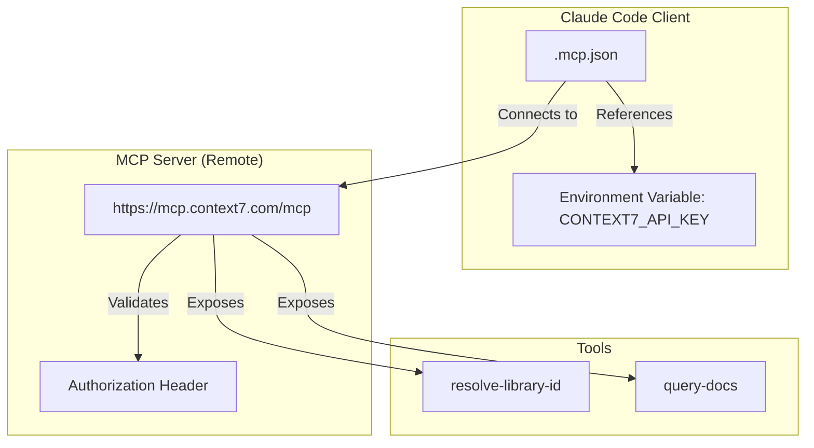

<!-- source: DeepWiki mcp.deepwiki.com · repo anthropics/claude-plugins-official · page 6 External Plugins · fetched 2026-10-26 -->

# External Plugins

<details>
<summary>Relevant source files</summary>

The following files were used as context for generating this wiki page:

- [external_plugins/context7/.claude-plugin/plugin.json](external_plugins/context7/.claude-plugin/plugin.json)
- [external_plugins/context7/.mcp.json](external_plugins/context7/.mcp.json)
- [external_plugins/context7/README.md](external_plugins/context7/README.md)
- [external_plugins/firebase/.claude-plugin/plugin.json](external_plugins/firebase/.claude-plugin/plugin.json)
- [external_plugins/github/.claude-plugin/plugin.json](external_plugins/github/.claude-plugin/plugin.json)
- [external_plugins/gitlab/.claude-plugin/plugin.json](external_plugins/gitlab/.claude-plugin/plugin.json)
- [external_plugins/laravel-boost/.claude-plugin/plugin.json](external_plugins/laravel-boost/.claude-plugin/plugin.json)

</details>


This page documents the external plugin ecosystem for Claude Code, featuring community and partner-contributed plugins. These extensions integrate third-party services, development tools, and infrastructure platforms directly into the Claude Code environment by leveraging the Model Context Protocol (MCP) and Claude's skills system.

## Overview and Categories

External plugins are third-party integrations maintained by partners or the community, distinct from the internal plugins developed by Anthropic. They are registered in the global marketplace manifest [/.claude-plugin/marketplace.json:1-20]().

*   **Submission Process**: Partners submit plugins via an official submission form. The repository uses automation to manage external contributions and enforce quality standards.
*   **Discovery and Installation**: Users can browse these plugins via the marketplace or install them using their unique names defined in the registry [/.claude-plugin/marketplace.json:22-155]().
*   **Categorization**: Plugins are organized into categories such as `development`, `productivity`, `infrastructure`, `security`, `design`, and `database` to streamline discovery [/.claude-plugin/marketplace.json:27-149]().

For details on the submission process and full taxonomy, see [Overview and Categories](#6.1).

**Sources:** [/.claude-plugin/marketplace.json:1-155]()

---

## Development Tools

The ecosystem includes specialized tools for code analysis, documentation, and version control platform integrations.

*   **AI Code Review**: Plugins like `greptile` allow users to view and resolve PR review comments directly from the terminal using tools like `list_code_reviews` and `trigger_code_review` [external_plugins/greptile/README.md:29-38]().
*   **Documentation Lookup**: `context7` (by Upstash) enables pulling version-specific documentation into the LLM context via the `query-docs` tool [external_plugins/context7/README.md:1-11]().
*   **Framework Support**: Tools like `laravel-boost` provide specialized assistance for specific ecosystems, including Artisan commands and Eloquent queries [external_plugins/laravel-boost/.claude-plugin/plugin.json:1-7]().
*   **API Security**: The `42crunch-api-security-testing` plugin automates OpenAPI spec audits and vulnerability detection [/.claude-plugin/marketplace.json:22-35]().

For details on these and other coding integrations, see [Development Tools](#6.2).

**Sources:** [external_plugins/greptile/README.md:1-40](), [external_plugins/context7/README.md:1-11](), [external_plugins/laravel-boost/.claude-plugin/plugin.json:1-7](), [/.claude-plugin/marketplace.json:22-35]()

---

## Project Management

These plugins bridge the gap between the terminal and work tracking systems, allowing Claude to manage tasks and documentation.

*   **Task Management**: Integrations for tools like `Airtable` (database and operations layer) [/.claude-plugin/marketplace.json:96-110]() and `Airwallex` (financial orchestration) [/.claude-plugin/marketplace.json:112-126]().
*   **Git Platforms**: Comprehensive support for `github` [external_plugins/github/.claude-plugin/plugin.json:1-7]() and `gitlab` [external_plugins/gitlab/.claude-plugin/plugin.json:1-7]() for managing issues, PRs, and CI/CD pipelines.
*   **Productivity**: Plugins like `adobe-for-creativity` for design workflows [/.claude-plugin/marketplace.json:38-52]().

For details on work tracking integrations, see [Project Management](#6.3).

**Sources:** [/.claude-plugin/marketplace.json:96-126](), [external_plugins/github/.claude-plugin/plugin.json:1-7](), [external_plugins/gitlab/.claude-plugin/plugin.json:1-7]()

---

## Infrastructure & Services

This category covers the operational side of development, including deployment, monitoring, and security scanning.

*   **Security Scanning**: `aikido` provides SAST, secrets, and IaC vulnerability detection [/.claude-plugin/marketplace.json:86-94](), while `ai-plugins` (Endor Labs) scans the software supply chain [/.claude-plugin/marketplace.json:76-84]().
*   **Deployment**: Support for managed services like `aiven` for PostgreSQL, Kafka, and OpenSearch [/.claude-plugin/marketplace.json:144-155]().
*   **Monitoring**: Integrations for services like Sentry and PostHog (referenced in marketplace categorization).

For details on deployment and monitoring services, see [Infrastructure & Services](#6.4).

**Sources:** [/.claude-plugin/marketplace.json:76-155]()

---

## Databases & Backend

External plugins provide Claude with direct access to backend services and managed data stores.

*   **Backend as a Service**: Integration with `firebase` for managing Firestore, Auth, and Cloud Functions [external_plugins/firebase/.claude-plugin/plugin.json:1-7]().
*   **Managed Databases**: `aiven` provides one-click deployment for various data stores [/.claude-plugin/marketplace.json:144-155]().
*   **Vector Databases**: Support for services like Pinecone for retrieval-augmented workflows.

For details on database and backend service plugins, see [Databases & Backend](#6.5).

**Sources:** [external_plugins/firebase/.claude-plugin/plugin.json:1-7](), [/.claude-plugin/marketplace.json:144-155]()

---

## Integration Architecture

External plugins typically leverage the **Model Context Protocol (MCP)** to expose third-party APIs as tools.

### Natural Language to Code Entity Mapping
When a user interacts with an external service, Claude Code resolves the request to specific plugin entities and their associated tools.

```mermaid
graph LR
    subgraph "Natural Language Space"
        REQ[""Show me Greptile's comments""]
    end

    subgraph "Code Entity Space: greptile plugin"
        MANIFEST["plugin.json (name: \"greptile\")"]
        TOOL1["list_pull_requests"]
        TOOL2["list_merge_request_comments"]
    end

    subgraph "External Execution"
        API["Greptile API Key (GREPTILE_API_KEY)"]
        SVC["Greptile Service"]
    end

    REQ --> MANIFEST
    MANIFEST --> TOOL2
    TOOL2 --> API
    API --> SVC
```
**Diagram: External Plugin Resolution Flow**
**Sources:** [external_plugins/greptile/README.md:22-32](), [external_plugins/greptile/.claude-plugin/plugin.json:1-5]()

### Remote MCP Configuration
Plugins like `context7` demonstrate how to connect to hosted remote MCP servers via HTTP, using environment variables for authentication.


**Diagram: Remote MCP Integration Architecture**
**Sources:** [external_plugins/context7/.mcp.json:1-8](), [external_plugins/context7/README.md:7-19]()

---

## Trust and Security

External plugins require explicit user trust. Anthropic does not control the contents of third-party MCP servers or files. Users are encouraged to verify the `homepage` and `author` fields in the plugin manifest before installation.

*   **Authentication**: Most external plugins use environment variables (e.g., `GREPTILE_API_KEY` [external_plugins/greptile/README.md:22](), `CONTEXT7_API_KEY` [external_plugins/context7/.mcp.json:7]()) to manage secrets securely without hardcoding them into the plugin configuration.

**Sources:** [external_plugins/greptile/README.md:22-25](), [external_plugins/context7/.mcp.json:1-8](), [external_plugins/greptile/.claude-plugin/plugin.json:1-10]()

---

