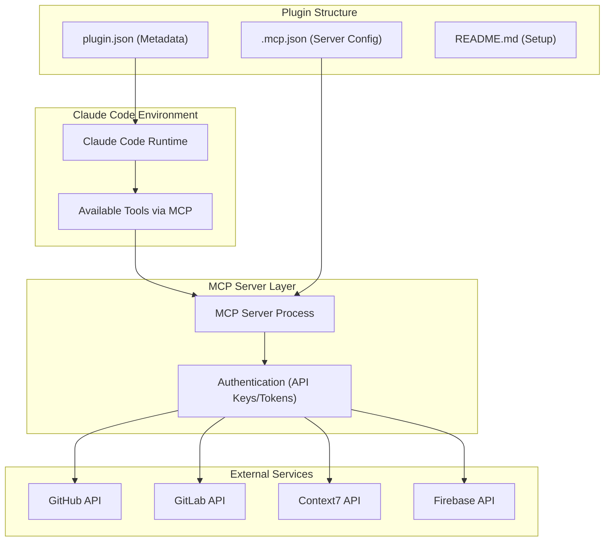
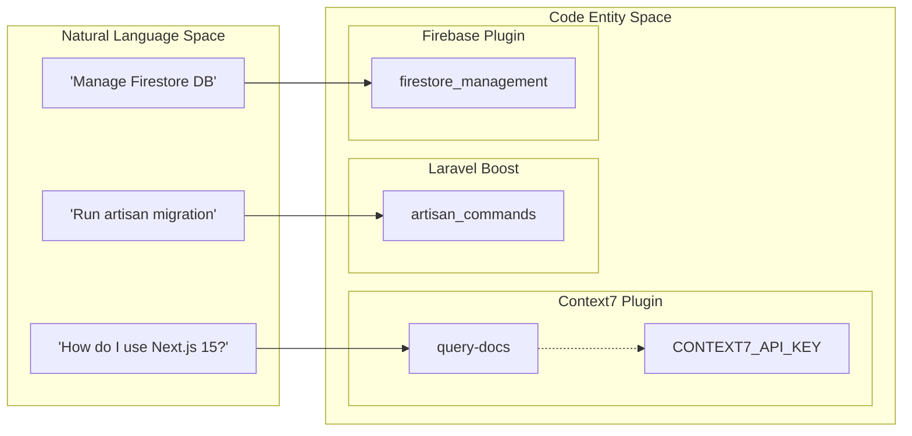

<!-- source: DeepWiki mcp.deepwiki.com · repo anthropics/claude-plugins-official · page 6.2 Development Tools · fetched 2026-10-26 -->

# Development Tools

<details>
<summary>Relevant source files</summary>

The following files were used as context for generating this wiki page:

- [external_plugins/context7/.claude-plugin/plugin.json](external_plugins/context7/.claude-plugin/plugin.json)
- [external_plugins/context7/.mcp.json](external_plugins/context7/.mcp.json)
- [external_plugins/context7/README.md](external_plugins/context7/README.md)
- [external_plugins/firebase/.claude-plugin/plugin.json](external_plugins/firebase/.claude-plugin/plugin.json)
- [external_plugins/github/.claude-plugin/plugin.json](external_plugins/github/.claude-plugin/plugin.json)
- [external_plugins/gitlab/.claude-plugin/plugin.json](external_plugins/gitlab/.claude-plugin/plugin.json)
- [external_plugins/laravel-boost/.claude-plugin/plugin.json](external_plugins/laravel-boost/.claude-plugin/plugin.json)

</details>


This page documents external development tool plugins that integrate Claude Code with popular development platforms and services. These plugins enable direct interaction with version control systems, code review platforms, documentation services, and framework-specific tooling through Model Context Protocol (MCP) server integrations.

---

## Overview

External development tool plugins provide Claude Code with direct access to external development services through MCP server connections. These plugins enable natural language interactions with:

- **Version Control Platforms**: Official GitHub and GitLab repository management [external_plugins/github/.claude-plugin/plugin.json:1-7](), [external_plugins/gitlab/.claude-plugin/plugin.json:1-7]().
- **Documentation Services**: Context7 version-specific documentation lookup [external_plugins/context7/.claude-plugin/plugin.json:1-7]().
- **Framework Tooling**: Laravel Boost framework-specific development assistance [external_plugins/laravel-boost/.claude-plugin/plugin.json:1-7]().
- **Backend Services**: Google Firebase backend and database management [external_plugins/firebase/.claude-plugin/plugin.json:1-7]().

All development tool plugins follow the standard external plugin structure with `.mcp.json` configuration files that define server connections.

Sources: [external_plugins/context7/.claude-plugin/plugin.json:1-7](), [external_plugins/github/.claude-plugin/plugin.json:1-7](), [external_plugins/gitlab/.claude-plugin/plugin.json:1-7](), [external_plugins/laravel-boost/.claude-plugin/plugin.json:1-7](), [external_plugins/firebase/.claude-plugin/plugin.json:1-7]()

---

## Plugin Architecture

External development tool plugins utilize MCP servers to bridge Claude Code with external APIs. The architecture follows a consistent pattern across all plugins:

Title: Development Tool Plugin Architecture


The plugin structure consists of three required components:
1. **plugin.json**: Metadata and marketplace registration [external_plugins/context7/.claude-plugin/plugin.json:1-7]().
2. **.mcp.json**: MCP server configuration defining the connection type (e.g., `http`, `stdio`) and credentials [external_plugins/context7/.mcp.json:1-8]().
3. **README.md**: Setup instructions and authentication requirements [external_plugins/context7/README.md:1-35]().

Sources: [external_plugins/context7/.claude-plugin/plugin.json:1-7](), [external_plugins/context7/.mcp.json:1-8](), [external_plugins/context7/README.md:1-35]()

---

## Context7 Documentation Lookup

Context7 (maintained by Upstash) solves the problem of outdated training data by fetching current documentation and code examples directly from source repositories [external_plugins/context7/README.md:1-3]().

### MCP Configuration
Unlike local MCP servers, Context7 uses a hosted remote HTTP MCP server configured in `.mcp.json` [external_plugins/context7/.mcp.json:1-8]().

```json
{
  "mcpServers": {
    "context7": {
      "type": "http",
      "url": "https://mcp.context7.com/mcp?client=claude-code-plugin"
    }
  }
}
```
Sources: [external_plugins/context7/.mcp.json:1-8]()

### Available Tools
- **`resolve-library-id`**: Searches for libraries and returns Context7-compatible identifiers (e.g., `/vercel/next.js`) plus available versions [external_plugins/context7/README.md:7-9]().
- **`query-docs`**: Fetches documentation for a specific library, ranked by relevance to user queries [external_plugins/context7/README.md:7-10]().

Sources: [external_plugins/context7/README.md:7-11]()

---

## Data Flow and Integration

The following diagram maps natural language intents to specific code entities and environment variables within the external development ecosystem.

Title: Intent to Code Entity Mapping


Sources: [external_plugins/context7/README.md:12-21](), [external_plugins/laravel-boost/.claude-plugin/plugin.json:1-7](), [external_plugins/firebase/.claude-plugin/plugin.json:1-7]()

### Authentication Summary

| Plugin | Env Variable / Method | Source |
|--------|-----------------------|--------|
| **Context7** | `CONTEXT7_API_KEY` | [external_plugins/context7/README.md:18-18]() |
| **GitHub** | `GITHUB_TOKEN` | External MCP Standard |
| **GitLab** | `GITLAB_TOKEN` | External MCP Standard |
| **Firebase** | `FIREBASE_TOKEN` | External MCP Standard |

Sources: [external_plugins/context7/README.md:12-21]()

---

## Usage Examples

### Context7
- "How do I set up authentication in Next.js 15?" [external_plugins/context7/README.md:27-27]()
- "Show me React Server Components examples" [external_plugins/context7/README.md:28-28]()
- "What's the Prisma syntax for relations?" [external_plugins/context7/README.md:29-29]()

Sources: [external_plugins/context7/README.md:23-31]()

---

