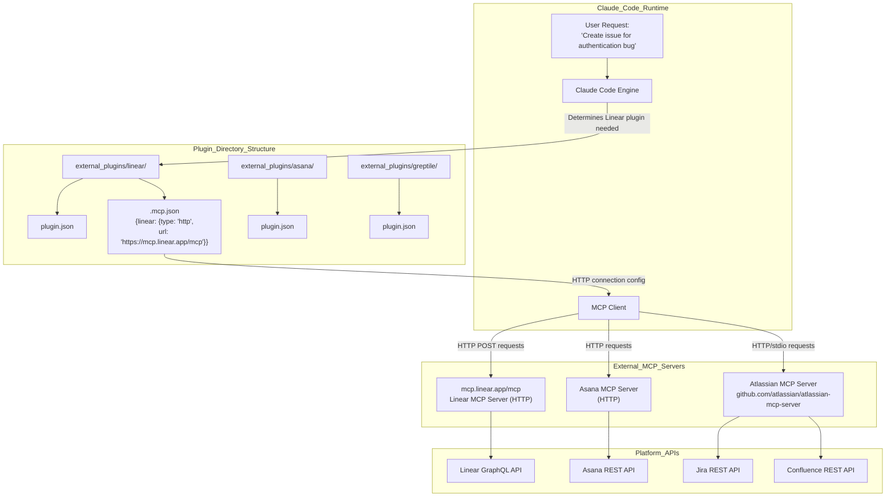
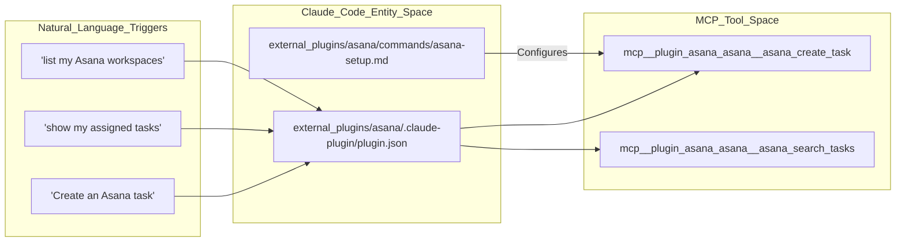

<!-- source: DeepWiki mcp.deepwiki.com · repo anthropics/claude-plugins-official · page 6.3 Project Management · fetched 2026-10-26 -->

# Project Management

<details>
<summary>Relevant source files</summary>

The following files were used as context for generating this wiki page:

- [external_plugins/asana/.claude-plugin/plugin.json](external_plugins/asana/.claude-plugin/plugin.json)
- [external_plugins/asana/README.md](external_plugins/asana/README.md)
- [external_plugins/asana/commands/asana-setup.md](external_plugins/asana/commands/asana-setup.md)
- [external_plugins/linear/.mcp.json](external_plugins/linear/.mcp.json)
- [plugins/plugin-dev/skills/mcp-integration/SKILL.md](plugins/plugin-dev/skills/mcp-integration/SKILL.md)
- [plugins/plugin-dev/skills/mcp-integration/examples/sse-server.json](plugins/plugin-dev/skills/mcp-integration/examples/sse-server.json)
- [plugins/plugin-dev/skills/mcp-integration/references/authentication.md](plugins/plugin-dev/skills/mcp-integration/references/authentication.md)
- [plugins/plugin-dev/skills/mcp-integration/references/server-types.md](plugins/plugin-dev/skills/mcp-integration/references/server-types.md)

</details>


This document covers the external project management plugins that integrate with Claude Code through the Model Context Protocol (MCP). These plugins enable Claude to interact with dedicated project management and work tracking platforms including Linear, Asana, Notion, Atlassian (Jira/Confluence), and specialized code review platforms like Greptile.

All project management plugins are external plugins maintained by their respective organizations and referenced in the marketplace via Git URLs or the `external_plugins/` directory. They use MCP servers to expose platform APIs to Claude Code, enabling task creation, issue tracking, project planning, and documentation management directly from the development environment.

**Note:** For development-focused tools like GitHub and GitLab, see page 8.2 (Development Tools). For internal productivity plugins, see section 7.3.

Sources: [external_plugins/asana/.claude-plugin/plugin.json:1-7](), [external_plugins/linear/.mcp.json:1-6]()

## MCP Integration Architecture

Project management plugins follow a consistent integration pattern using the Model Context Protocol. Each plugin defines an `.mcp.json` configuration file in the plugin directory that specifies the MCP server connection details [plugins/plugin-dev/skills/mcp-integration/SKILL.md:23-37]().

### Integration Flow Diagram



Sources: [external_plugins/linear/.mcp.json:1-6](), [external_plugins/asana/.claude-plugin/plugin.json:1-7](), [plugins/plugin-dev/skills/mcp-integration/SKILL.md:19-64]()

### MCP Configuration Pattern

All project management plugins use the `.mcp.json` file or inline `mcpServers` definitions to configure server connections [plugins/plugin-dev/skills/mcp-integration/SKILL.md:21-64]().

| Configuration Key | Type | Description |
|------------------|------|-------------|
| `type` | string | Server type: `http`, `stdio`, `sse`, or `ws` [plugins/plugin-dev/skills/mcp-integration/SKILL.md:65-166]() |
| `url` | string | HTTP/WebSocket endpoint URL [plugins/plugin-dev/skills/mcp-integration/SKILL.md:104-153]() |
| `command` | string | Executable command (for `stdio` type) [plugins/plugin-dev/skills/mcp-integration/SKILL.md:75-75]() |
| `args` | array | Command arguments (for `stdio` type) [plugins/plugin-dev/skills/mcp-integration/SKILL.md:76-76]() |
| `headers` | object | Custom HTTP headers for authentication [plugins/plugin-dev/skills/mcp-integration/SKILL.md:130-133]() |

Example configuration from Linear [external_plugins/linear/.mcp.json:1-6]():

```json
{
  "linear": {
    "type": "http",
    "url": "https://mcp.linear.app/mcp"
  }
}
```

Sources: [external_plugins/linear/.mcp.json:1-6](), [plugins/plugin-dev/skills/mcp-integration/SKILL.md:19-166]()

## Asana Integration (V2)

The Asana plugin connects Claude Code to Asana's **V2 MCP server** [external_plugins/asana/README.md:1-5](). Unlike V1, the V2 server requires users to provide their own Asana OAuth app credentials because Dynamic Client Registration is not supported [external_plugins/asana/README.md:5-5]().

### Setup and Authentication

The plugin provides a dedicated setup command, `/asana-setup`, which guides the user through creating an OAuth app in the Asana developer console [external_plugins/asana/commands/asana-setup.md:1-22]().

1. **OAuth Redirect:** The redirect URL must be exactly `http://localhost:8080/callback` [external_plugins/asana/README.md:15-19]().
2. **Server Registration:** The server is added using the CLI:
   `claude mcp add --transport http --client-id YOUR_CLIENT_ID --client-secret --callback-port 8080 asana https://mcp.asana.com/v2/mcp` [external_plugins/asana/README.md:28-33]().
3. **Secure Storage:** The `--client-secret` flag triggers a hidden prompt; secrets are stored securely in the OS keychain, never on disk [external_plugins/asana/README.md:36-36]().

### Asana Entity Mapping



Sources: [external_plugins/asana/README.md:1-68](), [external_plugins/asana/commands/asana-setup.md:1-42](), [plugins/plugin-dev/skills/mcp-integration/SKILL.md:190-201]()

## Greptile Integration

Greptile is an AI code review and work tracking platform. The plugin connects Claude Code to Greptile accounts to resolve review comments and query pull requests [external_plugins/greptile/README.md:1-3]().

### Available Tools

The Greptile plugin exposes tools categorized by PR management and code review [external_plugins/greptile/README.md:27-47]():

| Category | Tools |
|----------|-------|
| **Pull Requests** | `list_pull_requests`, `get_merge_request`, `list_merge_request_comments` |
| **Code Review** | `list_code_reviews`, `get_code_review`, `trigger_code_review` |
| **Search** | `search_greptile_comments` |

Sources: [external_plugins/greptile/README.md:1-58]()

## Authentication Patterns

Project management plugins utilize various MCP authentication methods depending on backend requirements [plugins/plugin-dev/skills/mcp-integration/references/authentication.md:5-7]():

1. **OAuth (Automatic):** Used by SSE and HTTP servers where Claude Code handles the browser-based consent flow and token refresh [plugins/plugin-dev/skills/mcp-integration/references/authentication.md:9-20]().
2. **Token-Based (Headers):** Used for RESTful MCP servers where tokens are passed via environment variables like `${API_TOKEN}` [plugins/plugin-dev/skills/mcp-integration/references/authentication.md:81-96]().
3. **Environment Variables (stdio):** Used for local child processes (e.g., Atlassian MCP server running via `npx`) [plugins/plugin-dev/skills/mcp-integration/references/authentication.md:172-189]().

### Security Best Practices
* **Environment Variable Expansion:** Configurations should use `${VARIABLE_NAME}` to avoid hardcoding secrets [plugins/plugin-dev/skills/mcp-integration/SKILL.md:167-187]().
* **Keychain Storage:** Use the `claude mcp add --client-secret` pattern to ensure secrets are stored in the system keychain rather than `.mcp.json` files [external_plugins/asana/README.md:36-36]().

Sources: [plugins/plugin-dev/skills/mcp-integration/references/authentication.md:1-310](), [plugins/plugin-dev/skills/mcp-integration/SKILL.md:241-287]()

## Installation Summary

| Plugin | Install Command | Primary Auth |
|--------|-----------------|--------------|
| **Linear** | `/plugin install linear` | HTTP/OAuth [external_plugins/linear/.mcp.json:1-6]() |
| **Asana** | `/plugin install asana` | OAuth (Self-hosted app) [external_plugins/asana/README.md:7-33]() |
| **Greptile** | `/plugin install greptile` | `GREPTILE_API_KEY` |
| **Notion** | `/plugin install Notion` | HTTP/Token [plugins/plugin-dev/skills/mcp-integration/references/authentication.md:81-96]() |
| **Atlassian** | `/plugin install atlassian` | `ATLASSIAN_API_TOKEN` [plugins/plugin-dev/skills/mcp-integration/references/authentication.md:172-189]() |

Sources: [external_plugins/asana/README.md:7-33](), [external_plugins/linear/.mcp.json:1-6](), [plugins/plugin-dev/skills/mcp-integration/references/authentication.md:81-189]()

---

