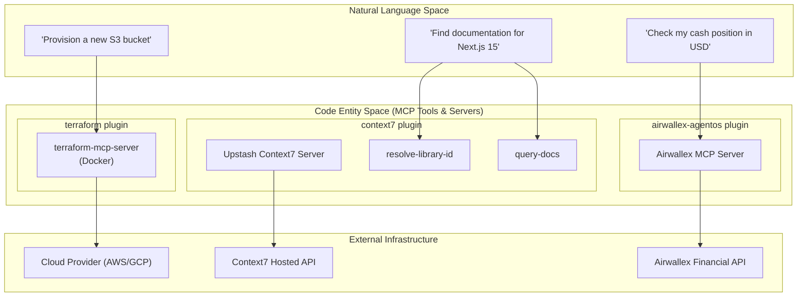

<!-- source: DeepWiki mcp.deepwiki.com · repo anthropics/claude-plugins-official · page 6.4 Infrastructure & Services · fetched 2026-10-26 -->

# Infrastructure & Services

Relevant source files

The following files were used as context for generating this wiki page:

- [external_plugins/terraform/.claude-plugin/plugin.json](external_plugins/terraform/.claude-plugin/plugin.json)
- [external_plugins/terraform/.mcp.json](external_plugins/terraform/.mcp.json)

This document covers external plugins that integrate Claude Code with infrastructure, deployment, monitoring, analytics, payment, and testing services. These plugins enable Claude to interact with production systems, track application health, manage deployments, process payments, and perform automated browser testing.

For database and backend service integrations (Firebase, Supabase, Pinecone), see **8.5 Databases & Backend**. For development tools (GitHub, GitLab, Greptile), see **8.2 Development Tools**. For project management systems (Asana, Linear, Notion), see **8.3 Project Management**.

## Overview

The infrastructure and services category includes external plugins that connect Claude Code to production and operational systems. These plugins are registered in the global marketplace and can be installed via the `/plugin install` command.

| Plugin | Category | Provider | Source Type | Primary Use Cases |
|--------|----------|----------|-------------|-------------------|
| `vercel` | deployment | Vercel | URL | Deploy applications, check build status, manage logs |
| `terraform` | IaC | HashiCorp | Local | Manage infrastructure as code, state, and providers |
| `stripe` | development | Stripe | Local | Payment processing, subscription management |
| `sentry` | monitoring | Sentry | URL | Error tracking, stack trace analysis, debugging |
| `posthog` | monitoring | PostHog | URL | Analytics, feature flags, A/B testing, LLM cost tracking |
| `playwright` | testing | Microsoft | Local | Browser automation, E2E testing, screenshots |
| `slack` | communication| Slack | Local | Channel messaging, notifications, team collaboration |
| `context7` | documentation| Upstash | Local | Version-specific documentation lookup |

All these plugins use MCP (Model Context Protocol) servers to bridge Claude Code with their respective service APIs. They provide natural language interfaces for operations that typically require web dashboards or CLI tools.

Sources: [.claude-plugin/marketplace.json:1-155](), [external_plugins/terraform/.claude-plugin/plugin.json:1-7](), [external_plugins/context7/.claude-plugin/plugin.json:1-7]()

## Architecture Pattern

The following diagram bridges the Natural Language requests from a user to the specific Code Entities (MCP tools and servers) that execute them.

Sources: [external_plugins/terraform/.mcp.json:1-12](), [external_plugins/context7/.mcp.json:1-8](), [external_plugins/context7/README.md:7-11](), [.claude-plugin/marketplace.json:112-126]()

## Infrastructure as Code: Terraform

The `terraform` plugin, authored by HashiCorp, provides integration with the Terraform ecosystem for Infrastructure as Code (IaC) development [external_plugins/terraform/.claude-plugin/plugin.json:1-7]().

### MCP Configuration
Unlike many plugins that use local scripts, the Terraform plugin runs via Docker to ensure a consistent execution environment:
- **Command**: `docker` [external_plugins/terraform/.mcp.json:3]()
- **Arguments**: `run -i --rm -e TFE_TOKEN=${TFE_TOKEN} hashicorp/terraform-mcp-server:0.4.0` [external_plugins/terraform/.mcp.json:4-10]()
- **Authentication**: Requires a `TFE_TOKEN` environment variable passed directly to the container runtime [external_plugins/terraform/.mcp.json:8]().

Sources: [external_plugins/terraform/.claude-plugin/plugin.json:1-7](), [external_plugins/terraform/.mcp.json:1-12]()

## Financial Infrastructure: Airwallex

The Airwallex integration is split into two specialized plugins targeting different personas:

1. **airwallex-agentos**: Designed for operational tasks. It enables orchestrating financial actions like setting up invoices, onboarding suppliers, and checking cash positions across currencies using plain language [.claude-plugin/marketplace.json:112-126]().
2. **airwallex-dev**: Designed for developers building payment flows. It assists in generating checkout code, card elements, and KYC onboarding flows directly within the user's codebase [.claude-plugin/marketplace.json:128-142]().

Sources: [.claude-plugin/marketplace.json:112-142]()

## Documentation: Context7

The `context7` plugin (by Upstash) solves the problem of outdated LLM training data by fetching current documentation and code examples directly from source repositories [external_plugins/context7/README.md:1-3]().

### MCP Configuration
The plugin connects to a hosted remote MCP server, removing the need for local Node.js or npm runtime installations [external_plugins/context7/README.md:5]().

- **Type**: `http` [external_plugins/context7/.mcp.json:4]()
- **URL**: `https://mcp.context7.com/mcp` [external_plugins/context7/.mcp.json:5]()
- **Auth**: Uses the `CONTEXT7_API_KEY` environment variable in the `Authorization` header [external_plugins/context7/.mcp.json:6-8]().

### Available Tools
- **`resolve-library-id`**: Searches for libraries and returns identifiers (e.g., `/vercel/next.js`) [external_plugins/context7/README.md:9]().
- **`query-docs`**: Fetches documentation for a specific library version ranked by relevance [external_plugins/context7/README.md:10]().

Sources: [external_plugins/context7/.claude-plugin/plugin.json:1-7](), [external_plugins/context7/.mcp.json:1-8](), [external_plugins/context7/README.md:1-32]()

## Configuration & Authentication Summary

Infrastructure plugins vary in their transport and execution requirements:

| Plugin | Transport / Runtime | Auth Method | Reference |
|--------|---------------------|-------------|-----------|
| **Terraform** | Docker | `TFE_TOKEN` (Env Var) | [external_plugins/terraform/.mcp.json:1-12]() |
| **Context7** | HTTP (Remote) | `CONTEXT7_API_KEY` | [external_plugins/context7/.mcp.json:1-8]() |
| **42Crunch** | git-subdir | API Security Audit loop | [.claude-plugin/marketplace.json:21-36]() |
| **Aiven** | URL | Managed DB credentials | [.claude-plugin/marketplace.json:144-155]() |

Sources: [external_plugins/terraform/.mcp.json:1-12](), [external_plugins/context7/.mcp.json:1-8](), [.claude-plugin/marketplace.json:21-155]()

---

