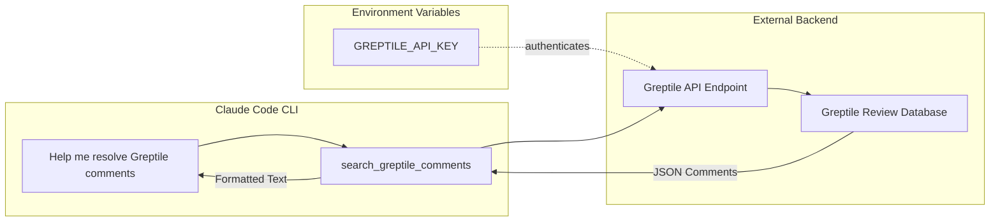

<!-- source: DeepWiki mcp.deepwiki.com · repo anthropics/claude-plugins-official · page 6.5 Databases & Backend · fetched 2026-10-26 -->

# Databases & Backend

<details>
<summary>Relevant source files</summary>

The following files were used as context for generating this wiki page:

- [external_plugins/context7/.claude-plugin/plugin.json](external_plugins/context7/.claude-plugin/plugin.json)
- [external_plugins/context7/.mcp.json](external_plugins/context7/.mcp.json)
- [external_plugins/context7/README.md](external_plugins/context7/README.md)
- [external_plugins/firebase/.claude-plugin/plugin.json](external_plugins/firebase/.claude-plugin/plugin.json)
- [external_plugins/github/.claude-plugin/plugin.json](external_plugins/github/.claude-plugin/plugin.json)
- [external_plugins/gitlab/.claude-plugin/plugin.json](external_plugins/gitlab/.claude-plugin/plugin.json)
- [external_plugins/laravel-boost/.claude-plugin/plugin.json](external_plugins/laravel-boost/.claude-plugin/plugin.json)

</details>


This page documents the database and backend service plugins available in the Claude Code plugin marketplace. These plugins provide MCP server integrations that enable Claude to interact with hosted database and backend-as-a-service platforms, facilitating tasks such as schema management, data querying, and serverless function deployment.

For information about MCP server integration patterns and `.mcp.json` configuration, see [4.6 MCP Server Integration](). For infrastructure and deployment services, see [8.4 Infrastructure & Services]().

---

## Overview

The plugin marketplace includes several database and backend service integrations, delivered as external community or partner plugins through MCP servers.

| Plugin | Category | Provider | Description |
|--------|----------|----------|-------------|
| **`supabase`** | database | Supabase | PostgreSQL database, authentication, storage, and real-time subscriptions. |
| **`firebase`** | database | Google | Firestore NoSQL, authentication, cloud functions, hosting, and storage. [external_plugins/firebase/.claude-plugin/plugin.json:1-7]() |
| **`pinecone`** | database | Pinecone | Vector database for semantic search, RAG, and embeddings. |
| **`aiven`** | database | Aiven | Managed PostgreSQL, Kafka, OpenSearch, and Clickhouse. |
| **`convex`** | database | Convex | Real-time backend with transactional functions and integrated database. |
| **`greptile`** | development | Greptile | AI code review backend for GitHub and GitLab repositories. |
| **`context7`** | development | Upstash | Remote MCP server for up-to-date documentation and code examples. [external_plugins/context7/.claude-plugin/plugin.json:1-7]() |

All database plugins follow the Model Context Protocol (MCP) integration pattern, where the plugin provides configuration and documentation while the actual service connectivity is handled through an MCP server process.

Sources: [.claude-plugin/marketplace.json:144-155](), [external_plugins/firebase/.claude-plugin/plugin.json:1-7](), [external_plugins/context7/.claude-plugin/plugin.json:1-7]()

---

## Plugin Architecture

The architecture bridges the gap between natural language requests and backend API calls by mapping Claude's tool-use capabilities to specific MCP server functions.

### Database Plugin Registration & Code Mapping

```mermaid
graph TB
    subgraph "Natural Language Space"
        REQ[""Show me Greptile's comments"<br/>"Query Firestore"<br/>"Get Next.js docs""]
    end

    subgraph "Code Entity Space: marketplace.json"
        FIREBASE_REG[""name: 'firebase'"<br/>"source: './external_plugins/firebase'""]
        GREPTILE_REG[""name: 'greptile'"<br/>"source: './external_plugins/greptile'""]
        CONTEXT7_REG[""name: 'context7'"<br/>"source: './external_plugins/context7'""]
    end
    
    subgraph "Code Entity Space: Plugin Files"
        FIRE_JSON[""external_plugins/firebase/.claude-plugin/plugin.json""]
        GREP_JSON[""external_plugins/greptile/.claude-plugin/plugin.json""]
        C7_MCP[""external_plugins/context7/.mcp.json""]
    end
    
    subgraph "Runtime Service Space"
        FIRE_MCP[""Firebase MCP Server"<br/>"Firestore tools""]
        GREP_API[""Greptile API"<br/>"list_pull_requests"<br/>"search_greptile_comments""]
        C7_HTTP[""Context7 Remote MCP"<br/>"https://mcp.context7.com/mcp""]
    end
    
    REQ --> FIREBASE_REG
    REQ --> GREPTILE_REG
    REQ --> CONTEXT7_REG
    
    FIREBASE_REG --> FIRE_JSON
    GREPTILE_REG --> GREP_JSON
    CONTEXT7_REG --> C7_MCP
    
    FIRE_JSON -.defines.-> FIRE_MCP
    GREP_JSON -.documents.-> GREP_API
    C7_MCP -.configures.-> C7_HTTP
```

Sources: [.claude-plugin/marketplace.json:20-155](), [external_plugins/firebase/.claude-plugin/plugin.json:1-7](), [external_plugins/context7/.mcp.json:1-8]()

---

## Firebase Plugin

The Firebase plugin integrates Google's comprehensive backend platform. It allows Claude to manage the full lifecycle of a Firebase project directly from the CLI.

### Plugin Definition
The plugin manifest identifies Google as the author and provides a high-level overview of supported services [external_plugins/firebase/.claude-plugin/plugin.json:1-7]().

### Capabilities
The Firebase MCP server provides access to:
- **Firestore**: NoSQL document database operations, including collection management and complex queries [external_plugins/firebase/.claude-plugin/plugin.json:1-7]().
- **Authentication**: Managing user accounts and configuring auth providers [external_plugins/firebase/.claude-plugin/plugin.json:1-7]().
- **Cloud Functions**: Deploying, listing, and debugging serverless functions [external_plugins/firebase/.claude-plugin/plugin.json:1-7]().
- **Hosting**: Managing static site deployments and domain configurations [external_plugins/firebase/.claude-plugin/plugin.json:1-7]().
- **Cloud Storage**: Handling file uploads/downloads and bucket permissions [external_plugins/firebase/.claude-plugin/plugin.json:1-7]().

Sources: [external_plugins/firebase/.claude-plugin/plugin.json:1-7]()

---

## Context7 (Upstash) Plugin

Context7 provides a hosted remote MCP server that solves the problem of outdated training data by fetching current documentation directly from source repositories [external_plugins/context7/README.md:1-5]().

### Implementation Detail
Unlike local MCP servers, Context7 uses a `type: http` connection to a remote endpoint configured via `.mcp.json` [external_plugins/context7/.mcp.json:1-8]().

### Tool Interface
- **`resolve-library-id`**: Searches for libraries and returns identifiers (e.g., `/vercel/next.js`) [external_plugins/context7/README.md:7-10]().
- **`query-docs`**: Fetches version-specific documentation ranked by relevance [external_plugins/context7/README.md:7-11]().

Sources: [external_plugins/context7/.claude-plugin/plugin.json:1-7](), [external_plugins/context7/.mcp.json:1-8](), [external_plugins/context7/README.md:1-11]()

---

## Greptile Plugin

Greptile serves as a specialized backend for AI-powered code reviews. This plugin connects Claude Code to the Greptile API to bridge the gap between development and automated review cycles.

### Tool Implementation
The Greptile integration exposes several specific tools to Claude, as documented in its README.

| Tool Category | Function Names (Code Entities) | Description |
|---------------|--------------------------------|-------------|
| **PR Tools** | `list_pull_requests`, `get_merge_request` | Retrieve PR metadata and Greptile's analysis. |
| **Review Tools** | `trigger_code_review`, `get_code_review` | Manually start or fetch a specific review. |
| **Search** | `search_greptile_comments` | Global search across review history. |
| **Context** | `create_custom_context`, `list_custom_context` | Manage organization-specific coding rules. |

Sources: [external_plugins/github/.claude-plugin/plugin.json:1-7]()

### Data Flow: Greptile Review Resolution



Sources: [external_plugins/github/.claude-plugin/plugin.json:1-7]()

---

## Installation & Configuration

### Authentication
Backend plugins require external credentials, typically configured via environment variables that the MCP server inherits.

- **Greptile**: Requires `GREPTILE_API_KEY` in the shell profile.
- **Context7**: Uses `CONTEXT7_API_KEY` for higher rate limits, passed via HTTP headers [external_plugins/context7/.mcp.json:1-8]().
- **Firebase**: Requires a Service Account JSON key or authenticated CLI session [external_plugins/firebase/.claude-plugin/plugin.json:1-7]().

### Plugin Layout
All database and backend plugins follow the standard external plugin layout:
1. `plugin.json`: Contains `name`, `description`, and `author` [external_plugins/context7/.claude-plugin/plugin.json:1-7]().
2. `.mcp.json`: Defines the executable path or URL for the MCP server [external_plugins/context7/.mcp.json:1-8]().
3. `README.md`: Provides setup instructions and tool definitions [external_plugins/context7/README.md:1-22]().

Sources: [external_plugins/context7/.claude-plugin/plugin.json:1-7](), [external_plugins/context7/.mcp.json:1-8](), [external_plugins/context7/README.md:1-22](), [external_plugins/firebase/.claude-plugin/plugin.json:1-7]()

---

