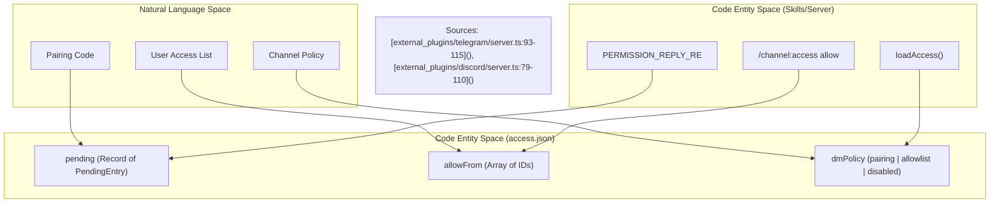
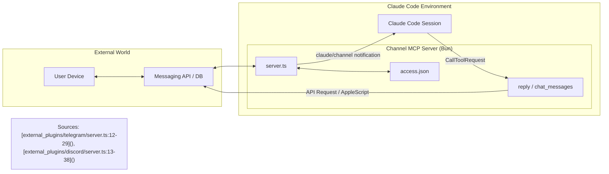

<!-- source: DeepWiki mcp.deepwiki.com · repo anthropics/claude-plugins-official · page 7 Messaging Channel Plugins · fetched 2026-10-26 -->

# Messaging Channel Plugins

Relevant source files

The following files were used as context for generating this wiki page:

- [external_plugins/discord/.claude-plugin/plugin.json](external_plugins/discord/.claude-plugin/plugin.json)
- [external_plugins/discord/README.md](external_plugins/discord/README.md)
- [external_plugins/discord/server.ts](external_plugins/discord/server.ts)
- [external_plugins/telegram/.claude-plugin/plugin.json](external_plugins/telegram/.claude-plugin/plugin.json)
- [external_plugins/telegram/.mcp.json](external_plugins/telegram/.mcp.json)
- [external_plugins/telegram/.npmrc](external_plugins/telegram/.npmrc)
- [external_plugins/telegram/ACCESS.md](external_plugins/telegram/ACCESS.md)
- [external_plugins/telegram/LICENSE](external_plugins/telegram/LICENSE)
- [external_plugins/telegram/README.md](external_plugins/telegram/README.md)
- [external_plugins/telegram/bun.lock](external_plugins/telegram/bun.lock)
- [external_plugins/telegram/package.json](external_plugins/telegram/package.json)
- [external_plugins/telegram/server.ts](external_plugins/telegram/server.ts)
- [external_plugins/telegram/skills/access/SKILL.md](external_plugins/telegram/skills/access/SKILL.md)
- [external_plugins/telegram/skills/configure/SKILL.md](external_plugins/telegram/skills/configure/SKILL.md)

The messaging channel plugin system enables Claude Code to operate as a remote assistant via external chat platforms. These plugins bridge the gap between a running Claude Code session and messaging APIs (like Telegram, Discord, or iMessage), allowing users to interact with their terminal environment from mobile devices or desktop chat clients.

Each channel plugin operates as a Model Context Protocol (MCP) server that handles inbound message notifications and provides tools for Claude to respond, react, and manage attachments.

## Channel Architecture and Access Control

All messaging channels follow a standardized contract for communication and security. When a channel plugin is active, Claude Code receives notifications via the `claude/channel` MCP notification. Security is managed through a pairing and allowlist model to ensure only authorized users can control the terminal.

*   **Activation**: Channels are enabled by launching Claude Code with the `--channels` flag [external_plugins/telegram/README.md:47-47]().
*   **State Management**: Access policies, allowlisted IDs, and pending pairings are stored in a local `access.json` file under the channel state directory [external_plugins/telegram/server.ts:26-29](), [external_plugins/discord/server.ts:37-38]().
*   **Pairing Flow**: To prevent unauthorized access, new users must typically provide a pairing code generated by the bot and entered into the local Claude Code session via an access skill [external_plugins/telegram/server.ts:93-94](), [external_plugins/telegram/README.md:52-55]().
*   **Approved Directory**: Successful pairings result in signaling files within an `approved/` directory [external_plugins/telegram/server.ts:30-30](), [external_plugins/discord/server.ts:39-39]().

For details, see [Channel Architecture and Access Control](#7.1).

### Natural Language to Code Entity Mapping: Access Control

The following diagram maps high-level access control concepts to the specific files and configuration keys used in the codebase.

## Telegram Channel Plugin

The Telegram plugin uses the `grammy` library to connect to the Telegram Bot API [external_plugins/telegram/server.ts:19-19](). It supports direct messages (DMs) and group chats with mention-triggering [external_plugins/telegram/server.ts:6-6]().

*   **Skills**: Includes `/telegram:configure` for token setup and `/telegram:access` for managing user permissions [external_plugins/telegram/README.md:35-55]().
*   **Tools**: Provides `reply`, `react`, and `edit_message` tools. It handles message chunking (4096 char limit) and supports sending files as attachments [external_plugins/telegram/README.md:74-79]().
*   **Persistence**: Uses a PID file (`bot.pid`) to prevent multiple instances from conflicting on the same bot token [external_plugins/telegram/server.ts:56-78]().

For details, see [Telegram Channel Plugin](#7.2).

## Discord Channel Plugin

The Discord plugin connects via the Discord Gateway (WebSocket) using `discord.js` and requires "Message Content Intent" to be enabled [external_plugins/discord/README.md:20-21]().

*   **Capabilities**: Supports a `fetch_messages` tool to retrieve recent history and a `download_attachment` tool for on-demand file retrieval [external_plugins/discord/README.md:97-98]().
*   **Group Support**: Supports guild channels via an opt-in mechanism using snowflake IDs [external_plugins/discord/README.md:88-88]().
*   **Interactive Auth**: Uses Discord's button components and gateway intents for secure messaging [external_plugins/discord/server.ts:25-31]().

For details, see [Discord Channel Plugin](#7.3).

## iMessage Channel Plugin

The iMessage plugin is macOS-only and interacts directly with the local `chat.db` SQLite database, using AppleScript for outbound message delivery.

*   **Requirements**: Requires **Full Disk Access** for the process to read `~/Library/Messages/chat.db`.
*   **Polling**: Monitors the database for new rows based on internal watermarks.
*   **Security**: Disables SMS/RCS by default to prevent sender ID spoofing.
*   **Self-Chat**: Automatically identifies the owner's addresses at boot to allow self-messaging without explicit allowlisting.

For details, see [iMessage Channel Plugin](#7.4).

## fakechat (Local Testing Channel)

`fakechat` is a reference implementation designed for local development and testing without requiring external API tokens.

*   **Interface**: Launches a local web server with an interactive web UI.
*   **File Management**: Outbound and inbound messages are managed through local files and directories.
*   **Reference Implementation**: Serves as a template for the common channel contract, demonstrating how to handle notifications and tool calls.

For details, see [fakechat (Local Testing Channel)](#7.5).

### System Component Interaction

The following diagram illustrates how a Channel MCP Server interacts with external APIs and the internal Claude Code environment.

## Channel Plugin Comparison

| Feature | Telegram | Discord | iMessage | fakechat |
| :--- | :--- | :--- | :--- | :--- |
| **Connection** | Long Polling [external_plugins/telegram/server.ts:9]() | WebSocket [external_plugins/discord/README.md:3] | SQLite Polling | HTTP/WS |
| **OS Support** | Cross-platform | Cross-platform | macOS Only | Cross-platform |
| **History** | No [external_plugins/telegram/README.md:91]() | Yes (`fetch_messages`) [external_plugins/discord/README.md:97]() | Yes (`chat_messages`) | No |
| **Attachments** | Support [external_plugins/telegram/README.md:76]() | On-demand [external_plugins/discord/README.md:98]() | Local Path | Local Dir |
| **Security** | Pairing/Allowlist [external_plugins/telegram/server.ts:5-6]() | Pairing/Allowlist [external_plugins/discord/server.ts:5-6]() | Allowlist/Self-chat | None |
| **Outbound** | Bot API [external_plugins/telegram/README.md:5]() | Bot API [external_plugins/discord/README.md:5] | AppleScript | Web UI |

Sources: [external_plugins/telegram/server.ts](), [external_plugins/discord/server.ts](), [external_plugins/telegram/README.md](), [external_plugins/discord/README.md]()

---

