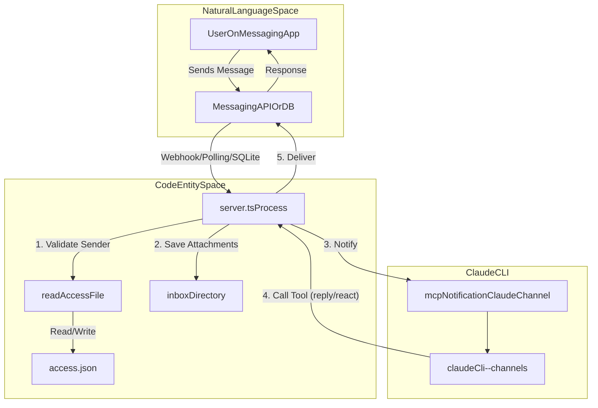
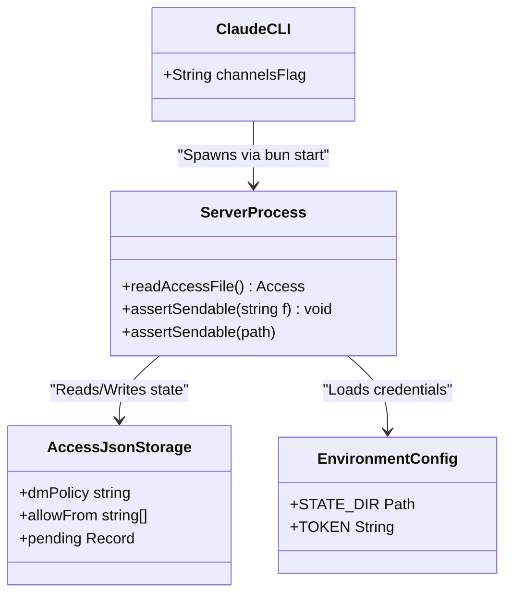

<!-- source: DeepWiki mcp.deepwiki.com · repo anthropics/claude-plugins-official · page 7.1 Channel Architecture and Access Control · fetched 2026-10-26 -->

# Channel Architecture and Access Control

<details>
<summary>Relevant source files</summary>

The following files were used as context for generating this wiki page:

- [external_plugins/discord/.mcp.json](external_plugins/discord/.mcp.json)
- [external_plugins/discord/.npmrc](external_plugins/discord/.npmrc)
- [external_plugins/discord/ACCESS.md](external_plugins/discord/ACCESS.md)
- [external_plugins/discord/LICENSE](external_plugins/discord/LICENSE)
- [external_plugins/discord/bun.lock](external_plugins/discord/bun.lock)
- [external_plugins/discord/package.json](external_plugins/discord/package.json)
- [external_plugins/discord/skills/access/SKILL.md](external_plugins/discord/skills/access/SKILL.md)
- [external_plugins/discord/skills/configure/SKILL.md](external_plugins/discord/skills/configure/SKILL.md)
- [external_plugins/telegram/.claude-plugin/plugin.json](external_plugins/telegram/.claude-plugin/plugin.json)
- [external_plugins/telegram/.mcp.json](external_plugins/telegram/.mcp.json)
- [external_plugins/telegram/.npmrc](external_plugins/telegram/.npmrc)
- [external_plugins/telegram/ACCESS.md](external_plugins/telegram/ACCESS.md)
- [external_plugins/telegram/LICENSE](external_plugins/telegram/LICENSE)
- [external_plugins/telegram/bun.lock](external_plugins/telegram/bun.lock)
- [external_plugins/telegram/package.json](external_plugins/telegram/package.json)
- [external_plugins/telegram/server.ts](external_plugins/telegram/server.ts)
- [external_plugins/telegram/skills/access/SKILL.md](external_plugins/telegram/skills/access/SKILL.md)
- [external_plugins/telegram/skills/configure/SKILL.md](external_plugins/telegram/skills/configure/SKILL.md)

</details>


This page documents the standardized architecture for Claude Code messaging channels. Channel plugins (such as Telegram, Discord, and iMessage) allow Claude Code to communicate with external messaging platforms via a unified Model Context Protocol (MCP) contract and a robust, multi-layer security model.

## Overview

Claude Code supports extending its reach beyond the terminal via **Channels**. All channel plugins share a common implementation pattern:
1.  **MCP Notification Bridge**: They use a specific notification type (`claude/channel`) to send inbound messages to the assistant.
2.  **Pairing & Access Control**: They implement a standardized "pairing" flow to securely link external user IDs (e.g., Telegram numeric IDs, Discord snowflakes, or iMessage handles) to a Claude Code session.
3.  **CLI Integration**: They are activated using the `--channels` flag.
4.  **Local State**: They manage configuration and access lists in the `~/.claude/channels/<plugin-name>/` directory [external_plugins/telegram/server.ts:27-31]().

### System Architecture

The following diagram illustrates the data flow between an external messaging platform, the MCP server, and the Claude Code CLI, bridging natural language spaces to code entities like `server.ts` and `loadAccessFile`.

**Channel Data Flow and Entity Mapping**

Sources: [external_plugins/telegram/server.ts:2-55]()

---

## The Channel Contract

All channel plugins must implement a set of core MCP tools and notifications to ensure compatibility with Claude Code.

### Inbound Notifications
When a message arrives, the plugin sends an MCP notification to Claude.
-   **Notification Name**: `claude/channel`
-   **Payload**: Typically contains `chat_id`, `message_id`, `sender_id`, and `text`.
-   **Attachments**: If the message contains files, the plugin handles them according to platform capabilities. Telegram downloads them eagerly to a local `inbox/` directory [external_plugins/telegram/server.ts:55]().

### Standardized Tools
Channel plugins typically expose tools to the assistant for replying, reacting, and fetching chat history.

Sources: [external_plugins/telegram/server.ts:12-17]()

---

## Access Control and Security Model

Security is managed through environment variables, the `access.json` state machine, and a filesystem signaling directory.

### The `access.json` Schema
All channel plugins maintain an `access.json` file. The `Access` type defines the structure [external_plugins/telegram/server.ts:111-126]():

| Field | Type | Description |
| :--- | :--- | :--- |
| `dmPolicy` | `string` | `pairing`, `allowlist`, or `disabled` [external_plugins/telegram/server.ts:112](). |
| `allowFrom` | `string[]` | List of approved User IDs or handles [external_plugins/telegram/server.ts:113](). |
| `groups` | `Record` | Map of group IDs to `GroupPolicy` [external_plugins/telegram/server.ts:114](). |
| `pending` | `Record` | Active pairing attempts waiting for approval [external_plugins/telegram/server.ts:115](). |

Sources: [external_plugins/telegram/server.ts:111-126](), [external_plugins/telegram/skills/access/SKILL.md:43-58]()

### Pairing Flow
The **Pairing** model allows for secure, interactive authorization.

1.  **Code Generation**: When an unknown user contacts the bot, the plugin generates a random pairing code.
2.  **State Tracking**: The code is stored in the `pending` object of `access.json` with an expiration timestamp.
3.  **Approval**: The operator approves the code via a plugin-specific access skill (e.g., `/telegram:access pair <code>`) [external_plugins/telegram/skills/access/SKILL.md:74-87]().
4.  **Promotion**: Upon approval, the `senderId` is moved to the `allowFrom` array [external_plugins/telegram/skills/access/SKILL.md:79-81]().

### Signaling with the `approved/` Directory
Plugins maintain an `approved/` directory inside the state directory [external_plugins/telegram/server.ts:30](). When a pairing is approved, the access skill writes a file to this directory [external_plugins/telegram/skills/access/SKILL.md:83-85](). The channel server polls this directory to detect when to send an "approval confirmation" message to the external user.

Sources: [external_plugins/telegram/server.ts:27-31](), [external_plugins/telegram/skills/access/SKILL.md:74-87]()

---

## CLI Integration: The `--channels` Flag

To enable a channel, Claude Code must be launched with the `--channels` flag.

**Command Syntax:**
```bash
claude --channels plugin:<plugin-name>@claude-plugins-official
```
Example for Telegram:
`claude --channels plugin:telegram@claude-plugins-official` [external_plugins/telegram/.mcp.json:1-8]()

### Implementation Details
1.  **Environment Loading**: Plugins attempt to load a `.env` file from the state directory to retrieve tokens (e.g., `TELEGRAM_BOT_TOKEN`) [external_plugins/telegram/server.ts:33-42]().
2.  **Safety Nets**: Channel servers implement `unhandledRejection` and `uncaughtException` handlers to prevent the bridge from dying silently [external_plugins/telegram/server.ts:80-87]().
3.  **Static Mode**: Setting `TELEGRAM_ACCESS_MODE=static` disables runtime pairing and treats the current `access.json` as read-only [external_plugins/telegram/server.ts:45]().

**Entity Mapping: Code to CLI Integration**

Sources: [external_plugins/telegram/server.ts:27-45, 144-154](), [external_plugins/telegram/.mcp.json:1-8]()

---

## Plugin Configuration Summary

| Feature | Implementation Detail |
| :--- | :--- |
| **Storage Path** | `~/.claude/channels/<plugin-name>/` [external_plugins/telegram/server.ts:27-28]() |
| **Credentials** | `.env` file or direct environment variables [external_plugins/telegram/server.ts:33-42]() |
| **Access State** | `access.json` (defines pairing/allowlist) [external_plugins/telegram/server.ts:29-126]() |
| **Inbound Files** | `inbox/` directory or native platform paths [external_plugins/telegram/server.ts:55]() |
| **Signaling** | `approved/` directory for authorized sessions [external_plugins/telegram/server.ts:30]() |

Sources: [external_plugins/telegram/server.ts:27-55]()

---

