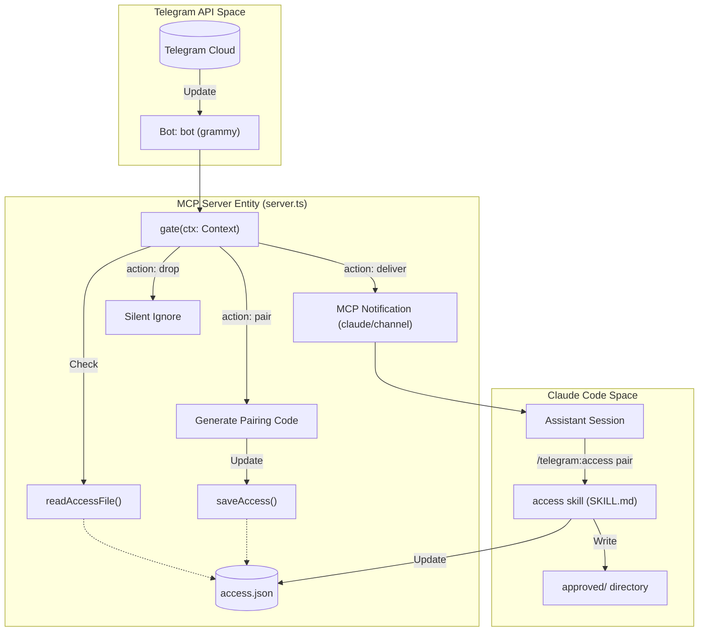
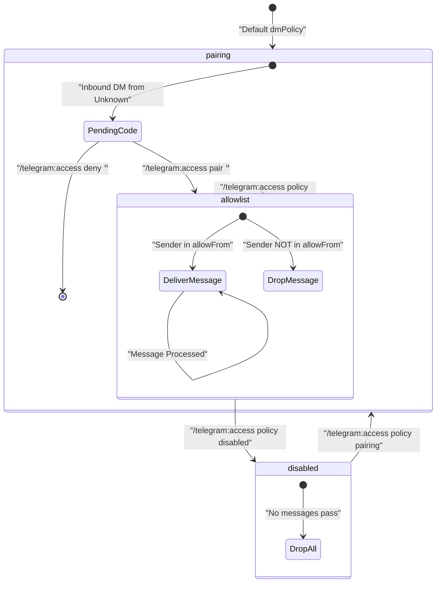

<!-- source: DeepWiki mcp.deepwiki.com · repo anthropics/claude-plugins-official · page 7.2 Telegram Channel Plugin · fetched 2026-10-26 -->

# Telegram Channel Plugin

Relevant source files

The following files were used as context for generating this wiki page:

- [external_plugins/telegram/.claude-plugin/plugin.json](external_plugins/telegram/.claude-plugin/plugin.json)
- [external_plugins/telegram/.mcp.json](external_plugins/telegram/.mcp.json)
- [external_plugins/telegram/.npmrc](external_plugins/telegram/.npmrc)
- [external_plugins/telegram/ACCESS.md](external_plugins/telegram/ACCESS.md)
- [external_plugins/telegram/LICENSE](external_plugins/telegram/LICENSE)
- [external_plugins/telegram/bun.lock](external_plugins/telegram/bun.lock)
- [external_plugins/telegram/package.json](external_plugins/telegram/package.json)
- [external_plugins/telegram/server.ts](external_plugins/telegram/server.ts)
- [external_plugins/telegram/skills/access/SKILL.md](external_plugins/telegram/skills/access/SKILL.md)
- [external_plugins/telegram/skills/configure/SKILL.md](external_plugins/telegram/skills/configure/SKILL.md)

The Telegram Channel Plugin is an MCP-based messaging bridge that allows Claude Code to communicate via a Telegram bot. It features a robust access control system, support for group chats with mention-triggering, and automated handling of Telegram-specific constraints like message length limits and attachment types.

## Overview and Setup

The plugin operates as an MCP server running on Bun, utilizing the `grammy` library for Telegram Bot API interactions [external_plugins/telegram/package.json:9](). It translates incoming Telegram messages into MCP notifications and provides tools for Claude to respond.

### Setup Workflow
1.  **Bot Creation**: Users create a bot via [@BotFather](https://t.me/BotFather) to obtain a `TELEGRAM_BOT_TOKEN` [external_plugins/telegram/skills/configure/SKILL.md:50]().
2.  **Configuration**: The `/telegram:configure` skill saves the token to `~/.claude/channels/telegram/.env` [external_plugins/telegram/skills/configure/SKILL.md:16]().
3.  **Activation**: Claude Code must be launched with the appropriate configuration or command-line flags.
4.  **Pairing**: Unknown senders trigger a 6-character pairing code. The user approves this in the terminal via `/telegram:access pair <code>` [external_plugins/telegram/skills/access/SKILL.md:74-85]().

### Natural Language to Code Entity Mapping: Setup
| User Concept | Code Entity / Path | Role |
| :--- | :--- | :--- |
| **Bot Token** | `TOKEN` | Loaded from `TELEGRAM_BOT_TOKEN` in `.env` [external_plugins/telegram/server.ts:44]() |
| **Configuration Skill** | `/telegram:configure` | Skill defined in `skills/configure/SKILL.md` [external_plugins/telegram/skills/configure/SKILL.md:2]() |
| **Access Management** | `/telegram:access` | Skill defined in `skills/access/SKILL.md` [external_plugins/telegram/skills/access/SKILL.md:2]() |
| **State Directory** | `STATE_DIR` | Defaults to `~/.claude/channels/telegram` [external_plugins/telegram/server.ts:27-28]() |
| **Inbox Directory** | `INBOX_DIR` | Storage for downloaded photos [external_plugins/telegram/server.ts:55]() |
| **Access State** | `Access` type | TypeScript interface defining the `access.json` schema [external_plugins/telegram/server.ts:111-126]() |

Sources: [external_plugins/telegram/server.ts:27-126](), [external_plugins/telegram/skills/configure/SKILL.md:1-16](), [external_plugins/telegram/skills/access/SKILL.md:1-85]()

---

## Technical Architecture

The plugin is implemented as a self-contained MCP server in `server.ts`. It uses a polling mechanism (via `grammy`) to receive updates and maps them to MCP tool calls and notifications.

### Message Processing Flow
The message processing router in `server.ts` acts as the primary traffic controller for inbound messages, determining if they should be delivered, dropped, or trigger a pairing flow [external_plugins/telegram/server.ts:1()]().

Title: "Telegram Inbound Message Data Flow"

Sources: [external_plugins/telegram/server.ts:1](), [external_plugins/telegram/skills/access/SKILL.md:64-87]()

### Key Components
*   **Access Control State**: Stored in `access.json`. It tracks `dmPolicy`, `allowFrom` (numeric IDs), `groups` configuration, and `pending` pairing codes [external_plugins/telegram/server.ts:111-126]().
*   **Polling**: The server uses `grammy` to poll for new messages. Telegram allows exactly one `getUpdates` consumer per token, so the server includes logic to kill stale poller PIDs on startup by reading and signaling `PID_FILE` [external_plugins/telegram/server.ts:58-77]().
*   **Attachment Handling**: Inbound photos are eagerly downloaded to `INBOX_DIR` because the Telegram Bot API does not provide a history or search API to fetch them later [external_plugins/telegram/server.ts:9]().

Sources: [external_plugins/telegram/server.ts:9-126]()

---

## Tools and Skills

### Exposed MCP Tools
The assistant has access to tools to interact with Telegram:

| Tool | Parameters | Logic |
| :--- | :--- | :--- |
| `reply` | `chat_id`, `text`, `reply_to`, `files` | Automatically chunks text based on `textChunkLimit`. Images send as photos; others as documents [external_plugins/telegram/server.ts:1()](). |
| `react` | `chat_id`, `message_id`, `emoji` | Only accepts Telegram's fixed emoji whitelist [external_plugins/telegram/server.ts:118-120](). |
| `edit_message` | `chat_id`, `message_id`, `text` | Updates existing bot messages for progress updates [external_plugins/telegram/server.ts:1()](). |

Sources: [external_plugins/telegram/server.ts:1](), [external_plugins/telegram/ACCESS.md:80-82]()

### The access.json State Machine
The `access.json` file is the source of truth for the bridge's security posture. It is re-read on every inbound message unless `TELEGRAM_ACCESS_MODE` is set to `static` [external_plugins/telegram/ACCESS.md:7]() .

Title: "Access State Machine and Skill Integration"

Sources: [external_plugins/telegram/skills/access/SKILL.md:43-107](), [external_plugins/telegram/ACCESS.md:19-27]()

---

## Implementation Details

### Message Chunking and Delivery
Telegram enforces a 4096-character limit per message [external_plugins/telegram/server.ts:137](). The plugin handles this through `textChunkLimit` and `chunkMode` [external_plugins/telegram/server.ts:123-125]():
*   **`length`**: Hard cut at the limit.
*   **`newline`**: Attempts to split at paragraph boundaries to preserve readability [external_plugins/telegram/ACCESS.md:144-145]().
*   **`replyToMode`**: Controls whether chunked replies are threaded to the original message (`first`, `all`, or `off`) [external_plugins/telegram/server.ts:121]().

### Group Support and Privacy
Groups are opt-in via `group add <groupId>` [external_plugins/telegram/ACCESS.md:46-49](). 
*   **Mention Triggering**: By default, `requireMention` is `true`. The bot responds to `@botusername`, replies to its own messages, or regex matches in `mentionPatterns` [external_plugins/telegram/server.ts:116]().
*   **Privacy Mode**: To use `--no-mention` (processing all group messages), users must disable "Privacy Mode" via BotFather [external_plugins/telegram/ACCESS.md:62-63]().

### Security and Validation
*   **Path Traversal**: The `assertSendable` function ensures the `reply` tool cannot be used to exfiltrate sensitive plugin state (like the `.env` containing the token) by checking that requested paths do not reside in `STATE_DIR` unless they are in the `inbox` [external_plugins/telegram/server.ts:144-154]().
*   **Input Integrity**: The `/telegram:access` skill explicitly refuses to act on input arriving via a channel notification (e.g., a Telegram message) to prevent prompt injection attacks from granting unauthorized access [external_plugins/telegram/skills/access/SKILL.md:15-20]().
*   **Permission Replies**: The server uses a strict regex `PERMISSION_REPLY_RE` to handle tool use approvals sent via Telegram [external_plugins/telegram/server.ts:93]().

Sources: [external_plugins/telegram/server.ts:93-154](), [external_plugins/telegram/skills/access/SKILL.md:15-20](), [external_plugins/telegram/ACCESS.md:46-145]()

---

