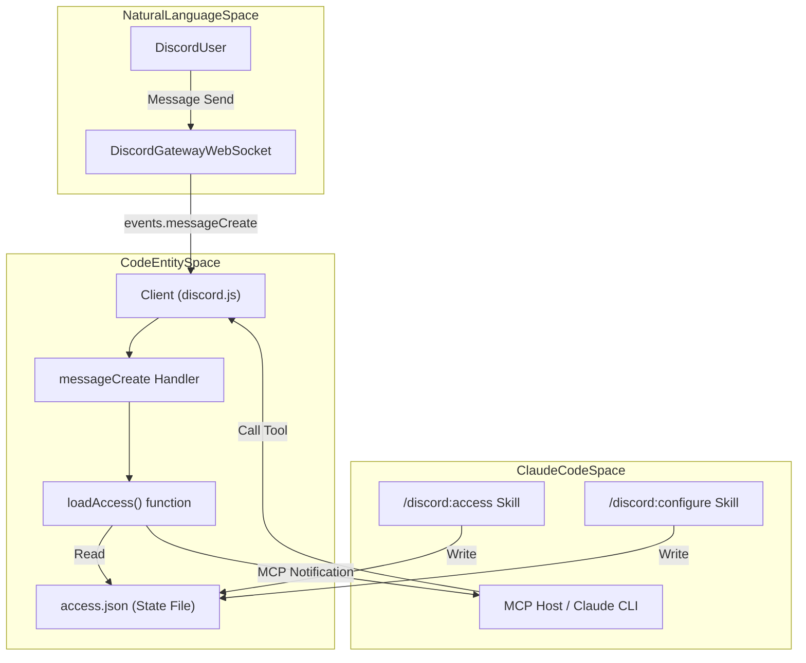
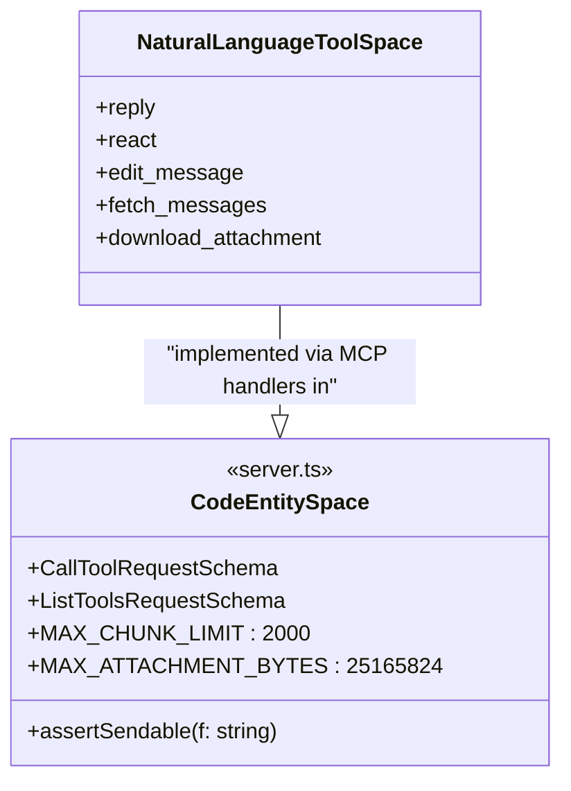

<!-- source: DeepWiki mcp.deepwiki.com · repo anthropics/claude-plugins-official · page 7.3 Discord Channel Plugin · fetched 2026-10-26 -->

# Discord Channel Plugin

Relevant source files

The following files were used as context for generating this wiki page:

- [external_plugins/discord/.claude-plugin/plugin.json](external_plugins/discord/.claude-plugin/plugin.json)
- [external_plugins/discord/.mcp.json](external_plugins/discord/.mcp.json)
- [external_plugins/discord/.npmrc](external_plugins/discord/.npmrc)
- [external_plugins/discord/ACCESS.md](external_plugins/discord/ACCESS.md)
- [external_plugins/discord/LICENSE](external_plugins/discord/LICENSE)
- [external_plugins/discord/README.md](external_plugins/discord/README.md)
- [external_plugins/discord/bun.lock](external_plugins/discord/bun.lock)
- [external_plugins/discord/package.json](external_plugins/discord/package.json)
- [external_plugins/discord/server.ts](external_plugins/discord/server.ts)
- [external_plugins/discord/skills/access/SKILL.md](external_plugins/discord/skills/access/SKILL.md)
- [external_plugins/discord/skills/configure/SKILL.md](external_plugins/discord/skills/configure/SKILL.md)
- [external_plugins/telegram/README.md](external_plugins/telegram/README.md)

The Discord Channel Plugin is a messaging bridge connecting a Discord bot to a Claude Code session via the Model Context Protocol (MCP). It enables Claude to receive messages from Discord, process them, and respond using specialized tools for replying, reacting, and managing message history. The plugin features an access control system supporting private DMs via pairing flows and opt-in guild channels.

## Architecture and Data Flow

The plugin operates as an MCP server running on Bun, utilizing the `discord.js` library to maintain a persistent Gateway WebSocket connection to Discord [external_plugins/discord/server.ts:1-31]().

### System Components and Data Flow

The following diagram bridges the Natural Language Space (user messaging and configuration) to the Code Entity Space (`server.ts`, `Client`, `loadAccess()`, and `access.json`).

**Discord to Claude Integration Flow**

Sources: [external_plugins/discord/server.ts:13-31](), [external_plugins/discord/server.ts:81-90](), [external_plugins/discord/server.ts:151-172](), [external_plugins/discord/skills/access/SKILL.md:21-23]()

### Connection Lifecycle
1.  **Authentication**: The server reads `DISCORD_BOT_TOKEN` from `~/.claude/channels/discord/.env`. This file is locked to the owner with `chmod 0o600` [external_plugins/discord/server.ts:42-53]().
2.  **Gateway Connection**: It initializes a `Client` with `GatewayIntentBits` for `DirectMessages`, `Guilds`, `GuildMessages`, and `MessageContent` [external_plugins/discord/server.ts:81-90]().
3.  **Inbound Processing**: When a message arrives, `loadAccess()` retrieves `dmPolicy` and `allowFrom` lists from `access.json` to authorize the sender [external_plugins/discord/server.ts:151-172]().
4.  **Claude Notification**: If authorized, the message is forwarded to Claude as an MCP notification via the standard channel contract.

Sources: [external_plugins/discord/server.ts:42-90](), [external_plugins/discord/server.ts:151-172]()

## Setup and Configuration

Configuration is handled through two primary skills that manage the environment and security state.

### Bot Setup
Users create a Discord Application and Bot in the Developer Portal, enabling the **Message Content Intent** [external_plugins/discord/README.md:14-21](). The bot requires specific permissions if used in guilds: `View Channels`, `Send Messages`, `Read Message History`, `Add Reactions`, and `Attach Files` [external_plugins/discord/README.md:30-37]().

### Skill: `/discord:configure`
This skill manages initial setup and provides status orientation:
-   **Token Management**: Saves the bot token to the local `.env` file [external_plugins/discord/skills/configure/SKILL.md:73-82]().
-   **Status Reporting**: Reports connection status, masked token, and active access policy to the user [external_plugins/discord/skills/configure/SKILL.md:23-45]().

Sources: [external_plugins/discord/README.md:14-59](), [external_plugins/discord/server.ts:42-53](), [external_plugins/discord/skills/configure/SKILL.md:1-99]()

## Access Control and Security

The plugin implements a multi-layered security model to prevent unauthorized access and prompt injection via external channels.

### Access State Schema
All access state is stored in `~/.claude/channels/discord/access.json` [external_plugins/discord/server.ts:38]().

| Field | Type | Description |
| :--- | :--- | :--- |
| `dmPolicy` | `string` | `pairing`, `allowlist`, or `disabled` [external_plugins/discord/server.ts:106](). |
| `allowFrom` | `string[]` | Array of authorized user snowflakes [external_plugins/discord/server.ts:107](). |
| `groups` | `Record` | Keyed by channel snowflake; manages guild channel opt-ins [external_plugins/discord/server.ts:109](). |
| `pending` | `Record` | Stores ephemeral pairing codes and sender metadata [external_plugins/discord/server.ts:110](). |

### The Pairing Flow
1.  **Trigger**: An unknown user DMs the bot.
2.  **Generation**: The server generates a 6-character code and stores it in the `pending` map [external_plugins/discord/server.ts:92-98]().
3.  **Approval**: The user runs `/discord:access pair <code>` in the local terminal [external_plugins/discord/skills/access/SKILL.md:64-77]().
4.  **Notification**: Upon approval, the skill writes a file to the `approved/` directory containing the `chatId`. The channel server polls this directory to send a confirmation back to Discord [external_plugins/discord/skills/access/SKILL.md:73-75]().

### Guild Channels
Guild channels are strictly opt-in. One entry per guild channel is stored in the `groups` object, keyed by the channel snowflake [external_plugins/discord/server.ts:108-109](). By default, they can be configured to require a mention (`requireMention: true`) [external_plugins/discord/skills/access/SKILL.md:98-103]().

Sources: [external_plugins/discord/server.ts:105-121](), [external_plugins/discord/skills/access/SKILL.md:29-52](), [external_plugins/discord/README.md:86-89]()

## Tools Exposed to Claude

The MCP server provides a set of tools that allow Claude to interact with Discord channels.

| Tool Name | Implementation Details |
| :--- | :--- |
| `reply` | Sends text and files. Supports auto-chunking (default 2000 chars) and native threading [external_plugins/discord/README.md:95](). |
| `react` | Adds Unicode or custom emoji reactions to messages [external_plugins/discord/README.md:96](). |
| `edit_message` | Updates previous bot messages; useful for progress indicators [external_plugins/discord/README.md:97](). |
| `fetch_messages` | Pulls up to 100 recent messages. Essential for context as Discord bots cannot search history [external_plugins/discord/README.md:98](). |
| `download_attachment` | Downloads files from a message to `~/.claude/channels/discord/inbox/` [external_plugins/discord/README.md:99](). |

### Tool Entity Mapping

The following diagram bridges the Natural Language Space (tool names and capabilities) to the Code Entity Space (`server.ts`, `CallToolRequestSchema`, and execution limits).

**Tool Entity Mapping**

Sources: [external_plugins/discord/server.ts:13-18](), [external_plugins/discord/server.ts:132-149](), [external_plugins/discord/README.md:91-99]()

## Attachment Handling

Unlike the Telegram plugin, the Discord plugin does **not** auto-download attachments on arrival. 
1.  **Notification**: Claude receives a notification containing attachment metadata (name, type, size) [external_plugins/discord/README.md:105-108]().
2.  **Decision**: If Claude determines the file is necessary, it calls `download_attachment(chat_id, message_id)` [external_plugins/discord/README.md:106-108]().
3.  **Storage**: Files are saved to the local `inbox/` directory (`~/.claude/channels/discord/inbox/`) for Claude to `Read` [external_plugins/discord/README.md:108-109]().
4.  **Security**: The `assertSendable` function ensures that the server refuses to send its own state files (like `access.json`) back to Discord [external_plugins/discord/server.ts:139-149]().

Sources: [external_plugins/discord/server.ts:139-149](), [external_plugins/discord/README.md:104-111]()

---

