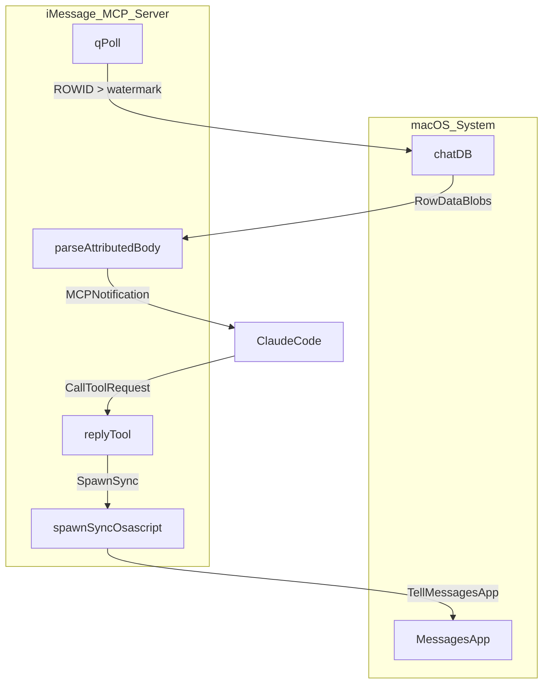
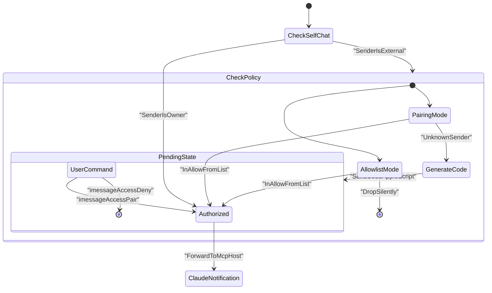

<!-- source: DeepWiki mcp.deepwiki.com · repo anthropics/claude-plugins-official · page 7.4 iMessage Channel Plugin · fetched 2026-10-26 -->

# iMessage Channel Plugin

Relevant source files

The following files were used as context for generating this wiki page:

- [external_plugins/imessage/.claude-plugin/plugin.json](external_plugins/imessage/.claude-plugin/plugin.json)
- [external_plugins/imessage/.mcp.json](external_plugins/imessage/.mcp.json)
- [external_plugins/imessage/.npmrc](external_plugins/imessage/.npmrc)
- [external_plugins/imessage/ACCESS.md](external_plugins/imessage/ACCESS.md)
- [external_plugins/imessage/LICENSE](external_plugins/imessage/LICENSE)
- [external_plugins/imessage/README.md](external_plugins/imessage/README.md)
- [external_plugins/imessage/bun.lock](external_plugins/imessage/bun.lock)
- [external_plugins/imessage/package.json](external_plugins/imessage/package.json)
- [external_plugins/imessage/server.ts](external_plugins/imessage/server.ts)
- [external_plugins/imessage/skills/access/SKILL.md](external_plugins/imessage/skills/access/SKILL.md)
- [external_plugins/imessage/skills/configure/SKILL.md](external_plugins/imessage/skills/configure/SKILL.md)

The iMessage Channel Plugin is a macOS-exclusive bridge that enables Claude Code to communicate via the native Messages app [external_plugins/imessage/server.ts:3-7, external_plugins/imessage/README.md:3-5](). It functions by directly polling the local SQLite database used by iMessage (`chat.db`) and sending replies via AppleScript (`osascript`) [external_plugins/imessage/server.ts:3-7](). Unlike other messaging plugins, it requires no external API tokens or servers, operating entirely on the local machine [external_plugins/imessage/server.ts:3-7, external_plugins/imessage/README.md:3]().

## System Architecture

The plugin is implemented as a Model Context Protocol (MCP) server that runs on `bun` [external_plugins/imessage/server.ts:1-2, external_plugins/imessage/package.json:2-6](). It handles inbound messages by monitoring the macOS `chat.db` and outbound messages by executing `osascript` commands [external_plugins/imessage/server.ts:3-7]().

### Inbound Data Flow (Polling)
The server performs a continuous poll of the `chat.db` SQLite database, typically located at `~/Library/Messages/chat.db` [external_plugins/imessage/server.ts:40-41]().

1.  **Watermark Initialization**: On startup, the server queries `MAX(ROWID)` from the `message` table using `qWatermark` to establish a watermark [external_plugins/imessage/server.ts:118-119](). This ensures old messages are not replayed on restart [external_plugins/imessage/README.md:55]().
2.  **Polling Loop**: Once per second, the server executes `qPoll` to find rows where `ROWID > watermark` [external_plugins/imessage/server.ts:120-129]().
3.  **AttributedBody Parsing**: Modern macOS versions often store text in a `blob` column called `attributedBody` using a `typedstream` (`NSAttributedString`) format when the plain `text` column is null [external_plugins/imessage/server.ts:80-82](). The `parseAttributedBody` function extracts the `NSString` payload by locating the string marker (`0x2B`) and decoding the streamtyped length prefix [external_plugins/imessage/server.ts:82-102]().
4.  **Attachment Handling**: The server queries the `attachment` table via `qAttachments` for file paths, MIME types, and transfer names associated with new messages [external_plugins/imessage/server.ts:165-172](). The first inbound image per message is surfaced to the assistant as a local path [external_plugins/imessage/README.md:58]().

### Outbound Data Flow (Sending)
Outbound messages are sent via the `reply` tool [external_plugins/imessage/server.ts:79-80, external_plugins/imessage/README.md:79]().
1.  **AppleScript Execution**: The server uses `spawnSync` to call `osascript` [external_plugins/imessage/server.ts:27]().
2.  **Message Delivery**: It executes a `tell application "Messages" to send ...` command, passing the text and chat GUID through `argv` to prevent shell escaping issues [external_plugins/imessage/README.md:56]().
3.  **Chunking**: Large replies are split into multiple messages based on the `textChunkLimit` (default 10,000) and `chunkMode` (`length` vs. `newline`) [external_plugins/imessage/ACCESS.md:87-90]().

### Natural Language to Code Entity Mapping: Messaging

| Natural Language Concept | Code Entity / Function | File Path |
| :--- | :--- | :--- |
| Message Poller | `qPoll` | [external_plugins/imessage/server.ts:120-129]() |
| SQLite Database | `db` (Bun.Database) | [external_plugins/imessage/server.ts:62-65]() |
| AppleScript Sender | `spawnSync("osascript", ...)` | [external_plugins/imessage/server.ts:27-27]() |
| Text Extraction | `parseAttributedBody` | [external_plugins/imessage/server.ts:82-102]() |
| Reply Tool | `reply` | [external_plugins/imessage/server.ts:79-80]() |
| History Fetcher | `qHistory` | [external_plugins/imessage/server.ts:131-141]() |

Title: "iMessage Message Flow"

Sources: [external_plugins/imessage/server.ts:27-172](), [external_plugins/imessage/README.md:53-59]()

## Setup and Security Requirements

### Full Disk Access (FDA)
Because `chat.db` is protected by macOS Transparency, Consent, and Control (TCC), the process running the plugin (e.g., Terminal, iTerm, or the `bun` binary) must be granted **Full Disk Access** in System Settings [external_plugins/imessage/README.md:10-14](). Without this, the server will exit with an `authorization denied` error during database initialization [external_plugins/imessage/server.ts:63-74]().

### SMS Spoofing Protection
SMS/RCS sender IDs are easily spoofable, whereas iMessage is Apple ID authenticated [external_plugins/imessage/server.ts:35-37]().
*   By default, `IMESSAGE_ALLOW_SMS` is `false` [external_plugins/imessage/server.ts:38]().
*   The server drops SMS/RCS messages unless explicitly opted in via environment variables (`IMESSAGE_ALLOW_SMS=true`), preventing forged senders from bypassing access controls [external_plugins/imessage/README.md:65]().

### Echo Cancellation
To distinguish user input from the assistant's own replies (which both appear as `is_from_me: 1` in `chat.db`), the server maintains tracking mechanisms against recently sent text [external_plugins/imessage/ACCESS.md:24]().

Sources: [external_plugins/imessage/server.ts:33-74](), [external_plugins/imessage/README.md:10-14](), [external_plugins/imessage/ACCESS.md:20-25]()

## Access Control and State Machine

Access is managed via `~/.claude/channels/imessage/access.json` [external_plugins/imessage/server.ts:44](). The server re-reads this file on every inbound message, allowing for real-time policy updates without restarts [external_plugins/imessage/skills/configure/SKILL.md:81-82]().

### Access State Machine
The plugin supports three primary `dmPolicy` modes [external_plugins/imessage/ACCESS.md:30-34]():
1.  **`allowlist` (Default)**: Only senders in the `allowFrom` array can communicate. Others are dropped silently [external_plugins/imessage/ACCESS.md:32]().
2.  **`pairing`**: Unknown senders receive an automated reply with a 5-letter pairing code (excluding 'l' for clarity) [external_plugins/imessage/server.ts:58-60](). The user must approve the code via `/imessage:access pair <code>` [external_plugins/imessage/skills/access/SKILL.md:71-84]().
3.  **`disabled`**: All messages except self-chat are dropped [external_plugins/imessage/ACCESS.md:34]().

### Self-Chat Bypass
Messages sent from the user's own Apple ID handles (discovered at boot by reading sent rows and handles) always bypass the gate [external_plugins/imessage/ACCESS.md:22-24]().

### Natural Language to Code Entity Mapping: Access Control

| Natural Language Concept | Code Entity / State Key | File Path |
| :--- | :--- | :--- |
| Access Configuration | `ACCESS_FILE` (`access.json`) | [external_plugins/imessage/server.ts:44-44]() |
| Approved Directory | `APPROVED_DIR` | [external_plugins/imessage/server.ts:45-45]() |
| Pairing Code Regex | `PERMISSION_REPLY_RE` | [external_plugins/imessage/server.ts:60-60]() |
| Policy Management | `access` Skill | [external_plugins/imessage/skills/access/SKILL.md:1-10]() |
| Setup Diagnostic | `configure` Skill | [external_plugins/imessage/skills/configure/SKILL.md:1-8]() |

Title: "iMessage Access Control Logic"

Sources: [external_plugins/imessage/server.ts:44-60](), [external_plugins/imessage/ACCESS.md:20-35](), [external_plugins/imessage/skills/access/SKILL.md:30-47]()

## Skill Commands and MCP Tools

### `/imessage:configure`
Used to diagnose setup issues. It checks for Full Disk Access by attempting to `ls` the `chat.db` file and summarizes the current access policy [external_plugins/imessage/skills/configure/SKILL.md:20-43](). It also provides guidance on handles (phone numbers vs. emails) [external_plugins/imessage/skills/configure/SKILL.md:60-62]().

### `/imessage:access`
Manages the `access.json` state machine [external_plugins/imessage/skills/access/SKILL.md:21-24]().
*   **`allow <handle>`**: Adds a phone number (`+1555...`) or email to the allowlist [external_plugins/imessage/skills/access/SKILL.md:90-95]().
*   **`pair <code>`**: Approves a pending pairing request, moves the sender to `allowFrom`, and writes a signal file to the `approved` directory [external_plugins/imessage/skills/access/SKILL.md:71-84]().
*   **`policy <mode>`**: Switches between `pairing`, `allowlist`, and `disabled` [external_plugins/imessage/skills/access/SKILL.md:100-104]().
*   **`group add <guid>`**: Enables the assistant in a specific group chat. Because iMessage lacks structured mentions, the plugin relies on `mentionPatterns` (regex) to trigger in groups [external_plugins/imessage/ACCESS.md:69-74]().
*   **`set <key> <value>`**: Configures delivery settings like `textChunkLimit` or `mentionPatterns` [external_plugins/imessage/skills/access/SKILL.md:116-123]().

### Exposed MCP Tools
- **`reply`**: Sends messages to a chat given a `chat_id` and `text`, supporting optional file paths [external_plugins/imessage/README.md:79]().
- **`chat_messages`**: Fetches recent conversation history directly from `chat.db`, categorized by DMs and groups with participant lists and timestamps [external_plugins/imessage/README.md:80]().

Sources: [external_plugins/imessage/skills/configure/SKILL.md:1-82](), [external_plugins/imessage/skills/access/SKILL.md:1-124](), [external_plugins/imessage/README.md:75-81]()

---

