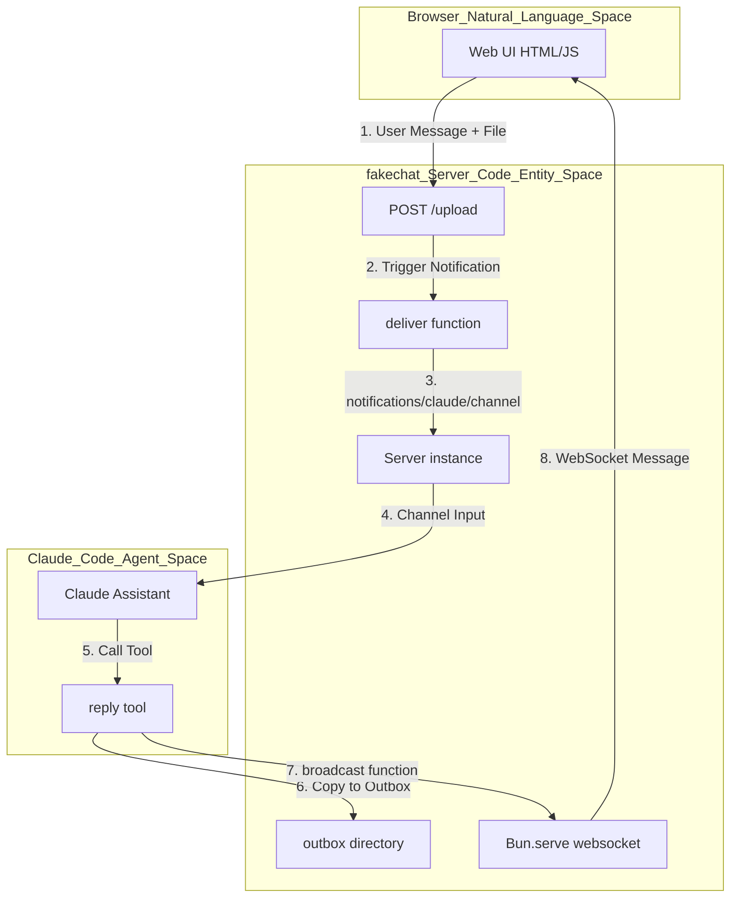
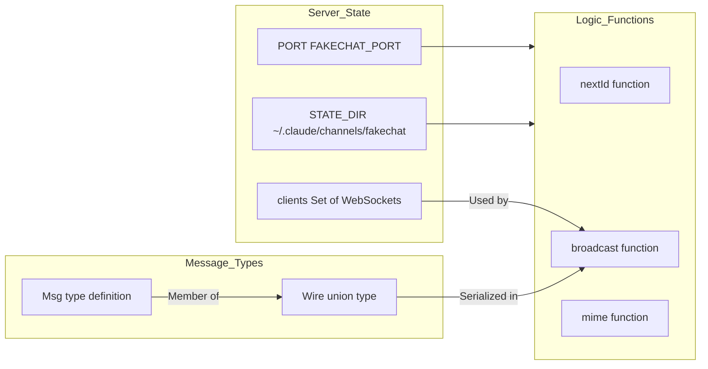

<!-- source: DeepWiki mcp.deepwiki.com · repo anthropics/claude-plugins-official · page 7.5 fakechat (Local Testing Channel) · fetched 2026-10-26 -->

# fakechat (Local Testing Channel)

<details>
<summary>Relevant source files</summary>

The following files were used as context for generating this wiki page:

- [external_plugins/fakechat/.claude-plugin/plugin.json](external_plugins/fakechat/.claude-plugin/plugin.json)
- [external_plugins/fakechat/.mcp.json](external_plugins/fakechat/.mcp.json)
- [external_plugins/fakechat/.npmrc](external_plugins/fakechat/.npmrc)
- [external_plugins/fakechat/LICENSE](external_plugins/fakechat/LICENSE)
- [external_plugins/fakechat/README.md](external_plugins/fakechat/README.md)
- [external_plugins/fakechat/bun.lock](external_plugins/fakechat/bun.lock)
- [external_plugins/fakechat/package.json](external_plugins/fakechat/package.json)
- [external_plugins/fakechat/server.ts](external_plugins/fakechat/server.ts)

</details>


The `fakechat` plugin is a reference implementation of the Claude Code channel contract (`claude/channel`). It provides a local, iMessage-style web interface that allows developers to test channel integrations, message flows, and file handling without requiring external API tokens or third-party messaging services like Telegram or Discord [external_plugins/fakechat/README.md:1-5](), [external_plugins/fakechat/server.ts:3-7]().

## Overview and Purpose

`fakechat` serves as a development tool rather than a production messaging bridge. It implements a simplified version of the `claude/channel` MCP protocol, enabling a bidirectional chat between a browser tab and a Claude Code session [external_plugins/fakechat/README.md:44-47]().

Key characteristics include:
- **No Authentication**: Unlike production channels, it does not use an `access.json` allowlist or pairing mechanism [external_plugins/fakechat/README.md:4-6]().
- **Local Server**: Runs a Bun-based HTTP and WebSocket server on `127.0.0.1:8787` (configurable via `FAKECHAT_PORT`) [external_plugins/fakechat/server.ts:20-20](), [external_plugins/fakechat/server.ts:150-152]().
- **Ephemeral State**: No message history or search; the UI resets on every browser reload [external_plugins/fakechat/README.md:44-47]().

### Sources:
- [external_plugins/fakechat/README.md:1-47]()
- [external_plugins/fakechat/server.ts:3-7]()
- [external_plugins/fakechat/server.ts:20-20]()
- [external_plugins/fakechat/server.ts:150-152]()

## Channel Contract Implementation

The plugin implements the `claude/channel` experimental capability using `@modelcontextprotocol/sdk` `Server` [external_plugins/fakechat/server.ts:9-14](), [external_plugins/fakechat/server.ts:59-65](). It uses standard MCP `notifications/claude/channel` to send messages from the web UI to Claude, and provides specialized tools for Claude to respond back to the UI [external_plugins/fakechat/server.ts:62-63](), [external_plugins/fakechat/server.ts:138-147]().

### Data Flow: Web UI to Claude
When a user types in the browser, the following sequence occurs:
1. The UI sends a `POST` request to `/upload` containing the message text and optional file attachments [external_plugins/fakechat/server.ts:173-178]().
2. Files are saved to the local `inbox` directory: `~/.claude/channels/fakechat/inbox/` [external_plugins/fakechat/server.ts:21-22](), [external_plugins/fakechat/server.ts:182-185]().
3. The server triggers a `deliver()` function which sends an MCP notification to Claude [external_plugins/fakechat/server.ts:135-148]().
4. Claude receives a notification containing the text and a `file_path` in the metadata if an attachment was provided [external_plugins/fakechat/server.ts:138-147]().

### Data Flow: Claude to Web UI
Claude communicates back to the browser using MCP tools:
1. **`reply`**: Sends text and optional files to the UI [external_plugins/fakechat/server.ts:98-120]().
2. **`edit_message`**: Updates a previously sent message in the UI [external_plugins/fakechat/server.ts:121-124]().
3. The server broadcasts these updates to all connected browser clients via WebSockets using `broadcast()` and `clients` [external_plugins/fakechat/server.ts:38-48]().

### Architecture Diagram: Channel Data Flow
This diagram maps the logical flow of messages to the specific functions and routes in `server.ts`.



### Sources:
- [external_plugins/fakechat/server.ts:9-14]()
- [external_plugins/fakechat/server.ts:38-48]()
- [external_plugins/fakechat/server.ts:59-65]()
- [external_plugins/fakechat/server.ts:135-148]()
- [external_plugins/fakechat/server.ts:150-191]()

## Key Components and Functions

### File Management
`fakechat` manages files using a local directory structure rooted at `~/.claude/channels/fakechat` via `STATE_DIR` [external_plugins/fakechat/server.ts:21-23]().

| Directory | Purpose | Implementation Detail |
| :--- | :--- | :--- |
| `inbox/` | Stores files uploaded from the Web UI to Claude | Files named with timestamp + extension [external_plugins/fakechat/server.ts:182-185]() |
| `outbox/` | Stores files sent from Claude to the Web UI | Files served via `/files/:filename` route [external_plugins/fakechat/server.ts:161-171]() |

### Tool Definitions
The plugin registers two primary tools via `ListToolsRequestSchema` and handles them in `CallToolRequestSchema` [external_plugins/fakechat/server.ts:67-92](), [external_plugins/fakechat/server.ts:94-131]().

#### 1. `reply`
- **Arguments**: `text` (required), `reply_to` (optional message ID), `files` (optional array of absolute paths) [external_plugins/fakechat/server.ts:75-79]().
- **Behavior**: Copies files to `outbox/` (enforcing a 50MB size limit), generates a unique message ID via `nextId()`, and broadcasts a `msg` wire type to the UI [external_plugins/fakechat/server.ts:41-43](), [external_plugins/fakechat/server.ts:104-118]().

#### 2. `edit_message`
- **Arguments**: `message_id` (required), `text` (required) [external_plugins/fakechat/server.ts:87-88]().
- **Behavior**: Broadcasts an `edit` wire type via `broadcast()` to update a specific message element in the UI [external_plugins/fakechat/server.ts:45-48](), [external_plugins/fakechat/server.ts:121-124]().

### Code Mapping: Server Entities
The following diagram associates system behaviors with their implementation variables and types in `server.ts`.



### Sources:
- [external_plugins/fakechat/server.ts:20-37]()
- [external_plugins/fakechat/server.ts:41-57]()
- [external_plugins/fakechat/server.ts:67-92]()
- [external_plugins/fakechat/server.ts:94-131]()

## Usage and Configuration

### Installation
The plugin is installed via the marketplace command or package reference [external_plugins/fakechat/README.md:12-15]().

```bash
/plugin install fakechat@claude-plugins-official
```

### Activation
To use `fakechat` as a channel, Claude Code must be launched with the `--channels` flag. The server will not connect without this parameter [external_plugins/fakechat/README.md:17-21]().

```bash
claude --channels plugin:fakechat@claude-plugins-official
```

### Environment Variables
- `FAKECHAT_PORT`: Overrides the default port `8787` [external_plugins/fakechat/server.ts:20-20]().

### Sources:
- [external_plugins/fakechat/README.md:12-21]()
- [external_plugins/fakechat/server.ts:20-20]()

---

