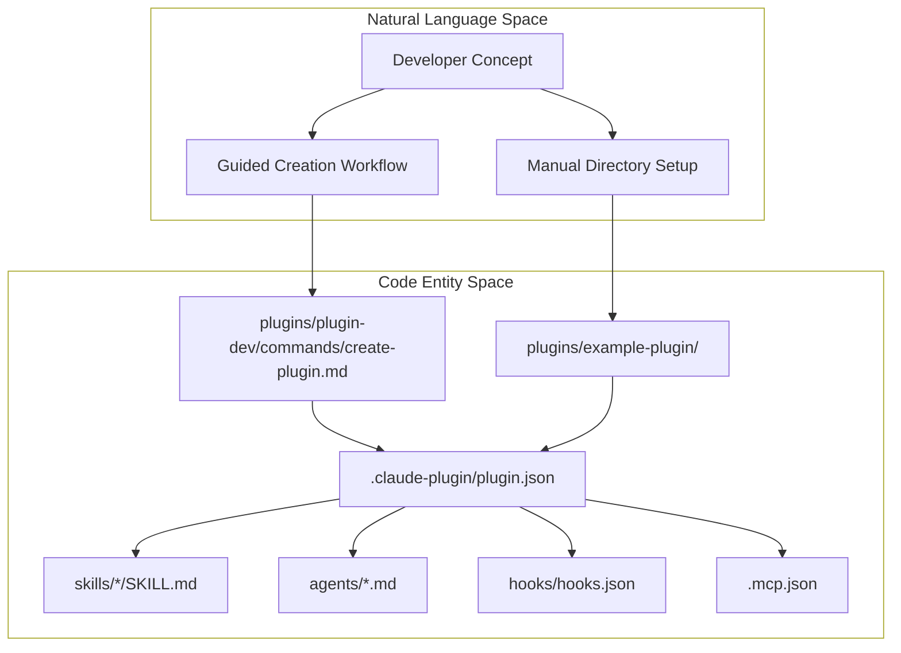
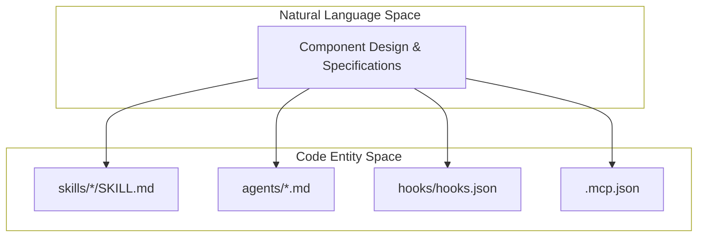

<!-- source: DeepWiki mcp.deepwiki.com · repo anthropics/claude-plugins-official · page 8 Developer Guide · fetched 2026-10-26 -->

# Developer Guide

Relevant source files

The following files were used as context for generating this wiki page:

- [.gitignore](.gitignore)
- [plugins/example-plugin/README.md](plugins/example-plugin/README.md)
- [plugins/example-plugin/commands/example-command.md](plugins/example-plugin/commands/example-command.md)
- [plugins/example-plugin/skills/example-command/SKILL.md](plugins/example-plugin/skills/example-command/SKILL.md)
- [plugins/plugin-dev/commands/create-plugin.md](plugins/plugin-dev/commands/create-plugin.md)
- [plugins/plugin-dev/skills/command-development/SKILL.md](plugins/plugin-dev/skills/command-development/SKILL.md)

This guide provides comprehensive guidance for developers creating, testing, and contributing Claude Code plugins. It covers the complete development lifecycle from initial planning through testing, validation, and publication, serving as a high-level entry point into plugin engineering.

**Scope:** This document introduces the plugin development process, available toolkits, and best practices. As a parent page, it provides a high-level overview and links to detailed child pages for each phase:
- **Creating a basic plugin from scratch:** See [Creating Your First Plugin](#8.1) for walk-throughs using `example-plugin`.
- **Using the AI-assisted workflow:** See [Using the Plugin Development Toolkit](#8.2) for the `/plugin-dev:create-plugin` workflow.
- **Detailed component development:** See [Developing Plugin Components](#8.3) for commands, agents, skills, hooks, and MCP integrations.
- **Testing and validation procedures:** See [Validation and Quality Assurance](#8.4) for validation scripts and review agents.
- **Submitting external plugins:** See [Contributing External Plugins](#8.5) for marketplace and external contribution workflows.

---

## Development Workflow Overview

Plugin development follows a structured workflow bridging natural language intent to concrete code entities in the filesystem. Developers can manually configure plugin directories or use automated generation systems.

Sources: [plugins/plugin-dev/commands/create-plugin.md:35-170](), [plugins/example-plugin/README.md:1-63]()

---

## Child Pages & Development Phases

The development process is structured into distinct phases, each detailed in its respective child page.

### 8.1. Creating Your First Plugin
Learn how to bootstrap a new plugin from scratch using `example-plugin` as a reference layout. This covers setting up `.claude-plugin/plugin.json`, structuring `skills/`, and integrating simple MCP servers.
- For details, see [Creating Your First Plugin](#8.1).
Sources: [plugins/example-plugin/README.md:1-20]()

### 8.2. Using the Plugin Development Toolkit
Leverage the `plugin-dev` toolkit to streamline creation. This system provides the `/plugin-dev:create-plugin` command, specialized skills (`hook-development`, `mcp-integration`, `plugin-structure`), and AI development agents.
- For details, see [Using the Plugin Development Toolkit](#8.2).
Sources: [plugins/plugin-dev/README.md:1-52](), [plugins/plugin-dev/commands/create-plugin.md:20-50]()

### 8.3. Developing Plugin Components
Understand the implementation details for specific component types, including user-invoked skills (`skills/*/SKILL.md`), autonomous agents (`agents/*.md`), event hooks (`hooks/hooks.json`), and MCP integrations (`.mcp.json`).

- For details, see [Developing Plugin Components](#8.3).
Sources: [plugins/plugin-dev/skills/command-development/SKILL.md:1-124](), [plugins/plugin-dev/skills/agent-development/SKILL.md:20-58]()

### 8.4. Validation and Quality Assurance
Ensure high plugin quality by running validation tools and scripts such as `validate-hook-schema.sh`, `validate-agent.sh`, and utilizing review agents like `plugin-validator` and `skill-reviewer`.
- For details, see [Validation and Quality Assurance](#8.4).
Sources: [plugins/plugin-dev/README.md:164-173]()

### 8.5. Contributing External Plugins
Review the guidelines, security requirements, and submission workflow for contributing external plugins to the marketplace ecosystem.
- For details, see [Contributing External Plugins](#8.5).
Sources: [plugins/plugin-dev/README.md:1-52]()

---

