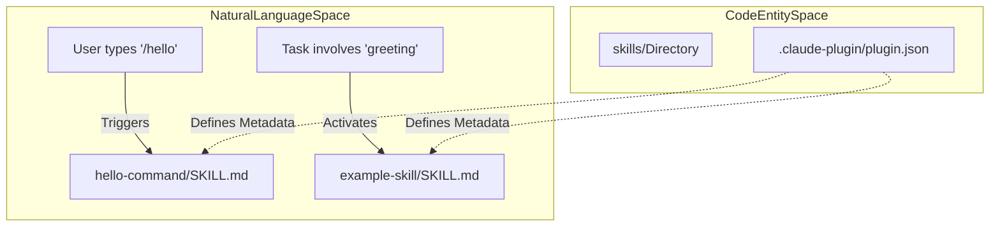
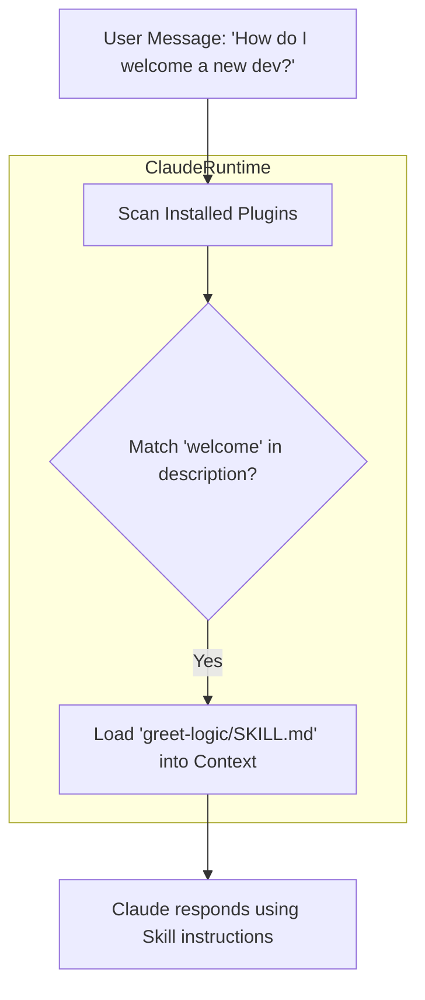

<!-- source: DeepWiki mcp.deepwiki.com · repo anthropics/claude-plugins-official · page 8.1 Creating Your First Plugin · fetched 2026-10-26 -->

# Creating Your First Plugin

<details>
<summary>Relevant source files</summary>

The following files were used as context for generating this wiki page:

- [.gitignore](.gitignore)
- [plugins/example-plugin/README.md](plugins/example-plugin/README.md)
- [plugins/example-plugin/commands/example-command.md](plugins/example-plugin/commands/example-command.md)
- [plugins/example-plugin/skills/example-command/SKILL.md](plugins/example-plugin/skills/example-command/SKILL.md)
- [plugins/plugin-dev/commands/create-plugin.md](plugins/plugin-dev/commands/create-plugin.md)
- [plugins/plugin-dev/skills/command-development/SKILL.md](plugins/plugin-dev/skills/command-development/SKILL.md)

</details>


## Purpose and Scope

This document provides a technical walkthrough for creating a Claude Code plugin from scratch using the example plugin structure [plugins/example-plugin/README.md:1-3](). It covers directory layouts, manifest configuration, user-invoked slash commands via the `skills/` format, contextual skills, and testing procedures [plugins/example-plugin/README.md:7-20]().

Sources: [plugins/example-plugin/README.md:1-3]()

---

## Understanding the Basic Plugin Structure

A Claude Code plugin consists of a metadata folder (`.claude-plugin/`) and component directories such as `skills/` [plugins/example-plugin/README.md:7-19](). The modern standard leverages the `skills/` directory for both model-invoked capabilities and user-invoked slash commands [plugins/example-plugin/README.md:23-26]().

### Standard Plugin Structure

```
my-first-plugin/
├── .claude-plugin/
│   └── plugin.json            # Required: Plugin metadata
├── .mcp.json                  # Optional: MCP server configuration
└── skills/
    ├── example-skill/
    │   └── SKILL.md           # Model-invoked (contextual guidance)
    └── example-command/
        └── SKILL.md           # User-invoked (slash command)
```

Claude Code automatically discovers these components during startup [plugins/plugin-dev/commands/create-plugin.md:134-166]().

### Natural Language to Code Entity Mapping



Sources: [plugins/example-plugin/README.md:7-19](), [plugins/plugin-dev/commands/create-plugin.md:142-149](), [plugins/plugin-dev/skills/plugin-structure/SKILL.md:20-37]()

---

## Step 1: Creating the Plugin Directory

Initialize the required directory tree using kebab-case for the plugin identifier [plugins/plugin-dev/commands/create-plugin.md:138-144]().

```bash
mkdir -p my-first-plugin/.claude-plugin
mkdir -p my-first-plugin/skills/hello
cd my-first-plugin
```

Sources: [plugins/plugin-dev/skills/plugin-structure/SKILL.md:39-44]()

---

## Step 2: Writing the Plugin Manifest

Create the plugin manifest file at `.claude-plugin/plugin.json` to define core metadata [plugins/example-plugin/README.md:9-10]().

```json
{
  "name": "my-first-plugin",
  "version": "0.1.0",
  "description": "A simple plugin with a command and a skill",
  "author": {
    "name": "Your Name",
    "email": "your.email@example.com"
  }
}
```

Sources: [plugins/plugin-dev/commands/create-plugin.md:150-161](), [plugins/plugin-dev/skills/plugin-structure/SKILL.md:46-85]()

---

## Step 3: Creating Your First Command (as a Skill)

Slash commands are implemented as markdown files within the `skills/<name>/SKILL.md` path [plugins/example-plugin/README.md:12-16](). They accept YAML frontmatter configuration [plugins/example-plugin/skills/example-command/SKILL.md:1-6]().

### Implementation

Create `skills/hello/SKILL.md`:

```markdown
---
name: hello
description: Say hello with a personalized greeting
argument-hint: <name> [tone]
allowed-tools: [Read, Bash]
---

# Hello Command

When the user invokes `/hello`, greet them.

## Instructions
1. Access the arguments provided via `$ARGUMENTS`.
2. If a name is provided, greet the user: "Hello, $1!"
3. If a tone is provided (e.g., "formal"), adjust the greeting accordingly.
4. If no arguments, say "Hello! I am your new plugin."
```

### Key Frontmatter Fields

| Field | Purpose | Code Reference |
|-------|---------|----------------|
| `name` | The slash command identifier | [plugins/example-plugin/skills/example-command/SKILL.md:28]() |
| `description` | Summary shown in `/help` | [plugins/example-plugin/skills/example-command/SKILL.md:29]() |
| `argument-hint` | Autocomplete hints for the user interface | [plugins/example-plugin/skills/example-command/SKILL.md:30]() |
| `allowed-tools` | Pre-approved tools to minimize prompts | [plugins/example-plugin/skills/example-command/SKILL.md:31]() |

Sources: [plugins/example-plugin/skills/example-command/SKILL.md:1-33](), [plugins/plugin-dev/skills/command-development/SKILL.md:124-195]()

---

## Step 4: Creating a Contextual Skill

Contextual skills activate automatically based on semantic task matching rather than explicit slash command execution [plugins/example-plugin/README.md:27-35]().

### Implementation

Create `skills/greet-logic/SKILL.md`:

```markdown
---
name: greet-logic
description: This skill should be used when the user mentions "onboarding", "welcome", or "new team member".
version: 1.0.0
---

# Onboarding Logic

Provide the user with the standard company onboarding greeting template.
```

### Contextual Skill Triggering Flow



Sources: [plugins/example-plugin/README.md:27-35](), [plugins/plugin-dev/commands/create-plugin.md:114-120](), [plugins/plugin-dev/skills/skill-development/SKILL.md:42-45]()

---

## Step 5: Advanced Components: Hooks and Settings

For automated behaviors and state management, plugins support configuration files and event hooks [plugins/example-plugin/README.md:52-63]().

### MCP Server Configuration (`.mcp.json`)

```json
{
  "server-name": {
    "type": "http",
    "url": "https://mcp.example.com/api"
  }
}
```

Sources: [plugins/example-plugin/README.md:52-63]()

---

## Step 6: Testing Your Plugin

Test the local plugin package by directing Claude Code to load the development directory [plugins/example-plugin/README.md:65-69]().

### Local Execution

```bash
cc --plugin-dir /path/to/my-first-plugin
```

### Verification Steps
1. Execute `/plugin list` to confirm `my-first-plugin` is loaded.
2. Run `/hello World` to verify command interpretation.
3. Query contextual triggers (e.g., "How do I onboard someone?") to verify skill activation [plugins/example-plugin/README.md:67-69]().

Sources: [plugins/example-plugin/README.md:65-69](), [plugins/plugin-dev/commands/create-plugin.md:214-216]()

---

## Component Comparison

| Feature | User-Invoked (Command) | Model-Invoked (Skill) |
|---------|-----------------------|-----------------------|
| **Directory Path** | `skills/<name>/` | `skills/<name>/` |
| **Invocation** | Explicit `/name` syntax | Semantic description match |
| **Argument Handling** | `$ARGUMENTS` or positional `$1`, `$2` [plugins/plugin-dev/skills/command-development/SKILL.md:212-241]() | Contextual derivation |
| **Primary Use Case** | User-driven workflows | Background knowledge injection |

Sources: [plugins/example-plugin/README.md:23-47](), [plugins/plugin-dev/skills/command-development/SKILL.md:210-252](), [plugins/plugin-dev/skills/skill-development/SKILL.md:13-24]()

---

