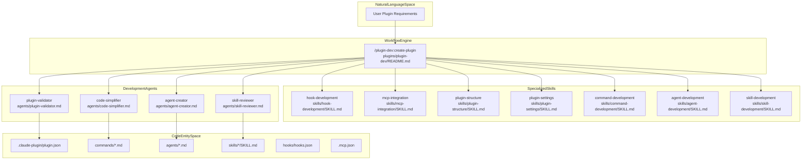
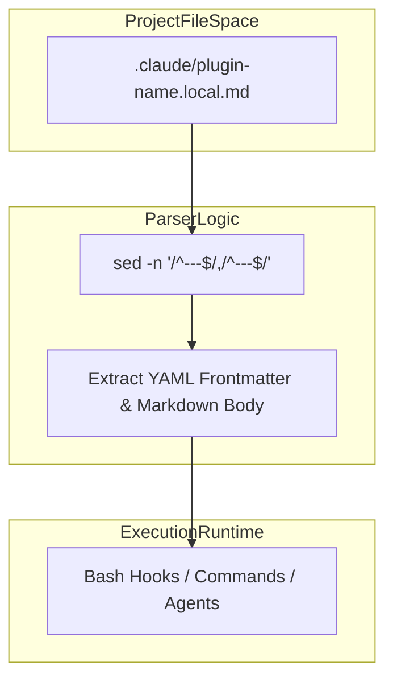

<!-- source: DeepWiki mcp.deepwiki.com · repo anthropics/claude-plugins-official · page 8.2 Using the Plugin Development Toolkit · fetched 2026-10-26 -->

# Using the Plugin Development Toolkit

<details>
<summary>Relevant source files</summary>

The following files were used as context for generating this wiki page:

- [plugins/hookify/skills/writing-rules/SKILL.md](plugins/hookify/skills/writing-rules/SKILL.md)
- [plugins/plugin-dev/README.md](plugins/plugin-dev/README.md)
- [plugins/plugin-dev/skills/hook-development/SKILL.md](plugins/plugin-dev/skills/hook-development/SKILL.md)
- [plugins/plugin-dev/skills/plugin-settings/SKILL.md](plugins/plugin-dev/skills/plugin-settings/SKILL.md)
- [plugins/plugin-dev/skills/plugin-structure/SKILL.md](plugins/plugin-dev/skills/plugin-structure/SKILL.md)
- [plugins/plugin-dev/skills/skill-development/SKILL.md](plugins/plugin-dev/skills/skill-development/SKILL.md)

</details>


## Purpose and Scope

This document details the usage and architecture of the `plugin-dev` toolkit within the Claude Code plugins ecosystem. The toolkit provides a structured 8-phase workflow command (`/plugin-dev:create-plugin`), seven specialized skills encapsulating domain expertise, and automated development agents that bridge natural language requirements with strict manifest, schema, and structural implementations required for Claude Code plugins.

Sources: [plugins/plugin-dev/README.md:1-52]()

## Toolkit Architecture

The `plugin-dev` toolkit bridges natural language specification space to code entity space by coordinating an entry-point workflow command, a set of modular skills, and autonomous agent roles to output validated plugin file structures.

### Component Architecture



Sources: [plugins/plugin-dev/README.md:19-52](), [plugins/plugin-dev/skills/skill-development/SKILL.md:27-40](), [plugins/plugin-dev/skills/plugin-structure/SKILL.md:22-37]()

### Progressive Disclosure Design Principle

Skills deployed via the toolkit leverage a three-tier loading model to optimize context consumption:

| Tier | Component | Loading Mechanism | Context Impact |
|------|-----------|-------------------|----------------|
| **1. Metadata** | `name` and `description` in YAML frontmatter | Always loaded in context | ~100 words |
| **2. SKILL.md Body** | Core procedural instructions | Loaded when skill triggers | <5,000 words |
| **3. Bundled Resources** | `scripts/`, `references/`, `assets/` | Loaded selectively by Claude | Unlimited* |

*\*Note: Scripts can be executed deterministically without loading their contents directly into the context window.*

Sources: [plugins/plugin-dev/skills/skill-development/SKILL.md:77-86]()

## The 8-Phase Workflow Command

The `/plugin-dev:create-plugin` command provides an interactive, end-to-end workflow mirroring advanced feature development processes.

### Command Execution Flow

```bash
# Interactive mode invocation
/plugin-dev:create-plugin

# Invocation with initial functional summary
/plugin-dev:create-plugin A plugin for managing database migrations
```

**8-Phase Lifecycle:**
1. **Discovery**: Gather requirements and define operational boundaries [plugins/plugin-dev/README.md:26-26]().
2. **Component Planning**: Select required skill modules, hooks, commands, agents, and MCP integrations [plugins/plugin-dev/README.md:27-27]().
3. **Detailed Design**: Specify parameters, schemas, and resolve functional ambiguities [plugins/plugin-dev/README.md:28-28]().
4. **Structure Creation**: Scaffold directory layouts and generate the `.claude-plugin/plugin.json` manifest [plugins/plugin-dev/README.md:29-29]().
5. **Component Implementation**: Build discrete files using specialized AI agents [plugins/plugin-dev/README.md:30-30]().
6. **Validation**: Execute structural checks and schema validation scripts [plugins/plugin-dev/README.md:31-31]().
7. **Testing**: Verify plugin execution within the runtime environment [plugins/plugin-dev/README.md:32-32]().
8. **Documentation**: Finalize the `README.md` and prepare distribution artifacts [plugins/plugin-dev/README.md:33-33]().

Sources: [plugins/plugin-dev/README.md:19-52]()

## Specialized Skills

The toolkit includes seven core skill modules designed to guide both developers and Claude through component creation.

### Skill Trigger Matrix

| Skill Identifier | Primary Trigger Phrases | Core Domain |
|------------------|-------------------------|-------------|
| `hook-development` | "create a hook", "PreToolUse hook", "validate tool use" | Event-driven automation [plugins/plugin-dev/README.md:56-60]() |
| `mcp-integration` | "add MCP server", ".mcp.json", "stdio/SSE/HTTP server" | Model Context Protocol [plugins/plugin-dev/README.md:76-80]() |
| `plugin-structure` | "plugin structure", "plugin.json manifest", "auto-discovery" | Layout and manifest setup [plugins/plugin-dev/README.md:95-98]() |
| `plugin-settings` | "plugin settings", ".local.md files", "YAML frontmatter" | State and configuration [plugins/plugin-dev/README.md:114-117]() |
| `command-development` | "create a slash command", "command frontmatter" | Slash command authoring [plugins/plugin-dev/README.md:135-138]() |
| `agent-development` | "create an agent", "agent frontmatter", "system prompt" | Autonomous agent design [plugins/plugin-dev/README.md:154-157]() |
| `skill-development` | "create a skill", "add a skill", "progressive disclosure" | Skill package creation [plugins/plugin-dev/skills/skill-development/SKILL.md:1-5]() |

Sources: [plugins/plugin-dev/README.md:54-195](), [plugins/plugin-dev/skills/skill-development/SKILL.md:1-5]()

### Plugin Settings Pattern

The `plugin-settings` skill defines how plugins maintain per-project state using `.claude/plugin-name.local.md` files combining YAML frontmatter and markdown documentation [plugins/plugin-dev/skills/plugin-settings/SKILL.md:9-19]().



Sources: [plugins/plugin-dev/skills/plugin-settings/SKILL.md:9-19](), [plugins/plugin-dev/skills/plugin-settings/SKILL.md:78-95]()

## Development Agents

Specialized agents automate validation and generation tasks during plugin authoring.

### Validation and Generation Architecture

* **`agent-creator`**: Generates autonomous agent specifications complete with system personas and structured `<example>` triggering blocks [plugins/plugin-dev/README.md:38-38]().
* **`plugin-validator`**: Verifies manifest integrity (`plugin.json`), component paths, and executes validation scripts (`validate-agent.sh`, `validate-hook-schema.sh`) [plugins/plugin-dev/README.md:31-31]().
* **`skill-reviewer`**: Audits skill packages for progressive disclosure compliance, third-person trigger syntax, and clean file separation [plugins/plugin-dev/skills/skill-development/SKILL.md:44-44]().
* **`code-simplifier`**: Refines generated code for clarity, maintaining adherence to project conventions (`CLAUDE.md`) while eliminating redundancy [plugins/pr-review-toolkit/agents/code-simplifier.md:43-57]().

Sources: [plugins/plugin-dev/README.md:31-41](), [plugins/plugin-dev/skills/skill-development/SKILL.md:44-44](), [plugins/pr-review-toolkit/agents/code-simplifier.md:43-57]()

## Best Practices

### Hook Authoring and Rule Structure
When implementing automated rules (such as via `hookify`), rules are written to `.claude/hookify.{rule-name}.local.md` using YAML frontmatter to control tool interception [plugins/hookify/skills/writing-rules/SKILL.md:9-11]().
* **Event Types**: Supported events include `bash`, `file`, `stop`, `prompt`, and `all` [plugins/hookify/skills/writing-rules/SKILL.md:21-21]().
* **Actions**: Actions default to `warn` or can be set to `block` to prevent undesired tool executions or stop sequences [plugins/hookify/skills/writing-rules/SKILL.md:48-52]().

Sources: [plugins/hookify/skills/writing-rules/SKILL.md:9-52]()

### MCP Portability
* Always utilize `${CLAUDE_PLUGIN_ROOT}` for defining executable paths and configuration references inside `.mcp.json` and `hooks.json` to ensure cross-environment portability [plugins/plugin-dev/README.md:66-66](), [plugins/plugin-dev/README.md:83-83]().

Sources: [plugins/plugin-dev/README.md:66-83]()

---

