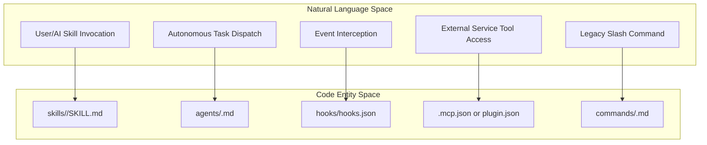
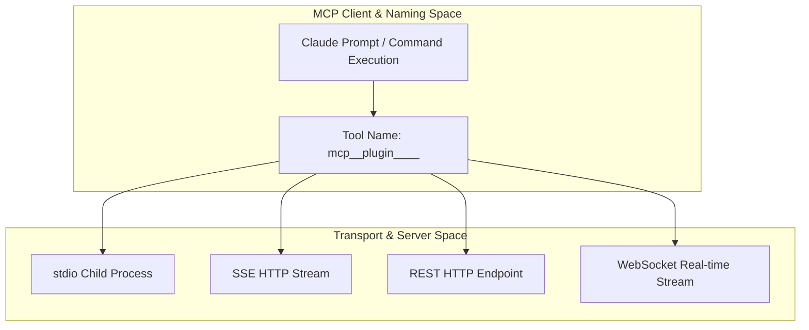

<!-- source: DeepWiki mcp.deepwiki.com · repo anthropics/claude-plugins-official · page 8.3 Developing Plugin Components · fetched 2026-10-26 -->

# Developing Plugin Components

<details>
<summary>Relevant source files</summary>

The following files were used as context for generating this wiki page:

- [external_plugins/asana/.claude-plugin/plugin.json](external_plugins/asana/.claude-plugin/plugin.json)
- [external_plugins/asana/README.md](external_plugins/asana/README.md)
- [external_plugins/asana/commands/asana-setup.md](external_plugins/asana/commands/asana-setup.md)
- [plugins/hookify/agents/conversation-analyzer.md](plugins/hookify/agents/conversation-analyzer.md)
- [plugins/plugin-dev/skills/agent-development/SKILL.md](plugins/plugin-dev/skills/agent-development/SKILL.md)
- [plugins/plugin-dev/skills/agent-development/examples/agent-creation-prompt.md](plugins/plugin-dev/skills/agent-development/examples/agent-creation-prompt.md)
- [plugins/plugin-dev/skills/agent-development/examples/complete-agent-examples.md](plugins/plugin-dev/skills/agent-development/examples/complete-agent-examples.md)
- [plugins/plugin-dev/skills/agent-development/references/agent-creation-system-prompt.md](plugins/plugin-dev/skills/agent-development/references/agent-creation-system-prompt.md)
- [plugins/plugin-dev/skills/agent-development/references/triggering-examples.md](plugins/plugin-dev/skills/agent-development/references/triggering-examples.md)
- [plugins/plugin-dev/skills/mcp-integration/SKILL.md](plugins/plugin-dev/skills/mcp-integration/SKILL.md)
- [plugins/plugin-dev/skills/mcp-integration/examples/sse-server.json](plugins/plugin-dev/skills/mcp-integration/examples/sse-server.json)
- [plugins/plugin-dev/skills/mcp-integration/references/authentication.md](plugins/plugin-dev/skills/mcp-integration/references/authentication.md)
- [plugins/plugin-dev/skills/mcp-integration/references/server-types.md](plugins/plugin-dev/skills/mcp-integration/references/server-types.md)
- [plugins/pr-review-toolkit/agents/code-reviewer.md](plugins/pr-review-toolkit/agents/code-reviewer.md)
- [plugins/pr-review-toolkit/agents/comment-analyzer.md](plugins/pr-review-toolkit/agents/comment-analyzer.md)
- [plugins/pr-review-toolkit/agents/pr-test-analyzer.md](plugins/pr-review-toolkit/agents/pr-test-analyzer.md)
- [plugins/pr-review-toolkit/agents/type-design-analyzer.md](plugins/pr-review-toolkit/agents/type-design-analyzer.md)

</details>


## Purpose and Scope

This document provides detailed technical guidance for developing the core component types in Claude Code plugins: commands, agents, skills, hooks, and MCP server integrations. Each component type has distinct file formats, data flow, invocation mechanisms, and configuration schemas.

For initial plugin creation and scaffolding, see [Creating Your First Plugin](). For using the AI-assisted development workflow, see [Using the Plugin Development Toolkit](). For validation and testing practices, see [Validation and Quality Assurance]().

---

## Component Types Overview

Claude Code plugins are composed of five distinct component types that extend the core harness with knowledge, autonomous capabilities, event hooks, and external service integrations.

### Component-to-File Entity Mapping

The following diagram bridges natural language component requests to concrete file entities and directory structures in the codebase (`[path/to/file:startLine-endLine]()`).



Sources: [plugins/plugin-dev/README.md:7-17](), [plugins/plugin-dev/skills/agent-development/SKILL.md:9-19](), [plugins/plugin-dev/skills/skill-development/SKILL.md:11-40]()

**Component Invocation Patterns & File Formats**

| Component | User-Invoked | AI-Invoked | Event-Driven | File Format / Path |
|-----------|--------------|------------|--------------|--------------------|
| Skills | Yes (`/name`) | Yes (context) | No | Markdown + YAML (`skills/*/SKILL.md`) [plugins/plugin-dev/README.md:135-152]() |
| Agents | No | Yes (description) | No | Markdown + YAML (`agents/*.md`) [plugins/plugin-dev/SKILL.md:20-31]() |
| Hooks | No | No | Yes (events) | JSON (`hooks/hooks.json`) [plugins/plugin-dev/skills/hook-development/SKILL.md:22-58]() |
| MCP Servers | No | No | Yes (auto-start) | JSON (`.mcp.json` or `plugin.json`) [plugins/plugin-dev/skills/mcp-integration/SKILL.md:23-59]() |
| Commands (Legacy) | Yes (`/name`) | No | No | Markdown + YAML (`commands/*.md`) [plugins/plugin-dev/skills/command-development/SKILL.md:135-152]() |

Sources: [plugins/plugin-dev/README.md:7-17](), [plugins/plugin-dev/skills/agent-development/SKILL.md:9-19](), [plugins/plugin-dev/skills/skill-development/SKILL.md:11-40]()

---

## Skills System

Skills are modular, self-contained packages that extend Claude's capabilities by providing specialized knowledge, workflows, and tools. They act as onboarding guides for specific domains [plugins/plugin-dev/skills/skill-development/SKILL.md:11-16]().

### Skill Directory Structure and Progressive Disclosure

Skills use a directory-based layout to bundle instructions with supporting resources, relying on progressive disclosure to keep context windows lean.

```mermaid
graph TB
    subgraph "Skill Directory Structure"
        SK["SKILL.md"]
        SCR["scripts/"]
        REF["references/"]
        AST["assets/"]
    end

    subgraph "Context Loading Levels"
        L1[""Level 1: Metadata (Always in Context)""]
        L2[""Level 2: SKILL.md Body (Loaded on Trigger)""]
        L3[""Level 3: Bundled Resources (Loaded/Executed On-Demand)""]
    end

    SK --> L1
    SK --> L2
    SCR -.-> L3
    REF -.-> L3
    AST -.-> L3
```

Sources: [plugins/plugin-dev/skills/skill-development/SKILL.md:27-83](), [plugins/plugin-dev/skills/plugin-structure/SKILL.md:164-199]()

**Resource Types in `skills/<name>/`:**
*   **`SKILL.md`**: Required entry point containing YAML frontmatter (`name`, `description`) and Markdown system instructions [plugins/plugin-dev/skills/skill-development/SKILL.md:27-45]().
*   **`scripts/`**: Executable code (Python/Bash) for tasks requiring deterministic reliability [plugins/plugin-dev/skills/skill-development/SKILL.md:48-55]().
*   **`references/`**: Documentation (API specs, schemas) loaded into context only when referenced [plugins/plugin-dev/skills/skill-development/SKILL.md:57-67]().
*   **`assets/`**: Files used in output (templates, boilerplate) not intended to be read into the context window [plugins/plugin-dev/skills/skill-development/SKILL.md:68-76]().

---

## Commands (Legacy Format)

Legacy commands are single Markdown files located in the `commands/` directory. They represent instructions **for Claude** rather than conversational messages for the user [plugins/plugin-dev/skills/command-development/SKILL.md:135-152]().

### Command Frontmatter Configuration

```markdown
---
description: Set up the Asana V2 MCP server connection
argument-hint: "[client_id]"
allowed-tools: ["Read", "Write", "Bash"]
---
```

*   `description`: Summary string displayed in `/help` and used for discovery [plugins/plugin-dev/skills/command-development/SKILL.md:140-141]().
*   `argument-hint`: Hint string displayed for dynamic command arguments [plugins/plugin-dev/skills/command-development/SKILL.md:141]().
*   `allowed-tools`: Optional array restricting tool execution privileges during command handling [plugins/plugin-dev/skills/command-development/SKILL.md:141]().

Sources: [plugins/plugin-dev/skills/command-development/SKILL.md:135-152](), [plugins/plugin-dev/skills/plugin-structure/SKILL.md:110-135]()

---

## Agents and Subagents

Agents are autonomous subprocesses that handle complex, multi-step tasks independently. They are defined as Markdown files under `agents/<agent-identifier>.md` [plugins/plugin-dev/skills/agent-development/SKILL.md:9-31]().

### Frontmatter Fields and Validation

| Field | Requirement | Validation Rules & Options |
|-------|-------------|----------------------------|
| `name` | Required | Lowercase, numbers, hyphens only; 3–50 chars; must start/end with alphanumeric (`[plugins/plugin-dev/skills/agent-development/SKILL.md:54-61]()`) |
| `description` | Required | Flat prose starting with "Use this agent when..." listing 2–4 trigger scenarios [plugins/plugin-dev/skills/agent-development/SKILL.md:74-86]() |
| `model` | Required | `inherit` (recommended), `sonnet`, `opus`, or `haiku` [plugins/plugin-dev/skills/agent-development/SKILL.md:95-105]() |
| `color` | Required | UI visual identifier: `blue`, `cyan`, `green`, `yellow`, `magenta`, `red` [plugins/plugin-dev/skills/agent-development/SKILL.md:107-111]() |
| `tools` | Optional | Array of permitted tool names (e.g. `["Read", "Write", "Grep"]`) [plugins/plugin-dev/skills/agent-development/SKILL.md:122-132]() |

### Triggering Mechanisms and System Prompt Structure

The agent file body acts as its system prompt. It must start with a `## When to invoke` section containing 2 to 4 representative scenarios formatted as prose bullets [plugins/plugin-dev/skills/agent-development/SKILL.md:35-45]().

Example agent files in the repository include `plugins/pr-review-toolkit/agents/code-reviewer.md` [plugins/pr-review-toolkit/agents/code-reviewer.md:1-6]() and `plugins/pr-review-toolkit/agents/pr-test-analyzer.md` [plugins/pr-review-toolkit/agents/pr-test-analyzer.md:1-6]().

Sources: [plugins/plugin-dev/skills/agent-development/SKILL.md:20-176](), [plugins/pr-review-toolkit/agents/code-reviewer.md:1-41]()

---

## Hooks System

Hooks are event-driven automation points configured in `hooks/hooks.json` [plugins/plugin-dev/skills/hook-development/SKILL.md:22-58]().

### Hook Events

*   `PreToolUse`: Triggered before a tool executes; capable of blocking execution or modifying input [plugins/plugin-dev/skills/hook-development/SKILL.md:62]().
*   `PostToolUse`: Triggered after tool execution; provides feedback or validation to the model [plugins/plugin-dev/skills/hook-development/SKILL.md:62]().
*   `Stop`: Triggered when an agent attempts to complete a task [plugins/plugin-dev/skills/hook-development/SKILL.md:62]().
*   `SessionStart`: Triggered at the beginning of a Claude Code session [plugins/plugin-dev/skills/hook-development/SKILL.md:63]().

Sources: [plugins/plugin-dev/skills/hook-development/SKILL.md:1-210]()

---

## MCP Server Integration

Model Context Protocol (MCP) integrations enable Claude Code plugins to connect to external APIs, databases, and services [plugins/plugin-dev/skills/mcp-integration/SKILL.md:9-12]().

### MCP Tool Execution and Routing

The following diagram illustrates how external service tool calls are structured and routed through MCP server transports.



Sources: [plugins/plugin-dev/skills/mcp-integration/SKILL.md:65-166](), [plugins/plugin-dev/skills/mcp-integration/references/server-types.md:1-300]()

### Configuration Methods

1.  **Dedicated `.mcp.json` (Recommended)**: Placed at the plugin root for clear separation of concerns [plugins/plugin-dev/skills/mcp-integration/SKILL.md:23-37]().
2.  **Inline in `plugin.json`**: Defined under the `mcpServers` key for single-server plugins [plugins/plugin-dev/skills/mcp-integration/SKILL.md:44-59]().

### Server Types and Transport Protocols

*   **`stdio`**: Spawns local child processes communicating via standard input/output streams [plugins/plugin-dev/skills/mcp-integration/SKILL.md:67-94]().
*   **`sse`**: Server-Sent Events over HTTP with built-in OAuth support (e.g. Asana V2 integration in `external_plugins/asana/README.md`) [plugins/plugin-dev/skills/mcp-integration/SKILL.md:95-119](), [external_plugins/asana/README.md:1-33]().
*   **`http`**: RESTful MCP servers using static tokens or custom headers [plugins/plugin-dev/skills/mcp-integration/SKILL.md:120-143]().
*   **`ws`**: Bidirectional real-time communication over WebSockets [plugins/plugin-dev/skills/mcp-integration/SKILL.md:144-166]().

### Tool Naming Convention

Tools provided by MCP servers are automatically prefixed according to the following strict naming format:
`mcp__plugin_<plugin-name>_<server-name>__<tool-name>` [plugins/plugin-dev/skills/mcp-integration/SKILL.md:190-201]()

Example configuration and setup command patterns can be found in `external_plugins/asana/commands/asana-setup.md` [external_plugins/asana/commands/asana-setup.md:1-42]() and `plugins/plugin-dev/skills/mcp-integration/references/authentication.md` [plugins/plugin-dev/skills/mcp-integration/references/authentication.md:1-120]().

Sources: [plugins/plugin-dev/skills/mcp-integration/SKILL.md:19-277](), [external_plugins/asana/README.md:1-49](), [plugins/plugin-dev/skills/mcp-integration/references/authentication.md:1-258]()

---

## Plugin Settings and Configuration

Plugins store user-specific configuration and state in `.claude/<plugin-name>.local.md` files within the project working directory [plugins/plugin-dev/skills/plugin-settings/SKILL.md:9-18](). These files combine YAML frontmatter for structured configuration properties with Markdown bodies for context instructions [plugins/plugin-dev/skills/plugin-settings/SKILL.md:24-40]().

### Parsing State in Shell Scripts

Bash-based hooks parse frontmatter state using `sed` and `grep` pipelines:

```bash
# Define state file path
STATE_FILE=".claude/my-plugin.local.md"

# Parse YAML frontmatter
FRONTMATTER=$(sed -n '/^---$/,/^---$/{ /^---$/d; p; }' "$STATE_FILE")

# Extract individual configuration field
ENABLED=$(echo "$FRONTMATTER" | grep '^enabled:' | sed 's/enabled: *//' | sed 's/^"\(.*\)"$/\1/')
```
[plugins/plugin-dev/skills/plugin-settings/SKILL.md:70-83]()

Sources: [plugins/plugin-dev/skills/plugin-settings/SKILL.md:1-135]()

---

