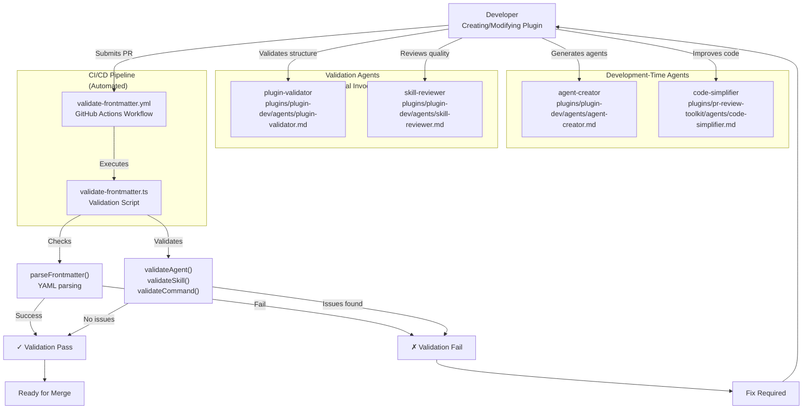
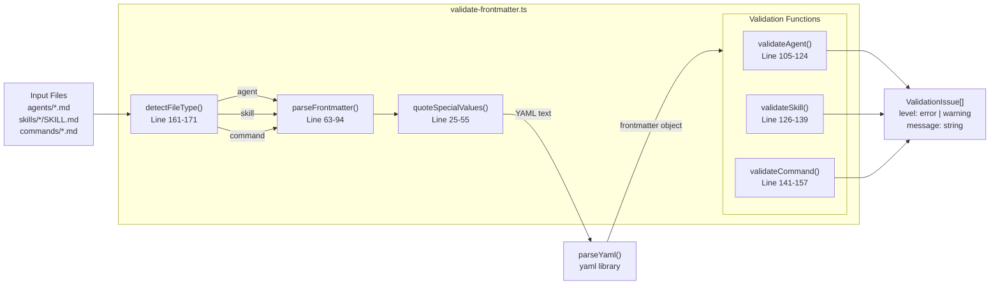
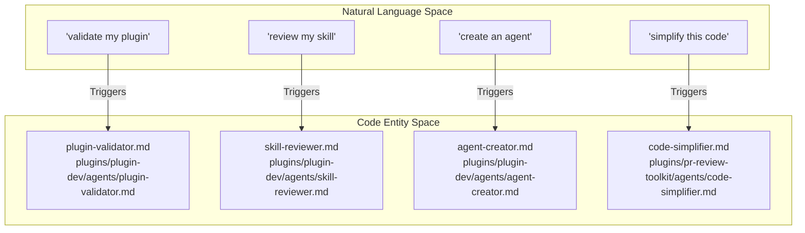

<!-- source: DeepWiki mcp.deepwiki.com · repo anthropics/claude-plugins-official · page 8.4 Validation and Quality Assurance · fetched 2026-10-26 -->

# Validation and Quality Assurance

Relevant source files

The following files were used as context for generating this wiki page:

- [.github/scripts/validate-frontmatter.ts](.github/scripts/validate-frontmatter.ts)
- [.github/workflows/validate-frontmatter.yml](.github/workflows/validate-frontmatter.yml)
- [plugins/plugin-dev/agents/agent-creator.md](plugins/plugin-dev/agents/agent-creator.md)
- [plugins/plugin-dev/agents/plugin-validator.md](plugins/plugin-dev/agents/plugin-validator.md)
- [plugins/plugin-dev/agents/skill-reviewer.md](plugins/plugin-dev/agents/skill-reviewer.md)
- [plugins/pr-review-toolkit/agents/code-simplifier.md](plugins/pr-review-toolkit/agents/code-simplifier.md)

This document describes the validation and quality assurance systems for Claude Code plugins. It covers automated frontmatter validation via GitHub Actions, validation agents (`plugin-validator`, `skill-reviewer`), quality improvement agents (`code-simplifier`, `agent-creator`), and testing best practices. 

For information about creating plugin components, see [4.3 Agents and Subagents]() and [4.4 Skills System](). For guidance on the plugin development workflow, see [10.2 Using the Plugin Development Toolkit](). For external plugin submission and review requirements, see [10.5 Contributing External Plugins]().

## Validation Pipeline Overview

The validation system operates at three levels: development-time agents that proactively improve quality, validation agents that developers manually invoke, and GitHub Actions that enforce standards in CI/CD.

### Validation Pipeline Architecture

"Natural Language Space to Code Entity Space Mapping"

Sources: [.github/workflows/validate-frontmatter.yml:1-35](), [.github/scripts/validate-frontmatter.ts:1-250](), [plugins/plugin-dev/agents/plugin-validator.md:1-183](), [plugins/plugin-dev/agents/skill-reviewer.md:1-184]()

## Frontmatter Validation System

The frontmatter validation system enforces YAML frontmatter standards for agents, skills, and commands through a TypeScript validation script executed in GitHub Actions CI/CD.

### Workflow Trigger Configuration

The `validate-frontmatter.yml` workflow triggers on pull requests that modify specific file patterns [ .github/workflows/validate-frontmatter.yml:4-9]():

| Pattern | Description |
|---------|-------------|
| `**/agents/*.md` | Agent definition files |
| `**/skills/*/SKILL.md` | Skill definition files |
| `**/commands/*.md` | Command definition files |

Sources: [.github/workflows/validate-frontmatter.yml:4-9]()

### Validation Script Architecture

"Code Entity Space: validate-frontmatter.ts Internal Logic"

Sources: [.github/scripts/validate-frontmatter.ts:25-250]()

### File Type Detection

The `detectFileType()` function identifies file types based on path patterns, with special handling to exclude skill content directories from agent/command detection [ .github/scripts/validate-frontmatter.ts:161-171]():

This prevents false positives where skills contain `agents/` or `commands/` subdirectories for examples.

Sources: [.github/scripts/validate-frontmatter.ts:161-171]()

### YAML Special Character Handling

The validation script preprocesses frontmatter to handle YAML special characters (e.g., glob patterns with `{`, `[`, `*`) by automatically quoting values using `quoteSpecialValues()` [ .github/scripts/validate-frontmatter.ts:25-55]().

The regex `YAML_SPECIAL_CHARS` [ .github/scripts/validate-frontmatter.ts:18]() identifies characters that require quoting.

Sources: [.github/scripts/validate-frontmatter.ts:15-55]()

### Validation Rules by Component Type

#### Agent Validation
- **Required Fields**: `name`, `description` [ .github/scripts/validate-frontmatter.ts:110-121]().
- **Types**: Must be strings [ .github/scripts/validate-frontmatter.ts:110-115]().

#### Skill Validation
- **Required Fields**: `description` (or legacy `when_to_use`) [ .github/scripts/validate-frontmatter.ts:131-136]().

#### Command Validation
- **Required Fields**: `description` [ .github/scripts/validate-frontmatter.ts:147-153]().

Sources: [.github/scripts/validate-frontmatter.ts:105-157]()

## Natural Language Triggers to QA Entities

"Natural Language Space to Validation Entities Mapping"

Sources: [plugins/plugin-dev/agents/plugin-validator.md:1-37](), [plugins/plugin-dev/agents/skill-reviewer.md:1-36](), [plugins/plugin-dev/agents/agent-creator.md:1-35](), [plugins/pr-review-toolkit/agents/code-simplifier.md:1-41]()

## Plugin Validator Agent

The `plugin-validator` agent performs comprehensive validation of plugin structure, components, and configuration. It is defined in `plugins/plugin-dev/agents/plugin-validator.md` [ plugins/plugin-dev/agents/plugin-validator.md:1-37]().

### Plugin Validator Capabilities

The agent follows a 10-step process [ plugins/plugin-dev/agents/plugin-validator.md:49-135]():
1. **Locate Plugin Root**: Checks for `.claude-plugin/plugin.json` [ plugins/plugin-dev/agents/plugin-validator.md:51-54]().
2. **Validate Manifest**: Verifies required `name` field and format (kebab-case) [ plugins/plugin-dev/agents/plugin-validator.md:56-65]().
3. **Validate Directory Structure**: Checks standard locations like `commands/`, `agents/`, `skills/`, and `hooks/hooks.json` [ plugins/plugin-dev/agents/plugin-validator.md:67-74]().
4. **Validate Commands**: Checks for YAML frontmatter and `description` [ plugins/plugin-dev/agents/plugin-validator.md:76-85]().
5. **Validate Agents**: Checks for `name`, `description`, `model`, `color`, and system prompt length [ plugins/plugin-dev/agents/plugin-validator.md:86-97]().
6. **Validate Skills**: Checks for `SKILL.md` and supporting subdirectories [ plugins/plugin-dev/agents/plugin-validator.md:98-106]().
7. **Validate Hooks**: Checks JSON syntax and valid event names (e.g., `PreToolUse`, `PostToolUse`, `Stop`) [ plugins/plugin-dev/agents/plugin-validator.md:107-115]().
8. **Validate MCP Configuration**: Checks syntax and `${CLAUDE_PLUGIN_ROOT}` usage [ plugins/plugin-dev/agents/plugin-validator.md:116-123]().
9. **Check File Organization**: Verifies `README.md` and `LICENSE` [ plugins/plugin-dev/agents/plugin-validator.md:124-129]().
10. **Security Checks**: Scans for hardcoded credentials and ensures HTTPS/WSS for MCP [ plugins/plugin-dev/agents/plugin-validator.md:130-135]().

Sources: [plugins/plugin-dev/agents/plugin-validator.md:49-135]()

## Skill Reviewer Agent

The `skill-reviewer` agent evaluates skill quality, focusing on description effectiveness, content organization, and progressive disclosure implementation [ plugins/plugin-dev/agents/skill-reviewer.md:1-45]().

### Content Quality Standards

- **Word Count**: `SKILL.md` body should ideally be 1,000-3,000 words [ plugins/plugin-dev/agents/skill-reviewer.md:68]().
- **Writing Style**: Uses imperative/infinitive form ("To do X, do Y") [ plugins/plugin-dev/agents/skill-reviewer.md:69]().
- **Progressive Disclosure**: Moves detailed docs to `references/` and code to `examples/` [ plugins/plugin-dev/agents/skill-reviewer.md:73-78]().

Sources: [plugins/plugin-dev/agents/skill-reviewer.md:67-84]()

## Code Quality Agents

### Code Simplifier Agent
The `code-simplifier` agent (`plugins/pr-review-toolkit/agents/code-simplifier.md`) focuses on enhancing code clarity and maintainability while preserving exact functionality [ plugins/pr-review-toolkit/agents/code-simplifier.md:43]().

It enforces project standards such as:
- Preferring `function` keyword over arrow functions [ plugins/pr-review-toolkit/agents/code-simplifier.md:52]().
- Avoiding nested ternary operators [ plugins/pr-review-toolkit/agents/code-simplifier.md:65]().
- Using ES modules with proper import sorting [ plugins/pr-review-toolkit/agents/code-simplifier.md:51]().

### Agent Creator Agent
The `agent-creator` agent (`plugins/plugin-dev/agents/agent-creator.md`) generates high-performance agent configurations [ plugins/plugin-dev/agents/agent-creator.md:37](). It ensures agents have:
- Descriptive kebab-case identifiers [ plugins/plugin-dev/agents/agent-creator.md:61-66]().
- 2-4 `<example>` blocks showing triggering conditions [ plugins/plugin-dev/agents/agent-creator.md:68-74]().
- Comprehensive system prompts (500-3,000 words) [ plugins/plugin-dev/agents/agent-creator.md:136]().

Sources: [plugins/pr-review-toolkit/agents/code-simplifier.md:1-88](), [plugins/plugin-dev/agents/agent-creator.md:1-167]()

---

