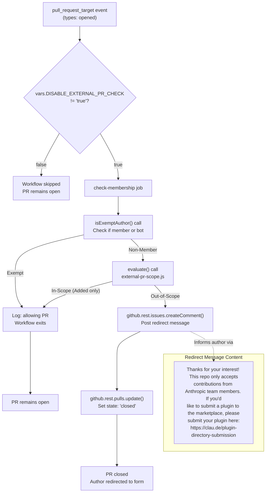
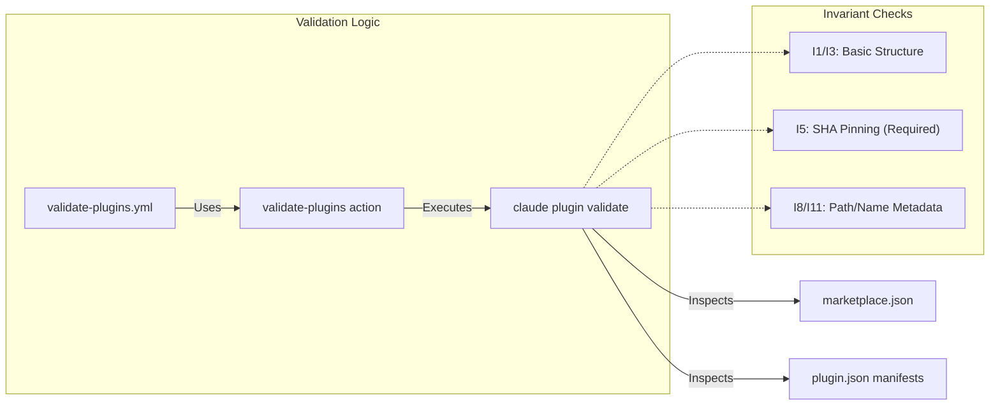
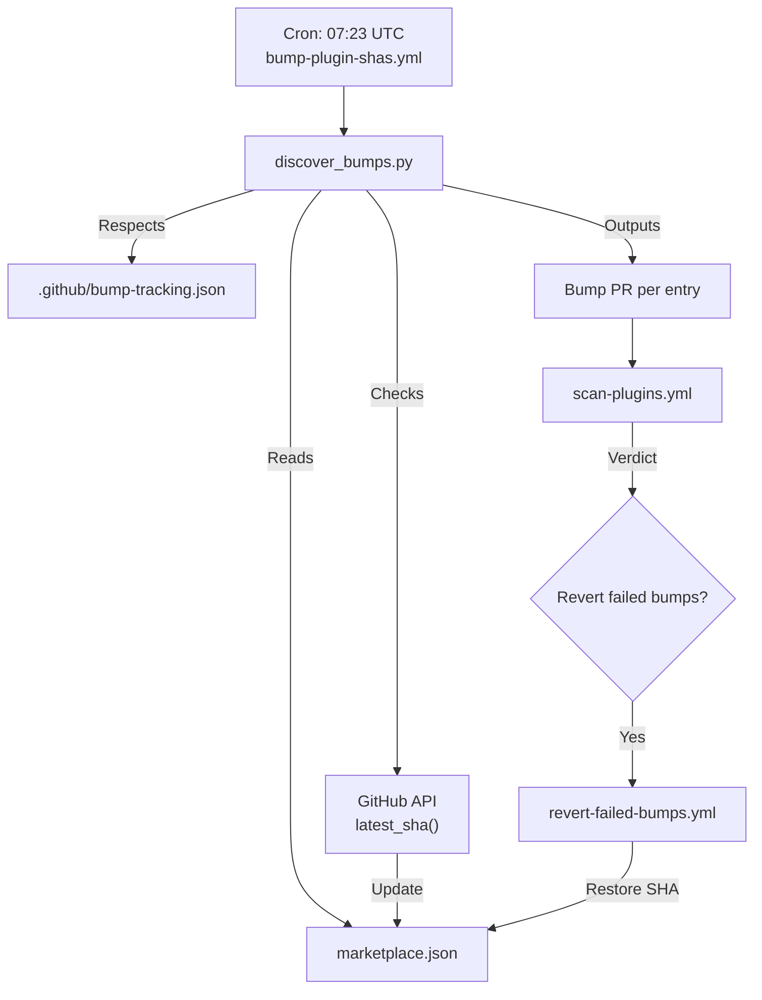

<!-- source: DeepWiki mcp.deepwiki.com · repo anthropics/claude-plugins-official · page 8.5 Contributing External Plugins · fetched 2026-10-26 -->

# Contributing External Plugins

Relevant source files

The following files were used as context for generating this wiki page:

- [.github/scripts/external-pr-scope.js](.github/scripts/external-pr-scope.js)
- [.github/workflows/close-external-prs.yml](.github/workflows/close-external-prs.yml)
- [.github/workflows/external-pr-scope-guard.yml](.github/workflows/external-pr-scope-guard.yml)

## Purpose and Scope

This document covers the process for submitting external plugins to the Claude Code Plugins marketplace. External plugins are developed by community members, partners, and third-party organizations. Unlike internal plugins, external contributions must undergo a formal submission and review process before being published or added as remote references in `.claude-plugin/marketplace.json`.

For information about creating plugin components (commands, agents, skills, hooks, MCP servers), see [Developing Plugin Components](10.3). For validation requirements, see [Validation and Quality Assurance](10.4).

Sources: [.github/workflows/close-external-prs.yml:1-63](), [.github/scripts/external-pr-scope.js:1-17]()

---

## Submission Process Overview

External plugin contributions follow a structured workflow that prioritizes security and quality. Direct pull requests from external contributors to the `anthropics/claude-plugins-official` repository are automatically managed by specialized GitHub Actions to redirect contributors to the official submission channel or enforce strict scoping rules.

### Key Characteristics

| Aspect | Details |
|--------|---------|
| **Directory Location** | Remote URLs in `.claude-plugin/marketplace.json` |
| **Submission Method** | Google Form submission (not GitHub PR) |
| **Review Process** | Quality, security, and automated policy review (Claude-driven) |
| **PR Access** | Restricted to Anthropic team members or specific "in-scope" external contributions |
| **Marketplace Registry** | Final inclusion requires an entry in `.claude-plugin/marketplace.json` |

Sources: [.github/workflows/close-external-prs.yml:22-55](), [.github/scripts/external-pr-scope.js:19-27]()

---

## GitHub PR Workflow and Access Control

The repository uses two primary workflows to enforce the submission policy: `Close External PRs` (`.github/workflows/close-external-prs.yml:1-64]`) and `External PR Scope Guard` (`.github/workflows/external-pr-scope-guard.yml:1-59]`). These ensure that the main branch remains stable and that external code is vetted.

### External PR Management Workflow

**Diagram: PR Access Control Flow (`.github/workflows/close-external-prs.yml`, `.github/scripts/external-pr-scope.js`)**

Sources: [.github/workflows/close-external-prs.yml:1-63](), [.github/scripts/external-pr-scope.js:1-151]()

### Permission and Scope Verification

The repository utilizes the `isExemptAuthor` and `evaluate` functions defined in `.github/scripts/external-pr-scope.js` to manage contributions.

- **isExemptAuthor**: Checks if the author is an org member (`admin` or `write` permission) or the `github-actions[bot]` [.github/scripts/external-pr-scope.js:133-151]().
- **evaluate**: Determines if a non-member PR is "in-scope." A PR is in-scope ONLY if it adds `marketplace.json` entries whose `source.url` already exists in the live marketplace [.github/scripts/external-pr-scope.js:36-45]().
- **Scope Restrictions**: Non-member PRs are forbidden from modifying existing entries or changing files outside of `.claude-plugin/marketplace.json` [.github/scripts/external-pr-scope.js:52-83]().

Sources: [.github/workflows/close-external-prs.yml:12-63](), [.github/scripts/external-pr-scope.js:1-151]()

---

## Security and Policy Scanning

All external plugins undergo an automated security review. This is implemented in the `Scan Plugins` workflow, which evaluates changes against the Anthropic Software Directory Policy.

### Automated Policy Scan

| Security Category | Policy Check Requirement |
|-------------------|--------------------------|
| **Baseline Safety** | Checks for malware, exfiltration, and credential extraction |
| **Hook Scope** | Verifies if hooks are gated to relevant projects or are "broad-scope" |
| **Telemetry** | Flags undisclosed network calls to non-MCP hosts |
| **Disclosure** | Ensures `plugin.json` description matches actual hook/data behavior |

Sources: [.github/workflows/scan-plugins.yml:1-22](), [.github/workflows/revert-failed-bumps.yml:1-22]()

---

## Validation Pipeline

Before inclusion, every plugin entry must pass the validation checks, which enforce schema and structural invariants.

**Diagram: Plugin Validation Infrastructure (`.github/workflows/validate-plugins.yml`)**

Sources: [.github/workflows/validate-plugins.yml:1-63]()

---

## Maintenance Automation

External plugins are kept up-to-date through automated scripts and workflows that monitor upstream repositories.

**Diagram: Nightly Maintenance and SHA Rotation (`.github/scripts/discover_bumps.py`, `.github/workflows/bump-plugin-shas.yml`)**

Sources: [.github/scripts/discover_bumps.py:1-202](), [.github/workflows/bump-plugin-shas.yml:1-107](), [.github/workflows/revert-failed-bumps.yml:1-150]()

---

## Summary of Submission Steps

1. **Develop and Test**: Build your plugin locally and verify it with the validation tools.
2. **Submit Form**: Navigate to the official submission form [.github/workflows/close-external-prs.yml:55]().
3. **Automated Policy Scan**: The plugin source will be scanned against the security policy.
4. **Marketplace Integration**: If approved, the plugin is added to `.claude-plugin/marketplace.json`.
5. **Lifecycle Maintenance**: The plugin's SHA will be automatically tracked and updated nightly by `discover_bumps.py` [.github/scripts/discover_bumps.py:1-9]() and `bump-plugin-shas.yml` [.github/workflows/bump-plugin-shas.yml:1-14]().

Sources: [.github/workflows/close-external-prs.yml:51-56](), [.github/workflows/bump-plugin-shas.yml:1-14](), [.github/scripts/discover_bumps.py:87-110]()

---

