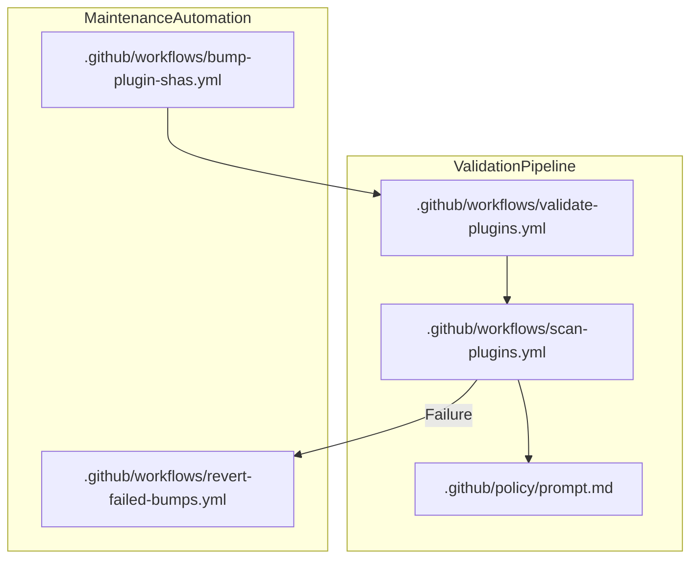
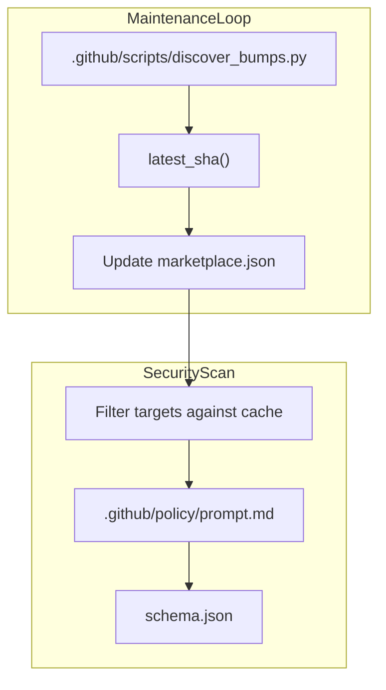

<!-- source: DeepWiki mcp.deepwiki.com · repo anthropics/claude-plugins-official · page 9 Repository Management · fetched 2026-10-26 -->

# Repository Management

Relevant source files

The following files were used as context for generating this wiki page:

- [.github/bump-tracking.json](.github/bump-tracking.json)
- [.github/policy/prompt.md](.github/policy/prompt.md)
- [.github/policy/schema.json](.github/policy/schema.json)
- [.github/scripts/discover_bumps.py](.github/scripts/discover_bumps.py)
- [.github/workflows/bump-plugin-shas.yml](.github/workflows/bump-plugin-shas.yml)
- [.github/workflows/revert-failed-bumps.yml](.github/workflows/revert-failed-bumps.yml)
- [.github/workflows/scan-plugins.yml](.github/workflows/scan-plugins.yml)
- [.github/workflows/validate-plugins.yml](.github/workflows/validate-plugins.yml)

## Purpose and Scope

This document covers the automated systems that manage contributions, enforce quality standards, and maintain the Claude Code Plugins repository. It provides a high-level overview of the CI/CD workflows, validation pipelines, and contribution policies that govern how plugins are added and modified.

For detailed information, see the child pages:
- [CI/CD and Validation Systems](#9.1) — In-depth coverage of marketplace validation, nightly SHA bumps, and policy scanning.
- [External PR Workflow](#9.2) — Detailed documentation of external contribution management and trust models.

## Repository Management Architecture

The repository implements automated validation and maintenance pipelines using GitHub Actions to ensure that all internal and external contributions meet strict schema, security, and policy requirements.

**Workflow Architecture**: The repository uses workflows such as [.github/workflows/validate-plugins.yml:1-90]() and [.github/workflows/scan-plugins.yml:1-53]() to validate schemas and perform LLM-based policy checks. Nightly maintenance is driven by [.github/workflows/bump-plugin-shas.yml:1-110]() with automatic failure mitigation via [.github/workflows/revert-failed-bumps.yml:1-56]().

Sources: [/.github/workflows/validate-plugins.yml:1-90](), [/.github/workflows/scan-plugins.yml:1-53](), [/.github/workflows/bump-plugin-shas.yml:1-110](), [/.github/workflows/revert-failed-bumps.yml:1-56]()

## Validation Pipeline Components

The validation system consists of several specialized workflows that ensure security, schema compliance, and connectivity:

| Component | File | Trigger | Purpose |
|-----------|------|---------|---------|
| Plugin Validator | `.github/workflows/validate-plugins.yml` | `pull_request`, `workflow_dispatch` | Validates plugin manifests and structure against marketplace requirements [.github/workflows/validate-plugins.yml:1-90](). |
| Policy Scanner | `.github/workflows/scan-plugins.yml` | `pull_request`, `workflow_dispatch` | Uses LLM-based review to check for telemetry, broad hooks, and policy violations [.github/workflows/scan-plugins.yml:1-53](). |
| SHA Bumper | `.github/workflows/bump-plugin-shas.yml` | `schedule`, `workflow_dispatch` | Discovers upstream updates and opens per-entry PRs to pin new SHAs [.github/workflows/bump-plugin-shas.yml:1-110](). |
| Revert System | `.github/workflows/revert-failed-bumps.yml` | `workflow_run` | Automatically reverts failing SHA bumps from the nightly PR to keep passing updates moving [.github/workflows/revert-failed-bumps.yml:1-56](). |

**Maintenance Automation**: The discovery script [.github/scripts/discover_bumps.py:1-195]() identifies plugins whose upstream repositories have moved past their pinned SHA. Selected entries can be configured for releases-only tracking via [.github/bump-tracking.json:1-18]().

Sources: [/.github/scripts/discover_bumps.py:1-195](), [/.github/workflows/bump-plugin-shas.yml:1-110](), [/.github/workflows/scan-plugins.yml:1-53](), [/.github/bump-tracking.json:1-18]()

## Policy and Security Enforcement

The repository maintains a strict security posture for the curated marketplace. Every external plugin update is scanned against the policy prompt [.github/policy/prompt.md:1-122]() and verified against the defined JSON schema [.github/policy/schema.json:1-52]().

### Key Policy Checks:
- **Hook Scope**: Checks if `UserPromptSubmit` or `PreToolUse` hooks are appropriately gated to relevant projects [.github/policy/prompt.md:73-97]().
- **Telemetry**: Detects outbound network calls to non-MCP hosts that are not disclosed in the description [.github/policy/prompt.md:98-104]().
- **Credential Safety**: Scans for cross-service credential exfiltration [.github/policy/prompt.md:37-69]().

Sources: [/.github/policy/prompt.md:1-122](), [/.github/policy/schema.json:1-52](), [/.github/workflows/scan-plugins.yml:1-53]()

## GitHub Actions Workflow Integration

For details on how CI/CD pipelines, validation checks, and external PR handling are coordinated, refer to the respective child pages:
- [CI/CD and Validation Systems](#9.1)
- [External PR Workflow](#9.2)

Sources: [/.github/workflows/bump-plugin-shas.yml:1-110](), [/.github/workflows/revert-failed-bumps.yml:1-56]()

## Related Documentation
- **[CI/CD and Validation Systems](#9.1)** — Deep dive into the nightly bump pipeline and policy scanning.
- **[External PR Workflow](#9.2)** — Detailed external contribution management and the trust model.

---

