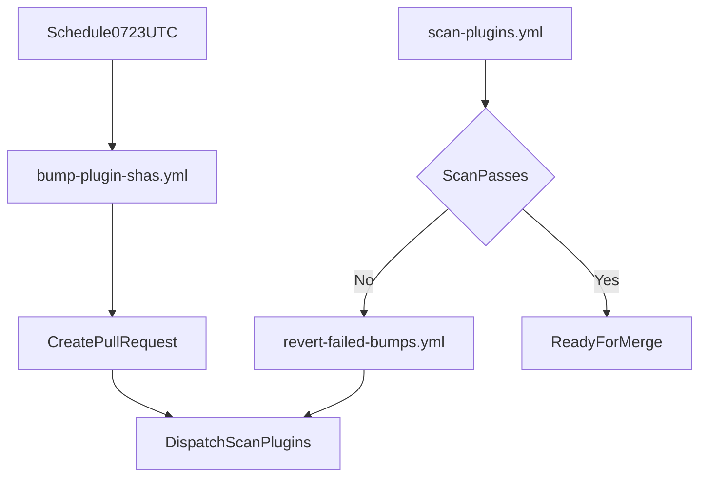
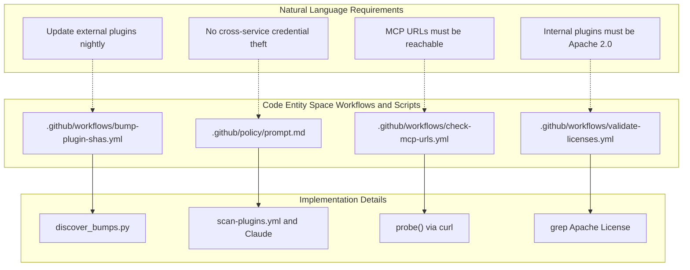
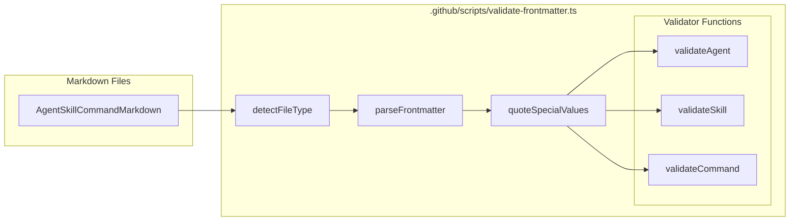

<!-- source: DeepWiki mcp.deepwiki.com · repo anthropics/claude-plugins-official · page 9.1 CI/CD and Validation Systems · fetched 2026-10-26 -->

# CI/CD and Validation Systems

Relevant source files

The following files were used as context for generating this wiki page:

- [.github/bump-tracking.json](.github/bump-tracking.json)
- [.github/policy/prompt.md](.github/policy/prompt.md)
- [.github/policy/schema.json](.github/policy/schema.json)
- [.github/scripts/discover_bumps.py](.github/scripts/discover_bumps.py)
- [.github/scripts/validate-frontmatter.ts](.github/scripts/validate-frontmatter.ts)
- [.github/workflows/bump-plugin-shas.yml](.github/workflows/bump-plugin-shas.yml)
- [.github/workflows/check-mcp-urls.yml](.github/workflows/check-mcp-urls.yml)
- [.github/workflows/revert-failed-bumps.yml](.github/workflows/revert-failed-bumps.yml)
- [.github/workflows/scan-plugins.yml](.github/workflows/scan-plugins.yml)
- [.github/workflows/validate-frontmatter.yml](.github/workflows/validate-frontmatter.yml)
- [.github/workflows/validate-licenses.yml](.github/workflows/validate-licenses.yml)
- [.github/workflows/validate-plugins.yml](.github/workflows/validate-plugins.yml)

## Purpose and Scope

This document describes the automated validation and continuous integration systems that enforce quality standards for the Claude Code Plugins repository. These systems ensure that all plugin components maintain consistent metadata, the marketplace registry remains valid, external URLs are reachable, and security policies are enforced.

The CI/CD pipeline consists of GitHub Actions workflows and a suite of validation scripts that together enforce:
- Frontmatter structure and required fields in agent, skill, and command files.
- Integrity of the `marketplace.json` registry and license compliance.
- Security and privacy scanning of external plugin updates via a nightly bump pipeline.
- Liveness checks for Model Context Protocol (MCP) server endpoints.

Sources: [.github/workflows/validate-frontmatter.yml:3-9](), [.github/workflows/validate-plugins.yml:3-42](), [.github/workflows/scan-plugins.yml:24-26](), [.github/workflows/check-mcp-urls.yml:17-27](), [.github/workflows/bump-plugin-shas.yml:24-39](), [.github/workflows/revert-failed-bumps.yml:23-26](), [.github/workflows/validate-licenses.yml:3-11]()

---

## GitHub Actions Workflows Overview

The repository implements automated workflows that run on pull request events, scheduled intervals, and manual dispatches:

| Workflow | Trigger | Purpose |
|----------|---------|---------|
| `validate-frontmatter.yml` | PR with `.md` changes | Validates YAML metadata in plugin components. |
| `validate-plugins.yml` | PR / Dispatch | Runs `claude plugin validate` against the marketplace. |
| `scan-plugins.yml` | PR / Dispatch | Executes Claude-powered security policy scans. |
| `check-mcp-urls.yml` | PR / Schedule | Probes HTTP/SSE MCP endpoints for liveness. |
| `bump-plugin-shas.yml` | Schedule (Nightly) | Discovers upstream updates and initiates the bump PR. |
| `revert-failed-bumps.yml` | `workflow_run` | Automatically reverts policy-failing entries in bump PRs. |
| `validate-licenses.yml` | PR / Push | Ensures all internal plugins have Apache 2.0 licenses. |

Sources: [.github/workflows/validate-frontmatter.yml:3-9](), [.github/workflows/validate-plugins.yml:3-71](), [.github/workflows/scan-plugins.yml:24-32](), [.github/workflows/check-mcp-urls.yml:17-27](), [.github/workflows/bump-plugin-shas.yml:28-43](), [.github/workflows/revert-failed-bumps.yml:23-26](), [.github/workflows/validate-licenses.yml:3-11]()

---

## Nightly SHA Bump and Security Pipeline

The repository maintains external plugins by pinning them to specific Git SHAs. A nightly pipeline automates the update of these SHAs while enforcing strict security policies.

### 1. Discovery Phase (`bump-plugin-shas.yml`)
The workflow uses the `anthropics/claude-plugins-community/.github/actions/bump-plugin-shas` composite action and `discover_bumps.py` to identify external plugins whose upstream `HEAD` has moved past the pinned SHA [[:github/workflows/bump-plugin-shas.yml:3-7](), [.github/workflows/bump-plugin-shas.yml:64-70](), [.github/scripts/discover_bumps.py:2-4]()]. It calculates the pinned age to prioritize oldest updates first, preventing starvation under the `max-bumps` cap (default 60) [[:github/workflows/bump-plugin-shas.yml:33-36](), [.github/scripts/discover_bumps.py:159-161]()]. 

The workflow also supports a tracking configuration in `.github/bump-tracking.json` to pin specific plugins to release tags instead of `HEAD` [[:github/workflows/bump-plugin-shas.yml:71-75](), [.github/bump-tracking.json:1-17]()].

### 2. Validation and Scan Phase (`scan-plugins.yml`)
Updates are subjected to a Claude-powered security scan based on a defined policy [[:github/policy/prompt.md:1-10]()].
- **Verdict Cache**: Each `(plugin, sha)` pair is scanned once. Verdicts are cached to save time and tokens [[:github/workflows/scan-plugins.yml:11-16]()]. The cache is keyed on the policy hash so that prompt changes invalidate all verdicts [[:github/workflows/scan-plugins.yml:86-101]()].
- **Policy Enforcement**: The scan checks for malicious code, undisclosed telemetry, and cross-service credential extraction [[:github/policy/prompt.md:26-68]()]. It specifically flags reading secrets like `ANTHROPIC_AUTH_TOKEN` and routing them to non-Anthropic endpoints [[:github/policy/prompt.md:47-59]()].
- **Required Fields**: The scan must produce a JSON verdict matching the defined schema, including `passes`, `summary`, and `violations` [[:github/policy/schema.json:1-13]()].

### 3. Automatic Reversion (`revert-failed-bumps.yml`)
If a nightly bump PR contains entries that fail the security scan, this workflow automatically reverts the failing SHAs to their previous known-good state [[:github/workflows/revert-failed-bumps.yml:3-8]()].
- **Budgeting**: It is limited to `MAX_REVERT_PASSES` (default 3) to prevent infinite loops if a scan is broken [[:github/workflows/revert-failed-bumps.yml:33-36]()].
- **Integrity**: It only reverts the `source.sha` field; if other fields were modified, it aborts for human review [[:github/workflows/revert-failed-bumps.yml:14-16](), [.github/workflows/revert-failed-bumps.yml:125-131]()].

Title: Security Pipeline Data Flow

Sources: [.github/workflows/bump-plugin-shas.yml:25-77](), [.github/workflows/scan-plugins.yml:11-22](), [.github/workflows/revert-failed-bumps.yml:3-21](), [.github/scripts/discover_bumps.py:159-161](), [.github/policy/prompt.md:47-59]()

---

## MCP Liveness Checks

The `check-mcp-urls.yml` workflow performs liveness probes on `http` and `sse` MCP server URLs declared by vendored plugins [[:github/workflows/check-mcp-urls.yml:3-5]()].

**Probe Logic (`probe()` function):**
1. **HEAD Request**: A cheap check to see if the endpoint is reachable [[:github/workflows/check-mcp-urls.yml:73-87]()].
2. **POST Fallback**: If HEAD fails (common for MCP), it sends a standard `initialize` JSON-RPC 2.0 request [[:github/workflows/check-mcp-urls.yml:89-100]()].
3. **Verdict**: Only `404`, `410`, or DNS/connection failures result in a `FAIL`. Auth errors (`401`, `403`, `405`) are considered `PASS` because the CI lacks user credentials [[:github/workflows/check-mcp-urls.yml:13-15](), [.github/workflows/check-mcp-urls.yml:102-106]()].

Sources: [.github/workflows/check-mcp-urls.yml:13-15](), [.github/workflows/check-mcp-urls.yml:73-107]()

---

## Frontmatter Validation

The `validate-frontmatter.ts` script ensures that markdown-based plugin components (Agents, Skills, Commands) contain valid YAML metadata [[:github/scripts/validate-frontmatter.ts:2-4]()].

### YAML Preprocessing
To support Claude Code features like glob patterns in frontmatter, the script uses `quoteSpecialValues()` to automatically wrap values containing special characters (e.g., `*`, `[`, `{`) in quotes before parsing [[:github/scripts/validate-frontmatter.ts:25-55]()].

### Validation Rules

| Component Type | Function | Requirements |
|----------------|----------|--------------|
| **Agent** | `validateAgent()` | Must have `name` and `description` strings [[:github/scripts/validate-frontmatter.ts:105-124]()]. |
| **Skill** | `validateSkill()` | Must have `description` or `when_to_use` [[:github/scripts/validate-frontmatter.ts:126-139]()]. |
| **Command** | `validateCommand()` | Must have a `description` string [[:github/scripts/validate-frontmatter.ts:141-157]()]. |

Sources: [.github/scripts/validate-frontmatter.ts:25-55](), [.github/scripts/validate-frontmatter.ts:105-157]()

---

## Code Entity Mapping

The following diagrams bridge the validation requirements to the specific code entities that implement them.

Title: System Enforcement Mapping

Title: Frontmatter Validation Architecture

Sources: [.github/workflows/bump-plugin-shas.yml:60-65](), [.github/policy/prompt.md:37-49](), [.github/workflows/check-mcp-urls.yml:73-107](), [.github/workflows/validate-licenses.yml:21-34](), [.github/scripts/validate-frontmatter.ts:63-94](), [.github/scripts/validate-frontmatter.ts:161-171]()

---

## License Validation

The `validate-licenses.yml` workflow enforces that every internal plugin located in the `plugins/` directory contains a `LICENSE` file [[:github/workflows/validate-licenses.yml:21-26]()]. It specifically checks that the file contains the strings "Apache License" and "Version 2.0" to ensure legal compliance across the official distribution [[:github/workflows/validate-licenses.yml:30-38]()]. Certain plugins, such as `plugins/claude-security`, are documented as exempt from the content check but must still provide a license file [[:github/workflows/validate-licenses.yml:24-35]()].

Sources: [.github/workflows/validate-licenses.yml:21-34](), [.github/workflows/validate-licenses.yml:27-35]()

---

