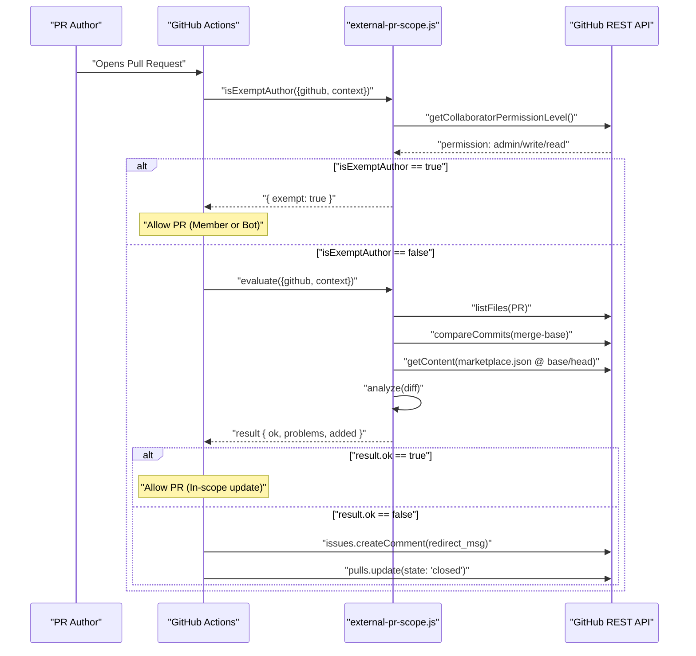
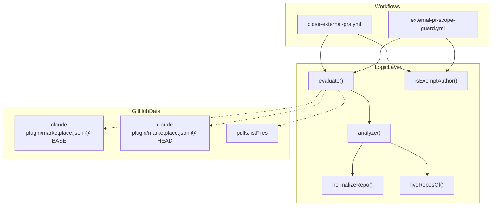

<!-- source: DeepWiki mcp.deepwiki.com · repo anthropics/claude-plugins-official · page 9.2 External PR Workflow · fetched 2026-10-26 -->

# External PR Workflow

Relevant source files

The following files were used as context for generating this wiki page:

- [.github/scripts/external-pr-scope.js](.github/scripts/external-pr-scope.js)
- [.github/workflows/close-external-prs.yml](.github/workflows/close-external-prs.yml)
- [.github/workflows/external-pr-scope-guard.yml](.github/workflows/external-pr-scope-guard.yml)
- [LICENSE](LICENSE)

## Purpose and Scope

This document describes the automated GitHub Actions workflows and scripts that manage external contributions to the Claude Code Plugins repository. The system balances a strict "members-only" contribution policy with a "trust-the-repo" model that allows existing plugin authors to update their marketplace entries via pull requests.

The primary components are:
- `close-external-prs.yml`: Automatically closes out-of-scope PRs from non-members [.github/workflows/close-external-prs.yml:1-63]().
- `external-pr-scope-guard.yml`: An advisory check that surfaces exactly what a non-member PR is attempting to change [.github/workflows/external-pr-scope-guard.yml:1-58]().
- `external-pr-scope.js`: Shared logic that evaluates if a PR is "in-scope" based on the source repository's history in the marketplace [.github/scripts/external-pr-scope.js:1-156]().

Sources: [.github/workflows/close-external-prs.yml:1-63](), [.github/workflows/external-pr-scope-guard.yml:1-58](), [.github/scripts/external-pr-scope.js:1-156]()

---

## The Trust Model

The repository operates on a trust model centered on **Source Repositories** rather than individual identities. 

A non-member PR is considered **in-scope** if and only if:
1. It modifies ONLY `.claude-plugin/marketplace.json` [.github/scripts/external-pr-scope.js:55-56]().
2. It only ADDS new entries (no modifications or removals of existing entries) [.github/scripts/external-pr-scope.js:66-67]().
3. Every added entry's `source.url` points to a repository that **already** backs a live plugin in the marketplace [.github/scripts/external-pr-scope.js:77-79]().

This allows plugin authors to add new versions or variants of their plugins without manual intervention for every PR, provided they are pinned to their existing trusted organization/repo [.github/scripts/external-pr-scope.js:5-10]().

Sources: [.github/scripts/external-pr-scope.js:1-86]()

---

## Workflow Architecture

### Sequence Diagram: PR Evaluation Flow

The following diagram illustrates the interaction between the GitHub Actions runner, the shared evaluation script, and the GitHub API.

Sources: [.github/workflows/close-external-prs.yml:23-63](), [.github/scripts/external-pr-scope.js:95-156]()

---

## Core Logic: `external-pr-scope.js`

This script is the brain of the workflow, shared by both the closer and the guard.

### Key Functions

| Function | Role | Code Pointer |
|----------|------|--------------|
| `isExemptAuthor` | Checks if the author is `github-actions[bot]` or has `admin`/`write` permissions. | [.github/scripts/external-pr-scope.js:138-156]() |
| `evaluate` | Orchestrates data fetching (files, diffs, marketplace versions) and calls `analyze`. | [.github/scripts/external-pr-scope.js:98-125]() |
| `analyze` | Computes the diff between `before` and `after` plugin maps and checks against `liveRepos`. | [.github/scripts/external-pr-scope.js:52-86]() |
| `normalizeRepo` | Standardizes URLs (removes `git+`, `.git`, `https://`) for reliable comparison. | [.github/scripts/external-pr-scope.js:21-27]() |
| `liveReposOf` | Extracts the set of unique `host/org/repo` strings currently in the marketplace. | [.github/scripts/external-pr-scope.js:36-45]() |

Sources: [.github/scripts/external-pr-scope.js:1-156]()

### Code Entity Mapping

Sources: [.github/scripts/external-pr-scope.js:1-156](), [.github/workflows/close-external-prs.yml:26-43](), [.github/workflows/external-pr-scope-guard.yml:35-45]()

---

## Close External PRs Workflow

The `close-external-prs.yml` workflow acts as the enforcement mechanism. It uses `pull_request_target` to ensure it runs with base repository permissions, allowing it to close PRs from forks [.github/workflows/close-external-prs.yml:4-10]().

### Enforcement Steps
1. **Membership Check**: If `isExemptAuthor` returns true, the PR is allowed [.github/workflows/close-external-prs.yml:30-34]().
2. **Scope Check**: If `evaluate` returns `ok` and additions are found, the PR is allowed [.github/workflows/close-external-prs.yml:43-47]().
3. **Closure**: If neither condition is met, the workflow:
    - Posts a comment directing the user to the [Plugin Submission Form](https://clau.de/plugin-directory-submission) [.github/workflows/close-external-prs.yml:51-56]().
    - Closes the PR [.github/workflows/close-external-prs.yml:58-63]().

Sources: [.github/workflows/close-external-prs.yml:12-63]()

---

## External PR Scope Guard

The `external-pr-scope-guard.yml` is an advisory status check. Unlike the closer, it runs on `synchronize` and `reopened` events as well [.github/workflows/external-pr-scope-guard.yml:19-21]().

### Purpose
It provides a "pass/fail" status on the PR. It is **not** intended to be a required status check in branch protection [.github/workflows/external-pr-scope-guard.yml:12-14](). Instead, it serves as a signal to maintainers:
- **Pass**: The PR only adds plugins from repositories already trusted in the marketplace [.github/workflows/external-pr-scope-guard.yml:54-58]().
- **Fail**: The PR attempts to modify code, remove entries, or add plugins from unknown repositories [.github/workflows/external-pr-scope-guard.yml:47-53]().

Sources: [.github/workflows/external-pr-scope-guard.yml:1-58]()

---

## Permissions and Security

Both workflows are configured with minimal necessary permissions:

| Workflow | Permission | Purpose |
|----------|------------|---------|
| `close-external-prs` | `pull-requests: write` | To close the PR [.github/workflows/close-external-prs.yml:8](). |
| `close-external-prs` | `issues: write` | To post the redirect comment [.github/workflows/close-external-prs.yml:9](). |
| `scope-guard` | `pull-requests: read` | To analyze the PR contents [.github/workflows/external-pr-scope-guard.yml:25](). |

**Security Note**: The `evaluate()` function reads `marketplace.json` content as raw data via the GitHub API and parses it as JSON. It never checks out or executes code from the head (fork) repository [.github/scripts/external-pr-scope.js:16-17]().

Sources: [.github/workflows/close-external-prs.yml:7-10](), [.github/workflows/external-pr-scope-guard.yml:23-26](), [.github/scripts/external-pr-scope.js:16-17]()

---

