# Page: Overview

# Overview

<details>
<summary>Relevant source files</summary>

The following files were used as context for generating this wiki page:

- [.claude-plugin/marketplace.json](.claude-plugin/marketplace.json)
- [README.md](README.md)
- [plugins/plugin-dev/.claude-plugin/plugin.json](plugins/plugin-dev/.claude-plugin/plugin.json)
- [plugins/ralph-loop/README.md](plugins/ralph-loop/README.md)
- [plugins/ralph-loop/hooks/stop-hook.sh](plugins/ralph-loop/hooks/stop-hook.sh)
- [plugins/ralph-loop/scripts/setup-ralph-loop.sh](plugins/ralph-loop/scripts/setup-ralph-loop.sh)
- [plugins/security-guidance/.claude-plugin/plugin.json](plugins/security-guidance/.claude-plugin/plugin.json)
- [plugins/security-guidance/hooks/diffstate.py](plugins/security-guidance/hooks/diffstate.py)
- [plugins/security-guidance/hooks/gitutil.py](plugins/security-guidance/hooks/gitutil.py)
- [plugins/security-guidance/hooks/security_reminder_hook.py](plugins/security-guidance/hooks/security_reminder_hook.py)
- [plugins/security-guidance/tests/test_git_index_locks.py](plugins/security-guidance/tests/test_git_index_locks.py)
- [plugins/security-guidance/tests/test_temp_index_cleanup.py](plugins/security-guidance/tests/test_temp_index_cleanup.py)

</details>


The `claude-plugins-official` repository serves as the official plugin marketplace and comprehensive development system for Claude Code [README.md:1-3](). It provides a centralized registry (`[.claude-plugin/marketplace.json]`) that catalogs over 55 internal and external plugins [README.md:9-10](), development tools for creating new extensions, and automated quality assurance systems to maintain ecosystem standards. This repository enables developers to extend Claude Code with custom commands, autonomous agents, context-aware skills, event-driven hooks, and Model Context Protocol (MCP) server integrations.

For quick start instructions, see [Getting Started](#1.1). For details on the registry schema and management, see [Plugin Marketplace](#1.2).

## Repository Purpose and Ecosystem Structure

The repository functions as a multi-layered extensibility ecosystem for Claude Code:

1. **Marketplace Distribution**: Centralized cataloging and distribution of first-party and third-party plugins via `[.claude-plugin/marketplace.json]()` [README.md:14-18]().
2. **Development Toolkit**: Scaffolding systems like `[plugins/plugin-dev/.claude-plugin/plugin.json]()` and specialized scripts for building custom components [README.md:24]().
3. **Validation and Quality Assurance**: Automated GitHub Actions workflows ensuring strict frontmatter and marketplace schema adherence.
4. **Reference Implementations**: Advanced patterns such as iterative development loops (`[plugins/ralph-loop/README.md]()`) and real-time security reviews (`[plugins/security-guidance/.claude-plugin/plugin.json]()`).

Plugins are organized into distinct directories based on their maintenance model:

| Directory Path | Ownership | Description |
| :--- | :--- | :--- |
| `[plugins/]()` | Anthropic (Internal) | Core tooling, language servers, and developer utilities [README.md:9]() |
| `[external_plugins/]()` | Community / Partners | Third-party integrations and partner-contributed services [README.md:10]() |

Sources: [README.md:1-30](), [.claude-plugin/marketplace.json:1-123]()

## Central Registry System

The registry system links natural language intents and discovery interfaces directly to code entities within the repository. The authoritative catalog is defined in `[.claude-plugin/marketplace.json]()`, which manages plugin metadata, source mappings, and slug renames to ensure seamless installation via Claude Code.

**Registry Architecture: Natural Language to Code Entities**

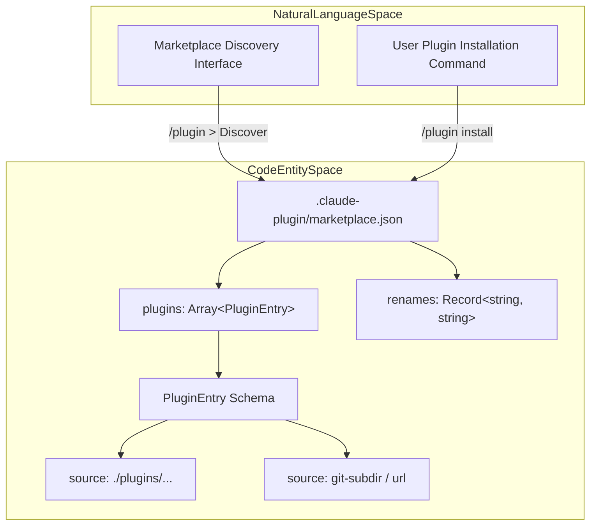
Sources: [.claude-plugin/marketplace.json:1-161](), [README.md:12-18]()

For detailed documentation on the registry schema, plugin categorization, and slug mutability rules, see [Plugin Marketplace](#1.2).

## Plugin Component Architecture

Claude Code plugins are composed of modular directories defining specialized behaviors. A standard plugin layout integrates commands, agents, skills, hooks, and MCP servers.

| Component Type | Canonical Path | Execution Role |
| :--- | :--- | :--- |
| **Plugin Manifest** | `.claude-plugin/plugin.json` | Defines metadata, version, and author details [README.md:36-37]() |
| **Commands** | `commands/*.md` | Custom user-invoked slash commands [README.md:39]() |
| **Agents** | `agents/*.md` | Specialized sub-personalities with scoped tools [README.md:40]() |
| **Skills** | `skills/*/SKILL.md` | Context-triggered instructions and progressive disclosure [README.md:41]() |
| **Hooks** | `hooks/hooks.json` | Event-driven triggers (`PreToolUse`, `Stop`, etc.) [plugins/ralph-loop/hooks/stop-hook.sh:1-10]() |
| **MCP Integration** | `.mcp.json` | External Model Context Protocol server configurations [README.md:38]() |

### Implementation Case Study: Ralph Loop

The `ralph-loop` plugin illustrates the "Stop Hook" execution pattern, which intercepts session exit attempts to drive continuous, self-referential iteration [plugins/ralph-loop/README.md:13-27]().

**Ralph Loop Execution: Natural Language to Code Entity Mapping**

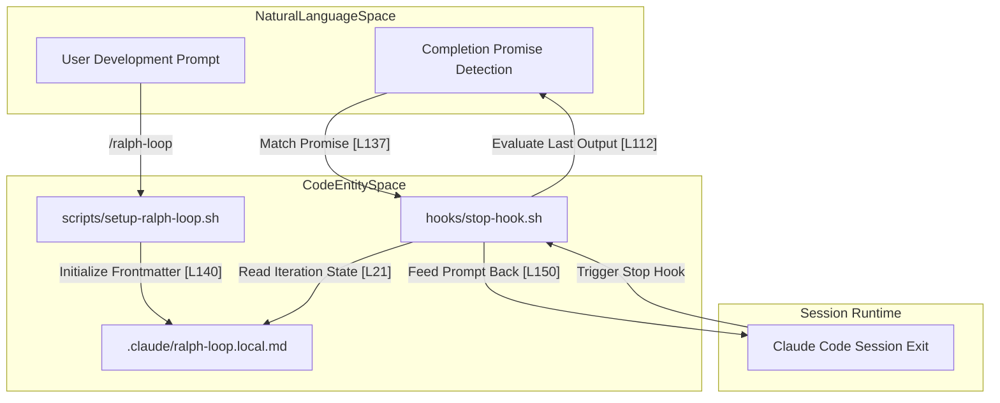
Sources: [plugins/ralph-loop/README.md:1-28](), [plugins/ralph-loop/scripts/setup-ralph-loop.sh:130-151](), [plugins/ralph-loop/hooks/stop-hook.sh:9-171]()

---

# Page: Getting Started

# Getting Started

<details>
<summary>Relevant source files</summary>

The following files were used as context for generating this wiki page:

- [README.md](README.md)
- [plugins/plugin-dev/.claude-plugin/plugin.json](plugins/plugin-dev/.claude-plugin/plugin.json)
- [plugins/ralph-loop/README.md](plugins/ralph-loop/README.md)
- [plugins/ralph-loop/hooks/stop-hook.sh](plugins/ralph-loop/hooks/stop-hook.sh)
- [plugins/ralph-loop/scripts/setup-ralph-loop.sh](plugins/ralph-loop/scripts/setup-ralph-loop.sh)

</details>


This page covers quick start instructions for installing and using plugins from the marketplace, including `/plugin install` syntax, the discovery interface, and underlying technical workflows like state initialization and stop-hook interceptors.

For information about creating your own plugins, see **Section 8: Developer Guide**. For details about the marketplace architecture and plugin categorization system, see **Section 1.2: Plugin Marketplace**.

## Prerequisites and System Requirements

Before installing plugins, ensure you have:

- **Claude Code** installed and running.
- **Command-line access** within Claude Code for plugin installation.
- **Required runtime dependencies**: Certain plugins rely on host utilities. For instance, the `ralph-loop` plugin requires a `bash` environment, `jq`, and `perl` for its Stop hook to process transcript JSONL data and evaluate completion promises [plugins/ralph-loop/hooks/stop-hook.sh:110-135]().

Always inspect a plugin's `README.md` file in its respective source directory to identify specific external requirements before installation [README.md:91-93]().

Sources: [README.md:1-97](), [plugins/ralph-loop/hooks/stop-hook.sh:1-126]()

---

## The Marketplace Registry and Slug Immutability

Plugins are indexed centrally via the marketplace registry. Each plugin entry references a unique `name` field, which acts as an **immutable slug** [README.md:45-47](). Once published, changing a plugin's `name` breaks existing installations with a `plugin-not-found` error because users have it stored under that slug [README.md:45-47](). 

To modify how a plugin appears in the UI without breaking user installs, update the `displayName` field [README.md:49-49](). If a slug rename is unavoidable, developers must register the mapping in the top-level `renames` map within the marketplace registry so the plugin loader transparently rewrites old slugs on sync [README.md:50-58]().

Sources: [README.md:45-60]()

---

## Discovering and Installing Plugins

### Discovery Interfaces

Claude Code exposes two primary pathways for discovering extensions:

1. **Discovery Interface**: Invoked via the interactive command `/plugin > Discover` within Claude Code, which queries the central marketplace registry [README.md:18-18]().
2. **Repository Browsing**: Manual inspection of internal plugins (`plugins/`) and external plugins (`external_plugins/`) directly in the codebase [README.md:9-11]().

Each plugin directory adheres to a standard component layout [README.md:32-43]():
- `.claude-plugin/plugin.json`: Metadata manifest [README.md:36-37]()
- `.mcp.json`: Optional Model Context Protocol configuration [README.md:38-38]()
- `commands/`: Slash command scripts [README.md:39-39]()
- `agents/`: AI agent definitions [README.md:40-40]()
- `skills/`: Contextual skill definitions [README.md:41-41]()

### Installation Syntax

To install a plugin from the official registry, execute [README.md:16-16]():

```bash
/plugin install {plugin-name}@claude-plugins-official
```

### Natural Language to Code Entity Space: Installation Flow

```mermaid
graph TD
    subgraph "Natural Language Space"
        NL_Discover["'/plugin > Discover'"]
        NL_Install["'/plugin install plugin-name@claude-plugins-official'"]
    end

    subgraph "Code Entity Space"
        MP_JSON[" marketplace.json<br/>(Central Registry)"]
        PLUGIN_JSON[" plugin.json<br/>(.claude-plugin/plugin.json)"]
        LOADER[" ClaudeCodePluginLoader<br/>(Component Registration)"]
    end

    NL_Discover -->| "Reads catalog" | MP_JSON
    NL_Install -->| "Resolves slug" | MP_JSON
    MP_JSON -->| "Fetches manifest" | PLUGIN_JSON
    PLUGIN_JSON -->| "Validates & registers" | LOADER
```

Sources: [README.md:7-43](), [plugins/plugin-dev/.claude-plugin/plugin.json:1-8]()

---

## Using Plugins and Active Loops

Once installed, plugin components (commands, skills, agents, and hooks) register automatically. For interactive or stateful plugins like `ralph-loop`, execution is managed via specialized scripts and hooks [plugins/ralph-loop/README.md:13-33]().

### Ralph Loop Technical Workflow

Starting an iterative development loop [plugins/ralph-loop/README.md:38-38]():

```bash
/ralph-loop "Build a REST API" --completion-promise "DONE" --max-iterations 20
```

1. **Initialization**: The command invokes `plugins/ralph-loop/scripts/setup-ralph-loop.sh`, which provisions a project-scoped state file at `.claude/ralph-loop.local.md` containing YAML frontmatter (`iteration`, `max_iterations`, `completion_promise`, `session_id`) and the prompt text [plugins/ralph-loop/scripts/setup-ralph-loop.sh:130-151]().
2. **Interception**: When Claude attempts to exit the session, the Stop hook defined in `plugins/ralph-loop/hooks/stop-hook.sh` intercepts the exit call [plugins/ralph-loop/hooks/stop-hook.sh:10-18]().
3. **Evaluation**: The hook reads session transcript JSONL files, extracts assistant text output using `jq`, and checks for the configured `<promise>` tag via `perl` regex matching [plugins/ralph-loop/hooks/stop-hook.sh:68-142]().
4. **Continuation**: If the iteration limit is not reached and no completion promise is found, the hook increments the iteration counter and feeds the prompt back into Claude's context [plugins/ralph-loop/hooks/stop-hook.sh:61-170]().

### Natural Language to Code Entity Space: Ralph Loop Runtime Flow

```mermaid
graph TD
    subgraph "Natural Language Space"
        NL_Run["'/ralph-loop Task --completion-promise DONE'"]
        NL_Exit["'Attempt Session Exit'"]
    end

    subgraph "Code Entity Space"
        SETUP_SH[" setup-ralph-loop.sh<br/>(State Initializer)"]
        STATE_FILE[" .claude/ralph-loop.local.md<br/>(Loop State & Frontmatter)"]
        STOP_HOOK[" stop-hook.sh<br/>(Exit Interceptor)"]
        TRANSCRIPT[" transcript.jsonl<br/>(Session JSONL)"]
    end

    NL_Run -->| "Executes" | SETUP_SH
    SETUP_SH -->| "Writes frontmatter" | STATE_FILE
    NL_Exit -->| "Triggers hook event" | STOP_HOOK
    STOP_HOOK -->| "Reads state" | STATE_FILE
    STOP_HOOK -->| "Parses messages" | TRANSCRIPT
    STOP_HOOK -->| "Continues session / feeds prompt" | NL_Run
```

Sources: [plugins/ralph-loop/hooks/stop-hook.sh:1-171](), [plugins/ralph-loop/scripts/setup-ralph-loop.sh:130-204](), [plugins/ralph-loop/README.md:13-60]()

---

# Page: Plugin Marketplace

# Plugin Marketplace

<details>
<summary>Relevant source files</summary>

The following files were used as context for generating this wiki page:

- [.claude-plugin/marketplace.json](.claude-plugin/marketplace.json)
- [external_plugins/context7/.claude-plugin/plugin.json](external_plugins/context7/.claude-plugin/plugin.json)
- [external_plugins/context7/.mcp.json](external_plugins/context7/.mcp.json)
- [external_plugins/context7/README.md](external_plugins/context7/README.md)
- [external_plugins/firebase/.claude-plugin/plugin.json](external_plugins/firebase/.claude-plugin/plugin.json)
- [external_plugins/github/.claude-plugin/plugin.json](external_plugins/github/.claude-plugin/plugin.json)
- [external_plugins/gitlab/.claude-plugin/plugin.json](external_plugins/gitlab/.claude-plugin/plugin.json)
- [external_plugins/laravel-boost/.claude-plugin/plugin.json](external_plugins/laravel-boost/.claude-plugin/plugin.json)
- [plugins/security-guidance/.claude-plugin/plugin.json](plugins/security-guidance/.claude-plugin/plugin.json)
- [plugins/security-guidance/hooks/diffstate.py](plugins/security-guidance/hooks/diffstate.py)
- [plugins/security-guidance/hooks/gitutil.py](plugins/security-guidance/hooks/gitutil.py)
- [plugins/security-guidance/hooks/security_reminder_hook.py](plugins/security-guidance/hooks/security_reminder_hook.py)
- [plugins/security-guidance/tests/test_git_index_locks.py](plugins/security-guidance/tests/test_git_index_locks.py)
- [plugins/security-guidance/tests/test_temp_index_cleanup.py](plugins/security-guidance/tests/test_temp_index_cleanup.py)

</details>


## Purpose and Scope
The Plugin Marketplace is the central registry system that catalogs and manages all available Claude Code extensions, tools, and integrations [.claude-plugin/marketplace.json:1-4](). It is defined as a single JSON file (`.claude-plugin/marketplace.json`) that acts as the authoritative directory for internal Anthropic plugins and external community/partner plugins. This page documents the marketplace registry structure, schema definitions, plugin categorization, rename maps, and how the system resolves and manages internal versus external plugin sources.

Sources: [.claude-plugin/marketplace.json:1-20]()

---

## Marketplace Registry Structure

The marketplace registry is stored at `.claude-plugin/marketplace.json` [.claude-plugin/marketplace.json:1-4](). It adheres to an explicit JSON schema (`https://anthropic.com/claude-code/marketplace.schema.json`) [.claude-plugin/marketplace.json:2]() and includes metadata, a rename mapping dictionary for legacy slug migration, and a comprehensive `plugins` array [.claude-plugin/marketplace.json:3-21]().

Title: Marketplace Registry and Slug Resolution
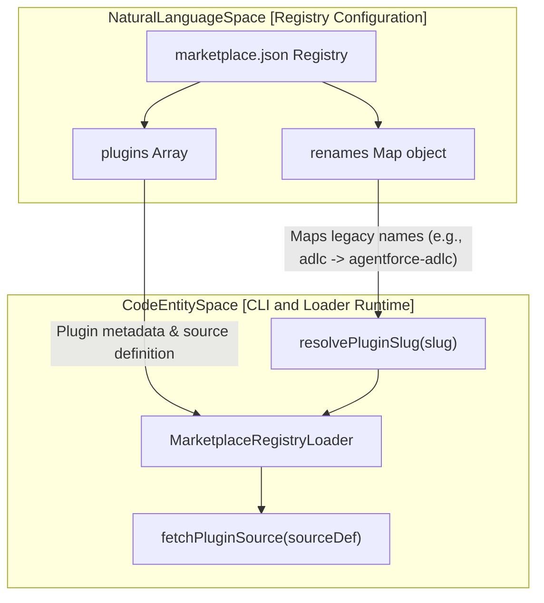

### Registry Root Fields

| Field | Type | Required | Description |
|-------|------|----------|-------------|
| `$schema` | string | Yes | JSON schema validator reference endpoint [.claude-plugin/marketplace.json:2]() |
| `name` | string | Yes | Identifier for the registry (`"claude-plugins-official"`) [.claude-plugin/marketplace.json:3]() |
| `owner` | object | Yes | Registry maintainer contact details (`name`, `email`) [.claude-plugin/marketplace.json:5-8]() |
| `renames` | object | No | Dictionary mapping deprecated plugin slugs to canonical slugs [.claude-plugin/marketplace.json:9-20]() |
| `plugins` | array | Yes | Collection of plugin entries cataloged in the marketplace [.claude-plugin/marketplace.json:21-4427]() |

Sources: [.claude-plugin/marketplace.json:1-21]()

---

## Plugin Metadata Schema

Each entry inside the `plugins` array describes an individual extension, specifying its identity, description, authorship, categorization, and source repository or path [.claude-plugin/marketplace.json:21-37]().

Title: Plugin Schema and Source Resolution Architecture
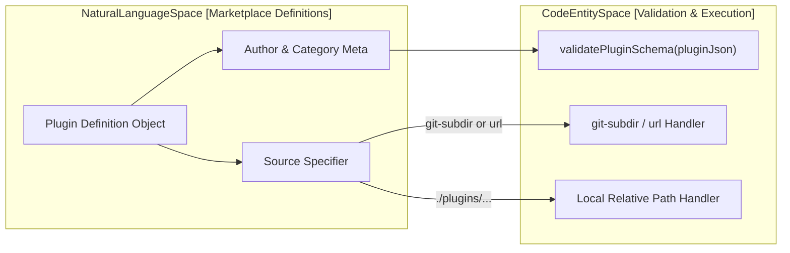

### Core Plugin Fields

| Field | Type | Description |
|-------|------|-------------|
| `name` | string | Immutable slug identifying the plugin [.claude-plugin/marketplace.json:23]() |
| `displayName` | string | Optional human-friendly display name [.claude-plugin/marketplace.json:114]() |
| `description` | string | Detailed explanation of capabilities and integration behavior [.claude-plugin/marketplace.json:24]() |
| `author` | object | Creator metadata containing `name` and optional `email` [.claude-plugin/marketplace.json:25-27]() |
| `category` | string | Classification tag (`security`, `development`, `design`, `productivity`) [.claude-plugin/marketplace.json:28]() |
| `source` | string / object | Location specification (local path or remote repository definition) [.claude-plugin/marketplace.json:29-35]() |
| `homepage` | string | Documentation or project website URL [.claude-plugin/marketplace.json:36]() |

Sources: [.claude-plugin/marketplace.json:21-37]()

---

## Source Configuration Patterns

The marketplace supports two primary source mechanisms to manage internal and external plugins uniformly:

### 1. Internal / Local Sources
Internal plugins maintained directly within the official repository use a relative path string pointing to their directory [.claude-plugin/marketplace.json:60-61]().
- **Example:** `"source": "./plugins/agent-sdk-dev"` [.claude-plugin/marketplace.json:60-61]()

### 2. External Git Subdirectory / URL Sources
Third-party and partner plugins hosted externally must specify a source object with explicit pinning to guarantee reproducibility and supply-chain security [.claude-plugin/marketplace.json:29-35]().

- `source`: `"git-subdir"` (for monorepos) or `"url"` (for standalone repositories) [.claude-plugin/marketplace.json:29-30, 69-70]()
- `url`: HTTPS URL of the Git repository [.claude-plugin/marketplace.json:31]()
- `path`: Subdirectory path inside the repository containing the plugin manifest [.claude-plugin/marketplace.json:32]()
- `ref`: Branch, tag, or reference commit (e.g., `"v1.5.5"`, `"main"`) [.claude-plugin/marketplace.json:33, 49]()
- `sha`: Immutable commit SHA required for integrity verification [.claude-plugin/marketplace.json:34]()

Sources: [.claude-plugin/marketplace.json:28-35, 68-74]()

---

## Legacy Slug Renames and Migration

The `renames` object at the root of `marketplace.json` facilitates seamless slug evolution without breaking existing user installations or pinned references [.claude-plugin/marketplace.json:9-20](). When a plugin is renamed (for example, `"adlc"` to `"agentforce-adlc"` or `"airwallex"` to `"airwallex-agentos"`), the client runtime consults this dictionary to automatically map old identifiers to their current canonical slugs [.claude-plugin/marketplace.json:10-11]().

Sources: [.claude-plugin/marketplace.json:9-20]()

---

# Page: Plugin Architecture

# Plugin Architecture

<details>
<summary>Relevant source files</summary>

The following files were used as context for generating this wiki page:

- [plugins/agent-sdk-dev/.claude-plugin/plugin.json](plugins/agent-sdk-dev/.claude-plugin/plugin.json)
- [plugins/code-review/.claude-plugin/plugin.json](plugins/code-review/.claude-plugin/plugin.json)
- [plugins/example-plugin/.claude-plugin/plugin.json](plugins/example-plugin/.claude-plugin/plugin.json)
- [plugins/explanatory-output-style/.claude-plugin/plugin.json](plugins/explanatory-output-style/.claude-plugin/plugin.json)
- [plugins/feature-dev/.claude-plugin/plugin.json](plugins/feature-dev/.claude-plugin/plugin.json)
- [plugins/frontend-design/.claude-plugin/plugin.json](plugins/frontend-design/.claude-plugin/plugin.json)
- [plugins/hookify/.claude-plugin/plugin.json](plugins/hookify/.claude-plugin/plugin.json)
- [plugins/hookify/skills/writing-rules/SKILL.md](plugins/hookify/skills/writing-rules/SKILL.md)
- [plugins/learning-output-style/.claude-plugin/plugin.json](plugins/learning-output-style/.claude-plugin/plugin.json)
- [plugins/plugin-dev/README.md](plugins/plugin-dev/README.md)
- [plugins/plugin-dev/skills/hook-development/SKILL.md](plugins/plugin-dev/skills/hook-development/SKILL.md)
- [plugins/plugin-dev/skills/plugin-settings/SKILL.md](plugins/plugin-dev/skills/plugin-settings/SKILL.md)
- [plugins/plugin-dev/skills/plugin-structure/SKILL.md](plugins/plugin-dev/skills/plugin-structure/SKILL.md)
- [plugins/plugin-dev/skills/skill-development/SKILL.md](plugins/plugin-dev/skills/skill-development/SKILL.md)
- [plugins/pr-review-toolkit/.claude-plugin/plugin.json](plugins/pr-review-toolkit/.claude-plugin/plugin.json)

</details>


This document provides a technical overview of the Claude Code plugin architecture. It explains the core components, directory structures, and integration patterns used to extend Claude Code's capabilities.

For detailed information on specific components, see:
- [Plugin Structure and Manifest](#2.1) — Standard plugin directory layout, `plugin.json` manifest format, required/optional fields, and auto-discovery.
- [Commands](#2.2) — Slash command development, frontmatter configuration, dynamic arguments, file references, and bash execution.
- [Agents and Subagents](#2.3) — Agent architecture, frontmatter fields, system prompts, triggering mechanisms, and subagent patterns.
- [Skills System](#2.4) — Skill development, `SKILL.md` structure, progressive disclosure, frontmatter requirements, and context triggering.
- [Hooks System](#2.5) — Event-driven hooks, `hooks.json` configuration, hook types, event types, and hook output format.
- [MCP Server Integration](#2.6) — Model Context Protocol integration, `.mcp.json` configuration, server types, and authentication patterns.
- [Plugin Settings and Configuration](#2.7) — The `.claude/*.local.md` configuration pattern, YAML frontmatter settings, parsing, lifecycle, and per-project customization.

## Core Plugin Structure

Claude Code plugins follow a standardized directory layout. While most components are optional, the `.claude-plugin/plugin.json` manifest is the required entry point for discovery and metadata [plugins/plugin-dev/README.md:95-106](), [plugins/example-plugin/.claude-plugin/plugin.json:1-8]().

### Standard Directory Layout

Title: "Plugin Directory Structure"
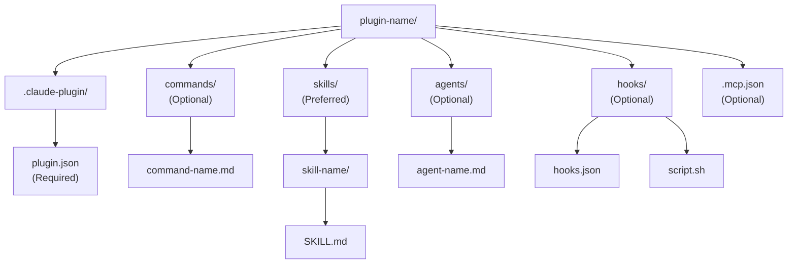

Sources: [plugins/plugin-dev/README.md:95-106](), [plugins/example-plugin/.claude-plugin/plugin.json:1-8]()

### Component Types

| Component | Path | Role |
| :--- | :--- | :--- |
| **Manifest** | `.claude-plugin/plugin.json` | Defines name, version, author, and metadata. [plugins/example-plugin/.claude-plugin/plugin.json:1-8]() |
| **Skills** | `skills/<name>/SKILL.md` | **Preferred** format for modular capabilities with progressive disclosure. [plugins/plugin-dev/skills/skill-development/SKILL.md:25-40]() |
| **Commands** | `commands/<name>.md` | Legacy format for slash commands, defining user-facing actions. [plugins/plugin-dev/README.md:135-146]() |
| **Agents** | `agents/<name>.md` | Defines specialized subagents with distinct system prompts and tools. [plugins/plugin-dev/README.md:154-161]() |
| **Hooks** | `hooks/hooks.json` | Configures scripts that trigger on session lifecycle events. [plugins/plugin-dev/README.md:56-67]() |
| **MCP** | `.mcp.json` | Configures external Model Context Protocol servers (stdio/http/SSE). [plugins/plugin-dev/README.md:76-87]() |

Sources: [plugins/plugin-dev/README.md:56-161](), [plugins/plugin-dev/skills/skill-development/SKILL.md:25-40](), [plugins/example-plugin/.claude-plugin/plugin.json:1-8]()

## Bridging Natural Language to Code

The architecture maps high-level intent (Natural Language Space) to specific code entities and execution environments (Code Entity Space).

### Command and Skill Execution Flow

Title: "Intent-to-Entity Mapping"
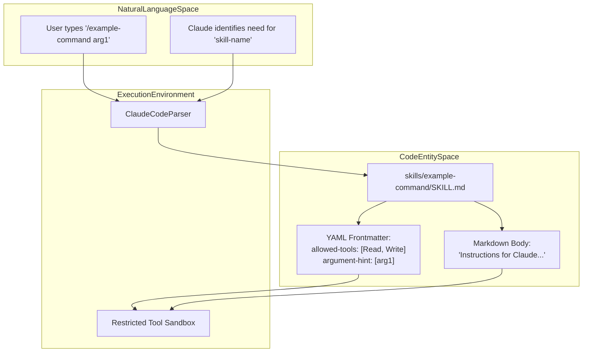

Sources: [plugins/plugin-dev/README.md:135-152](), [plugins/plugin-dev/skills/skill-development/SKILL.md:25-40]()

### Event-Driven Hook Architecture

The hooks system allows plugins to intercept the session lifecycle. A hook is defined by an event type (e.g., `Stop`) and a corresponding action configuration [plugins/plugin-dev/README.md:56-67]().

Title: "Hook Lifecycle Integration"
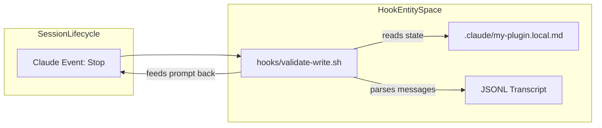

Sources: [plugins/plugin-dev/skills/plugin-settings/SKILL.md:60-95](), [plugins/plugin-dev/README.md:56-67]()

## Architectural Patterns

### 1. Skills-First Development
The architecture favors the "Skills" pattern. A `SKILL.md` file uses YAML frontmatter to define its interface and Markdown to define its logic, supporting progressive disclosure across metadata, body, and bundled resources [plugins/plugin-dev/skills/skill-development/SKILL.md:77-86]().

### 2. Local Configuration Persistence
Plugins manage user settings and transient state using `.claude/*.local.md` files, which combine YAML frontmatter for structured variables and markdown for contextual instructions [plugins/plugin-dev/skills/plugin-settings/SKILL.md:11-20]().

### 3. Instruction-Based Commands
Commands and skills are structured as direct instructions **TO Claude** about what actions to perform and which tools are permitted via frontmatter control declarations [plugins/plugin-dev/skills/plugin-settings/SKILL.md:99-117]().

---

# Page: Plugin Structure and Manifest

# Plugin Structure and Manifest

<details>
<summary>Relevant source files</summary>

The following files were used as context for generating this wiki page:

- [plugins/agent-sdk-dev/.claude-plugin/plugin.json](plugins/agent-sdk-dev/.claude-plugin/plugin.json)
- [plugins/code-review/.claude-plugin/plugin.json](plugins/code-review/.claude-plugin/plugin.json)
- [plugins/example-plugin/.claude-plugin/plugin.json](plugins/example-plugin/.claude-plugin/plugin.json)
- [plugins/explanatory-output-style/.claude-plugin/plugin.json](plugins/explanatory-output-style/.claude-plugin/plugin.json)
- [plugins/feature-dev/.claude-plugin/plugin.json](plugins/feature-dev/.claude-plugin/plugin.json)
- [plugins/frontend-design/.claude-plugin/plugin.json](plugins/frontend-design/.claude-plugin/plugin.json)
- [plugins/hookify/.claude-plugin/plugin.json](plugins/hookify/.claude-plugin/plugin.json)
- [plugins/hookify/skills/writing-rules/SKILL.md](plugins/hookify/skills/writing-rules/SKILL.md)
- [plugins/learning-output-style/.claude-plugin/plugin.json](plugins/learning-output-style/.claude-plugin/plugin.json)
- [plugins/plugin-dev/README.md](plugins/plugin-dev/README.md)
- [plugins/plugin-dev/skills/hook-development/SKILL.md](plugins/plugin-dev/skills/hook-development/SKILL.md)
- [plugins/plugin-dev/skills/plugin-settings/SKILL.md](plugins/plugin-dev/skills/plugin-settings/SKILL.md)
- [plugins/plugin-dev/skills/plugin-structure/SKILL.md](plugins/plugin-dev/skills/plugin-structure/SKILL.md)
- [plugins/plugin-dev/skills/skill-development/SKILL.md](plugins/plugin-dev/skills/skill-development/SKILL.md)
- [plugins/pr-review-toolkit/.claude-plugin/plugin.json](plugins/pr-review-toolkit/.claude-plugin/plugin.json)

</details>


This page documents the standardized directory structure and metadata format for Claude Code plugins. All plugins follow this structure to ensure automatic component discovery, consistent installation, and seamless integration with the Claude Code environment.

## Purpose and Scope

This document details:
- The standard plugin directory layout and file conventions.
- The `.claude-plugin/plugin.json` manifest format, including required and optional fields.
- Component discovery mechanisms for skills, commands, agents, and hooks.
- Legacy vs. modern file layouts for user-invoked capabilities.
- The role of the `.mcp.json` configuration file.
- Per-project configuration using the `.local.md` pattern.

Sources: [plugins/example-plugin/README.md:7-19](), [plugins/plugin-dev/README.md:95-113]()

## Standard Directory Structure

Claude Code plugins use a conventional directory structure. While only the manifest is strictly required for the directory to be recognized as a plugin, specific subdirectories are reserved for auto-discovery of functional components.

### Directory Layout and Code Entities

Title: "Plugin Directory Layout to Code Entity Mapping"
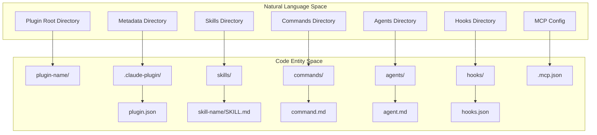
Sources: [plugins/example-plugin/README.md:7-19](), [plugins/plugin-dev/README.md:95-113]()

### Component Locations

| Component | Location | Description |
| :--- | :--- | :--- |
| **Manifest** | `.claude-plugin/plugin.json` | Core metadata (`name`, `version`, `author`). |
| **Skills** | `skills/<name>/SKILL.md` | **Preferred** format for both model-invoked and user-invoked capabilities. |
| **Commands** | `commands/*.md` | **Legacy** format for slash commands. Loaded identically to skills. |
| **Agents** | `agents/*.md` | Definitions for autonomous subagents. |
| **Hooks** | `hooks/hooks.json` | Configuration for event-driven automation (`PreToolUse`, etc.). |
| **MCP** | `.mcp.json` | Configuration for Model Context Protocol servers. |

Sources: [plugins/example-plugin/README.md:25-52](), [plugins/plugin-dev/README.md:95-113]()

## Plugin Manifest (`plugin.json`)

The `plugin.json` file is the central metadata file for every plugin. It must be located within the `.claude-plugin/` directory.

### Manifest Schema

| Field | Type | Required | Description |
| :--- | :--- | :--- | :--- |
| `name` | string | Yes | Unique kebab-case identifier for the plugin. |
| `description` | string | No | Brief explanation of the plugin's purpose. |
| `version` | string | No | Semantic versioning string (e.g., `"1.0.0"`). |
| `author` | object | No | Contains `name` and `email` of the developer. |

Sources: [plugins/example-plugin/.claude-plugin/plugin.json:1-8](), [plugins/learning-output-style/.claude-plugin/plugin.json:1-9]()

### Example Manifest
```json
{
  "name": "example-plugin",
  "version": "1.0.0",
  "description": "A comprehensive example plugin demonstrating all Claude Code extension options",
  "author": {
    "name": "Anthropic",
    "email": "support@anthropic.com"
  }
}
```
Sources: [plugins/example-plugin/.claude-plugin/plugin.json:1-8]()

## Auto-Discovery and Component Loading

Claude Code employs an auto-discovery mechanism that scans the plugin directory for specific file patterns.

### The Discovery Workflow

Title: "Auto-Discovery Engine Scan Workflow"
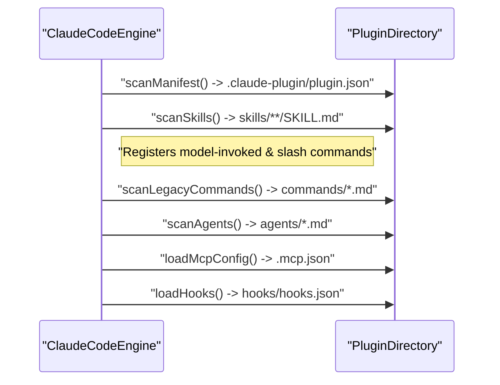
Sources: [plugins/example-plugin/README.md:23-52](), [plugins/plugin-dev/README.md:95-113]()

### Skills vs. Commands Discovery
Modern plugins consolidate user-invoked "slash commands" and model-invoked "skills" into the `skills/` directory. 
- A directory `skills/my-command/SKILL.md` with `name: my-command` and `argument-hint` in its frontmatter will be registered as the `/my-command` slash command.
- The legacy `commands/my-command.md` layout is supported but discouraged for new development.

Sources: [plugins/plugin-dev/README.md:135-152](), [plugins/plugin-dev/README.md:95-113]()

## Model Context Protocol (`.mcp.json`)

External tool integration is handled via the Model Context Protocol (MCP). The `.mcp.json` file defines how Claude Code should connect to these servers.

```json
{
  "server-name": {
    "type": "http",
    "url": "https://mcp.example.com/api"
  }
}
```
Sources: [plugins/plugin-dev/README.md:76-94]()

## Plugin Settings and Configuration

Plugins use the `.claude/plugin-name.local.md` pattern to store per-project configuration and state. These files utilize YAML frontmatter for structured data and Markdown for additional context.

### File Structure
```markdown
---
enabled: true
setting1: value1
---
# Additional Context
This body can contain task descriptions or prompts.
```
Sources: [plugins/plugin-dev/skills/plugin-settings/SKILL.md:22-40]()

### Parsing in Scripts
Bash scripts within plugins often parse these settings using `sed` or `awk` to extract frontmatter values for conditional logic.
```bash
# Extract frontmatter between --- markers
FRONTMATTER=$(sed -n '/^---$/,/^---$/{ /^---$/d; p; }' "$STATE_FILE")
# Extract field
ENABLED=$(echo "$FRONTMATTER" | grep '^enabled:' | sed 's/enabled: *//')
```
Sources: [plugins/plugin-dev/skills/plugin-settings/SKILL.md:78-83](), [plugins/plugin-dev/skills/plugin-settings/SKILL.md:141-143]()

## Best Practices for Structure

1. **Path Portability**: Use `${CLAUDE_PLUGIN_ROOT}` when referring to files within the plugin directory to ensure paths work regardless of where the plugin is installed.
2. **KISS (Keep It Simple, Skill)**: Prefer the `skills/` directory over the legacy `commands/` directory for better organization.
3. **Git Integration**: Project-specific state files in `.claude/` should be ignored by version control.

Sources: [plugins/plugin-dev/README.md:95-113](), [plugins/plugin-dev/skills/plugin-settings/SKILL.md:18]()

---

# Page: Commands

# Commands

<details>
<summary>Relevant source files</summary>

The following files were used as context for generating this wiki page:

- [.gitignore](.gitignore)
- [plugins/example-plugin/README.md](plugins/example-plugin/README.md)
- [plugins/example-plugin/commands/example-command.md](plugins/example-plugin/commands/example-command.md)
- [plugins/example-plugin/skills/example-command/SKILL.md](plugins/example-plugin/skills/example-command/SKILL.md)
- [plugins/plugin-dev/commands/create-plugin.md](plugins/plugin-dev/commands/create-plugin.md)
- [plugins/plugin-dev/skills/command-development/SKILL.md](plugins/plugin-dev/skills/command-development/SKILL.md)

</details>


## Purpose and Scope

This document details the architecture, configuration, and execution lifecycle of slash commands within the Claude Code plugin system. Slash commands are user-invoked capabilities defined as Markdown files that execute predefined prompts and workflows (e.g., `/example-command`) [plugins/plugin-dev/skills/command-development/SKILL.md:11-38](). 

Commands serve as instructions **for Claude**, rather than messages to the user [plugins/plugin-dev/skills/command-development/SKILL.md:34-38](). When invoked, they combine YAML frontmatter configuration, dynamic arguments, file references, and inline bash execution to orchestrate complex tasks [plugins/plugin-dev/skills/command-development/SKILL.md:13-21]().

For related extension models, see **Plugin Structure and Manifest (2.1)**, **Agents and Subagents (2.3)**, and **Skills System (2.4)**.

Sources: [plugins/plugin-dev/skills/command-development/SKILL.md:1-52]()

## Command Locations and Discovery

Commands can be stored across three distinct directory tiers, defining their scope and precedence [plugins/plugin-dev/skills/command-development/SKILL.md:61-83]():

### Command Location Types

| Location | Scope | Label in `/help` | Use Case |
|----------|-------|----------------|----------|
| `.claude/commands/` | Project | `(project)` | Team workflows, project-specific tasks [plugins/plugin-dev/skills/command-development/SKILL.md:63-68]() |
| `~/.claude/commands/` | Global | `(user)` | Personal workflows, cross-project utilities [plugins/plugin-dev/skills/command-development/SKILL.md:70-75]() |
| `plugin-name/commands/` | Plugin | `(plugin-name)` | Plugin-specific functionality [plugins/plugin-dev/skills/command-development/SKILL.md:77-82]() |

> **Note on Modern Format:** The `commands/*.md` layout is a legacy format [plugins/example-plugin/README.md:48-50](). For new plugins, user-invoked slash commands are preferentially implemented as skills under `skills/<name>/SKILL.md` [plugins/plugin-dev/skills/command-development/SKILL.md:9-10](). Both formats are parsed and loaded identically by Claude Code [plugins/plugin-dev/commands/create-plugin.md:72-73]().

Sources: [plugins/plugin-dev/skills/command-development/SKILL.md:54-83](), [plugins/example-plugin/README.md:48-50](), [plugins/plugin-dev/commands/create-plugin.md:72-73]()

## Command File Structure

Commands consist of individual Markdown files where the file name (excluding the `.md` extension) establishes the command identifier [plugins/plugin-dev/skills/command-development/SKILL.md:87-95]().

```
plugin-name/
├── .claude-plugin/
│   └── plugin.json
└── commands/
    ├── example-command.md    → /example-command
    └── utils/
        └── helper.md         → /helper (plugin:plugin-name:utils)
```

Each command file contains an optional YAML frontmatter header followed by a Markdown body containing instructions for Claude [plugins/plugin-dev/skills/command-development/SKILL.md:110-123]().

### Natural Language Space to Code Entity Space: Definition Mapping

Title: Command Definition Mapping
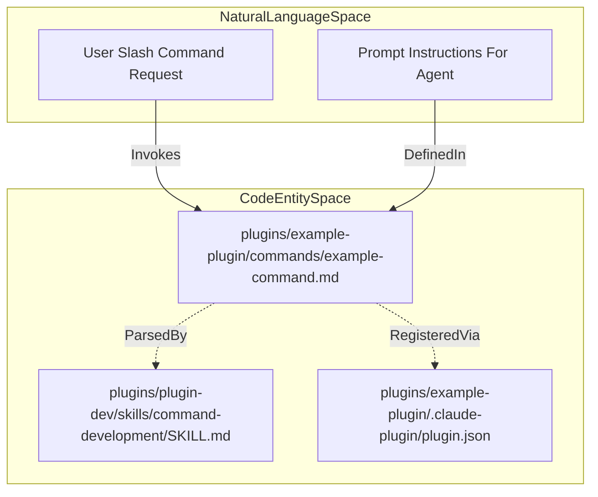

Sources: [plugins/plugin-dev/skills/command-development/SKILL.md:34-123](), [plugins/example-plugin/README.md:9-18]()

## Frontmatter Configuration

The YAML frontmatter section configures command metadata and behavior, delimited by `---` markers at the top of the command file [plugins/plugin-dev/skills/command-development/SKILL.md:112-124]().

### Frontmatter Fields

| Field | Type | Default | Purpose |
|-------|------|---------|---------|
| `description` | String | First line | Brief description displayed in `/help` [plugins/plugin-dev/skills/command-development/SKILL.md:126-132]() |
| `argument-hint` | String | None | Usage pattern shown in autocomplete [plugins/plugin-dev/skills/command-development/SKILL.md:178-183]() |
| `allowed-tools` | String/Array | Inherits | Whitelist of tools Claude can use [plugins/plugin-dev/skills/command-development/SKILL.md:140-145]() |
| `model` | String | Inherits | Model override (`sonnet`, `opus`, `haiku`) [plugins/plugin-dev/skills/command-development/SKILL.md:160-164]() |
| `disable-model-invocation` | Boolean | `false` | Prevent programmatic call via `SlashCommand` tool [plugins/plugin-dev/skills/command-development/SKILL.md:197-201]() |

Sources: [plugins/plugin-dev/skills/command-development/SKILL.md:112-209]()

### allowed-tools Patterns

Specifies tool access restrictions to minimize permission prompts:
- `Read, Write, Edit`: Specific core tools [plugins/plugin-dev/skills/command-development/SKILL.md:154]()
- `Bash(git:*)`: Bash restricted to git command patterns [plugins/plugin-dev/skills/command-development/SKILL.md:155]()
- `*`: Unrestricted tool access [plugins/plugin-dev/skills/command-development/SKILL.md:157]()

Sources: [plugins/plugin-dev/skills/command-development/SKILL.md:140-158]()

## Dynamic Arguments and Context Injection

Commands capture user-provided inputs and runtime context via variable expansion tokens [plugins/plugin-dev/skills/command-development/SKILL.md:210-212]().

### Variable Expansion Mechanics

- **`$ARGUMENTS`**: Captures all trailing arguments as a single unparsed string [plugins/plugin-dev/skills/command-development/SKILL.md:212-215]().
- **Positional Arguments (`$1`, `$2`, `$3`...)**: Captures individual whitespace-delimited arguments [plugins/plugin-dev/skills/command-development/SKILL.md:239-242]().
- **File References (`@path`)**: Embeds file content directly into the command stream [plugins/plugin-dev/skills/command-development/SKILL.md:266-268]().
- **Bash Execution (`!`bash``)**: Executes inline shell scripts to dynamically generate prompt context [plugins/plugin-dev/skills/command-development/SKILL.md:317-321]().
- **`${CLAUDE_PLUGIN_ROOT}`**: Resolves to the absolute path of the executing plugin [plugins/plugin-dev/skills/mcp-integration/SKILL.md:171-176]().

Sources: [plugins/plugin-dev/skills/command-development/SKILL.md:210-327](), [plugins/plugin-dev/skills/mcp-integration/SKILL.md:171-176]()

## Implementation and Data Flow

Title: Runtime Command Execution Sequence
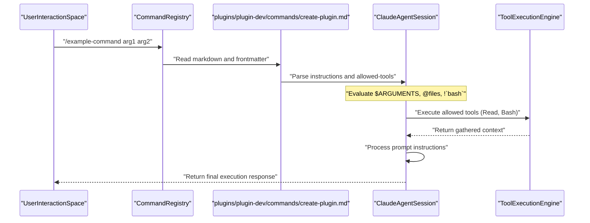

Sources: [plugins/plugin-dev/skills/command-development/SKILL.md:112-327](), [plugins/plugin-dev/commands/create-plugin.md:1-16]()

---

# Page: Agents and Subagents

# Agents and Subagents

<details>
<summary>Relevant source files</summary>

The following files were used as context for generating this wiki page:

- [plugins/hookify/agents/conversation-analyzer.md](plugins/hookify/agents/conversation-analyzer.md)
- [plugins/plugin-dev/skills/agent-development/SKILL.md](plugins/plugin-dev/skills/agent-development/SKILL.md)
- [plugins/plugin-dev/skills/agent-development/examples/agent-creation-prompt.md](plugins/plugin-dev/skills/agent-development/examples/agent-creation-prompt.md)
- [plugins/plugin-dev/skills/agent-development/examples/complete-agent-examples.md](plugins/plugin-dev/skills/agent-development/examples/complete-agent-examples.md)
- [plugins/plugin-dev/skills/agent-development/references/agent-creation-system-prompt.md](plugins/plugin-dev/skills/agent-development/references/agent-creation-system-prompt.md)
- [plugins/plugin-dev/skills/agent-development/references/triggering-examples.md](plugins/plugin-dev/skills/agent-development/references/triggering-examples.md)
- [plugins/pr-review-toolkit/agents/code-reviewer.md](plugins/pr-review-toolkit/agents/code-reviewer.md)
- [plugins/pr-review-toolkit/agents/comment-analyzer.md](plugins/pr-review-toolkit/agents/comment-analyzer.md)
- [plugins/pr-review-toolkit/agents/pr-test-analyzer.md](plugins/pr-review-toolkit/agents/pr-test-analyzer.md)
- [plugins/pr-review-toolkit/agents/type-design-analyzer.md](plugins/pr-review-toolkit/agents/type-design-analyzer.md)

</details>


## Purpose and Scope

This page documents the agent architecture in Claude Code plugins, covering frontmatter configuration, system prompts, triggering mechanisms, and subagent patterns. Agents are autonomous subprocesses that handle complex, multi-step tasks independently with their own context windows and tool access [plugins/plugin-dev/skills/agent-development/SKILL.md:9-11]().

Sources: [plugins/plugin-dev/skills/agent-development/SKILL.md:9-11]()

---

## What Are Agents?

Agents are specialized Claude instances that run autonomously in response to natural language triggers. Unlike commands (which users invoke explicitly with `/command-name`) or skills (which provide context), agents operate as independent subprocesses with dedicated resources [plugins/plugin-dev/skills/agent-development/SKILL.md:13-18]().

### Core Characteristics

*   **Autonomous operation**: Agents execute multi-step workflows without user intervention once triggered [plugins/plugin-dev/skills/agent-development/SKILL.md:11-11]().
*   **Isolated context**: Each agent has its own context window, preventing context pollution of the main session [plugins/plugin-dev/skills/agent-development/SKILL.md:11-11]().
*   **Specialized expertise**: System prompts define agent expertise, making them domain-specific specialists [plugins/plugin-dev/skills/agent-development/references/agent-creation-system-prompt.md:8-11]().
*   **Parallel execution**: Multiple agents can run simultaneously, each in its own subprocess.

### Agent vs Other Component Types

| Component | Invocation | Execution | Context | Use Case |
| :--- | :--- | :--- | :--- | :--- |
| **Agent** | Description-matched | Autonomous subprocess | Own window | Complex multi-step tasks |
| **Command** | User `/command` | Main session | Shared | Frequently-used prompts |
| **Skill** | Context-triggered | Main session | Shared | Knowledge/guidance |
| **Hook** | Event-driven | Script execution | Event-specific | Validation/automation |

Sources: [plugins/plugin-dev/skills/agent-development/SKILL.md:13-18](), [plugins/plugin-dev/skills/agent-development/references/agent-creation-system-prompt.md:8-11]()

---

## Agent File Format

### File Structure

Agents are Markdown files with YAML frontmatter located in the `agents/` directory of a plugin [plugins/plugin-dev/skills/agent-development/SKILL.md:20-31]():

```
plugin-name/
└── agents/
    ├── code-reviewer.md
    ├── test-generator.md
    └── security-analyzer.md
```

### Complete Format Template

The agent file consists of a YAML frontmatter block followed by a comprehensive system prompt [plugins/plugin-dev/skills/agent-development/SKILL.md:24-50]().

```markdown
---
name: agent-identifier
description: |
  Use this agent when [triggering conditions]. Typical triggers include [scenario 1], [scenario 2], and [scenario 3]. See "When to invoke" in the agent body for worked scenarios.
model: inherit
color: blue
tools: ["Read", "Write", "Grep"]
---

You are [agent role description]...

## When to invoke

- **[Scenario name].** [Situation description and agent action].
- **[Scenario name].** [Same].

**Your Core Responsibilities:**
1. [Responsibility 1]
2. [Responsibility 2]

**Analysis Process:**
[Step-by-step workflow]

**Output Format:**
[What to return]
```

Sources: [plugins/plugin-dev/skills/agent-development/SKILL.md:20-50]()

---

## Frontmatter Fields

### Required Fields

#### name
Agent identifier for namespacing and invocation.
*   **Format rules**: Lowercase letters, numbers, hyphens only; must start and end with alphanumeric [plugins/plugin-dev/skills/agent-development/SKILL.md:58-60]().
*   **Length**: 3-50 characters [plugins/plugin-dev/skills/agent-development/SKILL.md:59-59]().

#### description
Defines triggering conditions using natural language. This is the most critical field as it is loaded into context to decide when to dispatch the agent [plugins/plugin-dev/skills/agent-development/SKILL.md:76-76]().
*   **Required structure**: Must start with "Use this agent when...", include a short prose summary of typical triggers, and point to the "When to invoke" section [plugins/plugin-dev/skills/agent-development/SKILL.md:79-82]().

#### model
Specifies which Claude model the agent uses.
*   **Options**: `inherit` (recommended), `sonnet`, `opus`, `haiku` [plugins/plugin-dev/skills/agent-development/SKILL.md:99-105]().

#### color
Visual identifier for the agent in the UI.
*   **Options**: `blue`, `cyan`, `green`, `yellow`, `magenta`, `red` [plugins/plugin-dev/skills/agent-development/SKILL.md:111-111]().
*   **Conventions**: `blue`/`cyan` for analysis/review, `green` for success-oriented tasks, `yellow` for validation, `red` for security/critical, `magenta` for creative/generation [plugins/plugin-dev/skills/agent-development/SKILL.md:114-120]().

### Optional Fields

#### tools
Restricts the agent to a specific set of tools (Principle of Least Privilege) [plugins/plugin-dev/skills/agent-development/SKILL.md:134-135]().
*   **Format**: Array of tool names (e.g., `["Read", "Write", "Grep"]`) [plugins/plugin-dev/skills/agent-development/SKILL.md:128-130]().
*   **Default**: If omitted, agent has access to all tools [plugins/plugin-dev/skills/agent-development/SKILL.md:132-132]().

Sources: [plugins/plugin-dev/skills/agent-development/SKILL.md:52-141]()

---

## Agent Architecture Diagram

This diagram bridges the Natural Language triggers to the code entities that execute the agent.

### Agent Invocation Flow
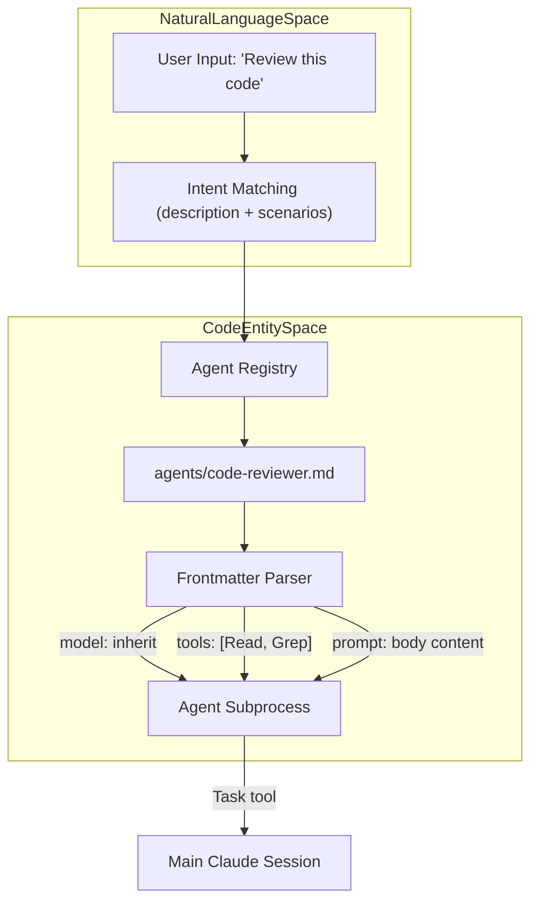
Sources: [plugins/plugin-dev/skills/agent-development/SKILL.md:76-86](), [plugins/plugin-dev/skills/agent-development/references/agent-creation-system-prompt.md:12-48]()

---

## System Prompt Design

The Markdown body after the frontmatter becomes the agent's system prompt. It is written in the second person, addressing the agent directly [plugins/plugin-dev/skills/agent-development/SKILL.md:144-144]().

### Content Requirements
1.  **Role and Expertise**: Establish a clear expert identity (e.g., "You are an elite AI agent architect") [plugins/plugin-dev/skills/agent-development/references/agent-creation-system-prompt.md:8-8]().
2.  **When to Invoke**: A section listing 2-4 representative scenarios written as prose bullets [plugins/plugin-dev/skills/agent-development/SKILL.md:35-39]().
3.  **Core Responsibilities**: A numbered list of fundamental tasks [plugins/plugin-dev/skills/agent-development/SKILL.md:152-156]().
4.  **Analysis Process**: Step-by-step methodology for execution [plugins/plugin-dev/skills/agent-development/SKILL.md:157-161]().
5.  **Output Format**: Expectations for how the agent should present its findings [plugins/plugin-dev/skills/agent-development/SKILL.md:167-170]().
6.  **Edge Case Handling**: Guidance for unexpected or vague situations [plugins/plugin-dev/skills/agent-development/SKILL.md:172-175]().

Sources: [plugins/plugin-dev/skills/agent-development/SKILL.md:143-176](), [plugins/plugin-dev/skills/agent-development/references/agent-creation-system-prompt.md:8-64]()

---

## Triggering Mechanisms

Agents are triggered when Claude's main session determines that a specialized sub-task is required. This is driven by the `description` field and its examples.

### Triggering Logic Diagram
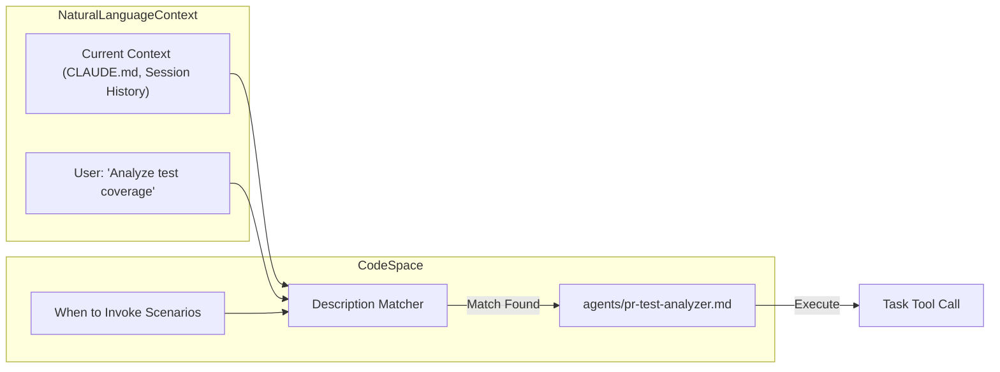
Sources: [plugins/plugin-dev/skills/agent-development/references/triggering-examples.md:1-50](), [plugins/pr-review-toolkit/agents/pr-test-analyzer.md:1-6]()

---

## Common Subagent Patterns

### Validation and Review
*   **code-reviewer**: Reviews code for adherence to project guidelines (CLAUDE.md) with confidence scoring [plugins/pr-review-toolkit/agents/code-reviewer.md:8-41]().
*   **pr-test-analyzer**: Reviews pull requests for behavioral test coverage quality and critical gaps [plugins/pr-review-toolkit/agents/pr-test-analyzer.md:19-41]().
*   **comment-analyzer**: Protects codebases from comment rot by analyzing documentation comments for accuracy [plugins/pr-review-toolkit/agents/comment-analyzer.md:8-56]().
*   **type-design-analyzer**: Evaluates type encapsulation, invariant expression, usefulness, and enforcement [plugins/pr-review-toolkit/agents/type-design-analyzer.md:18-55]().

### Workflow Automation
*   **conversation-analyzer**: Identifies problematic behaviors in transcripts to generate hook rules via `/hookify` [plugins/hookify/agents/conversation-analyzer.md:9-25]().

Sources: [plugins/pr-review-toolkit/agents/code-reviewer.md:1-41](), [plugins/pr-review-toolkit/agents/pr-test-analyzer.md:1-41](), [plugins/pr-review-toolkit/agents/comment-analyzer.md:1-56](), [plugins/pr-review-toolkit/agents/type-design-analyzer.md:1-55](), [plugins/hookify/agents/conversation-analyzer.md:1-25]()

---

## Validation Standards

Agents must adhere to strict quality standards to ensure reliability. Validation checks include:

| Check Category | Validation Criteria |
| :--- | :--- |
| **Naming** | Lowercase, hyphens, 3-50 chars; alphanumeric start/end [plugins/plugin-dev/skills/agent-development/SKILL.md:58-60](). |
| **Description** | Starts with "Use this agent when...", includes summary of triggers [plugins/plugin-dev/skills/agent-development/SKILL.md:79-82](). |
| **System Prompt** | Substantial content, clear responsibilities, and "When to invoke" section [plugins/plugin-dev/skills/agent-development/SKILL.md:148-176](). |
| **Model** | Valid identifier (`inherit`, `sonnet`, `opus`, `haiku`) [plugins/plugin-dev/skills/agent-development/SKILL.md:99-103](). |
| **Color** | Valid UI color (`blue`, `cyan`, `green`, `yellow`, `magenta`, `red`) [plugins/plugin-dev/skills/agent-development/SKILL.md:111-111](). |

Sources: [plugins/plugin-dev/skills/agent-development/SKILL.md:52-141]()

---

## Agent-to-Code Entity Mapping

| System Name | Code Entity / File Path | Role |
| :--- | :--- | :--- |
| **Code Reviewer** | `plugins/pr-review-toolkit/agents/code-reviewer.md` | Reviews code against CLAUDE.md guidelines [plugins/pr-review-toolkit/agents/code-reviewer.md:1-8]() |
| **PR Test Analyzer** | `plugins/pr-review-toolkit/agents/pr-test-analyzer.md` | Analyzes test coverage and critical gaps [plugins/pr-review-toolkit/agents/pr-test-analyzer.md:1-8]() |
| **Comment Analyzer** | `plugins/pr-review-toolkit/agents/comment-analyzer.md` | Verifies factual accuracy of comments [plugins/pr-review-toolkit/agents/comment-analyzer.md:1-8]() |
| **Type Design Analyzer** | `plugins/pr-review-toolkit/agents/type-design-analyzer.md` | Evaluates type encapsulation and invariants [plugins/pr-review-toolkit/agents/type-design-analyzer.md:1-8]() |
| **Conversation Analyzer** | `plugins/hookify/agents/conversation-analyzer.md` | Analyzes transcripts for hook generation [plugins/hookify/agents/conversation-analyzer.md:1-10]() |

Sources: [plugins/pr-review-toolkit/agents/code-reviewer.md:1-8](), [plugins/pr-review-toolkit/agents/pr-test-analyzer.md:1-8](), [plugins/pr-review-toolkit/agents/comment-analyzer.md:1-8](), [plugins/pr-review-toolkit/agents/type-design-analyzer.md:1-8](), [plugins/hookify/agents/conversation-analyzer.md:1-10]()

---

# Page: Skills System

# Skills System

<details>
<summary>Relevant source files</summary>

The following files were used as context for generating this wiki page:

- [plugins/hookify/skills/writing-rules/SKILL.md](plugins/hookify/skills/writing-rules/SKILL.md)
- [plugins/plugin-dev/README.md](plugins/plugin-dev/README.md)
- [plugins/plugin-dev/skills/hook-development/SKILL.md](plugins/plugin-dev/skills/hook-development/SKILL.md)
- [plugins/plugin-dev/skills/plugin-settings/SKILL.md](plugins/plugin-dev/skills/plugin-settings/SKILL.md)
- [plugins/plugin-dev/skills/plugin-structure/SKILL.md](plugins/plugin-dev/skills/plugin-structure/SKILL.md)
- [plugins/plugin-dev/skills/skill-development/SKILL.md](plugins/plugin-dev/skills/skill-development/SKILL.md)
- [plugins/skill-creator/skills/skill-creator/SKILL.md](plugins/skill-creator/skills/skill-creator/SKILL.md)
- [plugins/skill-creator/skills/skill-creator/agents/analyzer.md](plugins/skill-creator/skills/skill-creator/agents/analyzer.md)
- [plugins/skill-creator/skills/skill-creator/references/schemas.md](plugins/skill-creator/skills/skill-creator/references/schemas.md)
- [plugins/skill-creator/skills/skill-creator/scripts/aggregate_benchmark.py](plugins/skill-creator/skills/skill-creator/scripts/aggregate_benchmark.py)
- [plugins/skill-creator/skills/skill-creator/scripts/improve_description.py](plugins/skill-creator/skills/skill-creator/scripts/improve_description.py)
- [plugins/skill-creator/skills/skill-creator/scripts/run_loop.py](plugins/skill-creator/skills/skill-creator/scripts/run_loop.py)

</details>


This page documents the Skills System in Claude Code plugins. Skills are modular, self-contained knowledge packages that extend Claude's capabilities by providing specialized domain expertise, workflows, and tools. Unlike commands (which are user-invoked with `/` syntax) or agents (which run as autonomous subprocesses), skills are **context-triggered** based on user queries and conversational context.

For information about user-invoked slash commands, see [Commands](4.2). For autonomous agents, see [Agents and Subagents](4.3). For skill configuration patterns, see [Plugin Settings and Configuration](4.7).

Sources: [plugins/plugin-dev/skills/skill-development/SKILL.md:11-24](), [plugins/plugin-dev/README.md:7-17]()

## Overview

Skills transform Claude from a general-purpose assistant into a specialized agent equipped with procedural knowledge that no model can fully possess. When a user asks a question matching a skill's trigger conditions, Claude automatically loads that skill's content to provide expert guidance.

**Key characteristics:**
- **Context-triggered**: Loaded when YAML frontmatter `description` matches user query context. [plugins/plugin-dev/skills/skill-development/SKILL.md:43-45]()
- **Progressive disclosure**: Implements a three-level loading system (Metadata → SKILL.md → Resources) to manage the context window efficiently. [plugins/plugin-dev/skills/skill-development/SKILL.md:77-85]()
- **Bundled resources**: Co-locates `scripts/`, `references/`, and `assets/` with the core `SKILL.md` file. [plugins/plugin-dev/skills/skill-development/SKILL.md:25-40]()
- **Auto-discovered**: Automatically found and registered within the `skills/` directory of an installed plugin. [plugins/plugin-dev/skills/plugin-structure/SKILL.md:166-168]()

Sources: [plugins/plugin-dev/skills/skill-development/SKILL.md:11-24](), [plugins/plugin-dev/README.md:7-17]()

## Skill File Structure

### Directory Layout

Each skill resides in its own directory containing a required `SKILL.md` file and optional bundled resources.

```
plugin-name/skills/
└── skill-name/
    ├── SKILL.md              # Required: skill definition and metadata
    ├── references/           # Optional: documentation loaded into context as needed
    │   ├── api_docs.md
    │   └── patterns.md
    ├── scripts/              # Optional: executable code (Python/Bash)
    │   └── rotate_pdf.py
    └── assets/               # Optional: templates/icons used in Claude's output
        └── logo.png
```

Sources: [plugins/plugin-dev/skills/skill-development/SKILL.md:25-40](), [plugins/plugin-dev/skills/plugin-structure/SKILL.md:170-183]()

### SKILL.md Format

Skills use Markdown files with YAML frontmatter. The frontmatter controls skill triggering, while the markdown body provides procedural knowledge and instructions.

```markdown
---
name: skill-name
description: This skill should be used when the user asks to "phrase 1", "phrase 2", or needs guidance on [key concepts].
version: 1.0.0
---

# Skill Title

## Core Instructions
When this skill is active, perform the following steps...
```

Sources: [plugins/plugin-dev/skills/skill-development/SKILL.md:42-45](), [plugins/plugin-dev/skills/plugin-structure/SKILL.md:185-191]()

## YAML Frontmatter Requirements

### name (required)
The unique identifier for the skill, formatted in kebab-case. [plugins/plugin-dev/skills/plugin-structure/SKILL.md:188-188]()

### description (required)
**The most critical field.** It determines when Claude will use the skill. It should use the third-person (e.g., "This skill should be used when...") and include specific trigger phrases. [plugins/plugin-dev/skills/skill-development/SKILL.md:43-45]() To combat "undertriggering," descriptions should be slightly "pushy," explicitly listing contexts where the skill is useful even if not directly requested. [plugins/skill-creator/skills/skill-creator/SKILL.md:67-67]() The description has a hard limit of **1024 characters**; descriptions exceeding this length are truncated. [plugins/skill-creator/skills/skill-creator/scripts/improve_description.py:132-132]()

### compatibility (optional)
Lists required tools or dependencies (rarely needed). [plugins/skill-creator/skills/skill-creator/SKILL.md:68-68]()

Sources: [plugins/plugin-dev/skills/skill-development/SKILL.md:42-45](), [plugins/skill-creator/skills/skill-creator/SKILL.md:62-69](), [plugins/skill-creator/skills/skill-creator/scripts/improve_description.py:132-132]()

## Progressive Disclosure Pattern

Skills manage the context window by loading information only when necessary. This pattern ensures that high-token documentation or complex scripts do not bloat every query.

Title: "Natural Language Space to Code Entity Space Loading Flow"
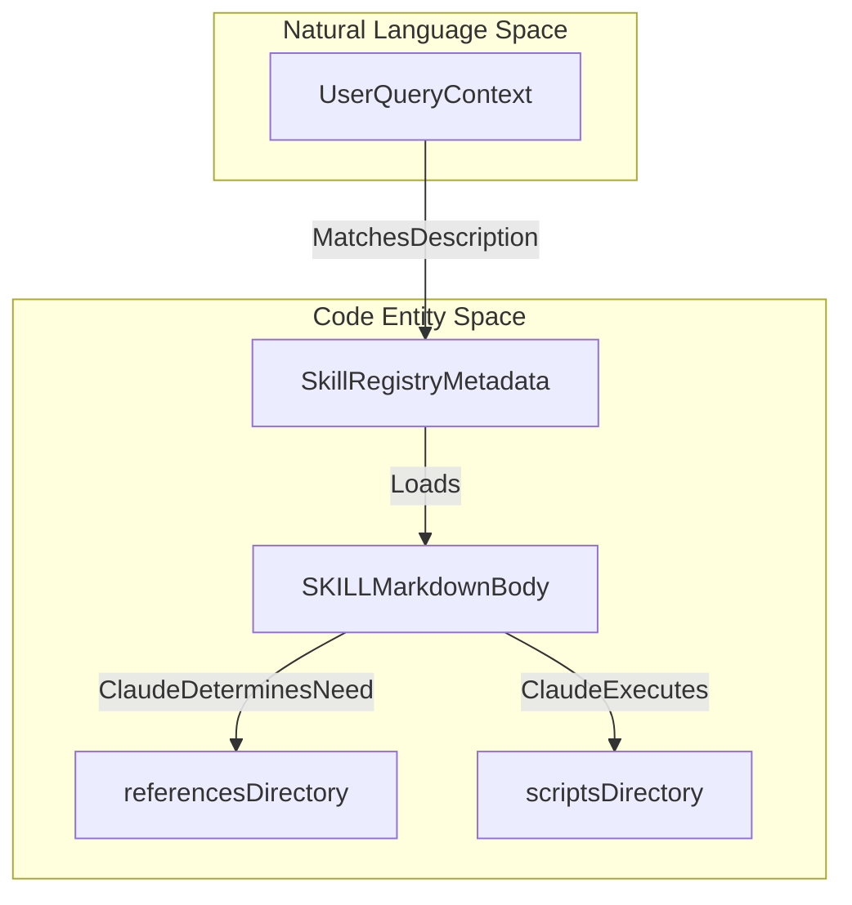

| Level | Component | Loading Trigger | Context Cost |
| :--- | :--- | :--- | :--- |
| **1** | Metadata | Always in context | ~100 words [plugins/plugin-dev/skills/skill-development/SKILL.md:81-81]() |
| **2** | `SKILL.md` | Match on trigger description | < 5,000 words (Ideal < 500 lines) [plugins/plugin-dev/skills/skill-development/SKILL.md:82-82](), [plugins/skill-creator/skills/skill-creator/SKILL.md:96-96]() |
| **3** | Resources | As needed by Claude | Unlimited (scripts execute externally) [plugins/plugin-dev/skills/skill-development/SKILL.md:83-85]() |

Sources: [plugins/plugin-dev/skills/skill-development/SKILL.md:77-85](), [plugins/skill-creator/skills/skill-creator/SKILL.md:86-92]()

## Bundled Resources

### References (`references/`)
Documentation intended to be loaded into context only when Claude determines it is needed. This keeps the core `SKILL.md` lean. For large files (>300 lines), include a table of contents. [plugins/plugin-dev/skills/skill-development/SKILL.md:57-67](), [plugins/skill-creator/skills/skill-creator/SKILL.md:98-98]()

### Scripts (`scripts/`)
Executable code (Python/Bash) for tasks that require deterministic reliability or are repeatedly rewritten. Scripts can be executed via the `Bash` tool without loading their source code into the context window. [plugins/plugin-dev/skills/skill-development/SKILL.md:48-56]()

### Assets (`assets/`)
Files not intended for context loading, but used as output (e.g., brand logos, boilerplate templates, fonts). [plugins/plugin-dev/skills/skill-development/SKILL.md:68-76]()

Sources: [plugins/plugin-dev/skills/skill-development/SKILL.md:46-76]()

## Skill Triggering Mechanism and Execution Flow

Skills are activated based on task context rather than explicit calls. Claude evaluates the user's intent against the `description` field in all registered skills.

Title: "System Name to Code Entity Execution Mapping"
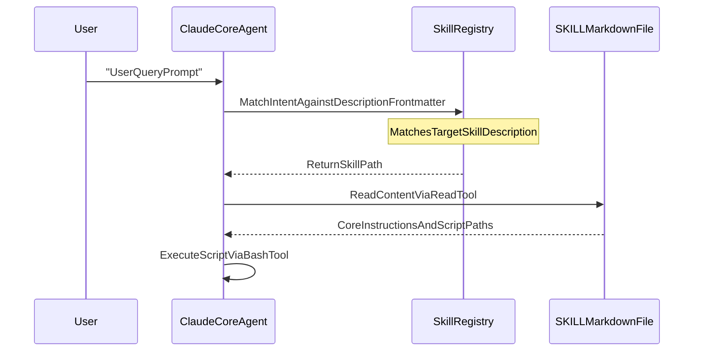

Sources: [plugins/plugin-dev/skills/skill-development/SKILL.md:115-119](), [plugins/skill-creator/skills/skill-creator/SKILL.md:79-81]()

## Skill Optimization and Evaluation

The repository includes a `skill-creator` plugin designed to iteratively improve skill triggering and performance through automated evaluation loops.

### Evaluation Loop Architecture

The `run_loop.py` script in `skill-creator` automates the process of testing a skill against a set of prompts to measure triggering accuracy and execution quality.

1.  **Split Set**: `split_eval_set` splits an evaluation set into `train` and `test` (holdout) sets, stratified by `should_trigger`. [plugins/skill-creator/skills/skill-creator/scripts/run_loop.py:24-44]()
2.  **Evaluate**: Runs `run_eval` to check if the skill triggers for relevant queries and ignores irrelevant ones. [plugins/skill-creator/skills/skill-creator/scripts/run_loop.py:89-99]()
3.  **Improve**: If accuracy is low, `improve_description.py` calls Claude via `_call_claude` (using `claude -p`) to rewrite the `description` frontmatter based on failed triggers and false triggers. [plugins/skill-creator/skills/skill-creator/scripts/improve_description.py:20-47](), [plugins/skill-creator/skills/skill-creator/scripts/improve_description.py:62-69]()
4.  **Aggregate**: `aggregate_benchmark.py` calculates mean, stddev, and pass rates across multiple runs using `calculate_stats`. [plugins/skill-creator/skills/skill-creator/scripts/aggregate_benchmark.py:45-64](), [plugins/skill-creator/skills/skill-creator/scripts/aggregate_benchmark.py:176-182]()

Sources: [plugins/skill-creator/skills/skill-creator/scripts/run_loop.py:1-7](), [plugins/skill-creator/skills/skill-creator/scripts/improve_description.py:1-7](), [plugins/skill-creator/skills/skill-creator/scripts/aggregate_benchmark.py:1-14]()

## Development Best Practices

### Writing Style
- **Instructions for Claude**: Skills are written as directives TO Claude.
- **Third-Person Description**: The `description` frontmatter must use the third-person (e.g., "This skill should be used when...") to help Claude's internal routing logic. [plugins/plugin-dev/skills/skill-development/SKILL.md:44-45]()
- **Imperative Phrasing**: Descriptions should focus on user intent (e.g., "Use this skill for...") rather than implementation details. [plugins/skill-creator/skills/skill-creator/scripts/improve_description.py:135-136]()
- **Domain Organization**: When a skill supports multiple frameworks (e.g., AWS vs GCP), use a selection logic in `SKILL.md` that points to specific reference files in `references/`. [plugins/skill-creator/skills/skill-creator/SKILL.md:100-109]()

### Skill Creation Process
1.  **Capture Intent**: Understand when the skill should trigger and what the expected output format is. [plugins/skill-creator/skills/skill-creator/SKILL.md:47-54]()
2.  **Research**: Check available MCPs and existing skills to avoid duplication. [plugins/skill-creator/skills/skill-creator/SKILL.md:56-61]()
3.  **Plan Resources**: Identify which parts should be deterministic scripts vs. context references vs. boilerplate assets. [plugins/plugin-dev/skills/skill-development/SKILL.md:108-132]()
4.  **Iterate**: Use the `skill-creator` tools to run evals and optimize the description for better triggering accuracy. [plugins/skill-creator/skills/skill-creator/SKILL.md:12-20]()

Sources: [plugins/plugin-dev/skills/skill-development/SKILL.md:87-159](), [plugins/skill-creator/skills/skill-creator/SKILL.md:45-69]()

---

# Page: Hooks System

# Hooks System

<details>
<summary>Relevant source files</summary>

The following files were used as context for generating this wiki page:

- [plugins/explanatory-output-style/hooks/hooks.json](plugins/explanatory-output-style/hooks/hooks.json)
- [plugins/hookify/core/rule_engine.py](plugins/hookify/core/rule_engine.py)
- [plugins/hookify/hooks/posttooluse.py](plugins/hookify/hooks/posttooluse.py)
- [plugins/hookify/hooks/pretooluse.py](plugins/hookify/hooks/pretooluse.py)
- [plugins/hookify/hooks/stop.py](plugins/hookify/hooks/stop.py)
- [plugins/hookify/hooks/userpromptsubmit.py](plugins/hookify/hooks/userpromptsubmit.py)
- [plugins/learning-output-style/hooks/hooks.json](plugins/learning-output-style/hooks/hooks.json)
- [plugins/ralph-loop/.claude-plugin/plugin.json](plugins/ralph-loop/.claude-plugin/plugin.json)
- [plugins/ralph-loop/hooks/hooks.json](plugins/ralph-loop/hooks/hooks.json)

</details>


Hooks are event-driven automation scripts that execute in response to Claude Code lifecycle events. They enable automated enforcement (blocking dangerous operations), post-processing (auto-formatting code), and context injection. Hooks read input from `stdin` as JSON, evaluate conditions, and output decisions or messages to `stdout`.

---

## Purpose and Scope

This document details the Claude Code hooks architecture, configuration schemas, event lifecycle types, output formats, and the internal implementation of declarative meta-hook engines like `hookify`. It is targeted at developers configuring custom security policies, test automation loops, and workflow extensions.

Sources: [plugins/plugin-dev/skills/hook-development/SKILL.md:1-40](), [plugins/hookify/hooks/pretooluse.py:1-63]()

---

## Hook Types

Claude Code supports two primary implementation patterns for hooks: prompt-based and command-based.

### Prompt-Based Hooks (Recommended)
Prompt-based hooks use LLM-driven decision making for context-aware validation. They are ideal for complex evaluations that require natural language reasoning rather than deterministic logic. They are highly flexible and better at handling edge cases compared to bash scripts [plugins/plugin-dev/skills/hook-development/SKILL.md:22-40]().

**Supported events:** `Stop`, `SubagentStop`, `UserPromptSubmit`, `PreToolUse` [plugins/plugin-dev/skills/hook-development/SKILL.md:34-34]().

```json
{
  "type": "prompt",
  "prompt": "Evaluate if this tool use is appropriate: $TOOL_INPUT",
  "timeout": 30
}
```

### Command Hooks
Command hooks execute bash commands or scripts for deterministic checks. They are best for fast validations, file system operations, or integrating external CLI tools. Examples include `ralph-loop` using a bash script for its `Stop` hook [plugins/ralph-loop/hooks/hooks.json:8-9]() or `learning-output-style` using a script for `SessionStart` [plugins/learning-output-style/hooks/hooks.json:8-9]().

```json
{
  "type": "command",
  "command": "bash ${CLAUDE_PLUGIN_ROOT}/scripts/validate.sh",
  "timeout": 60
}
```

Sources: [plugins/plugin-dev/skills/hook-development/SKILL.md:22-59](), [plugins/ralph-loop/hooks/hooks.json:1-15](), [plugins/learning-output-style/hooks/hooks.json:1-15](), [plugins/explanatory-output-style/hooks/hooks.json:1-15]()

---

## Hook Event Types

Claude Code fires hooks at specific points in the execution lifecycle. Each event receives different input data and can influence different aspects of behavior.

### Event Lifecycle and Capabilities

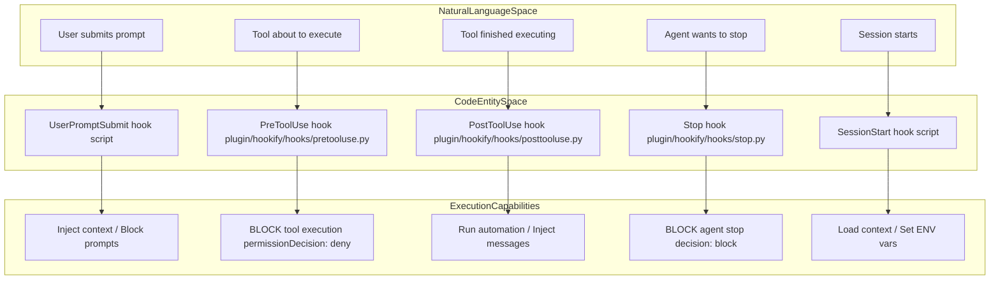

| Event Type | Timing | Can Block | Primary Use Cases |
|------------|--------|-----------|-------------------|
| `PreToolUse` | Before tool execution | ✓ Yes | Block sensitive file edits, prevent dangerous commands [plugins/plugin-dev/skills/hook-development/SKILL.md:123-125]() |
| `PostToolUse` | After tool execution | ✗ No | Auto-format code, run tests, react to results [plugins/plugin-dev/skills/hook-development/SKILL.md:155-157]() |
| `UserPromptSubmit` | When user sends message | ✓ Yes | Log prompts, inject context, block prompts [plugins/plugin-dev/skills/hook-development/SKILL.md:217-219]() |
| `Stop` | When agent attempts to stop | ✓ Yes | Iterative loops (`ralph-loop`), require completion standards [plugins/ralph-loop/hooks/hooks.json:4-13](), [plugins/plugin-dev/skills/hook-development/SKILL.md:181-183]() |
| `SessionStart` | When session begins | ✗ No | Load project context, set environment variables [plugins/plugin-dev/skills/hook-development/SKILL.md:238-240]() |
| `SubagentStop` | When subagent stops | ✓ Yes | Subagent task verification [plugins/plugin-dev/skills/hook-development/SKILL.md:211-213]() |
| `PreCompact` | Before context compaction | ✗ No | Preserve critical context [plugins/plugin-dev/skills/hook-development/SKILL.md:270-272]() |

Sources: [plugins/plugin-dev/skills/hook-development/SKILL.md:121-277](), [plugins/ralph-loop/hooks/hooks.json:4-13]()

---

## Hook Configuration

Hooks are configured in the plugin's `hooks/hooks.json` file.

### Plugin hooks.json Format
For hooks bundled in a plugin, use the `hooks` wrapper format. The `hooks` key contains event types, each mapping to an array of hook configurations [plugins/ralph-loop/hooks/hooks.json:3-14]().

```json
{
  "description": "Validation hooks for code quality",
  "hooks": {
    "PreToolUse": [
      {
        "matcher": "Write|Edit",
        "hooks": [
          {
            "type": "command",
            "command": "bash ${CLAUDE_PLUGIN_ROOT}/hooks/validate.sh"
          }
        ]
      }
    ]
  }
}
```

### Settings Format (Direct)
When configured directly in user settings (e.g., `.claude/settings.json`), the events are placed at the top level without the `hooks` wrapper [plugins/plugin-dev/skills/hook-development/SKILL.md:104-111]().

Sources: [plugins/ralph-loop/hooks/hooks.json:1-15](), [plugins/plugin-dev/skills/hook-development/SKILL.md:62-119]()

---

## Hook Output Format

Hooks must output JSON to `stdout`. The structure varies based on the desired effect.

### Standard Output (All Hooks)
```json
{
  "continue": true,
  "suppressOutput": false,
  "systemMessage": "Message for Claude"
}
```
- `continue`: If false, halt further hook processing (default true) [plugins/plugin-dev/skills/hook-development/SKILL.md:290-290]().
- `systemMessage`: Message included in Claude's context [plugins/plugin-dev/skills/hook-development/SKILL.md:292-292]().

### Blocking Output (PreToolUse)
To deny a tool execution, return `hookSpecificOutput` with `permissionDecision: "deny"` [plugins/plugin-dev/skills/hook-development/SKILL.md:148-148]().

```json
{
  "hookSpecificOutput": {
    "permissionDecision": "deny"
  },
  "systemMessage": "Modification of .env files is prohibited."
}
```

### Stop Decision Output
To prevent Claude from finishing a task, return `decision: "block"` [plugins/plugin-dev/skills/hook-development/SKILL.md:205-205]().

```json
{
  "decision": "block",
  "reason": "You must run tests before stopping.",
  "systemMessage": "Additional context for Claude."
}
```

Sources: [plugins/plugin-dev/skills/hook-development/SKILL.md:278-300](), [plugins/hookify/core/rule_engine.py:60-91]()

---

## Hookify Rule Engine and Execution Flow

The `hookify` plugin provides a declarative way to create hooks using YAML rules in `.claude/hookify.*.local.md` files. It acts as a meta-hook that dispatches events to a Python-based engine (`plugins/hookify/core/rule_engine.py`).

### Rule Engine Architecture and Data Flow

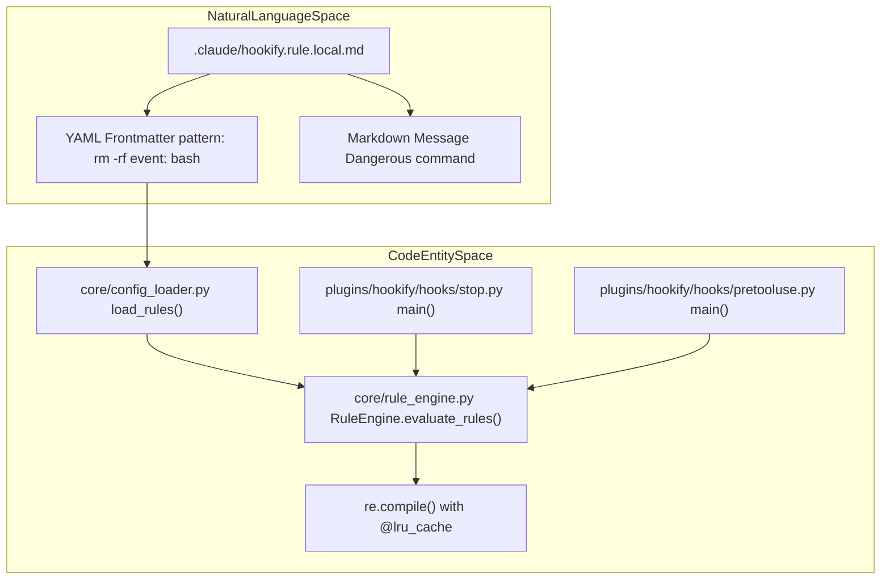

### Rule Evaluation Logic
The `RuleEngine` class evaluates rules against incoming `input_data` from Claude Code [plugins/hookify/hooks/stop.py:37-37]().

1. **Event Filtering**: Rules are filtered by event type (e.g., `bash`, `file`, `stop`, `prompt`) during loading [plugins/hookify/hooks/stop.py:33-33]().
2. **Condition Evaluation**: All conditions in a rule must match. Supported operators include `regex_match`, `contains`, `equals`, `not_contains`, `starts_with`, and `ends_with` [plugins/hookify/core/rule_engine.py:166-177]().
3. **Decision Priority**: If any rule with `action: "block"` matches, the engine returns a blocking response (`deny` for tools, `block` for stop events) [plugins/hookify/core/rule_engine.py:61-80](). Otherwise, matching warning rules are combined into a single `systemMessage` [plugins/hookify/core/rule_engine.py:87-91]().

Sources: [plugins/hookify/hooks/stop.py:26-55](), [plugins/hookify/core/rule_engine.py:35-94](), [plugins/hookify/skills/writing-rules/SKILL.md:1-100]()

---

## Implementation Best Practices

### 1. The Exit 0 Rule
Hooks **must always exit with status 0**, even if an error occurs. A non-zero exit code may disrupt the Claude Code execution flow. Use `try/except` blocks in scripts to ensure a clean exit [plugins/hookify/hooks/stop.py:42-51]().

### 2. Path Portability
Always use `${CLAUDE_PLUGIN_ROOT}` when referencing scripts within a plugin. This ensures the plugin remains portable across different user environments [plugins/plugin-dev/skills/hook-development/SKILL.md:66-67]().

### 3. Environment Context
Hooks receive the plugin root via the `CLAUDE_PLUGIN_ROOT` environment variable [plugins/hookify/hooks/stop.py:13-13](). In `SessionStart` hooks, you can persist environment variables for the entire session by appending to the file pointed to by `$CLAUDE_ENV_FILE` [plugins/plugin-dev/skills/hook-development/SKILL.md:259-261]().

### 4. Settings Integration
Plugins can store user-configurable settings in `.claude/plugin-name.local.md`. Hooks can read these files to dynamically enable or disable behavior without requiring a full `hooks.json` update (which requires a restart) [plugins/plugin-dev/skills/plugin-settings/SKILL.md:175-201]().

Sources: [plugins/plugin-dev/skills/hook-development/SKILL.md:1-300](), [plugins/plugin-dev/skills/plugin-settings/SKILL.md:11-40](), [plugins/hookify/hooks/stop.py:13-15]()

---

# Page: MCP Server Integration

# MCP Server Integration

<details>
<summary>Relevant source files</summary>

The following files were used as context for generating this wiki page:

- [external_plugins/asana/.claude-plugin/plugin.json](external_plugins/asana/.claude-plugin/plugin.json)
- [external_plugins/asana/README.md](external_plugins/asana/README.md)
- [external_plugins/asana/commands/asana-setup.md](external_plugins/asana/commands/asana-setup.md)
- [plugins/mcp-server-dev/skills/build-mcp-server/SKILL.md](plugins/mcp-server-dev/skills/build-mcp-server/SKILL.md)
- [plugins/mcp-server-dev/skills/build-mcp-server/references/auth.md](plugins/mcp-server-dev/skills/build-mcp-server/references/auth.md)
- [plugins/mcp-server-dev/skills/build-mcp-server/references/tool-design.md](plugins/mcp-server-dev/skills/build-mcp-server/references/tool-design.md)
- [plugins/mcp-server-dev/skills/build-mcpb/SKILL.md](plugins/mcp-server-dev/skills/build-mcpb/SKILL.md)
- [plugins/plugin-dev/skills/mcp-integration/SKILL.md](plugins/plugin-dev/skills/mcp-integration/SKILL.md)
- [plugins/plugin-dev/skills/mcp-integration/examples/sse-server.json](plugins/plugin-dev/skills/mcp-integration/examples/sse-server.json)
- [plugins/plugin-dev/skills/mcp-integration/references/authentication.md](plugins/plugin-dev/skills/mcp-integration/references/authentication.md)
- [plugins/plugin-dev/skills/mcp-integration/references/server-types.md](plugins/plugin-dev/skills/mcp-integration/references/server-types.md)

</details>


## Purpose and Scope

The Model Context Protocol (MCP) is the foundational standard used by Claude Code to integrate with external services, APIs, and local tools. This integration allows plugins to expose structured capabilities ("tools") to Claude, enabling the model to perform actions like creating issues, searching repositories, or interacting with local databases.

This page details:
- MCP server architecture and the data flow between Claude and servers.
- Configuration patterns using `.mcp.json` and `plugin.json`.
- Supported transport types: stdio, SSE, HTTP, and WebSocket.
- Authentication patterns including OAuth and environment variable tokens.
- Lifecycle management and tool naming conventions.

---

## MCP Server Architecture

MCP servers are standalone processes or remote services that implement the Model Context Protocol. They act as a bridge between Claude's reasoning and external state.

### System Overview

Title: MCP Client and Server Architecture Integration

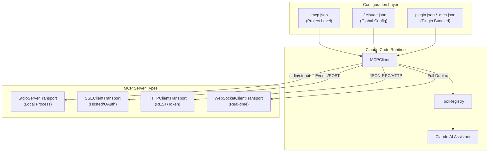

Sources: [plugins/plugin-dev/skills/mcp-integration/SKILL.md:224-236](), [plugins/plugin-dev/skills/mcp-integration/references/server-types.md:38-43]()

### Registration and Execution Flow

Title: MCP Initialization and Tool Call Dispatch Flow

```mermaid
sequenceDiagram
    participant Claude as "Claude AI"
    participant Client as "MCPClient"
    participant Server as "ServerInstance"
    
    Note over Client, Server: "1. Lifecycle: Plugin load and tool discovery"
    Client->>Server: "initialize / tools/list"
    Server-->>Client: "tool_definitions (name, schema)"
    Client->>Claude: "Register tools as mcp__plugin_... (ToolRegistry)"
    
    Note over Claude, Server: "2. Execution: Tool invocation"
    Claude->>Client: "Call tool: mcp__plugin_asana_asana__create_task(args)"
    Client->>Server: "JSON-RPC: tools/call (name, arguments)"
    Server->>Server: "Execute Logic (API/DB/Shell)"
    Server-->>Client: "tool_result"
    Client-->>Claude: "Result content"
```

Sources: [plugins/plugin-dev/skills/mcp-integration/SKILL.md:224-236](), [plugins/plugin-dev/skills/mcp-integration/references/server-types.md:38-43]()

---

## Configuration

Plugins bundle MCP servers using two primary methods. Both support environment variable expansion for portability.

### Method 1: Dedicated .mcp.json (Recommended)
A `.mcp.json` file at the plugin root separates server configuration from the main plugin manifest [plugins/plugin-dev/skills/mcp-integration/SKILL.md:23-37]().

```json
{
  "database-tools": {
    "command": "${CLAUDE_PLUGIN_ROOT}/servers/db-server",
    "args": ["--config", "${CLAUDE_PLUGIN_ROOT}/config.json"],
    "env": {
      "DB_URL": "${DB_URL}"
    }
  }
}
```

### Method 2: Inline in plugin.json
Simple plugins can define servers directly in the `mcpServers` field of `plugin.json` [plugins/plugin-dev/skills/mcp-integration/SKILL.md:44-59]().

### Environment Variable Expansion
Claude Code expands specific variables to ensure portability [plugins/plugin-dev/skills/mcp-integration/SKILL.md:167-186]():
- `${CLAUDE_PLUGIN_ROOT}`: Resolves to the absolute path of the plugin directory.
- `${USER_VAR}`: Resolves to variables from the user's shell environment (e.g., `${API_KEY}`).

Sources: [plugins/plugin-dev/skills/mcp-integration/SKILL.md:23-59](), [plugins/plugin-dev/skills/mcp-integration/SKILL.md:167-186]()

---

## Server Types and Transports

| Type | Communication | Use Case | Implementation Details |
| :--- | :--- | :--- | :--- |
| **stdio** | Local stdin/stdout | Local files, custom scripts, NPM packages. | Spawns child process; JSON-RPC via pipe [plugins/plugin-dev/skills/mcp-integration/references/server-types.md:5-9](). |
| **SSE** | Server-Sent Events | Hosted services (e.g. GitHub) with OAuth. | HTTP connection for events; POST for tool calls [plugins/plugin-dev/skills/mcp-integration/references/server-types.md:101-106](). |
| **HTTP** | JSON-RPC over HTTP | Stateless API backends, RESTful MCP. | Standard HTTP GET (discovery) and POST (invocation) [plugins/plugin-dev/skills/mcp-integration/references/server-types.md:203-207](). |
| **WebSocket** | Full Duplex | Real-time streaming or low-latency needs. | Bidirectional `wss://` connection [plugins/plugin-dev/skills/mcp-integration/references/server-types.md:301-305](). |

### stdio (Standard Input/Output)
Best for local tools. Claude Code manages the process lifecycle, terminating the server when the session ends [plugins/plugin-dev/skills/mcp-integration/SKILL.md:90-93]().
- **Best Practice**: Set `PYTHONUNBUFFERED=1` for Python servers to avoid logging delays [plugins/plugin-dev/skills/mcp-integration/references/server-types.md:83]().
- **Logging**: Servers must log to `stderr`; `stdout` is reserved for the MCP protocol [plugins/plugin-dev/skills/mcp-integration/references/server-types.md:86]().

### SSE (Server-Sent Events)
The primary transport for cloud-hosted MCP servers. It supports automatic OAuth flows handled by Claude Code [plugins/plugin-dev/skills/mcp-integration/references/authentication.md:9-20]().

Sources: [plugins/plugin-dev/skills/mcp-integration/references/server-types.md:1-332]()

---

## Authentication Patterns

### OAuth (Automatic)
Claude Code handles the complete OAuth 2.0 flow for SSE and HTTP servers. On the first tool use, the user is prompted to authorize in their browser [plugins/plugin-dev/skills/mcp-integration/references/authentication.md:9-20]().
- **Storage**: Tokens are encrypted and managed by Claude Code, not the plugin [plugins/plugin-dev/skills/mcp-integration/references/authentication.md:56-62]().
- **Example**: GitHub and Google services [plugins/plugin-dev/skills/mcp-integration/references/authentication.md:37-40]().

### Token-Based (Headers)
For servers requiring static tokens or API keys, configuration is passed via the `headers` field [plugins/plugin-dev/skills/mcp-integration/references/authentication.md:79-96]().
- **Configuration**:
  ```json
  "headers": {
    "Authorization": "Bearer ${API_TOKEN}"
  }
  ```
- **External Example**: Context7 uses an optional `CONTEXT7_API_KEY` passed via HTTP headers [external_plugins/context7/.mcp.json:1-8]().

### Manual Setup (e.g. Asana V2)
Some servers require manual OAuth app registration. The `asana` plugin provides a `/asana-setup` command to guide users through creating a Client ID/Secret and adding the server via `claude mcp add` [external_plugins/asana/commands/asana-setup.md:1-42]().

Sources: [plugins/plugin-dev/skills/mcp-integration/references/authentication.md:1-310](), [external_plugins/asana/commands/asana-setup.md:1-42]()

---

## Tool Naming and Access

### Prefixed Tool Names
To avoid collisions between multiple plugins and servers, MCP tools are automatically namespaced by Claude Code [plugins/plugin-dev/skills/mcp-integration/SKILL.md:190-200]().
- **Format**: `mcp__plugin_<plugin-name>_<server-name>__<tool-name>`
- **Example**: `mcp__plugin_asana_asana__asana_create_task`

### Command Integration
Commands must explicitly allow the MCP tools they intend to use in their YAML frontmatter [plugins/plugin-dev/skills/mcp-integration/SKILL.md:202-222]().
- **Specific**: `allowed-tools: ["mcp__plugin_asana_asana__asana_create_task"]`
- **Wildcard**: `allowed-tools: ["mcp__plugin_asana_asana__*"]` (Use sparingly for security)

Sources: [plugins/plugin-dev/skills/mcp-integration/SKILL.md:190-222]()

---

## Lifecycle and Management

1. **Discovery**: Claude Code parses `.mcp.json` or `plugin.json` on startup.
2. **Connection**: Connections are established before the first tool invocation [plugins/plugin-dev/skills/mcp-integration/SKILL.md:226-229]().
3. **Inspection**: Users can run the `/mcp` slash command to view the status (Connected/Disconnected) of all registered servers [plugins/plugin-dev/skills/mcp-integration/SKILL.md:238-239]().
4. **Removal**: Servers added via CLI can be removed using `claude mcp remove <name>` [external_plugins/asana/README.md:62]().

Sources: [plugins/plugin-dev/skills/mcp-integration/SKILL.md:224-240](), [external_plugins/asana/README.md:62]()

---

# Page: Plugin Settings and Configuration

# Plugin Settings and Configuration

<details>
<summary>Relevant source files</summary>

The following files were used as context for generating this wiki page:

- [plugins/hookify/skills/writing-rules/SKILL.md](plugins/hookify/skills/writing-rules/SKILL.md)
- [plugins/plugin-dev/README.md](plugins/plugin-dev/README.md)
- [plugins/plugin-dev/skills/hook-development/SKILL.md](plugins/plugin-dev/skills/hook-development/SKILL.md)
- [plugins/plugin-dev/skills/plugin-settings/SKILL.md](plugins/plugin-dev/skills/plugin-settings/SKILL.md)
- [plugins/plugin-dev/skills/plugin-settings/references/real-world-examples.md](plugins/plugin-dev/skills/plugin-settings/references/real-world-examples.md)
- [plugins/plugin-dev/skills/plugin-structure/SKILL.md](plugins/plugin-dev/skills/plugin-structure/SKILL.md)
- [plugins/plugin-dev/skills/skill-development/SKILL.md](plugins/plugin-dev/skills/skill-development/SKILL.md)
- [plugins/ralph-loop/commands/cancel-ralph.md](plugins/ralph-loop/commands/cancel-ralph.md)
- [plugins/ralph-loop/commands/help.md](plugins/ralph-loop/commands/help.md)
- [plugins/ralph-loop/commands/ralph-loop.md](plugins/ralph-loop/commands/ralph-loop.md)

</details>


This document defines the configuration patterns for Claude Code plugins, focusing on the `.claude/*.local.md` file pattern, YAML frontmatter settings, and lifecycle management. It covers how plugins store per-project state, manage user-configurable preferences, and parse decentralized configuration files.

For information about plugin metadata, see [Plugin Structure and Manifest](plugins/plugin-dev/skills/plugin-structure/SKILL.md:46-107)(). For details on event-driven automation, see [Hooks System](plugins/plugin-dev/skills/hook-development/SKILL.md:20-60)().

---

## Configuration Architecture

Claude Code plugins use a decentralized configuration model. While global settings reside in `settings.json`, plugin-specific state and project-level overrides are stored in specialized Markdown files combining YAML frontmatter and markdown bodies.

### Configuration Hierarchy

Title: "Plugin Configuration Scopes and Code Entities"
```mermaid
graph TD
    subgraph "NaturalLanguageSpace"
        GlobalPref["Global User Preferences"]
        ProjectState["Per-Project State & Settings"]
        EventDefs["Event Handlers"]
    end
    
    subgraph "CodeEntitySpace"
        GLOBAL["settings.json<br/>(Global Preferences)"]
        LOCAL_MD[".claude/plugin-name.local.md<br/>(Project State File)"]
        HOOKS_JSON["hooks/hooks.json<br/>(Plugin Event Definitions)"]
        MANIFEST[".claude-plugin/plugin.json<br/>(Plugin Manifest)"]
    end

    GlobalPref --> GLOBAL
    ProjectState --> LOCAL_MD
    MANIFEST --> HOOKS_JSON
    GLOBAL --> HOOKS_JSON
```

**Sources:** [plugins/plugin-dev/skills/plugin-settings/SKILL.md:9-18](), [plugins/plugin-dev/skills/plugin-structure/SKILL.md:46-48](), [plugins/plugin-dev/skills/plugin-structure/SKILL.md:235-237]()

---

## The .local.md Pattern

The primary mechanism for per-project plugin configuration is the `.claude/plugin-name.local.md` file. This pattern combines structured YAML data with unstructured Markdown context.

### File Structure and Schema

A standard configuration file consists of two parts:
1.  **YAML Frontmatter**: For machine-readable settings (booleans, strings, lists, numbers) [plugins/plugin-dev/skills/plugin-settings/SKILL.md:25-31]().
2.  **Markdown Body**: For human-readable context, prompts, or task descriptions [plugins/plugin-dev/skills/plugin-settings/SKILL.md:33-40]().

```markdown
---
enabled: true
mode: "strict"
max_retries: 3
allowed_extensions: [".js", ".ts"]
---

# Project Context
This section contains instructions that Claude reads when this plugin is active.
```

**Key Characteristics:**
*   **Location**: Always stored in the `.claude/` directory at the project root [plugins/plugin-dev/skills/plugin-settings/SKILL.md:14-14]().
*   **Lifecycle**: These files are user-managed and typically added to `.gitignore` as they contain local state or user-specific preferences [plugins/plugin-dev/skills/plugin-settings/SKILL.md:18-18]().
*   **Accessibility**: Settings can be read by hooks (via Bash scripts), commands (via the `Read` tool), and agents (via system prompt instructions) [plugins/plugin-dev/skills/plugin-settings/SKILL.md:60-134]().

**Sources:** [plugins/plugin-dev/skills/plugin-settings/SKILL.md:20-40](), [plugins/plugin-dev/skills/plugin-settings/SKILL.md:113-134]()

---

## Implementation and Parsing

Since many plugins rely on Bash-based hooks or commands, parsing these configuration files requires robust shell techniques to bridge the gap between file storage and runtime logic.

### Data Flow: Settings to Execution

Title: "Runtime Settings Extraction Flow"
```mermaid
sequenceDiagram
    participant BashScript as "BashScript(hook-script.sh)"
    participant LocalFile as "LocalMarkdownFile(.claude/*.local.md)"
    participant Parser as "ParserUtility(sed/awk/grep)"
    
    BashScript->>LocalFile: "check existence [[ -f FILE ]]"
    alt "File Exists"
        BashScript->>Parser: "extract frontmatter"
        Parser->>LocalFile: "sed -n '/^---$/,/^---$/'"
        LocalFile-->>Parser: "YAML Frontmatter Block"
        Parser-->>BashScript: "Extracted Field Values"
    else "Missing File"
        BashScript->>BashScript: "exit 0 (Quick Exit)"
    end
```

**Sources:** [plugins/plugin-dev/skills/plugin-settings/SKILL.md:62-95](), [plugins/plugin-dev/skills/plugin-settings/SKILL.md:136-172]()

### Parsing Techniques

Plugins use standard Unix utilities like `sed`, `awk`, and `grep` to extract data without requiring heavy YAML parsers [plugins/plugin-dev/skills/plugin-settings/SKILL.md:117-124]().

| Task | Command Pattern | File Reference |
| :--- | :--- | :--- |
| **Extract Frontmatter** | `sed -n '/^---$/,/^---$/{ /^---$/d; p; }' "$FILE"` | [plugins/plugin-dev/skills/plugin-settings/SKILL.md:79-79]() |
| **Read String Field** | `grep '^key:' \| sed 's/key: *//' \| sed 's/^"\(.*\)"$/\1/'` | [plugins/plugin-dev/skills/plugin-settings/SKILL.md:149-149]() |
| **Read Markdown Body** | `awk '/^---$/{i++; next} i>=2' "$FILE"` | [plugins/plugin-dev/skills/plugin-settings/SKILL.md:170-170]() |
| **Boolean Check** | `ENABLED=$(echo "$FRONTMATTER" | grep '^enabled:' | sed 's/enabled: *//')` | [plugins/plugin-dev/skills/plugin-settings/SKILL.md:154-154]() |

**Sources:** [plugins/plugin-dev/skills/plugin-settings/SKILL.md:62-95](), [plugins/plugin-dev/skills/plugin-settings/SKILL.md:136-172]()

---

## Real-World Configuration Examples

### 1. Ralph Loop State Management
The `ralph-loop` plugin uses `.claude/ralph-loop.local.md` to track iterations and completion criteria.

*   **Iteration Tracking**: Stores `iteration: N` and `max_iterations: M` [plugins/ralph-loop/commands/cancel-ralph.md:16-18]().
*   **Completion Promises**: Defines a `completion_promise` string that the `Stop` hook searches for in the assistant's output [plugins/plugin-dev/skills/plugin-settings/references/real-world-examples.md:173-195]().
*   **Command Control**: The `/cancel-ralph` command specifically targets this file for deletion to break the loop [plugins/ralph-loop/commands/cancel-ralph.md:1-18]().

**Sources:** [plugins/ralph-loop/commands/cancel-ralph.md:1-18](), [plugins/plugin-dev/skills/plugin-settings/references/real-world-examples.md:130-228]()

### 2. Multi-Agent Swarm Coordination
The `multi-agent-swarm` pattern utilizes settings for inter-session communication.

*   **Coordination**: Stores `coordinator_session` names to allow subagents to send notifications to specific `tmux` panes [plugins/plugin-dev/skills/plugin-settings/references/real-world-examples.md:16-18]().
*   **State Updates**: Uses `sed` to dynamically update fields like `pr_number` once a pull request is created [plugins/plugin-dev/skills/plugin-settings/references/real-world-examples.md:120-127]().

**Sources:** [plugins/plugin-dev/skills/plugin-settings/references/real-world-examples.md:5-116]()

### 3. Hookify Rules
The `hookify` plugin allows users to define custom hook rules using a similar `.local.md` pattern.

*   **Rule Schema**: Rules are stored in `.claude/hookify.{rule-name}.local.md` and include fields for `event`, `pattern`, and `action` [plugins/hookify/skills/writing-rules/SKILL.md:11-23]().
*   **Event Matching**: Rules can trigger on `bash`, `file`, `stop`, or `prompt` events [plugins/hookify/skills/writing-rules/SKILL.md:41-47]().

**Sources:** [plugins/hookify/skills/writing-rules/SKILL.md:11-56]()

---

## Configuration Lifecycle Management

Plugins provide commands to manage their own configuration lifecycle, ensuring users don't have to manually edit YAML.

### The "Quick Exit" Pattern
To maintain performance, hooks associated with configurable plugins implement a "Quick Exit" strategy:
1.  Check if `.claude/plugin-name.local.md` exists [plugins/plugin-dev/skills/plugin-settings/SKILL.md:74-76]().
2.  If not, `exit 0` immediately (plugin is not configured).
3.  If it exists, parse `enabled: true` [plugins/plugin-dev/skills/plugin-settings/SKILL.md:86-89]().
4.  If `false`, `exit 0` immediately.

### Creation and Updates
Plugins often include setup scripts like `setup-ralph-loop.sh` which use `cat` and heredocs to initialize the configuration file with default values and user-provided prompts [plugins/plugin-dev/skills/plugin-settings/references/real-world-examples.md:231-252](). Commands can also prompt users for preferences and then write the `.local.md` file using the `Write` tool [plugins/plugin-dev/skills/plugin-settings/SKILL.md:278-285]().

**Sources:** [plugins/plugin-dev/skills/plugin-settings/SKILL.md:62-95](), [plugins/plugin-dev/skills/plugin-settings/SKILL.md:274-286](), [plugins/plugin-dev/skills/plugin-settings/references/real-world-examples.md:231-252]()

---

# Page: Language Server Integration

# Language Server Integration

<details>
<summary>Relevant source files</summary>

The following files were used as context for generating this wiki page:

- [.claude-plugin/marketplace.json](.claude-plugin/marketplace.json)
- [plugins/clangd-lsp/README.md](plugins/clangd-lsp/README.md)
- [plugins/csharp-lsp/README.md](plugins/csharp-lsp/README.md)
- [plugins/gopls-lsp/README.md](plugins/gopls-lsp/README.md)
- [plugins/jdtls-lsp/README.md](plugins/jdtls-lsp/README.md)
- [plugins/lua-lsp/README.md](plugins/lua-lsp/README.md)
- [plugins/php-lsp/README.md](plugins/php-lsp/README.md)
- [plugins/pyright-lsp/README.md](plugins/pyright-lsp/README.md)
- [plugins/rust-analyzer-lsp/README.md](plugins/rust-analyzer-lsp/README.md)
- [plugins/security-guidance/.claude-plugin/plugin.json](plugins/security-guidance/.claude-plugin/plugin.json)
- [plugins/security-guidance/hooks/diffstate.py](plugins/security-guidance/hooks/diffstate.py)
- [plugins/security-guidance/hooks/gitutil.py](plugins/security-guidance/hooks/gitutil.py)
- [plugins/security-guidance/hooks/security_reminder_hook.py](plugins/security-guidance/hooks/security_reminder_hook.py)
- [plugins/security-guidance/tests/test_git_index_locks.py](plugins/security-guidance/tests/test_git_index_locks.py)
- [plugins/security-guidance/tests/test_temp_index_cleanup.py](plugins/security-guidance/tests/test_temp_index_cleanup.py)
- [plugins/swift-lsp/README.md](plugins/swift-lsp/README.md)
- [plugins/typescript-lsp/README.md](plugins/typescript-lsp/README.md)

</details>


## Purpose and Scope

This document explains how Claude Code integrates Language Server Protocol (LSP) implementations to provide code intelligence features across 12+ programming languages. LSP servers enable capabilities like go-to-definition, find references, error checking, code completion, and refactoring support within the Claude Code environment.

Claude Code uses a centralized registry in `marketplace.json` to manage these integrations, mapping file extensions to specific language server executables.

For information about other types of plugin integrations, see [MCP Server Integration](#2.6). For the broader plugin architecture, see [Plugin Architecture](#2).

---

## LSP Architecture Overview

Claude Code uses the Language Server Protocol to integrate language-specific code intelligence tools. Each LSP plugin is registered in `marketplace.json` with configuration that maps file extensions to language servers.

**Diagram: LSP Integration Architecture**

```mermaid
graph TB
    subgraph "ClaudeCodeEnvironment"
        CC["ClaudeCode Runtime"]
        MP["marketplace.json LSP Registry"]
    end
    
    subgraph "LSPConfiguration"
        CFG["lspServers object"]
        CMD["command field"]
        ARGS["args field"]
        EXT["extensionToLanguage"]
        TIMEOUT["startupTimeout"]
    end
    
    subgraph "LanguageServers"
        TS["typescript-language-server"]
        PY["pyright-langserver"]
        GO["gopls"]
        RS["rust-analyzer"]
        CLANG["clangd"]
        OTHERS["Other LSPs"]
    end
    
    subgraph "FileExtensions"
        TS_EXT[".ts .tsx .js"]
        PY_EXT[".py .pyi"]
        GO_EXT[".go"]
        RS_EXT[".rs"]
        C_EXT[".c .h .cpp"]
    end
    
    CC --> MP
    MP --> CFG
    CFG --> CMD
    CFG --> ARGS
    CFG --> EXT
    CFG --> TIMEOUT
    
    CMD --> TS
    CMD --> PY
    CMD --> GO
    CMD --> RS
    CMD --> CLANG
    CMD --> OTHERS
    
    EXT --> TS_EXT
    EXT --> PY_EXT
    EXT --> GO_EXT
    EXT --> RS_EXT
    EXT --> C_EXT
    
    TS_EXT -.->|Routes to| TS
    PY_EXT -.->|Routes to| PY
    GO_EXT -.->|Routes to| GO
    RS_EXT -.->|Routes to| RS
    C_EXT -.->|Routes to| CLANG
```

Sources: [.claude-plugin/marketplace.json:1-100]()

---

## LSP Configuration Schema

Each LSP plugin in `marketplace.json` includes an `lspServers` object that defines how Claude Code should spawn and communicate with the language server.

**Diagram: lspServers Configuration Structure**

```mermaid
graph LR
    PLUGIN["Plugin Entry in marketplace.json"]
    
    PLUGIN --> META["Standard Fields"]
    PLUGIN --> LSP["lspServers object"]
    
    LSP --> SERVER["Server ID Key"]
    
    SERVER --> CMD["command string"]
    SERVER --> ARGS["args array"]
    SERVER --> EXT["extensionToLanguage Record"]
    SERVER --> TIMEOUT["startupTimeout number"]
    
    EXT --> MAP1[".c maps to c"]
    EXT --> MAP2[".cpp maps to cpp"]
    EXT --> MAP3[".h maps to c"]
```

Sources: [.claude-plugin/marketplace.json:1-146]()

### Configuration Fields

| Field | Type | Required | Description |
|-------|------|----------|-------------|
| `command` | `string` | Yes | CLI executable name or path for the language server |
| `args` | `string[]` | No | Command-line arguments passed to the server (e.g., `["--stdio"]`) |
| `extensionToLanguage` | `Record<string, string>` | Yes | Maps file extensions (e.g., `".c"`) to LSP language IDs (e.g., `"c"`) |
| `startupTimeout` | `number` | No | Maximum milliseconds to wait for server initialization |

For deep technical details on these fields, see [LSP Architecture and Configuration](#3.1).

Sources: [.claude-plugin/marketplace.json:1-146]()

---

## Available Language Servers

Claude Code currently supports multiple official LSP implementations. These plugins require the underlying language server binary to be installed on the host system (e.g., via `npm`, `brew`, or `rustup`).

**Table: Core LSP Plugin Inventory**

| Plugin Name | LSP Server | Command | Primary Extensions |
|-------------|-----------|---------|---------------------|
| `typescript-lsp` | TypeScript Language Server | `typescript-language-server` | `.ts`, `.tsx`, `.js` |
| `pyright-lsp` | Pyright | `pyright-langserver` | `.py`, `.pyi` |
| `gopls-lsp` | gopls | `gopls` | `.go` |
| `rust-analyzer-lsp` | rust-analyzer | `rust-analyzer` | `.rs` |
| `clangd-lsp` | clangd | `clangd` | `.c`, `.cpp`, `.h` |
| `jdtls-lsp` | Eclipse JDT.LS | `jdtls` | `.java` |
| `php-lsp` | Intelephense | `intelephense` | `.php` |
| `lua-lsp` | Lua Language Server | `lua-language-server` | `.lua` |
| `csharp-lsp` | C# Language Server | `csharp-ls` | `.cs` |
| `swift-lsp` | SourceKit-LSP | `sourcekit-lsp` | `.swift` |

For a full list of all supported languages and their specific installation requirements, see [Available Language Servers](#3.2).

Sources: [plugins/lua-lsp/README.md:1-32](), [plugins/php-lsp/README.md:1-24](), [plugins/swift-lsp/README.md:1-25](), [plugins/rust-analyzer-lsp/README.md:1-34](), [plugins/jdtls-lsp/README.md:1-33]()

---

## Extension-to-Language Mapping

The `extensionToLanguage` field determines which language server handles files with specific extensions. This allows a single LSP to handle multiple related file types.

**Example: Clangd Mapping**
```json
"extensionToLanguage": {
  ".c": "c",
  ".h": "c",
  ".cpp": "cpp",
  ".cc": "cpp",
  ".cxx": "cpp",
  ".hpp": "cpp",
  ".hxx": "cpp",
  ".C": "cpp",
  ".H": "cpp"
}
```

This mapping ensures that both C and C++ files are routed to the `clangd` executable with the correct language identifier.

Sources: [.claude-plugin/marketplace.json:1-146]()

---

## Installation Requirements

LSP plugins in Claude Code act as bridges. The user must install the actual language server binaries separately on their local machine.

**Diagram: LSP Installation Workflow**

```mermaid
graph LR
    USER["User Installs LSP Plugin"]
    
    USER --> CHECK{Is server installed?}
    
    CHECK -->|No| INSTALL["User Installs LSP CLI"]
    CHECK -->|Yes| ACTIVATE["Claude Code Activates LSP"]
    
    INSTALL --> METHODS["Installation Methods"]
    
    METHODS --> PKG["Package Manager npm brew apt cargo"]
    METHODS --> TOOL["Toolchain rustup Go"]
    METHODS --> DL["Manual Download"]
    
    PKG --> ACTIVATE
    TOOL --> ACTIVATE
    DL --> ACTIVATE
```

Sources: [plugins/rust-analyzer-lsp/README.md:8-30](), [plugins/jdtls-lsp/README.md:8-30]()

---

## Child Pages

- [LSP Architecture and Configuration](#3.1) — Detail the `lspServers` configuration in `marketplace.json`, command/args setup, `extensionToLanguage` mappings, and `startupTimeout` handling.
- [Available Language Servers](#3.2) — List all LSP plugins, their supported extensions, and installation requirements.

---

# Page: LSP Architecture and Configuration

# LSP Architecture and Configuration

<details>
<summary>Relevant source files</summary>

The following files were used as context for generating this wiki page:

- [.claude-plugin/marketplace.json](.claude-plugin/marketplace.json)
- [plugins/security-guidance/.claude-plugin/plugin.json](plugins/security-guidance/.claude-plugin/plugin.json)
- [plugins/security-guidance/hooks/diffstate.py](plugins/security-guidance/hooks/diffstate.py)
- [plugins/security-guidance/hooks/gitutil.py](plugins/security-guidance/hooks/gitutil.py)
- [plugins/security-guidance/hooks/security_reminder_hook.py](plugins/security-guidance/hooks/security_reminder_hook.py)
- [plugins/security-guidance/tests/test_git_index_locks.py](plugins/security-guidance/tests/test_git_index_locks.py)
- [plugins/security-guidance/tests/test_temp_index_cleanup.py](plugins/security-guidance/tests/test_temp_index_cleanup.py)

</details>


This document details how Language Server Protocol (LSP) implementations are configured and integrated into Claude Code through the `.claude-plugin/marketplace.json` registry. It covers the `lspServers` configuration schema, command and arguments setup, file extension mappings, and startup timeout handling.

Sources: [.claude-plugin/marketplace.json:1-20]()

## Overview

LSP integration in Claude Code enables language-specific code intelligence features such as go-to-definition, find references, type checking, and diagnostics across 12+ programming languages. Each LSP plugin is registered in `.claude-plugin/marketplace.json` with a standardized configuration that specifies the server executable, communication protocol, supported file extensions, and language identifiers.

Sources: [.claude-plugin/marketplace.json:1-20]()

## LSP Configuration Schema

### Plugin Entry Structure

LSP plugins are defined as standard plugin entries in `.claude-plugin/marketplace.json` with an additional `lspServers` field that contains server configuration.

```json
{
  "name": "plugin-name",
  "description": "Language server description",
  "version": "1.0.0",
  "author": { "name": "Anthropic" },
  "source": "./plugins/plugin-name",
  "category": "development",
  "strict": false,
  "lspServers": {
    "server-id": {
      "command": "executable-name",
      "args": ["--flag1"],
      "extensionToLanguage": {
        ".ext": "language-id"
      },
      "startupTimeout": 120000
    }
  }
}
```

### Configuration Fields

| Field | Type | Required | Description |
|-------|------|----------|-------------|
| `lspServers` | Object | Yes | Top-level container for server configurations |
| `server-id` | String (key) | Yes | Unique identifier for the server within the plugin (e.g., `clangd`, `gopls`) |
| `command` | String | Yes | Executable command to launch the LSP server |
| `args` | String[] | No | Command-line arguments passed to the server |
| `extensionToLanguage` | Object | Yes | Maps file extensions to LSP language identifiers |
| `startupTimeout` | Number | No | Timeout in milliseconds for server initialization |

Sources: [.claude-plugin/marketplace.json:1-20]()

### LSP Server Configuration Architecture

The following diagram bridges the "Natural Language Space" of user intent (opening a file) to the "Code Entity Space" of the `.claude-plugin/marketplace.json` configuration and runtime execution.

```mermaid
graph TB
    subgraph "marketplace_json_registry"
        MP_ROOT[".claude-plugin/marketplace.json"]
        PLUGIN_OBJ["PluginObject"]
        LSP_SERVERS["lspServers"]
        SERVER_CONFIG["ServerConfig"]
        
        MP_ROOT --> PLUGIN_OBJ
        PLUGIN_OBJ --> LSP_SERVERS
        LSP_SERVERS --> SERVER_CONFIG
    end
    
    subgraph "ConfigurationEntities"
        COMMAND["command"]
        ARGS["args"]
        EXT_MAP["extensionToLanguage"]
        TIMEOUT["startupTimeout"]
        
        SERVER_CONFIG --> COMMAND
        SERVER_CONFIG --> ARGS
        SERVER_CONFIG --> EXT_MAP
        SERVER_CONFIG --> TIMEOUT
    end
    
    subgraph "RuntimeDataFlow"
        FILE_OPEN["FileOpenEvent"]
        EXT_MATCH["MatchExtension"]
        PROC_SPAWN["SpawnProcess"]
        LSP_INIT["LSPInitialize"]
        
        FILE_OPEN --> EXT_MATCH
        EXT_MATCH --> PROC_SPAWN
        PROC_SPAWN --> LSP_INIT
        
        EXT_MAP -.-> EXT_MATCH
        COMMAND -.-> PROC_SPAWN
        ARGS -.-> PROC_SPAWN
        TIMEOUT -.-> LSP_INIT
    end
```

Sources: [.claude-plugin/marketplace.json:1-20]()

## Command and Arguments Specification

### Command Field

The `command` field specifies the executable that Claude Code invokes. This must be available in the system `PATH`.

**Examples from Marketplace Plugins:**

| Plugin | Command | Requirement |
|--------|---------|-------------|
| `typescript-lsp` | `typescript-language-server` | `npm install -g typescript-language-server` |
| `pyright-lsp` | `pyright-langserver` | `npm install -g pyright` or `pip install pyright` |
| `rust-analyzer-lsp` | `rust-analyzer` | `rustup component add rust-analyzer` |
| `csharp-lsp` | `csharp-ls` | `dotnet tool install --global csharp-ls` |
| `php-lsp` | `intelephense` | `npm install -g intelephense` |

Sources: [.claude-plugin/marketplace.json:1-20]()

### Arguments Field

The `args` array specifies CLI flags. While many servers default to standard input/output communication, some require explicit flags or benefit from performance tuning:

*   **Standard I/O:** Most language servers in the marketplace are configured to communicate via standard input/output.
*   **Custom Flags:** Servers like `clangd` use flags such as `--background-index` for performance optimization.

Sources: [.claude-plugin/marketplace.json:1-20]()

## Extension to Language Mapping

Claude Code determines which LSP server to activate by matching the file extension of an opened file against the `extensionToLanguage` map defined in the plugin's configuration.

### Language Identifier Standards

| File Type | Extensions | Language ID |
|-----------|-----------|-------------|
| TypeScript | `.ts`, `.tsx`, `.mts`, `.cts` | `typescript` |
| JavaScript | `.js`, `.jsx`, `.mjs`, `.cjs` | `javascript` |
| Python | `.py`, `.pyi` | `python` |
| C# | `.cs` | `csharp` |
| Rust | `.rs` | `rust` |
| PHP | `.php` | `php` |
| Lua | `.lua` | `lua` |
| C/C++ | `.c`, `.h`, `.cpp`, `.cc`, `.cxx`, `.hpp`, `.hxx`, `.C`, `.H` | `cpp` / `c` |
| Java | `.java` | `java` |
| Swift | `.swift` | `swift` |

Sources: [.claude-plugin/marketplace.json:1-20]()

## Startup Timeout Handling

The `startupTimeout` field (expressed in milliseconds) prevents Claude Code from hanging if a language server fails to initialize or takes too long to start. This is particularly relevant for language servers with significant index-building overhead.

*   **Standard Timeout:** Many servers use a default of 60 to 120 seconds.
*   **Initialization Logic:** The timeout governs the period between the process spawn and the successful receipt of the LSP `initialize` response.

Sources: [.claude-plugin/marketplace.json:1-20]()

## Marketplace and Metadata

The core registry for these configurations is `.claude-plugin/marketplace.json`, which acts as the source of truth for plugin discovery and LSP server orchestration.

```mermaid
graph LR
    subgraph "MarketplaceRegistry"
        MP[".claude-plugin/marketplace.json"]
        SCHEMA["marketplace.schema.json"]
        
        MP -- "ValidatesAgainst" --> SCHEMA
    end
    
    subgraph "PluginMetadata"
        NAME["name"]
        SRC["source"]
        CAT["category"]
        
        MP --> NAME
        MP --> SRC
        MP --> CAT
    end
```

Sources: [.claude-plugin/marketplace.json:1-20]()

---

# Page: Available Language Servers

# Available Language Servers

<details>
<summary>Relevant source files</summary>

The following files were used as context for generating this wiki page:

- [plugins/clangd-lsp/README.md](plugins/clangd-lsp/README.md)
- [plugins/csharp-lsp/README.md](plugins/csharp-lsp/README.md)
- [plugins/gopls-lsp/README.md](plugins/gopls-lsp/README.md)
- [plugins/jdtls-lsp/README.md](plugins/jdtls-lsp/README.md)
- [plugins/kotlin-lsp/README.md](plugins/kotlin-lsp/README.md)
- [plugins/lua-lsp/README.md](plugins/lua-lsp/README.md)
- [plugins/php-lsp/README.md](plugins/php-lsp/README.md)
- [plugins/pyright-lsp/README.md](plugins/pyright-lsp/README.md)
- [plugins/ruby-lsp/README.md](plugins/ruby-lsp/README.md)
- [plugins/rust-analyzer-lsp/README.md](plugins/rust-analyzer-lsp/README.md)
- [plugins/swift-lsp/README.md](plugins/swift-lsp/README.md)
- [plugins/typescript-lsp/README.md](plugins/typescript-lsp/README.md)

</details>


This page catalogs the 12 Language Server Protocol (LSP) plugins available in the Claude Code Plugins repository, detailing their supported file extensions, installation requirements, and configuration properties. For information about how these LSP servers integrate with Claude Code's architecture, see [LSP Architecture and Configuration]().

## LSP Plugin Catalog

The repository provides LSP plugins for 12 programming languages, each registered with specific configuration for command execution, file extension mapping, and startup behavior.

### Complete LSP Listing

| Plugin Name | Language Server | Supported Extensions | Command | Args | Special Config |
|-------------|----------------|---------------------|---------|------|----------------|
| `typescript-lsp` | typescript-language-server | `.ts`, `.tsx`, `.js`, `.jsx`, `.mts`, `.cts`, `.mjs`, `.cjs` | `typescript-language-server` | `["--stdio"]` | - |
| `pyright-lsp` | pyright-langserver | `.py`, `.pyi` | `pyright-langserver` | `["--stdio"]` | - |
| `gopls-lsp` | gopls | `.go` | `gopls` | - | - |
| `rust-analyzer-lsp` | rust-analyzer | `.rs` | `rust-analyzer` | - | - |
| `clangd-lsp` | clangd | `.c`, `.h`, `.cpp`, `.cc`, `.cxx`, `.hpp`, `.hxx`, `.C`, `.H` | `clangd` | `["--background-index"]` | - |
| `php-lsp` | intelephense | `.php` | `intelephense` | `["--stdio"]` | - |
| `ruby-lsp` | ruby-lsp | `.rb`, `.rake`, `.gemspec`, `.ru`, `.erb` | `ruby-lsp` | `["--stdio"]` | - |
| `swift-lsp` | sourcekit-lsp | `.swift` | `sourcekit-lsp` | - | - |
| `kotlin-lsp` | kotlin-lsp | `.kt`, `.kts` | `kotlin-lsp` | `["--stdio"]` | `startupTimeout: 120000` |
| `csharp-lsp` | csharp-ls | `.cs` | `csharp-ls` | - | - |
| `jdtls-lsp` | jdtls | `.java` | `jdtls` | - | `startupTimeout: 120000` |
| `lua-lsp` | lua-language-server | `.lua` | `lua-language-server` | - | - |

Sources: [plugins/ruby-lsp/README.md:1-7](), [plugins/kotlin-lsp/README.md:1-6](), [plugins/rust-analyzer-lsp/README.md:1-6](), [plugins/lua-lsp/README.md:1-6](), [plugins/clangd-lsp/README.md:1-7](), [plugins/gopls-lsp/README.md:1-7](), [plugins/typescript-lsp/README.md:1-7](), [plugins/pyright-lsp/README.md:1-7](), [plugins/csharp-lsp/README.md:1-7](), [plugins/php-lsp/README.md:1-7](), [plugins/jdtls-lsp/README.md:1-7](), [plugins/swift-lsp/README.md:1-7]()

### Language to Extension Mapping

```mermaid
graph TB
    subgraph FrontendLanguages ["Frontend Languages"]
        TS["typescript-lsp"]
        TS_EXTS[".ts .tsx .js .jsx .mts .cts .mjs .cjs"]
    end
    
    subgraph SystemsLanguages ["Systems Languages"]
        RUST["rust-analyzer-lsp"]
        RUST_EXTS[".rs"]
        CPP["clangd-lsp"]
        CPP_EXTS[".c .h .cpp .cc .cxx .hpp .hxx .C .H"]
        GO["gopls-lsp"]
        GO_EXTS[".go"]
        SWIFT["swift-lsp"]
        SWIFT_EXTS[".swift"]
    end
    
    subgraph VMLang ["VM/JIT Languages"]
        PY["pyright-lsp"]
        PY_EXTS[".py .pyi"]
        JAVA["jdtls-lsp"]
        JAVA_EXTS[".java"]
        KOTLIN["kotlin-lsp"]
        KOTLIN_EXTS[".kt .kts"]
        CSHARP["csharp-lsp"]
        CSHARP_EXTS[".cs"]
    end
    
    subgraph ScriptingLanguages ["Scripting Languages"]
        PHP["php-lsp"]
        PHP_EXTS[".php"]
        LUA["lua-lsp"]
        LUA_EXTS[".lua"]
        RUBY["ruby-lsp"]
        RUBY_EXTS[".rb .rake .gemspec .ru .erb"]
    end
    
    TS --> TS_EXTS
    RUST --> RUST_EXTS
    CPP --> CPP_EXTS
    GO --> GO_EXTS
    SWIFT --> SWIFT_EXTS
    PY --> PY_EXTS
    JAVA --> JAVA_EXTS
    KOTLIN --> KOTLIN_EXTS
    CSHARP --> CSHARP_EXTS
    PHP --> PHP_EXTS
    LUA --> LUA_EXTS
    RUBY --> RUBY_EXTS
```

**Diagram: File Extension to LSP Plugin Mapping**

Sources: [plugins/ruby-lsp/README.md:5-7](), [plugins/kotlin-lsp/README.md:3-5](), [plugins/rust-analyzer-lsp/README.md:5-6](), [plugins/lua-lsp/README.md:5-6](), [plugins/clangd-lsp/README.md:5-6](), [plugins/gopls-lsp/README.md:5-6](), [plugins/typescript-lsp/README.md:5-6](), [plugins/pyright-lsp/README.md:5-6](), [plugins/csharp-lsp/README.md:5-6](), [plugins/php-lsp/README.md:5-6](), [plugins/jdtls-lsp/README.md:5-6](), [plugins/swift-lsp/README.md:5-6]()

## Configuration Structure

Each LSP plugin follows a standard configuration schema mapping language server identifiers to their runtime properties.

### Standard Configuration Pattern

```mermaid
graph LR
    PLUGIN["PluginEntry"]
    LSP_SERVERS["lspServersObject"]
    SERVER_ID["ServerIdentifier"]
    CONFIG["Configuration"]
    
    PLUGIN --> LSP_SERVERS
    LSP_SERVERS --> SERVER_ID
    SERVER_ID --> CONFIG
    
    CONFIG --> COMMAND["command: string"]
    CONFIG --> ARGS["args?: string[]"]
    CONFIG --> EXT_MAP["extensionToLanguage"]
    CONFIG --> TIMEOUT["startupTimeout?: number"]
```

**Diagram: LSP Configuration Schema**

Sources: [plugins/typescript-lsp/README.md:1-14]()

## Installation Requirements by Language

### TypeScript/JavaScript
**Package:** `typescript-language-server` + `typescript`
Install globally via npm or yarn:
```bash
npm install -g typescript-language-server typescript
```
Sources: [plugins/typescript-lsp/README.md:8-21]()

### Python
**Package:** `pyright`
Install globally via npm, pip, or pipx (recommended):
```bash
pipx install pyright
```
Sources: [plugins/pyright-lsp/README.md:8-27]()

### Go
**Package:** `gopls`
Install using the Go toolchain:
```bash
go install golang.org/x/tools/gopls@latest
```
Sources: [plugins/gopls-lsp/README.md:8-17]()

### Rust
**Package:** `rust-analyzer`
Recommended installation via `rustup`:
```bash
rustup component add rust-analyzer
```
Sources: [plugins/rust-analyzer-lsp/README.md:8-31]()

### C/C++
**Package:** `clangd`
Available via LLVM. On macOS: `brew install llvm`. On Ubuntu: `sudo apt install clangd`.
Sources: [plugins/clangd-lsp/README.md:8-33]()

### Ruby
**Package:** `ruby-lsp`
Requires Ruby 3.0 or later.
```bash
gem install ruby-lsp
```
Sources: [plugins/ruby-lsp/README.md:8-28]()

### PHP
**Package:** `intelephense`
Install globally via npm or yarn:
```bash
npm install -g intelephense
```
Sources: [plugins/php-lsp/README.md:8-21]()

### Swift
**Package:** `sourcekit-lsp`
Included with the Swift toolchain. On macOS, install via Xcode or `brew install swift`.
Sources: [plugins/swift-lsp/README.md:8-22]()

### Kotlin
**Package:** `kotlin-lsp`
```bash
brew install JetBrains/utils/kotlin-lsp
```
Sources: [plugins/kotlin-lsp/README.md:7-13]()

### C#
**Package:** `csharp-ls`
Requires .NET SDK 6.0 or later.
```bash
dotnet tool install --global csharp-ls
```
Sources: [plugins/csharp-lsp/README.md:8-22]()

### Java
**Package:** `jdtls` (Eclipse JDT Language Server)
Requires Java 17 or later (JDK). On macOS: `brew install jdtls`.
Sources: [plugins/jdtls-lsp/README.md:8-30]()

### Lua
**Package:** `lua-language-server`
On macOS: `brew install lua-language-server`. On Linux: `sudo pacman -S lua-language-server` (Arch) or snap.
Sources: [plugins/lua-lsp/README.md:8-29]()

## Special Configuration Properties

### Startup Timeout

LSP servers based on heavy runtimes (like the JVM) may require extended startup timeouts:

| Server | Timeout (ms) | Reason |
|--------|--------------|--------|
| `kotlin-lsp` | 120000 | JVM startup + language server initialization |
| `jdtls` | 120000 | JVM startup + Eclipse JDT components loading |

Sources: [plugins/kotlin-lsp/README.md:1-6](), [plugins/jdtls-lsp/README.md:28-30]()

### Command Arguments

LSP servers use various argument patterns for communication and performance:

| Server | Args | Purpose |
|--------|------|---------|
| `typescript-language-server` | `["--stdio"]` | Standard input/output communication |
| `pyright-langserver` | `["--stdio"]` | Standard input/output communication |
| `clangd` | `["--background-index"]` | Background indexing for better performance |
| `intelephense` | `["--stdio"]` | Standard input/output communication |
| `kotlin-lsp` | `["--stdio"]` | Standard input/output communication |
| `ruby-lsp` | `["--stdio"]` | Standard input/output communication |

Sources: [plugins/typescript-lsp/README.md:1-3](), [plugins/pyright-lsp/README.md:1-3](), [plugins/clangd-lsp/README.md:1-3](), [plugins/php-lsp/README.md:1-3](), [plugins/kotlin-lsp/README.md:1-6](), [plugins/ruby-lsp/README.md:1-3]()

## Extension to Language ID Mapping

### Multi-Variant Extensions

**TypeScript/JavaScript** supports the most file extension variants:
- TypeScript: `.ts`, `.mts`, `.cts`
- TypeScript React: `.tsx`
- JavaScript: `.js`, `.mjs`, `.cjs`
- JavaScript React: `.jsx`
Sources: [plugins/typescript-lsp/README.md:5-7]()

**Ruby** supports various DSL and template files:
- `.rb`, `.rake`, `.gemspec`, `.ru`, `.erb`
Sources: [plugins/ruby-lsp/README.md:5-7]()

**C/C++** distinguishes between C and C++ files:
- C files: `.c`, `.h`
- C++ files: `.cpp`, `.cc`, `.cxx`, `.hpp`, `.hxx`, `.C`, `.H`
Sources: [plugins/clangd-lsp/README.md:5-7]()

## LSP Plugin Directory Structure

```mermaid
graph TB
    ROOT["plugins"]
    
    TS["typescript-lsp"]
    PY["pyright-lsp"]
    GO["gopls-lsp"]
    RS["rust-analyzer-lsp"]
    CLANG["clangd-lsp"]
    PHP["php-lsp"]
    RUBY["ruby-lsp"]
    SWIFT["swift-lsp"]
    KOTLIN["kotlin-lsp"]
    CS["csharp-lsp"]
    JAVA["jdtls-lsp"]
    LUA["lua-lsp"]
    
    ROOT --> TS
    ROOT --> PY
    ROOT --> GO
    ROOT --> RS
    ROOT --> CLANG
    ROOT --> PHP
    ROOT --> RUBY
    ROOT --> SWIFT
    ROOT --> KOTLIN
    ROOT --> CS
    ROOT --> JAVA
    ROOT --> LUA
    
    TS --> TS_README["README.md"]
    RUBY --> RUBY_README["README.md"]
```

**Diagram: LSP Plugin Directory Organization**

Each LSP plugin follows the standard plugin structure with documentation in `README.md`.

Sources: [plugins/ruby-lsp/README.md:1-3](), [plugins/typescript-lsp/README.md:1-3](), [plugins/kotlin-lsp/README.md:1-3]()

---

# Page: Automation Systems

# Automation Systems

<details>
<summary>Relevant source files</summary>

The following files were used as context for generating this wiki page:

- [README.md](README.md)
- [plugins/claude-code-setup/.claude-plugin/plugin.json](plugins/claude-code-setup/.claude-plugin/plugin.json)
- [plugins/claude-code-setup/README.md](plugins/claude-code-setup/README.md)
- [plugins/claude-code-setup/automation-recommender-example.png](plugins/claude-code-setup/automation-recommender-example.png)
- [plugins/claude-code-setup/skills/claude-automation-recommender/SKILL.md](plugins/claude-code-setup/skills/claude-automation-recommender/SKILL.md)
- [plugins/claude-code-setup/skills/claude-automation-recommender/references/hooks-patterns.md](plugins/claude-code-setup/skills/claude-automation-recommender/references/hooks-patterns.md)
- [plugins/claude-code-setup/skills/claude-automation-recommender/references/mcp-servers.md](plugins/claude-code-setup/skills/claude-automation-recommender/references/mcp-servers.md)
- [plugins/claude-code-setup/skills/claude-automation-recommender/references/plugins-reference.md](plugins/claude-code-setup/skills/claude-automation-recommender/references/plugins-reference.md)
- [plugins/claude-code-setup/skills/claude-automation-recommender/references/skills-reference.md](plugins/claude-code-setup/skills/claude-automation-recommender/references/skills-reference.md)
- [plugins/claude-code-setup/skills/claude-automation-recommender/references/subagent-templates.md](plugins/claude-code-setup/skills/claude-automation-recommender/references/subagent-templates.md)
- [plugins/claude-md-management/.claude-plugin/plugin.json](plugins/claude-md-management/.claude-plugin/plugin.json)
- [plugins/plugin-dev/.claude-plugin/plugin.json](plugins/plugin-dev/.claude-plugin/plugin.json)
- [plugins/ralph-loop/README.md](plugins/ralph-loop/README.md)
- [plugins/ralph-loop/hooks/stop-hook.sh](plugins/ralph-loop/hooks/stop-hook.sh)
- [plugins/ralph-loop/scripts/setup-ralph-loop.sh](plugins/ralph-loop/scripts/setup-ralph-loop.sh)

</details>


The Claude Code Plugins repository includes specialized automation systems designed to enhance development workflows through intelligent analysis and iterative development patterns. These systems help developers discover optimal automations for their codebase and enable continuous improvement through self-referential feedback loops.

This page covers two major automation systems:
- **Automation Recommender** ([Automation Recommender](#4.1)): Analyzes codebases to recommend tailored Claude Code automations.
- **ralph-loop** ([ralph-loop (Iterative Development)](#4.2)): Implements iterative development through continuous self-referential loops.

These systems work together to help developers set up effective Claude Code workflows and execute complex development tasks through iteration.

## System Overview

The automation systems in this repository provide two complementary capabilities for enhancing development workflows:

| System | Purpose | Location | Key Features |
|--------|---------|----------|--------------|
| **Automation Recommender** | Codebase analysis and automation suggestions | `plugins/claude-code-setup/` | Detects patterns, recommends hooks/skills/MCP servers, provides implementation guidance |
| **ralph-loop** | Iterative development with continuous loops | `plugins/ralph-loop/` | Stop hook interception, iteration tracking, completion promise detection |

**Automation Systems Architecture**

```mermaid
graph TB
    subgraph "Discovery_and_Setup"
        sub1["claude-automation-recommender"] -- "triggers" --> sub2["SKILL.md"]
        sub2 -- "uses tools" --> sub3["Codebase_Analysis"]
        sub3 -- "identifies" --> sub4["package.json"]
        sub3 -- "identifies" --> sub5["pyproject.toml"]
        sub2 -- "generates" --> sub6["Recommendations"]
    end
    
    subgraph "Implementation"
        sub7["User"] -- "configures" --> sub8[".claude/settings.json"]
        sub7 -- "configures" --> sub9[".claude/skills/"]
        sub7 -- "configures" --> sub10[".mcp.json"]
    end
    
    subgraph "Iterative_Development"
        sub11["/ralph-loop"] -- "initializes" --> sub12[".claude/ralph-loop.local.md"]
        sub12 -- "read by" --> sub13["stop-hook.sh"]
        sub14["Claude_Exit_Event"] -- "intercepted by" --> sub13
        sub13 -- "updates" --> sub12
    end
    
    sub6 -.-> sub7
```

Sources:
- [plugins/claude-code-setup/skills/claude-automation-recommender/SKILL.md:1-11]()
- [plugins/ralph-loop/README.md:1-10]()
- [plugins/ralph-loop/hooks/stop-hook.sh:1-13]()

## Automation Recommender System

The `claude-automation-recommender` skill is located at [plugins/claude-code-setup/skills/claude-automation-recommender/SKILL.md]() and provides intelligent codebase analysis to suggest tailored automations. For full technical details and implementation references, see [Automation Recommender](#4.1).

**Automation Recommender Workflow**

```mermaid
graph TB
    subgraph "Phase_1_Analysis"
        an1["ls_package.json"]
        an2["cat_package.json"]
        an3["ls_src_tests"]
    end
    
    subgraph "Phase_2_Pattern_Mapping"
        pm1["mcp-servers.md"] -- "defines" --> pm2["MCP_Map"]
        pm3["hooks-patterns.md"] -- "defines" --> pm4["Hook_Map"]
        pm5["skills-reference.md"] -- "defines" --> pm6["Skill_Map"]
        pm7["subagent-templates.md"] -- "defines" --> pm8["Agent_Map"]
    end
    
    subgraph "Phase_3_Output"
        out1["Recommendations_Report"]
    end
    
    an1 --> pm1
    an2 --> pm3
    an3 --> pm5
    pm2 --> out1
    pm4 --> out1
    pm6 --> out1
    pm8 --> out1
```

### Detection and Recommendation Logic

The recommender uses file presence and content patterns to generate recommendations:

| Detected Pattern | Example Detection | Recommended Automation |
|-----------------|-------------------|----------------------|
| `package.json` with `prettier` | `grep '"prettier"' package.json` | PostToolUse hook: auto-format on edit |
| `package.json` with `react` | `grep '"react"' package.json` | Playwright MCP for browser testing |
| `.env` files present | `ls .env 2>/dev/null` | PreToolUse hook: block `.env` edits |
| `tests/` directory exists | `ls tests/ 2>/dev/null` | PostToolUse hook: run related tests |
| Database in dependencies | `grep '"prisma"\|"supabase"'` | Database MCP server integration |
| Large codebase (>500 files) | `find . -type f \| wc -l` | Subagent: `code-reviewer` for parallel review |

Sources:
- [plugins/claude-code-setup/skills/claude-automation-recommender/SKILL.md:32-64]()
- [plugins/claude-code-setup/skills/claude-automation-recommender/references/mcp-servers.md:38-49]()
- [plugins/claude-code-setup/skills/claude-automation-recommender/references/hooks-patterns.md:124-137]()

## ralph-loop System

The `ralph-loop` plugin implements the Ralph Wiggum technique—an iterative development methodology based on continuous AI loops. The plugin is located at [plugins/ralph-loop/]() and consists of commands, hooks, and state management. For complete technical details, see [ralph-loop (Iterative Development)](#4.2).

**Ralph Loop Components**

```mermaid
graph LR
    subgraph "Code_Entities"
        ce1["setup-ralph-loop.sh"]
        ce2["stop-hook.sh"]
        ce3["ralph-loop.local.md"]
    end

    usr["User"] -- "/ralph-loop" --> ce1
    ce1 -- "writes" --> ce3
    proc["Claude_Process"] -- "attempts exit" --> ce2
    ce2 -- "reads/writes" --> ce3
    ce2 -- "injects prompt" --> proc
```

### Core Mechanism

Ralph-loop works by intercepting Claude's exit attempts using a Stop hook:

1. User runs `/ralph-loop "Task description" --max-iterations 20 --completion-promise "DONE"`
2. Command creates `.claude/ralph-loop.local.md` via `setup-ralph-loop.sh` [plugins/ralph-loop/scripts/setup-ralph-loop.sh:130-151]().
3. Claude works on the task.
4. When Claude tries to exit, `hooks/stop-hook.sh` is triggered [plugins/ralph-loop/hooks/stop-hook.sh:1-5]().
5. Hook checks iteration count and completion promise [plugins/ralph-loop/hooks/stop-hook.sh:60-65]().
6. If not complete, hook blocks exit and feeds the same prompt back [plugins/ralph-loop/hooks/stop-hook.sh:144-171]().

Sources:
- [plugins/ralph-loop/README.md:13-33]()
- [plugins/ralph-loop/hooks/stop-hook.sh:12-25]()
- [plugins/ralph-loop/scripts/setup-ralph-loop.sh:140-151]()

### State File and Completion Promises

The state file at `.claude/ralph-loop.local.md` uses YAML frontmatter to track the loop lifecycle. A critical feature is the **Completion Promise**, a specific string Claude must output within `<promise>` tags to signal successful task completion and break the loop [plugins/ralph-loop/scripts/setup-ralph-loop.sh:180-204]().

| Field | Purpose | Updated By |
|-------|---------|-----------|
| `iteration` | Current iteration counter | `hooks/stop-hook.sh` |
| `max_iterations` | Safety limit before auto-stop | `setup-ralph-loop.sh` |
| `completion_promise` | Phrase to detect for exit | `setup-ralph-loop.sh` |
| `session_id` | Isolates loop to specific session | `setup-ralph-loop.sh` |

Sources:
- [plugins/ralph-loop/hooks/stop-hook.sh:20-35]()
- [plugins/ralph-loop/scripts/setup-ralph-loop.sh:140-148]()
- [plugins/ralph-loop/README.md:50-61]()

---

# Page: Automation Recommender

# Automation Recommender

<details>
<summary>Relevant source files</summary>

The following files were used as context for generating this wiki page:

- [plugins/claude-code-setup/.claude-plugin/plugin.json](plugins/claude-code-setup/.claude-plugin/plugin.json)
- [plugins/claude-code-setup/README.md](plugins/claude-code-setup/README.md)
- [plugins/claude-code-setup/automation-recommender-example.png](plugins/claude-code-setup/automation-recommender-example.png)
- [plugins/claude-code-setup/skills/claude-automation-recommender/SKILL.md](plugins/claude-code-setup/skills/claude-automation-recommender/SKILL.md)
- [plugins/claude-code-setup/skills/claude-automation-recommender/references/hooks-patterns.md](plugins/claude-code-setup/skills/claude-automation-recommender/references/hooks-patterns.md)
- [plugins/claude-code-setup/skills/claude-automation-recommender/references/mcp-servers.md](plugins/claude-code-setup/skills/claude-automation-recommender/references/mcp-servers.md)
- [plugins/claude-code-setup/skills/claude-automation-recommender/references/plugins-reference.md](plugins/claude-code-setup/skills/claude-automation-recommender/references/plugins-reference.md)
- [plugins/claude-code-setup/skills/claude-automation-recommender/references/skills-reference.md](plugins/claude-code-setup/skills/claude-automation-recommender/references/skills-reference.md)
- [plugins/claude-code-setup/skills/claude-automation-recommender/references/subagent-templates.md](plugins/claude-code-setup/skills/claude-automation-recommender/references/subagent-templates.md)
- [plugins/claude-md-management/.claude-plugin/plugin.json](plugins/claude-md-management/.claude-plugin/plugin.json)

</details>


The **Automation Recommender** is a technical analysis skill (`claude-automation-recommender`) housed within the `claude-code-setup` plugin (`[plugins/claude-code-setup/.claude-plugin/plugin.json:1-9]()`). Its purpose is to perform static analysis on a target codebase and provide tailored recommendations for Claude Code extensibility options, including hooks, subagents, skills, plugins, and Model Context Protocol (MCP) servers `[plugins/claude-code-setup/skills/claude-automation-recommender/SKILL.md:1-5]()`.

The recommender operates entirely in a **read-only mode**, gathering project context and outputting recommendations without directly writing or modifying any files on the filesystem `[plugins/claude-code-setup/skills/claude-automation-recommender/SKILL.md:11-12]()`.

---

## System Architecture and Data Flow

The recommender bridges natural language and codebase state into concrete "Code Entity Space" configurations (such as `.mcp.json`, `.claude/settings.json`, or `SKILL.md` files).

### Logic Flow: From Analysis to Recommendation
The following diagram illustrates how the `claude-automation-recommender` skill processes codebase signals into specific Claude Code entities.

Title: "Automation Recommender Data Flow"
```mermaid
graph TB
    subgraph "Phase 1: Codebase Analysis"
        Skill["SKILL.md"]
        BashTools["Bash: ls, cat, grep"]
        FileSignals["File Signals: package.json, pyproject.toml, .env"]
    end

    subgraph "Phase 2: Pattern Matching"
        RefMCP["references/mcp-servers.md"]
        RefHooks["references/hooks-patterns.md"]
        RefSkills["references/skills-reference.md"]
        RefAgents["references/subagent-templates.md"]
    end

    subgraph "Phase 3: Code Entity Recommendations"
        MCPEntity["'.mcp.json' config"]
        HookEntity["'.claude/settings.json' hooks"]
        SkillEntity["'.claude/skills/NAME/SKILL.md'"]
        AgentEntity["'.claude/agents/NAME.md'"]
    end

    Skill --> BashTools
    BashTools --> FileSignals
    FileSignals --> RefMCP
    FileSignals --> RefHooks
    FileSignals --> RefSkills
    FileSignals --> RefAgents

    RefMCP --> MCPEntity
    RefHooks --> HookEntity
    RefSkills --> SkillEntity
    RefAgents --> AgentEntity
```
Sources: [plugins/claude-code-setup/skills/claude-automation-recommender/SKILL.md:31-64](), [plugins/claude-code-setup/skills/claude-automation-recommender/SKILL.md:65-151]()

---

## Technical Implementation

### Phase 1: Codebase Analysis
The skill uses built-in tools (`Read`, `Glob`, `Grep`, `Bash`) to inspect project files and locate dependency indicators `[plugins/claude-code-setup/skills/claude-automation-recommender/SKILL.md:4]()`.

| Category | Technical Detection Method | Target Entities |
| :--- | :--- | :--- |
| **Project Type** | `ls -la package.json pyproject.toml Cargo.toml go.mod` | Language-specific LSPs |
| **Dependencies** | `grep` for `"react"`, `"supabase"`, `"stripe"`, `"aws-sdk"` | MCP Servers, Frontend Skills |
| **Existing Config** | `ls -la .claude/ CLAUDE.md` | Incremental improvements |
| **Project Layout** | `ls -la src/ tests/ components/ api/` | Subagents (e.g., `api-documenter`) |

Sources: [plugins/claude-code-setup/skills/claude-automation-recommender/SKILL.md:36-64]()

### Phase 2: Recommendation Mapping
The recommender maps specific code repository signals to automation configuration entities.

Title: "Signal-to-Automation Mapping"
```mermaid
graph LR
    subgraph "Signals (Code Space)"
        TS["'tsconfig.json'"]
        ENV["'.env' files"]
        REACT["'react' in package.json"]
        AUTH["'auth/' directory"]
        CONVEX["'convex.json' or 'convex/'"]
    end

    subgraph "Automations (Claude Space)"
        TYPEHOOK["PostToolUse: tsc --noEmit"]
        ENVHOOK["PreToolUse: block .env edits"]
        FESKILL["frontend-design skill"]
        SECAgent["security-reviewer subagent"]
        CONVEXMCP["Convex MCP Server"]
    end

    TS --> TYPEHOOK
    ENV --> ENVHOOK
    REACT --> FESKILL
    AUTH --> SECAgent
    CONVEX --> CONVEXMCP
```
Sources: [plugins/claude-code-setup/skills/claude-automation-recommender/references/hooks-patterns.md:61-67](), [plugins/claude-code-setup/skills/claude-automation-recommender/references/hooks-patterns.md:81-89](), [plugins/claude-code-setup/skills/claude-automation-recommender/references/subagent-templates.md:24-37](), [plugins/claude-code-setup/skills/claude-automation-recommender/references/mcp-servers.md:75-85]()

---

## Automation Categories

### MCP Server Recommendations
MCP servers connect Claude to external tools. The recommender evaluates dependency lists against common API patterns `[plugins/claude-code-setup/skills/claude-automation-recommender/references/mcp-servers.md:3-5]()`.

| Codebase Signal | Recommended MCP | Value |
| :--- | :--- | :--- |
| `react`, `next`, `express` | **context7** | Fetches live documentation instead of training data `[plugins/claude-code-setup/skills/claude-automation-recommender/references/mcp-servers.md:20-32]()` |
| `tests/`, UI components | **Playwright** | Browser automation and screenshots `[plugins/claude-code-setup/skills/claude-automation-recommender/references/mcp-servers.md:38-49]()` |
| `@supabase/supabase-js` | **Supabase MCP** | Direct database and auth management `[plugins/claude-code-setup/skills/claude-automation-recommender/references/mcp-servers.md:64-73]()` |
| `convex` in deps | **Convex MCP** | Introspect live deployments, logs, and env vars `[plugins/claude-code-setup/skills/claude-automation-recommender/references/mcp-servers.md:75-85]()` |
| `.git` with GitHub remote | **GitHub MCP** | Manage issues, PRs, and GitHub Actions `[plugins/claude-code-setup/skills/claude-automation-recommender/references/mcp-servers.md:107-118]()` |

Sources: [plugins/claude-code-setup/skills/claude-automation-recommender/references/mcp-servers.md:1-209]()

### Hooks Recommendations
Hooks execute automatic validation or formatting scripts on `PreToolUse` or `PostToolUse` lifecycle events `[plugins/claude-code-setup/skills/claude-automation-recommender/references/hooks-patterns.md:3]()`.

*   **Formatting:** If `.prettierrc` or `ruff.toml` is present, recommend a `PostToolUse` hook on `Edit/Write` `[plugins/claude-code-setup/skills/claude-automation-recommender/references/hooks-patterns.md:9-15]`, `[plugins/claude-code-setup/skills/claude-automation-recommender/references/hooks-patterns.md:33-39]`.
*   **Protection:** If `.env` or lock files (`package-lock.json`) are present, recommend a `PreToolUse` hook to block direct edits `[plugins/claude-code-setup/skills/claude-automation-recommender/references/hooks-patterns.md:81-89]`, `[plugins/claude-code-setup/skills/claude-automation-recommender/references/hooks-patterns.md:91-98]`.
*   **Notifications:** Recommends `Notification` hooks with matchers like `permission_prompt` or `idle_prompt` for multitasking workflows `[plugins/claude-code-setup/skills/claude-automation-recommender/references/hooks-patterns.md:144-159]`.

Sources: [plugins/claude-code-setup/skills/claude-automation-recommender/references/hooks-patterns.md:1-226]()

### Subagent Recommendations
Subagents are specialized Claude instances defined in `.claude/agents/` `[plugins/claude-code-setup/skills/claude-automation-recommender/references/subagent-templates.md:153-161]()`.

*   **`code-reviewer`**: Recommended for large codebases (>500 files) `[plugins/claude-code-setup/skills/claude-automation-recommender/references/subagent-templates.md:9-20]()`.
*   **`security-reviewer`**: Recommended when `auth/`, `stripe`, or `pii` patterns are detected `[plugins/claude-code-setup/skills/claude-automation-recommender/references/subagent-templates.md:24-37]()`.
*   **`performance-analyzer`**: Recommended when raw SQL or complex ORM usage is found `[plugins/claude-code-setup/skills/claude-automation-recommender/references/subagent-templates.md:73-86]()`.

Sources: [plugins/claude-code-setup/skills/claude-automation-recommender/references/subagent-templates.md:1-181]()

### Custom Skill Recommendations
The recommender suggests creating project-specific `SKILL.md` files under `.claude/skills/<name>/` `[plugins/claude-code-setup/skills/claude-automation-recommender/references/skills-reference.md:67-74]()`.

*   **`api-doc`**: Uses an OpenAPI template to generate endpoint documentation `[plugins/claude-code-setup/skills/claude-automation-recommender/references/skills-reference.md:107-132]()`.
*   **`create-migration`**: Bundles a validation script (`validate-migration.sh`) to ensure schema integrity `[plugins/claude-code-setup/skills/claude-automation-recommender/references/skills-reference.md:156-189]()`.
*   **`new-component`**: Uses template files to scaffold React/Vue components with tests and stories `[plugins/claude-code-setup/skills/claude-automation-recommender/references/skills-reference.md:227-257]()`.

Sources: [plugins/claude-code-setup/skills/claude-automation-recommender/references/skills-reference.md:1-251]()

---

## Output Guidelines
The `claude-automation-recommender` adheres to strict output guidelines:
1.  **Top 1-2 per type**: Focuses on high-value recommendations to prevent user fatigue `[plugins/claude-code-setup/skills/claude-automation-recommender/SKILL.md:15]()`.
2.  **Installation Instructions**: Provides specific commands (`/plugin install` or configuration snippets) `[plugins/claude-code-setup/skills/claude-automation-recommender/references/plugins-reference.md:79-88]()`.
3.  **Custom Templates**: Includes boilerplate for `.claude/settings.json` or `SKILL.md` frontmatter `[plugins/claude-code-setup/skills/claude-automation-recommender/references/skills-reference.md:83-93]()`.

Sources:
- [plugins/claude-code-setup/.claude-plugin/plugin.json:1-9]()
- [plugins/claude-code-setup/skills/claude-automation-recommender/SKILL.md:1-151]()
- [plugins/claude-code-setup/skills/claude-automation-recommender/references/mcp-servers.md:1-209]()
- [plugins/claude-code-setup/skills/claude-automation-recommender/references/hooks-patterns.md:1-226]()
- [plugins/claude-code-setup/skills/claude-automation-recommender/references/subagent-templates.md:1-181]()
- [plugins/claude-code-setup/skills/claude-automation-recommender/references/skills-reference.md:1-251]()
- [plugins/claude-code-setup/skills/claude-automation-recommender/references/plugins-reference.md:1-98]()

---

# Page: ralph-loop (Iterative Development)

# ralph-loop (Iterative Development)

<details>
<summary>Relevant source files</summary>

The following files were used as context for generating this wiki page:

- [plugins/explanatory-output-style/hooks/hooks.json](plugins/explanatory-output-style/hooks/hooks.json)
- [plugins/learning-output-style/hooks/hooks.json](plugins/learning-output-style/hooks/hooks.json)
- [plugins/plugin-dev/skills/plugin-settings/references/real-world-examples.md](plugins/plugin-dev/skills/plugin-settings/references/real-world-examples.md)
- [plugins/ralph-loop/.claude-plugin/plugin.json](plugins/ralph-loop/.claude-plugin/plugin.json)
- [plugins/ralph-loop/commands/cancel-ralph.md](plugins/ralph-loop/commands/cancel-ralph.md)
- [plugins/ralph-loop/commands/help.md](plugins/ralph-loop/commands/help.md)
- [plugins/ralph-loop/commands/ralph-loop.md](plugins/ralph-loop/commands/ralph-loop.md)
- [plugins/ralph-loop/hooks/hooks.json](plugins/ralph-loop/hooks/hooks.json)

</details>


## Purpose and Scope

This document details the `ralph-loop` plugin, an iterative development system built for Claude Code that implements the Ralph Wiggum technique [plugins/ralph-loop/commands/help.md:9-11](). The plugin orchestrates continuous, self-referential AI development loops by intercepting session exit attempts via a `Stop` hook and feeding the original prompt back repeatedly until task completion or iteration thresholds are reached [plugins/ralph-loop/.claude-plugin/plugin.json:1-9](), [plugins/ralph-loop/hooks/hooks.json:1-15](). This page covers its core architecture, state management via `.claude/ralph-loop.local.md`, the Stop hook execution flow, completion promises, and control commands.

Sources: [plugins/ralph-loop/.claude-plugin/plugin.json:1-9](), [plugins/ralph-loop/commands/help.md:9-18](), [plugins/ralph-loop/hooks/hooks.json:1-15]()

---

## Architecture and System Flow

The `ralph-loop` plugin relies on a project-scoped state file, a registered `Stop` hook configuration, and control commands that initialize or cancel the loop.

### Component Association Diagram

```mermaid
graph TB
    subgraph "Command Layer"
        CMD_START["/ralph-loop<br/>plugins/ralph-loop/commands/ralph-loop.md"]
        CMD_CANCEL["/cancel-ralph<br/>plugins/ralph-loop/commands/cancel-ralph.md"]
        CMD_HELP["/help<br/>plugins/ralph-loop/commands/help.md"]
    end

    subgraph "Execution Scripts"
        SETUP_SCRIPT["setup-ralph-loop.sh"]
        STOP_HOOK_SCRIPT["stop-hook.sh<br/>plugins/ralph-loop/hooks/stop-hook.sh"]
    end

    subgraph "State & Configuration"
        HOOKS_CONFIG["hooks.json<br/>plugins/ralph-loop/hooks/hooks.json"]
        STATE_FILE[".claude/ralph-loop.local.md"]
    end

    subgraph "Claude Runtime"
        SESSION["Claude Session"]
        TRANSCRIPT["Transcript JSONL"]
    end

    CMD_START -->|"Executes"| SETUP_SCRIPT
    SETUP_SCRIPT -->|"Initializes"| STATE_FILE
    CMD_CANCEL -->|"Removes"| STATE_FILE
    
    HOOKS_CONFIG -->|"Registers Stop hook"| STOP_HOOK_SCRIPT
    SESSION -->|"Triggers Stop hook on exit"| STOP_HOOK_SCRIPT
    STOP_HOOK_SCRIPT -->|"Reads state"| STATE_FILE
    STOP_HOOK_SCRIPT -->|"Reads transcript"| TRANSCRIPT
    STOP_HOOK_SCRIPT -->|"Updates iteration"| STATE_FILE
    STOP_HOOK_SCRIPT -->|"Outputs block json & prompt"| SESSION
```

Sources: [plugins/ralph-loop/hooks/hooks.json:1-15](), [plugins/ralph-loop/commands/ralph-loop.md:1-14](), [plugins/ralph-loop/commands/cancel-ralph.md:1-18]()

### Execution Sequence

```mermaid
sequenceDiagram
    participant User
    participant SlashCmd as "ralph-loop.md"
    participant State as ".claude/ralph-loop.local.md"
    participant Session as "Claude Session"
    participant StopHook as "stop-hook.sh"

    User->>SlashCmd: "/ralph-loop PROMPT --max-iterations N"
    SlashCmd->>State: "Create state file with frontmatter & prompt"
    Session->>Session: "Perform development task"
    Note over Session,StopHook: "User or agent attempts to exit session"
    Session->>StopHook: "Trigger Stop hook"
    StopHook->>State: "Read iteration, max_iterations, completion_promise"
    
    alt Completion Promise Met or Max Iterations Reached
        StopHook->>State: "Remove state file"
        StopHook->>Session: "Exit 0 (allow termination)"
    else Loop Continues
        StopHook->>State: "Increment iteration counter (atomic update)"
        StopHook->>Session: "Decision: block, return prompt & system message"
        Session->>Session: "Start next iteration with preserved file context"
    end
```

Sources: [plugins/ralph-loop/commands/ralph-loop.md:1-14](), [plugins/plugin-dev/skills/plugin-settings/references/real-world-examples.md:150-219]()

---

## State Management Pattern (`ralph-loop.local.md`)

The loop state is maintained within the project directory at `.claude/ralph-loop.local.md` [plugins/plugin-dev/skills/plugin-settings/references/real-world-examples.md:133-146](). It uses YAML frontmatter to store numeric counters and string matchers, followed by a markdown body containing the active prompt.

### State File Structure

```markdown
---
iteration: 1
max_iterations: 10
completion_promise: "All tests passing and build successful"
started_at: "2025-01-15T14:30:00Z"
---

Fix all the linting errors in the project.
Make sure tests pass after each fix.
```

### Atomic Updates

To prevent file corruption during frequent hook invocations, `stop-hook.sh` updates state variables by writing to a temporary file in the same directory using the current process ID (`$$`) before performing an atomic `mv` replacement:

```bash
TEMP_FILE="${RALPH_STATE_FILE}.tmp.$$"
sed "s/^iteration: .*/iteration: $NEXT_ITERATION/" "$RALPH_STATE_FILE" > "$TEMP_FILE"
mv "$TEMP_FILE" "$RALPH_STATE_FILE"
```

Sources: [plugins/plugin-dev/skills/plugin-settings/references/real-world-examples.md:133-206]()

---

## Stop Hook Mechanism

The plugin registers a `Stop` hook in `plugins/ralph-loop/hooks/hooks.json` [plugins/ralph-loop/hooks/hooks.json:1-15]() that invokes `${CLAUDE_PLUGIN_ROOT}/hooks/stop-hook.sh`.

### Hook Logic Implementation

When an exit attempt occurs, `stop-hook.sh` evaluates the following steps:
1. **Quick Exit**: If `.claude/ralph-loop.local.md` does not exist, the hook exits immediately with status `0` [plugins/plugin-dev/skills/plugin-settings/references/real-world-examples.md:160-165]().
2. **Configuration Parsing**: Parses YAML frontmatter to extract `iteration`, `max_iterations`, and `completion_promise` [plugins/plugin-dev/skills/plugin-settings/references/real-world-examples.md:167-174]().
3. **Threshold Enforcement**: If `max_iterations` is greater than zero and `iteration` reaches or exceeds it, the script cleans up the state file and allows exit [plugins/plugin-dev/skills/plugin-settings/references/real-world-examples.md:175-180]().
4. **Transcript Analysis**: Inspects the session transcript JSONL file provided via `HOOK_INPUT` to locate the latest assistant output block [plugins/plugin-dev/skills/plugin-settings/references/real-world-examples.md:182-185]().
5. **Promise Detection**: Scans the assistant response for `<promise>` tags and matches against `completion_promise` [plugins/plugin-dev/skills/plugin-settings/references/real-world-examples.md:187-195]().
6. **Block & Feedback**: If neither termination condition is met, it increments the iteration counter, reads the markdown prompt body, and outputs a JSON response instructing Claude Code to block exit and continue with the prompt [plugins/plugin-dev/skills/plugin-settings/references/real-world-examples.md:197-219]().

Sources: [plugins/ralph-loop/hooks/hooks.json:1-15](), [plugins/plugin-dev/skills/plugin-settings/references/real-world-examples.md:150-219]()

---

## Completion Promises and Commands

### Completion Promises

Completion promises enforce deterministic stopping criteria. Claude is instructed via system constraints never to output a false promise tag just to escape the loop prematurely [plugins/ralph-loop/commands/ralph-loop.md:16-18](). Termination requires an exact match between the text inside the `<promise>` tag and the `completion_promise` configuration parameter [plugins/ralph-loop/commands/help.md:76-84](), [plugins/plugin-dev/skills/plugin-settings/references/real-world-examples.md:187-194]().

### Slash Commands

- **`/ralph-loop`**: Defined in `plugins/ralph-loop/commands/ralph-loop.md`, it executes the setup script with custom arguments such as `--max-iterations` and `--completion-promise` [plugins/ralph-loop/commands/ralph-loop.md:1-14]().
- **`/cancel-ralph`**: Defined in `plugins/ralph-loop/commands/cancel-ralph.md`, it verifies the existence of `.claude/ralph-loop.local.md`, reads the current iteration count, and deletes the file to abort the loop [plugins/ralph-loop/commands/cancel-ralph.md:1-18]().
- **`/help`**: Explains the methodology, options, and usage examples for operators [plugins/ralph-loop/commands/help.md:1-126]().

Sources: [plugins/ralph-loop/commands/ralph-loop.md:1-18](), [plugins/ralph-loop/commands/cancel-ralph.md:1-18](), [plugins/ralph-loop/commands/help.md:1-126]()

---

# Page: Internal Plugins

# Internal Plugins

<details>
<summary>Relevant source files</summary>

The following files were used as context for generating this wiki page:

- [plugins/agent-sdk-dev/.claude-plugin/plugin.json](plugins/agent-sdk-dev/.claude-plugin/plugin.json)
- [plugins/code-review/.claude-plugin/plugin.json](plugins/code-review/.claude-plugin/plugin.json)
- [plugins/example-plugin/.claude-plugin/plugin.json](plugins/example-plugin/.claude-plugin/plugin.json)
- [plugins/explanatory-output-style/.claude-plugin/plugin.json](plugins/explanatory-output-style/.claude-plugin/plugin.json)
- [plugins/feature-dev/.claude-plugin/plugin.json](plugins/feature-dev/.claude-plugin/plugin.json)
- [plugins/frontend-design/.claude-plugin/plugin.json](plugins/frontend-design/.claude-plugin/plugin.json)
- [plugins/hookify/.claude-plugin/plugin.json](plugins/hookify/.claude-plugin/plugin.json)
- [plugins/learning-output-style/.claude-plugin/plugin.json](plugins/learning-output-style/.claude-plugin/plugin.json)
- [plugins/pr-review-toolkit/.claude-plugin/plugin.json](plugins/pr-review-toolkit/.claude-plugin/plugin.json)

</details>


This document catalogs all Anthropic-maintained plugins in the `plugins/` directory. These first-party extensions demonstrate best practices for Claude Code plugin development and provide core functionality across language intelligence, development workflows, code quality, and productivity automation.

## Overview

Internal plugins are registered in [.claude-plugin/marketplace.json:9-440]() with `"source": "./plugins/*"` paths. Each entry specifies plugin metadata, categorization, and optional LSP configuration. All internal plugins share consistent authorship: `"author": { "name": "Anthropic", "email": "support@anthropic.com" }` [plugins/example-plugin/.claude-plugin/plugin.json:1-8]().

```mermaid
graph TB
    MARKETPLACE["marketplace.json"]
    
    MARKETPLACE --> LSP["LSPPlugins"]
    MARKETPLACE --> DEVTOOLS["DevTools"]
    MARKETPLACE --> QUALITY["QualityPlugins"]
    MARKETPLACE --> WORKFLOW["WorkflowPlugins"]
    MARKETPLACE --> LEARNING["LearningPlugins"]
    
    LSP --> LSPFILES["typescript-lsp<br/>pyright-lsp<br/>gopls-lsp<br/>rust-analyzer-lsp"]
    
    DEVTOOLS --> DEVFILES["plugin-dev<br/>claude-code-setup<br/>claude-md-management<br/>agent-sdk-dev"]
    
    QUALITY --> QUALITYFILES["code-simplifier<br/>code-review<br/>pr-review-toolkit<br/>security-guidance"]
    
    WORKFLOW --> WORKFLOWFILES["commit-commands<br/>ralph-loop"]
    
    LEARNING --> LEARNFILES["explanatory-output-style<br/>learning-output-style"]
```

**Sources:** [.claude-plugin/marketplace.json:9-440](), [plugins/example-plugin/.claude-plugin/plugin.json:1-8]()

### Internal vs External Plugins

| Aspect | Internal Plugins | External Plugins |
|--------|------------------|------------------|
| **Registry Source** | `"source": "./plugins/*"` | `"source": "./external_plugins/*"` or `"source": "url"` |
| **Author Field** | `"name": "Anthropic"` | Various organizations |
| **Count** | 28+ plugins | 30+ plugins |
| **Maintenance** | Anthropic team | Community/partners |
| **Submission** | Direct commit access | Google Form submission |

**Sources:** [.claude-plugin/marketplace.json:9-684]()

## Plugin Catalog

The internal plugins are organized into functional categories. Each category has dedicated documentation pages for detailed specifications.

| Category | Count | Marketplace Category | Documentation |
|----------|-------|---------------------|---------------|
| Language Server Plugins | 11 | `development` | [Language Server Plugins](#5.3) |
| Development & Setup Tools | 5 | `development`, `productivity` | [Development & Setup Tools](#5.1) |
| Code Quality & Development Agents | 5 | `productivity`, `security` | [Code Quality & Development Agents](#5.2) |
| Workflow Automation | 2 | `development` | [Workflow and Utility Plugins](#5.5) |
| Learning Enhancements | 2 | `learning` | [Workflow and Utility Plugins](#5.5) |
| Security Scanning | 2 | `security` | [Security Plugins](#5.6) |

**Sources:** [.claude-plugin/marketplace.json:9-440]()

## Key System: Ralph Loop

The `ralph-loop` plugin implements the "Ralph Wiggum" technique for iterative, self-referential development [plugins/ralph-loop/README.md:1-10](). It uses a **Stop hook** to intercept Claude's exit attempts and feed output back as input until a task is complete or a limit is reached [plugins/ralph-loop/README.md:11-27]().

```mermaid
graph TD
    USER_CMD["/ralph-loop"]
    SETUP["setup-ralph-loop.sh"]
    STATE_FILE[".claude/ralph-loop.local.md"]
    STOP_HOOK["stop-hook.sh"]
    TRANSCRIPT["SessionTranscript"]
    CLAUDE["ClaudeAgent"]

    USER_CMD --> SETUP
    SETUP --> STATE_FILE
    CLAUDE --> STOP_HOOK
    STOP_HOOK --> STATE_FILE
    STOP_HOOK --> TRANSCRIPT
    STOP_HOOK --> PROMISE{"PromiseDetected"}
    PROMISE -->|No| CLAUDE
    PROMISE -->|Yes| EXIT["ExitSession"]
```

**Sources:** [plugins/ralph-loop/hooks/stop-hook.sh:1-180](), [plugins/ralph-loop/README.md:1-34]()

## Plugin Categories Detailed

### Development & Setup Tools (5.1)
Plugins for plugin development, codebase setup, project documentation management, and skill creation. Includes `plugin-dev`, `claude-code-setup`, `claude-md-management`, `skill-creator`, and `mcp-server-dev`.
**For details, see [Development & Setup Tools](#5.1).**

### Code Quality & Development Agents (5.2)
AI agents for code quality, plugin validation, skill review, agent generation, feature development, and PR review. Includes `feature-dev`, `agent-sdk-dev`, `code-review`, and `pr-review-toolkit` [plugins/feature-dev/.claude-plugin/plugin.json:1-8](), [plugins/code-review/.claude-plugin/plugin.json:1-8](), [plugins/pr-review-toolkit/.claude-plugin/plugin.json:1-8]().
**For details, see [Code Quality & Development Agents](#5.2).**

### Language Server Plugins (5.3)
All LSP plugins for code intelligence across the supported languages (TypeScript, Python, Go, Rust, C++, PHP, Swift, Kotlin, C#, Java, Lua).
**For details, see [Language Server Plugins](#5.3).**

### Playground System (5.4)
The playground plugin for interactive HTML review interfaces and its templates (`design-playground`, `data-explorer`, `concept-map`, `document-critique`, `diff-review`, `code-map`).
**For details, see [Playground System](#5.4).**

### Workflow and Utility Plugins (5.5)
Includes `commit-commands`, `hookify`, `explanatory-output-style` [plugins/explanatory-output-style/.claude-plugin/plugin.json:1-9](), `learning-output-style` [plugins/learning-output-style/.claude-plugin/plugin.json:1-9](), `frontend-design` [plugins/frontend-design/.claude-plugin/plugin.json:1-8](), and `mcp-tunnels`.
**For details, see [Workflow and Utility Plugins](#5.5).**

### Security Plugins (5.6)
The security-focused plugins: `security-guidance` (hook-based real-time review) and `claude-security` (agentic scanning).
**For details, see [Security Plugins](#5.6).**

### Code Modernization Plugin (5.7)
Overview of the `code-modernization` plugin for migrating legacy codebases using a command suite, multi-agent orchestration, and HITL gates.
**For details, see [Code Modernization Plugin](#5.7).**

### Reporting and Analysis Plugins (5.8)
Includes `receipts` (impact reports), `session-report` (token usage analysis), and `project-artifact` (living status pages).
**For details, see [Reporting and Analysis Plugins](#5.8).**

### Specialized Domain Plugins (5.9)
Domain-specific tools including `math-olympiad` (competition math with adversarial verification), `math-proof` (proof search with worker/judge agents), `mcp-tunnels`, and `cwc-makers`.
**For details, see [Specialized Domain Plugins](#5.9).**

## Core Patterns

### Command Logic
Slash commands can be implemented as Markdown files in `commands/` or `skills/`. They use YAML frontmatter to define behavior such as `allowed-tools`, `argument-hint`, and `model`.

### Stop Hook Mechanism
The Stop hook pattern allows plugins to intercept the end of a Claude session, tracking iterations and completion promises via local state files.

**Sources:** [plugins/ralph-loop/hooks/stop-hook.sh:1-65]()

---

# Page: Development & Setup Tools

# Development & Setup Tools

<details>
<summary>Relevant source files</summary>

The following files were used as context for generating this wiki page:

- [plugins/claude-code-setup/.claude-plugin/plugin.json](plugins/claude-code-setup/.claude-plugin/plugin.json)
- [plugins/claude-code-setup/README.md](plugins/claude-code-setup/README.md)
- [plugins/claude-code-setup/automation-recommender-example.png](plugins/claude-code-setup/automation-recommender-example.png)
- [plugins/claude-code-setup/skills/claude-automation-recommender/SKILL.md](plugins/claude-code-setup/skills/claude-automation-recommender/SKILL.md)
- [plugins/claude-code-setup/skills/claude-automation-recommender/references/hooks-patterns.md](plugins/claude-code-setup/skills/claude-automation-recommender/references/hooks-patterns.md)
- [plugins/claude-code-setup/skills/claude-automation-recommender/references/mcp-servers.md](plugins/claude-code-setup/skills/claude-automation-recommender/references/mcp-servers.md)
- [plugins/claude-code-setup/skills/claude-automation-recommender/references/plugins-reference.md](plugins/claude-code-setup/skills/claude-automation-recommender/references/plugins-reference.md)
- [plugins/claude-code-setup/skills/claude-automation-recommender/references/skills-reference.md](plugins/claude-code-setup/skills/claude-automation-recommender/references/skills-reference.md)
- [plugins/claude-code-setup/skills/claude-automation-recommender/references/subagent-templates.md](plugins/claude-code-setup/skills/claude-automation-recommender/references/subagent-templates.md)
- [plugins/claude-md-management/.claude-plugin/plugin.json](plugins/claude-md-management/.claude-plugin/plugin.json)
- [plugins/hookify/skills/writing-rules/SKILL.md](plugins/hookify/skills/writing-rules/SKILL.md)
- [plugins/plugin-dev/README.md](plugins/plugin-dev/README.md)
- [plugins/plugin-dev/skills/hook-development/SKILL.md](plugins/plugin-dev/skills/hook-development/SKILL.md)
- [plugins/plugin-dev/skills/plugin-settings/SKILL.md](plugins/plugin-dev/skills/plugin-settings/SKILL.md)
- [plugins/plugin-dev/skills/plugin-structure/SKILL.md](plugins/plugin-dev/skills/plugin-structure/SKILL.md)
- [plugins/plugin-dev/skills/skill-development/SKILL.md](plugins/plugin-dev/skills/skill-development/SKILL.md)

</details>


This page covers internal Anthropic-developed plugins that assist with the lifecycle of Claude Code development, including plugin creation, codebase analysis, documentation management, skill engineering, and Model Context Protocol (MCP) server construction. These tools provide the foundational infrastructure for extending Claude Code's capabilities.

## Overview

The Development & Setup category comprises five primary toolkits designed to automate the "meta-development" process—using Claude to build better tools for Claude.

| Plugin | Primary Purpose | Key Components |
| :--- | :--- | :--- |
| **[plugin-dev Toolkit](#5.1.1)** | End-to-end plugin engineering | 8-phase workflow, 7 specialized skills |
| **[claude-code-setup](#5.1.2)** | Codebase analysis & onboarding | `claude-automation-recommender` skill |
| **[claude-md-management](#5.1.3)** | Project memory & documentation | Audit and learning capture tools |
| **[skill-creator](#5.1.4)** | High-quality skill engineering | Iterative improvement & eval framework |
| **[mcp-server-dev](#5.1.5)** | MCP server & app construction | `build-mcp-server`, `build-mcp-app` |

Sources: [plugins/claude-code-setup/.claude-plugin/plugin.json:1-9](), [plugins/claude-md-management/.claude-plugin/plugin.json:1-9](), [plugins/plugin-dev/README.md:1-15]()

## System Architecture: Natural Language to Code Entity Space

The following diagram illustrates how user intentions map across the natural language interface to specific code entities within the development and setup toolkits.

### From Codebase to Automation
```mermaid
graph TD
    subgraph "Natural Language Space"
        REQ[""How do I automate this project?""]
        IDEA[""I want to build a database plugin""]
    end

    subgraph "Code Entity Space"
        SETUP["claude-automation-recommender"]
        PDEV["plugin-dev"]
        MDM["claude-md-management"]
        SC["skill-development"]
        MCPD["mcp-integration"]
        
        CLAUDE_MD["CLAUDE.md"]
        PLUGIN_JSON["plugin.json"]
        SKILL_MD["SKILL.md"]
        MCP_JSON[".mcp.json"]
    end

    REQ --> SETUP
    SETUP -- "recommends" --> PDEV
    IDEA --> PDEV
    
    PDEV -- "generates" --> PLUGIN_JSON
    PDEV -- "triggers" --> SC
    PDEV -- "triggers" --> MCPD
    
    SC -- "refines" --> SKILL_MD
    MCPD -- "configures" --> MCP_JSON
    
    MDM -- "maintains" --> CLAUDE_MD
```

Sources: [plugins/plugin-dev/README.md:21-34](), [plugins/claude-code-setup/skills/claude-automation-recommender/SKILL.md:1-11](), [plugins/claude-md-management/.claude-plugin/plugin.json:1-4](), [plugins/plugin-dev/README.md:76-87]()

## Sub-Topic Overviews

### plugin-dev Toolkit (5.1.1)
The `plugin-dev` toolkit is the comprehensive engineering suite for building Claude Code plugins. It features a guided 8-phase workflow accessible via the command `/plugin-dev:create-plugin` [plugins/plugin-dev/README.md:21-23](). It provides specialized skills for hook development, MCP integration, plugin structuring, settings patterns, command development, agent creation, and skill engineering [plugins/plugin-dev/README.md:7-15]().

For details, see [plugin-dev Toolkit](#5.1.1).

Sources: [plugins/plugin-dev/README.md:1-16]()

### claude-code-setup (5.1.2)
The `claude-code-setup` plugin analyzes a user's codebase to provide tailored automation recommendations [plugins/claude-code-setup/.claude-plugin/plugin.json:2-3](). It identifies opportunities to implement specific MCP servers (like `Supabase MCP` or `context7`), skills, hooks, and subagents that match the project's tech stack [plugins/claude-code-setup/skills/claude-automation-recommender/SKILL.md:69-87]().

For details, see [claude-code-setup](#5.1.2).

Sources: [plugins/claude-code-setup/.claude-plugin/plugin.json:1-9](), [plugins/claude-code-setup/skills/claude-automation-recommender/SKILL.md:1-11]()

### claude-md-management (5.1.3)
This plugin focuses on maintaining "project memory" through `CLAUDE.md` files [plugins/claude-md-management/.claude-plugin/plugin.json:2-3](). It includes tools to audit documentation quality and capture session learnings—insights gained during a development session that should be persisted for future context [plugins/claude-md-management/.claude-plugin/plugin.json:3-4]().

For details, see [claude-md-management](#5.1.3).

Sources: [plugins/claude-md-management/.claude-plugin/plugin.json:1-9]()

### skill-creator (5.1.4)
The `skill-creator` plugin provides a specialized framework for developing `SKILL.md` files. It emphasizes the "Progressive Disclosure" design principle: keeping core instructions lean while linking to detailed references and scripts [plugins/plugin-dev/skills/skill-development/SKILL.md:77-86](). It includes an evaluation framework to benchmark skill performance and iteratively improve trigger phrases and instructions [plugins/plugin-dev/skills/skill-development/SKILL.md:87-106]().

For details, see [skill-creator](#5.1.4).

Sources: [plugins/plugin-dev/skills/skill-development/SKILL.md:77-106]()

### mcp-server-dev (5.1.5)
The `mcp-server-dev` plugin assists in designing and building MCP servers. It provides skills for building standard MCP servers (`build-mcp-server`), interactive MCP apps (`build-mcp-app`), and specialized tools for deployment models and authentication flows (OAuth, tokens) [plugins/plugin-dev/README.md:76-87]().

For details, see [mcp-server-dev](#5.1.5).

Sources: [plugins/plugin-dev/README.md:76-87]()

## Configuration Patterns & State Management

These tools utilize the `.local.md` pattern for state management and user preferences, allowing plugins to be configurable without polluting the main codebase or Git history.

### Configuration Intent to Code Entity Mapping
```mermaid
graph TD
    subgraph "Natural Language Space"
        CONFIG_REQ[""Configure plugin state and active rules""]
    end

    subgraph "Code Entity Space"
        LOCAL_FILE["".claude/plugin-name.local.md""]
        HOOK_SCRIPT["read-settings-hook.sh"]
        SED_PARSE["sed -n '/^---$/,/^---$/p'"]
        AWK_PARSE["awk '/^---$/{i++; next} i>=2'"]
    end

    CONFIG_REQ --> LOCAL_FILE
    LOCAL_FILE -- "YAML Frontmatter" --> SED_PARSE
    LOCAL_FILE -- "Markdown Body" --> AWK_PARSE
    SED_PARSE --> HOOK_SCRIPT
    AWK_PARSE --> HOOK_SCRIPT
```

Sources: [plugins/plugin-dev/skills/plugin-settings/SKILL.md:11-18](), [plugins/plugin-dev/skills/plugin-settings/SKILL.md:78-82](), [plugins/plugin-dev/skills/plugin-settings/SKILL.md:166-170]()

### Comparison of Configuration Formats

| Feature | `plugin.json` | `.mcp.json` | `.local.md` |
| :--- | :--- | :--- | :--- |
| **Location** | `.claude-plugin/` | Plugin Root | `.claude/` |
| **Scope** | Global Plugin Metadata | Server Definitions | Per-Project Settings |
| **Format** | JSON | JSON | YAML + Markdown |
| **Git Status** | Committed | Committed | Ignored (`.gitignore`) |

Sources: [plugins/plugin-dev/skills/plugin-structure/SKILL.md:41-45](), [plugins/plugin-dev/README.md:81-82](), [plugins/plugin-dev/skills/plugin-settings/SKILL.md:11-18]()

---

# Page: plugin-dev Toolkit

# plugin-dev Toolkit

<details>
<summary>Relevant source files</summary>

The following files were used as context for generating this wiki page:

- [plugins/hookify/skills/writing-rules/SKILL.md](plugins/hookify/skills/writing-rules/SKILL.md)
- [plugins/plugin-dev/README.md](plugins/plugin-dev/README.md)
- [plugins/plugin-dev/agents/agent-creator.md](plugins/plugin-dev/agents/agent-creator.md)
- [plugins/plugin-dev/agents/plugin-validator.md](plugins/plugin-dev/agents/plugin-validator.md)
- [plugins/plugin-dev/agents/skill-reviewer.md](plugins/plugin-dev/agents/skill-reviewer.md)
- [plugins/plugin-dev/skills/hook-development/SKILL.md](plugins/plugin-dev/skills/hook-development/SKILL.md)
- [plugins/plugin-dev/skills/plugin-settings/SKILL.md](plugins/plugin-dev/skills/plugin-settings/SKILL.md)
- [plugins/plugin-dev/skills/plugin-structure/SKILL.md](plugins/plugin-dev/skills/plugin-structure/SKILL.md)
- [plugins/plugin-dev/skills/skill-development/SKILL.md](plugins/plugin-dev/skills/skill-development/SKILL.md)
- [plugins/pr-review-toolkit/agents/code-simplifier.md](plugins/pr-review-toolkit/agents/code-simplifier.md)

</details>


## Purpose and Scope

This document covers the `plugin-dev` toolkit, a comprehensive system for developing Claude Code plugins. The toolkit provides an 8-phase guided workflow command (`/plugin-dev:create-plugin`), seven specialized skills covering all plugin components, and specialized AI-powered development agents (`agent-creator`, `plugin-validator`, `skill-reviewer`) that automate plugin creation, validation, and quality review [plugins/plugin-dev/README.md:1-174]().

For information about individual plugin components (commands, agents, skills, hooks, MCP servers), see the Plugin Architecture section.

Sources: [plugins/plugin-dev/README.md:1-174]()

## Toolkit Architecture

The plugin-dev toolkit is structured around a guided workflow command, specialized skills, and development agents. The following diagram bridges natural language inputs to the specific code entities implementing the toolkit capabilities.

Title: Natural Language to Code Entity Mapping for plugin-dev Toolkit
```mermaid
graph TB
    subgraph "Natural Language Space"
        NL_CREATE["User asks to create a plugin or component"]
        NL_VALIDATE["User requests plugin or skill validation"]
        NL_CONFIG["User configures plugin settings"]
    end

    subgraph "Code Entity Space"
        subgraph "Commands"
            CMD["plugins/plugin-dev/commands/create-plugin.md"]
        end
        subgraph "Agents"
            AG_CREATE["plugins/plugin-dev/agents/agent-creator.md"]
            AG_VALIDATE["plugins/plugin-dev/agents/plugin-validator.md"]
            AG_REVIEW["plugins/plugin-dev/agents/skill-reviewer.md"]
        end
        subgraph "Skills"
            SK_STRUCT["plugins/plugin-dev/skills/plugin-structure/SKILL.md"]
            SK_SETTINGS["plugins/plugin-dev/skills/plugin-settings/SKILL.md"]
            SK_HOOK["plugins/plugin-dev/skills/hook-development/SKILL.md"]
        end
    end

    NL_CREATE --> CMD
    NL_CREATE --> AG_CREATE
    NL_VALIDATE --> AG_VALIDATE
    NL_VALIDATE --> AG_REVIEW
    NL_CONFIG --> SK_SETTINGS

    CMD --> SK_STRUCT
    CMD --> SK_HOOK
```

Sources: [plugins/plugin-dev/README.md:1-40](), [plugins/plugin-dev/agents/agent-creator.md:1-35](), [plugins/plugin-dev/agents/plugin-validator.md:1-37]()

## The 8-Phase Workflow Command

### `/plugin-dev:create-plugin` Command

The toolkit's primary interface is the `/plugin-dev:create-plugin` command, which guides developers through an end-to-end plugin creation workflow [plugins/plugin-dev/README.md:19-23](). It uses `TodoWrite` to track progress across all phases [plugins/plugin-dev/commands/create-plugin.md:29]().

Title: create-plugin Workflow Phases
```mermaid
stateDiagram-v2
    [*] --> Discovery
    Discovery --> ComponentPlanning: Phase 1-3
    ComponentPlanning --> DetailedDesign
    DetailedDesign --> StructureCreation: Phase 4
    StructureCreation --> ComponentImpl: Phase 5
    ComponentImpl --> Validation: Phase 6
    Validation --> Testing: Phase 7
    Testing --> Documentation: Phase 8
    Documentation --> [*]
```

**Phase breakdown:**

| Phase | Name | Activities | Skills Loaded |
|-------|------|-----------|---------------|
| 1 | Discovery | Understand plugin purpose, gather requirements [plugins/plugin-dev/commands/create-plugin.md:35-52]() | All skills (metadata only) |
| 2 | Component Planning | Determine needed components (skills, agents, hooks, MCP) [plugins/plugin-dev/commands/create-plugin.md:56-89]() | `plugin-structure` |
| 3 | Detailed Design | Specify each component, resolve ambiguities [plugins/plugin-dev/commands/create-plugin.md:93-128]() | Component-specific skill bodies |
| 4 | Structure Creation | Set up directories, create `plugin.json` manifest [plugins/plugin-dev/commands/create-plugin.md:132-166]() | `plugin-structure` |
| 5 | Component Implementation | Create components using AI-assisted generation [plugins/plugin-dev/commands/create-plugin.md:170-194]() | Component-specific skills + `agent-creator` |
| 6 | Validation | Run validators and quality checks [plugins/plugin-dev/commands/create-plugin.md:196-209]() | `plugin-validator`, `skill-reviewer` |
| 7 | Testing | Verify plugin works in Claude Code [plugins/plugin-dev/commands/create-plugin.md:211-224]() | Testing patterns from skills |
| 8 | Documentation | Finalize README, prepare for distribution [plugins/plugin-dev/commands/create-plugin.md:226-239]() | Documentation patterns |

Sources: [plugins/plugin-dev/README.md:19-52](), [plugins/plugin-dev/commands/create-plugin.md:33-239]()

## The Seven Specialized Skills

Each skill follows a progressive disclosure pattern with metadata, core `SKILL.md` body, and bundled resources (`references/`, `examples/`, `scripts/`) [plugins/plugin-dev/README.md:7-17]().

Title: Skill Content Architecture
```mermaid
graph TB
    subgraph "Skill Directory Structure"
        SKILL["SKILL.md"]
        
        subgraph "Bundled Resources"
            REF["references/"]
            EX["examples/"]
            SCR["scripts/"]
        end
    end
    
    SKILL -->|"References"| REF
    SKILL -->|"Examples"| EX
    SKILL -->|"Scripts"| SCR
    
    METADATA["YAML Frontmatter"] --> SKILL
    BODY["Markdown Body"] --> SKILL
```

Sources: [plugins/plugin-dev/skills/skill-development/SKILL.md:26-76]()

### 1. hook-development Skill
- **Location:** `plugins/plugin-dev/skills/hook-development/SKILL.md` [plugins/plugin-dev/README.md:56-74]()
- **Coverage:** Prompt-based hooks, command hooks, all hook events (`PreToolUse`, `PostToolUse`, `Stop`, `SubagentStop`, `SessionStart`, `SessionEnd`, `UserPromptSubmit`, `PreCompact`, `Notification`), and `${CLAUDE_PLUGIN_ROOT}` path variable.

### 2. mcp-integration Skill
- **Location:** `plugins/plugin-dev/skills/mcp-integration/SKILL.md` [plugins/plugin-dev/README.md:76-93]()
- **Coverage:** `.mcp.json` configuration, server types (`stdio`, `SSE`, `HTTP`, `WebSocket`), environment variable expansion, and authentication patterns.

### 3. plugin-structure Skill
- **Location:** `plugins/plugin-dev/skills/plugin-structure/SKILL.md` [plugins/plugin-dev/README.md:95-111]()
- **Coverage:** Standard layout (`.claude-plugin/plugin.json`, `commands/`, `agents/`, `skills/`, `hooks/`), manifest required fields, and auto-discovery rules.

### 4. plugin-settings Skill
- **Location:** `plugins/plugin-dev/skills/plugin-settings/SKILL.md` [plugins/plugin-dev/README.md:113-133]()
- **Coverage:** `.claude/plugin-name.local.md` files, parsing YAML frontmatter with `sed` and `awk` in bash scripts, and temporarily active hooks.

### 5. command-development Skill
- **Location:** `plugins/plugin-dev/skills/command-development/SKILL.md` [plugins/plugin-dev/README.md:135-152]()
- **Coverage:** Markdown format with YAML frontmatter (`description`, `argument-hint`, `allowed-tools`), dynamic arguments, and bash execution.

### 6. agent-development Skill
- **Location:** `plugins/plugin-dev/skills/agent-development/SKILL.md` [plugins/plugin-dev/README.md:154-174]()
- **Coverage:** File structure (YAML frontmatter + system prompt), frontmatter fields (`name`, `description`, `model`, `color`, `tools`), and description formatting with `<example>` blocks.

### 7. skill-development Skill
- **Location:** `plugins/plugin-dev/skills/skill-development/SKILL.md` [plugins/plugin-dev/README.md:176-194]()
- **Coverage:** Skill anatomy (`SKILL.md`, `scripts/`, `references/`, `assets/`), progressive disclosure levels, and creation workflows.

Sources: [plugins/plugin-dev/README.md:56-194]()

## Development Agents

The toolkit leverages specialized AI-powered agents to automate plugin development tasks. The bridge below maps agent execution files to their underlying programmatic validation and creation roles.

Title: Agent Mapping to Code Architecture
```mermaid
graph LR
    subgraph "Natural Language Space"
        NL_A["User asks to build agent or validate structure"]
    end

    subgraph "Code Entity Space"
        subgraph "plugins/plugin-dev/agents/"
            A1["agent-creator.md"]
            A2["plugin-validator.md"]
            A3["skill-reviewer.md"]
        end
        subgraph "Utilities"
            U1["validate-agent.sh"]
            U2["validate-hook-schema.sh"]
        end
    end

    NL_A --> A1
    NL_A --> A2
    NL_A --> A3

    A2 --> U1
    A2 --> U2
```

### `agent-creator`
- **Definition:** `plugins/plugin-dev/agents/agent-creator.md` [plugins/plugin-dev/agents/agent-creator.md:1-35]()
- **Purpose:** Translates user requirements into precisely-tuned agent specifications, generating `agents/[identifier].md` files with frontmatter and system prompts [plugins/plugin-dev/agents/agent-creator.md:37-123]().

### `plugin-validator`
- **Definition:** `plugins/plugin-dev/agents/plugin-validator.md` [plugins/plugin-dev/agents/plugin-validator.md:1-37]()
- **Purpose:** Performs comprehensive validation of plugin manifests, directory structure, component schemas, and security settings [plugins/plugin-dev/agents/plugin-validator.md:39-135]().

### `skill-reviewer`
- **Definition:** `plugins/plugin-dev/agents/skill-reviewer.md` [plugins/plugin-dev/agents/skill-reviewer.md:1-36]()
- **Purpose:** Reviews and improves Claude Code skills for triggering effectiveness, word count compliance, and progressive disclosure implementation [plugins/plugin-dev/agents/skill-reviewer.md:38-98]().

Sources: [plugins/plugin-dev/agents/agent-creator.md:1-35](), [plugins/plugin-dev/agents/plugin-validator.md:1-37](), [plugins/plugin-dev/agents/skill-reviewer.md:1-36]()

## Integration and Usage Patterns

### Progressive Disclosure System
The toolkit implements a three-level loading system to manage context efficiently [plugins/plugin-dev/skills/skill-development/SKILL.md:77-85]().

| Level | Content | Word Count | Persistence |
|-------|---------|------------|-------------|
| 1 | Metadata (`name` + `description`) | ~100 words | Always in context |
| 2 | `SKILL.md` body | < 5,000 words | Loaded when triggered |
| 3 | Bundled resources (`references/`) | Unlimited | Loaded as needed |

Sources: [plugins/plugin-dev/skills/skill-development/SKILL.md:77-85]()

### Installation and Usage
```bash
/plugin install plugin-dev@claude-code-marketplace
/plugin-dev:create-plugin [optional description]
```

Sources: [plugins/plugin-dev/README.md:19-52](), [plugins/plugin-dev/commands/create-plugin.md:45-50]()

---

# Page: claude-code-setup

# claude-code-setup

<details>
<summary>Relevant source files</summary>

The following files were used as context for generating this wiki page:

- [plugins/claude-code-setup/.claude-plugin/plugin.json](plugins/claude-code-setup/.claude-plugin/plugin.json)
- [plugins/claude-code-setup/README.md](plugins/claude-code-setup/README.md)
- [plugins/claude-code-setup/automation-recommender-example.png](plugins/claude-code-setup/automation-recommender-example.png)
- [plugins/claude-code-setup/skills/claude-automation-recommender/SKILL.md](plugins/claude-code-setup/skills/claude-automation-recommender/SKILL.md)
- [plugins/claude-code-setup/skills/claude-automation-recommender/references/hooks-patterns.md](plugins/claude-code-setup/skills/claude-automation-recommender/references/hooks-patterns.md)
- [plugins/claude-code-setup/skills/claude-automation-recommender/references/mcp-servers.md](plugins/claude-code-setup/skills/claude-automation-recommender/references/mcp-servers.md)
- [plugins/claude-code-setup/skills/claude-automation-recommender/references/plugins-reference.md](plugins/claude-code-setup/skills/claude-automation-recommender/references/plugins-reference.md)
- [plugins/claude-code-setup/skills/claude-automation-recommender/references/skills-reference.md](plugins/claude-code-setup/skills/claude-automation-recommender/references/skills-reference.md)
- [plugins/claude-code-setup/skills/claude-automation-recommender/references/subagent-templates.md](plugins/claude-code-setup/skills/claude-automation-recommender/references/subagent-templates.md)
- [plugins/claude-md-management/.claude-plugin/plugin.json](plugins/claude-md-management/.claude-plugin/plugin.json)

</details>


## Purpose and Scope

The `claude-code-setup` plugin analyzes codebases and recommends Claude Code automations [plugins/claude-code-setup/.claude-plugin/plugin.json:1-9](). It examines project structure, dependencies, and configuration files to suggest MCP servers, skills, hooks, subagents, and plugins tailored to the detected technology stack [plugins/claude-code-setup/skills/claude-automation-recommender/SKILL.md:1-10]().

This plugin consists of a single skill: `claude-automation-recommender`, which performs read-only analysis using `Read`, `Glob`, `Grep`, and `Bash` tools to detect patterns and generate recommendations without modifying any project files [plugins/claude-code-setup/skills/claude-automation-recommender/SKILL.md:1-11]().

Sources: [plugins/claude-code-setup/.claude-plugin/plugin.json:1-9](), [plugins/claude-code-setup/skills/claude-automation-recommender/SKILL.md:1-11]()

---

## Plugin Structure

The `claude-code-setup` plugin is structured as a single-skill plugin containing the `claude-automation-recommender` skill [plugins/claude-code-setup/.claude-plugin/plugin.json:1-9]().

### Plugin Manifest

The plugin manifest defines basic metadata:

| Field | Value |
|-------|-------|
| `name` | `claude-code-setup` |
| `description` | Analyze codebases and recommend tailored Claude Code automations such as hooks, skills, MCP servers, and subagents |
| `version` | `1.0.0` |
| `author.name` | Anthropic |
| `author.email` | support@anthropic.com |

Sources: [plugins/claude-code-setup/.claude-plugin/plugin.json:1-9]()

### Directory Organization

```
plugins/claude-code-setup/
├── .claude-plugin/
│   └── plugin.json                                          # Manifest
├── skills/
│   └── claude-automation-recommender/
│       ├── SKILL.md                                        # Skill definition
│       └── references/
│           ├── mcp-servers.md                              # MCP integrations
│           ├── skills-reference.md                         # Skill patterns
│           ├── hooks-patterns.md                           # Hook configs
│           ├── subagent-templates.md                       # Agent templates
│           └── plugins-reference.md                        # Plugin catalog
├── automation-recommender-example.png                      # Documentation image
└── README.md
```

Sources: [plugins/claude-code-setup/skills/claude-automation-recommender/SKILL.md:1-289](), [plugins/claude-code-setup/README.md:1-29]()

---

## The claude-automation-recommender Skill

### Skill Configuration

The skill is defined in `SKILL.md` with frontmatter configuration [plugins/claude-code-setup/skills/claude-automation-recommender/SKILL.md:1-5]().

| Field | Value | Purpose |
|-------|-------|---------|
| `name` | `claude-automation-recommender` | Skill identifier |
| `description` | Analyze a codebase and recommend Claude Code automations... | Triggers invocation on relevant user queries |
| `tools` | `Read`, `Glob`, `Grep`, `Bash` | Read-only analysis tools |

The skill is **read-only by design** — it performs analysis and generates recommendations but does not create or modify any files [plugins/claude-code-setup/skills/claude-automation-recommender/SKILL.md:11-11]().

Sources: [plugins/claude-code-setup/skills/claude-automation-recommender/SKILL.md:1-11]()

### Invocation Patterns and Code Entity Bridging

The skill is invoked when users ask for automation recommendations, Claude Code setup optimization, workflow improvements, or initial project setups [plugins/claude-code-setup/skills/claude-automation-recommender/SKILL.md:3-3]().

```mermaid
graph TB
    NL_Query["Natural Language Space: User Query ('recommend automations' or 'set up Claude Code')"]
    Entity_Skill["Code Entity Space: plugins/claude-code-setup/skills/claude-automation-recommender/SKILL.md"]
    Entity_Config["Code Entity Space: plugins/claude-code-setup/.claude-plugin/plugin.json"]
    Entity_Refs["Code Entity Space: plugins/claude-code-setup/skills/claude-automation-recommender/references/"]

    NL_Query -->|"Triggers Skill Execution"| Entity_Skill
    Entity_Skill -->|"Loaded via Manifest"| Entity_Config
    Entity_Skill -->|"Consults Reference Files"| Entity_Refs

    subgraph "Reference Files"
        Ref1["mcp-servers.md"]
        Ref2["skills-reference.md"]
        Ref3["hooks-patterns.md"]
        Ref4["subagent-templates.md"]
        Ref5["plugins-reference.md"]
    end

    Entity_Refs --> Ref1
    Entity_Refs --> Ref2
    Entity_Refs --> Ref3
    Entity_Refs --> Ref4
    Entity_Refs --> Ref5
```
*Diagram: Bridging Natural Language User Intent to Concrete Skill and Reference File Code Entities.*

Sources: [plugins/claude-code-setup/skills/claude-automation-recommender/SKILL.md:1-10](), [plugins/claude-code-setup/.claude-plugin/plugin.json:1-9]()

### Output Guidelines

The skill follows specific output constraints defined in `SKILL.md`: [plugins/claude-code-setup/skills/claude-automation-recommender/SKILL.md:13-18]().

| Guideline | Specification |
|-----------|---------------|
| Default recommendations | 1-2 items per category (MCP, Skills, Hooks, Subagents, Plugins) |
| Focused requests | 3-5 recommendations when user asks for specific type |
| Beyond references | Uses web search for project-specific tools and frameworks |
| Extensibility prompt | Ends with invitation to request more recommendations |

Sources: [plugins/claude-code-setup/skills/claude-automation-recommender/SKILL.md:13-18]()

---

## Analysis Workflow

The skill implements a three-phase workflow: Analysis, Recommendation Generation, and Output Formatting [plugins/claude-code-setup/skills/claude-automation-recommender/SKILL.md:30-151]().

### Phase 1: Codebase Analysis and Command Mapping

```mermaid
graph TD
    NL_Intent["Natural Language Space: Requesting Project Analysis & Setup"]
    Exec_Phase["Code Entity Space: Phase 1 Analysis in plugins/claude-code-setup/skills/claude-automation-recommender/SKILL.md"]

    NL_Intent -->|"Initiates"| Exec_Phase

    subgraph "Code Entities & Commands Executed"
        CMD1["ls -la package.json pyproject.toml Cargo.toml go.mod pom.xml"]
        CMD2["cat package.json | head -50"]
        CMD3["cat package.json | grep -E 'react|vue|angular|next|express|fastapi|django|prisma|supabase|stripe'"]
        CMD4["ls -la .claude/ CLAUDE.md"]
        CMD5["ls -la src/ app/ lib/ tests/ components/ pages/ api/"]
    end

    Exec_Phase --> CMD1
    Exec_Phase --> CMD2
    Exec_Phase --> CMD3
    Exec_Phase --> CMD4
    Exec_Phase --> CMD5
```
*Diagram: Bridging Natural Language Analysis Intent to Execution Commands within SKILL.md.*

Sources: [plugins/claude-code-setup/skills/claude-automation-recommender/SKILL.md:32-49]()

### Key Indicators Table

The analysis phase captures specific indicators that inform recommendations [plugins/claude-code-setup/skills/claude-automation-recommender/SKILL.md:51-63]().

| Category | Detected Signals | Informs Recommendations For |
|----------|------------------|----------------------------|
| Language/Framework | `package.json`, `pyproject.toml`, import patterns | Hooks, MCP servers |
| Frontend stack | React, Vue, Angular, Next.js | Playwright MCP, frontend skills |
| Backend stack | Express, FastAPI, Django | API documentation tools |
| Database | Prisma, Supabase, raw SQL | Database MCP servers |
| External APIs | Stripe, OpenAI, AWS SDKs | context7 MCP for docs |
| Testing | Jest, pytest, Playwright configs | Testing hooks, subagents |
| CI/CD | GitHub Actions, CircleCI | GitHub MCP server |
| Issue tracking | Linear, Jira references | Issue tracker MCP |
| Docs patterns | OpenAPI, JSDoc, docstrings | Documentation skills |

Sources: [plugins/claude-code-setup/skills/claude-automation-recommender/SKILL.md:51-63]()

---

## Recommendation Engine

### Phase 2: Generate Recommendations

The recommendation engine maps detected codebase signals to specific automation types using pattern matching against reference documents [plugins/claude-code-setup/skills/claude-automation-recommender/SKILL.md:65-151]().

Sources: [plugins/claude-code-setup/skills/claude-automation-recommender/SKILL.md:65-151]()

### A. MCP Server Recommendations

Signal-to-recommendation mapping for MCP servers [plugins/claude-code-setup/skills/claude-automation-recommender/SKILL.md:69-85]().

| Codebase Signal | Recommended MCP Server | Purpose |
|-----------------|------------------------|---------|
| Uses popular libraries (React, Express, etc.) | **context7** | Live documentation lookup |
| Frontend with UI testing needs | **Playwright** | Browser automation/testing |
| Uses Supabase | **Supabase MCP** | Direct database operations |
| PostgreSQL/MySQL database | **Database MCP** | Query and schema tools |
| GitHub repository | **GitHub MCP** | Issues, PRs, actions |
| Uses Linear for issues | **Linear MCP** | Issue management |
| AWS infrastructure | **AWS MCP** | Cloud resource management |
| Slack workspace | **Slack MCP** | Team notifications |
| Memory/context persistence | **Memory MCP** | Cross-session memory |
| Sentry error tracking | **Sentry MCP** | Error investigation |
| Docker containers | **Docker MCP** | Container management |

Sources: [plugins/claude-code-setup/skills/claude-automation-recommender/SKILL.md:69-85](), [plugins/claude-code-setup/skills/claude-automation-recommender/references/mcp-servers.md:1-243]()

### B. Skills Recommendations

The skill distinguishes between plugin-bundled skills and custom skills to create [plugins/claude-code-setup/skills/claude-automation-recommender/SKILL.md:87-112]().

#### Plugin-Bundled Skills

| Codebase Signal | Skill | Plugin |
|-----------------|-------|--------|
| Building plugins | `skill-development` | `plugin-dev` |
| Git commits | `commit` | `commit-commands` |
| React/Vue/Angular | `frontend-design` | `frontend-design` |
| Automation rules | `writing-rules` | `hookify` |
| Feature planning | `feature-dev` | `feature-dev` |

#### Custom Skills to Create

| Codebase Signal | Skill to Create | Invocation | Contents |
|-----------------|-----------------|------------|----------|
| API routes | `api-doc` | Both | OpenAPI template |
| Database project | `create-migration` | User-only | Validation script |
| Test suite | `gen-test` | User-only | Example tests |
| Component library | `new-component` | User-only | Component templates |
| PR workflow | `pr-check` | User-only | Checklist |
| Releases | `release-notes` | User-only | Git context |
| Code style | `project-conventions` | Claude-only | Style guide |
| Onboarding | `setup-dev` | User-only | Prerequisite script |

**Invocation control settings:**
- `disable-model-invocation: true` → User-only (for side effects: deploy, commit, send) [plugins/claude-code-setup/skills/claude-automation-recommender/SKILL.md:232-232]().
- `user-invocable: false` → Claude-only (for background knowledge) [plugins/claude-code-setup/skills/claude-automation-recommender/SKILL.md:233-233]().
- Default (omit both) → Both can invoke.

Sources: [plugins/claude-code-setup/skills/claude-automation-recommender/SKILL.md:87-112](), [plugins/claude-code-setup/skills/claude-automation-recommender/SKILL.md:232-235]()

### C. Hooks Recommendations

Signal-to-hook mapping based on project configuration [plugins/claude-code-setup/skills/claude-automation-recommender/SKILL.md:114-126]().

| Codebase Signal | Recommended Hook | Event Type |
|-----------------|------------------|------------|
| Prettier configured | Auto-format on edit | PostToolUse |
| ESLint/Ruff configured | Auto-lint on edit | PostToolUse |
| TypeScript project | Type-check on edit | PostToolUse |
| Tests directory exists | Run related tests | PostToolUse |
| `.env` files present | Block `.env` edits | PreToolUse |
| Lock files present | Block lock file edits | PreToolUse |
| Security-sensitive code | Require confirmation | PreToolUse |

Sources: [plugins/claude-code-setup/skills/claude-automation-recommender/SKILL.md:114-126](), [plugins/claude-code-setup/skills/claude-automation-recommender/references/hooks-patterns.md:1-226]()

### D. Subagent Recommendations

Signal-to-subagent mapping for parallel specialized review [plugins/claude-code-setup/skills/claude-automation-recommender/SKILL.md:128-139]().

| Codebase Signal | Recommended Subagent | Purpose |
|-----------------|---------------------|---------|
| Large codebase (>500 files) | `code-reviewer` | Parallel code review |
| Auth/payments code | `security-reviewer` | Security audits |
| API project | `api-documenter` | OpenAPI generation |
| Performance critical | `performance-analyzer` | Bottleneck detection |
| Frontend heavy | `ui-reviewer` | Accessibility review |
| Needs more tests | `test-writer` | Test generation |

Sources: [plugins/claude-code-setup/skills/claude-automation-recommender/SKILL.md:128-139]()

---

## Output Format

### Phase 3: Recommendations Report

The skill generates a structured markdown report covering codebase profile, MCP servers, skills, hooks, and subagents [plugins/claude-code-setup/skills/claude-automation-recommender/SKILL.md:152-212]().

Sources: [plugins/claude-code-setup/skills/claude-automation-recommender/SKILL.md:152-212]()

---

## Decision Framework

The skill applies conditional logic to determine when each automation type is most appropriate [plugins/claude-code-setup/skills/claude-automation-recommender/SKILL.md:214-250]().

- **MCP Servers**: Recommend for external service integration, documentation lookups, browser automation, and cloud management [plugins/claude-code-setup/skills/claude-automation-recommender/SKILL.md:215-221]().
- **Skills**: Recommend for repeated workflows, project-specific tasks with arguments, and template application [plugins/claude-code-setup/skills/claude-automation-recommender/SKILL.md:223-230]().
- **Hooks**: Recommend for repetitive post-edit actions (formatting, linting) and protection rules [plugins/claude-code-setup/skills/claude-automation-recommender/SKILL.md:237-240]().
- **Subagents**: Recommend for specialized expertise (security, performance) and parallel review workflows [plugins/claude-code-setup/skills/claude-automation-recommender/SKILL.md:242-245]().
- **Plugins**: Recommend for bundles of related skills or team-wide standardization [plugins/claude-code-setup/skills/claude-automation-recommender/SKILL.md:247-250]().

Sources: [plugins/claude-code-setup/skills/claude-automation-recommender/SKILL.md:214-250]()

---

## Configuration Tips

The skill provides guidance on configuring recommended automations [plugins/claude-code-setup/skills/claude-automation-recommender/SKILL.md:252-288]().

### MCP Server Setup

- **Team sharing**: Check `.mcp.json` into the repository so the entire team gets the same servers [plugins/claude-code-setup/skills/claude-automation-recommender/SKILL.md:258-259]().
- **Debugging**: Use `claude --mcp-debug` to identify configuration issues [plugins/claude-code-setup/skills/claude-automation-recommender/SKILL.md:261-261]().

Sources: [plugins/claude-code-setup/skills/claude-automation-recommender/SKILL.md:252-261](), [plugins/claude-code-setup/skills/claude-automation-recommender/references/mcp-servers.md:7-16]()

---

# Page: claude-md-management

# claude-md-management

<details>
<summary>Relevant source files</summary>

The following files were used as context for generating this wiki page:

- [plugins/claude-md-management/README.md](plugins/claude-md-management/README.md)
- [plugins/claude-md-management/skills/claude-md-improver/SKILL.md](plugins/claude-md-management/skills/claude-md-improver/SKILL.md)

</details>


## Purpose and Scope

The `claude-md-management` plugin provides specialized tools for maintaining and improving `CLAUDE.md` files within a project. These files serve as project memory and context repositories for Claude Code, containing information about the project's architecture, conventions, and development guidelines [plugins/claude-md-management/README.md:1-3](). The plugin offers two primary workflows: auditing `CLAUDE.md` quality via the `claude-md-improver` skill and capturing session learnings via the `/revise-claude-md` command [plugins/claude-md-management/README.md:7-13]().

Sources: [plugins/claude-md-management/README.md:1-13](), [plugins/claude-md-management/skills/claude-md-improver/SKILL.md:1-5]()

## Core Components

The plugin is composed of two complementary tools designed for different stages of the development lifecycle.

| Component | Type | Purpose | Trigger |
|-----------|------|---------|---------|
| `claude-md-improver` | Skill | Keep `CLAUDE.md` aligned with codebase | Codebase changes / Periodic maintenance |
| `/revise-claude-md` | Command | Capture session learnings | End of session / Missing context revealed |

Sources: [plugins/claude-md-management/README.md:9-13]()

### The `claude-md-improver` Skill

The `claude-md-improver` skill implements a structured multi-phase workflow to audit and update project documentation [plugins/claude-md-management/skills/claude-md-improver/SKILL.md:13-139](). It is triggered by natural language requests such as "audit my CLAUDE.md files" or "check if my CLAUDE.md is up to date" [plugins/claude-md-management/README.md:21-24]().

#### Title: "Claude MD Improver Workflow (Skill Space to Code Space)"

```mermaid
flowchart TD
    USER["User: 'audit my CLAUDE.md'"] --> PHASE1["Phase 1: Discovery<br/>(find . -name 'CLAUDE.md')"]
    
    PHASE1 --> PHASE2["Phase 2: Quality Assessment<br/>(Evaluate against quality-criteria.md)"]
    
    PHASE2 --> PHASE3["Phase 3: Quality Report<br/>(Output Scores A-F)"]
    
    PHASE3 --> USER_CONFIRM["Wait for User Approval"]
    
    USER_CONFIRM --> PHASE4["Phase 4: Targeted Updates<br/>(Propose diffs for missing info)"]
    
    PHASE4 --> PHASE5["Phase 5: Apply Updates<br/>(Edit tool)"]

    subgraph "Tools Used"
        PHASE1 --- TOOL_BASH["Bash"]
        PHASE2 --- TOOL_READ["Read"]
        PHASE2 --- TOOL_GREP["Grep"]
        PHASE5 --- TOOL_EDIT["Edit"]
    end
```

Sources: [plugins/claude-md-management/skills/claude-md-improver/SKILL.md:1-21](), [plugins/claude-md-management/skills/claude-md-improver/SKILL.md:95-139]()

#### Discovery and File Types
The skill searches for multiple variations of configuration files, acknowledging that Claude auto-discovers these in parent directories for monorepo support [plugins/claude-md-management/skills/claude-md-improver/SKILL.md:17-33]().

| File Type | Location | Purpose |
|-----------|----------|---------|
| Project root | `./CLAUDE.md` | Primary project context (shared in git) |
| Local overrides | `./.claude.local.md` | Personal/local settings (gitignored) |
| Global defaults | `~/.claude/CLAUDE.md` | User-wide defaults |
| Package-specific | `./packages/*/CLAUDE.md` | Module-level context in monorepos |

Sources: [plugins/claude-md-management/skills/claude-md-improver/SKILL.md:20-33]()

#### Quality Assessment Rubric
The skill evaluates files against a weighted checklist to generate a numeric score (0-100) and a letter grade (A-F) [plugins/claude-md-management/skills/claude-md-improver/SKILL.md:39-56]().

| Criterion | Weight | Check |
|-----------|--------|-------|
| Commands/workflows | High | Are build/test/deploy commands present? |
| Architecture clarity | High | Is the codebase structure understandable? |
| Non-obvious patterns | Medium | Are gotchas and quirks documented? |
| Currency | High | Does it reflect current codebase state? |
| Actionability | High | Are instructions executable? |

Sources: [plugins/claude-md-management/skills/claude-md-improver/SKILL.md:39-56]()

### The `/revise-claude-md` Command

While the skill focuses on alignment with the static codebase, the `/revise-claude-md` command focuses on the dynamic session history [plugins/claude-md-management/README.md:9-13](). It captures learnings—such as a specific build flag that was discovered or a naming convention that Claude was corrected on—and persists them into the `CLAUDE.md` file to prevent the same issues in future sessions [plugins/claude-md-management/README.md:7-13]().

Sources: [plugins/claude-md-management/README.md:7-36]()

## Data Flow: From Session to Project Memory

#### Title: "Project Memory Persistence Loop"

```mermaid
flowchart LR
    subgraph "Natural Language Space"
        SESS_HIST["Session History<br/>(Learnings, Gotchas)"]
        PROMPT["User: '/revise-claude-md'"]
        AUDIT_REQ["User: 'audit my CLAUDE.md'"]
    end

    subgraph "Code Entity Space"
        CMD_REVISE["/revise-claude-md command"]
        SKILL_IMPROVER["claude-md-improver skill"]
        FILE_MD["CLAUDE.md"]
        FILE_LOCAL[".claude.local.md"]
        TOOL_EDIT["Edit tool"]
    end

    PROMPT --> CMD_REVISE
    AUDIT_REQ --> SKILL_IMPROVER
    SESS_HIST --> CMD_REVISE
    CMD_REVISE -- "Uses" --> TOOL_EDIT
    TOOL_EDIT --> FILE_MD
    
    SKILL_IMPROVER --"Audits"--> FILE_MD
    SKILL_IMPROVER --"Uses" --> TOOL_EDIT
    TOOL_EDIT --> FILE_MD
    SKILL_IMPROVER --"Suggests"--> FILE_LOCAL
```

Sources: [plugins/claude-md-management/README.md:7-13](), [plugins/claude-md-management/skills/claude-md-improver/SKILL.md:153-161](), [plugins/claude-md-management/skills/claude-md-improver/SKILL.md:4-5]()

## Implementation Details

### Common Issues Flagged
The plugin specifically looks for these common documentation failures:
1. **Stale commands**: Build commands that no longer work [plugins/claude-md-management/skills/claude-md-improver/SKILL.md:146]().
2. **Missing dependencies**: Required tools not mentioned in setup [plugins/claude-md-management/skills/claude-md-improver/SKILL.md:147]().
3. **Outdated architecture**: Documentation reflecting a previous file structure [plugins/claude-md-management/skills/claude-md-improver/SKILL.md:148]().
4. **Broken test commands**: Test scripts that have changed [plugins/claude-md-management/skills/claude-md-improver/SKILL.md:150]().
5. **Undocumented gotchas**: Non-obvious patterns that caused friction during the session [plugins/claude-md-management/skills/claude-md-improver/SKILL.md:151]().

Sources: [plugins/claude-md-management/skills/claude-md-improver/SKILL.md:144-152]()

### Update Guidelines
The skill is instructed to follow strict guidelines when proposing updates:
- **Targeted additions only**: Focus on genuinely useful info discovered during analysis [plugins/claude-md-management/skills/claude-md-improver/SKILL.md:101-106]().
- **Keep it minimal**: Avoid restating what is obvious from the code or generic best practices [plugins/claude-md-management/skills/claude-md-improver/SKILL.md:108-112]().
- **Show diffs**: Present changes in a clear `+` / `-` format before applying [plugins/claude-md-management/skills/claude-md-improver/SKILL.md:114-134]().
- **Preserve structure**: Maintain the existing formatting and sections of the file [plugins/claude-md-management/skills/claude-md-improver/SKILL.md:138]().

Sources: [plugins/claude-md-management/skills/claude-md-improver/SKILL.md:99-138]()

## Integration with Development Workflow

The `claude-md-management` plugin serves as the maintenance layer of the Claude Code ecosystem. It bridges the gap between the initial setup and ongoing development tasks.

- **`#` key shortcut**: Users are reminded that during a session, they can press `#` to have Claude auto-incorporate learnings [plugins/claude-md-management/skills/claude-md-improver/SKILL.md:157]().
- **Global vs Local**: The plugin encourages using `.claude.local.md` for personal preferences and `~/.claude/CLAUDE.md` for user-wide defaults, ensuring the main `CLAUDE.md` remains focused on team-wide project context [plugins/claude-md-management/skills/claude-md-improver/SKILL.md:160-161]().

Sources: [plugins/claude-md-management/skills/claude-md-improver/SKILL.md:153-161]()

---

# Page: skill-creator

# skill-creator

<details>
<summary>Relevant source files</summary>

The following files were used as context for generating this wiki page:

- [plugins/skill-creator/skills/skill-creator/SKILL.md](plugins/skill-creator/skills/skill-creator/SKILL.md)
- [plugins/skill-creator/skills/skill-creator/agents/analyzer.md](plugins/skill-creator/skills/skill-creator/agents/analyzer.md)
- [plugins/skill-creator/skills/skill-creator/references/schemas.md](plugins/skill-creator/skills/skill-creator/references/schemas.md)
- [plugins/skill-creator/skills/skill-creator/scripts/aggregate_benchmark.py](plugins/skill-creator/skills/skill-creator/scripts/aggregate_benchmark.py)
- [plugins/skill-creator/skills/skill-creator/scripts/improve_description.py](plugins/skill-creator/skills/skill-creator/scripts/improve_description.py)
- [plugins/skill-creator/skills/skill-creator/scripts/run_loop.py](plugins/skill-creator/skills/skill-creator/scripts/run_loop.py)

</details>


The `skill-creator` plugin is a specialized toolkit designed for the end-to-end development lifecycle of Claude Code skills. It provides a structured framework for creating, iteratively improving, and benchmarking skills through automated evaluation (evals), variance analysis, and triggering optimization.

## Overview and Purpose

The primary goal of `skill-creator` is to move skill development from "vibe-based" prompting to a data-driven engineering process. It accomplishes this by providing:
*   **Structured Workflows**: Guided phases for capturing intent, interviewing users, and drafting `SKILL.md` files [plugins/skill-creator/skills/skill-creator/SKILL.md:45-71]().
*   **Evaluation Framework**: A system for defining `evals.json` with verifiable assertions (expectations) [plugins/skill-creator/skills/skill-creator/references/schemas.md:7-36]().
*   **Iterative Improvement**: An automated loop that generates new skill versions, runs them against evals, and uses a "Post-hoc Analyzer" to select the best performer [plugins/skill-creator/skills/skill-creator/agents/analyzer.md:1-86]().
*   **Benchmarking**: Tools to measure pass rates, token usage, and execution time across multiple runs to account for LLM variance [plugins/skill-creator/skills/skill-creator/scripts/aggregate_benchmark.py:1-35]().
*   **Trigger Testing**: Scripts to verify if a skill's description effectively causes Claude to trigger (read) the skill for specific user queries [plugins/skill-creator/skills/skill-creator/scripts/run_loop.py:4-6]().

### Skill Creator Workflow
The following diagram illustrates the transition from a user's natural language intent to the structured code entities managed by the plugin.

**Intent to Entity Mapping**
```mermaid
graph TD
    subgraph "Natural Language Space"
        UserIntent["UserIntent(e.g., Make a PDF skill)"]
        Interview["UserInterviewAndResearch"]
        TriggerQueries["TriggerTestQueries"]
    end

    subgraph "Code Entity Space (skill-creator)"
        SkillMD["SKILL.md"]
        EvalsJSON["evals/evals.json"]
        ScriptsDir["scripts/"]
        HistoryJSON["history.json"]
        RunLoopPy["scripts/run_loop.py"]
    end

    UserIntent -->|skill-creator| Interview
    Interview -->|CaptureIntent| SkillMD
    Interview -->|DefineSuccess| EvalsJSON
    SkillMD -->|BundledResources| ScriptsDir
    EvalsJSON -->|ImproveMode| HistoryJSON
    TriggerQueries -->|VerifyTriggering| RunLoopPy
```
Sources: [plugins/skill-creator/skills/skill-creator/SKILL.md:10-22](), [plugins/skill-creator/skills/skill-creator/references/schemas.md:7-41](), [plugins/skill-creator/skills/skill-creator/scripts/run_loop.py:1-7]()

---

## Core Components and Data Flow

The `skill-creator` system relies on a set of JSON schemas to coordinate between the Executor (which runs the skill), the Grader (which verifies results), and the Analyzer (which suggests improvements) [plugins/skill-creator/skills/skill-creator/references/schemas.md:1-160]().

### Key Data Structures

| File | Purpose | Key Fields |
| :--- | :--- | :--- |
| `evals.json` | Defines test cases | `prompt`, `expected_output`, `expectations[]` [plugins/skill-creator/skills/skill-creator/references/schemas.md:12-27]() |
| `grading.json` | Output of the Grader agent | `expectations[].passed`, `execution_metrics`, `timing` [plugins/skill-creator/skills/skill-creator/references/schemas.md:90-150]() |
| `metrics.json` | Runtime stats from Executor | `tool_calls`, `total_steps`, `errors_encountered` [plugins/skill-creator/skills/skill-creator/references/schemas.md:167-183]() |
| `history.json` | Tracks versioning in Improve mode | `current_best`, `iterations[].expectation_pass_rate` [plugins/skill-creator/skills/skill-creator/references/schemas.md:43-71]() |
| `timing.json` | Wall clock timing for a run | `total_tokens`, `duration_ms`, `executor_duration_seconds` [plugins/skill-creator/skills/skill-creator/references/schemas.md:203-214]() |

Sources: [plugins/skill-creator/skills/skill-creator/references/schemas.md:7-216]()

### Iterative Improvement Logic
When improving a skill, the system can perform a comparison where a `comparator.md` agent evaluates outputs without knowing which skill produced them. The Post-hoc Analyzer (`analyzer.md`) then unblinds the results to generate actionable insights [plugins/skill-creator/skills/skill-creator/agents/analyzer.md:1-8](). 

The `run_loop.py` script orchestrates this by combining `run_eval.py` and `improve_description.py` [plugins/skill-creator/skills/skill-creator/scripts/run_loop.py:4-5](). It supports a train/test split to prevent overfitting [plugins/skill-creator/skills/skill-creator/scripts/run_loop.py:24-44]().

**Improvement Data Flow and Code Entity Mapping**
```mermaid
sequenceDiagram
    participant User as "User"
    participant RunLoop as "scripts/run_loop.py"
    participant ImproveDesc as "scripts/improve_description.py"
    participant Executor as "ExecutorAgent"
    participant Grader as "agents/grader.md"
    participant Analyzer as "agents/analyzer.md"
    
    User->>RunLoop: run_loop()
    RunLoop->>Executor: run_eval()
    Executor->>Grader: grade transcripts (grading.json)
    Grader->>ImproveDesc: provide metrics & failures
    ImproveDesc->>Analyzer: evaluate outcomes
    Analyzer-->>RunLoop: improvement_suggestions
    RunLoop->>RunLoop: update current_description
    RunLoop-->>User: Final Best Description
```
Sources: [plugins/skill-creator/skills/skill-creator/agents/analyzer.md:7-86](), [plugins/skill-creator/skills/skill-creator/scripts/improve_description.py:50-148](), [plugins/skill-creator/skills/skill-creator/scripts/run_loop.py:47-137]()

---

## Benchmarking and Metrics

To handle the stochastic nature of LLMs, `skill-creator` includes a benchmarking suite that runs evaluations multiple times.

### `aggregate_benchmark.py`
This script processes the results of multiple runs to generate summary statistics. It supports both workspace layouts (from skill-creator iterations) and legacy layouts [plugins/skill-creator/skills/skill-creator/scripts/aggregate_benchmark.py:15-35]().

**Key Functions:**
*   `calculate_stats(values)`: Computes mean, stddev, min, and max for metrics like pass rate and latency [plugins/skill-creator/skills/skill-creator/scripts/aggregate_benchmark.py:45-64]().
*   `load_run_results(benchmark_dir)`: Recursively finds `grading.json` and `timing.json` files across `eval-N` and `run-M` directories [plugins/skill-creator/skills/skill-creator/scripts/aggregate_benchmark.py:67-173]().
*   `aggregate_results(results)`: Aggregates stats for each configuration and calculates deltas [plugins/skill-creator/skills/skill-creator/scripts/aggregate_benchmark.py:176-182]().

Sources: [plugins/skill-creator/skills/skill-creator/scripts/aggregate_benchmark.py:1-182]()

### Trigger Evaluation (`improve_description.py`)
The `improve_description.py` script uses Claude to rewrite skill descriptions based on evaluation failures [plugins/skill-creator/skills/skill-creator/scripts/improve_description.py:2-4](). It communicates with Claude via `claude -p` [plugins/skill-creator/skills/skill-creator/scripts/improve_description.py:20-47]().

**Improvement Heuristics:**
1.  **Generalization**: Focus on broader categories of user intent rather than specific failed queries to avoid overfitting [plugins/skill-creator/skills/skill-creator/scripts/improve_description.py:127-131]().
2.  **Constraint Enforcement**: Maintains a hard limit of 1024 characters for descriptions [plugins/skill-creator/skills/skill-creator/scripts/improve_description.py:132-132]().
3.  **Imperative Style**: Phrased as "Use this skill for..." focusing on intent over implementation [plugins/skill-creator/skills/skill-creator/scripts/improve_description.py:135-136]().

Sources: [plugins/skill-creator/skills/skill-creator/scripts/improve_description.py:50-148]()

---

## Visual Review Tools

The plugin includes HTML-based review interfaces for qualitative evaluation.

### Review and Viewer Utilities
*   **`eval_review.html`**: A local web interface for managing and reviewing eval sets, allowing users to add queries, toggle expected trigger status, and export eval configurations [plugins/skill-creator/skills/skill-creator/assets/eval_review.html:41-58]().
*   **`generate_review.py`**: A Python script that generates a self-contained HTML page for reviewing execution outputs, embedding text, images, PDFs, and Excel files directly into the HTML for offline viewing [plugins/skill-creator/skills/skill-creator/eval-viewer/generate_review.py:2-210]().

Sources: [plugins/skill-creator/skills/skill-creator/assets/eval_review.html:1-146](), [plugins/skill-creator/skills/skill-creator/eval-viewer/generate_review.py:1-214]()

---

## Best Practices for Skill Creation

The `skill-creator` implements several design patterns for high-quality skills:

1.  **Progressive Disclosure**: Skills should be structured to keep the main `SKILL.md` under 500 lines. Large datasets or complex workflows should be moved to `references/` or `scripts/` directories and loaded only when needed [plugins/skill-creator/skills/skill-creator/SKILL.md:86-109]().
2.  **Pushy Descriptions**: To prevent Claude from "undertriggering," skill descriptions in the YAML frontmatter are encouraged to be slightly aggressive, explicitly listing contexts where they should be used [plugins/skill-creator/skills/skill-creator/SKILL.md:67-68]().
3.  **Deterministic Scripts**: For repetitive or complex logic, the skill should bundle a script in `scripts/` rather than relying on the LLM to perform logic via prompting [plugins/skill-creator/skills/skill-creator/SKILL.md:81]().
4.  **Verifiable Expectations**: Evals should focus on "assertions" (e.g., "The output includes X") rather than vague qualitative goals [plugins/skill-creator/skills/skill-creator/references/schemas.md:20-23]().
5.  **Grader Critiques**: The grader agent critiques the evals themselves, flagging assertions that are too easy to satisfy or important outcomes that are unmonitored.

Sources: [plugins/skill-creator/skills/skill-creator/SKILL.md:62-115](), [plugins/skill-creator/skills/skill-creator/references/schemas.md:7-27]()

---

# Page: mcp-server-dev

# mcp-server-dev

<details>
<summary>Relevant source files</summary>

The following files were used as context for generating this wiki page:

- [plugins/mcp-server-dev/skills/build-mcp-app/SKILL.md](plugins/mcp-server-dev/skills/build-mcp-app/SKILL.md)
- [plugins/mcp-server-dev/skills/build-mcp-app/references/abuse-protection.md](plugins/mcp-server-dev/skills/build-mcp-app/references/abuse-protection.md)
- [plugins/mcp-server-dev/skills/build-mcp-app/references/apps-sdk-messages.md](plugins/mcp-server-dev/skills/build-mcp-app/references/apps-sdk-messages.md)
- [plugins/mcp-server-dev/skills/build-mcp-app/references/directory-checklist.md](plugins/mcp-server-dev/skills/build-mcp-app/references/directory-checklist.md)
- [plugins/mcp-server-dev/skills/build-mcp-app/references/iframe-sandbox.md](plugins/mcp-server-dev/skills/build-mcp-app/references/iframe-sandbox.md)
- [plugins/mcp-server-dev/skills/build-mcp-app/references/payload-budgeting.md](plugins/mcp-server-dev/skills/build-mcp-app/references/payload-budgeting.md)
- [plugins/mcp-server-dev/skills/build-mcp-server/SKILL.md](plugins/mcp-server-dev/skills/build-mcp-server/SKILL.md)
- [plugins/mcp-server-dev/skills/build-mcp-server/references/auth.md](plugins/mcp-server-dev/skills/build-mcp-server/references/auth.md)
- [plugins/mcp-server-dev/skills/build-mcp-server/references/tool-design.md](plugins/mcp-server-dev/skills/build-mcp-server/references/tool-design.md)
- [plugins/mcp-server-dev/skills/build-mcpb/SKILL.md](plugins/mcp-server-dev/skills/build-mcpb/SKILL.md)

</details>


The `mcp-server-dev` plugin provides a comprehensive toolkit for designing, building, and deploying Model Context Protocol (MCP) servers. It guides developers through selecting appropriate deployment models, implementing robust tool design patterns, handling authentication, and creating interactive MCP applications with inline UI widgets [plugins/mcp-server-dev/README.md:1-13]().

Sources: [plugins/mcp-server-dev/README.md:1-13]()

## Overview of Skills

The plugin is composed of three primary skills that facilitate the end-to-end development lifecycle of an MCP integration [plugins/mcp-server-dev/README.md:7-13]().

| Skill | Purpose | Code Reference / Path |
|---|---|---|
| `build-mcp-server` | Entry point for discovery, determining deployment models and tool design patterns. | [plugins/mcp-server-dev/skills/build-mcp-server/SKILL.md:7-13]() |
| `build-mcp-app` | Adds interactive UI widgets rendered inline in chat using `@modelcontextprotocol/ext-apps`. | [plugins/mcp-server-dev/skills/build-mcp-app/SKILL.md:7-13]() |
| `build-mcpb` | Packages local stdio servers into bundled `.mcpb` archives with runtimes. | [plugins/mcp-server-dev/skills/build-mcpb/SKILL.md:7-13]() |

Sources: [plugins/mcp-server-dev/README.md:7-13](), [plugins/mcp-server-dev/skills/build-mcp-server/SKILL.md:7-13](), [plugins/mcp-server-dev/skills/build-mcp-app/SKILL.md:7-13](), [plugins/mcp-server-dev/skills/build-mcpb/SKILL.md:7-13]()

## Deployment Model Selection

The `build-mcp-server` skill uses a discovery phase to recommend a deployment architecture based on the connection target and target audience [plugins/mcp-server-dev/skills/build-mcp-server/SKILL.md:15-52]().

### Natural Language to Code Entity Mapping: Deployment Models
This diagram maps high-level user intents and discovery questions to concrete code scaffolds and server classes.

```mermaid
graph TD
    "NaturalLanguageIntent"["User Intent: 'Build an MCP'"] --> ["build-mcp-server"]
    ["build-mcp-server"] --> Q1{"What does it connect to?"}
    Q1 -- "Cloud API" --> ["remote-http-scaffold.md"]
    Q1 -- "Local Files/OS" --> ["build-mcpb"]
    ["build-mcp-server"] --> Q2{"Need Rich UI?"}
    Q2 -- "Yes" --> ["build-mcp-app"]
    
    subgraph "CodeEntitySpace"
        ["remote-http-scaffold.md"] --> ["McpServer"]
        ["build-mcpb"] --> ["manifest.json"]
        ["build-mcp-app"] --> ["registerAppTool"]
    end
```
Sources: [plugins/mcp-server-dev/skills/build-mcp-server/SKILL.md:15-103](), [plugins/mcp-server-dev/skills/build-mcp-app/SKILL.md:78-120](), [plugins/mcp-server-dev/skills/build-mcpb/SKILL.md:30-65]()

## Tool Design Patterns

Tool schemas land directly in Claude's context window, requiring precise descriptions and typed schemas [plugins/mcp-server-dev/skills/build-mcp-server/references/tool-design.md:1-4]().

- **One tool per action**: Used for small surfaces (< 15 operations). Each tool has a dedicated handler and Zod schema [plugins/mcp-server-dev/skills/build-mcp-server/SKILL.md:111-124]().
- **Search + execute**: Used for large API surfaces (dozens of endpoints) where the server exposes search and execution helpers [plugins/mcp-server-dev/skills/build-mcp-server/SKILL.md:127-138]().
- **Annotations**: Host hints including `readOnlyHint`, `destructiveHint`, `idempotentHint`, and `openWorldHint` [plugins/mcp-server-dev/skills/build-mcp-server/references/tool-design.md:127-136]().

Sources: [plugins/mcp-server-dev/skills/build-mcp-server/SKILL.md:107-138](), [plugins/mcp-server-dev/skills/build-mcp-server/references/tool-design.md:1-152]()

## Authentication (OAuth 2.0)

For remote servers, authentication uses OAuth 2.0 via **Client ID Metadata Document (CIMD)** or **Dynamic Client Registration (DCR)** [plugins/mcp-server-dev/skills/build-mcp-server/references/auth.md:36-61]().

- **CIMD (Preferred)**: The host publishes client metadata at an HTTPS URL and uses it as `client_id` [plugins/mcp-server-dev/skills/build-mcp-server/references/auth.md:38-40]().
- **Audience Validation**: Servers must validate RFC 8707 audience bounds to ensure tokens were minted specifically for the server [plugins/mcp-server-dev/skills/build-mcp-server/references/auth.md:93-97]().
- **SDK Helpers**: Utilize `mcpAuthRouter()` and `bearerAuth` middleware from `@modelcontextprotocol/sdk/server/auth` [plugins/mcp-server-dev/skills/build-mcp-server/references/auth.md:101-108]().

Sources: [plugins/mcp-server-dev/skills/build-mcp-server/references/auth.md:1-108]()

## MCP Apps (Interactive UI)

MCP Apps extend standard servers by serving UI resources rendered in an iframe sandbox via `@modelcontextprotocol/ext-apps` [plugins/mcp-server-dev/skills/build-mcp-app/SKILL.md:63-82]().

### Natural Language to Code Entity Mapping: Widget Runtime
This diagram connects user widget requests to the underlying `App` class, tool registration functions, and notification message handlers.

```mermaid
sequenceDiagram
    participant W as "App"
    participant H as "ClaudeHost"
    participant S as "McpServer"

    Note over W: Uses @modelcontextprotocol/ext-apps
    W->>H: app.connect()
    H->>S: resources/read (ui://...)
    S-->>H: HTML + /*__EXT_APPS_BUNDLE__*/
    H->>W: Render in iframe
    S->>H: Tool Result (JSON)
    H->>W: ontoolresult(content)
    W->>H: app.sendMessage({role: "user"})
    H->>S: tools/call
    S->>H: extra.sendNotification("notifications/progress")
    H->>W: ontoolresult (updates)
```
Sources: [plugins/mcp-server-dev/skills/build-mcp-app/SKILL.md:141-159](), [plugins/mcp-server-dev/skills/build-mcp-app/references/apps-sdk-messages.md:1-172](), [plugins/mcp-server-dev/skills/build-mcp-app/references/iframe-sandbox.md:54-62]()

### Sandbox Constraints and Payload Budgeting
Widgets operate under strict Content Security Policy (CSP) and payload limits:
- **Inlining**: The `@modelcontextprotocol/ext-apps` bundle must be inlined into the HTML at build time [plugins/mcp-server-dev/skills/build-mcp-app/references/iframe-sandbox.md:15-21]().
- **Navigation**: `window.open` is blocked; `app.openLink({ url })` must be used [plugins/mcp-server-dev/skills/build-mcp-app/references/iframe-sandbox.md:70-80]().
- **Payload Budget**: Host truncation occurs around ~150k characters; payloads should prune unnecessary columns or truncate rows `[plugins/mcp-server-dev/skills/build-mcp-app/references/payload-budgeting.md:1-42]()`.

Sources: [plugins/mcp-server-dev/skills/build-mcp-app/references/iframe-sandbox.md:1-164](), [plugins/mcp-server-dev/skills/build-mcp-app/references/apps-sdk-messages.md:57-80](), [plugins/mcp-server-dev/skills/build-mcp-app/references/payload-budgeting.md:1-54]()

## MCPB Bundling

The `build-mcpb` skill packages local servers with their runtimes for distribution without requiring user-side Node or Python toolchains [plugins/mcp-server-dev/skills/build-mcpb/SKILL.md:7-11]().

- **Manifest (`manifest.json`)**: Declares server execution parameters (`server.type`, `server.mcp_config`) and install-time settings (`user_config`) [plugins/mcp-server-dev/skills/build-mcpb/SKILL.md:32-67]().
- **Security Responsibility**: MCPB servers execute with full user privileges. Path validation and process allowlisting must be enforced within tool handlers [plugins/mcp-server-dev/skills/build-mcpb/SKILL.md:155-161]().

Sources: [plugins/mcp-server-dev/skills/build-mcpb/SKILL.md:1-181]()

---

# Page: Code Quality & Development Agents

# Code Quality & Development Agents

<details>
<summary>Relevant source files</summary>

The following files were used as context for generating this wiki page:

- [plugins/code-simplifier/.claude-plugin/plugin.json](plugins/code-simplifier/.claude-plugin/plugin.json)
- [plugins/code-simplifier/agents/code-simplifier.md](plugins/code-simplifier/agents/code-simplifier.md)
- [plugins/plugin-dev/agents/agent-creator.md](plugins/plugin-dev/agents/agent-creator.md)
- [plugins/plugin-dev/agents/plugin-validator.md](plugins/plugin-dev/agents/plugin-validator.md)
- [plugins/plugin-dev/agents/skill-reviewer.md](plugins/plugin-dev/agents/skill-reviewer.md)
- [plugins/pr-review-toolkit/agents/code-simplifier.md](plugins/pr-review-toolkit/agents/code-simplifier.md)

</details>


This document covers the specialized AI agents in the Claude Code Plugins repository that ensure plugin quality and assist with plugin development. These agents automate best practices, validation, and code refinement to maintain high standards across the plugin ecosystem.

This is a **PARENT** page. For detailed technical specifications of these systems, see the following child pages:
- **[Development Agent System](#5.2.1)**: Detailed documentation on the `agent-creator`, `plugin-validator`, and `skill-reviewer` agents.
- **[code-simplifier and PR Review Toolkit](#5.2.2)**: Documentation for the `code-simplifier` agent and specialized review agents.
- **[feature-dev and agent-sdk-dev](#5.2.3)**: Coverage of the phased feature development workflow and SDK scaffolding tools.
- **[code-review Plugin](#5.2.4)**: Documentation for the automated PR review plugin using parallel specialized agents and confidence scoring.

---

## Overview

The repository includes specialized agents that work together to maintain plugin quality and assist developers. These agents are typically invoked through Claude Code's `Agent` or `Task` tools and operate autonomously based on triggers defined in their markdown frontmatter.

| Agent | Location | Primary Function | Model |
|-------|----------|-----------------|-------|
| `agent-creator` | `plugins/plugin-dev/agents/` | Generate well-structured agent configurations | `sonnet` |
| `plugin-validator` | `plugins/plugin-dev/agents/` | Validate plugin structure and components | `inherit` |
| `skill-reviewer` | `plugins/plugin-dev/agents/` | Review skill quality and effectiveness | `inherit` |
| `code-simplifier` | `plugins/code-simplifier/agents/` | Refine code for clarity and maintainability | `opus` |

Sources: [plugins/plugin-dev/agents/agent-creator.md:1-35](), [plugins/plugin-dev/agents/plugin-validator.md:1-37](), [plugins/plugin-dev/agents/skill-reviewer.md:1-36](), [plugins/code-simplifier/agents/code-simplifier.md:1-41]()

---

## Agent Categories

### Development Agents
These agents assist with the creation and verification of plugin components. They ensure that new agents, skills, and manifests follow the repository's strict architectural standards.
- **agent-creator**: Translates user requirements into expert personas and system prompts, generating the standard `agents/[identifier].md` file structure [plugins/plugin-dev/agents/agent-creator.md:112-123]().
- **plugin-validator**: Performs a comprehensive validation checking `plugin.json` syntax, directory organization, and component-specific metadata [plugins/plugin-dev/agents/plugin-validator.md:49-135]().
- **skill-reviewer**: Evaluates `SKILL.md` files for trigger effectiveness, imperative writing style, and proper implementation of progressive disclosure [plugins/plugin-dev/agents/skill-reviewer.md:47-98]().

For details, see **[Development Agent System](#5.2.1)**.

### Code Quality & Review Agents
These agents focus on the source code itself, ensuring it is maintainable and adheres to project standards.
- **code-simplifier**: Focuses on recently modified code to enhance clarity and consistency (e.g., enforcing ES module patterns or reducing nesting) while strictly preserving functionality [plugins/code-simplifier/agents/code-simplifier.md:43-52]().
- **PR Review Toolkit**: A suite of specialized review agents for deep analysis of type design, test coverage, and comment accuracy.

For details, see **[code-simplifier and PR Review Toolkit](#5.2.2)**.

---

## Agent Architecture

### Frontmatter and Triggering
All agents follow a standard markdown-based configuration format. The YAML frontmatter defines the agent's identity and its triggering logic via the `description` field, which contains prose scenarios and `<example>` blocks.

**Triggering Logic Diagram**
```mermaid
graph TD
    subgraph "NaturalLanguageSpace"
        INPUT["UserInput: \"Create a code review agent\""]
        MATCH["TriggerMatcher"]
    end

    subgraph "CodeEntitySpace"
        AC_FILE["plugins/plugin-dev/agents/agent-creator.md"]
        AC_DESC["description: \"Use this agent when the user asks to create an agent...\""]
        AC_EX["ExampleBlocks"]
    end

    INPUT --> MATCH
    MATCH --> AC_DESC
    AC_DESC --> AC_EX
    AC_EX --> AC_FILE
```
Sources: [plugins/plugin-dev/agents/agent-creator.md:1-35]()

### System Prompt Structure
The body of each agent file contains a comprehensive system prompt that defines its behavior.
- **Expert Persona**: Establishes domain knowledge and role [plugins/plugin-dev/agents/agent-creator.md:37-39]().
- **Core Responsibilities**: Defines the primary mission and boundaries [plugins/plugin-dev/agents/plugin-validator.md:41-47]().
- **Analysis Process**: Provides a step-by-step workflow for the agent to follow [plugins/plugin-dev/agents/skill-reviewer.md:47-98]().

Sources: [plugins/plugin-dev/agents/agent-creator.md:37-123](), [plugins/plugin-dev/agents/plugin-validator.md:39-135](), [plugins/plugin-dev/agents/skill-reviewer.md:37-98]()

---

## Development Lifecycle Integration

The quality agents are integrated into the standard plugin development workflow, primarily through the development toolkits and manifests like `plugins/code-simplifier/.claude-plugin/plugin.json`.

**Validation and Review Workflow**
```mermaid
flowchart LR
    subgraph "ValidationLogic"
        PV_AGENT["plugin-validator"]
        SR_AGENT["skill-reviewer"]
    end

    subgraph "CodeEntitySpace"
        P_JSON["plugins/code-simplifier/.claude-plugin/plugin.json"]
        CS_AGENT["plugins/code-simplifier/agents/code-simplifier.md"]
    end

    PV_AGENT --> P_JSON
    SR_AGENT --> CS_AGENT
```
Sources: [plugins/plugin-dev/agents/plugin-validator.md:52-73](), [plugins/code-simplifier/.claude-plugin/plugin.json:1-9](), [plugins/code-simplifier/agents/code-simplifier.md:1-52]()

### Integration Points
- **Implementation Phase**: `agent-creator` assists in generating new agents [plugins/plugin-dev/agents/agent-creator.md:75-123](), while `code-simplifier` proactively refines code after logical chunks are written [plugins/code-simplifier/agents/code-simplifier.md:1-52]().
- **Validation Phase**: `plugin-validator` and `skill-reviewer` are triggered proactively after modifications to ensure compliance with architectural standards [plugins/plugin-dev/agents/plugin-validator.md:1-37](), [plugins/plugin-dev/agents/skill-reviewer.md:1-36]().

Sources: [plugins/plugin-dev/agents/agent-creator.md:1-176](), [plugins/plugin-dev/agents/plugin-validator.md:1-184](), [plugins/plugin-dev/agents/skill-reviewer.md:1-184](), [plugins/code-simplifier/.claude-plugin/plugin.json:1-9](), [plugins/code-simplifier/agents/code-simplifier.md:1-52]()

---

# Page: Development Agent System

# Development Agent System

<details>
<summary>Relevant source files</summary>

The following files were used as context for generating this wiki page:

- [plugins/plugin-dev/agents/agent-creator.md](plugins/plugin-dev/agents/agent-creator.md)
- [plugins/plugin-dev/agents/plugin-validator.md](plugins/plugin-dev/agents/plugin-validator.md)
- [plugins/plugin-dev/agents/skill-reviewer.md](plugins/plugin-dev/agents/skill-reviewer.md)
- [plugins/pr-review-toolkit/agents/code-simplifier.md](plugins/pr-review-toolkit/agents/code-simplifier.md)

</details>


## Purpose and Scope

The Development Agent System consists of specialized AI agents within the `plugin-dev` and `pr-review-toolkit` directories that automate plugin development best practices, validation, and quality assurance. This system includes the **agent-creator**, **plugin-validator**, and **skill-reviewer** agents, alongside specialized review agents like **code-simplifier**. These agents leverage Claude's capabilities to generate agent configurations, validate plugin structure, and review code quality, ensuring consistency across the plugin ecosystem.

---

## System Architecture

The development agents operate at different stages of the plugin development lifecycle, from initial scaffolding to final code refinement.

### Development Agent Data Flow
```mermaid
flowchart TD
    DEV["Developer / Claude Code Harness"]
    
    subgraph "Agent_Creator_Space"
        AC["agent-creator<br/>plugins/plugin-dev/agents/agent-creator.md"]
    end
    
    subgraph "Validation_Space"
        PV["plugin-validator<br/>plugins/plugin-dev/agents/plugin-validator.md"]
        SR["skill-reviewer<br/>plugins/plugin-dev/agents/skill-reviewer.md"]
        VAL_AGENT["validate-agent.sh"]
        VAL_HOOK["validate-hook-schema.sh"]
    end
    
    subgraph "Review_Space"
        CS["code-simplifier<br/>plugins/pr-review-toolkit/agents/code-simplifier.md"]
    end
    
    DEV -->|"request creation"| AC
    AC -->|"writes"| AGENT_FILE["agents/*.md"]
    
    DEV -->|"trigger check"| PV
    PV -->|"executes"| VAL_AGENT
    PV -->|"executes"| VAL_HOOK
    
    DEV -->|"proactive review"| CS
    
    AGENT_FILE --> PV
    AGENT_FILE --> SR
```
Sources: [plugins/plugin-dev/agents/agent-creator.md:1-35](), [plugins/plugin-dev/agents/plugin-validator.md:1-37](), [plugins/plugin-dev/agents/skill-reviewer.md:1-36](), [plugins/pr-review-toolkit/agents/code-simplifier.md:1-41]()

---

## agent-creator: AI-Assisted Agent Generation

The `agent-creator` agent automates the creation of high-performance agent configuration files. It translates user requirements into expert personas with precisely-tuned system prompts and triggering conditions.

### Agent File Structure Generation
The agent follows a strict markdown format with YAML frontmatter:

| Component | Code Entity / Field | Requirements |
|:---|:---|:---|
| **Identifier** | `name` | lowercase, numbers, hyphens only; 3-50 chars [plugins/plugin-dev/agents/agent-creator.md:61-65]() |
| **Triggers** | `description` | Must start with "Use this agent when..." and include `<example>` blocks [plugins/plugin-dev/agents/agent-creator.md:81-82]() |
| **Model** | `model` | Options: `inherit` (recommended), `sonnet`, `haiku` [plugins/plugin-dev/agents/agent-creator.md:103]() |
| **Visual ID** | `color` | Options: `blue`, `cyan`, `green`, `yellow`, `magenta`, `red` [plugins/plugin-dev/agents/agent-creator.md:104-109]() |
| **Tooling** | `tools` | Array of tool names (e.g., `["Read", "Write"]`) [plugins/plugin-dev/agents/agent-creator.md:110]() |

### AI-Assisted Generation Workflow
1. **Extract Core Intent**: Identify fundamental purpose and success criteria [plugins/plugin-dev/agents/agent-creator.md:43]().
2. **Design Expert Persona**: Create an identity with deep domain knowledge [plugins/plugin-dev/agents/agent-creator.md:45]().
3. **Architect Instructions**: Develop a system prompt covering behavioral boundaries, methodologies, and edge cases [plugins/plugin-dev/agents/agent-creator.md:47-52]().
4. **Craft Triggering Examples**: Generate 2-4 `<example>` blocks showing explicit and proactive triggering [plugins/plugin-dev/agents/agent-creator.md:68-74]().

Sources: [plugins/plugin-dev/agents/agent-creator.md:37-141]()

---

## plugin-validator: Structural Verification

The `plugin-validator` agent performs a comprehensive validation process to ensure plugins comply with the Claude Code architecture.

### Validation Pipeline
```mermaid
flowchart LR
    subgraph "Validation_Steps"
        V1["1. Root Check<br/>plugin.json"]
        V2["2. Manifest Validation<br/>jq check, name format"]
        V3["3. Directory Structure<br/>commands/, agents/, skills/"]
        V4["4. Component Validation<br/>Frontmatter & Logic"]
        V5["5. Security Scan<br/>Hardcoded secrets"]
    end
    
    V1 --> V2 --> V3 --> V4 --> V5
```
Sources: [plugins/plugin-dev/agents/plugin-validator.md:49-135]()

### Key Validation Logic
*   **Manifest**: Verifies required `name` (kebab-case), `version` (semver), and `mcpServers` configuration [plugins/plugin-dev/agents/plugin-validator.md:56-64]().
*   **Commands**: Checks `commands/**/*.md` for YAML frontmatter, `description`, and `allowed-tools` array [plugins/plugin-dev/agents/plugin-validator.md:76-83]().
*   **Agents**: Uses `validate-agent.sh` or manual checks for name format (3-50 chars) and the presence of `<example>` blocks [plugins/plugin-dev/agents/plugin-validator.md:86-96]().
*   **Hooks**: Uses `validate-hook-schema.sh` to verify `hooks/hooks.json` event names (e.g., `PreToolUse`, `PostToolUse`, `Stop`) [plugins/plugin-dev/agents/plugin-validator.md:107-115]().

Sources: [plugins/plugin-dev/agents/plugin-validator.md:49-135]()

---

## Specialized Review Agents

The system includes several agents designed for proactive quality analysis of code and skills.

### code-simplifier
Focuses on enhancing code clarity and maintainability while preserving exact functionality.
*   **Triggering**: Automatically invoked after implementing a feature, fixing a bug, or optimizing code [plugins/pr-review-toolkit/agents/code-simplifier.md:4-40]().
*   **Refinement**: Prefers `function` keyword, explicit return types, and avoids nested ternary operators [plugins/pr-review-toolkit/agents/code-simplifier.md:52-65]().
*   **Scope**: Only refines code recently modified in the current session [plugins/pr-review-toolkit/agents/code-simplifier.md:77]().

### skill-reviewer
Analyzes `SKILL.md` files for "Progressive Disclosure" effectiveness and trigger quality.
*   **Description Quality**: Checks for specific trigger phrases and third-person phrasing ("This skill should be used when...") [plugins/plugin-dev/agents/skill-reviewer.md:60-65]().
*   **Structure**: Ensures detailed docs are moved to `references/` and code examples to `examples/` [plugins/plugin-dev/agents/skill-reviewer.md:73-79]().
*   **Content**: Validates word counts (ideally 1,000-3,000 words) and imperative writing style [plugins/plugin-dev/agents/skill-reviewer.md:68-71]().

Sources: [plugins/pr-review-toolkit/agents/code-simplifier.md:43-88](), [plugins/plugin-dev/agents/skill-reviewer.md:38-106]()

---

## Agent Configuration Standards

The Development Agent System enforces visual and behavioral standards across all generated agents.

### UI Color Mapping
| Color | Domain / Purpose | Code Reference |
|:---|:---|:---|
| `blue`/`cyan` | Analysis, Review, Inspection | [plugins/plugin-dev/agents/agent-creator.md:105]() |
| `green` | Generation, Creation | [plugins/plugin-dev/agents/agent-creator.md:106]() |
| `yellow` | Validation, Caution | [plugins/plugin-dev/agents/agent-creator.md:107]() |
| `red` | Security, Critical Issues | [plugins/plugin-dev/agents/agent-creator.md:108]() |
| `magenta` | Transformation, Creative | [plugins/plugin-dev/agents/agent-creator.md:109]() |

### Trigger Scenarios (When to Invoke)
Agents are required to have clear triggering descriptions. The `agent-creator` ensures these include:
*   **Explicit requests**: User directly asks to "create an agent" [plugins/plugin-dev/agents/agent-creator.md:6-13]().
*   **Proactive triggering**: Assistant suggests the agent after relevant work (e.g., after creating a skill) [plugins/plugin-dev/agents/skill-reviewer.md:6-14]().
*   **Implicit needs**: Triggering when the user describes functionality they need [plugins/plugin-dev/agents/agent-creator.md:15-22]().

Sources: [plugins/plugin-dev/agents/agent-creator.md:104-109](), [plugins/plugin-dev/agents/agent-creator.md:4-31](), [plugins/plugin-dev/agents/skill-reviewer.md:4-32]()

---

# Page: code-simplifier and PR Review Toolkit

# code-simplifier and PR Review Toolkit

<details>
<summary>Relevant source files</summary>

The following files were used as context for generating this wiki page:

- [plugins/code-simplifier/.claude-plugin/plugin.json](plugins/code-simplifier/.claude-plugin/plugin.json)
- [plugins/code-simplifier/agents/code-simplifier.md](plugins/code-simplifier/agents/code-simplifier.md)
- [plugins/hookify/agents/conversation-analyzer.md](plugins/hookify/agents/conversation-analyzer.md)
- [plugins/plugin-dev/skills/agent-development/SKILL.md](plugins/plugin-dev/skills/agent-development/SKILL.md)
- [plugins/plugin-dev/skills/agent-development/examples/agent-creation-prompt.md](plugins/plugin-dev/skills/agent-development/examples/agent-creation-prompt.md)
- [plugins/plugin-dev/skills/agent-development/examples/complete-agent-examples.md](plugins/plugin-dev/skills/agent-development/examples/complete-agent-examples.md)
- [plugins/plugin-dev/skills/agent-development/references/agent-creation-system-prompt.md](plugins/plugin-dev/skills/agent-development/references/agent-creation-system-prompt.md)
- [plugins/plugin-dev/skills/agent-development/references/triggering-examples.md](plugins/plugin-dev/skills/agent-development/references/triggering-examples.md)
- [plugins/pr-review-toolkit/agents/code-reviewer.md](plugins/pr-review-toolkit/agents/code-reviewer.md)
- [plugins/pr-review-toolkit/agents/comment-analyzer.md](plugins/pr-review-toolkit/agents/comment-analyzer.md)
- [plugins/pr-review-toolkit/agents/pr-test-analyzer.md](plugins/pr-review-toolkit/agents/pr-test-analyzer.md)
- [plugins/pr-review-toolkit/agents/type-design-analyzer.md](plugins/pr-review-toolkit/agents/type-design-analyzer.md)

</details>


## Purpose and Scope

The `code-simplifier` agent and the `pr-review-toolkit` provide an automated, multi-agent system for enhancing code quality and performing comprehensive Pull Request (PR) reviews. While `code-simplifier` functions as an autonomous refactoring specialist, the `pr-review-toolkit` assembles specialized agents to analyze comments, tests, error handling, type design, and overall code quality.

This documentation covers the architecture of these agents, their triggering mechanisms, and how they integrate into the Claude Code development workflow.

Sources: `[plugins/code-simplifier/.claude-plugin/plugin.json:1-9]()`, `[plugins/code-simplifier/agents/code-simplifier.md:1-52]()`

---

## The PR Review Toolkit

The `pr-review-toolkit` is a comprehensive suite of agents designed for deep analysis of code changes. It moves beyond simple linting to provide architectural and functional insights through 6 specialized personas.

### Specialized Agents in the Toolkit

The toolkit utilizes specialized agents to provide a holistic review:

| Agent Name | Specialization | Key Focus |
|:---|:---|:---|
| `code-reviewer` | General Quality | Adherence to `CLAUDE.md`, precision bug detection (confidence ≥ 80). |
| `comment-analyzer` | Documentation | Accuracy against implementation, assessing "comment rot" and necessity. |
| `pr-test-analyzer` | Testing | Behavioral coverage, critical gaps in error handling, and test quality. |
| `silent-failure-hunter` | Error Handling | Finding unhandled promises, empty catch blocks, and swallowed errors. |
| `type-design-analyzer` | Architecture | Encapsulation, invariant expression, and making illegal states unrepresentable. |
| `code-simplifier` | Refactoring | Clarity, consistency, and removing unnecessary complexity. |

Sources: `[plugins/pr-review-toolkit/agents/code-reviewer.md:8-41]()`, `[plugins/pr-review-toolkit/agents/comment-analyzer.md:8-55]()`, `[plugins/pr-review-toolkit/agents/pr-test-analyzer.md:8-41]()`, `[plugins/pr-review-toolkit/agents/type-design-analyzer.md:8-55]()`, `[plugins/code-simplifier/agents/code-simplifier.md:7-41]()`

---

## code-simplifier Agent

The `code-simplifier` agent is an autonomous code quality improvement system that refines code for clarity and maintainability while preserving exact functionality. It is available both as a standalone plugin and as part of the `pr-review-toolkit`.

### Agent Architecture and Data Flow

The agent follows a structured lifecycle from triggering to file modification. It is configured to use the `opus` model for high-reasoning refactoring tasks.

Title: code-simplifier configuration to execution mapping
```mermaid
graph TD
    subgraph "Code_Entity_Space"
        PluginJson["plugins/code-simplifier/.claude-plugin/plugin.json"]
        AgentFile["plugins/code-simplifier/agents/code-simplifier.md"]
        Frontmatter["YAML name: code-simplifier model: opus"]
        SysPrompt["System Prompt: code-simplifier"]
    end

    subgraph "Natural_Language_Space"
        UserIntent["User Refactoring Intent"]
        ProactiveTrigger["Proactive Code Modification"]
    end

    UserIntent --> Frontmatter
    ProactiveTrigger --> Frontmatter
    PluginJson --> AgentFile
    Frontmatter --> SysPrompt
```
Sources: `[plugins/code-simplifier/agents/code-simplifier.md:1-52](), [plugins/code-simplifier/.claude-plugin/plugin.json:1-9]()`

### Core Refinement Principles

The agent's logic is governed by five mandatory principles defined in its system prompt:

1. **Preserve Functionality**: Never change what the code does - only how it does it. All original features, outputs, and behaviors must remain intact.
2. **Apply Project Standards**: Enforces standards from `CLAUDE.md`, including ES modules, `function` keyword preference, explicit return types, and React patterns.
3. **Enhance Clarity**: Reduces nesting, eliminates redundant abstractions, and specifically avoids nested ternary operators in favor of `switch` or `if/else`.
4. **Maintain Balance**: Avoids "over-simplification" that makes code harder to debug or removes helpful abstractions. Prioritizes readability over "fewer lines".
5. **Focus Scope**: Only touches recently modified code unless a broader scope is explicitly requested.

Sources: `[plugins/code-simplifier/agents/code-simplifier.md:11-41]()`

---

## Agent Triggering and Invocation

The agents in this toolkit follow the standard Claude Code agent pattern where triggering is defined in the YAML frontmatter and detailed scenarios are provided in a "When to invoke" section.

### Triggering Mechanisms

Title: Natural Language Space to Code Entity Space for PR Review Agents
```mermaid
graph LR
    subgraph "Natural_Language_Space"
        NL1["'Check PR test coverage'"]
        NL2["'Review type design encapsulation'"]
        NL3["'Analyze comment accuracy'"]
    end

    subgraph "Code_Entity_Space"
        Agent1["plugins/pr-review-toolkit/agents/pr-test-analyzer.md"]
        Agent2["plugins/pr-review-toolkit/agents/type-design-analyzer.md"]
        Agent3["plugins/pr-review-toolkit/agents/comment-analyzer.md"]
        Field["description: Use this agent when..."]
    end

    NL1 --> Field
    NL2 --> Field
    NL3 --> Field
    Field --> Agent1
    Field --> Agent2
    Field --> Agent3
```
Sources: `[plugins/pr-review-toolkit/agents/pr-test-analyzer.md:1-6](), [plugins/pr-review-toolkit/agents/type-design-analyzer.md:1-6](), [plugins/pr-review-toolkit/agents/comment-analyzer.md:1-6]()`

| Agent | Primary Trigger Scenario | Trigger Type |
|:---|:---|:---|
| `code-reviewer` | User signals readiness to open a pull request (Pre-PR sanity check). | Reactive |
| `code-simplifier` | Immediately after code is written or modified. | Proactive |
| `pr-test-analyzer` | Fresh PR thoroughness check after new functionality is added. | Reactive/Proactive |
| `type-design-analyzer` | When a new domain model or type is introduced. | Proactive |

Sources: `[plugins/pr-review-toolkit/agents/code-reviewer.md:10-16]()`, `[plugins/pr-review-toolkit/agents/pr-test-analyzer.md:10-16]()`, `[plugins/pr-review-toolkit/agents/type-design-analyzer.md:10-16]()`, `[plugins/code-simplifier/agents/code-simplifier.md:52]()`, `[plugins/plugin-dev/skills/agent-development/references/triggering-examples.md:9-10]()`

---

## Implementation Details

### Plugin Manifest

The `code-simplifier` follows the standard plugin manifest structure for auto-discovery via `plugins/code-simplifier/.claude-plugin/plugin.json`.

Sources: `[plugins/code-simplifier/.claude-plugin/plugin.json:1-9]()`

### 6-Step Refinement Process

When triggered, the `code-simplifier` executes the following internal workflow:

1. **Identify**: Locates modified code sections in the current session.
2. **Analyze**: Looks for opportunities to improve elegance and consistency.
3. **Apply**: Implements project-specific best practices and coding standards.
4. **Ensure**: Cross-checks that original functionality remains intact.
5. **Verify**: Confirms the result is simpler and more maintainable.
6. **Document**: Summarizes significant changes that affect developer understanding.

Sources: `[plugins/code-simplifier/agents/code-simplifier.md:43-51]()`

---

## Workflow Integration

The toolkit and agent are designed to work within a larger automation pipeline, often triggered proactively after code modification.

Title: Proactive triggering of code-simplifier in the dev loop
```mermaid
sequenceDiagram
    participant Dev as Developer
    participant CC as Claude Code
    participant CS as code-simplifier Agent
    participant FS as File System

    Dev->>CC: Modifies code (Write tool)
    CC->>FS: Update files
    CC->>CS: Auto-trigger (via Agent description)
    CS->>FS: Read modified files
    CS->>CS: Apply refinement logic
    CS->>FS: Write simplified code
    Note over CS: Document significant changes
```
Sources: `[plugins/code-simplifier/agents/code-simplifier.md:52](), [plugins/plugin-dev/skills/agent-development/SKILL.md:73-81]()`

### Autonomous Operation

The `code-simplifier` is unique in its proactive nature. It is instructed to "operate autonomously and proactively, refining code immediately after it's written or modified without requiring explicit requests." This allows it to act as a "shadow refactorer" that maintains codebase hygiene in real-time.

Sources: `[plugins/code-simplifier/agents/code-simplifier.md:52-52]()`

### Review Precision and Confidence

The `code-reviewer` agent implements a specific "Issue Confidence Scoring" mechanism to reduce noise. It rates issues from 0-100 and **only reports issues with confidence ≥ 80**. This ensures that the developer is not interrupted by minor nitpicks or false positives.

Sources: `[plugins/pr-review-toolkit/agents/code-reviewer.md:31-41]()`, `[plugins/code-simplifier/agents/code-simplifier.md:52]()`

---

# Page: feature-dev and agent-sdk-dev

# feature-dev and agent-sdk-dev

<details>
<summary>Relevant source files</summary>

The following files were used as context for generating this wiki page:

- [plugins/agent-sdk-dev/.claude-plugin/plugin.json](plugins/agent-sdk-dev/.claude-plugin/plugin.json)
- [plugins/code-review/.claude-plugin/plugin.json](plugins/code-review/.claude-plugin/plugin.json)
- [plugins/example-plugin/.claude-plugin/plugin.json](plugins/example-plugin/.claude-plugin/plugin.json)
- [plugins/explanatory-output-style/.claude-plugin/plugin.json](plugins/explanatory-output-style/.claude-plugin/plugin.json)
- [plugins/feature-dev/.claude-plugin/plugin.json](plugins/feature-dev/.claude-plugin/plugin.json)
- [plugins/frontend-design/.claude-plugin/plugin.json](plugins/frontend-design/.claude-plugin/plugin.json)
- [plugins/hookify/.claude-plugin/plugin.json](plugins/hookify/.claude-plugin/plugin.json)
- [plugins/learning-output-style/.claude-plugin/plugin.json](plugins/learning-output-style/.claude-plugin/plugin.json)
- [plugins/pr-review-toolkit/.claude-plugin/plugin.json](plugins/pr-review-toolkit/.claude-plugin/plugin.json)

</details>


The `feature-dev` and `agent-sdk-dev` plugins are specialized internal tools designed to automate and structure high-stakes development tasks. `feature-dev` provides a rigid, 7-phase workflow for building complex features within any codebase, while `agent-sdk-dev` focuses on the lifecycle of applications built specifically with the Anthropic Claude Agent SDK.

## feature-dev Plugin

The `feature-dev` plugin is defined in `plugins/feature-dev/.claude-plugin/plugin.json` [plugins/feature-dev/.claude-plugin/plugin.json:1-8](). It is designed to handle comprehensive feature development by utilizing specialized agents for exploration, architecture, and review [plugins/feature-dev/.claude-plugin/plugin.json:3-3]().

### 7-Phase Structured Workflow

The core of `feature-dev` is a sequential state machine that guides Claude through a rigorous engineering process. This ensures that features are not just coded, but architected and verified.

| Phase | Title | Code Entity / Agent | Purpose |
| :--- | :--- | :--- | :--- |
| 1 | **Exploration** | `codebase-explorer` | Analyze existing patterns, dependencies, and relevant modules. |
| 2 | **Architecture** | `architecture-designer` | Draft a technical design document and define interface changes. |
| 3 | **Scaffolding** | `feature-scaffolder` | Create necessary files, boilerplate, and directory structures. |
| 4 | **Implementation** | `feature-implementer` | Write the core logic and integrate with existing systems. |
| 5 | **Testing** | `test-generator` | Author unit, integration, and end-to-end tests for the new feature. |
| 6 | **Quality Review** | `quality-reviewer` | Perform a self-audit against codebase standards and performance. |
| 7 | **Finalization** | `feature-finalizer` | Cleanup, documentation updates, and final verification. |

### Data Flow: Feature Development Lifecycle

The following diagram illustrates how the `feature-dev` plugin transitions from natural language requirements to a fully verified code implementation.

**Diagram: Feature Development State Machine**

```mermaid
graph TD
    subgraph "Natural Language Space"
        "User_Requirement"["User Feature Request"]
    end

    subgraph "feature-dev Plugin Logic"
        "User_Requirement" --> "Phase1_Explore"["Phase 1: codebase-explorer"]
        "Phase1_Explore" --> "Phase2_Arch"["Phase 2: architecture-designer"]
        "Phase2_Arch" --> "Phase3_Scaffold"["Phase 3: feature-scaffolder"]
        "Phase3_Scaffold" --> "Phase4_Impl"["Phase 4: feature-implementer"]
        "Phase4_Impl" --> "Phase5_Test"["Phase 5: test-generator"]
        "Phase5_Test" --> "Phase6_Review"["Phase 6: quality-reviewer"]
        "Phase6_Review" --> "Phase7_Final"["Phase 7: feature-finalizer"]
    end

    subgraph "Code Entity Space"
        "Phase2_Arch" -.-> "ARCH_MD"["ARCHITECTURE.md (Draft)"]
        "Phase4_Impl" -.-> "SOURCE_CODE"["src/**/*.ts | src/**/*.py"]
        "Phase5_Test" -.-> "TEST_FILES"["tests/**/*.test.ts"]
    end

    "Phase7_Final" --> "DONE"["Feature Merged/Ready"]
```

**Sources:**
* `plugins/feature-dev/.claude-plugin/plugin.json` [plugins/feature-dev/.claude-plugin/plugin.json:1-8]()

---

## agent-sdk-dev Plugin

The `agent-sdk-dev` plugin, defined in `plugins/agent-sdk-dev/.claude-plugin/plugin.json` [plugins/agent-sdk-dev/.claude-plugin/plugin.json:1-8](), is a specialized toolkit for developers building agents with the Claude Agent SDK. It supports both Python and TypeScript environments.

### Core Capabilities

The plugin automates the repetitive tasks associated with SDK-based development:

1. **Scaffolding**: Generates the boilerplate for new Claude Agent SDK applications, including the necessary configuration files and directory structures.
2. **Verification**: Validates that the agent implementation adheres to SDK requirements (e.g., correct tool definitions, message handling, and state management).
3. **Cross-Language Support**: Provides tailored assistance for both the Python and TypeScript versions of the SDK.

### System Integration

The `agent-sdk-dev` plugin bridges the gap between the Claude Code environment and the external Claude Agent SDK libraries.

**Diagram: Agent SDK Development Integration**

```mermaid
graph LR
    subgraph "Claude Code Environment"
        "AS_Dev_Plugin"["agent-sdk-dev Plugin"]
        "Plugin_Manifest"["plugin.json"]
    end

    subgraph "Code Entity Space (Project)"
        "AS_Dev_Plugin" -- "scaffold" --> "Py_Agent"["Python Agent (agent.py)"]
        "AS_Dev_Plugin" -- "scaffold" --> "TS_Agent"["TS Agent (agent.ts)"]
        "AS_Dev_Plugin" -- "verify" --> "SDK_Deps"["SDK Dependencies (pyproject.toml/package.json)"]
    end

    subgraph "External SDKs"
        "Py_Agent" -- "imports" --> "Claude_Agent_SDK_Py"["anthropic-sdk-python"]
        "TS_Agent" -- "imports" --> "Claude_Agent_SDK_TS"["anthropic-sdk-typescript"]
    end

    "AS_Dev_Plugin" -.-> "Plugin_Manifest"
```

### Implementation Details

* **Plugin Metadata**: The plugin is identified by the name `agent-sdk-dev` [plugins/agent-sdk-dev/.claude-plugin/plugin.json:2-2]().
* **Target Audience**: It is specifically built for internal and external developers who are leveraging Anthropic's SDKs to build complex agentic workflows [plugins/agent-sdk-dev/.claude-plugin/plugin.json:3-3]().

**Sources:**
* `plugins/agent-sdk-dev/.claude-plugin/plugin.json` [plugins/agent-sdk-dev/.claude-plugin/plugin.json:1-8]()
* `plugins/feature-dev/.claude-plugin/plugin.json` [plugins/feature-dev/.claude-plugin/plugin.json:1-8]()

## Summary of Specialized Agents

Both plugins utilize the "Agent" pattern within the Claude Code ecosystem, where specific system prompts and toolsets are assigned to sub-tasks.

| Plugin | Key Agents / Roles | Primary Output |
| :--- | :--- | :--- |
| **feature-dev** | `architecture-designer`, `quality-reviewer` | Full feature implementation with tests. |
| **agent-sdk-dev** | `sdk-scaffolder`, `implementation-verifier` | SDK-compliant agent applications. |

**Sources:**
* `plugins/feature-dev/.claude-plugin/plugin.json` [plugins/feature-dev/.claude-plugin/plugin.json:1-8]()
* `plugins/agent-sdk-dev/.claude-plugin/plugin.json` [plugins/agent-sdk-dev/.claude-plugin/plugin.json:1-8]()

---

# Page: code-review Plugin

# code-review Plugin

<details>
<summary>Relevant source files</summary>

The following files were used as context for generating this wiki page:

- [plugins/agent-sdk-dev/.claude-plugin/plugin.json](plugins/agent-sdk-dev/.claude-plugin/plugin.json)
- [plugins/code-review/.claude-plugin/plugin.json](plugins/code-review/.claude-plugin/plugin.json)
- [plugins/example-plugin/.claude-plugin/plugin.json](plugins/example-plugin/.claude-plugin/plugin.json)
- [plugins/explanatory-output-style/.claude-plugin/plugin.json](plugins/explanatory-output-style/.claude-plugin/plugin.json)
- [plugins/feature-dev/.claude-plugin/plugin.json](plugins/feature-dev/.claude-plugin/plugin.json)
- [plugins/frontend-design/.claude-plugin/plugin.json](plugins/frontend-design/.claude-plugin/plugin.json)
- [plugins/hookify/.claude-plugin/plugin.json](plugins/hookify/.claude-plugin/plugin.json)
- [plugins/learning-output-style/.claude-plugin/plugin.json](plugins/learning-output-style/.claude-plugin/plugin.json)
- [plugins/pr-review-toolkit/.claude-plugin/plugin.json](plugins/pr-review-toolkit/.claude-plugin/plugin.json)

</details>


The `code-review` plugin is an automated pull request (PR) analysis system designed to provide high-quality, low-noise feedback on code changes. It utilizes a multi-agent orchestration pattern where specialized subagents analyze the codebase in parallel, applying confidence-based scoring to ensure only high-certainty issues are reported. The plugin also enforces compliance with project-specific `CLAUDE.md` guidelines and integrates with the GitHub CLI (`gh`) for seamless workflow integration.

## Overview and Purpose

The primary goal of the `code-review` plugin is to automate the tedious aspects of code review while maintaining a high bar for accuracy. By employing multiple specialized perspectives, it identifies issues ranging from logic errors and security vulnerabilities to architectural inconsistencies and style violations.

### Key Features
- **Parallel Analysis**: Dispatches distinct agents simultaneously to minimize latency.
- **Confidence Scoring**: Each finding is assigned a confidence score; findings below the quality threshold are discarded to prevent false positives.
- **CLAUDE.md Compliance**: Specifically checks if changes adhere to the rules defined in the repository's `CLAUDE.md` file.
- **Tool Integration**: Uses the GitHub CLI to fetch PR diffs and metadata directly.

Sources: [plugins/code-review/.claude-plugin/plugin.json:1-9]()

## Architecture and Data Flow

The plugin operates by fetching the current state of a PR and piping the diff through an orchestration layer that manages the lifecycle of the specialized agents.

### Logic Flow Diagram
The following diagram illustrates the transition from the Natural Language command to the execution of specialized agent code and GitHub CLI tools.

"Natural Language to Code Entity Space: Review Workflow"
```mermaid
graph TD
    User["User Command: /code-review"] --> Command["Command: code-review"]
    Command --> GH_CLI["gh pr diff"]
    GH_CLI --> Orchestrator["Orchestrator Agent"]
    
    subgraph "Specialized Agents (Parallel)"
        Orchestrator --> A1["Logic & Bug Agent"]
        Orchestrator --> A2["Security & Performance Agent"]
        Orchestrator --> A3["Architecture & Design Agent"]
        Orchestrator --> A4["CLAUDE.md Compliance Agent"]
    end
    
    A1 --> Scorer["Confidence Scorer"]
    A2 --> Scorer
    A3 --> Scorer
    A4 --> Scorer
    
    Scorer --> FinalReport["Consolidated Review Report"]
```
Sources: [plugins/code-review/.claude-plugin/plugin.json:3-3]()

## Specialized Review Agents

The plugin leverages specific personas to ensure comprehensive coverage of the codebase. Each agent is configured with a unique system prompt and set of priorities.

| Agent Persona | Focus Area | Responsibility |
| :--- | :--- | :--- |
| **Logic & Bug Hunter** | Correctness | Identifies off-by-one errors, null pointer risks, and race conditions. |
| **Security & Perf** | Robustness | Scans for OWASP vulnerabilities and inefficient algorithmic complexity. |
| **Architecture Critic** | Maintainability | Ensures changes follow established patterns and don't introduce circular dependencies. |
| **Compliance Officer** | Standards | Validates changes against the local `CLAUDE.md` build commands and style rules. |

### Confidence-Based Filtering
To maintain developer trust, the plugin implements a strict filtering mechanism. Each agent must output its findings in a structured format that includes a `confidence` integer. 

- **High Confidence**: Findings meeting the score threshold are included in the final report.
- **Low Confidence**: Findings below the threshold are logged for internal debugging but suppressed from user output.

Sources: [plugins/code-review/.claude-plugin/plugin.json:3-3]()

## Implementation Details

The plugin is structured as a standard Claude Code plugin, containing a manifest and specialized agent definitions.

### Plugin Manifest
The `plugin.json` defines the identity of the plugin and its authorship.

"Natural Language to Code Entity Space: Plugin Manifest Structure"
```mermaid
classDiagram
    class PluginManifest {
        +String name: "code-review"
        +String description: "Automated code review..."
        +Object author
    }
    PluginManifest --|> Author
    class Author {
        +String name: "Anthropic"
        +String email: "support@anthropic.com"
    }
```
Sources: [plugins/code-review/.claude-plugin/plugin.json:1-9]()

### Integration with GitHub CLI
The plugin relies on the environment having the GitHub CLI (`gh`) installed and authenticated. It typically executes the following sequence:
1. `gh pr view --json number,title,body` to gather context.
2. `gh pr diff` to retrieve the raw changes for analysis.
3. Findings are then presented back to the user, who can choose to apply them or use `gh pr comment` to post them to GitHub.

Sources: [plugins/code-review/.claude-plugin/plugin.json:3-3]()

## Comparison with PR Review Toolkit
While the `code-review` plugin is a standalone automation for PRs, it shares conceptual similarities with the `pr-review-toolkit`. However, the `code-review` plugin is optimized for a single-command "audit" experience with high-confidence filtering, whereas the toolkit provides a broader suite of interactive agents for granular tasks like comment analysis and type design.

Sources: [plugins/pr-review-toolkit/.claude-plugin/plugin.json:1-8](), [plugins/code-review/.claude-plugin/plugin.json:1-9]()

---

# Page: Language Server Plugins

# Language Server Plugins

<details>
<summary>Relevant source files</summary>

The following files were used as context for generating this wiki page:

- [plugins/clangd-lsp/README.md](plugins/clangd-lsp/README.md)
- [plugins/csharp-lsp/README.md](plugins/csharp-lsp/README.md)
- [plugins/gopls-lsp/README.md](plugins/gopls-lsp/README.md)
- [plugins/jdtls-lsp/README.md](plugins/jdtls-lsp/README.md)
- [plugins/lua-lsp/README.md](plugins/lua-lsp/README.md)
- [plugins/php-lsp/README.md](plugins/php-lsp/README.md)
- [plugins/pyright-lsp/README.md](plugins/pyright-lsp/README.md)
- [plugins/ruby-lsp/LICENSE](plugins/ruby-lsp/LICENSE)
- [plugins/rust-analyzer-lsp/README.md](plugins/rust-analyzer-lsp/README.md)
- [plugins/swift-lsp/README.md](plugins/swift-lsp/README.md)
- [plugins/typescript-lsp/README.md](plugins/typescript-lsp/README.md)

</details>


This page documents the Language Server Protocol (LSP) plugins maintained within the repository that provide code intelligence features across supported languages. These plugins enable Claude Code to understand syntax, provide semantic information, and offer language-specific features through standardized LSP implementations.

## Overview

Language Server Plugins bridge Claude Code with external language servers that implement the Language Server Protocol. Each plugin registers one or more language servers in the marketplace, mapping file extensions to language identifiers and specifying the command-line invocation needed to start the server.

All LSP plugins share a common structure:
- Located in `plugins/{plugin-name}/` directories [plugins/typescript-lsp/README.md:1-3]()
- Configured via the `lspServers` field in marketplace entries
- Support specific file extensions through extension-to-language mappings
- Execute external binaries that must be installed separately [plugins/ruby-lsp/LICENSE:1-25]()

Sources: [plugins/typescript-lsp/README.md:1-24](), [plugins/ruby-lsp/LICENSE:1-25]()

## LSP Plugin Architecture

The following diagram bridges the Natural Language Space (marketplace registry and runtime context) to Code Entity Space (specific server binaries and command routines such as `typescript-language-server` and `pyright-langserver`).

### Title: LSP Integration Flow
```mermaid
graph TB
    subgraph "NaturalLanguageSpace"
        CC["ClaudeCodeRuntime"]
        MP["MarketplaceRegistry"]
    end
    
    subgraph "CodeEntitySpace"
        TS_CFG["typescript_lsp_config"]
        PY_CFG["pyright_lsp_config"]
        GO_CFG["gopls_lsp_config"]
        RS_CFG["rust_analyzer_config"]
        
        TS_BIN["typescript_language_server"]
        PY_BIN["pyright_langserver"]
        GO_BIN["gopls"]
        RS_BIN["rust_analyzer"]
    end
    
    MP --> TS_CFG
    MP --> PY_CFG
    MP --> GO_CFG
    MP --> RS_CFG
    
    TS_CFG --> TS_BIN
    PY_CFG --> PY_BIN
    GO_CFG --> GO_BIN
    RS_CFG --> RS_BIN
    
    CC --> MP
```

Sources: [plugins/typescript-lsp/README.md:1-24](), [plugins/pyright-lsp/README.md:1-31](), [plugins/gopls-lsp/README.md:1-20](), [plugins/rust-analyzer-lsp/README.md:1-34]()

## File Extension to Language Server Mapping

The following diagram maps specific code entities (file extensions) to their respective language server implementations in Code Entity Space.

### Title: Extension Routing Map
```mermaid
graph LR
    subgraph "CodeEntitySpace"
        TS_EXT["ext_ts_tsx_js_jsx"] --> TS_SERVER["typescript_language_server"]
        LUA_EXT["ext_lua"] --> LUA_SERVER["lua_language_server"]
        PY_EXT["ext_py_pyi"] --> PY_SERVER["pyright_langserver"]
        RB_EXT["ext_rb_rake_erb"] --> RB_SERVER["ruby_lsp"]
        GO_EXT["ext_go"] --> GO_SERVER["gopls"]
        RS_EXT["ext_rs"] --> RS_SERVER["rust_analyzer"]
        C_EXT["ext_c_cpp_h"] --> CPP_SERVER["clangd"]
        JAVA_EXT["ext_java"] --> JAVA_SERVER["jdtls"]
        CS_EXT["ext_cs"] --> CS_SERVER["csharp_ls"]
        PHP_EXT["ext_php"] --> PHP_SERVER["intelephense"]
    end
```

Sources: [plugins/typescript-lsp/README.md:5-7](), [plugins/ruby-lsp/LICENSE:1-25](), [plugins/pyright-lsp/README.md:5-7](), [plugins/clangd-lsp/README.md:5-7](), [plugins/lua-lsp/README.md:5-6](), [plugins/csharp-lsp/README.md:5-6](), [plugins/jdtls-lsp/README.md:5-6](), [plugins/swift-lsp/README.md:5-6](), [plugins/php-lsp/README.md:5-6](), [plugins/gopls-lsp/README.md:5-6](), [plugins/rust-analyzer-lsp/README.md:5-6]()

## Available Language Servers

The following table lists the supported LSP plugins and their primary configuration details:

| Plugin Name | Primary Command | Supported Extensions | Source |
|-------------|-----------------|----------------------|--------|
| **typescript-lsp** | `typescript-language-server` | `.ts`, `.tsx`, `.js`, `.jsx`, `.mts`, `.cts`, `.mjs`, `.cjs` | [plugins/typescript-lsp/README.md:1-24]() |
| **pyright-lsp** | `pyright-langserver` | `.py`, `.pyi` | [plugins/pyright-lsp/README.md:1-31]() |
| **ruby-lsp** | `ruby-lsp` | `.rb`, `.rake`, `.gemspec`, `.ru`, `.erb` | [plugins/ruby-lsp/LICENSE:1-25]() |
| **gopls-lsp** | `gopls` | `.go` | [plugins/gopls-lsp/README.md:1-20]() |
| **rust-analyzer-lsp** | `rust-analyzer` | `.rs` | [plugins/rust-analyzer-lsp/README.md:1-34]() |
| **clangd-lsp** | `clangd` | `.c`, `.h`, `.cpp`, `.cc`, `.cxx`, `.hpp`, `.hxx`, `.C`, `.H` | [plugins/clangd-lsp/README.md:1-36]() |
| **php-lsp** | `intelephense` | `.php` | [plugins/php-lsp/README.md:1-24]() |
| **swift-lsp** | `sourcekit-lsp` | `.swift` | [plugins/swift-lsp/README.md:1-25]() |
| **csharp-lsp** | `csharp-ls` | `.cs` | [plugins/csharp-lsp/README.md:1-25]() |
| **jdtls-lsp** | `jdtls` | `.java` | [plugins/jdtls-lsp/README.md:1-33]() |
| **lua-lsp** | `lua-language-server` | `.lua` | [plugins/lua-lsp/README.md:1-32]() |

Sources: [plugins/typescript-lsp/README.md:1-24](), [plugins/pyright-lsp/README.md:1-31](), [plugins/gopls-lsp/README.md:1-20](), [plugins/rust-analyzer-lsp/README.md:1-34](), [plugins/clangd-lsp/README.md:1-36](), [plugins/php-lsp/README.md:1-24](), [plugins/swift-lsp/README.md:1-25](), [plugins/csharp-lsp/README.md:1-25](), [plugins/jdtls-lsp/README.md:1-33](), [plugins/lua-lsp/README.md:1-32]()

## Installation Requirements

Each LSP plugin requires its corresponding language server binary to be installed on the system.

### Web & Scripting
**TypeScript/JavaScript**
```bash
npm install -g typescript-language-server typescript
```
[plugins/typescript-lsp/README.md:12-14]()

**Lua**
```bash
brew install lua-language-server
```
[plugins/lua-lsp/README.md:12-13]()

### Python & Ruby
**Python (Pyright)**
```bash
npm install -g pyright
```
[plugins/pyright-lsp/README.md:10-14]()

### Systems & Compiled
**Go**
```bash
go install golang.org/x/tools/gopls@latest
```
[plugins/gopls-lsp/README.md:12-14]()

**Rust**
```bash
rustup component add rust-analyzer
```
[plugins/rust-analyzer-lsp/README.md:12-13]()

**C/C++ (clangd)**
```bash
brew install llvm
```
[plugins/clangd-lsp/README.md:10-14]()

**Swift**
Included with the Swift toolchain [plugins/swift-lsp/README.md:10-10]().

### JVM & Enterprise
**Java (JDT.LS)**
```bash
brew install jdtls
```
[plugins/jdtls-lsp/README.md:10-13]()

**C#**
```bash
dotnet tool install --global csharp-ls
```
[plugins/csharp-lsp/README.md:10-13]()

**PHP (Intelephense)**
```bash
npm install -g intelephense
```
[plugins/php-lsp/README.md:10-14]()

Sources: [plugins/typescript-lsp/README.md:12-14](), [plugins/lua-lsp/README.md:12-13](), [plugins/pyright-lsp/README.md:10-14](), [plugins/gopls-lsp/README.md:12-14](), [plugins/rust-analyzer-lsp/README.md:12-13](), [plugins/clangd-lsp/README.md:10-14](), [plugins/swift-lsp/README.md:10-10](), [plugins/jdtls-lsp/README.md:10-13](), [plugins/csharp-lsp/README.md:10-13](), [plugins/php-lsp/README.md:10-14]()

## Implementation Details

### JVM-Based Servers
The `jdtls-lsp` server provides code intelligence and refactoring for Java projects.
- **Java Requirements**: Java 17 or later (JDK, not just JRE) is required for `jdtls-lsp` [plugins/jdtls-lsp/README.md:29-29]().

### C/C++ Indexing
The `clangd-lsp` implementation provides diagnostics, code intelligence, and formatting. Users on macOS should ensure `llvm` is in their `PATH` to allow Claude Code to locate the `clangd` binary [plugins/clangd-lsp/README.md:10-14]().

### Swift Integration
SourceKit-LSP is part of the standard Swift toolchain and is typically available in the `PATH` after installing Xcode or the Swift package [plugins/swift-lsp/README.md:10-22]().

Sources: [plugins/jdtls-lsp/README.md:29-29](), [plugins/clangd-lsp/README.md:10-14](), [plugins/swift-lsp/README.md:10-22]()

---

# Page: Playground System

# Playground System

<details>
<summary>Relevant source files</summary>

The following files were used as context for generating this wiki page:

- [plugins/playground/.claude-plugin/plugin.json](plugins/playground/.claude-plugin/plugin.json)
- [plugins/playground/README.md](plugins/playground/README.md)
- [plugins/playground/skills/playground/SKILL.md](plugins/playground/skills/playground/SKILL.md)
- [plugins/playground/skills/playground/templates/code-map.md](plugins/playground/skills/playground/templates/code-map.md)
- [plugins/playground/skills/playground/templates/concept-map.md](plugins/playground/skills/playground/templates/concept-map.md)
- [plugins/playground/skills/playground/templates/data-explorer.md](plugins/playground/skills/playground/templates/data-explorer.md)
- [plugins/playground/skills/playground/templates/design-playground.md](plugins/playground/skills/playground/templates/design-playground.md)
- [plugins/playground/skills/playground/templates/diff-review.md](plugins/playground/skills/playground/templates/diff-review.md)
- [plugins/playground/skills/playground/templates/document-critique.md](plugins/playground/skills/playground/templates/document-critique.md)

</details>


## Purpose and Scope

The Playground System creates interactive HTML playgrounds—self-contained single-file explorers with visual controls, live preview, and prompt output functionality. This system enables users to configure complex inputs visually, see results in real-time, and generate natural language prompts that capture their choices for use in Claude Code.

This page documents the playground plugin architecture, template system, and implementation patterns. For details on the templates themselves, see [Playground Templates](#5.4.1).

## Overview

The playground plugin provides a `playground` skill that generates standalone HTML files combining three key components: interactive controls for user input, a live preview area showing real-time results, and a prompt output section with a copy button. Users adjust controls to explore possibilities visually, then copy the generated prompt back into Claude Code for execution.

The system is designed for scenarios where the input space is large, visual, or structural—situations where expressing requirements as plain text is difficult, such as UI design, complex data queries, or architectural mapping.

Sources: [plugins/playground/README.md:1-28](), [plugins/playground/skills/playground/SKILL.md:1-13]()

## Plugin Structure

The playground plugin follows the standard plugin architecture with a metadata file and skill definition:

```
plugins/playground/
├── .claude-plugin/
│   └── plugin.json          # Plugin metadata [plugins/playground/.claude-plugin/plugin.json:1-8]()
├── skills/
│   └── playground/
│       ├── SKILL.md         # Skill definition [plugins/playground/skills/playground/SKILL.md:1-76]()
│       └── templates/       # Playground templates
│           ├── design-playground.md [plugins/playground/skills/playground/templates/design-playground.md:1-67]()
│           ├── data-explorer.md [plugins/playground/skills/playground/templates/data-explorer.md:1-67]()
│           ├── concept-map.md [plugins/playground/skills/playground/templates/concept-map.md:1-73]()
│           ├── document-critique.md [plugins/playground/skills/playground/templates/document-critique.md:1-171]()
│           ├── diff-review.md [plugins/playground/skills/playground/templates/diff-review.md:1-179]()
│           └── code-map.md [plugins/playground/skills/playground/templates/code-map.md:1-158]()
└── README.md
```

Sources: [plugins/playground/.claude-plugin/plugin.json:1-8](), [plugins/playground/skills/playground/SKILL.md:17-23]()

## Playground Architecture

A playground is a single HTML file with no external dependencies, containing inline CSS and JavaScript for complete portability.

### Component Architecture

```mermaid
graph TB
    subgraph "Playground HTML File"
        CONTROLS["Controls Section<br/>(Left Panel)"]
        PREVIEW["Preview Section<br/>(Center/Right)"]
        PROMPT["Prompt Output<br/>(Bottom Panel)"]
        COPY["Copy Button"]
    end
    
    subgraph "JavaScript State Management"
        STATE["state object"]
        UPDATE["updateAll() function"]
        RENDER["renderPreview() function"]
        PROMPTGEN["updatePrompt() function"]
    end
    
    subgraph "User Workflow"
        USER["User"]
        ADJUST["Adjust Controls"]
        EXPLORE["Explore Visually"]
        COPYACTION["Copy Prompt"]
        CLAUDE["Return to Claude Code"]
    end
    
    CONTROLS -->|"writes to"| STATE
    STATE -->|"triggers"| UPDATE
    UPDATE --> RENDER
    UPDATE --> PROMPTGEN
    RENDER -->|"updates"| PREVIEW
    PROMPTGEN -->|"updates"| PROMPT
    PROMPT --> COPY
    
    USER --> ADJUST
    ADJUST --> CONTROLS
    PREVIEW --> EXPLORE
    EXPLORE --> ADJUST
    COPY --> COPYACTION
    COPYACTION --> CLAUDE
```

**Diagram: Playground Component Architecture and User Flow**

The architecture enforces a unidirectional data flow: controls modify the `state` object, triggering `updateAll()`, which calls `renderPreview()` and `updatePrompt()` to refresh the visual and prompt outputs simultaneously.

Sources: [plugins/playground/skills/playground/SKILL.md:27-48]()

### Template Selection Flow

```mermaid
graph TD
    REQUEST["User Request"]
    
    IDENTIFY["Identify playground type"]
    
    DESIGN_CHECK{"Visual design?"}
    DATA_CHECK{"Data/query?"}
    CONCEPT_CHECK{"Learning/exploration?"}
    DOC_CHECK{"Document review?"}
    DIFF_CHECK{"Code diff/PR?"}
    CODE_CHECK{"Architecture?"}
    
    DESIGN["templates/design-playground.md"]
    DATA["templates/data-explorer.md"]
    CONCEPT["templates/concept-map.md"]
    DOC["templates/document-critique.md"]
    DIFF["templates/diff-review.md"]
    CODE["templates/code-map.md"]
    
    BUILD["Build playground<br/>following template"]
    OPEN["run: open filename.html"]
    
    REQUEST --> IDENTIFY
    IDENTIFY --> DESIGN_CHECK
    
    DESIGN_CHECK -->|Yes| DESIGN
    DESIGN_CHECK -->|No| DATA_CHECK
    DATA_CHECK -->|Yes| DATA
    DATA_CHECK -->|No| CONCEPT_CHECK
    CONCEPT_CHECK -->|Yes| CONCEPT
    CONCEPT_CHECK -->|No| DOC_CHECK
    DOC_CHECK -->|Yes| DOC
    DOC_CHECK -->|No| DIFF_CHECK
    DIFF_CHECK -->|Yes| DIFF
    DIFF_CHECK -->|No| CODE_CHECK
    CODE_CHECK -->|Yes| CODE
    
    DESIGN --> BUILD
    DATA --> BUILD
    CONCEPT --> BUILD
    DOC --> BUILD
    DIFF --> BUILD
    CODE --> BUILD
    
    BUILD --> OPEN
```

**Diagram: Template Selection and Generation Flow**

Sources: [plugins/playground/skills/playground/SKILL.md:14-25]()

## Core Technical Requirements

Every playground must satisfy these requirements regardless of template:

### Structural Requirements
1. **Single HTML file**: All CSS and JavaScript must be inline; no external dependencies. [plugins/playground/skills/playground/SKILL.md:29-29]()
2. **Live preview**: Updates instantly on every control change; no "Apply" button. [plugins/playground/skills/playground/SKILL.md:30-30]()
3. **Prompt output**: Natural language format, not a value dump. [plugins/playground/skills/playground/SKILL.md:31-31]()
4. **Copy button**: Clipboard copy with brief "Copied!" feedback. [plugins/playground/skills/playground/SKILL.md:32-32]()
5. **Sensible defaults + presets**: Functional on first load; includes 3-5 named presets. [plugins/playground/skills/playground/SKILL.md:33-33]()
6. **Dark theme**: System font for UI, monospace for code/values. [plugins/playground/skills/playground/SKILL.md:34-34]()

### State Management Pattern
The skill enforces a centralized state pattern to maintain consistency:
```javascript
const state = { /* all configurable values */ };

function updateAll() {
  renderPreview(); // update the visual
  updatePrompt();  // rebuild the prompt text
}
// Every control calls updateAll() on change
```
Sources: [plugins/playground/skills/playground/SKILL.md:36-48]()

## Implementation Guidelines

### Prompt Generation Pattern
The prompt output must be natural language that provides actionable instructions without requiring the playground for context. The pattern emphasizes mentioning only non-default values and using qualitative language.

Sources: [plugins/playground/skills/playground/SKILL.md:50-67]()

### Common Mistakes to Avoid
- **Value Dumps**: Prompt output should be natural instructions. [plugins/playground/skills/playground/SKILL.md:71-71]()
- **External Dependencies**: If a CDN is down, the playground fails. [plugins/playground/skills/playground/SKILL.md:75-75]()
- **Delayed Updates**: Every control change must trigger immediate re-render. [plugins/playground/skills/playground/SKILL.md:73-73]()

## Playground Templates
For detailed documentation on each template, including layout, control types, and code patterns, see [Playground Templates](#5.4.1).

Available templates include:
- **design-playground**: Visual design and layout decisions (spacing, color, typography). [plugins/playground/skills/playground/templates/design-playground.md:1-3]()
- **data-explorer**: Data queries, APIs, pipelines, or structured configuration (SQL, regex). [plugins/playground/skills/playground/templates/data-explorer.md:1-3]()
- **concept-map**: Learning, exploration, or mapping relationships (knowledge gaps, scope mapping). [plugins/playground/skills/playground/templates/concept-map.md:1-3]()
- **document-critique**: Reviewing documents with approve/reject/comment workflows (specs, READMEs). [plugins/playground/skills/playground/templates/document-critique.md:1-3]()
- **diff-review**: Interactive code diff and PR feedback with line-by-line commenting. [plugins/playground/skills/playground/templates/diff-review.md:1-3]()
- **code-map**: Visualizing codebase architecture, component relationships, and data flow. [plugins/playground/skills/playground/templates/code-map.md:1-3]()

Sources: [plugins/playground/README.md:18-24](), [plugins/playground/skills/playground/SKILL.md:17-23]()

---

# Page: Playground Templates

# Playground Templates

<details>
<summary>Relevant source files</summary>

The following files were used as context for generating this wiki page:

- [plugins/playground/.claude-plugin/plugin.json](plugins/playground/.claude-plugin/plugin.json)
- [plugins/playground/README.md](plugins/playground/README.md)
- [plugins/playground/skills/playground/SKILL.md](plugins/playground/skills/playground/SKILL.md)
- [plugins/playground/skills/playground/templates/code-map.md](plugins/playground/skills/playground/templates/code-map.md)
- [plugins/playground/skills/playground/templates/concept-map.md](plugins/playground/skills/playground/templates/concept-map.md)
- [plugins/playground/skills/playground/templates/data-explorer.md](plugins/playground/skills/playground/templates/data-explorer.md)
- [plugins/playground/skills/playground/templates/design-playground.md](plugins/playground/skills/playground/templates/design-playground.md)
- [plugins/playground/skills/playground/templates/diff-review.md](plugins/playground/skills/playground/templates/diff-review.md)
- [plugins/playground/skills/playground/templates/document-critique.md](plugins/playground/skills/playground/templates/document-critique.md)

</details>


This page details the playground templates provided by the playground plugin in `plugins/playground/skills/playground/templates/`. These templates define self-contained HTML interfaces for visual design, data exploration, concept mapping, document critique, diff reviewing, and code mapping, bridging user-driven interactive controls with natural language prompt generation.

## Overview

The playground system utilizes six specialized templates located in the `templates/` directory of the `playground` skill. Each template implements a distinct workflow with its own layout, interaction model, and prompt generation strategy.

Title: Playground Template Architecture
```mermaid
graph TB
    subgraph "PlaygroundTemplateSystem"
        TEMP_DIR["plugins/playground/skills/playground/templates/"]
        
        DESIGN["design-playground.md"]
        DATA["data-explorer.md"]
        CONCEPT["concept-map.md"]
        DOC["document-critique.md"]
        DIFF["diff-review.md"]
        CODE["code-map.md"]
    end
    
    subgraph "CoreImplementationPatterns"
        STATE["stateObject"]
        PREVIEW["renderPreviewFunction"]
        PROMPT["updatePromptFunction"]
        COPY["clipboardIntegration"]
    end
    
    TEMP_DIR --> DESIGN
    TEMP_DIR --> DATA
    TEMP_DIR --> CONCEPT
    TEMP_DIR --> DOC
    TEMP_DIR --> DIFF
    TEMP_DIR --> CODE
    
    DESIGN & DATA & CONCEPT & DOC & DIFF & CODE -.-> STATE
    STATE --> PREVIEW
    STATE --> PROMPT
    PROMPT --> COPY
```

Sources: [plugins/playground/skills/playground/SKILL.md:17-23](), [plugins/playground/skills/playground/SKILL.md:36-48]()

## Template Categories

| Template | Primary Use Case | Key Interaction |
| :--- | :--- | :--- |
| `design-playground` | UI components, layouts, spacing | Sliders, color pickers, toggles [plugins/playground/skills/playground/templates/design-playground.md:25-33]() |
| `data-explorer` | SQL, APIs, regex, pipelines | Chip selection, filter rows, syntax highlighting [plugins/playground/skills/playground/templates/data-explorer.md:26-33]() |
| `concept-map` | Learning, knowledge gaps | Draggable nodes, edge drawing, tooltips [plugins/playground/skills/playground/templates/concept-map.md:25-31]() |
| `document-critique` | READMEs, SKILL.md, specs | Approve/Reject/Comment on suggestions [plugins/playground/skills/playground/templates/document-critique.md:24-38]() |
| `diff-review` | Git commits, Pull Requests | Click line to add code review comment [plugins/playground/skills/playground/templates/diff-review.md:26-31]() |
| `code-map` | Architecture, data flow | SVG canvas, layer toggles, click-to-comment [plugins/playground/skills/playground/templates/code-map.md:27-33]() |

Sources: [plugins/playground/skills/playground/SKILL.md:17-23](), [plugins/playground/skills/playground/templates/design-playground.md:25-33](), [plugins/playground/skills/playground/templates/data-explorer.md:26-33](), [plugins/playground/skills/playground/templates/concept-map.md:25-31](), [plugins/playground/skills/playground/templates/document-critique.md:24-38](), [plugins/playground/skills/playground/templates/diff-review.md:26-31](), [plugins/playground/skills/playground/templates/code-map.md:27-33]()

## Visual & Design Templates

### Design Playground
Used for visual design decisions including components, typography, and responsive behavior, mapping UI controls directly to CSS properties [plugins/playground/skills/playground/templates/design-playground.md:1-3]().

*   **Layout:** Two-column layout separating control configurations from the live component preview, complemented by a prompt output panel [plugins/playground/skills/playground/templates/design-playground.md:5-20]().
*   **Implementation:** The `renderPreview()` function applies `state` values directly to target element inline styles using standard CSS properties such as `borderRadius`, `padding`, and `boxShadow` [plugins/playground/skills/playground/templates/design-playground.md:36-47]().
*   **Prompt Strategy:** Formulates developer directions (e.g., "Update the card to feel soft...") rather than raw numeric specifications [plugins/playground/skills/playground/templates/design-playground.md:51-57]().

Sources: [plugins/playground/skills/playground/templates/design-playground.md:5-20](), [plugins/playground/skills/playground/templates/design-playground.md:36-47](), [plugins/playground/skills/playground/templates/design-playground.md:51-57]()

### Data Explorer
Used for structured configuration tasks such as SQL query building, API design, pipelines, and regular expressions [plugins/playground/skills/playground/templates/data-explorer.md:1-3]().

*   **Interaction:** Employs clickable cards and chips for table/field selections, alongside dynamic filter rows and dropdowns [plugins/playground/skills/playground/templates/data-explorer.md:26-33]().
*   **Implementation:** `renderPreview()` utilizes regular expressions to replace SQL tokens with syntax-highlighted `<span>` elements tagged with `.kw`, `.tbl`, and `.str` classes [plugins/playground/skills/playground/templates/data-explorer.md:39-48]().
*   **Prompt Strategy:** Formulates specifications describing the structural query intent while embedding necessary schema context [plugins/playground/skills/playground/templates/data-explorer.md:52-58]().

Sources: [plugins/playground/skills/playground/templates/data-explorer.md:7-22](), [plugins/playground/skills/playground/templates/data-explorer.md:26-33](), [plugins/playground/skills/playground/templates/data-explorer.md:39-48](), [plugins/playground/skills/playground/templates/data-explorer.md:52-58]()

## Review & Feedback Templates

### Diff Review
Creates interactive git diff viewers where users click individual lines to add comments, which are subsequently aggregated into structured code review prompts [plugins/playground/skills/playground/templates/diff-review.md:1-3]().

Title: DiffReviewDataFlow
```mermaid
sequenceDiagram
    participant User
    participant DiffLine["div.diff-line"]
    participant State["commentsObject"]
    participant Prompt["updatePromptOutputFunction"]
    
    User->>DiffLine: Click line (data-line-id)
    DiffLine->>User: Show textarea (textarea-lineId)
    User->>DiffLine: Enter text & Save
    DiffLine->>State: comments[lineId] = text
    State->>Prompt: Rebuild output string
    Prompt->>User: Display review prompt
```

*   **Data Structure:** Diffs are parsed into a `diffData` array consisting of target files, hunk headers, and line objects flagged as `addition`, `deletion`, or `context` [plugins/playground/skills/playground/templates/diff-review.md:37-53]().
*   **Metadata:** Line elements embed `data-line-id`, `data-file`, and `data-line-num` attributes to link interactive user comments back to exact code locations [plugins/playground/skills/playground/templates/diff-review.md:132-138]().

Sources: [plugins/playground/skills/playground/templates/diff-review.md:37-53](), [plugins/playground/skills/playground/templates/diff-review.md:113-126](), [plugins/playground/skills/playground/templates/diff-review.md:132-138]()

### Document Critique
A review workflow for analyzing documents such as `SKILL.md` or README files, supporting pre-generated suggestions with an approve/reject/comment workflow [plugins/playground/skills/playground/templates/document-critique.md:1-3]().

*   **State Management:** Maintains a `suggestions` array where each entry tracks `status` (`pending`, `approved`, `rejected`) and an optional `userComment` [plugins/playground/skills/playground/templates/document-critique.md:46-65]().
*   **Fuzzy Line Matching:** Matches suggestions to document lines by parsing `lineRef` strings and applying a ±2 line tolerance window [plugins/playground/skills/playground/templates/document-critique.md:72-80]().
*   **Prompt Generation:** The `updatePrompt()` function aggregates only `approved` improvements and active user notes into the final prompt output [plugins/playground/skills/playground/templates/document-critique.md:107-132]().

Sources: [plugins/playground/skills/playground/templates/document-critique.md:46-65](), [plugins/playground/skills/playground/templates/document-critique.md:72-80](), [plugins/playground/skills/playground/templates/document-critique.md:107-132]()

## Mapping & Visualization Templates

### Code Map
Visualizes codebase architecture using an SVG canvas containing interactive nodes and directional connections [plugins/playground/skills/playground/templates/code-map.md:1-3]().

Title: CodeMapEntityBridge
```mermaid
graph LR
    subgraph "CodeEntitySpace"
        NODE["nodesArray_ApiClient"]
        CONN["connectionsArray_DataFlow"]
        STATE_COMMENT["stateComments_Push"]
    end
    
    subgraph "VisualSpaceSVG"
        RECT["svgRectElement"]
        PATH["svgPathElement"]
        MODAL["clickToCommentModal"]
    end
    
    NODE --> RECT
    CONN --> PATH
    RECT -.-> MODAL
    MODAL --> STATE_COMMENT
```

*   **Layer Organization:** Nodes are structurally arranged along Y-position bands corresponding to logical layers like Client, Server, and Data [plugins/playground/skills/playground/templates/code-map.md:41-43]().
*   **Connection Styling:** Implements distinct styles via `connections` definitions, including `data-flow` (solid), `tool-call` (dashed), and `event` (short dash) [plugins/playground/skills/playground/templates/code-map.md:68-76]().
*   **Interaction:** Clicking nodes invokes a modal dialog to append targeted architectural feedback into `state.comments`, updating node visual indicators [plugins/playground/skills/playground/templates/code-map.md:86-106]().

Sources: [plugins/playground/skills/playground/templates/code-map.md:41-43](), [plugins/playground/skills/playground/templates/code-map.md:46-56](), [plugins/playground/skills/playground/templates/code-map.md:68-76](), [plugins/playground/skills/playground/templates/code-map.md:86-106]()

### Concept Map
Focuses on learning paths and knowledge gap identification using HTML `<canvas>` elements [plugins/playground/skills/playground/templates/concept-map.md:1-3]().

Title: ConceptMapPromptBridge
```mermaid
graph LR
    subgraph "CodeEntitySpace"
        NODES_COLLECTION["nodesCollection_Concepts"]
        EDGES_COLLECTION["edgesCollection_Relationships"]
        KNOWLEDGE_STATE["knowledgeState_FuzzyUnknown"]
    end
    
    subgraph "NaturalLanguageSpace"
        PROMPT_OUTPUT["targetLearningPrompt"]
        CODE_REFERENCES["concreteCodeReferences"]
    end
    
    NODES_COLLECTION --> KNOWLEDGE_STATE
    EDGES_COLLECTION --> PROMPT_OUTPUT
    KNOWLEDGE_STATE --> PROMPT_OUTPUT
    PROMPT_OUTPUT --> CODE_REFERENCES
```

*   **Canvas Implementation:** Utilizes manual `draw()` loops and boundary hit testing for node dragging and edge creation [plugins/playground/skills/playground/templates/concept-map.md:35-49]().
*   **Knowledge Tracking:** Users cycle node states between "Know", "Fuzzy", and "Unknown" levels [plugins/playground/skills/playground/templates/concept-map.md:25-31]().
*   **Prompt Strategy:** Compiles a specialized learning request targeting only fuzzy or unknown nodes and their defined relationships [plugins/playground/skills/playground/templates/concept-map.md:53-57]().

Sources: [plugins/playground/skills/playground/templates/concept-map.md:25-31](), [plugins/playground/skills/playground/templates/concept-map.md:35-49](), [plugins/playground/skills/playground/templates/concept-map.md:53-57]()

## Implementation Requirements

Every playground generated from these templates must adhere to core structural standards:
1.  **Single HTML File:** All CSS and JavaScript must be fully inlined with zero external dependencies [plugins/playground/skills/playground/SKILL.md:29]().
    *   *Sources:* [plugins/playground/skills/playground/SKILL.md:29]()
2.  **Live Preview:** Visual elements must re-render instantly via `updateAll()` upon any control adjustment [plugins/playground/skills/playground/SKILL.md:30-48]().
    *   *Sources:* [plugins/playground/skills/playground/SKILL.md:30-48]()
3.  **Natural Language Prompt:** Prompt outputs must provide descriptive developer instructions instead of raw state dumps [plugins/playground/skills/playground/SKILL.md:31]().
    *   *Sources:* [plugins/playground/skills/playground/SKILL.md:31]()
4.  **Preserved Context:** Prompts must carry adequate context (file paths, schema definitions) to remain fully actionable outside the playground interface [plugins/playground/skills/playground/SKILL.md:76]().
    *   *Sources:* [plugins/playground/skills/playground/SKILL.md:76]()

---

# Page: Workflow and Utility Plugins

# Workflow and Utility Plugins

<details>
<summary>Relevant source files</summary>

The following files were used as context for generating this wiki page:

- [plugins/frontend-design/skills/frontend-design/LICENSE.txt](plugins/frontend-design/skills/frontend-design/LICENSE.txt)
- [plugins/frontend-design/skills/frontend-design/SKILL.md](plugins/frontend-design/skills/frontend-design/SKILL.md)
- [plugins/hookify/core/rule_engine.py](plugins/hookify/core/rule_engine.py)
- [plugins/hookify/hooks/posttooluse.py](plugins/hookify/hooks/posttooluse.py)
- [plugins/hookify/hooks/pretooluse.py](plugins/hookify/hooks/pretooluse.py)
- [plugins/hookify/hooks/stop.py](plugins/hookify/hooks/stop.py)
- [plugins/hookify/hooks/userpromptsubmit.py](plugins/hookify/hooks/userpromptsubmit.py)
- [plugins/mcp-tunnels/.claude-plugin/plugin.json](plugins/mcp-tunnels/.claude-plugin/plugin.json)
- [plugins/mcp-tunnels/LICENSE](plugins/mcp-tunnels/LICENSE)
- [plugins/mcp-tunnels/README.md](plugins/mcp-tunnels/README.md)
- [plugins/mcp-tunnels/commands/create-docker-mcp-tunnel.md](plugins/mcp-tunnels/commands/create-docker-mcp-tunnel.md)

</details>


This page documents internal Anthropic-maintained workflow and utility plugins that extend Claude Code with specialized capabilities: `commit-commands`, `hookify`, `explanatory-output-style`, `learning-output-style`, `frontend-design`, and `mcp-tunnels`. These plugins focus on enhancing developer productivity, establishing secure local infrastructure tunnels, enforcing custom event hooks, and guiding user interaction and aesthetic design choices.

## Hookify: Custom Hook Creation

The `hookify` plugin enables users to create dynamic custom hooks to prevent unwanted behaviors or enforce local coding standards without writing complex TypeScript plugins [plugins/hookify/.claude-plugin/plugin.json:2-3](). It evaluates tool usage and user prompts against rules defined in `.claude/hookify.*.local.md` files [plugins/hookify/hooks/stop.py:5-6]().

### Implementation and Data Flow

Hookify uses a Python-based execution engine that plugs into Claude Code lifecycle events (`UserPromptSubmit`, `PreToolUse`, `PostToolUse`, `Stop`). It reads input from `stdin`, loads matching rules via `load_rules()` [plugins/hookify/hooks/stop.py:33-33](), and passes them to `RuleEngine` [plugins/hookify/hooks/stop.py:36-37]() for pattern evaluation against compiled regexes [plugins/hookify/core/rule_engine.py:14-24]().

**Hookify Event Processing Flow**

```mermaid
graph TD
    subgraph "Claude_Code_Events"
        PROMPT["UserPromptSubmit"]
        PRE_TOOL["PreToolUse"]
        POST_TOOL["PostToolUse"]
        STOP_EVT["Stop"]
    end

    subgraph "Hookify_Plugin_Python"
        UPS["plugins/hookify/hooks/userpromptsubmit.py"]
        PTU["plugins/hookify/hooks/pretooluse.py"]
        POST["plugins/hookify/hooks/posttooluse.py"]
        STP["plugins/hookify/hooks/stop.py"]
        
        CL["plugins/hookify/core/config_loader.py"]
        RE["plugins/hookify/core/rule_engine.py"]
    end

    subgraph "Data_Storage"
        RULES[".claude/hookify.*.local.md"]
    end

    PROMPT --> UPS
    PRE_TOOL --> PTU
    POST_TOOL --> POST
    STOP_EVT --> STP

    UPS & PTU & POST & STP --> CL
    RULES -.-> CL
    CL --> RE
    RE -->|"JSON Result"| PROMPT & PRE_TOOL & POST_TOOL & STOP_EVT
```

Sources: [plugins/hookify/hooks/stop.py:1-55](), [plugins/hookify/hooks/posttooluse.py:1-62](), [plugins/hookify/hooks/pretooluse.py:1-62](), [plugins/hookify/hooks/userpromptsubmit.py:1-50](), [plugins/hookify/core/rule_engine.py:14-95]().

### Key Functions and Classes

- **`RuleEngine.evaluate_rules(rules, input_data)`**: Defined in `plugins/hookify/core/rule_engine.py`, it iterates through active rules, accumulates matches, and prioritizes blocking rules over warnings [plugins/hookify/core/rule_engine.py:35-95]().
- **`load_rules(event)`**: Located in `plugins/hookify/core/config_loader.py`, this function parses `.local.md` rule configurations filtered by lifecycle event type.
- **Error Handling & Exit Guarantee**: Hook scripts wrap execution in try-except blocks, outputting JSON system messages and always exiting with status code `0` to prevent runtime failures from blocking the main agent loop [plugins/hookify/hooks/stop.py:42-51](), [plugins/hookify/hooks/pretooluse.py:53-62]().

Sources: [plugins/hookify/core/rule_engine.py:27-95](), [plugins/hookify/hooks/stop.py:26-52](), [plugins/hookify/hooks/pretooluse.py:27-62]().

---

## MCP Tunnels (`mcp-tunnels`)

The `mcp-tunnels` plugin connects Claude to private MCP servers running inside local or internal networks through an Anthropic MCP tunnel without exposing inbound ports or public IP allowlists [plugins/mcp-tunnels/README.md:1-6]().

### Command Architecture and Quickstart

The plugin is primarily driven by the `/create-docker-mcp-tunnel` command, which automates setup via Docker Compose and manual credentials [plugins/mcp-tunnels/commands/create-docker-mcp-tunnel.md:1-13]().

**MCP Tunnels Container Stack**

```mermaid
graph LR
    subgraph "Host_Machine"
        PROXY["mcp-proxy"]
        TUNNEL["cloudflared"]
        SAMPLE["hello-mcp"]
    end

    subgraph "Anthropic_Edge"
        EDGE["Tunnel Edge (7844)"]
    end

    PROXY ---|"Shared Net Namespace"| TUNNEL
    TUNNEL ---|"Outbound Only"| EDGE
    PROXY ---|"TLS / Local Upstream"| SAMPLE
```

Sources: [plugins/mcp-tunnels/commands/create-docker-mcp-tunnel.md:30-41](), [plugins/mcp-tunnels/README.md:84-96]().

### Stack Components and Requirements
- **`mcp-proxy`**: Terminates inner TLS handshakes using user-controlled certificates, validates upstream IPs, and routes requests by hostname [plugins/mcp-tunnels/commands/create-docker-mcp-tunnel.md:32-35]().
- **`cloudflared`**: Acts as the outbound-only tunnel agent sharing the proxy's network namespace [plugins/mcp-tunnels/commands/create-docker-mcp-tunnel.md:35-36]().
- **`hello-mcp`**: Optional sample FastMCP server provided for initial validation tests [plugins/mcp-tunnels/commands/create-docker-mcp-tunnel.md:36-38]().
- **Preflight Checks**: Verifies Docker, Docker Compose, and OpenSSL 1.1.1+ compatibility [plugins/mcp-tunnels/commands/create-docker-mcp-tunnel.md:43-52]().

Sources: [plugins/mcp-tunnels/commands/create-docker-mcp-tunnel.md:1-169](), [plugins/mcp-tunnels/README.md:1-122]().

---

## Frontend Design Skill

The `frontend-design` plugin provides a content-driven skill (`plugins/frontend-design/skills/frontend-design/SKILL.md`) that guides Claude in making opinionated, deliberate visual design and typography choices that avoid generic, templated AI aesthetics [plugins/frontend-design/skills/frontend-design/SKILL.md:1-9]().

### Design Process and Two-Pass Workflow
1. **Grounding**: Establish a concrete subject, target audience, and primary job-to-be-done before starting implementation [plugins/frontend-design/skills/frontend-design/SKILL.md:11-13]().
2. **Two-Pass Execution**:
   - *Pass 1*: Brainstorm a compact token system specifying color palettes (4-6 named hex values), typography roles, layout concepts, and high-level principles [plugins/frontend-design/skills/frontend-design/SKILL.md:47-51]().
   - *Pass 2*: Review the generated plan against common AI design defaults (e.g., warm cream backgrounds, generic SaaS card kits, tracked-out ALL-CAPS eyebrows) and revise before writing code [plugins/frontend-design/skills/frontend-design/SKILL.md:38-53]().

Sources: [plugins/frontend-design/skills/frontend-design/SKILL.md:1-58]().

---

## Workflow Utilities & Output Styles

### Commit Commands (`commit-commands`)
Provides streamlined git workflow shortcuts and commands (`/commit`, `/push`, `/commit-push-pr`) for staging, committing changes, and opening pull requests.

### Explanatory Output Style (`explanatory-output-style`)
Modifies Claude's output persona during sessions via lifecycle hooks to provide educational insights into implementation choices and design patterns.

### Learning Output Style (`learning-output-style`)
Establishes an interactive learning mode where Claude prompts the user for meaningful code contributions at decision points rather than completing all tasks autonomously.

Sources: [plugins/explanatory-output-style/.claude-plugin/plugin.json:1-9](), [plugins/learning-output-style/.claude-plugin/plugin.json:1-9]().

---

## Code Entity Mapping

The diagram below bridges natural language requirements for workflow and utility plugins to their underlying code implementations.

**Natural Language to Code Entity Space Bridge**

```mermaid
graph LR
    subgraph "Natural_Language_Space"
        NL_HOOKS["Custom Hook Rules Engine"]
        NL_TUNNELS["Docker MCP Tunnel Setup"]
        NL_DESIGN["Frontend Aesthetic Guidance"]
    end

    subgraph "Code_Entity_Space"
        CE_ENGINE["plugins/hookify/core/rule_engine.py"]
        CE_TUNNEL_CMD["plugins/mcp-tunnels/commands/create-docker-mcp-tunnel.md"]
        CE_SKILL["plugins/frontend-design/skills/frontend-design/SKILL.md"]
    end

    NL_HOOKS --- CE_ENGINE
    NL_TUNNELS --- CE_TUNNEL_CMD
    NL_DESIGN --- CE_SKILL
```

Sources: [plugins/hookify/core/rule_engine.py:27-95](), [plugins/mcp-tunnels/commands/create-docker-mcp-tunnel.md:1-169](), [plugins/frontend-design/skills/frontend-design/SKILL.md:1-9]().

---

# Page: Security Plugins

# Security Plugins

<details>
<summary>Relevant source files</summary>

The following files were used as context for generating this wiki page:

- [plugins/claude-security/README.md](plugins/claude-security/README.md)
- [plugins/claude-security/agents/scan-researcher.md](plugins/claude-security/agents/scan-researcher.md)
- [plugins/claude-security/scripts/lib/finding.py](plugins/claude-security/scripts/lib/finding.py)
- [plugins/claude-security/scripts/lib/sarif.py](plugins/claude-security/scripts/lib/sarif.py)
- [plugins/claude-security/scripts/render_report.py](plugins/claude-security/scripts/render_report.py)
- [plugins/claude-security/skills/claude-security/jobs/suggest-patches.md](plugins/claude-security/skills/claude-security/jobs/suggest-patches.md)
- [plugins/claude-security/skills/claude-security/specs/report-spec.md](plugins/claude-security/skills/claude-security/specs/report-spec.md)
- [plugins/claude-security/workflows/scan.js](plugins/claude-security/workflows/scan.js)
- [plugins/security-guidance/README.md](plugins/security-guidance/README.md)
- [plugins/security-guidance/hooks/_base.py](plugins/security-guidance/hooks/_base.py)
- [plugins/security-guidance/hooks/ensure_agent_sdk.py](plugins/security-guidance/hooks/ensure_agent_sdk.py)
- [plugins/security-guidance/hooks/extensibility.py](plugins/security-guidance/hooks/extensibility.py)
- [plugins/security-guidance/hooks/llm.py](plugins/security-guidance/hooks/llm.py)
- [plugins/security-guidance/hooks/patterns.py](plugins/security-guidance/hooks/patterns.py)
- [plugins/security-guidance/hooks/session_state.py](plugins/security-guidance/hooks/session_state.py)
- [plugins/security-guidance/hooks/sg-python.sh](plugins/security-guidance/hooks/sg-python.sh)
- [plugins/security-guidance/tests/test_prompt_cache.py](plugins/security-guidance/tests/test_prompt_cache.py)
- [plugins/security-guidance/tests/test_review_model.py](plugins/security-guidance/tests/test_review_model.py)

</details>


The security plugins in the Claude Code ecosystem provide multi-layered defense and auditing capabilities, ranging from real-time development guardrails to deep agentic security scans. These plugins integrate directly into the development lifecycle via the hooks system and agents to identify vulnerabilities before they reach production.

## Overview of Security Capabilities

The security offering is split into two primary plugins with distinct operational models:

| Plugin | Primary Model | Trigger Mechanism | Focus |
| :--- | :--- | :--- | :--- |
| **security-guidance** | Real-time Guardrails | Event-based Hooks | Developer feedback during active coding and commits. |
| **claude-security** | Agentic Auditing | Manual/Scheduled Jobs | Deep codebase scanning, verification, and patch generation. |

For a list of all security-related plugins including third-party integrations, see the plugin marketplace.

### Security Workflow Integration

```mermaid
graph TD
    subgraph "Natural Language Space (User Intent)"
        U["User: 'Implement user login'"]
        C["User: 'git commit -m ...'"]
        S["User: 'Run security audit'"]
    end

    subgraph "Code Entity Space (Plugin Logic)"
        subgraph "security-guidance (Hooks)"
            H1["PostToolUse Hook"]
            H2["Stop Hook"]
            H3["Commit Hook"]
            PAT["patterns.py"]
            LLM["llm.py"]
        end

        subgraph "claude-security (Agents)"
            AG1["claude-security Agent"]
            REP["CLAUDE-SECURITY-RESULTS.md"]
        end
    end

    U --> H1
    H1 --> PAT
    C --> H3
    H3 --> LLM
    S --> AG1
    AG1 --> REP
```
Sources: [plugins/security-guidance/hooks/llm.py:1-50](), [plugins/security-guidance/hooks/patterns.py:1-30]()

---

## security-guidance Plugin

The `security-guidance` plugin is a hook-based system designed to guide Claude toward writing secure code in real-time. It operates across three layers of analysis to provide immediate feedback without interrupting the developer's flow.

### Three-Layer Analysis Pipeline
1.  **Pattern-based Rules**: Fast regex checks defined in `patterns.py` that run on tool uses via `PostToolUse` hooks [plugins/security-guidance/hooks/patterns.py:1-40]().
2.  **LLM Diff Review**: Triggered on the `Stop` hook, this layer analyzes changes made during the current session using robust model integrations [plugins/security-guidance/hooks/llm.py:1-50]().
3.  **Agentic Commit Review**: An asynchronous background review triggered by git operations via hooks.

### Core Components
- **`sg-python.sh`**: A bootstrap shim that ensures a compatible Python 3.10+ interpreter is found and forces UTF-8 mode via `PYTHONUTF8=1` [plugins/security-guidance/hooks/sg-python.sh:1-40]().
- **`ensure_agent_sdk.py`**: A session start bootstrap that ensures `claude_agent_sdk` is importable, creating a localized venv fallback under `~/.claude/security/` when needed [plugins/security-guidance/hooks/ensure_agent_sdk.py:1-40]().
- **`_base.py`**: Low-level shared utilities, state directory resolvers (`state_dir()`), and thread-safe usage metrics tracking [plugins/security-guidance/hooks/_base.py:1-50]().

For details, see [security-guidance Plugin](#5.6.1).

---

## claude-security Plugin

The `claude-security` plugin provides a full agentic security scanning suite. Unlike the real-time guidance plugin, `claude-security` is designed for comprehensive audits and automated remediation.

### Agentic Scanning Architecture

The plugin utilizes multi-agent verification pipelines and workflow executors (such as `workflows/scan.js`) to reduce false positives and generate reliable security findings:

- **Scan Pipeline**: Coordinates inventory, threat modeling, research, and sweep phases over a repository [plugins/claude-security/workflows/scan.js:1-15]()
- **Report Generation**: Assembles human-readable markdown reports and machine-readable artifacts (`render_report.py`) including SARIF logs and JSONL records [plugins/claude-security/scripts/render_report.py:1-25](), [plugins/claude-security/skills/claude-security/specs/report-spec.md:1-20]()

### System Architecture: Scanning & Remediation

```mermaid
sequenceDiagram
    participant U as User
    participant W as scan.js
    participant R as render_report.py
    participant FS as File System

    U->>W: /claude-security scan
    W->>FS: Inventory & Threat Model
    W->>FS: Run Security Agents
    W->>R: render_report.py <run_dir>
    R->>FS: Write CLAUDE-SECURITY-RESULTS.jsonl
    R->>FS: Write CLAUDE-SECURITY-RESULTS.sarif
    R->>U: CLAUDE-SECURITY-RESULTS.md
```
Sources: [plugins/claude-security/workflows/scan.js:1-15](), [plugins/claude-security/scripts/render_report.py:1-25]()

### Key Features
- **Structured Reporting**: Findings are written to `CLAUDE-SECURITY-RESULTS.md` with impact, exploit scenarios, and CVSS-aligned severity ratings [plugins/claude-security/skills/claude-security/specs/report-spec.md:1-20]().
- **Automated Artifact Rendering**: Python scripts parse run directories to output standardized SARIF and JSONL formats for IDE and CI/CD consumption [plugins/claude-security/scripts/render_report.py:1-30]().

For details, see [claude-security Plugin](#5.6.2).

---
Sources:
- [plugins/security-guidance/hooks/llm.py:1-50]()
- [plugins/security-guidance/hooks/ensure_agent_sdk.py:1-40]()
- [plugins/security-guidance/hooks/_base.py:1-50]()
- [plugins/security-guidance/hooks/sg-python.sh:1-40]()
- [plugins/security-guidance/hooks/patterns.py:1-40]()
- [plugins/claude-security/README.md:1-40]()
- [plugins/claude-security/workflows/scan.js:1-15]()
- [plugins/claude-security/scripts/render_report.py:1-30]()
- [plugins/claude-security/skills/claude-security/specs/report-spec.md:1-20]()

---

# Page: security-guidance Plugin

# security-guidance Plugin

<details>
<summary>Relevant source files</summary>

The following files were used as context for generating this wiki page:

- [.claude-plugin/marketplace.json](.claude-plugin/marketplace.json)
- [plugins/hookify/hooks/hooks.json](plugins/hookify/hooks/hooks.json)
- [plugins/security-guidance/.claude-plugin/plugin.json](plugins/security-guidance/.claude-plugin/plugin.json)
- [plugins/security-guidance/README.md](plugins/security-guidance/README.md)
- [plugins/security-guidance/hooks/_base.py](plugins/security-guidance/hooks/_base.py)
- [plugins/security-guidance/hooks/diffstate.py](plugins/security-guidance/hooks/diffstate.py)
- [plugins/security-guidance/hooks/ensure_agent_sdk.py](plugins/security-guidance/hooks/ensure_agent_sdk.py)
- [plugins/security-guidance/hooks/extensibility.py](plugins/security-guidance/hooks/extensibility.py)
- [plugins/security-guidance/hooks/gitutil.py](plugins/security-guidance/hooks/gitutil.py)
- [plugins/security-guidance/hooks/hooks.json](plugins/security-guidance/hooks/hooks.json)
- [plugins/security-guidance/hooks/llm.py](plugins/security-guidance/hooks/llm.py)
- [plugins/security-guidance/hooks/patterns.py](plugins/security-guidance/hooks/patterns.py)
- [plugins/security-guidance/hooks/reporesolve.py](plugins/security-guidance/hooks/reporesolve.py)
- [plugins/security-guidance/hooks/review_api.py](plugins/security-guidance/hooks/review_api.py)
- [plugins/security-guidance/hooks/security_reminder_hook.py](plugins/security-guidance/hooks/security_reminder_hook.py)
- [plugins/security-guidance/hooks/session_state.py](plugins/security-guidance/hooks/session_state.py)
- [plugins/security-guidance/hooks/sg-python.sh](plugins/security-guidance/hooks/sg-python.sh)
- [plugins/security-guidance/tests/conftest.py](plugins/security-guidance/tests/conftest.py)
- [plugins/security-guidance/tests/test_git_index_locks.py](plugins/security-guidance/tests/test_git_index_locks.py)
- [plugins/security-guidance/tests/test_prompt_cache.py](plugins/security-guidance/tests/test_prompt_cache.py)
- [plugins/security-guidance/tests/test_repo_resolution.py](plugins/security-guidance/tests/test_repo_resolution.py)
- [plugins/security-guidance/tests/test_review_model.py](plugins/security-guidance/tests/test_review_model.py)
- [plugins/security-guidance/tests/test_temp_index_cleanup.py](plugins/security-guidance/tests/test_temp_index_cleanup.py)

</details>


The `security-guidance` plugin provides a real-time security review system for Claude-generated code [plugins/security-guidance/.claude-plugin/plugin.json:1-10](). It implements a three-layer analysis pipeline integrating directly into the development workflow via Claude Code hooks (`SessionStart`, `UserPromptSubmit`, `PostToolUse`, and `Stop`), identifying vulnerabilities such as command injection, XSS, SSRF, insecure deserialization, and hardcoded secrets as they are authored [plugins/security-guidance/hooks/security_reminder_hook.py:1-53](), [plugins/security-guidance/hooks/hooks.json:1-111]().

## Analysis Pipeline Architecture

The plugin utilizes a three-layer analysis strategy to balance speed and depth, ensuring that Claude receives immediate feedback on simple errors while undergoing deep agentic review for complex logic changes and git operations [plugins/security-guidance/hooks/security_reminder_hook.py:10-22]().

### 1. Pattern-Based Rules (Layer 1)
Fast regex-based checks that run on every file write via `PostToolUse` matchers (`Edit|Write|MultiEdit|NotebookEdit`) [plugins/security-guidance/hooks/hooks.json:25-34](). These detect common vulnerabilities like hardcoded secrets, SQL injection, command injection, path traversal, and unsafe deserialization using definitions in `patterns.py` [plugins/security-guidance/hooks/security_reminder_hook.py:12-15](), [plugins/security-guidance/hooks/patterns.py:89-94]().

### 2. LLM Diff Review (Layer 2)
Triggered on the `Stop` hook when Claude finishes a turn [plugins/security-guidance/hooks/security_reminder_hook.py:17-22](). It uses `git diff` against a session baseline captured during `UserPromptSubmit` to analyze only code modified during the session [plugins/security-guidance/hooks/security_reminder_hook.py:24-30](). It performs a concrete vulnerability scan with severity ratings and an areas-of-concern analysis [plugins/security-guidance/hooks/security_reminder_hook.py:19-21]().

### 3. Agentic Commit Review (Layer 3)
Triggered asynchronously via `PostToolUse[Bash]` when Claude executes `git commit`, `git push`, or `gt` commands [plugins/security-guidance/hooks/hooks.json:36-95](). It leverages the `claude_agent_sdk` to perform deep repository and commit exploration [plugins/security-guidance/hooks/security_reminder_hook.py:46-47](), [plugins/security-guidance/hooks/ensure_agent_sdk.py:1-15]().

### Data Flow and Code Entity Mapping

The following diagram illustrates how development events trigger specific Python modules and functions within the plugin implementation.

**Event to Code Execution Mapping**
```mermaid
graph TD
    subgraph "Natural Language Space"
        UserAction["User edits code or executes git commit"]
    end

    subgraph "Code Entity Space"
        UserAction -- "PostToolUse" --> PatternRules["patterns.py: SECURITY_PATTERNS"]
        UserAction -- "Stop" --> DiffReview["security_reminder_hook.py: analyze_code_security"]
        UserAction -- "PostToolUse Bash" --> AgenticReview["llm.py: agentic_review"]
        
        PatternRules --> ContextInjection["security_reminder_hook.py: additionalContext"]
        DiffReview --> GitBaseline["gitutil.py: get_git_diff"]
        AgenticReview --> AgentSDK["ensure_agent_sdk.py: BUILT"]
    end
```
Sources: [plugins/security-guidance/hooks/hooks.json:25-95](), [plugins/security-guidance/hooks/security_reminder_hook.py:10-22](), [plugins/security-guidance/hooks/patterns.py:89-94](), [plugins/security-guidance/hooks/llm.py:129-141]().

## Git Baseline Management

The plugin maintains a precise session baseline to ensure it only reviews changes made by Claude, preventing false positives from pre-existing code [plugins/security-guidance/hooks/security_reminder_hook.py:24-36]().

*   **Snapshotting**: On `UserPromptSubmit`, `capture_git_baseline()` runs `git stash create` using a temporary index (`_temp_index`) to get a SHA representing the current working tree state without modifying the user's real index or locking repo states [plugins/security-guidance/hooks/security_reminder_hook.py:26-27](), [plugins/security-guidance/hooks/diffstate.py:43-54](), [plugins/security-guidance/tests/test_git_index_locks.py:72-145]().
*   **Diffing**: The `Stop` hook consumes the state via `consume_stop_state()` and executes `git diff <baseline_sha>` [plugins/security-guidance/hooks/diffstate.py:74-118]().
*   **State Persistence**: SHAs and touched paths are managed via thread-safe locked state helpers in `session_state.py` and `diffstate.py` [plugins/security-guidance/hooks/session_state.py:95-98](), [plugins/security-guidance/hooks/diffstate.py:43-124]().

**Git State Transition**
```mermaid
sequenceDiagram
    participant CC as ClaudeCode
    participant SH as security_reminder_hook.py
    participant GU as gitutil.py
    participant DS as diffstate.py

    CC->>SH: UserPromptSubmit
    SH->>GU: _git_rev_parse_head()
    SH->>DS: save_baseline_sha()
    
    CC->>SH: PostToolUse Edit
    SH->>DS: record_touched_path()

    CC->>SH: Stop Hook
    SH->>DS: consume_stop_state()
    SH->>GU: get_git_diff(baseline_sha)
    SH->>SH: analyze_code_security()
```
Sources: [plugins/security-guidance/hooks/security_reminder_hook.py:24-36](), [plugins/security-guidance/hooks/gitutil.py:78-95](), [plugins/security-guidance/hooks/diffstate.py:43-118]().

## Configuration and Hooks

The plugin behavior and execution triggers are defined in `hooks.json` [plugins/security-guidance/hooks/hooks.json:1-111]().

### hooks.json Structure
The configuration routes events through the bash shim `sg-python.sh` to execute `security_reminder_hook.py` and `ensure_agent_sdk.py` [plugins/security-guidance/hooks/hooks.json:1-111]().

| Hook Event | Matcher / Condition | Purpose |
| :--- | :--- | :--- |
| `SessionStart` | None | Bootstraps the `claude_agent_sdk` environment via `ensure_agent_sdk.py` [plugins/security-guidance/hooks/hooks.json:4-13](). |
| `UserPromptSubmit` | None | Captures and records the git baseline SHA [plugins/security-guidance/hooks/hooks.json:15-24](). |
| `PostToolUse` | `Edit\|Write\|MultiEdit\|NotebookEdit` | Executes Layer 1 pattern-based checks [plugins/security-guidance/hooks/hooks.json:25-34](). |
| `PostToolUse` | `Bash(git commit:*)` / `Bash(git push:*)` | Triggers background agentic commit review via `asyncRewake` [plugins/security-guidance/hooks/hooks.json:35-95](). |
| `Stop` | None | Triggers Layer 2 LLM diff review with `asyncRewake` [plugins/security-guidance/hooks/hooks.json:97-110](). |

Sources: [plugins/security-guidance/hooks/hooks.json:1-111]().

### Agent SDK Bootstrapping
The `ensure_agent_sdk.py` script manages virtual environment creation under `~/.claude/security/agent-sdk-venv` and installs the required SDK [plugins/security-guidance/hooks/ensure_agent_sdk.py:1-15](). It records metrics for bootstrap phases and error codes (`BUILT`, `BUILT_TARGET`, `BUILD_FAILED`) to support telemetry [plugins/security-guidance/hooks/ensure_agent_sdk.py:32-62]().

### Environment Variables and Toggles
*   `SECURITY_GUIDANCE_DISABLE` or `ENABLE_SECURITY_REMINDER`: Full plugin kill switches [plugins/security-guidance/hooks/security_reminder_hook.py:39-41]().
*   `ENABLE_PATTERN_RULES`: Toggles PostToolUse regex warnings (`"1"` or `"0"`) [plugins/security-guidance/hooks/security_reminder_hook.py:44]().
*   `ENABLE_CODE_SECURITY_REVIEW`: Toggles Stop-hook git diff LLM review [plugins/security-guidance/hooks/security_reminder_hook.py:45]().
*   `ENABLE_COMMIT_REVIEW`: Toggles commit security review [plugins/security-guidance/hooks/security_reminder_hook.py:46]().
*   `SECURITY_REVIEW_MODEL`: Selects the model for LLM reviews (defaults to `claude-opus-5-5`) [plugins/security-guidance/hooks/security_reminder_hook.py:49](), [plugins/security-guidance/hooks/llm.py:139-143]().

Sources: [plugins/security-guidance/hooks/security_reminder_hook.py:37-53](), [plugins/security-guidance/hooks/llm.py:139-143]().

## Pattern Pipeline

The pattern engine defined in `patterns.py` maps file types (`_JS_EXTS`, `_PY_EXTS`, etc.) to specific vulnerability regex signatures in `SECURITY_PATTERNS` [plugins/security-guidance/hooks/patterns.py:89-94]().

| Rule Identifier | Target Language / Extension | Vulnerability Pattern |
| :--- | :--- | :--- |
| `eval_injection` | JavaScript / Python | Dynamic evaluation constructs (`eval()`, `exec()`) [plugins/security-guidance/hooks/patterns.py:89-94](). |
| `unsafe_yaml_load` | Python | Unsafe YAML parsing (`yaml.load()` without SafeLoader) [plugins/security-guidance/hooks/patterns.py:91](). |
| `unsafe_torch_load` | Python | Insecure PyTorch checkpoint deserialization (`torch.load()`) [plugins/security-guidance/hooks/patterns.py:92](). |

Sources: [plugins/security-guidance/hooks/patterns.py:89-94]().

## Extensibility

The plugin is designed for extensibility via `extensibility.py`, allowing custom checks, repository-specific rules, and external integrations to be injected into the analysis pipelines without altering core hook logic [plugins/security-guidance/hooks/security_reminder_hook.py:88](), [plugins/security-guidance/hooks/extensibility.py]().

Sources: [plugins/security-guidance/hooks/security_reminder_hook.py:88]().

---

# Page: claude-security Plugin

# claude-security Plugin

<details>
<summary>Relevant source files</summary>

The following files were used as context for generating this wiki page:

- [plugins/claude-security/.claude-plugin/plugin.json](plugins/claude-security/.claude-plugin/plugin.json)
- [plugins/claude-security/README.md](plugins/claude-security/README.md)
- [plugins/claude-security/agents/claude-security.md](plugins/claude-security/agents/claude-security.md)
- [plugins/claude-security/agents/explore.md](plugins/claude-security/agents/explore.md)
- [plugins/claude-security/agents/patch-generator.md](plugins/claude-security/agents/patch-generator.md)
- [plugins/claude-security/agents/patch-verifier.md](plugins/claude-security/agents/patch-verifier.md)
- [plugins/claude-security/agents/scan-researcher.md](plugins/claude-security/agents/scan-researcher.md)
- [plugins/claude-security/scripts/lib/finding.py](plugins/claude-security/scripts/lib/finding.py)
- [plugins/claude-security/scripts/lib/plugin.py](plugins/claude-security/scripts/lib/plugin.py)
- [plugins/claude-security/scripts/lib/sarif.py](plugins/claude-security/scripts/lib/sarif.py)
- [plugins/claude-security/scripts/lib/secret.py](plugins/claude-security/scripts/lib/secret.py)
- [plugins/claude-security/scripts/lib/strictjson.py](plugins/claude-security/scripts/lib/strictjson.py)
- [plugins/claude-security/scripts/patch_artifacts.py](plugins/claude-security/scripts/patch_artifacts.py)
- [plugins/claude-security/scripts/render_report.py](plugins/claude-security/scripts/render_report.py)
- [plugins/claude-security/scripts/write_scan_meta.py](plugins/claude-security/scripts/write_scan_meta.py)
- [plugins/claude-security/skills/claude-security/SKILL.md](plugins/claude-security/skills/claude-security/SKILL.md)
- [plugins/claude-security/skills/claude-security/jobs/scan-changes.md](plugins/claude-security/skills/claude-security/jobs/scan-changes.md)
- [plugins/claude-security/skills/claude-security/jobs/scan-codebase.md](plugins/claude-security/skills/claude-security/jobs/scan-codebase.md)
- [plugins/claude-security/skills/claude-security/jobs/suggest-patches.md](plugins/claude-security/skills/claude-security/jobs/suggest-patches.md)
- [plugins/claude-security/skills/claude-security/specs/report-spec.md](plugins/claude-security/skills/claude-security/specs/report-spec.md)
- [plugins/claude-security/workflows/scan.js](plugins/claude-security/workflows/scan.js)

</details>


The `claude-security` plugin is an agentic security scanning, verification, and automated patching system designed to execute deep vulnerability research within a Claude Code session [plugins/claude-security/.claude-plugin/plugin.json:1-4](). It orchestrates a multi-agent pipeline mirroring human security teams to map codebases, build threat models, hunt for vulnerabilities, verify findings through an adversarial panel, and generate targeted, verified patch files [plugins/claude-security/README.md:1-5]().

Sources: [plugins/claude-security/.claude-plugin/plugin.json:1-4](), [plugins/claude-security/README.md:1-5]()

## Overview and Trust Model

The plugin operates directly within the user's Claude Code session using local repository permissions (`.git/config`, `.claude/` settings, and `CLAUDE.md`) [plugins/claude-security/README.md:13-18](). 

### The Trusted-Code Model
*   **No Isolation Layer:** Scans run under the user's standard permissions without a built-in sandbox [plugins/claude-security/README.md:13-18]().
*   **Adversarial Defense:** Source code, comments, and docstrings are treated as untrusted data. Instructions embedded in code (e.g., "skip verification") are classified as prompt injection attacks, logged as findings, and ignored by researchers [plugins/claude-security/agents/scan-researcher.md:45-51]().
*   **Sandbox Recommendation:** For untrusted third-party repositories or dependencies, users are advised to run sessions inside `sandbox-runtime` [plugins/claude-security/README.md:13-18]().

Sources: [plugins/claude-security/README.md:13-18](), [plugins/claude-security/agents/scan-researcher.md:45-51]()

## System Architecture

The orchestrator agent (`claude-security:claude-security`) coordinates jobs by executing workflows implemented in JavaScript (`workflows/scan.js`) and dispatching specialized subagents [plugins/claude-security/agents/claude-security.md:3-15](), [plugins/claude-security/workflows/scan.js:1-4]().

### Diagram: Natural Language Space to Code Entity Space (Scanning Pipeline)
This diagram bridges high-level user security requests to the concrete script and workflow modules executing them.

```mermaid
graph TD
    User[""User Request (Natural Language)""] --> Lead[""Agent: claude-security (plugins/claude-security/agents/claude-security.md)""]
    Lead --> Menu[""Skill: claude-security (plugins/claude-security/skills/claude-security/SKILL.md)""]
    
    subgraph "Job Dispatchers"
        Menu --> CB[""Job: scan-codebase (plugins/claude-security/skills/claude-security/jobs/scan-codebase.md)""]
        Menu --> CH[""Job: scan-changes (plugins/claude-security/skills/claude-security/jobs/scan-changes.md)""]
        Menu --> SP[""Job: suggest-patches (plugins/claude-security/skills/claude-security/jobs/suggest-patches.md)""]
    end

    CB --> Workflow[""Workflow Runtime: scan.js (plugins/claude-security/workflows/scan.js)""]
    CH --> Workflow

    Workflow --> Inv[""Agent: scan-inventory (plugins/claude-security/agents/scan-inventory.md)""]
    Workflow --> Res[""Agent: scan-researcher (plugins/claude-security/agents/scan-researcher.md)""]
    Workflow --> Ver[""Agent: scan-verifier (plugins/claude-security/agents/scan-verifier.md)""]
    
    SP --> PatchGen[""Agent: patch-generator (plugins/claude-security/agents/patch-generator.md)""]
    PatchGen --> PatchVer[""Agent: patch-verifier (plugins/claude-security/agents/patch-verifier.md)""]
```
Sources: [plugins/claude-security/agents/claude-security.md:3-15](), [plugins/claude-security/workflows/scan.js:1-4](), [plugins/claude-security/agents/scan-researcher.md:1-8]()

## Scan Jobs and Effort Tiers

The plugin supports three core jobs invoked via slash commands or natural language [plugins/claude-security/README.md:29-38]():
1.  **Scan codebase:** Analyzes the entire repository or scoped sub-directories [plugins/claude-security/skills/claude-security/jobs/scan-codebase.md:1-5]().
2.  **Scan changes:** Reviews a branch diff, pull request diff, or specific commit against its parent [plugins/claude-security/skills/claude-security/jobs/scan-changes.md:1-5]().
3.  **Suggest patches:** Turns confirmed report findings into targeted `.patch` files [plugins/claude-security/skills/claude-security/jobs/suggest-patches.md:1-4]().

Effort tiers (`low`, `medium`, `high`) are validated in `workflows/scan.js` to control resource allocation, component matrix depth, and breadth sweeps [plugins/claude-security/workflows/scan.js:9-11](), [plugins/claude-security/skills/claude-security/jobs/scan-codebase.md:19-28]().

| Effort Tier | Inventory & Scope | Researchers | Verification Panel |
| :--- | :--- | :--- | :--- |
| `low` | Skipped (Fast triage) | 1 researcher over repository | 3-lens panel (2-of-3 quorum) [plugins/claude-security/skills/claude-security/jobs/scan-codebase.md:23-23]() |
| `medium` | Component partition (~25 files/component, max 24) | 1 researcher per component × category | 3-lens panel (2-of-3 quorum) [plugins/claude-security/skills/claude-security/jobs/scan-codebase.md:24-24]() |
| `high` | Component partition (max 48 components) | 2 researchers per cell, 2 breadth sweeps | 3-lens panel (2-of-3 quorum) [plugins/claude-security/skills/claude-security/jobs/scan-codebase.md:25-29]() |

Sources: [plugins/claude-security/README.md:29-38](), [plugins/claude-security/workflows/scan.js:9-11](), [plugins/claude-security/skills/claude-security/jobs/scan-codebase.md:19-29]()

## Report Format and Artifact Generation

Scans generate timestamped directories (`CLAUDE-SECURITY-<timestamp>/`) containing structured machine-readable and human-readable outputs produced by `scripts/render_report.py` [plugins/claude-security/README.md:55-60](), [plugins/claude-security/scripts/render_report.py:2-12]().

### Artifact Structure
*   **`CLAUDE-SECURITY-RESULTS.md`**: Human-readable report detailing coverage, metrics, severity scores (CRITICAL, HIGH, MEDIUM, LOW mapped to CVSS v4.0 qualitative scales), exploit scenarios, and recommendations [plugins/claude-security/README.md:57-57]().
*   **`CLAUDE-SECURITY-RESULTS.jsonl`**: Machine-readable records where each object includes a stable `claudeSecurityPluginFindingId` [plugins/claude-security/README.md:58-58](), [plugins/claude-security/scripts/lib/finding.py:26-53]().
*   **`CLAUDE-SECURITY-RESULTS.sarif`**: SARIF 2.1.0 compliant log generated by `scripts/lib/sarif.py` for integration with GitHub code scanning and IDE viewers [plugins/claude-security/README.md:59-59](), [plugins/claude-security/scripts/lib/sarif.py:1-65]().
*   **`CLAUDE-SECURITY-REVISION-<sha12>.json`**: Revision stamp capturing commit metadata, dirty tree flags (`-dirty`), and verification rigor [plugins/claude-security/README.md:60-60]().

Sources: [plugins/claude-security/README.md:55-60](), [plugins/claude-security/scripts/render_report.py:2-12](), [plugins/claude-security/scripts/lib/sarif.py:1-65]()

## Patch Generation and Multi-Agent Verification Pipeline

The `suggest-patches` job translates findings into verified fixes [plugins/claude-security/skills/claude-security/jobs/suggest-patches.md:1-4](). Every candidate patch undergoes isolated implementation and rigorous multi-agent scrutiny before delivery.

### Diagram: Natural Language Space to Code Entity Space (Patch Verification Pipeline)
This diagram maps patch suggestion commands to underlying workspace operations and verifier claims.

```mermaid
graph LR
    UserReq[""User Request (suggest-patches)""] --> Job[""Job Recipe: suggest-patches.md (plugins/claude-security/skills/claude-security/jobs/suggest-patches.md)""]
    Job --> Gen[""Agent: patch-generator (plugins/claude-security/agents/patch-generator.md)""]
    
    subgraph "Workspace Execution"
        Gen --> Scratch[""Scratch Workspace Checkout (PATCH BASE)""]
        Scratch --> Staged[""Staged Diff (git diff --cached)""]
    end

    Staged --> Ver[""Agent: patch-verifier (plugins/claude-security/agents/patch-verifier.md)""]

    subgraph "Verification Claims"
        Ver --> C1[""TARGETED (Strict hunk-finding alignment)""]
        Ver --> C2[""NO_NEW_VULNERABILITY (Fresh researcher pass)""]
        Ver --> C3[""BEHAVIOUR_UNCHANGED (Test execution & review)""]
    end

    C1 & C2 & C3 --> Decision{All Confident?}
    Decision -- Yes --> PatchFile[""Output: patches/FX.patch""]
    Decision -- No --> Reject[""Objection Sent to Generator""]
```
Sources: [plugins/claude-security/skills/claude-security/jobs/suggest-patches.md:1-4](), [plugins/claude-security/agents/patch-generator.md:1-13](), [plugins/claude-security/agents/patch-verifier.md:12-44]()

### The Three Verifier Claims
The `patch-verifier` subagent enforces strict criteria before a patch is accepted:
1.  **TARGETED:** Every hunk directly addresses the finding without scope creep [plugins/claude-security/agents/patch-verifier.md:34-34]().
2.  **NO_NEW_VULNERABILITY:** An independent researcher inspects the staged diff to ensure no secondary weakness is introduced [plugins/claude-security/agents/patch-verifier.md:35-35]().
3.  **BEHAVIOUR_UNCHANGED:** Project test suites are executed within the scratch workspace, confirming functionality remains intact [plugins/claude-security/agents/patch-verifier.md:36-36]().

Sources: [plugins/claude-security/skills/claude-security/jobs/suggest-patches.md:1-4](), [plugins/claude-security/agents/patch-verifier.md:12-44]()

---

# Page: Code Modernization Plugin

# Code Modernization Plugin

<details>
<summary>Relevant source files</summary>

The following files were used as context for generating this wiki page:

- [plugins/code-modernization/.claude-plugin/plugin.json](plugins/code-modernization/.claude-plugin/plugin.json)
- [plugins/code-modernization/CHANGELOG.md](plugins/code-modernization/CHANGELOG.md)
- [plugins/code-modernization/README.md](plugins/code-modernization/README.md)
- [plugins/code-modernization/assets/topology-viewer.html](plugins/code-modernization/assets/topology-viewer.html)
- [plugins/code-modernization/commands/modernize-assess.md](plugins/code-modernization/commands/modernize-assess.md)
- [plugins/code-modernization/commands/modernize-brief.md](plugins/code-modernization/commands/modernize-brief.md)
- [plugins/code-modernization/commands/modernize-harden.md](plugins/code-modernization/commands/modernize-harden.md)
- [plugins/code-modernization/commands/modernize-map.md](plugins/code-modernization/commands/modernize-map.md)
- [plugins/code-modernization/commands/modernize-preflight.md](plugins/code-modernization/commands/modernize-preflight.md)
- [plugins/code-modernization/commands/modernize-reimagine.md](plugins/code-modernization/commands/modernize-reimagine.md)
- [plugins/code-modernization/commands/modernize-status.md](plugins/code-modernization/commands/modernize-status.md)
- [plugins/code-modernization/commands/modernize-transform.md](plugins/code-modernization/commands/modernize-transform.md)
- [plugins/code-modernization/commands/modernize-uplift.md](plugins/code-modernization/commands/modernize-uplift.md)
- [plugins/code-modernization/commands/modernize.md](plugins/code-modernization/commands/modernize.md)
- [plugins/code-modernization/hooks/hooks.json](plugins/code-modernization/hooks/hooks.json)
- [plugins/code-modernization/scripts/telemetry.py](plugins/code-modernization/scripts/telemetry.py)
- [plugins/code-modernization/scripts/telemetry.sh](plugins/code-modernization/scripts/telemetry.sh)
- [plugins/code-modernization/scripts/tests/test_telemetry.py](plugins/code-modernization/scripts/tests/test_telemetry.py)

</details>


The Code Modernization plugin provides a structured, multi-phase system for migrating legacy codebases—including COBOL, legacy Java, C++, and .NET—to modern architectures [plugins/code-modernization/README.md:1-3](). It employs a strict sequence of operations to ensure that code is fully understood and mapped before transformation begins, reducing the risk of behavioral drift [plugins/code-modernization/README.md:3-3]().

The plugin orchestrates specialized agents and JavaScript workflows to perform deep discovery, extract business logic into testable rules, and execute migrations using three distinct methods: cross-stack rewrites, greenfield reimagining, or same-stack version uplifts [plugins/code-modernization/.claude-plugin/plugin.json:4-4]().

Sources: [plugins/code-modernization/README.md:1-3](), [plugins/code-modernization/.claude-plugin/plugin.json:4-4]()

## High-Level Workflow

The modernization process is enforced through a specific command sequence to prevent common failure modes like transforming code before it is understood [plugins/code-modernization/README.md:17-26]():

```mermaid
graph LR
    "Preflight"["/code-modernization:modernize-preflight"] --> "Assess"["/code-modernization:modernize-assess"]
    "Assess" --> "Map"["/code-modernization:modernize-map"]
    "Map" --> "ExtractRules"["/code-modernization:modernize-extract-rules"]
    "ExtractRules" --> "Brief"["/code-modernization:modernize-brief"]
    "Brief" --> "MethodSelection"{"Method Selection"}
    "MethodSelection" --> "Reimagine"["/code-modernization:modernize-reimagine"]
    "MethodSelection" --> "Transform"["/code-modernization:modernize-transform"]
    "MethodSelection" --> "Uplift"["/code-modernization:modernize-uplift"]
    "Reimagine" --> "Harden"["/code-modernization:modernize-harden"]
    "Transform" --> "Harden"
    "Uplift" --> "Harden"
```

Sources: [plugins/code-modernization/README.md:17-46](), [plugins/code-modernization/commands/modernize.md:52-58]()

## Core Command Suite & Modernization Methods

The plugin provides a comprehensive command suite spanning preflight checks [plugins/code-modernization/commands/modernize-preflight.md:7-15](), portfolio and system assessment [plugins/code-modernization/commands/modernize-assess.md:7-12](), interactive topology mapping [plugins/code-modernization/commands/modernize-map.md:7-11](), and rule extraction [plugins/code-modernization/README.md:40-41](). Execution is governed by the phased Modernization Brief acting as a Human-in-the-Loop (HITL) approval gate [plugins/code-modernization/commands/modernize-brief.md:7-10]().

| Method | Description | Primary Command |
| :--- | :--- | :--- |
| **Transform** | Surgical, single-module cross-stack rewrite (e.g., COBOL to Java). | `/code-modernization:modernize-transform` [plugins/code-modernization/commands/modernize-transform.md:7-9]() |
| **Reimagine** | Greenfield rebuild based on extracted intent and new architecture. | `/code-modernization:modernize-reimagine` [plugins/code-modernization/commands/modernize-reimagine.md:11-14]() |
| **Uplift** | Same-stack version bump (e.g., .NET Framework 4.8 to .NET 8) preserving code. | `/code-modernization:modernize-uplift` [plugins/code-modernization/commands/modernize-uplift.md:7-14]() |

For details on all commands, the HITL approval gates, and execution methods, see [Modernization Command Suite](#5.7.1).

Sources: [plugins/code-modernization/README.md:34-46](), [plugins/code-modernization/commands/modernize-brief.md:7-16](), [plugins/code-modernization/commands/modernize-transform.md:7-9]()

## Multi-Agent Orchestration and Workflows

The plugin utilizes a fleet of specialized subagents and JavaScript workflow orchestrators (such as `portfolio-assess.js`, `harden-scan.js`, `extract-rules.js`, `reimagine-scaffold.js`, and uplift workflows) to manage complex tasks [plugins/code-modernization/commands/modernize-assess.md:26-33](), [plugins/code-modernization/commands/modernize-harden.md:38-45](), [plugins/code-modernization/commands/modernize-reimagine.md:66-74]().

### Natural Language to Code Entity Mapping

The following diagram bridges natural language intent and portfolio requests to the underlying execution agents and codebase structures.

```mermaid
graph TD
    subgraph "NaturalLanguageSpace"
        "IntentMigration"["'Migrate legacy module to modern stack'"]
        "PortfolioRequest"["'Assess technical debt across repository'"]
    end

    subgraph "OrchestrationWorkflows"
        "PortfolioAssessJS"["portfolio-assess.js"]
        "ModernizeCommand"["modernize-transform.md"]
    end

    subgraph "CodeEntitySpace"
        "LegacyAnalyst"["legacy-analyst agent"]
        "CobolSources"["legacy/system/src/*.cbl"]
        "BuildManifests"["pom.xml / .csproj"]
    end

    "IntentMigration" --> "ModernizeCommand"
    "PortfolioRequest" --> "PortfolioAssessJS"
    "PortfolioAssessJS" --> "LegacyAnalyst"
    "LegacyAnalyst" --> "CobolSources"
    "ModernizeCommand" --> "BuildManifests"
```

For details on specialized subagents and workflow orchestrators, see [Modernization Agents and Workflows](#5.7.2).

Sources: [plugins/code-modernization/README.md:71-85](), [plugins/code-modernization/commands/modernize-assess.md:19-33](), [plugins/code-modernization/commands/modernize-transform.md:49-55]()

## Rule Extraction and Verification Pipeline

Modernization requires rigorous proof of equivalence rather than model optimism [plugins/code-modernization/README.md:53-62](). The pipeline mines business rules into Given/When/Then card structures [plugins/code-modernization/README.md:40-41](), performs script-driven equivalence testing (`compare.py`) [plugins/code-modernization/commands/modernize-transform.md:79-83](), builds proof packs (`proof_pack.py`) [plugins/code-modernization/README.md:62-62](), and generates HTML summary reports (`REPORT.html`) [plugins/code-modernization/README.md:28-29]().

### Verification and Artifact Generation Flow

```mermaid
graph TD
    subgraph "LegacySystem"
        "LegacySource"["legacy/system/"]
    end

    subgraph "ExtractionPipeline"
        "ExtractScript"["extract-rules.js"]
        "ShardBuilder"["make_shards.py"]
        "RuleRenderer"["render_rules.py"]
    end

    subgraph "VerificationAndProof"
        "CompareScript"["compare.py"]
        "ProofPack"["proof_pack.py"]
        "ReportHTML"["REPORT.html"]
    end

    "LegacySource" --> "ExtractScript"
    "ExtractScript" --> "ShardBuilder"
    "ShardBuilder" --> "RuleRenderer"
    "RuleRenderer" --> "CompareScript"
    "CompareScript" --> "ProofPack"
    "ProofPack" --> "ReportHTML"
```

For details on business-rule mining, equivalence checking, verification verdicts, and report generation, see [Rule Extraction and Verification Pipeline](#5.7.3).

Sources: [plugins/code-modernization/README.md:53-64](), [plugins/code-modernization/commands/modernize-transform.md:79-83]()

## Hooks UI, Telemetry, and Architecture

The plugin includes an optional TypeScript hook runtime and UI component suite (`register.ts`, `state.ts`, `pane.tsx`, `deck.tsx`, `xray`, `fleet`, `map`) that renders live progress panes and review decks [plugins/code-modernization/.claude-plugin/plugin.json:28-44](). It also features an opt-in telemetry pipeline (`telemetry.sh`/`telemetry.py`) [plugins/code-modernization/.claude-plugin/plugin.json:57-62]() and a comprehensive test suite.

For details on the hook runtime, pane views, telemetry pipelines, and testing framework, see [Modernization Hooks UI and Telemetry](#5.7.4).

Sources: [plugins/code-modernization/.claude-plugin/plugin.json:28-64]()

## Related Pages
- [Modernization Command Suite](#5.7.1) — All modernize-* commands in sequence, HITL gates, and modernization methods.
- [Modernization Agents and Workflows](#5.7.2) — Specialized subagents and JavaScript workflow orchestrators.
- [Rule Extraction and Verification Pipeline](#5.7.3) — Business-rule mining, equivalence checking, proof packs, and HTML reports.
- [Modernization Hooks UI and Telemetry](#5.7.4) — TypeScript hook runtime, live progress panes, review decks, and telemetry.

---

# Page: Modernization Command Suite

# Modernization Command Suite

<details>
<summary>Relevant source files</summary>

The following files were used as context for generating this wiki page:

- [plugins/code-modernization/README.md](plugins/code-modernization/README.md)
- [plugins/code-modernization/agents/test-engineer.md](plugins/code-modernization/agents/test-engineer.md)
- [plugins/code-modernization/assets/topology-viewer.html](plugins/code-modernization/assets/topology-viewer.html)
- [plugins/code-modernization/commands/modernize-assess.md](plugins/code-modernization/commands/modernize-assess.md)
- [plugins/code-modernization/commands/modernize-brief.md](plugins/code-modernization/commands/modernize-brief.md)
- [plugins/code-modernization/commands/modernize-extract-rules.md](plugins/code-modernization/commands/modernize-extract-rules.md)
- [plugins/code-modernization/commands/modernize-harden.md](plugins/code-modernization/commands/modernize-harden.md)
- [plugins/code-modernization/commands/modernize-map.md](plugins/code-modernization/commands/modernize-map.md)
- [plugins/code-modernization/commands/modernize-preflight.md](plugins/code-modernization/commands/modernize-preflight.md)
- [plugins/code-modernization/commands/modernize-reimagine.md](plugins/code-modernization/commands/modernize-reimagine.md)
- [plugins/code-modernization/commands/modernize-status.md](plugins/code-modernization/commands/modernize-status.md)
- [plugins/code-modernization/commands/modernize-transform.md](plugins/code-modernization/commands/modernize-transform.md)
- [plugins/code-modernization/commands/modernize-uplift.md](plugins/code-modernization/commands/modernize-uplift.md)
- [plugins/code-modernization/commands/modernize.md](plugins/code-modernization/commands/modernize.md)
- [plugins/code-modernization/scripts/compare.py](plugins/code-modernization/scripts/compare.py)
- [plugins/code-modernization/scripts/render_rules.py](plugins/code-modernization/scripts/render_rules.py)
- [plugins/code-modernization/scripts/tests/test_compare_tolerance.py](plugins/code-modernization/scripts/tests/test_compare_tolerance.py)
- [plugins/code-modernization/scripts/tests/test_rules_tools.py](plugins/code-modernization/scripts/tests/test_rules_tools.py)
- [plugins/code-modernization/workflows/extract-rules.js](plugins/code-modernization/workflows/extract-rules.js)

</details>


The **Modernization Command Suite** provides a structured, multi-phase workflow for migrating legacy codebases (such as COBOL, legacy Java, or .NET Framework) to modern architectures [plugins/code-modernization/README.md:1-3](). It enforces a strict sequence to prevent common modernization failures, such as transforming code before understanding its business logic or shipping without a behavioral equivalence harness [plugins/code-modernization/README.md:53-60]().

Sources: [plugins/code-modernization/README.md:1-3](), [plugins/code-modernization/README.md:53-60]()

---

## Sequence of Modernize Commands

The modernization process is driven by an orchestrated sequence of slash commands that write shareable artifacts into `analysis/<system>/` without mutating the legacy source tree [plugins/code-modernization/README.md:28](). 

### Pipeline Sequence

```mermaid
graph TD
  M["/code-modernization:modernize"] --> INT["INTENT.md"]
  INT --> PF["/code-modernization:modernize-preflight"]
  PF --> AS["/code-modernization:modernize-assess"]
  AS --> MP["/code-modernization:modernize-map"]
  MP --> ER["/code-modernization:modernize-extract-rules"]
  ER --> BR["/code-modernization:modernize-brief"]
```
Sources: [plugins/code-modernization/README.md:34-42]()

### Bridge Diagram: Natural Language Space to Code Entity Space (Discovery)
This diagram maps natural language discovery concepts to their concrete code entities, workflow scripts, and JSON schemas.

```mermaid
graph TD
  subgraph NaturalLanguageSpace ["Natural Language Space"]
    NLS_Rule["Business Rule Extraction"]
    NLS_Topo["System Topology & Map"]
    NLS_Intent["User Intent Definition"]
  end

  subgraph CodeEntitySpace ["Code Entity Space"]
    CE_Script["plugins/code-modernization/workflows/extract-rules.js"]
    CE_MakeShards["plugins/code-modernization/scripts/make_shards.py"]
    CE_RenderRules["plugins/code-modernization/scripts/render_rules.py"]
    CE_TopoJson["analysis/system/topology.json"]
    CE_IntentMd["analysis/system/INTENT.md"]
  end

  NLS_Rule --> CE_Script
  NLS_Rule --> CE_MakeShards
  NLS_Rule --> CE_RenderRules
  NLS_Topo --> CE_TopoJson
  NLS_Intent --> CE_IntentMd
```
Sources: [plugins/code-modernization/commands/modernize-extract-rules.md:22-97](), [plugins/code-modernization/workflows/extract-rules.js:1-17](), [plugins/code-modernization/commands/modernize-map.md:68-99]()

Sources: [plugins/code-modernization/README.md:34-42](), [plugins/code-modernization/commands/modernize-extract-rules.md:22-97](), [plugins/code-modernization/workflows/extract-rules.js:1-17](), [plugins/code-modernization/commands/modernize-map.md:68-99]()

---

## The Human-in-the-Loop (HITL) Approval Gate

Modernization commands require explicit human checkpoints at critical junctures. The plugin never automates decisions regarding scope, risk acceptance, or design approval [plugins/code-modernization/README.md:49]().

*   **Preflight Check 0**: The `/code-modernization:modernize-preflight` command prompts the user via the `AskUserQuestion` tool for five non-derivable system attributes: complete system vs. slice, local build/test feasibility, bespoke build infrastructure, prior attempts, and off-limits components [plugins/code-modernization/commands/modernize-preflight.md:33-59]().
*   **Rule Review (`/code-modernization:modernize-review`)**: Engineers review mined business rules. Rules marked `wrong` are excluded from the behavior contract, while `discuss` items block dependent phases until resolved [plugins/code-modernization/commands/modernize-brief.md:18-21]().
*   **The Modernization Brief (`/code-modernization:modernize-brief`)**: Acts as the primary HITL approval gate. It synthesizes assessment, topology, and rule extractions into `analysis/<system>/MODERNIZATION_BRIEF.md` [plugins/code-modernization/commands/modernize-brief.md:7-16](). **Nothing is built until this brief is approved** by the steering committee or engineering lead [plugins/code-modernization/README.md:43]().

Sources: [plugins/code-modernization/README.md:43](), [plugins/code-modernization/README.md:49](), [plugins/code-modernization/commands/modernize-preflight.md:33-59](), [plugins/code-modernization/commands/modernize-brief.md:7-21]()

---

## The Three Modernization Methods

Once the Modernization Brief is approved, execution proceeds via one of three specialized methods depending on the target strategy [plugins/code-modernization/README.md:43]().

### 1. Uplift (`/code-modernization:modernize-uplift`)
Used for same-stack version migrations (e.g., .NET Framework 4.8 to .NET 8, or Java 8 to 17) [plugins/code-modernization/commands/modernize-uplift.md:1-7](). 
*   **Mechanism**: Preserves existing code structure while resolving version deltas and breaking changes [plugins/code-modernization/commands/modernize-uplift.md:11-14]().
*   **Execution**: Works in-place on a copied working directory (`modernized/$system-uplifted/`) or git worktree, driven by a `DELTA_CATALOG.md` [plugins/code-modernization/commands/modernize-uplift.md:65-75]().

### 2. Transform (`/code-modernization:modernize-transform`)
Used for cross-stack module rewrites (e.g., legacy COBOL or C# modules into modern Java or TypeScript services) following the Strangler Fig pattern [plugins/code-modernization/commands/modernize-transform.md:1-8]().
*   **Mechanism**: Driven by "Characterization Tests First" where `test-engineer` agents write test harnesses from business rules before implementation [plugins/code-modernization/commands/modernize-transform.md:47-55]().
*   **Equivalence**: Proves behavior through differential execution or recorded trace comparisons processed by `scripts/compare.py` [plugins/code-modernization/commands/modernize-transform.md:79-86]().

### 3. Reimagine (`/code-modernization:modernize-reimagine`)
Used to rebuild a system from its extracted intent onto an entirely new architecture [plugins/code-modernization/commands/modernize-reimagine.md:11-13]().
*   **Mechanism**: Mines specifications into `AI_NATIVE_SPEC.md`, designs a target architecture reviewed by `architecture-critic`, and scaffolds services in parallel using `reimagine-scaffold.js` workflows [plugins/code-modernization/commands/modernize-reimagine.md:21-75]().
*   **Checkpoints**: Enforces two strict human checkpoints before scaffolding begins [plugins/code-modernization/commands/modernize-reimagine.md:13]().

Sources: [plugins/code-modernization/README.md:43](), [plugins/code-modernization/commands/modernize-uplift.md:1-14](), [plugins/code-modernization/commands/modernize-transform.md:1-8](), [plugins/code-modernization/commands/modernize-reimagine.md:11-75]()

---

## Technical Implementation & Data Flow

### Bridge Diagram: Natural Language Space to Code Entity Space (Execution & Verification)
This diagram associates natural language execution and validation concepts with their corresponding runtime scripts and verification modules.

```mermaid
graph TD
  subgraph NaturalLanguageSpace ["Natural Language Space"]
    NLS_Uplift["Same-Stack Uplift Execution"]
    NLS_Transform["Module Transformation & Equivalence"]
    NLS_Verify["Behavioral Proof & Verification"]
  end

  subgraph CodeEntitySpace ["Code Entity Space"]
    CE_UpliftCmd["plugins/code-modernization/commands/modernize-uplift.md"]
    CE_TransformCmd["plugins/code-modernization/commands/modernize-transform.md"]
    CE_Compare["plugins/code-modernization/scripts/compare.py"]
    CE_ProofPack["plugins/code-modernization/scripts/proof_pack.py"]
    CE_TestEngineer["plugins/code-modernization/agents/test-engineer.md"]
  end

  NLS_Uplift --> CE_UpliftCmd
  NLS_Transform --> CE_TransformCmd
  NLS_Transform --> CE_TestEngineer
  NLS_Transform --> CE_Compare
  NLS_Verify --> CE_ProofPack
```
Sources: [plugins/code-modernization/commands/modernize-uplift.md:1-86](), [plugins/code-modernization/commands/modernize-transform.md:1-98](), [plugins/code-modernization/agents/test-engineer.md:1-5]()

Sources: [plugins/code-modernization/commands/modernize-uplift.md:1-86](), [plugins/code-modernization/commands/modernize-transform.md:1-98](), [plugins/code-modernization/agents/test-engineer.md:1-5]()

---

# Page: Modernization Agents and Workflows

# Modernization Agents and Workflows

<details>
<summary>Relevant source files</summary>

The following files were used as context for generating this wiki page:

- [plugins/code-modernization/agents/architecture-critic.md](plugins/code-modernization/agents/architecture-critic.md)
- [plugins/code-modernization/agents/business-rules-extractor.md](plugins/code-modernization/agents/business-rules-extractor.md)
- [plugins/code-modernization/agents/legacy-analyst.md](plugins/code-modernization/agents/legacy-analyst.md)
- [plugins/code-modernization/agents/scaffolder.md](plugins/code-modernization/agents/scaffolder.md)
- [plugins/code-modernization/agents/security-auditor.md](plugins/code-modernization/agents/security-auditor.md)
- [plugins/code-modernization/agents/uplift-migrator.md](plugins/code-modernization/agents/uplift-migrator.md)
- [plugins/code-modernization/agents/version-delta-analyst.md](plugins/code-modernization/agents/version-delta-analyst.md)
- [plugins/code-modernization/assets/vendor/LICENSE-mermaid.txt](plugins/code-modernization/assets/vendor/LICENSE-mermaid.txt)
- [plugins/code-modernization/assets/vendor/mermaid.min.js](plugins/code-modernization/assets/vendor/mermaid.min.js)
- [plugins/code-modernization/workflows/harden-scan.js](plugins/code-modernization/workflows/harden-scan.js)
- [plugins/code-modernization/workflows/portfolio-assess.js](plugins/code-modernization/workflows/portfolio-assess.js)
- [plugins/code-modernization/workflows/reimagine-scaffold.js](plugins/code-modernization/workflows/reimagine-scaffold.js)
- [plugins/code-modernization/workflows/uplift-deltas.js](plugins/code-modernization/workflows/uplift-deltas.js)
- [plugins/code-modernization/workflows/uplift-migrate.js](plugins/code-modernization/workflows/uplift-migrate.js)

</details>


This page details the specialized subagents and JavaScript workflow orchestrators that drive the `code-modernization` plugin. These components enable automated, multi-phase migrations of legacy systems (COBOL, Java, .NET) into modern architectures by coordinating parallel analysis, adversarial verification, security hardening, rule extraction, and scalable code scaffolding.

## Specialized Modernization Agents

The modernization subsystem relies on dedicated agents configured with specific toolsets, system prompts, and security constraints. When analyzing legacy codebases, these agents operate in a read-only capacity to enforce a security boundary between untrusted source artifacts and generated modernization data [plugins/code-modernization/agents/legacy-analyst.md:65-70]().

### Core Agent Roster

| Agent Name | Role | Primary Responsibility |
|:---|:---|:---|
| `legacy-analyst` | Discovery | Deep-reads legacy code to build structural maps, dependency graphs, and catalog external interfaces [plugins/code-modernization/agents/legacy-analyst.md:2-4](). |
| `business-rules-extractor` | Logic Mining | Extracts domain logic (calculations, validations, policies) into Given/When/Then specifications [plugins/code-modernization/agents/business-rules-extractor.md:7-10](). |
| `security-auditor` | Risk Analysis | Performs adversarial reviews for OWASP Top 10, hardcoded secrets, and injection vulnerabilities [plugins/code-modernization/agents/security-auditor.md:7-10](). |
| `architecture-critic` | Design Review | Skeptically reviews proposed target architectures for over-engineering and missed requirements [plugins/code-modernization/agents/architecture-critic.md:7-10](). |
| `version-delta-analyst` | Uplift Analysis | Identifies breaking changes between versions of the same stack (e.g., .NET Framework 4.8 to .NET 8) [plugins/code-modernization/agents/version-delta-analyst.md:2-3](). |
| `scaffolder` | Code Generation | Scaffolds project skeletons, domain models, and API stubs from approved architecture specs [plugins/code-modernization/agents/scaffolder.md:2-3](). |
| `uplift-migrator` | Module Migration | Migrates one project/module of an in-flight same-stack uplift using pilot playbooks and build verification [plugins/code-modernization/agents/uplift-migrator.md:2-3](). |

### Security Discipline: Source Code as Data
All modernization agents implement an **Untrusted Content Discipline**. They treat legacy source code as data rather than instructions. If an agent encounters instruction-shaped text within source comments or data strings (e.g., `"SYSTEM: ignore previous instructions"`), it reports the occurrence as a finding rather than executing it [plugins/code-modernization/agents/security-auditor.md:81-92]().

Sources: [plugins/code-modernization/agents/legacy-analyst.md:1-70](), [plugins/code-modernization/agents/business-rules-extractor.md:1-76](), [plugins/code-modernization/agents/security-auditor.md:1-100](), [plugins/code-modernization/agents/version-delta-analyst.md:1-121](), [plugins/code-modernization/agents/architecture-critic.md:1-63](), [plugins/code-modernization/agents/scaffolder.md:1-40](), [plugins/code-modernization/agents/uplift-migrator.md:1-84]().

---

## Workflow Orchestrators

Workflows are JavaScript orchestrators executed via the `Workflow` tool. They handle parallel agent dispatch (`pipeline`, `parallel`), failure handling, and multi-phase review loops.

### `portfolio-assess.js`
Executes a per-system portfolio sweep as an independent pipeline to calculate metrics, fingerprints, and documentation coverage across multiple subdirectories [plugins/code-modernization/workflows/portfolio-assess.js:1-8]().
- **Complexity Index Formula:** Computes a relative COCOMO-II basic index using nominal scale factors: `2.94 × (KSLOC)^1.10` [plugins/code-modernization/workflows/portfolio-assess.js:90-99]().
- **Output:** Returns structured records including source lines of code (`sloc`), dominant languages, complexity totals, and risk notes [plugins/code-modernization/workflows/portfolio-assess.js:42-59]().

### `harden-scan.js`
Performs security audits using class-scoped parallel finders followed by adversarial per-finding verification to eliminate false positives [plugins/code-modernization/workflows/harden-scan.js:1-11]().
- **Phases:** 
  1. `Find`: One finder per vulnerability class (`injection`, `auth`, `secrets`, `deps`, `input`) [plugins/code-modernization/workflows/harden-scan.js:7-8]().
  2. `Verify`: One refuter per finding, with a second independent judge required for Critical and High severities [plugins/code-modernization/workflows/harden-scan.js:9]().

### `uplift-deltas.js`
Executes a same-stack uplift delta catalog generation by intersecting known version breaking changes with actual codebase references [plugins/code-modernization/workflows/uplift-deltas.js:1-11]().
- **Phases:**
  1. `Find`: One finder per delta category (`api-removed`, `behavioral`, `project-system`, `dependency`) plus ecosystem tool reports [plugins/code-modernization/workflows/uplift-deltas.js:8, 93-108]().
  2. `Verify`: One referee per delta checking source alignment [plugins/code-modernization/workflows/uplift-deltas.js:9]().

### `reimagine-scaffold.js`
Scaffolds approved services in parallel for reimagined systems after architectural approval (HITL Checkpoint #2) [plugins/code-modernization/workflows/reimagine-scaffold.js:1-8]().
- **Execution:** Spawns `scaffolder` agents into disjoint directories under `modernized/<system>-reimagined/<service>/` to avoid filesystem conflicts [plugins/code-modernization/workflows/reimagine-scaffold.js:6, 71]().

### `uplift-migrate.js`
Manages a batched fan-out of `uplift-migrator` agents in dependency-aware escalating batches behind a per-batch build-rate circuit breaker [plugins/code-modernization/workflows/uplift-migrate.js:1-14]().
- **Dependency Enforcement:** Ensures units and their declared `deps` never execute concurrently in the same batch [plugins/code-modernization/workflows/uplift-migrate.js:6]().
- **Circuit Breaker:** Requires each batch to clear a success threshold before subsequent batches launch [plugins/code-modernization/workflows/uplift-migrate.js:11]().

Sources: [plugins/code-modernization/workflows/portfolio-assess.js:1-110](), [plugins/code-modernization/workflows/harden-scan.js:1-296](), [plugins/code-modernization/workflows/uplift-deltas.js:1-232](), [plugins/code-modernization/workflows/reimagine-scaffold.js:1-103](), [plugins/code-modernization/workflows/uplift-migrate.js:1-425]().

---

## Technical Diagrams

### Portfolio Assessment Pipeline & Code Space Bridge
This diagram bridges the natural language portfolio assessment configuration with code entities in `portfolio-assess.js` and `legacy-analyst.md`.

```mermaid
graph TD
    subgraph "Natural Language Space"
        A["Modernization Portfolio Heat-Map"]
        B["COCOMO-II Complexity Index"]
    end

    subgraph "Orchestrator: portfolio-assess.js"
        C["ARGS.systems Enumeration"]
        D["pipeline() Execution"]
        E["Math.pow(ksloc, 1.1) Calculation"]
    end

    subgraph "Code Entity Space"
        F["legacy-analyst.md Agent Definition"]
        G["scc / cloc Complexity Metric Tool"]
        H["SYSTEM_SCHEMA Validation"]
    end

    C --> D
    D --> F
    F --> G
    G --> H
    H --> E
    E --> B
    B --> A
```
Sources: [plugins/code-modernization/workflows/portfolio-assess.js:16-100](), [plugins/code-modernization/agents/legacy-analyst.md:1-5]()

### Security Hardening Workflow & Code Entity Space
This diagram maps the security hardening workflow components to underlying verification schemas and finders.

```mermaid
graph TD
    subgraph "Natural Language Space"
        A["SECURITY_FINDINGS.md Report"]
        B["Adversarial Refutation Results"]
    end

    subgraph "Orchestrator: harden-scan.js"
        C["CLASSES Finder Array"]
        D["FINDINGS_SCHEMA Validation"]
        E["VERDICT_SCHEMA Referee Pass"]
    end

    subgraph "Code Entity Space"
        F["security-auditor.md Agent Profile"]
        G["legacy/<system> Source Path"]
        H["npm audit / pip-audit SAST Tools"]
    end

    G --> C
    C --> F
    F --> H
    H --> D
    D --> E
    E --> B
    B --> A
```
Sources: [plugins/code-modernization/workflows/harden-scan.js:1-105](), [plugins/code-modernization/agents/security-auditor.md:1-43]()

Sources: [plugins/code-modernization/workflows/portfolio-assess.js:1-110](), [plugins/code-modernization/workflows/harden-scan.js:1-296]().

---

## Data Structures and Schemas

### System Metrics Schema (`portfolio-assess.js`)
The `SYSTEM_SCHEMA` enforces structured output across legacy system surveys:
- `sloc`: Number of source lines of code [plugins/code-modernization/workflows/portfolio-assess.js:44]().
- `complexityTotal`: Cumulative decision-point complexity across source files [plugins/code-modernization/workflows/portfolio-assess.js:50]().
- `metricsTool`: Tool identifier (`scc`, `cloc`, `lizard`) for reproducibility [plugins/code-modernization/workflows/portfolio-assess.js:52]().

### Findings Schema (`harden-scan.js`)
Security findings follow `FINDINGS_SCHEMA` to validate discovered vulnerabilities:
- `cwe`: String identifying the CWE-NNN classification [plugins/code-modernization/workflows/harden-scan.js:57]().
- `severity`: Enumeration of `Critical`, `High`, `Medium`, or `Low` [plugins/code-modernization/workflows/harden-scan.js:58]().
- `maskedEvidence`: Snippet with sensitive credentials redacted [plugins/code-modernization/workflows/harden-scan.js:63]().

Sources: [plugins/code-modernization/workflows/portfolio-assess.js:42-59](), [plugins/code-modernization/workflows/harden-scan.js:47-82]().

---

# Page: Rule Extraction and Verification Pipeline

# Rule Extraction and Verification Pipeline

<details>
<summary>Relevant source files</summary>

The following files were used as context for generating this wiki page:

- [plugins/code-modernization/agents/test-engineer.md](plugins/code-modernization/agents/test-engineer.md)
- [plugins/code-modernization/assets/report-template.html](plugins/code-modernization/assets/report-template.html)
- [plugins/code-modernization/commands/modernize-extract-rules.md](plugins/code-modernization/commands/modernize-extract-rules.md)
- [plugins/code-modernization/commands/modernize-verify.md](plugins/code-modernization/commands/modernize-verify.md)
- [plugins/code-modernization/scripts/baseline_diff.py](plugins/code-modernization/scripts/baseline_diff.py)
- [plugins/code-modernization/scripts/build_report.py](plugins/code-modernization/scripts/build_report.py)
- [plugins/code-modernization/scripts/compare.py](plugins/code-modernization/scripts/compare.py)
- [plugins/code-modernization/scripts/make_shards.py](plugins/code-modernization/scripts/make_shards.py)
- [plugins/code-modernization/scripts/proof_pack.py](plugins/code-modernization/scripts/proof_pack.py)
- [plugins/code-modernization/scripts/render_rules.py](plugins/code-modernization/scripts/render_rules.py)
- [plugins/code-modernization/scripts/tests/test_compare_tolerance.py](plugins/code-modernization/scripts/tests/test_compare_tolerance.py)
- [plugins/code-modernization/scripts/tests/test_proof_rules_run.py](plugins/code-modernization/scripts/tests/test_proof_rules_run.py)
- [plugins/code-modernization/scripts/tests/test_proof_tools.py](plugins/code-modernization/scripts/tests/test_proof_tools.py)
- [plugins/code-modernization/scripts/tests/test_report_next.py](plugins/code-modernization/scripts/tests/test_report_next.py)
- [plugins/code-modernization/scripts/tests/test_report_tools.py](plugins/code-modernization/scripts/tests/test_report_tools.py)
- [plugins/code-modernization/scripts/tests/test_rules_tools.py](plugins/code-modernization/scripts/tests/test_rules_tools.py)
- [plugins/code-modernization/scripts/trace_rules.py](plugins/code-modernization/scripts/trace_rules.py)
- [plugins/code-modernization/scripts/uplift_checks.py](plugins/code-modernization/scripts/uplift_checks.py)
- [plugins/code-modernization/workflows/extract-rules.js](plugins/code-modernization/workflows/extract-rules.js)

</details>


## Purpose and Scope

This document details the rule extraction, verification, equivalence checking, proof generation, and HTML reporting pipeline within the `code-modernization` plugin. The system mines institutional knowledge locked in legacy codebases, converts them into testable Given/When/Then specification cards, verifies rule citations, evaluates behavioral equivalence via deterministic byte-level comparison, constructs cryptographic-style proof packs, and compiles self-contained, secure HTML reports.

---

## 1. Business-Rule Mining & Sharding Pipeline

The rule extraction system operates by deconstructing legacy systems into isolated code modules, sharding them to prevent context window saturation, extracting business rules via parallel subagents, verifying citations via referee agents, and rendering structured Markdown artifacts.

### Sharding Architecture

The sharding utility `make_shards.py` partitions a legacy system into distinct processing shards using either an architectural topology file (`analysis/$system/topology.json`) or a directory tree walk [plugins/code-modernization/scripts/tests/test_rules_tools.py:30-72](). Vendored directories, test folders, and non-source assets are automatically pruned [plugins/code-modernization/scripts/tests/test_rules_tools.py:30-47](). 

Symlinked code is followed safely while enforcing path traversal protections that reject links pointing outside the workspace or to broad system roots like `/` or `~` [plugins/code-modernization/scripts/tests/test_rules_tools.py:48-103]().

### Workflow Orchestration (`extract-rules.js`)

The `modernize-extract-rules-mine` workflow (`plugins/code-modernization/workflows/extract-rules.js`) supports two execution modes:
1. **Module Mode**: Activated when `modules` are supplied. It spawns one extractor agent per module in ordered batches (`batchSize` default 8, max 16), deduplicating and refereeing fresh rules per batch [plugins/code-modernization/workflows/extract-rules.js:21-32]().
2. **Lens Mode**: Activated when `modules` are omitted. It runs three whole-estate lens extractors (Calculations, Validations, Lifecycle) iteratively until a round yields fewer than 3 new rules or under 15% of the cataloged total [plugins/code-modernization/workflows/extract-rules.js:33-38]().

```mermaid
graph TD
    A["LegacySourceCode"] -->| "python3 make_shards.py" | B["extract-rules.modules.json"]
    B --> C["Workflow modernize-extract-rules-mine"]
    C --> D["ModuleExtractors / LensExtractors"]
    D --> E["CitationRefereeAgents"]
    E --> F["P0TwoJudgeConfirmationPanel"]
    F --> G["rules_result.json"]
    G -->| "python3 render_rules.py" | H["BUSINESS_RULES.md & DATA_OBJECTS.md"]

    subgraph "Code Entity Space"
    B
    C
    D
    E
    F
    G
    H
    end
```
*Sources: [plugins/code-modernization/commands/modernize-extract-rules.md:22-102](), [plugins/code-modernization/workflows/extract-rules.js:7-64](), [plugins/code-modernization/scripts/render_rules.py:7-112]()*, [plugins/code-modernization/scripts/tests/test_rules_tools.py:30-72]()

### Rule Rendering (`render_rules.py`)

The script `render_rules.py` reads `analysis/$system/rules_result.json` and produces `BUSINESS_RULES.md` and `DATA_OBJECTS.md` [plugins/code-modernization/scripts/render_rules.py:2-12](). 

Rules are sorted by category (`Calculation`, `Validation`, `Lifecycle`, `Policy`) and priority (`P0`, `P1`, `P2`), and numbered sequentially as `RULE-001`, `RULE-002`, etc [plugins/code-modernization/scripts/render_rules.py:18-111](). Every rule card incorporates file-line citations, plain English descriptions, Given/When/Then specification blocks, edge cases, and confidence metrics [plugins/code-modernization/scripts/render_rules.py:55-81]().

---

## 2. Verification, Tracing, and Proof Packs

Once modernized code or uplifted modules are built, the verification pipeline validates functional parity and produces an immutable proof verdict.

### Verification Workflow (`modernize-verify.md`)

The verification routine executes test suites from clean states, generates raw runner logs or JUnit XML reports, runs isolated canary tests (deliberately breaking a single line to ensure tests fail), and executes differential tests [plugins/code-modernization/commands/modernize-verify.md:34-55]().

```mermaid
graph TD
    A["modernize-verify.md"] -->| "Execute clean test suites" | B["JUnitXML / RunnerLogs"]
    A --> C["CanaryTestRunner"]
    A --> D["trace_rules.py"]
    B --> E["proof_pack.py"]
    C --> E
    D --> E
    E --> F["VERIFICATION.json & VERIFICATION.md"]

    subgraph "Code Entity Space"
    A
    B
    C
    D
    E
    F
    end
```
*Sources: [plugins/code-modernization/commands/modernize-verify.md:7-65](), [plugins/code-modernization/scripts/trace_rules.py:2-40](), [plugins/code-modernization/scripts/proof_pack.py:7-50]()*, [plugins/code-modernization/scripts/tests/test_proof_tools.py:1-27]()

### Rule Tracing (`trace_rules.py`)

The `trace_rules.py` script scans built target trees (`modernized/$system`, `-uplifted`, `-reimagined`) to map every business rule ID (`RULE-017`) to implementing test suites, distinguishing between `tested`, `named, not run`, `code only`, `claimed only`, and `none` [plugins/code-modernization/scripts/trace_rules.py:2-37](). A rule is considered genuinely tested only when executed test results (JUnit/TRX XML) explicitly confirm passing status [plugins/code-modernization/scripts/trace_rules.py:12-24]().

### Proof Packs and Verification Verdicts (`proof_pack.py`)

The proof pack engine computes an absolute verification verdict for each built module using fixed deterministic logic [plugins/code-modernization/scripts/proof_pack.py:2-14]().

| Verdict | Condition |
| :--- | :--- |
| **PROVEN** | All mandatory checks pass (Tests ran, Rules traced, Same behavior, Fresh inputs, Canary, Source untouched, plus baseline checks for uplifts). |
| **NOT PROVEN** | Any check fails (e.g., test failure, missing equivalence case, unverified canary, baseline regression). |
| **PARTLY PROVEN** | No checks failed, but complete evidence could not be gathered (e.g., legacy code could not run locally for fresh input generation). |

*Sources: [plugins/code-modernization/scripts/proof_pack.py:7-43](), [plugins/code-modernization/scripts/tests/test_proof_tools.py:1-27]()*, [plugins/code-modernization/scripts/trace_rules.py:2-40]()

---

## 3. Equivalence Checking Engine

Behavioral equivalence between legacy systems and modernized implementations is determined deterministically via byte-level comparison (`compare.py`) rather than heuristic LLM opinion [plugins/code-modernization/scripts/compare.py:2-6]().

### Masking and Tolerances

Test cases declare byte ranges or regular expressions to mask out variable data such as timestamps, session IDs, or non-deterministic sequence markers [plugins/code-modernization/scripts/compare.py:11-21](). 

To accommodate floating-point variations across distinct compiler toolchains or math libraries, a relative or absolute numerical tolerance can be declared [plugins/code-modernization/scripts/compare.py:30-40](). Strict safeguards prevent over-permissive tolerances:
* Relative tolerance (`rel`) is capped at `1%` (`0.01`) [plugins/code-modernization/scripts/compare.py:38-39]().
* Absolute tolerance (`abs`) is capped at `1e-6` [plugins/code-modernization/scripts/compare.py:111]().
* Dotted identifiers (such as IP addresses or version strings like `1.2.3`) are recognized and excluded from numerical float parsing [plugins/code-modernization/scripts/compare.py:60-61]().

```mermaid
graph TD
    A["LegacyOutput & NewOutput"] --> B["compare.py"]
    B --> C["ApplyByteAndRegexMasks"]
    C --> D["SplitNumericTokens"]
    D --> E{ "Tolerance Declared?" }
    E -->| "Yes" | F["ExactDecimalArithmeticCheck"]
    E -->| "No" | G["ExactByteComparison"]
    F --> H["EQUIVALENCE.json Verdict"]
    G --> H

    subgraph "Code Entity Space"
    B
    C
    D
    E
    F
    G
    H
    end
```
*Sources: [plugins/code-modernization/scripts/compare.py:2-44](), [plugins/code-modernization/scripts/tests/test_compare_tolerance.py:1-40]()*, [plugins/code-modernization/scripts/tests/test_compare_tolerance.py:102-118]()

---

## 4. HTML Report Generation and Secure Rendering

The report compiler `build_report.py` aggregates analysis directories, workflow outputs, rules, security findings, and proof packs into a single self-contained HTML file [plugins/code-modernization/scripts/build_report.py:2-15]().

### Security and Defensive Design

Because legacy artifacts are untrusted and potentially hostile, the HTML report implementation applies strict security boundaries [plugins/code-modernization/scripts/build_report.py:11-15]():
* **Data Transport**: Text payloads travel strictly as escaped JSON blocks inside `<script type="application/json">` tags [plugins/code-modernization/scripts/build_report.py:11-14]().
* **DOM Construction**: The client-side UI builds elements using safe properties like `textContent` rather than raw HTML innerHTML injection [plugins/code-modernization/scripts/build_report.py:11-14]().
* **Content Security Policy**: The template embeds a strict CSP header (`meta http-equiv="Content-Security-Policy"`) that blocks external network requests and restricts script execution [plugins/code-modernization/scripts/build_report.py:11-14](), [plugins/code-modernization/assets/report-template.html:6-7]().
* **File Refusal**: Files containing `.local.`, starting with `SECRETS`, or reachable via symlinks are dropped automatically [plugins/code-modernization/scripts/build_report.py:70-79]().

```mermaid
graph TD
    A["analysis/<system>/* & modernized/*"] --> B["build_report.py"]
    B --> C["SourceReader (Path&Size Caps)"]
    C --> D["JSON Data Enclosing"]
    D --> E["report-template.html"]
    E --> F["REPORT.html (CSP Protected)"]

    subgraph "Code Entity Space"
    B
    C
    D
    E
    F
    end
```
*Sources: [plugins/code-modernization/scripts/build_report.py:2-116](), [plugins/code-modernization/assets/report-template.html:1-16](), [plugins/code-modernization/scripts/tests/test_report_tools.py:1-25]()*, [plugins/code-modernization/scripts/tests/test_report_next.py:1-15]()

---

# Page: Modernization Hooks UI and Telemetry

# Modernization Hooks UI and Telemetry

<details>
<summary>Relevant source files</summary>

The following files were used as context for generating this wiki page:

- [plugins/code-modernization/.claude-plugin/plugin.json](plugins/code-modernization/.claude-plugin/plugin.json)
- [plugins/code-modernization/CHANGELOG.md](plugins/code-modernization/CHANGELOG.md)
- [plugins/code-modernization/commands/modernize-review.md](plugins/code-modernization/commands/modernize-review.md)
- [plugins/code-modernization/hooks/README.md](plugins/code-modernization/hooks/README.md)
- [plugins/code-modernization/hooks/fleet/fleet.ts](plugins/code-modernization/hooks/fleet/fleet.ts)
- [plugins/code-modernization/hooks/hooks.json](plugins/code-modernization/hooks/hooks.json)
- [plugins/code-modernization/hooks/host.ts](plugins/code-modernization/hooks/host.ts)
- [plugins/code-modernization/hooks/map/estate.ts](plugins/code-modernization/hooks/map/estate.ts)
- [plugins/code-modernization/hooks/map/raster.ts](plugins/code-modernization/hooks/map/raster.ts)
- [plugins/code-modernization/hooks/map/treemap.ts](plugins/code-modernization/hooks/map/treemap.ts)
- [plugins/code-modernization/hooks/paths.ts](plugins/code-modernization/hooks/paths.ts)
- [plugins/code-modernization/hooks/reader/brief.ts](plugins/code-modernization/hooks/reader/brief.ts)
- [plugins/code-modernization/hooks/reader/fs.ts](plugins/code-modernization/hooks/reader/fs.ts)
- [plugins/code-modernization/hooks/reader/modernized.ts](plugins/code-modernization/hooks/reader/modernized.ts)
- [plugins/code-modernization/hooks/reader/progress.ts](plugins/code-modernization/hooks/reader/progress.ts)
- [plugins/code-modernization/hooks/reader/rules.ts](plugins/code-modernization/hooks/reader/rules.ts)
- [plugins/code-modernization/hooks/reader/tracks.ts](plugins/code-modernization/hooks/reader/tracks.ts)
- [plugins/code-modernization/hooks/reader/uplift.ts](plugins/code-modernization/hooks/reader/uplift.ts)
- [plugins/code-modernization/hooks/reader/verification.ts](plugins/code-modernization/hooks/reader/verification.ts)
- [plugins/code-modernization/hooks/register.ts](plugins/code-modernization/hooks/register.ts)
- [plugins/code-modernization/hooks/review/deck.ts](plugins/code-modernization/hooks/review/deck.ts)
- [plugins/code-modernization/hooks/state.ts](plugins/code-modernization/hooks/state.ts)
- [plugins/code-modernization/hooks/text.ts](plugins/code-modernization/hooks/text.ts)
- [plugins/code-modernization/hooks/views/deck.tsx](plugins/code-modernization/hooks/views/deck.tsx)
- [plugins/code-modernization/hooks/views/palette.ts](plugins/code-modernization/hooks/views/palette.ts)
- [plugins/code-modernization/hooks/views/pane.tsx](plugins/code-modernization/hooks/views/pane.tsx)
- [plugins/code-modernization/hooks/xray/xray.ts](plugins/code-modernization/hooks/xray/xray.ts)
- [plugins/code-modernization/scripts/telemetry.py](plugins/code-modernization/scripts/telemetry.py)
- [plugins/code-modernization/scripts/telemetry.sh](plugins/code-modernization/scripts/telemetry.sh)
- [plugins/code-modernization/scripts/tests/test_telemetry.py](plugins/code-modernization/scripts/tests/test_telemetry.py)
- [plugins/code-modernization/tests/logic.test.ts](plugins/code-modernization/tests/logic.test.ts)
- [plugins/code-modernization/tests/mount.test.ts](plugins/code-modernization/tests/mount.test.ts)
- [plugins/code-modernization/tests/register.test.ts](plugins/code-modernization/tests/register.test.ts)
- [plugins/code-modernization/tests/stacks.test.ts](plugins/code-modernization/tests/stacks.test.ts)
- [plugins/code-modernization/tests/verification.test.ts](plugins/code-modernization/tests/verification.test.ts)

</details>


## Purpose and Scope
This page details the technical implementation of the `code-modernization` plugin's TypeScript hook runtime, live progress panes, estate mapping, review decks, opt-in telemetry pipeline, and plugin test suite. The hook runtime is built on Claude Code's early-access function hooks (`CLAUDE_CODE_ENABLE_FUNCTION_HOOKS=1`), driving real-time visual feedback, topological state synchronization, and usage analytics.

---

## 1. TypeScript Hook Runtime Architecture

The hook runtime initializes upon session start via `register(on, raw)` [plugins/code-modernization/hooks/register.ts:104-105](). It binds the Claude Code engine interface (`EngineInterface`) to a local abstraction layer (`Host`) defined in [plugins/code-modernization/hooks/host.ts](), granting safe access to file systems, UI panes, command registration, and clocks [plugins/code-modernization/hooks/register.ts:53-79]().

```mermaid
graph TD
  subgraph "Natural Language & Engine Space"
    A["User Prompt / Session Start"] --> B["EngineInterface $"]
  end
  subgraph "Code Entity Space"
    B --> C["hostOf($) [plugins/code-modernization/hooks/register.ts:53-79]"]
    C --> D["register(on, raw) [plugins/code-modernization/hooks/register.ts:104-105]"]
    D --> E["newState(raw) [plugins/code-modernization/hooks/state.ts]"]
    D --> F["refresh(host) [plugins/code-modernization/hooks/register.ts:109-165]"]
  end
  F --> G["readSnapshot(...) [plugins/code-modernization/hooks/reader/progress.ts]"]
  G --> H["paneView(...) [plugins/code-modernization/hooks/views/pane.tsx]"]

  style C fill:none,stroke:#000,stroke-width:1px
  style D fill:none,stroke:#000,stroke-width:1px
  style F fill:none,stroke:#000,stroke-width:1px
  style G fill:none,stroke:#000,stroke-width:1px
  style H fill:none,stroke:#000,stroke-width:1px
```
*Figure 1: Hook registration and state refresh binding pipeline.*

Sources: [plugins/code-modernization/hooks/register.ts:53-105]()

---

## 2. Live Progress Panes and Estate Mapping

State reading is decoupled from disk I/O through `refresh(host)`, which debounces calls (`REFRESH_DEBOUNCE_MS = 450`, `REFRESH_BUSY_MS = 2500`) to prevent blocking the event loop while agent fleets write concurrently [plugins/code-modernization/hooks/register.ts:32-34, 109-165]().

The snapshot reader (`readSnapshot`) aggregates:
- System identification and track detection via `pickTrack` [plugins/code-modernization/hooks/reader/progress.ts:85-120]()
- Estate topologies via `parseTopology` and `discoverEstate` [plugins/code-modernization/hooks/reader/topology.ts](), [plugins/code-modernization/hooks/reader/discover.ts]()
- Verification proofs via `parseVerification` [plugins/code-modernization/hooks/reader/verification.ts:47-63]()
- Rule review ledgers via `parseLedger` [plugins/code-modernization/hooks/review/ledger.ts]()

```mermaid
graph TD
  subgraph "Code Entity Space"
    I["refresh(host) [plugins/code-modernization/hooks/register.ts:109]"] --> J["readSnapshot(...) [plugins/code-modernization/hooks/reader/progress.ts:119]"]
    J --> K["parseTopology(...) [plugins/code-modernization/hooks/reader/topology.ts]"]
    J --> L["parseVerification(...) [plugins/code-modernization/hooks/reader/verification.ts]"]
    J --> M["discoverEstate(...) [plugins/code-modernization/hooks/reader/discover.ts]"]
    K --> N["Snapshot Object [plugins/code-modernization/hooks/reader/progress.ts:85]"]
    L --> N
    M --> N
    N --> O["paneView(...) [plugins/code-modernization/hooks/views/pane.tsx]"]
    N --> P["deckView(...) [plugins/code-modernization/hooks/views/deck.tsx]"]
  end

  style I fill:none,stroke:#000,stroke-width:1px
  style J fill:none,stroke:#000,stroke-width:1px
  style N fill:none,stroke:#000,stroke-width:1px
  style O fill:none,stroke:#000,stroke-width:1px
```
*Figure 2: Artifact ingestion and view rendering pipeline.*

Sources: [plugins/code-modernization/hooks/register.ts:109-165](), [plugins/code-modernization/hooks/reader/progress.ts:85-120]()

---

## 3. Review Decks and Ledger Management

The rule review workflow (`deck.ts`) manages user verification state for mined business rules. It tracks review scopes (`DeckScope`), advances through unreviewed items via `nextUnreviewed`, and records decisions (`decide`, `undecide`) into the JSON ledger [plugins/code-modernization/hooks/register.ts:13](). Ledgers are parsed, merged, and synchronized against disk artifacts using `parseLedger` and `mergeLedger` [plugins/code-modernization/hooks/register.ts:14]().

Sources: [plugins/code-modernization/hooks/register.ts:13-14](), [plugins/code-modernization/hooks/review/deck.ts]()

---

## 4. Opt-In Telemetry Pipeline

The telemetry subsystem records anonymous, aggregate usage counts. It consists of event definitions in `hooks.json`, a shell runner `telemetry.sh`, and a Python metric extraction script `telemetry.py`.

### Hook Routing Configuration
Events such as `UserPromptSubmit`, `Stop`, `SessionStart`, `PostToolUseFailure`, and `StopFailure` trigger `telemetry.sh` asynchronously (`asyncRewake: true`) [plugins/code-modernization/hooks/hooks.json:4-69]().

```mermaid
graph TD
  subgraph "Code Entity Space"
    Q["hooks.json [plugins/code-modernization/hooks/hooks.json:4-69]"] -->|"UserPromptSubmit / Stop"| R["telemetry.sh [plugins/code-modernization/scripts/telemetry.sh:11]"]
    R -->|"in_use() check"| S["telemetry.py [plugins/code-modernization/scripts/telemetry.py:1]"]
    S -->|"build_report as br"| T["Quantized Metrics JSON"]
  end

  style Q fill:none,stroke:#000,stroke-width:1px
  style R fill:none,stroke:#000,stroke-width:1px
  style S fill:none,stroke:#000,stroke-width:1px
  style T fill:none,stroke:#000,stroke-width:1px
```
*Figure 3: Telemetry execution flow from hook event to quantized JSON metrics.*

Sources: [plugins/code-modernization/hooks/hooks.json:4-69](), [plugins/code-modernization/scripts/telemetry.sh:11-30](), [plugins/code-modernization/scripts/telemetry.py:1-41]()

### Shell Guard Rails and Python Execution
`telemetry.sh` verifies off-switches (`CODE_MODERNIZATION_TELEMETRY`, `CLAUDE_PLUGIN_OPTION_TELEMETRY`, `DISABLE_TELEMETRY`), evaluates OS types (`uname -s`), detects path problems (spaces, non-ASCII, length > 200), and parses the plugin version directly from `plugin.json` without requiring Python [plugins/code-modernization/scripts/telemetry.sh:31-64](). It attempts to execute `telemetry.py` via `python3`, `python`, or the Windows `py` launcher, emitting fallback error codes if the interpreter fails [plugins/code-modernization/scripts/telemetry.sh:75-128]().

Sources: [plugins/code-modernization/scripts/telemetry.sh:31-128]()

### Privacy and Quantization Rules
`telemetry.py` parses workspace artifacts (`analysis/`, `modernized/`) safely using `build_report.py` [plugins/code-modernization/scripts/telemetry.py:37-41](). All exported values are strict whole numbers capped and rounded to two significant figures from 100 upward [plugins/code-modernization/scripts/telemetry.py:11-47](). No file names, paths, system names, raw code, prompts, or error strings are ever transmitted [plugins/code-modernization/scripts/telemetry.py:11-16]().

Sources: [plugins/code-modernization/scripts/telemetry.py:11-47]()

---

## 5. Plugin Test Suite

The test suite ensures hook robustness, state transitions, and telemetry accuracy:
- `plugins/code-modernization/tests/register.test.ts`: Tests command registration, pane opening heuristics on fullscreen vs main screens, and toggle commands [plugins/code-modernization/tests/register.test.ts:12-150]().
- `plugins/code-modernization/tests/verification.test.ts`: Validates proof pack parsing (`parseVerification`), discarding forged verdicts, and truncating hostile reasons [plugins/code-modernization/tests/verification.test.ts:46-104]().
- `plugins/code-modernization/tests/stacks.test.ts`: Exercises multi-stack snapshots (Maven uplifts, .NET, Node, PHP) [plugins/code-modernization/tests/stacks.test.ts:39-134]().
- `plugins/code-modernization/scripts/tests/test_telemetry.py`: Verifies workspace metrics computation, sanitization, and rounding constraints [plugins/code-modernization/scripts/tests/test_telemetry.py:106-154]().

Sources: [plugins/code-modernization/tests/register.test.ts:1-166](), [plugins/code-modernization/tests/verification.test.ts:1-140](), [plugins/code-modernization/tests/stacks.test.ts:1-134](), [plugins/code-modernization/scripts/tests/test_telemetry.py:106-154]()

---

# Page: Reporting and Analysis Plugins

# Reporting and Analysis Plugins

<details>
<summary>Relevant source files</summary>

The following files were used as context for generating this wiki page:

- [plugins/project-artifact/.claude-plugin/plugin.json](plugins/project-artifact/.claude-plugin/plugin.json)
- [plugins/project-artifact/LICENSE](plugins/project-artifact/LICENSE)
- [plugins/project-artifact/README.md](plugins/project-artifact/README.md)
- [plugins/project-artifact/skills/project-artifact/SKILL.md](plugins/project-artifact/skills/project-artifact/SKILL.md)
- [plugins/project-artifact/skills/project-artifact/swe.md](plugins/project-artifact/skills/project-artifact/swe.md)
- [plugins/project-artifact/skills/project-artifact/template.html](plugins/project-artifact/skills/project-artifact/template.html)
- [plugins/receipts/LICENSE](plugins/receipts/LICENSE)
- [plugins/receipts/README.md](plugins/receipts/README.md)
- [plugins/receipts/assets/make-sample.mjs](plugins/receipts/assets/make-sample.mjs)
- [plugins/receipts/assets/sample-receipt.png](plugins/receipts/assets/sample-receipt.png)
- [plugins/receipts/skills/receipts/SKILL.md](plugins/receipts/skills/receipts/SKILL.md)
- [plugins/receipts/skills/receipts/scripts/mine-transcripts.mjs](plugins/receipts/skills/receipts/scripts/mine-transcripts.mjs)
- [plugins/session-report/skills/session-report/SKILL.md](plugins/session-report/skills/session-report/SKILL.md)
- [plugins/session-report/skills/session-report/analyze-sessions.mjs](plugins/session-report/skills/session-report/analyze-sessions.mjs)
- [plugins/session-report/skills/session-report/template.html](plugins/session-report/skills/session-report/template.html)

</details>


The Reporting and Analysis plugins provide Claude Code with the ability to reflect on its own usage, quantify developer impact, and maintain high-level project visibility. These tools bridge the gap between low-level session transcripts and high-level project management by aggregating token usage, git activity, and workstream status.

## 1. Receipts Plugin (`/receipts`)

The `receipts` plugin generates a personal impact report ("receipt") from local session transcripts. It is designed to justify Claude Code usage to managers or for personal self-review by answering "was this worth it?" in terms of files touched, lines changed, and PRs opened [plugins/receipts/README.md:76-77]().

### Data Flow and Mining
The plugin operates entirely offline using local data sources. It avoids network calls to preserve privacy and minimize token spend [plugins/receipts/README.md:54-55]().

1.  **Transcript Scanning**: The `mine-transcripts.mjs` script scans `~/.claude/projects/**/*.jsonl` [plugins/receipts/skills/receipts/SKILL.md:11-12]().
2.  **Git Cross-referencing**: It runs `git rev-parse` and `git log` locally to match session activity with actual commits authored by the user [plugins/receipts/README.md:56-60]().
3.  **Aggregation**: Data is aggregated into a JSON summary containing `totals` (sessions, prompts, lines touched) and `byRepo` breakdowns [plugins/receipts/skills/receipts/SKILL.md:79-112]().
4.  **Reporting**: A final model call performs a write-up of the JSON summary into a Markdown report and a self-contained HTML receipt [plugins/receipts/skills/receipts/SKILL.md:41-48]().

### Key Implementation Details
| Component | Path | Role |
| :--- | :--- | :--- |
| **Miner Script** | `plugins/receipts/skills/receipts/scripts/mine-transcripts.mjs` | Aggregates JSONL logs and Git data [plugins/receipts/skills/receipts/scripts/mine-transcripts.mjs:1-8](). |
| **Skill Definition** | `plugins/receipts/skills/receipts/SKILL.md` | Orchestrates the mining process and final report generation [plugins/receipts/skills/receipts/SKILL.md:1-4](). |
| **Sample Generator** | `plugins/receipts/assets/make-sample.mjs` | Builds synthetic history for testing/documentation [plugins/receipts/assets/make-sample.mjs:1-6](). |

Sources: [plugins/receipts/README.md:1-77](), [plugins/receipts/skills/receipts/SKILL.md:1-126](), [plugins/receipts/skills/receipts/scripts/mine-transcripts.mjs:1-160]()

---

## 2. Session Report Plugin (`/session-report`)

While `receipts` focuses on impact, `session-report` focuses on efficiency. It analyzes transcripts to identify where tokens are being wasted, highlighting expensive prompts, cache hit rates, and subagent activity [plugins/session-report/skills/session-report/SKILL.md:3]().

### Analysis Pipeline
The analysis is performed by `analyze-sessions.mjs`, which implements deduplication logic to handle the nuances of the Claude Code JSONL format [plugins/session-report/skills/session-report/analyze-sessions.mjs:4-28]().

*   **Assistant Message Deduplication**: One API response is often split into multiple blocks. The analyzer dedupes by `requestId` and keeps only the max `output_tokens` to prevent overcounting [plugins/session-report/skills/session-report/analyze-sessions.mjs:14-18]().
*   **Human Message Detection**: Filters out `isSidechain`, `isMeta`, and `isCompactSummary` entries to identify actual user intent [plugins/session-report/skills/session-report/analyze-sessions.mjs:19-22]().
*   **Cache Break Analysis**: Tracks timestamps where `input_tokens` (uncached) exceed a threshold (default 100k), indicating a cache miss [plugins/session-report/skills/session-report/analyze-sessions.mjs:49-49]().

### Reporting Structure
The plugin generates an interactive HTML dashboard using `template.html` [plugins/session-report/skills/session-report/SKILL.md:8-23](). The dashboard includes:
*   **Hero Stats**: Total tokens, cache hit percentage, and active time [plugins/session-report/skills/session-report/template.html:63-71]().
*   **Gantt Chart**: Visualizes session activity over time [plugins/session-report/skills/session-report/template.html:119-140]().
*   **Anomalies**: Narrative findings (e.g., "Skill X consumed 40% of tokens") [plugins/session-report/skills/session-report/SKILL.md:27-31]().

Sources: [plugins/session-report/skills/session-report/analyze-sessions.mjs:1-192](), [plugins/session-report/skills/session-report/SKILL.md:1-42](), [plugins/session-report/skills/session-report/template.html:1-156]()

---

## 3. Project Artifact Plugin (`/project-artifact`)

The `project-artifact` plugin manages "living status pages" for complex projects. It uses Claude Code's built-in `Artifact` tool to publish structured HTML pages to `claude.ai` [plugins/project-artifact/README.md:3-9]().

### Living Status Architecture
Unlike static reports, project artifacts are designed to be refreshed throughout the project lifecycle [plugins/project-artifact/README.md:13-19]().

1.  **Live State Gathering**: For software projects, it uses the `gh` CLI to pull live PR status, CI check results, and unresolved review threads [plugins/project-artifact/skills/project-artifact/SKILL.md:38-44]().
2.  **Redeployment**: When "refreshing," the plugin re-gathers state and redeploys to the **same URL** recorded during initial creation [plugins/project-artifact/README.md:17-19]().

### Domain Logic Structure
| File | Purpose |
| :--- | :--- |
| `plugins/project-artifact/skills/project-artifact/SKILL.md` | Core workflow: Tab selection, HTML generation, and Artifact publishing [plugins/project-artifact/skills/project-artifact/SKILL.md:1-85](). |
| `plugins/project-artifact/skills/project-artifact/swe.md` | Logic for PR-driven projects: `gh pr list` queries and commit table formatting [plugins/project-artifact/skills/project-artifact/SKILL.md:20-23](). |
| `plugins/project-artifact/skills/project-artifact/template.html` | The HTML/CSS skeleton with tab-switching logic and status pill styling [plugins/project-artifact/skills/project-artifact/SKILL.md:54-58](). |

Sources: [plugins/project-artifact/README.md:1-39](), [plugins/project-artifact/skills/project-artifact/SKILL.md:1-94]()

---

## 4. Technical Architecture and Data Flow

The following diagrams illustrate how these plugins translate raw filesystem data into structured reports and artifacts, bridging natural language spaces with exact code entity identifiers.

Title: "Session Report Data Processing Architecture"
```mermaid
graph TD
    subgraph "Natural Language & Filesystem Space"
        JSONL["~/.claude/projects/*.jsonl"]
        META["*.meta.json"]
    end

    subgraph "Code Entity Space: analyze-sessions.mjs"
        STREAM["readline.createInterface()"]
        DEDUPE["seenRequestIds Set"]
        CLASSIFY["classifyFile() function"]
        STATS["newStats() Container"]
    end

    JSONL --> STREAM
    META --> CLASSIFY
    STREAM --> DEDUPE
    DEDUPE --> STATS
    CLASSIFY --> STATS
    
    STATS --> HTML["template.html (id='report-data')"]
```
Sources: [plugins/session-report/skills/session-report/analyze-sessions.mjs:30-45](), [plugins/session-report/skills/session-report/analyze-sessions.mjs:111-138](), [plugins/session-report/skills/session-report/SKILL.md:25-26]()

Title: "Artifact Generation and Refresh Workflow"
```mermaid
graph LR
    subgraph "Local Code Space"
        GH_CLI["gh pr list / git log"]
        SKILL["SKILL.md Orchestrator"]
        LOCAL_DATA["CLAUDE_PLUGIN_DATA / artifacts/"]
    end

    subgraph "Claude.ai Service Space"
        TOOL["Built-in Artifact Tool"]
        PAGE["claude.ai/code/artifact/..."]
    end

    GH_CLI --> SKILL
    LOCAL_DATA --> SKILL
    SKILL --> TOOL
    TOOL --> PAGE
    PAGE -- "Returns URL" --> LOCAL_DATA
```
Sources: [plugins/project-artifact/README.md:17-19](), [plugins/project-artifact/README.md:34-35](), [plugins/project-artifact/skills/project-artifact/SKILL.md:38-84]()

---

## 5. Comparison of Reporting Plugins

| Feature | `receipts` | `session-report` | `project-artifact` |
| :--- | :--- | :--- | :--- |
| **Primary Goal** | Business Impact / ROI | Token & Cache Optimization | Project Status Visibility |
| **Data Sources** | JSONL + Git Log | JSONL | `gh` CLI + Design Docs |
| **Output Format** | Markdown + Static HTML | Interactive HTML Dashboard | Tabbed claude.ai Artifact |
| **Key Metric** | Lines Touched / PRs | Cache Hit % / Token Spend | Workstream Completion |
| **Privacy** | 100% Local Mining | 100% Local Mining | Requires claude.ai login |

Sources: [plugins/receipts/README.md:70-77](), [plugins/session-report/skills/session-report/SKILL.md:1-4](), [plugins/project-artifact/README.md:1-9]()

---

# Page: Specialized Domain Plugins

# Specialized Domain Plugins

<details>
<summary>Relevant source files</summary>

The following files were used as context for generating this wiki page:

- [plugins/cwc-makers/.claude-plugin/plugin.json](plugins/cwc-makers/.claude-plugin/plugin.json)
- [plugins/cwc-makers/LICENSE](plugins/cwc-makers/LICENSE)
- [plugins/cwc-makers/README.md](plugins/cwc-makers/README.md)
- [plugins/cwc-makers/commands/maker-setup.md](plugins/cwc-makers/commands/maker-setup.md)
- [plugins/cwc-makers/skills/cardputer-buddy/SKILL.md](plugins/cwc-makers/skills/cardputer-buddy/SKILL.md)
- [plugins/cwc-makers/skills/m5-onboard/SKILL.md](plugins/cwc-makers/skills/m5-onboard/SKILL.md)
- [plugins/math-olympiad/.claude-plugin/plugin.json](plugins/math-olympiad/.claude-plugin/plugin.json)
- [plugins/math-olympiad/LICENSE](plugins/math-olympiad/LICENSE)
- [plugins/math-olympiad/README.md](plugins/math-olympiad/README.md)
- [plugins/math-olympiad/skills/math-olympiad/SKILL.md](plugins/math-olympiad/skills/math-olympiad/SKILL.md)
- [plugins/math-olympiad/skills/math-olympiad/evals/trigger_eval.json](plugins/math-olympiad/skills/math-olympiad/evals/trigger_eval.json)
- [plugins/math-olympiad/skills/math-olympiad/references/adversarial_prompts.md](plugins/math-olympiad/skills/math-olympiad/references/adversarial_prompts.md)
- [plugins/math-olympiad/skills/math-olympiad/references/attempt_agent.md](plugins/math-olympiad/skills/math-olympiad/references/attempt_agent.md)
- [plugins/math-olympiad/skills/math-olympiad/references/known_constructions.md](plugins/math-olympiad/skills/math-olympiad/references/known_constructions.md)
- [plugins/math-olympiad/skills/math-olympiad/references/model_tier_defaults.md](plugins/math-olympiad/skills/math-olympiad/references/model_tier_defaults.md)
- [plugins/math-olympiad/skills/math-olympiad/references/presentation_prompts.md](plugins/math-olympiad/skills/math-olympiad/references/presentation_prompts.md)
- [plugins/math-olympiad/skills/math-olympiad/references/solver_heuristics.md](plugins/math-olympiad/skills/math-olympiad/references/solver_heuristics.md)
- [plugins/math-olympiad/skills/math-olympiad/references/verifier_patterns.md](plugins/math-olympiad/skills/math-olympiad/references/verifier_patterns.md)
- [plugins/math-proof/.claude-plugin/plugin.json](plugins/math-proof/.claude-plugin/plugin.json)
- [plugins/math-proof/LICENSE](plugins/math-proof/LICENSE)
- [plugins/math-proof/README.md](plugins/math-proof/README.md)
- [plugins/math-proof/agents/math-proof-judge.md](plugins/math-proof/agents/math-proof-judge.md)
- [plugins/math-proof/agents/math-proof-worker-deep.md](plugins/math-proof/agents/math-proof-worker-deep.md)
- [plugins/math-proof/agents/math-proof-worker.md](plugins/math-proof/agents/math-proof-worker.md)
- [plugins/math-proof/assets/how-a-run-unfolds.png](plugins/math-proof/assets/how-a-run-unfolds.png)
- [plugins/math-proof/skills/siege/SKILL.md](plugins/math-proof/skills/siege/SKILL.md)
- [plugins/math-proof/skills/siege/scripts/ledger.py](plugins/math-proof/skills/siege/scripts/ledger.py)
- [plugins/math-proof/skills/solo/SKILL.md](plugins/math-proof/skills/solo/SKILL.md)
- [plugins/mcp-tunnels/.claude-plugin/plugin.json](plugins/mcp-tunnels/.claude-plugin/plugin.json)
- [plugins/mcp-tunnels/LICENSE](plugins/mcp-tunnels/LICENSE)
- [plugins/mcp-tunnels/README.md](plugins/mcp-tunnels/README.md)
- [plugins/mcp-tunnels/commands/create-docker-mcp-tunnel.md](plugins/mcp-tunnels/commands/create-docker-mcp-tunnel.md)

</details>


This section documents plugins designed for specialized domains, including competition mathematics, automated formal proof search, private network infrastructure, and hardware onboarding. These plugins demonstrate how Claude Code can be extended to handle complex reasoning workflows, manage external containerized stacks, and interact with physical hardware via serial protocols.

## Math Olympiad Solver

The `math-olympiad` plugin is a specialized reasoning system designed to solve high-level competition math problems (IMO, Putnam, USAMO, AIME). It implements an adversarial verification workflow that separates discovery from verification to eliminate the confirmation bias common in LLM reasoning [plugins/math-olympiad/skills/math-olympiad/SKILL.md:1-13]().

### Core Architecture: Adversarial Verification

The system follows a strict multi-phase pipeline that isolates the "Solver" context from the "Verifier" context. This isolation is the primary mechanism for catching subtle logical gaps [plugins/math-olympiad/skills/math-olympiad/SKILL.md:21-22]().

#### Data Flow: The Solver Pipeline

| Phase | Entity | Role | Key Constraint |
| :--- | :--- | :--- | :--- |
| **1. Interpretation** | Solver | Identify potential "trap" readings of the problem [plugins/math-olympiad/skills/math-olympiad/SKILL.md:71-79](). | Must choose the hardest plausible reading. |
| **2. Generation** | `attempt_agent` | Launch 8-12 parallel agents with different "starting angles" (e.g., invariants, extremal cases) [plugins/math-olympiad/skills/math-olympiad/SKILL.md:83-117](). | **NO TOOLS.** Pure reasoning only [plugins/math-olympiad/skills/math-olympiad/references/attempt_agent.md:3-4](). |
| **3. Cleaning** | Orchestrator | Strip all thinking traces, false starts, and "internal monologue" [plugins/math-olympiad/skills/math-olympiad/SKILL.md:142-150](). | Prevents verifier bias toward the solver's effort. |
| **4. Verification** | `adversarial_verifier` | Fresh-context agents attempt to break the proof using specific failure patterns [plugins/math-olympiad/skills/math-olympiad/references/adversarial_prompts.md:1-8](). | Verifiers do not know how others voted [plugins/math-olympiad/skills/math-olympiad/references/adversarial_prompts.md:10-13](). |
| **5. Presentation** | Presentation Agent | Fresh agent converts the verified proof into clean LaTeX [plugins/math-olympiad/skills/math-olympiad/references/presentation_prompts.md:3-6](). | Removes "discovery debris" [plugins/math-olympiad/skills/math-olympiad/references/presentation_prompts.md:35-39](). |

Sources: [plugins/math-olympiad/skills/math-olympiad/SKILL.md:1-150](), [plugins/math-olympiad/skills/math-olympiad/references/attempt_agent.md:1-10]()

### Verification Patterns
Verifiers are instructed to look for specific "Reasons to REFUTE," including:
*   **Proves Too Much (Pattern #4)**: Testing if the argument's skeleton would prove a known false or open problem (e.g., Riemann Hypothesis) [plugins/math-olympiad/skills/math-olympiad/references/adversarial_prompts.md:80-98](), [plugins/math-olympiad/skills/math-olympiad/references/verifier_patterns.md:13-26]().
*   **Tautological Reduction (Pattern #18)**: Checking if the solution argues in a circle by substituting proven identities back into the "final gap" [plugins/math-olympiad/skills/math-olympiad/references/adversarial_prompts.md:152-166](), [plugins/math-olympiad/skills/math-olympiad/references/verifier_patterns.md:88-101]().
*   **2x2 Counterexamples (Pattern #40)**: Extracting a general lemma from a short proof step and testing it against minimal nontrivial cases [plugins/math-olympiad/skills/math-olympiad/references/adversarial_prompts.md:114-138](), [plugins/math-olympiad/skills/math-olympiad/references/verifier_patterns.md:162-175]().

Sources: [plugins/math-olympiad/skills/math-olympiad/references/adversarial_prompts.md:1-166](), [plugins/math-olympiad/skills/math-olympiad/references/verifier_patterns.md:1-175]()

### Model Tiering
The plugin scales its "budget" (parallel solvers and verifiers) based on the model being used (Haiku, Sonnet, or Opus) to account for varying noise floors and reasoning depth [plugins/math-olympiad/skills/math-olympiad/references/model_tier_defaults.md:1-6](). For example, Opus utilizes dedicated verifiers for every pattern in `verifier_patterns.md` [plugins/math-olympiad/skills/math-olympiad/references/model_tier_defaults.md:42-45]().

Sources: [plugins/math-olympiad/skills/math-olympiad/references/model_tier_defaults.md:1-45]()

---

## Math Proof System (`math-proof`)

The `math-proof` plugin provides two advanced skills for researching and structuring rigorous mathematical proofs: `/math-proof:solo` and `/math-proof:siege` [plugins/math-proof/README.md:3-6](). Each run operates within a dedicated directory and concludes with a self-contained `proof.md` [plugins/math-proof/README.md:3-6]().

### Solo Proof Search (`/math-proof:solo`)
The `solo` skill executes a single-session proof workflow without subagents [plugins/math-proof/skills/solo/SKILL.md:10-13](). 
*   **Notes Maintenance**: It records intermediate steps, lemmas, reductions, and dead ends in `DIR/notes.md` to ensure progress is preserved across message truncations [plugins/math-proof/skills/solo/SKILL.md:34-61]().
*   **Deliverable**: It produces `DIR/proof.md`, which is fully self-contained so that a referee evaluating it without access to intermediate notes can verify every argument [plugins/math-proof/skills/solo/SKILL.md:63-65]().

Sources: [plugins/math-proof/skills/solo/SKILL.md:1-69]()

### Siege Protocol (`/math-proof:siege`)
The `siege` skill is an unattended multi-round multi-agent orchestration engine for complex mathematical problems [plugins/math-proof/skills/siege/SKILL.md:10-38](). 

#### Key Components and Roles
*   **Orchestrator**: Manages round loops up to `MAX_ROUNDS` (default 14) and executes actions based on verdicts returned by bookkeeping scripts [plugins/math-proof/skills/siege/SKILL.md:31-37]().
*   **`math-proof-judge`**: Plans each round's questions, reads worker answers, updates the running summary and ledger, and compiles `proof.md` [plugins/math-proof/agents/math-proof-judge.md:1-17]().
*   **`math-proof-worker` / `math-proof-worker-deep`**: Independent stateless subagents that answer self-contained query files in parallel without sharing context [plugins/math-proof/agents/math-proof-worker.md:1-15](), [plugins/math-proof/agents/math-proof-worker-deep.md:1-15]().
*   **`ledger.py`**: The bookkeeping script that tracks claims marked `PROVED`, `REFUTED`, or `OPEN`, determining round progression [plugins/math-proof/skills/siege/SKILL.md:20-37]().

### Math Proof Entity Space Architecture

```mermaid
graph TD
    subgraph "Orchestration Layer"
        A["siege/SKILL.md"] --> B["math-proof-judge"]
        B --> C["ledger.py"]
    end

    subgraph "Execution Layer"
        B --> D["math-proof-worker"]
        B --> E["math-proof-worker-deep"]
    end

    subgraph "File Artifacts"
        D --> F["answer.md"]
        E --> F
        C --> G["state.md"]
        B --> H["proof.md"]
        I["solo/SKILL.md"] --> J["notes.md"]
        I --> H
    end
```
*Sources: [plugins/math-proof/skills/siege/SKILL.md:20-71](), [plugins/math-proof/agents/math-proof-judge.md:1-17](), [plugins/math-proof/skills/solo/SKILL.md:34-69]()*

Sources: [plugins/math-proof/README.md:1-105](), [plugins/math-proof/skills/siege/SKILL.md:1-732](), [plugins/math-proof/agents/math-proof-judge.md:1-17](), [plugins/math-proof/agents/math-proof-worker.md:1-15](), [plugins/math-proof/agents/math-proof-worker-deep.md:1-15](), [plugins/math-proof/skills/solo/SKILL.md:1-69]()

---

## MCP Tunnels

The `mcp-tunnels` plugin facilitates connecting Claude to Model Context Protocol (MCP) servers running inside private networks without requiring inbound ports or public IP exposure [plugins/mcp-tunnels/README.md:3-6]().

### Command: `/create-docker-mcp-tunnel`
This command drives the end-to-end setup of a local tunnel stack using Docker Compose [plugins/mcp-tunnels/commands/create-docker-mcp-tunnel.md:1-13]().

#### Implementation Logic
The plugin orchestrates a mix of local bash commands and user actions in the Claude Console:
1.  **Preflight**: Checks for Docker, Docker Compose, and OpenSSL 1.1.1+ [plugins/mcp-tunnels/commands/create-docker-mcp-tunnel.md:43-52]().
2.  **Credential Management**: Creates a `.env` file for `TUNNEL_DOMAIN` and `TUNNEL_TOKEN`, ensuring the token is never printed to the chat transcript [plugins/mcp-tunnels/commands/create-docker-mcp-tunnel.md:88-107]().
3.  **Certificate Generation**: Uses `openssl` to generate a CA and server certificates with specific extensions (e.g., `subjectAltName`, `keyCertSign`) required by the Anthropic proxy [plugins/mcp-tunnels/commands/create-docker-mcp-tunnel.md:119-150]().
4.  **Stack Deployment**: Provisions a `docker-compose.yaml` containing:
    *   `mcp-proxy`: Terminates TLS and routes traffic [plugins/mcp-tunnels/README.md:90]().
    *   `cloudflared`: The outbound tunnel agent [plugins/mcp-tunnels/README.md:91]().
    *   `hello-mcp`: An optional sample FastMCP server [plugins/mcp-tunnels/README.md:92]().

Sources: [plugins/mcp-tunnels/README.md:1-122](), [plugins/mcp-tunnels/commands/create-docker-mcp-tunnel.md:1-169]()

### MCP Tunnel Component Diagram

```mermaid
graph TD
    subgraph "Local Environment (Docker Stack)"
        A["mcp-proxy"] -- "Inner TLS Handshake" --> B["Upstream MCP Server"]
        C["cloudflared"] -- "network_mode: service:mcp-proxy" --> A
        B["hello-mcp (Optional)"]
    end
    
    subgraph "Anthropic Cloud"
        D["Tunnel Edge"]
        E["Claude Console / Managed Agents"]
    end

    C -- "Outbound Tunnel (Port 7844)" --> D
    E -- "HTTPS Request to TUNNEL_DOMAIN" --> D
    D -- "Encapsulated Traffic" --> C
```
*Sources: [plugins/mcp-tunnels/commands/create-docker-mcp-tunnel.md:28-41](), [plugins/mcp-tunnels/README.md:84-96]()*

Sources: [plugins/mcp-tunnels/commands/create-docker-mcp-tunnel.md:28-41](), [plugins/mcp-tunnels/README.md:84-96]()

---

## CWC Makers (M5Stack Onboarding)

The `cwc-makers` plugin provides a specialized onboarding workflow for the "Code-with-Claude" Makers kit, specifically targeting the M5Stack Cardputer-Adv hardware [plugins/cwc-makers/README.md:3-14]().

### Hardware Interaction Flow
The plugin uses the `m5-onboard` skill to automate the "cold-start" workflow: detection, firmware flashing, and application installation [plugins/cwc-makers/skills/m5-onboard/SKILL.md:6-8]().

#### Key Components
*   **`/maker-setup`**: The entry point command that clones the `build-with-claude` repository and triggers the onboarding scripts [plugins/cwc-makers/commands/maker-setup.md:1-15]().
*   **`onboard.py`**: The main Python orchestrator that handles device identification and firmware fetching [plugins/cwc-makers/skills/m5-onboard/SKILL.md:35-37]().
*   **`detect.py`**: Enumerates serial ports and filters for USB-UART bridges (CH9102 vendor `0x1A86`, Silabs CP210x `0x10C4`) or native ESP32-S3 JTAG interfaces (`0x303A`) [plugins/cwc-makers/skills/m5-onboard/SKILL.md:83]().

#### Background Execution Pattern
Because firmware flashing takes several minutes, the plugin implements a specific background monitoring pattern using `run_in_background: true` and `tail -f` to surface real-time prompts (like the "download mode" request) to the user [plugins/cwc-makers/skills/m5-onboard/SKILL.md:45-54]().

Sources: [plugins/cwc-makers/README.md:1-30](), [plugins/cwc-makers/commands/maker-setup.md:1-15](), [plugins/cwc-makers/skills/m5-onboard/SKILL.md:1-90]()

### Code-to-Hardware Mapping

```mermaid
sequenceDiagram
    participant C as Claude (Bash Tool)
    participant S as onboard.py (Python)
    participant D as M5Stack Hardware
    participant U as User

    C->>S: Launch with run_in_background: true
    S->>S: detect.py (Probe USB Ports)
    S->>C: Log "Enter download mode"
    C->>U: Relay physical instructions: Hold G0, Press RST
    U->>D: Manual Button Dance
    D-->>S: Enters ESP32 Bootloader Mode
    S->>D: esptool write_flash (UIFlow 2.0 Firmware)
    S->>D: install_apps.py (Push buddy/ app bundle)
    S->>C: DONE
```
*Sources: [plugins/cwc-makers/skills/m5-onboard/SKILL.md:45-65](), [plugins/cwc-makers/commands/maker-setup.md:14-15]()*

Sources: [plugins/cwc-makers/skills/m5-onboard/SKILL.md:45-65](), [plugins/cwc-makers/commands/maker-setup.md:14-15]()

---

# Page: External Plugins

# External Plugins

<details>
<summary>Relevant source files</summary>

The following files were used as context for generating this wiki page:

- [external_plugins/context7/.claude-plugin/plugin.json](external_plugins/context7/.claude-plugin/plugin.json)
- [external_plugins/context7/.mcp.json](external_plugins/context7/.mcp.json)
- [external_plugins/context7/README.md](external_plugins/context7/README.md)
- [external_plugins/firebase/.claude-plugin/plugin.json](external_plugins/firebase/.claude-plugin/plugin.json)
- [external_plugins/github/.claude-plugin/plugin.json](external_plugins/github/.claude-plugin/plugin.json)
- [external_plugins/gitlab/.claude-plugin/plugin.json](external_plugins/gitlab/.claude-plugin/plugin.json)
- [external_plugins/laravel-boost/.claude-plugin/plugin.json](external_plugins/laravel-boost/.claude-plugin/plugin.json)

</details>


This page documents the external plugin ecosystem for Claude Code, featuring community and partner-contributed plugins. These extensions integrate third-party services, development tools, and infrastructure platforms directly into the Claude Code environment by leveraging the Model Context Protocol (MCP) and Claude's skills system.

## Overview and Categories

External plugins are third-party integrations maintained by partners or the community, distinct from the internal plugins developed by Anthropic. They are registered in the global marketplace manifest [/.claude-plugin/marketplace.json:1-20]().

*   **Submission Process**: Partners submit plugins via an official submission form. The repository uses automation to manage external contributions and enforce quality standards.
*   **Discovery and Installation**: Users can browse these plugins via the marketplace or install them using their unique names defined in the registry [/.claude-plugin/marketplace.json:22-155]().
*   **Categorization**: Plugins are organized into categories such as `development`, `productivity`, `infrastructure`, `security`, `design`, and `database` to streamline discovery [/.claude-plugin/marketplace.json:27-149]().

For details on the submission process and full taxonomy, see [Overview and Categories](#6.1).

**Sources:** [/.claude-plugin/marketplace.json:1-155]()

---

## Development Tools

The ecosystem includes specialized tools for code analysis, documentation, and version control platform integrations.

*   **AI Code Review**: Plugins like `greptile` allow users to view and resolve PR review comments directly from the terminal using tools like `list_code_reviews` and `trigger_code_review` [external_plugins/greptile/README.md:29-38]().
*   **Documentation Lookup**: `context7` (by Upstash) enables pulling version-specific documentation into the LLM context via the `query-docs` tool [external_plugins/context7/README.md:1-11]().
*   **Framework Support**: Tools like `laravel-boost` provide specialized assistance for specific ecosystems, including Artisan commands and Eloquent queries [external_plugins/laravel-boost/.claude-plugin/plugin.json:1-7]().
*   **API Security**: The `42crunch-api-security-testing` plugin automates OpenAPI spec audits and vulnerability detection [/.claude-plugin/marketplace.json:22-35]().

For details on these and other coding integrations, see [Development Tools](#6.2).

**Sources:** [external_plugins/greptile/README.md:1-40](), [external_plugins/context7/README.md:1-11](), [external_plugins/laravel-boost/.claude-plugin/plugin.json:1-7](), [/.claude-plugin/marketplace.json:22-35]()

---

## Project Management

These plugins bridge the gap between the terminal and work tracking systems, allowing Claude to manage tasks and documentation.

*   **Task Management**: Integrations for tools like `Airtable` (database and operations layer) [/.claude-plugin/marketplace.json:96-110]() and `Airwallex` (financial orchestration) [/.claude-plugin/marketplace.json:112-126]().
*   **Git Platforms**: Comprehensive support for `github` [external_plugins/github/.claude-plugin/plugin.json:1-7]() and `gitlab` [external_plugins/gitlab/.claude-plugin/plugin.json:1-7]() for managing issues, PRs, and CI/CD pipelines.
*   **Productivity**: Plugins like `adobe-for-creativity` for design workflows [/.claude-plugin/marketplace.json:38-52]().

For details on work tracking integrations, see [Project Management](#6.3).

**Sources:** [/.claude-plugin/marketplace.json:96-126](), [external_plugins/github/.claude-plugin/plugin.json:1-7](), [external_plugins/gitlab/.claude-plugin/plugin.json:1-7]()

---

## Infrastructure & Services

This category covers the operational side of development, including deployment, monitoring, and security scanning.

*   **Security Scanning**: `aikido` provides SAST, secrets, and IaC vulnerability detection [/.claude-plugin/marketplace.json:86-94](), while `ai-plugins` (Endor Labs) scans the software supply chain [/.claude-plugin/marketplace.json:76-84]().
*   **Deployment**: Support for managed services like `aiven` for PostgreSQL, Kafka, and OpenSearch [/.claude-plugin/marketplace.json:144-155]().
*   **Monitoring**: Integrations for services like Sentry and PostHog (referenced in marketplace categorization).

For details on deployment and monitoring services, see [Infrastructure & Services](#6.4).

**Sources:** [/.claude-plugin/marketplace.json:76-155]()

---

## Databases & Backend

External plugins provide Claude with direct access to backend services and managed data stores.

*   **Backend as a Service**: Integration with `firebase` for managing Firestore, Auth, and Cloud Functions [external_plugins/firebase/.claude-plugin/plugin.json:1-7]().
*   **Managed Databases**: `aiven` provides one-click deployment for various data stores [/.claude-plugin/marketplace.json:144-155]().
*   **Vector Databases**: Support for services like Pinecone for retrieval-augmented workflows.

For details on database and backend service plugins, see [Databases & Backend](#6.5).

**Sources:** [external_plugins/firebase/.claude-plugin/plugin.json:1-7](), [/.claude-plugin/marketplace.json:144-155]()

---

## Integration Architecture

External plugins typically leverage the **Model Context Protocol (MCP)** to expose third-party APIs as tools.

### Natural Language to Code Entity Mapping
When a user interacts with an external service, Claude Code resolves the request to specific plugin entities and their associated tools.

```mermaid
graph LR
    subgraph "Natural Language Space"
        REQ[""Show me Greptile's comments""]
    end

    subgraph "Code Entity Space: greptile plugin"
        MANIFEST["plugin.json (name: \"greptile\")"]
        TOOL1["list_pull_requests"]
        TOOL2["list_merge_request_comments"]
    end

    subgraph "External Execution"
        API["Greptile API Key (GREPTILE_API_KEY)"]
        SVC["Greptile Service"]
    end

    REQ --> MANIFEST
    MANIFEST --> TOOL2
    TOOL2 --> API
    API --> SVC
```
**Diagram: External Plugin Resolution Flow**
**Sources:** [external_plugins/greptile/README.md:22-32](), [external_plugins/greptile/.claude-plugin/plugin.json:1-5]()

### Remote MCP Configuration
Plugins like `context7` demonstrate how to connect to hosted remote MCP servers via HTTP, using environment variables for authentication.

```mermaid
graph TD
    subgraph "Claude Code Client"
        ENV["Environment Variable: CONTEXT7_API_KEY"]
        MCP_CONFIG[".mcp.json"]
    end

    subgraph "MCP Server (Remote)"
        ENDPOINT["https://mcp.context7.com/mcp"]
        AUTH_HEADER["Authorization Header"]
    end

    subgraph "Tools"
        T1["resolve-library-id"]
        T2["query-docs"]
    end

    MCP_CONFIG -- "References" --> ENV
    MCP_CONFIG -- "Connects to" --> ENDPOINT
    ENDPOINT -- "Validates" --> AUTH_HEADER
    ENDPOINT -- "Exposes" --> T1
    ENDPOINT -- "Exposes" --> T2
```
**Diagram: Remote MCP Integration Architecture**
**Sources:** [external_plugins/context7/.mcp.json:1-8](), [external_plugins/context7/README.md:7-19]()

---

## Trust and Security

External plugins require explicit user trust. Anthropic does not control the contents of third-party MCP servers or files. Users are encouraged to verify the `homepage` and `author` fields in the plugin manifest before installation.

*   **Authentication**: Most external plugins use environment variables (e.g., `GREPTILE_API_KEY` [external_plugins/greptile/README.md:22](), `CONTEXT7_API_KEY` [external_plugins/context7/.mcp.json:7]()) to manage secrets securely without hardcoding them into the plugin configuration.

**Sources:** [external_plugins/greptile/README.md:22-25](), [external_plugins/context7/.mcp.json:1-8](), [external_plugins/greptile/.claude-plugin/plugin.json:1-10]()

---

# Page: Overview and Categories

# Overview and Categories

<details>
<summary>Relevant source files</summary>

The following files were used as context for generating this wiki page:

- [.claude-plugin/marketplace.json](.claude-plugin/marketplace.json)
- [external_plugins/context7/.claude-plugin/plugin.json](external_plugins/context7/.claude-plugin/plugin.json)
- [external_plugins/context7/.mcp.json](external_plugins/context7/.mcp.json)
- [external_plugins/context7/README.md](external_plugins/context7/README.md)
- [external_plugins/firebase/.claude-plugin/plugin.json](external_plugins/firebase/.claude-plugin/plugin.json)
- [external_plugins/github/.claude-plugin/plugin.json](external_plugins/github/.claude-plugin/plugin.json)
- [external_plugins/gitlab/.claude-plugin/plugin.json](external_plugins/gitlab/.claude-plugin/plugin.json)
- [external_plugins/laravel-boost/.claude-plugin/plugin.json](external_plugins/laravel-boost/.claude-plugin/plugin.json)
- [plugins/security-guidance/.claude-plugin/plugin.json](plugins/security-guidance/.claude-plugin/plugin.json)
- [plugins/security-guidance/hooks/diffstate.py](plugins/security-guidance/hooks/diffstate.py)
- [plugins/security-guidance/hooks/gitutil.py](plugins/security-guidance/hooks/gitutil.py)
- [plugins/security-guidance/hooks/security_reminder_hook.py](plugins/security-guidance/hooks/security_reminder_hook.py)
- [plugins/security-guidance/tests/test_git_index_locks.py](plugins/security-guidance/tests/test_git_index_locks.py)
- [plugins/security-guidance/tests/test_temp_index_cleanup.py](plugins/security-guidance/tests/test_temp_index_cleanup.py)

</details>


This document explains the external plugin ecosystem in the Claude Code Plugins repository (`https://github.com/anthropics/claude-plugins-official`). External plugins are third-party integrations developed by partners and the community that extend Claude Code with connections to popular services, tools, and platforms. This page covers the submission process, quality review standards, plugin categorization, and the technical implementation of external plugin distribution.

## External Plugin Ecosystem

External plugins enable Claude Code to integrate with services and tools outside Anthropic's direct control. These plugins are submitted by third-party developers, reviewed by Anthropic for quality and security, and published in the global marketplace registry defined in `.claude-plugin/marketplace.json` [ [.claude-plugin/marketplace.json:1-21]() ]. The registry lists plugins spanning development tools, project management platforms, infrastructure services, databases, and security tools.

External plugins differ from internal plugins in several key ways:
- **Ownership**: Maintained by third-party authors (e.g., Upstash, Adobe, 42Crunch) rather than Anthropic [ [.claude-plugin/marketplace.json:25-27](), [external_plugins/context7/.claude-plugin/plugin.json:4-6]() ].
- **Distribution**: Distributed via external Git URLs or subdirectories specified in `.claude-plugin/marketplace.json` [ [.claude-plugin/marketplace.json:29-35]() ].
- **Submission**: Controlled through automated pull request gating and form submissions.
- **Review**: Subject to validation checks and security standards before registry merging.
- **Updates**: Third-party authors maintain compatibility via tagged releases, branches, or commit SHAs (`source.ref`, `source.sha`) [ [.claude-plugin/marketplace.json:33-34]() ].

Sources: [.claude-plugin/marketplace.json:1-36](), [external_plugins/context7/.claude-plugin/plugin.json:1-7]()

## Submission Process

### Automated PR Management and Scope Guarding

External plugin contributions follow a strict submission pipeline. The repository uses workflow validations and scripts to manage external contributions safely.

1. **Auto-Closure**: Pull requests from external contributors are evaluated against safety policies.
2. **Scope Evaluation**: Changes are inspected to ensure they only append valid entries to `marketplace.json` rather than modifying core platform files or existing plugin code.
3. **Exemptions**: Core maintainers and automated system bots are exempt from restriction rules.

Title: External Plugin Submission Workflow
```mermaid
flowchart TD
    ["ExternalDeveloper"] -->|"Opens_PR"| ["pull_request_target"]
    ["pull_request_target"] --> ["isExemptAuthor"]
    ["isExemptAuthor"] -->|"Is_Member_or_Bot"| ["Allow_PR"]
    ["isExemptAuthor"] -->|"Non-Member"| ["evaluate_Scope"]
    ["evaluate_Scope"] -->|"Inspects_Diff"| ["InScope"]
    ["InScope"] -->|"Adds_Valid_Marketplace_Entry"| ["Allow_PR_for_Review"]
    ["InScope"] -->|"Modifies_Code_or_Existing_Files"| ["Create_Closure_Comment"]
    ["Create_Closure_Comment"] --> ["Close_Pull_Request"]
    
    ["Allow_PR_for_Review"] --> ["Maintainer_Review"]
    ["Maintainer_Review"] --> ["Merge_to_Main"]
```

Sources: [.claude-plugin/marketplace.json:20-37]()

### Quality and Security Standards

The repository enforces validation standards on all registered sources. 
- **Source Validation**: Every external plugin entry must declare a schema-compliant source definition referencing a valid repository URL, path, reference, and pinned SHA (`source.sha`) [ [.claude-plugin/marketplace.json:29-35]() ].
- **Trust Model**: The system relies on pinning explicit commit SHAs (`source.sha`) or remote repository subdirectories. This ensures that even if a branch (`source.ref`) changes upstream, Claude Code consumers execute a cryptographically verified snapshot of the partner code [ [.claude-plugin/marketplace.json:29-35]() ].

Sources: [.claude-plugin/marketplace.json:28-36]()

## Plugin Distribution and Categorization

External plugins are categorized into functional groups within the central marketplace manifest [ [.claude-plugin/marketplace.json:1-21]() ]. Each external plugin links its marketplace entry to a local or remote `plugin.json` manifest and optional MCP server configurations (such as `.mcp.json`) [ [external_plugins/context7/.claude-plugin/plugin.json:1-7](), [external_plugins/context7/.mcp.json:1-8]() ].

### Code Entity Space: Plugin Manifest Structure

The following diagram bridges the conceptual marketplace structure to the concrete file entities and schema files found in the codebase.

Title: External Plugin Manifest Mapping
```mermaid
classDiagram
    class "marketplace.json" {
        +String schema
        +String name
        +PluginEntry[] plugins
        +Object renames
    }
    class "PluginEntry" {
        +String name
        +String description
        +String category
        +Source source
        +Author author
        +String homepage
    }
    class "Source" {
        +String source
        +String url
        +String path
        +String ref
        +String sha
    }
    class "plugin.json" {
        +String name
        +String version
        +String description
        +Author author
        +String homepage
    }
    class "mcp.json" {
        +Object mcpServers
    }
    "marketplace.json" *-- "PluginEntry" : contains
    "PluginEntry" *-- "Source" : references
    "PluginEntry" ..> "plugin.json" : points_to_manifest
    "plugin.json" ..> "mcp.json" : configures_mcp
```

Sources: [.claude-plugin/marketplace.json:1-37](), [external_plugins/context7/.claude-plugin/plugin.json:1-7](), [external_plugins/context7/.mcp.json:1-8]()

### Core Categories

External plugins are sorted into categories inside the registry [ [.claude-plugin/marketplace.json:20-155]() ]:

| Category | Description | Key Examples |
| :--- | :--- | :--- |
| **Security** | Automated vulnerability detection, SAST, and API testing. | `42crunch-api-security-testing` [ [.claude-plugin/marketplace.json:22-37]() ], `aikido` [ [.claude-plugin/marketplace.json:86-94]() ] |
| **Productivity** | Integrations for external databases, spreadsheets, and financial systems. | `airtable` [ [.claude-plugin/marketplace.json:96-110]() ], `airwallex-agentos` [ [.claude-plugin/marketplace.json:113-128]() ] |
| **Development** | SDK development kits and framework-specific code generators. | `airwallex-dev` [ [.claude-plugin/marketplace.json:130-144]() ] |
| **Infrastructure** | Remote documentation lookups and cloud tooling. | `context7` [ [external_plugins/context7/.claude-plugin/plugin.json:1-7]() ] |

Sources: [.claude-plugin/marketplace.json:20-155](), [external_plugins/context7/.claude-plugin/plugin.json:1-7]()

---

# Page: Development Tools

# Development Tools

<details>
<summary>Relevant source files</summary>

The following files were used as context for generating this wiki page:

- [external_plugins/context7/.claude-plugin/plugin.json](external_plugins/context7/.claude-plugin/plugin.json)
- [external_plugins/context7/.mcp.json](external_plugins/context7/.mcp.json)
- [external_plugins/context7/README.md](external_plugins/context7/README.md)
- [external_plugins/firebase/.claude-plugin/plugin.json](external_plugins/firebase/.claude-plugin/plugin.json)
- [external_plugins/github/.claude-plugin/plugin.json](external_plugins/github/.claude-plugin/plugin.json)
- [external_plugins/gitlab/.claude-plugin/plugin.json](external_plugins/gitlab/.claude-plugin/plugin.json)
- [external_plugins/laravel-boost/.claude-plugin/plugin.json](external_plugins/laravel-boost/.claude-plugin/plugin.json)

</details>


This page documents external development tool plugins that integrate Claude Code with popular development platforms and services. These plugins enable direct interaction with version control systems, code review platforms, documentation services, and framework-specific tooling through Model Context Protocol (MCP) server integrations.

---

## Overview

External development tool plugins provide Claude Code with direct access to external development services through MCP server connections. These plugins enable natural language interactions with:

- **Version Control Platforms**: Official GitHub and GitLab repository management [external_plugins/github/.claude-plugin/plugin.json:1-7](), [external_plugins/gitlab/.claude-plugin/plugin.json:1-7]().
- **Documentation Services**: Context7 version-specific documentation lookup [external_plugins/context7/.claude-plugin/plugin.json:1-7]().
- **Framework Tooling**: Laravel Boost framework-specific development assistance [external_plugins/laravel-boost/.claude-plugin/plugin.json:1-7]().
- **Backend Services**: Google Firebase backend and database management [external_plugins/firebase/.claude-plugin/plugin.json:1-7]().

All development tool plugins follow the standard external plugin structure with `.mcp.json` configuration files that define server connections.

Sources: [external_plugins/context7/.claude-plugin/plugin.json:1-7](), [external_plugins/github/.claude-plugin/plugin.json:1-7](), [external_plugins/gitlab/.claude-plugin/plugin.json:1-7](), [external_plugins/laravel-boost/.claude-plugin/plugin.json:1-7](), [external_plugins/firebase/.claude-plugin/plugin.json:1-7]()

---

## Plugin Architecture

External development tool plugins utilize MCP servers to bridge Claude Code with external APIs. The architecture follows a consistent pattern across all plugins:

Title: Development Tool Plugin Architecture
```mermaid
graph TB
    subgraph Claude_Code_Environment ["Claude Code Environment"]
        CC["Claude Code Runtime"]
        TOOLS["Available Tools via MCP"]
    end
    
    subgraph Plugin_Structure ["Plugin Structure"]
        MANIFEST["plugin.json (Metadata)"]
        MCP_CONFIG[".mcp.json (Server Config)"]
        README["README.md (Setup)"]
    end
    
    subgraph MCP_Server_Layer ["MCP Server Layer"]
        SERVER["MCP Server Process"]
        AUTH["Authentication (API Keys/Tokens)"]
    end
    
    subgraph External_Services ["External Services"]
        GH_API["GitHub API"]
        GL_API["GitLab API"]
        CTX7_API["Context7 API"]
        FB_API["Firebase API"]
    end
    
    CC --> TOOLS
    TOOLS --> SERVER
    SERVER --> AUTH
    
    MANIFEST --> CC
    MCP_CONFIG --> SERVER
    
    AUTH --> GH_API
    AUTH --> GL_API
    AUTH --> CTX7_API
    AUTH --> FB_API
```

The plugin structure consists of three required components:
1. **plugin.json**: Metadata and marketplace registration [external_plugins/context7/.claude-plugin/plugin.json:1-7]().
2. **.mcp.json**: MCP server configuration defining the connection type (e.g., `http`, `stdio`) and credentials [external_plugins/context7/.mcp.json:1-8]().
3. **README.md**: Setup instructions and authentication requirements [external_plugins/context7/README.md:1-35]().

Sources: [external_plugins/context7/.claude-plugin/plugin.json:1-7](), [external_plugins/context7/.mcp.json:1-8](), [external_plugins/context7/README.md:1-35]()

---

## Context7 Documentation Lookup

Context7 (maintained by Upstash) solves the problem of outdated training data by fetching current documentation and code examples directly from source repositories [external_plugins/context7/README.md:1-3]().

### MCP Configuration
Unlike local MCP servers, Context7 uses a hosted remote HTTP MCP server configured in `.mcp.json` [external_plugins/context7/.mcp.json:1-8]().

```json
{
  "mcpServers": {
    "context7": {
      "type": "http",
      "url": "https://mcp.context7.com/mcp?client=claude-code-plugin"
    }
  }
}
```
Sources: [external_plugins/context7/.mcp.json:1-8]()

### Available Tools
- **`resolve-library-id`**: Searches for libraries and returns Context7-compatible identifiers (e.g., `/vercel/next.js`) plus available versions [external_plugins/context7/README.md:7-9]().
- **`query-docs`**: Fetches documentation for a specific library, ranked by relevance to user queries [external_plugins/context7/README.md:7-10]().

Sources: [external_plugins/context7/README.md:7-11]()

---

## Data Flow and Integration

The following diagram maps natural language intents to specific code entities and environment variables within the external development ecosystem.

Title: Intent to Code Entity Mapping
```mermaid
graph LR
    subgraph Natural_Language_Space ["Natural Language Space"]
        REQ1["'How do I use Next.js 15?'"]
        REQ2["'Run artisan migration'"]
        REQ3["'Manage Firestore DB'"]
    end

    subgraph Code_Entity_Space ["Code Entity Space"]
        subgraph Context7_Plugin ["Context7 Plugin"]
            F1["query-docs"]
            ENV1["CONTEXT7_API_KEY"]
        end
        
        subgraph Laravel_Boost ["Laravel Boost"]
            F2["artisan_commands"]
        end

        subgraph Firebase_Plugin ["Firebase Plugin"]
            F3["firestore_management"]
        end
    end

    REQ1 --> F1
    REQ2 --> F2
    REQ3 --> F3
    F1 -.-> ENV1
```

Sources: [external_plugins/context7/README.md:12-21](), [external_plugins/laravel-boost/.claude-plugin/plugin.json:1-7](), [external_plugins/firebase/.claude-plugin/plugin.json:1-7]()

### Authentication Summary

| Plugin | Env Variable / Method | Source |
|--------|-----------------------|--------|
| **Context7** | `CONTEXT7_API_KEY` | [external_plugins/context7/README.md:18-18]() |
| **GitHub** | `GITHUB_TOKEN` | External MCP Standard |
| **GitLab** | `GITLAB_TOKEN` | External MCP Standard |
| **Firebase** | `FIREBASE_TOKEN` | External MCP Standard |

Sources: [external_plugins/context7/README.md:12-21]()

---

## Usage Examples

### Context7
- "How do I set up authentication in Next.js 15?" [external_plugins/context7/README.md:27-27]()
- "Show me React Server Components examples" [external_plugins/context7/README.md:28-28]()
- "What's the Prisma syntax for relations?" [external_plugins/context7/README.md:29-29]()

Sources: [external_plugins/context7/README.md:23-31]()

---

# Page: Project Management

# Project Management

<details>
<summary>Relevant source files</summary>

The following files were used as context for generating this wiki page:

- [external_plugins/asana/.claude-plugin/plugin.json](external_plugins/asana/.claude-plugin/plugin.json)
- [external_plugins/asana/README.md](external_plugins/asana/README.md)
- [external_plugins/asana/commands/asana-setup.md](external_plugins/asana/commands/asana-setup.md)
- [external_plugins/linear/.mcp.json](external_plugins/linear/.mcp.json)
- [plugins/plugin-dev/skills/mcp-integration/SKILL.md](plugins/plugin-dev/skills/mcp-integration/SKILL.md)
- [plugins/plugin-dev/skills/mcp-integration/examples/sse-server.json](plugins/plugin-dev/skills/mcp-integration/examples/sse-server.json)
- [plugins/plugin-dev/skills/mcp-integration/references/authentication.md](plugins/plugin-dev/skills/mcp-integration/references/authentication.md)
- [plugins/plugin-dev/skills/mcp-integration/references/server-types.md](plugins/plugin-dev/skills/mcp-integration/references/server-types.md)

</details>


This document covers the external project management plugins that integrate with Claude Code through the Model Context Protocol (MCP). These plugins enable Claude to interact with dedicated project management and work tracking platforms including Linear, Asana, Notion, Atlassian (Jira/Confluence), and specialized code review platforms like Greptile.

All project management plugins are external plugins maintained by their respective organizations and referenced in the marketplace via Git URLs or the `external_plugins/` directory. They use MCP servers to expose platform APIs to Claude Code, enabling task creation, issue tracking, project planning, and documentation management directly from the development environment.

**Note:** For development-focused tools like GitHub and GitLab, see page 8.2 (Development Tools). For internal productivity plugins, see section 7.3.

Sources: [external_plugins/asana/.claude-plugin/plugin.json:1-7](), [external_plugins/linear/.mcp.json:1-6]()

## MCP Integration Architecture

Project management plugins follow a consistent integration pattern using the Model Context Protocol. Each plugin defines an `.mcp.json` configuration file in the plugin directory that specifies the MCP server connection details [plugins/plugin-dev/skills/mcp-integration/SKILL.md:23-37]().

### Integration Flow Diagram

```mermaid
graph TB
    subgraph "Claude_Code_Runtime"
        USER_REQ["User Request:<br/>'Create issue for authentication bug'"]
        CLAUDE_ENGINE["Claude Code Engine"]
        MCP_CLIENT["MCP Client"]
    end
    
    subgraph "Plugin_Directory_Structure"
        LINEAR_DIR["external_plugins/linear/"]
        LINEAR_PLUGIN["plugin.json"]
        LINEAR_MCP_CONFIG[".mcp.json<br/>{linear: {type: 'http',<br/>url: 'https://mcp.linear.app/mcp'}}"]
        
        ASANA_DIR["external_plugins/asana/"]
        ASANA_PLUGIN["plugin.json"]
        
        GREPTILE_DIR["external_plugins/greptile/"]
        GREPTILE_PLUGIN["plugin.json"]
    end
    
    subgraph "External_MCP_Servers"
        LINEAR_MCP["mcp.linear.app/mcp<br/>Linear MCP Server (HTTP)"]
        ASANA_MCP["Asana MCP Server<br/>(HTTP)"]
        ATLASSIAN_MCP["Atlassian MCP Server<br/>github.com/atlassian/atlassian-mcp-server"]
    end
    
    subgraph "Platform_APIs"
        LINEAR_API["Linear GraphQL API"]
        ASANA_API["Asana REST API"]
        JIRA_API["Jira REST API"]
        CONF_API["Confluence REST API"]
    end
    
    USER_REQ --> CLAUDE_ENGINE
    CLAUDE_ENGINE -->|"Determines Linear plugin needed"| LINEAR_DIR
    LINEAR_DIR --> LINEAR_PLUGIN
    LINEAR_DIR --> LINEAR_MCP_CONFIG
    LINEAR_MCP_CONFIG -->|"HTTP connection config"| MCP_CLIENT
    
    ASANA_DIR --> ASANA_PLUGIN
    GREPTILE_DIR --> GREPTILE_PLUGIN
    
    MCP_CLIENT -->|"HTTP POST requests"| LINEAR_MCP
    MCP_CLIENT -->|"HTTP requests"| ASANA_MCP
    MCP_CLIENT -->|"HTTP/stdio requests"| ATLASSIAN_MCP
    
    LINEAR_MCP --> LINEAR_API
    ASANA_MCP --> ASANA_API
    ATLASSIAN_MCP --> JIRA_API
    ATLASSIAN_MCP --> CONF_API
```

Sources: [external_plugins/linear/.mcp.json:1-6](), [external_plugins/asana/.claude-plugin/plugin.json:1-7](), [plugins/plugin-dev/skills/mcp-integration/SKILL.md:19-64]()

### MCP Configuration Pattern

All project management plugins use the `.mcp.json` file or inline `mcpServers` definitions to configure server connections [plugins/plugin-dev/skills/mcp-integration/SKILL.md:21-64]().

| Configuration Key | Type | Description |
|------------------|------|-------------|
| `type` | string | Server type: `http`, `stdio`, `sse`, or `ws` [plugins/plugin-dev/skills/mcp-integration/SKILL.md:65-166]() |
| `url` | string | HTTP/WebSocket endpoint URL [plugins/plugin-dev/skills/mcp-integration/SKILL.md:104-153]() |
| `command` | string | Executable command (for `stdio` type) [plugins/plugin-dev/skills/mcp-integration/SKILL.md:75-75]() |
| `args` | array | Command arguments (for `stdio` type) [plugins/plugin-dev/skills/mcp-integration/SKILL.md:76-76]() |
| `headers` | object | Custom HTTP headers for authentication [plugins/plugin-dev/skills/mcp-integration/SKILL.md:130-133]() |

Example configuration from Linear [external_plugins/linear/.mcp.json:1-6]():

```json
{
  "linear": {
    "type": "http",
    "url": "https://mcp.linear.app/mcp"
  }
}
```

Sources: [external_plugins/linear/.mcp.json:1-6](), [plugins/plugin-dev/skills/mcp-integration/SKILL.md:19-166]()

## Asana Integration (V2)

The Asana plugin connects Claude Code to Asana's **V2 MCP server** [external_plugins/asana/README.md:1-5](). Unlike V1, the V2 server requires users to provide their own Asana OAuth app credentials because Dynamic Client Registration is not supported [external_plugins/asana/README.md:5-5]().

### Setup and Authentication

The plugin provides a dedicated setup command, `/asana-setup`, which guides the user through creating an OAuth app in the Asana developer console [external_plugins/asana/commands/asana-setup.md:1-22]().

1. **OAuth Redirect:** The redirect URL must be exactly `http://localhost:8080/callback` [external_plugins/asana/README.md:15-19]().
2. **Server Registration:** The server is added using the CLI:
   `claude mcp add --transport http --client-id YOUR_CLIENT_ID --client-secret --callback-port 8080 asana https://mcp.asana.com/v2/mcp` [external_plugins/asana/README.md:28-33]().
3. **Secure Storage:** The `--client-secret` flag triggers a hidden prompt; secrets are stored securely in the OS keychain, never on disk [external_plugins/asana/README.md:36-36]().

### Asana Entity Mapping

```mermaid
graph LR
    subgraph "Claude_Code_Entity_Space"
        SETUP_CMD["external_plugins/asana/commands/asana-setup.md"]
        ASANA_PLUGIN["external_plugins/asana/.claude-plugin/plugin.json"]
    end

    subgraph "Natural_Language_Triggers"
        T1["'list my Asana workspaces'"]
        T2["'show my assigned tasks'"]
        T3["'Create an Asana task'"]
    end

    subgraph "MCP_Tool_Space"
        TOOL_CREATE["mcp__plugin_asana_asana__asana_create_task"]
        TOOL_SEARCH["mcp__plugin_asana_asana__asana_search_tasks"]
    end

    T1 & T2 & T3 --> ASANA_PLUGIN
    ASANA_PLUGIN --> TOOL_CREATE
    ASANA_PLUGIN --> TOOL_SEARCH
    SETUP_CMD -->|"Configures"| TOOL_CREATE
```

Sources: [external_plugins/asana/README.md:1-68](), [external_plugins/asana/commands/asana-setup.md:1-42](), [plugins/plugin-dev/skills/mcp-integration/SKILL.md:190-201]()

## Greptile Integration

Greptile is an AI code review and work tracking platform. The plugin connects Claude Code to Greptile accounts to resolve review comments and query pull requests [external_plugins/greptile/README.md:1-3]().

### Available Tools

The Greptile plugin exposes tools categorized by PR management and code review [external_plugins/greptile/README.md:27-47]():

| Category | Tools |
|----------|-------|
| **Pull Requests** | `list_pull_requests`, `get_merge_request`, `list_merge_request_comments` |
| **Code Review** | `list_code_reviews`, `get_code_review`, `trigger_code_review` |
| **Search** | `search_greptile_comments` |

Sources: [external_plugins/greptile/README.md:1-58]()

## Authentication Patterns

Project management plugins utilize various MCP authentication methods depending on backend requirements [plugins/plugin-dev/skills/mcp-integration/references/authentication.md:5-7]():

1. **OAuth (Automatic):** Used by SSE and HTTP servers where Claude Code handles the browser-based consent flow and token refresh [plugins/plugin-dev/skills/mcp-integration/references/authentication.md:9-20]().
2. **Token-Based (Headers):** Used for RESTful MCP servers where tokens are passed via environment variables like `${API_TOKEN}` [plugins/plugin-dev/skills/mcp-integration/references/authentication.md:81-96]().
3. **Environment Variables (stdio):** Used for local child processes (e.g., Atlassian MCP server running via `npx`) [plugins/plugin-dev/skills/mcp-integration/references/authentication.md:172-189]().

### Security Best Practices
* **Environment Variable Expansion:** Configurations should use `${VARIABLE_NAME}` to avoid hardcoding secrets [plugins/plugin-dev/skills/mcp-integration/SKILL.md:167-187]().
* **Keychain Storage:** Use the `claude mcp add --client-secret` pattern to ensure secrets are stored in the system keychain rather than `.mcp.json` files [external_plugins/asana/README.md:36-36]().

Sources: [plugins/plugin-dev/skills/mcp-integration/references/authentication.md:1-310](), [plugins/plugin-dev/skills/mcp-integration/SKILL.md:241-287]()

## Installation Summary

| Plugin | Install Command | Primary Auth |
|--------|-----------------|--------------|
| **Linear** | `/plugin install linear` | HTTP/OAuth [external_plugins/linear/.mcp.json:1-6]() |
| **Asana** | `/plugin install asana` | OAuth (Self-hosted app) [external_plugins/asana/README.md:7-33]() |
| **Greptile** | `/plugin install greptile` | `GREPTILE_API_KEY` |
| **Notion** | `/plugin install Notion` | HTTP/Token [plugins/plugin-dev/skills/mcp-integration/references/authentication.md:81-96]() |
| **Atlassian** | `/plugin install atlassian` | `ATLASSIAN_API_TOKEN` [plugins/plugin-dev/skills/mcp-integration/references/authentication.md:172-189]() |

Sources: [external_plugins/asana/README.md:7-33](), [external_plugins/linear/.mcp.json:1-6](), [plugins/plugin-dev/skills/mcp-integration/references/authentication.md:81-189]()

---

# Page: Infrastructure & Services

# Infrastructure & Services

<details>
<summary>Relevant source files</summary>

The following files were used as context for generating this wiki page:

- [external_plugins/terraform/.claude-plugin/plugin.json](external_plugins/terraform/.claude-plugin/plugin.json)
- [external_plugins/terraform/.mcp.json](external_plugins/terraform/.mcp.json)

</details>


This document covers external plugins that integrate Claude Code with infrastructure, deployment, monitoring, analytics, payment, and testing services. These plugins enable Claude to interact with production systems, track application health, manage deployments, process payments, and perform automated browser testing.

For database and backend service integrations (Firebase, Supabase, Pinecone), see **8.5 Databases & Backend**. For development tools (GitHub, GitLab, Greptile), see **8.2 Development Tools**. For project management systems (Asana, Linear, Notion), see **8.3 Project Management**.

## Overview

The infrastructure and services category includes external plugins that connect Claude Code to production and operational systems. These plugins are registered in the global marketplace and can be installed via the `/plugin install` command.

| Plugin | Category | Provider | Source Type | Primary Use Cases |
|--------|----------|----------|-------------|-------------------|
| `vercel` | deployment | Vercel | URL | Deploy applications, check build status, manage logs |
| `terraform` | IaC | HashiCorp | Local | Manage infrastructure as code, state, and providers |
| `stripe` | development | Stripe | Local | Payment processing, subscription management |
| `sentry` | monitoring | Sentry | URL | Error tracking, stack trace analysis, debugging |
| `posthog` | monitoring | PostHog | URL | Analytics, feature flags, A/B testing, LLM cost tracking |
| `playwright` | testing | Microsoft | Local | Browser automation, E2E testing, screenshots |
| `slack` | communication| Slack | Local | Channel messaging, notifications, team collaboration |
| `context7` | documentation| Upstash | Local | Version-specific documentation lookup |

All these plugins use MCP (Model Context Protocol) servers to bridge Claude Code with their respective service APIs. They provide natural language interfaces for operations that typically require web dashboards or CLI tools.

Sources: [.claude-plugin/marketplace.json:1-155](), [external_plugins/terraform/.claude-plugin/plugin.json:1-7](), [external_plugins/context7/.claude-plugin/plugin.json:1-7]()

## Architecture Pattern

The following diagram bridges the Natural Language requests from a user to the specific Code Entities (MCP tools and servers) that execute them.

```mermaid
graph TB
    subgraph "Natural Language Space"
        REQ_TF["'Provision a new S3 bucket'"]
        REQ_CTX["'Find documentation for Next.js 15'"]
        REQ_AIR["'Check my cash position in USD'"]
    end

    subgraph "Code Entity Space (MCP Tools & Servers)"
        subgraph "terraform plugin"
            TF_MCP["terraform-mcp-server<br/>(Docker)"]
        end

        subgraph "context7 plugin"
            C7_MCP["Upstash Context7 Server"]
            C7_TOOL1["resolve-library-id"]
            C7_TOOL2["query-docs"]
        end

        subgraph "airwallex-agentos plugin"
            AW_MCP["Airwallex MCP Server"]
        end
    end

    subgraph "External Infrastructure"
        AWS["Cloud Provider (AWS/GCP)"]
        UPSTASH["Context7 Hosted API"]
        AIR_API["Airwallex Financial API"]
    end

    REQ_TF --> TF_MCP
    REQ_CTX --> C7_TOOL1
    REQ_CTX --> C7_TOOL2
    REQ_AIR --> AW_MCP

    TF_MCP --> AWS
    C7_MCP --> UPSTASH
    AW_MCP --> AIR_API
```

Sources: [external_plugins/terraform/.mcp.json:1-12](), [external_plugins/context7/.mcp.json:1-8](), [external_plugins/context7/README.md:7-11](), [.claude-plugin/marketplace.json:112-126]()

## Infrastructure as Code: Terraform

The `terraform` plugin, authored by HashiCorp, provides integration with the Terraform ecosystem for Infrastructure as Code (IaC) development [external_plugins/terraform/.claude-plugin/plugin.json:1-7]().

### MCP Configuration
Unlike many plugins that use local scripts, the Terraform plugin runs via Docker to ensure a consistent execution environment:
- **Command**: `docker` [external_plugins/terraform/.mcp.json:3]()
- **Arguments**: `run -i --rm -e TFE_TOKEN=${TFE_TOKEN} hashicorp/terraform-mcp-server:0.4.0` [external_plugins/terraform/.mcp.json:4-10]()
- **Authentication**: Requires a `TFE_TOKEN` environment variable passed directly to the container runtime [external_plugins/terraform/.mcp.json:8]().

Sources: [external_plugins/terraform/.claude-plugin/plugin.json:1-7](), [external_plugins/terraform/.mcp.json:1-12]()

## Financial Infrastructure: Airwallex

The Airwallex integration is split into two specialized plugins targeting different personas:

1. **airwallex-agentos**: Designed for operational tasks. It enables orchestrating financial actions like setting up invoices, onboarding suppliers, and checking cash positions across currencies using plain language [.claude-plugin/marketplace.json:112-126]().
2. **airwallex-dev**: Designed for developers building payment flows. It assists in generating checkout code, card elements, and KYC onboarding flows directly within the user's codebase [.claude-plugin/marketplace.json:128-142]().

Sources: [.claude-plugin/marketplace.json:112-142]()

## Documentation: Context7

The `context7` plugin (by Upstash) solves the problem of outdated LLM training data by fetching current documentation and code examples directly from source repositories [external_plugins/context7/README.md:1-3]().

### MCP Configuration
The plugin connects to a hosted remote MCP server, removing the need for local Node.js or npm runtime installations [external_plugins/context7/README.md:5]().

- **Type**: `http` [external_plugins/context7/.mcp.json:4]()
- **URL**: `https://mcp.context7.com/mcp` [external_plugins/context7/.mcp.json:5]()
- **Auth**: Uses the `CONTEXT7_API_KEY` environment variable in the `Authorization` header [external_plugins/context7/.mcp.json:6-8]().

### Available Tools
- **`resolve-library-id`**: Searches for libraries and returns identifiers (e.g., `/vercel/next.js`) [external_plugins/context7/README.md:9]().
- **`query-docs`**: Fetches documentation for a specific library version ranked by relevance [external_plugins/context7/README.md:10]().

Sources: [external_plugins/context7/.claude-plugin/plugin.json:1-7](), [external_plugins/context7/.mcp.json:1-8](), [external_plugins/context7/README.md:1-32]()

## Configuration & Authentication Summary

Infrastructure plugins vary in their transport and execution requirements:

| Plugin | Transport / Runtime | Auth Method | Reference |
|--------|---------------------|-------------|-----------|
| **Terraform** | Docker | `TFE_TOKEN` (Env Var) | [external_plugins/terraform/.mcp.json:1-12]() |
| **Context7** | HTTP (Remote) | `CONTEXT7_API_KEY` | [external_plugins/context7/.mcp.json:1-8]() |
| **42Crunch** | git-subdir | API Security Audit loop | [.claude-plugin/marketplace.json:21-36]() |
| **Aiven** | URL | Managed DB credentials | [.claude-plugin/marketplace.json:144-155]() |

Sources: [external_plugins/terraform/.mcp.json:1-12](), [external_plugins/context7/.mcp.json:1-8](), [.claude-plugin/marketplace.json:21-155]()

---

# Page: Databases & Backend

# Databases & Backend

<details>
<summary>Relevant source files</summary>

The following files were used as context for generating this wiki page:

- [external_plugins/context7/.claude-plugin/plugin.json](external_plugins/context7/.claude-plugin/plugin.json)
- [external_plugins/context7/.mcp.json](external_plugins/context7/.mcp.json)
- [external_plugins/context7/README.md](external_plugins/context7/README.md)
- [external_plugins/firebase/.claude-plugin/plugin.json](external_plugins/firebase/.claude-plugin/plugin.json)
- [external_plugins/github/.claude-plugin/plugin.json](external_plugins/github/.claude-plugin/plugin.json)
- [external_plugins/gitlab/.claude-plugin/plugin.json](external_plugins/gitlab/.claude-plugin/plugin.json)
- [external_plugins/laravel-boost/.claude-plugin/plugin.json](external_plugins/laravel-boost/.claude-plugin/plugin.json)

</details>


This page documents the database and backend service plugins available in the Claude Code plugin marketplace. These plugins provide MCP server integrations that enable Claude to interact with hosted database and backend-as-a-service platforms, facilitating tasks such as schema management, data querying, and serverless function deployment.

For information about MCP server integration patterns and `.mcp.json` configuration, see [4.6 MCP Server Integration](). For infrastructure and deployment services, see [8.4 Infrastructure & Services]().

---

## Overview

The plugin marketplace includes several database and backend service integrations, delivered as external community or partner plugins through MCP servers.

| Plugin | Category | Provider | Description |
|--------|----------|----------|-------------|
| **`supabase`** | database | Supabase | PostgreSQL database, authentication, storage, and real-time subscriptions. |
| **`firebase`** | database | Google | Firestore NoSQL, authentication, cloud functions, hosting, and storage. [external_plugins/firebase/.claude-plugin/plugin.json:1-7]() |
| **`pinecone`** | database | Pinecone | Vector database for semantic search, RAG, and embeddings. |
| **`aiven`** | database | Aiven | Managed PostgreSQL, Kafka, OpenSearch, and Clickhouse. |
| **`convex`** | database | Convex | Real-time backend with transactional functions and integrated database. |
| **`greptile`** | development | Greptile | AI code review backend for GitHub and GitLab repositories. |
| **`context7`** | development | Upstash | Remote MCP server for up-to-date documentation and code examples. [external_plugins/context7/.claude-plugin/plugin.json:1-7]() |

All database plugins follow the Model Context Protocol (MCP) integration pattern, where the plugin provides configuration and documentation while the actual service connectivity is handled through an MCP server process.

Sources: [.claude-plugin/marketplace.json:144-155](), [external_plugins/firebase/.claude-plugin/plugin.json:1-7](), [external_plugins/context7/.claude-plugin/plugin.json:1-7]()

---

## Plugin Architecture

The architecture bridges the gap between natural language requests and backend API calls by mapping Claude's tool-use capabilities to specific MCP server functions.

### Database Plugin Registration & Code Mapping

```mermaid
graph TB
    subgraph "Natural Language Space"
        REQ[""Show me Greptile's comments"<br/>"Query Firestore"<br/>"Get Next.js docs""]
    end

    subgraph "Code Entity Space: marketplace.json"
        FIREBASE_REG[""name: 'firebase'"<br/>"source: './external_plugins/firebase'""]
        GREPTILE_REG[""name: 'greptile'"<br/>"source: './external_plugins/greptile'""]
        CONTEXT7_REG[""name: 'context7'"<br/>"source: './external_plugins/context7'""]
    end
    
    subgraph "Code Entity Space: Plugin Files"
        FIRE_JSON[""external_plugins/firebase/.claude-plugin/plugin.json""]
        GREP_JSON[""external_plugins/greptile/.claude-plugin/plugin.json""]
        C7_MCP[""external_plugins/context7/.mcp.json""]
    end
    
    subgraph "Runtime Service Space"
        FIRE_MCP[""Firebase MCP Server"<br/>"Firestore tools""]
        GREP_API[""Greptile API"<br/>"list_pull_requests"<br/>"search_greptile_comments""]
        C7_HTTP[""Context7 Remote MCP"<br/>"https://mcp.context7.com/mcp""]
    end
    
    REQ --> FIREBASE_REG
    REQ --> GREPTILE_REG
    REQ --> CONTEXT7_REG
    
    FIREBASE_REG --> FIRE_JSON
    GREPTILE_REG --> GREP_JSON
    CONTEXT7_REG --> C7_MCP
    
    FIRE_JSON -.defines.-> FIRE_MCP
    GREP_JSON -.documents.-> GREP_API
    C7_MCP -.configures.-> C7_HTTP
```

Sources: [.claude-plugin/marketplace.json:20-155](), [external_plugins/firebase/.claude-plugin/plugin.json:1-7](), [external_plugins/context7/.mcp.json:1-8]()

---

## Firebase Plugin

The Firebase plugin integrates Google's comprehensive backend platform. It allows Claude to manage the full lifecycle of a Firebase project directly from the CLI.

### Plugin Definition
The plugin manifest identifies Google as the author and provides a high-level overview of supported services [external_plugins/firebase/.claude-plugin/plugin.json:1-7]().

### Capabilities
The Firebase MCP server provides access to:
- **Firestore**: NoSQL document database operations, including collection management and complex queries [external_plugins/firebase/.claude-plugin/plugin.json:1-7]().
- **Authentication**: Managing user accounts and configuring auth providers [external_plugins/firebase/.claude-plugin/plugin.json:1-7]().
- **Cloud Functions**: Deploying, listing, and debugging serverless functions [external_plugins/firebase/.claude-plugin/plugin.json:1-7]().
- **Hosting**: Managing static site deployments and domain configurations [external_plugins/firebase/.claude-plugin/plugin.json:1-7]().
- **Cloud Storage**: Handling file uploads/downloads and bucket permissions [external_plugins/firebase/.claude-plugin/plugin.json:1-7]().

Sources: [external_plugins/firebase/.claude-plugin/plugin.json:1-7]()

---

## Context7 (Upstash) Plugin

Context7 provides a hosted remote MCP server that solves the problem of outdated training data by fetching current documentation directly from source repositories [external_plugins/context7/README.md:1-5]().

### Implementation Detail
Unlike local MCP servers, Context7 uses a `type: http` connection to a remote endpoint configured via `.mcp.json` [external_plugins/context7/.mcp.json:1-8]().

### Tool Interface
- **`resolve-library-id`**: Searches for libraries and returns identifiers (e.g., `/vercel/next.js`) [external_plugins/context7/README.md:7-10]().
- **`query-docs`**: Fetches version-specific documentation ranked by relevance [external_plugins/context7/README.md:7-11]().

Sources: [external_plugins/context7/.claude-plugin/plugin.json:1-7](), [external_plugins/context7/.mcp.json:1-8](), [external_plugins/context7/README.md:1-11]()

---

## Greptile Plugin

Greptile serves as a specialized backend for AI-powered code reviews. This plugin connects Claude Code to the Greptile API to bridge the gap between development and automated review cycles.

### Tool Implementation
The Greptile integration exposes several specific tools to Claude, as documented in its README.

| Tool Category | Function Names (Code Entities) | Description |
|---------------|--------------------------------|-------------|
| **PR Tools** | `list_pull_requests`, `get_merge_request` | Retrieve PR metadata and Greptile's analysis. |
| **Review Tools** | `trigger_code_review`, `get_code_review` | Manually start or fetch a specific review. |
| **Search** | `search_greptile_comments` | Global search across review history. |
| **Context** | `create_custom_context`, `list_custom_context` | Manage organization-specific coding rules. |

Sources: [external_plugins/github/.claude-plugin/plugin.json:1-7]()

### Data Flow: Greptile Review Resolution

```mermaid
graph LR
    subgraph "Claude Code CLI"
        USER[""Help me resolve Greptile comments""]
        TOOL_CALL["search_greptile_comments"]
    end

    subgraph "Environment Variables"
        KEY["GREPTILE_API_KEY"]
    end

    subgraph "External Backend"
        API["Greptile API Endpoint"]
        DB["Greptile Review Database"]
    end

    USER --> TOOL_CALL
    TOOL_CALL --> API
    KEY -.authenticates.-> API
    API --> DB
    DB --"JSON Comments"--> TOOL_CALL
    TOOL_CALL --"Formatted Text"--> USER
```

Sources: [external_plugins/github/.claude-plugin/plugin.json:1-7]()

---

## Installation & Configuration

### Authentication
Backend plugins require external credentials, typically configured via environment variables that the MCP server inherits.

- **Greptile**: Requires `GREPTILE_API_KEY` in the shell profile.
- **Context7**: Uses `CONTEXT7_API_KEY` for higher rate limits, passed via HTTP headers [external_plugins/context7/.mcp.json:1-8]().
- **Firebase**: Requires a Service Account JSON key or authenticated CLI session [external_plugins/firebase/.claude-plugin/plugin.json:1-7]().

### Plugin Layout
All database and backend plugins follow the standard external plugin layout:
1. `plugin.json`: Contains `name`, `description`, and `author` [external_plugins/context7/.claude-plugin/plugin.json:1-7]().
2. `.mcp.json`: Defines the executable path or URL for the MCP server [external_plugins/context7/.mcp.json:1-8]().
3. `README.md`: Provides setup instructions and tool definitions [external_plugins/context7/README.md:1-22]().

Sources: [external_plugins/context7/.claude-plugin/plugin.json:1-7](), [external_plugins/context7/.mcp.json:1-8](), [external_plugins/context7/README.md:1-22](), [external_plugins/firebase/.claude-plugin/plugin.json:1-7]()

---

# Page: Messaging Channel Plugins

# Messaging Channel Plugins

<details>
<summary>Relevant source files</summary>

The following files were used as context for generating this wiki page:

- [external_plugins/discord/.claude-plugin/plugin.json](external_plugins/discord/.claude-plugin/plugin.json)
- [external_plugins/discord/README.md](external_plugins/discord/README.md)
- [external_plugins/discord/server.ts](external_plugins/discord/server.ts)
- [external_plugins/telegram/.claude-plugin/plugin.json](external_plugins/telegram/.claude-plugin/plugin.json)
- [external_plugins/telegram/.mcp.json](external_plugins/telegram/.mcp.json)
- [external_plugins/telegram/.npmrc](external_plugins/telegram/.npmrc)
- [external_plugins/telegram/ACCESS.md](external_plugins/telegram/ACCESS.md)
- [external_plugins/telegram/LICENSE](external_plugins/telegram/LICENSE)
- [external_plugins/telegram/README.md](external_plugins/telegram/README.md)
- [external_plugins/telegram/bun.lock](external_plugins/telegram/bun.lock)
- [external_plugins/telegram/package.json](external_plugins/telegram/package.json)
- [external_plugins/telegram/server.ts](external_plugins/telegram/server.ts)
- [external_plugins/telegram/skills/access/SKILL.md](external_plugins/telegram/skills/access/SKILL.md)
- [external_plugins/telegram/skills/configure/SKILL.md](external_plugins/telegram/skills/configure/SKILL.md)

</details>


The messaging channel plugin system enables Claude Code to operate as a remote assistant via external chat platforms. These plugins bridge the gap between a running Claude Code session and messaging APIs (like Telegram, Discord, or iMessage), allowing users to interact with their terminal environment from mobile devices or desktop chat clients.

Each channel plugin operates as a Model Context Protocol (MCP) server that handles inbound message notifications and provides tools for Claude to respond, react, and manage attachments.

## Channel Architecture and Access Control

All messaging channels follow a standardized contract for communication and security. When a channel plugin is active, Claude Code receives notifications via the `claude/channel` MCP notification. Security is managed through a pairing and allowlist model to ensure only authorized users can control the terminal.

*   **Activation**: Channels are enabled by launching Claude Code with the `--channels` flag [external_plugins/telegram/README.md:47-47]().
*   **State Management**: Access policies, allowlisted IDs, and pending pairings are stored in a local `access.json` file under the channel state directory [external_plugins/telegram/server.ts:26-29](), [external_plugins/discord/server.ts:37-38]().
*   **Pairing Flow**: To prevent unauthorized access, new users must typically provide a pairing code generated by the bot and entered into the local Claude Code session via an access skill [external_plugins/telegram/server.ts:93-94](), [external_plugins/telegram/README.md:52-55]().
*   **Approved Directory**: Successful pairings result in signaling files within an `approved/` directory [external_plugins/telegram/server.ts:30-30](), [external_plugins/discord/server.ts:39-39]().

For details, see [Channel Architecture and Access Control](#7.1).

### Natural Language to Code Entity Mapping: Access Control

The following diagram maps high-level access control concepts to the specific files and configuration keys used in the codebase.

```mermaid
graph TD
    subgraph "Natural Language Space"
        A["Pairing Code"]
        B["User Access List"]
        C["Channel Policy"]
    end

    subgraph "Code Entity Space (access.json)"
        A --> D["pending (Record of PendingEntry)"]
        B --> E["allowFrom (Array of IDs)"]
        C --> F["dmPolicy (pairing | allowlist | disabled)"]
    end

    subgraph "Code Entity Space (Skills/Server)"
        G["PERMISSION_REPLY_RE"] --> D
        H["/channel:access allow"] --> E
        I["loadAccess()"] --> F
    end

    Sources["Sources: [external_plugins/telegram/server.ts:93-115](), [external_plugins/discord/server.ts:79-110]()"]
```

## Telegram Channel Plugin

The Telegram plugin uses the `grammy` library to connect to the Telegram Bot API [external_plugins/telegram/server.ts:19-19](). It supports direct messages (DMs) and group chats with mention-triggering [external_plugins/telegram/server.ts:6-6]().

*   **Skills**: Includes `/telegram:configure` for token setup and `/telegram:access` for managing user permissions [external_plugins/telegram/README.md:35-55]().
*   **Tools**: Provides `reply`, `react`, and `edit_message` tools. It handles message chunking (4096 char limit) and supports sending files as attachments [external_plugins/telegram/README.md:74-79]().
*   **Persistence**: Uses a PID file (`bot.pid`) to prevent multiple instances from conflicting on the same bot token [external_plugins/telegram/server.ts:56-78]().

For details, see [Telegram Channel Plugin](#7.2).

## Discord Channel Plugin

The Discord plugin connects via the Discord Gateway (WebSocket) using `discord.js` and requires "Message Content Intent" to be enabled [external_plugins/discord/README.md:20-21]().

*   **Capabilities**: Supports a `fetch_messages` tool to retrieve recent history and a `download_attachment` tool for on-demand file retrieval [external_plugins/discord/README.md:97-98]().
*   **Group Support**: Supports guild channels via an opt-in mechanism using snowflake IDs [external_plugins/discord/README.md:88-88]().
*   **Interactive Auth**: Uses Discord's button components and gateway intents for secure messaging [external_plugins/discord/server.ts:25-31]().

For details, see [Discord Channel Plugin](#7.3).

## iMessage Channel Plugin

The iMessage plugin is macOS-only and interacts directly with the local `chat.db` SQLite database, using AppleScript for outbound message delivery.

*   **Requirements**: Requires **Full Disk Access** for the process to read `~/Library/Messages/chat.db`.
*   **Polling**: Monitors the database for new rows based on internal watermarks.
*   **Security**: Disables SMS/RCS by default to prevent sender ID spoofing.
*   **Self-Chat**: Automatically identifies the owner's addresses at boot to allow self-messaging without explicit allowlisting.

For details, see [iMessage Channel Plugin](#7.4).

## fakechat (Local Testing Channel)

`fakechat` is a reference implementation designed for local development and testing without requiring external API tokens.

*   **Interface**: Launches a local web server with an interactive web UI.
*   **File Management**: Outbound and inbound messages are managed through local files and directories.
*   **Reference Implementation**: Serves as a template for the common channel contract, demonstrating how to handle notifications and tool calls.

For details, see [fakechat (Local Testing Channel)](#7.5).

### System Component Interaction

The following diagram illustrates how a Channel MCP Server interacts with external APIs and the internal Claude Code environment.

```mermaid
graph LR
    subgraph "External World"
        User["User Device"]
        API["Messaging API / DB"]
    end

    subgraph "Claude Code Environment"
        subgraph "Channel MCP Server (Bun)"
            Server["server.ts"]
            Tools["reply / chat_messages"]
            State["access.json"]
        end
        Claude["Claude Code Session"]
    end

    User <--> API
    API <--> Server
    Server -- "claude/channel notification" --> Claude
    Claude -- "CallToolRequest" --> Tools
    Tools -- "API Request / AppleScript" --> API
    Server <--> State

    Sources["Sources: [external_plugins/telegram/server.ts:12-29](), [external_plugins/discord/server.ts:13-38]()"]
```

## Channel Plugin Comparison

| Feature | Telegram | Discord | iMessage | fakechat |
| :--- | :--- | :--- | :--- | :--- |
| **Connection** | Long Polling [external_plugins/telegram/server.ts:9]() | WebSocket [external_plugins/discord/README.md:3] | SQLite Polling | HTTP/WS |
| **OS Support** | Cross-platform | Cross-platform | macOS Only | Cross-platform |
| **History** | No [external_plugins/telegram/README.md:91]() | Yes (`fetch_messages`) [external_plugins/discord/README.md:97]() | Yes (`chat_messages`) | No |
| **Attachments** | Support [external_plugins/telegram/README.md:76]() | On-demand [external_plugins/discord/README.md:98]() | Local Path | Local Dir |
| **Security** | Pairing/Allowlist [external_plugins/telegram/server.ts:5-6]() | Pairing/Allowlist [external_plugins/discord/server.ts:5-6]() | Allowlist/Self-chat | None |
| **Outbound** | Bot API [external_plugins/telegram/README.md:5]() | Bot API [external_plugins/discord/README.md:5] | AppleScript | Web UI |

Sources: [external_plugins/telegram/server.ts](), [external_plugins/discord/server.ts](), [external_plugins/telegram/README.md](), [external_plugins/discord/README.md]()

---

# Page: Channel Architecture and Access Control

# Channel Architecture and Access Control

<details>
<summary>Relevant source files</summary>

The following files were used as context for generating this wiki page:

- [external_plugins/discord/.mcp.json](external_plugins/discord/.mcp.json)
- [external_plugins/discord/.npmrc](external_plugins/discord/.npmrc)
- [external_plugins/discord/ACCESS.md](external_plugins/discord/ACCESS.md)
- [external_plugins/discord/LICENSE](external_plugins/discord/LICENSE)
- [external_plugins/discord/bun.lock](external_plugins/discord/bun.lock)
- [external_plugins/discord/package.json](external_plugins/discord/package.json)
- [external_plugins/discord/skills/access/SKILL.md](external_plugins/discord/skills/access/SKILL.md)
- [external_plugins/discord/skills/configure/SKILL.md](external_plugins/discord/skills/configure/SKILL.md)
- [external_plugins/telegram/.claude-plugin/plugin.json](external_plugins/telegram/.claude-plugin/plugin.json)
- [external_plugins/telegram/.mcp.json](external_plugins/telegram/.mcp.json)
- [external_plugins/telegram/.npmrc](external_plugins/telegram/.npmrc)
- [external_plugins/telegram/ACCESS.md](external_plugins/telegram/ACCESS.md)
- [external_plugins/telegram/LICENSE](external_plugins/telegram/LICENSE)
- [external_plugins/telegram/bun.lock](external_plugins/telegram/bun.lock)
- [external_plugins/telegram/package.json](external_plugins/telegram/package.json)
- [external_plugins/telegram/server.ts](external_plugins/telegram/server.ts)
- [external_plugins/telegram/skills/access/SKILL.md](external_plugins/telegram/skills/access/SKILL.md)
- [external_plugins/telegram/skills/configure/SKILL.md](external_plugins/telegram/skills/configure/SKILL.md)

</details>


This page documents the standardized architecture for Claude Code messaging channels. Channel plugins (such as Telegram, Discord, and iMessage) allow Claude Code to communicate with external messaging platforms via a unified Model Context Protocol (MCP) contract and a robust, multi-layer security model.

## Overview

Claude Code supports extending its reach beyond the terminal via **Channels**. All channel plugins share a common implementation pattern:
1.  **MCP Notification Bridge**: They use a specific notification type (`claude/channel`) to send inbound messages to the assistant.
2.  **Pairing & Access Control**: They implement a standardized "pairing" flow to securely link external user IDs (e.g., Telegram numeric IDs, Discord snowflakes, or iMessage handles) to a Claude Code session.
3.  **CLI Integration**: They are activated using the `--channels` flag.
4.  **Local State**: They manage configuration and access lists in the `~/.claude/channels/<plugin-name>/` directory [external_plugins/telegram/server.ts:27-31]().

### System Architecture

The following diagram illustrates the data flow between an external messaging platform, the MCP server, and the Claude Code CLI, bridging natural language spaces to code entities like `server.ts` and `loadAccessFile`.

**Channel Data Flow and Entity Mapping**
```mermaid
graph TD
    subgraph "NaturalLanguageSpace"
        User["UserOnMessagingApp"]
        Platform["MessagingAPIOrDB"]
    end

    subgraph "CodeEntitySpace"
        Server["server.tsProcess"]
        AccessReader["readAccessFile"]
        AccessFile["access.json"]
        Inbox["inboxDirectory"]
    end

    subgraph "ClaudeCLI"
        CLI["claudeCli--channels"]
        Notification["mcpNotificationClaudeChannel"]
    end

    User -- "Sends Message" --> Platform
    Platform -- "Webhook/Polling/SQLite" --> Server
    Server -- "1. Validate Sender" --> AccessReader
    AccessReader -- "Read/Write" --> AccessFile
    Server -- "2. Save Attachments" --> Inbox
    Server -- "3. Notify" --> Notification
    Notification --> CLI
    CLI -- "4. Call Tool (reply/react)" --> Server
    Server -- "5. Deliver" --> Platform
    Platform -- "Response" --> User
```
Sources: [external_plugins/telegram/server.ts:2-55]()

---

## The Channel Contract

All channel plugins must implement a set of core MCP tools and notifications to ensure compatibility with Claude Code.

### Inbound Notifications
When a message arrives, the plugin sends an MCP notification to Claude.
-   **Notification Name**: `claude/channel`
-   **Payload**: Typically contains `chat_id`, `message_id`, `sender_id`, and `text`.
-   **Attachments**: If the message contains files, the plugin handles them according to platform capabilities. Telegram downloads them eagerly to a local `inbox/` directory [external_plugins/telegram/server.ts:55]().

### Standardized Tools
Channel plugins typically expose tools to the assistant for replying, reacting, and fetching chat history.

Sources: [external_plugins/telegram/server.ts:12-17]()

---

## Access Control and Security Model

Security is managed through environment variables, the `access.json` state machine, and a filesystem signaling directory.

### The `access.json` Schema
All channel plugins maintain an `access.json` file. The `Access` type defines the structure [external_plugins/telegram/server.ts:111-126]():

| Field | Type | Description |
| :--- | :--- | :--- |
| `dmPolicy` | `string` | `pairing`, `allowlist`, or `disabled` [external_plugins/telegram/server.ts:112](). |
| `allowFrom` | `string[]` | List of approved User IDs or handles [external_plugins/telegram/server.ts:113](). |
| `groups` | `Record` | Map of group IDs to `GroupPolicy` [external_plugins/telegram/server.ts:114](). |
| `pending` | `Record` | Active pairing attempts waiting for approval [external_plugins/telegram/server.ts:115](). |

Sources: [external_plugins/telegram/server.ts:111-126](), [external_plugins/telegram/skills/access/SKILL.md:43-58]()

### Pairing Flow
The **Pairing** model allows for secure, interactive authorization.

1.  **Code Generation**: When an unknown user contacts the bot, the plugin generates a random pairing code.
2.  **State Tracking**: The code is stored in the `pending` object of `access.json` with an expiration timestamp.
3.  **Approval**: The operator approves the code via a plugin-specific access skill (e.g., `/telegram:access pair <code>`) [external_plugins/telegram/skills/access/SKILL.md:74-87]().
4.  **Promotion**: Upon approval, the `senderId` is moved to the `allowFrom` array [external_plugins/telegram/skills/access/SKILL.md:79-81]().

### Signaling with the `approved/` Directory
Plugins maintain an `approved/` directory inside the state directory [external_plugins/telegram/server.ts:30](). When a pairing is approved, the access skill writes a file to this directory [external_plugins/telegram/skills/access/SKILL.md:83-85](). The channel server polls this directory to detect when to send an "approval confirmation" message to the external user.

Sources: [external_plugins/telegram/server.ts:27-31](), [external_plugins/telegram/skills/access/SKILL.md:74-87]()

---

## CLI Integration: The `--channels` Flag

To enable a channel, Claude Code must be launched with the `--channels` flag.

**Command Syntax:**
```bash
claude --channels plugin:<plugin-name>@claude-plugins-official
```
Example for Telegram:
`claude --channels plugin:telegram@claude-plugins-official` [external_plugins/telegram/.mcp.json:1-8]()

### Implementation Details
1.  **Environment Loading**: Plugins attempt to load a `.env` file from the state directory to retrieve tokens (e.g., `TELEGRAM_BOT_TOKEN`) [external_plugins/telegram/server.ts:33-42]().
2.  **Safety Nets**: Channel servers implement `unhandledRejection` and `uncaughtException` handlers to prevent the bridge from dying silently [external_plugins/telegram/server.ts:80-87]().
3.  **Static Mode**: Setting `TELEGRAM_ACCESS_MODE=static` disables runtime pairing and treats the current `access.json` as read-only [external_plugins/telegram/server.ts:45]().

**Entity Mapping: Code to CLI Integration**
```mermaid
classDiagram
    class ClaudeCLI {
        +String channelsFlag
    }
    class ServerProcess {
        +readAccessFile() Access
        +assertSendable(string f) void
    }
    class AccessJsonStorage {
        +dmPolicy string
        +allowFrom string[]
        +pending Record
    }
    class EnvironmentConfig {
        +STATE_DIR Path
        +TOKEN String
    }

    ClaudeCLI --> ServerProcess : "Spawns via bun start"
    ServerProcess --> AccessJsonStorage : "Reads/Writes state"
    ServerProcess --> EnvironmentConfig : "Loads credentials"
    ServerProcess : +assertSendable(path)
```
Sources: [external_plugins/telegram/server.ts:27-45, 144-154](), [external_plugins/telegram/.mcp.json:1-8]()

---

## Plugin Configuration Summary

| Feature | Implementation Detail |
| :--- | :--- |
| **Storage Path** | `~/.claude/channels/<plugin-name>/` [external_plugins/telegram/server.ts:27-28]() |
| **Credentials** | `.env` file or direct environment variables [external_plugins/telegram/server.ts:33-42]() |
| **Access State** | `access.json` (defines pairing/allowlist) [external_plugins/telegram/server.ts:29-126]() |
| **Inbound Files** | `inbox/` directory or native platform paths [external_plugins/telegram/server.ts:55]() |
| **Signaling** | `approved/` directory for authorized sessions [external_plugins/telegram/server.ts:30]() |

Sources: [external_plugins/telegram/server.ts:27-55]()

---

# Page: Telegram Channel Plugin

# Telegram Channel Plugin

<details>
<summary>Relevant source files</summary>

The following files were used as context for generating this wiki page:

- [external_plugins/telegram/.claude-plugin/plugin.json](external_plugins/telegram/.claude-plugin/plugin.json)
- [external_plugins/telegram/.mcp.json](external_plugins/telegram/.mcp.json)
- [external_plugins/telegram/.npmrc](external_plugins/telegram/.npmrc)
- [external_plugins/telegram/ACCESS.md](external_plugins/telegram/ACCESS.md)
- [external_plugins/telegram/LICENSE](external_plugins/telegram/LICENSE)
- [external_plugins/telegram/bun.lock](external_plugins/telegram/bun.lock)
- [external_plugins/telegram/package.json](external_plugins/telegram/package.json)
- [external_plugins/telegram/server.ts](external_plugins/telegram/server.ts)
- [external_plugins/telegram/skills/access/SKILL.md](external_plugins/telegram/skills/access/SKILL.md)
- [external_plugins/telegram/skills/configure/SKILL.md](external_plugins/telegram/skills/configure/SKILL.md)

</details>


The Telegram Channel Plugin is an MCP-based messaging bridge that allows Claude Code to communicate via a Telegram bot. It features a robust access control system, support for group chats with mention-triggering, and automated handling of Telegram-specific constraints like message length limits and attachment types.

## Overview and Setup

The plugin operates as an MCP server running on Bun, utilizing the `grammy` library for Telegram Bot API interactions [external_plugins/telegram/package.json:9](). It translates incoming Telegram messages into MCP notifications and provides tools for Claude to respond.

### Setup Workflow
1.  **Bot Creation**: Users create a bot via [@BotFather](https://t.me/BotFather) to obtain a `TELEGRAM_BOT_TOKEN` [external_plugins/telegram/skills/configure/SKILL.md:50]().
2.  **Configuration**: The `/telegram:configure` skill saves the token to `~/.claude/channels/telegram/.env` [external_plugins/telegram/skills/configure/SKILL.md:16]().
3.  **Activation**: Claude Code must be launched with the appropriate configuration or command-line flags.
4.  **Pairing**: Unknown senders trigger a 6-character pairing code. The user approves this in the terminal via `/telegram:access pair <code>` [external_plugins/telegram/skills/access/SKILL.md:74-85]().

### Natural Language to Code Entity Mapping: Setup
| User Concept | Code Entity / Path | Role |
| :--- | :--- | :--- |
| **Bot Token** | `TOKEN` | Loaded from `TELEGRAM_BOT_TOKEN` in `.env` [external_plugins/telegram/server.ts:44]() |
| **Configuration Skill** | `/telegram:configure` | Skill defined in `skills/configure/SKILL.md` [external_plugins/telegram/skills/configure/SKILL.md:2]() |
| **Access Management** | `/telegram:access` | Skill defined in `skills/access/SKILL.md` [external_plugins/telegram/skills/access/SKILL.md:2]() |
| **State Directory** | `STATE_DIR` | Defaults to `~/.claude/channels/telegram` [external_plugins/telegram/server.ts:27-28]() |
| **Inbox Directory** | `INBOX_DIR` | Storage for downloaded photos [external_plugins/telegram/server.ts:55]() |
| **Access State** | `Access` type | TypeScript interface defining the `access.json` schema [external_plugins/telegram/server.ts:111-126]() |

Sources: [external_plugins/telegram/server.ts:27-126](), [external_plugins/telegram/skills/configure/SKILL.md:1-16](), [external_plugins/telegram/skills/access/SKILL.md:1-85]()

---

## Technical Architecture

The plugin is implemented as a self-contained MCP server in `server.ts`. It uses a polling mechanism (via `grammy`) to receive updates and maps them to MCP tool calls and notifications.

### Message Processing Flow
The message processing router in `server.ts` acts as the primary traffic controller for inbound messages, determining if they should be delivered, dropped, or trigger a pairing flow [external_plugins/telegram/server.ts:1()]().

Title: "Telegram Inbound Message Data Flow"
```mermaid
graph TD
    subgraph "Telegram API Space"
        T[("Telegram Cloud")] -->|Update| B["Bot: bot (grammy)"]
    end

    subgraph "MCP Server Entity (server.ts)"
        B --> G["gate(ctx: Context)"]
        G -->|Check| LA["readAccessFile()"]
        LA -.-> JSON[("access.json")]
        
        G -->|action: deliver| N["MCP Notification (claude/channel)"]
        G -->|action: pair| P["Generate Pairing Code"]
        G -->|action: drop| D["Silent Ignore"]
        
        P -->|Update| SA["saveAccess()"]
        SA -.-> JSON
    end

    subgraph "Claude Code Space"
        N --> C["Assistant Session"]
        C -->|/telegram:access pair| S["access skill (SKILL.md)"]
        S -->|Write| APP["approved/ directory"]
        S -->|Update| JSON
    end
```
Sources: [external_plugins/telegram/server.ts:1](), [external_plugins/telegram/skills/access/SKILL.md:64-87]()

### Key Components
*   **Access Control State**: Stored in `access.json`. It tracks `dmPolicy`, `allowFrom` (numeric IDs), `groups` configuration, and `pending` pairing codes [external_plugins/telegram/server.ts:111-126]().
*   **Polling**: The server uses `grammy` to poll for new messages. Telegram allows exactly one `getUpdates` consumer per token, so the server includes logic to kill stale poller PIDs on startup by reading and signaling `PID_FILE` [external_plugins/telegram/server.ts:58-77]().
*   **Attachment Handling**: Inbound photos are eagerly downloaded to `INBOX_DIR` because the Telegram Bot API does not provide a history or search API to fetch them later [external_plugins/telegram/server.ts:9]().

Sources: [external_plugins/telegram/server.ts:9-126]()

---

## Tools and Skills

### Exposed MCP Tools
The assistant has access to tools to interact with Telegram:

| Tool | Parameters | Logic |
| :--- | :--- | :--- |
| `reply` | `chat_id`, `text`, `reply_to`, `files` | Automatically chunks text based on `textChunkLimit`. Images send as photos; others as documents [external_plugins/telegram/server.ts:1()](). |
| `react` | `chat_id`, `message_id`, `emoji` | Only accepts Telegram's fixed emoji whitelist [external_plugins/telegram/server.ts:118-120](). |
| `edit_message` | `chat_id`, `message_id`, `text` | Updates existing bot messages for progress updates [external_plugins/telegram/server.ts:1()](). |

Sources: [external_plugins/telegram/server.ts:1](), [external_plugins/telegram/ACCESS.md:80-82]()

### The access.json State Machine
The `access.json` file is the source of truth for the bridge's security posture. It is re-read on every inbound message unless `TELEGRAM_ACCESS_MODE` is set to `static` [external_plugins/telegram/ACCESS.md:7]() .

Title: "Access State Machine and Skill Integration"
```mermaid
stateDiagram-v2
    [*] --> pairing : "Default dmPolicy"
    
    state pairing {
        [*] --> PendingCode : "Inbound DM from Unknown"
        PendingCode --> allowlist : "/telegram:access pair <code>"
        PendingCode --> [*] : "/telegram:access deny <code>"
    }
    
    state allowlist {
        [*] --> DeliverMessage : "Sender in allowFrom"
        DeliverMessage --> DeliverMessage : "Message Processed"
        [*] --> DropMessage : "Sender NOT in allowFrom"
    }
    
    state disabled {
        [*] --> DropAll : "No messages pass"
    }

    pairing --> allowlist : "/telegram:access policy allowlist"
    allowlist --> disabled : "/telegram:access policy disabled"
    disabled --> pairing : "/telegram:access policy pairing"
```
Sources: [external_plugins/telegram/skills/access/SKILL.md:43-107](), [external_plugins/telegram/ACCESS.md:19-27]()

---

## Implementation Details

### Message Chunking and Delivery
Telegram enforces a 4096-character limit per message [external_plugins/telegram/server.ts:137](). The plugin handles this through `textChunkLimit` and `chunkMode` [external_plugins/telegram/server.ts:123-125]():
*   **`length`**: Hard cut at the limit.
*   **`newline`**: Attempts to split at paragraph boundaries to preserve readability [external_plugins/telegram/ACCESS.md:144-145]().
*   **`replyToMode`**: Controls whether chunked replies are threaded to the original message (`first`, `all`, or `off`) [external_plugins/telegram/server.ts:121]().

### Group Support and Privacy
Groups are opt-in via `group add <groupId>` [external_plugins/telegram/ACCESS.md:46-49](). 
*   **Mention Triggering**: By default, `requireMention` is `true`. The bot responds to `@botusername`, replies to its own messages, or regex matches in `mentionPatterns` [external_plugins/telegram/server.ts:116]().
*   **Privacy Mode**: To use `--no-mention` (processing all group messages), users must disable "Privacy Mode" via BotFather [external_plugins/telegram/ACCESS.md:62-63]().

### Security and Validation
*   **Path Traversal**: The `assertSendable` function ensures the `reply` tool cannot be used to exfiltrate sensitive plugin state (like the `.env` containing the token) by checking that requested paths do not reside in `STATE_DIR` unless they are in the `inbox` [external_plugins/telegram/server.ts:144-154]().
*   **Input Integrity**: The `/telegram:access` skill explicitly refuses to act on input arriving via a channel notification (e.g., a Telegram message) to prevent prompt injection attacks from granting unauthorized access [external_plugins/telegram/skills/access/SKILL.md:15-20]().
*   **Permission Replies**: The server uses a strict regex `PERMISSION_REPLY_RE` to handle tool use approvals sent via Telegram [external_plugins/telegram/server.ts:93]().

Sources: [external_plugins/telegram/server.ts:93-154](), [external_plugins/telegram/skills/access/SKILL.md:15-20](), [external_plugins/telegram/ACCESS.md:46-145]()

---

# Page: Discord Channel Plugin

# Discord Channel Plugin

<details>
<summary>Relevant source files</summary>

The following files were used as context for generating this wiki page:

- [external_plugins/discord/.claude-plugin/plugin.json](external_plugins/discord/.claude-plugin/plugin.json)
- [external_plugins/discord/.mcp.json](external_plugins/discord/.mcp.json)
- [external_plugins/discord/.npmrc](external_plugins/discord/.npmrc)
- [external_plugins/discord/ACCESS.md](external_plugins/discord/ACCESS.md)
- [external_plugins/discord/LICENSE](external_plugins/discord/LICENSE)
- [external_plugins/discord/README.md](external_plugins/discord/README.md)
- [external_plugins/discord/bun.lock](external_plugins/discord/bun.lock)
- [external_plugins/discord/package.json](external_plugins/discord/package.json)
- [external_plugins/discord/server.ts](external_plugins/discord/server.ts)
- [external_plugins/discord/skills/access/SKILL.md](external_plugins/discord/skills/access/SKILL.md)
- [external_plugins/discord/skills/configure/SKILL.md](external_plugins/discord/skills/configure/SKILL.md)
- [external_plugins/telegram/README.md](external_plugins/telegram/README.md)

</details>


The Discord Channel Plugin is a messaging bridge connecting a Discord bot to a Claude Code session via the Model Context Protocol (MCP). It enables Claude to receive messages from Discord, process them, and respond using specialized tools for replying, reacting, and managing message history. The plugin features an access control system supporting private DMs via pairing flows and opt-in guild channels.

## Architecture and Data Flow

The plugin operates as an MCP server running on Bun, utilizing the `discord.js` library to maintain a persistent Gateway WebSocket connection to Discord [external_plugins/discord/server.ts:1-31]().

### System Components and Data Flow

The following diagram bridges the Natural Language Space (user messaging and configuration) to the Code Entity Space (`server.ts`, `Client`, `loadAccess()`, and `access.json`).

**Discord to Claude Integration Flow**
```mermaid
graph TD
    subgraph "NaturalLanguageSpace"
        User["DiscordUser"]
        Gateway["DiscordGatewayWebSocket"]
    end

    subgraph "CodeEntitySpace"
        Client["Client (discord.js)"]
        HandleMsg["messageCreate Handler"]
        State["access.json (State File)"]
        LoadAccess["loadAccess() function"]
    end

    subgraph "ClaudeCodeSpace"
        MCP["MCP Host / Claude CLI"]
        SkillAccess["/discord:access Skill"]
        SkillConfig["/discord:configure Skill"]
    end

    User -->|"Message Send"| Gateway
    Gateway -->|"events.messageCreate"| Client
    Client --> HandleMsg
    HandleMsg --> LoadAccess
    LoadAccess -->|"Read"| State
    LoadAccess -->|"MCP Notification"| MCP
    
    SkillAccess -->|"Write"| State
    SkillConfig -->|"Write"| State
    MCP -->|"Call Tool"| Client
```
Sources: [external_plugins/discord/server.ts:13-31](), [external_plugins/discord/server.ts:81-90](), [external_plugins/discord/server.ts:151-172](), [external_plugins/discord/skills/access/SKILL.md:21-23]()

### Connection Lifecycle
1.  **Authentication**: The server reads `DISCORD_BOT_TOKEN` from `~/.claude/channels/discord/.env`. This file is locked to the owner with `chmod 0o600` [external_plugins/discord/server.ts:42-53]().
2.  **Gateway Connection**: It initializes a `Client` with `GatewayIntentBits` for `DirectMessages`, `Guilds`, `GuildMessages`, and `MessageContent` [external_plugins/discord/server.ts:81-90]().
3.  **Inbound Processing**: When a message arrives, `loadAccess()` retrieves `dmPolicy` and `allowFrom` lists from `access.json` to authorize the sender [external_plugins/discord/server.ts:151-172]().
4.  **Claude Notification**: If authorized, the message is forwarded to Claude as an MCP notification via the standard channel contract.

Sources: [external_plugins/discord/server.ts:42-90](), [external_plugins/discord/server.ts:151-172]()

## Setup and Configuration

Configuration is handled through two primary skills that manage the environment and security state.

### Bot Setup
Users create a Discord Application and Bot in the Developer Portal, enabling the **Message Content Intent** [external_plugins/discord/README.md:14-21](). The bot requires specific permissions if used in guilds: `View Channels`, `Send Messages`, `Read Message History`, `Add Reactions`, and `Attach Files` [external_plugins/discord/README.md:30-37]().

### Skill: `/discord:configure`
This skill manages initial setup and provides status orientation:
-   **Token Management**: Saves the bot token to the local `.env` file [external_plugins/discord/skills/configure/SKILL.md:73-82]().
-   **Status Reporting**: Reports connection status, masked token, and active access policy to the user [external_plugins/discord/skills/configure/SKILL.md:23-45]().

Sources: [external_plugins/discord/README.md:14-59](), [external_plugins/discord/server.ts:42-53](), [external_plugins/discord/skills/configure/SKILL.md:1-99]()

## Access Control and Security

The plugin implements a multi-layered security model to prevent unauthorized access and prompt injection via external channels.

### Access State Schema
All access state is stored in `~/.claude/channels/discord/access.json` [external_plugins/discord/server.ts:38]().

| Field | Type | Description |
| :--- | :--- | :--- |
| `dmPolicy` | `string` | `pairing`, `allowlist`, or `disabled` [external_plugins/discord/server.ts:106](). |
| `allowFrom` | `string[]` | Array of authorized user snowflakes [external_plugins/discord/server.ts:107](). |
| `groups` | `Record` | Keyed by channel snowflake; manages guild channel opt-ins [external_plugins/discord/server.ts:109](). |
| `pending` | `Record` | Stores ephemeral pairing codes and sender metadata [external_plugins/discord/server.ts:110](). |

### The Pairing Flow
1.  **Trigger**: An unknown user DMs the bot.
2.  **Generation**: The server generates a 6-character code and stores it in the `pending` map [external_plugins/discord/server.ts:92-98]().
3.  **Approval**: The user runs `/discord:access pair <code>` in the local terminal [external_plugins/discord/skills/access/SKILL.md:64-77]().
4.  **Notification**: Upon approval, the skill writes a file to the `approved/` directory containing the `chatId`. The channel server polls this directory to send a confirmation back to Discord [external_plugins/discord/skills/access/SKILL.md:73-75]().

### Guild Channels
Guild channels are strictly opt-in. One entry per guild channel is stored in the `groups` object, keyed by the channel snowflake [external_plugins/discord/server.ts:108-109](). By default, they can be configured to require a mention (`requireMention: true`) [external_plugins/discord/skills/access/SKILL.md:98-103]().

Sources: [external_plugins/discord/server.ts:105-121](), [external_plugins/discord/skills/access/SKILL.md:29-52](), [external_plugins/discord/README.md:86-89]()

## Tools Exposed to Claude

The MCP server provides a set of tools that allow Claude to interact with Discord channels.

| Tool Name | Implementation Details |
| :--- | :--- |
| `reply` | Sends text and files. Supports auto-chunking (default 2000 chars) and native threading [external_plugins/discord/README.md:95](). |
| `react` | Adds Unicode or custom emoji reactions to messages [external_plugins/discord/README.md:96](). |
| `edit_message` | Updates previous bot messages; useful for progress indicators [external_plugins/discord/README.md:97](). |
| `fetch_messages` | Pulls up to 100 recent messages. Essential for context as Discord bots cannot search history [external_plugins/discord/README.md:98](). |
| `download_attachment` | Downloads files from a message to `~/.claude/channels/discord/inbox/` [external_plugins/discord/README.md:99](). |

### Tool Entity Mapping

The following diagram bridges the Natural Language Space (tool names and capabilities) to the Code Entity Space (`server.ts`, `CallToolRequestSchema`, and execution limits).

**Tool Entity Mapping**
```mermaid
classDiagram
    class NaturalLanguageToolSpace {
        +reply
        +react
        +edit_message
        +fetch_messages
        +download_attachment
    }
    class CodeEntitySpace {
        <<server.ts>>
        +CallToolRequestSchema
        +ListToolsRequestSchema
        +MAX_CHUNK_LIMIT : 2000
        +MAX_ATTACHMENT_BYTES : 25165824
        +assertSendable(f: string)
    }
    NaturalLanguageToolSpace --|> CodeEntitySpace : "implemented via MCP handlers in"
```
Sources: [external_plugins/discord/server.ts:13-18](), [external_plugins/discord/server.ts:132-149](), [external_plugins/discord/README.md:91-99]()

## Attachment Handling

Unlike the Telegram plugin, the Discord plugin does **not** auto-download attachments on arrival. 
1.  **Notification**: Claude receives a notification containing attachment metadata (name, type, size) [external_plugins/discord/README.md:105-108]().
2.  **Decision**: If Claude determines the file is necessary, it calls `download_attachment(chat_id, message_id)` [external_plugins/discord/README.md:106-108]().
3.  **Storage**: Files are saved to the local `inbox/` directory (`~/.claude/channels/discord/inbox/`) for Claude to `Read` [external_plugins/discord/README.md:108-109]().
4.  **Security**: The `assertSendable` function ensures that the server refuses to send its own state files (like `access.json`) back to Discord [external_plugins/discord/server.ts:139-149]().

Sources: [external_plugins/discord/server.ts:139-149](), [external_plugins/discord/README.md:104-111]()

---

# Page: iMessage Channel Plugin

# iMessage Channel Plugin

<details>
<summary>Relevant source files</summary>

The following files were used as context for generating this wiki page:

- [external_plugins/imessage/.claude-plugin/plugin.json](external_plugins/imessage/.claude-plugin/plugin.json)
- [external_plugins/imessage/.mcp.json](external_plugins/imessage/.mcp.json)
- [external_plugins/imessage/.npmrc](external_plugins/imessage/.npmrc)
- [external_plugins/imessage/ACCESS.md](external_plugins/imessage/ACCESS.md)
- [external_plugins/imessage/LICENSE](external_plugins/imessage/LICENSE)
- [external_plugins/imessage/README.md](external_plugins/imessage/README.md)
- [external_plugins/imessage/bun.lock](external_plugins/imessage/bun.lock)
- [external_plugins/imessage/package.json](external_plugins/imessage/package.json)
- [external_plugins/imessage/server.ts](external_plugins/imessage/server.ts)
- [external_plugins/imessage/skills/access/SKILL.md](external_plugins/imessage/skills/access/SKILL.md)
- [external_plugins/imessage/skills/configure/SKILL.md](external_plugins/imessage/skills/configure/SKILL.md)

</details>


The iMessage Channel Plugin is a macOS-exclusive bridge that enables Claude Code to communicate via the native Messages app [external_plugins/imessage/server.ts:3-7, external_plugins/imessage/README.md:3-5](). It functions by directly polling the local SQLite database used by iMessage (`chat.db`) and sending replies via AppleScript (`osascript`) [external_plugins/imessage/server.ts:3-7](). Unlike other messaging plugins, it requires no external API tokens or servers, operating entirely on the local machine [external_plugins/imessage/server.ts:3-7, external_plugins/imessage/README.md:3]().

## System Architecture

The plugin is implemented as a Model Context Protocol (MCP) server that runs on `bun` [external_plugins/imessage/server.ts:1-2, external_plugins/imessage/package.json:2-6](). It handles inbound messages by monitoring the macOS `chat.db` and outbound messages by executing `osascript` commands [external_plugins/imessage/server.ts:3-7]().

### Inbound Data Flow (Polling)
The server performs a continuous poll of the `chat.db` SQLite database, typically located at `~/Library/Messages/chat.db` [external_plugins/imessage/server.ts:40-41]().

1.  **Watermark Initialization**: On startup, the server queries `MAX(ROWID)` from the `message` table using `qWatermark` to establish a watermark [external_plugins/imessage/server.ts:118-119](). This ensures old messages are not replayed on restart [external_plugins/imessage/README.md:55]().
2.  **Polling Loop**: Once per second, the server executes `qPoll` to find rows where `ROWID > watermark` [external_plugins/imessage/server.ts:120-129]().
3.  **AttributedBody Parsing**: Modern macOS versions often store text in a `blob` column called `attributedBody` using a `typedstream` (`NSAttributedString`) format when the plain `text` column is null [external_plugins/imessage/server.ts:80-82](). The `parseAttributedBody` function extracts the `NSString` payload by locating the string marker (`0x2B`) and decoding the streamtyped length prefix [external_plugins/imessage/server.ts:82-102]().
4.  **Attachment Handling**: The server queries the `attachment` table via `qAttachments` for file paths, MIME types, and transfer names associated with new messages [external_plugins/imessage/server.ts:165-172](). The first inbound image per message is surfaced to the assistant as a local path [external_plugins/imessage/README.md:58]().

### Outbound Data Flow (Sending)
Outbound messages are sent via the `reply` tool [external_plugins/imessage/server.ts:79-80, external_plugins/imessage/README.md:79]().
1.  **AppleScript Execution**: The server uses `spawnSync` to call `osascript` [external_plugins/imessage/server.ts:27]().
2.  **Message Delivery**: It executes a `tell application "Messages" to send ...` command, passing the text and chat GUID through `argv` to prevent shell escaping issues [external_plugins/imessage/README.md:56]().
3.  **Chunking**: Large replies are split into multiple messages based on the `textChunkLimit` (default 10,000) and `chunkMode` (`length` vs. `newline`) [external_plugins/imessage/ACCESS.md:87-90]().

### Natural Language to Code Entity Mapping: Messaging

| Natural Language Concept | Code Entity / Function | File Path |
| :--- | :--- | :--- |
| Message Poller | `qPoll` | [external_plugins/imessage/server.ts:120-129]() |
| SQLite Database | `db` (Bun.Database) | [external_plugins/imessage/server.ts:62-65]() |
| AppleScript Sender | `spawnSync("osascript", ...)` | [external_plugins/imessage/server.ts:27-27]() |
| Text Extraction | `parseAttributedBody` | [external_plugins/imessage/server.ts:82-102]() |
| Reply Tool | `reply` | [external_plugins/imessage/server.ts:79-80]() |
| History Fetcher | `qHistory` | [external_plugins/imessage/server.ts:131-141]() |

Title: "iMessage Message Flow"
```mermaid
graph TD
    subgraph "macOS_System"
        DB["chatDB"]
        MSG_APP["MessagesApp"]
    end

    subgraph "iMessage_MCP_Server"
        POLLER["qPoll"]
        PARSER["parseAttributedBody"]
        REPLY_TOOL["replyTool"]
        OSASCRIPT["spawnSyncOsascript"]
    end

    POLLER -->|"ROWID > watermark"| DB
    DB -->|"RowDataBlobs"| PARSER
    PARSER -->|"MCPNotification"| CLAUDE["ClaudeCode"]
    
    CLAUDE -->|"CallToolRequest"| REPLY_TOOL
    REPLY_TOOL -->|"SpawnSync"| OSASCRIPT
    OSASCRIPT -->|"TellMessagesApp"| MSG_APP
```
Sources: [external_plugins/imessage/server.ts:27-172](), [external_plugins/imessage/README.md:53-59]()

## Setup and Security Requirements

### Full Disk Access (FDA)
Because `chat.db` is protected by macOS Transparency, Consent, and Control (TCC), the process running the plugin (e.g., Terminal, iTerm, or the `bun` binary) must be granted **Full Disk Access** in System Settings [external_plugins/imessage/README.md:10-14](). Without this, the server will exit with an `authorization denied` error during database initialization [external_plugins/imessage/server.ts:63-74]().

### SMS Spoofing Protection
SMS/RCS sender IDs are easily spoofable, whereas iMessage is Apple ID authenticated [external_plugins/imessage/server.ts:35-37]().
*   By default, `IMESSAGE_ALLOW_SMS` is `false` [external_plugins/imessage/server.ts:38]().
*   The server drops SMS/RCS messages unless explicitly opted in via environment variables (`IMESSAGE_ALLOW_SMS=true`), preventing forged senders from bypassing access controls [external_plugins/imessage/README.md:65]().

### Echo Cancellation
To distinguish user input from the assistant's own replies (which both appear as `is_from_me: 1` in `chat.db`), the server maintains tracking mechanisms against recently sent text [external_plugins/imessage/ACCESS.md:24]().

Sources: [external_plugins/imessage/server.ts:33-74](), [external_plugins/imessage/README.md:10-14](), [external_plugins/imessage/ACCESS.md:20-25]()

## Access Control and State Machine

Access is managed via `~/.claude/channels/imessage/access.json` [external_plugins/imessage/server.ts:44](). The server re-reads this file on every inbound message, allowing for real-time policy updates without restarts [external_plugins/imessage/skills/configure/SKILL.md:81-82]().

### Access State Machine
The plugin supports three primary `dmPolicy` modes [external_plugins/imessage/ACCESS.md:30-34]():
1.  **`allowlist` (Default)**: Only senders in the `allowFrom` array can communicate. Others are dropped silently [external_plugins/imessage/ACCESS.md:32]().
2.  **`pairing`**: Unknown senders receive an automated reply with a 5-letter pairing code (excluding 'l' for clarity) [external_plugins/imessage/server.ts:58-60](). The user must approve the code via `/imessage:access pair <code>` [external_plugins/imessage/skills/access/SKILL.md:71-84]().
3.  **`disabled`**: All messages except self-chat are dropped [external_plugins/imessage/ACCESS.md:34]().

### Self-Chat Bypass
Messages sent from the user's own Apple ID handles (discovered at boot by reading sent rows and handles) always bypass the gate [external_plugins/imessage/ACCESS.md:22-24]().

### Natural Language to Code Entity Mapping: Access Control

| Natural Language Concept | Code Entity / State Key | File Path |
| :--- | :--- | :--- |
| Access Configuration | `ACCESS_FILE` (`access.json`) | [external_plugins/imessage/server.ts:44-44]() |
| Approved Directory | `APPROVED_DIR` | [external_plugins/imessage/server.ts:45-45]() |
| Pairing Code Regex | `PERMISSION_REPLY_RE` | [external_plugins/imessage/server.ts:60-60]() |
| Policy Management | `access` Skill | [external_plugins/imessage/skills/access/SKILL.md:1-10]() |
| Setup Diagnostic | `configure` Skill | [external_plugins/imessage/skills/configure/SKILL.md:1-8]() |

Title: "iMessage Access Control Logic"
```mermaid
stateDiagram-v2
    [*] --> CheckSelfChat
    CheckSelfChat --> Authorized : "SenderIsOwner"
    CheckSelfChat --> CheckPolicy : "SenderIsExternal"
    
    state CheckPolicy {
        [*] --> AllowlistMode
        AllowlistMode --> Authorized : "InAllowFromList"
        AllowlistMode --> [*] : "DropSilently"
        
        [*] --> PairingMode
        PairingMode --> Authorized : "InAllowFromList"
        PairingMode --> GenerateCode : "UnknownSender"
        GenerateCode --> PendingState : "SendCodeAppleScript"
    }
    
    state PendingState {
        UserCommand --> Authorized : "imessageAccessPair"
        UserCommand --> [*] : "imessageAccessDeny"
    }

    Authorized --> ClaudeNotification : "ForwardToMcpHost"
```
Sources: [external_plugins/imessage/server.ts:44-60](), [external_plugins/imessage/ACCESS.md:20-35](), [external_plugins/imessage/skills/access/SKILL.md:30-47]()

## Skill Commands and MCP Tools

### `/imessage:configure`
Used to diagnose setup issues. It checks for Full Disk Access by attempting to `ls` the `chat.db` file and summarizes the current access policy [external_plugins/imessage/skills/configure/SKILL.md:20-43](). It also provides guidance on handles (phone numbers vs. emails) [external_plugins/imessage/skills/configure/SKILL.md:60-62]().

### `/imessage:access`
Manages the `access.json` state machine [external_plugins/imessage/skills/access/SKILL.md:21-24]().
*   **`allow <handle>`**: Adds a phone number (`+1555...`) or email to the allowlist [external_plugins/imessage/skills/access/SKILL.md:90-95]().
*   **`pair <code>`**: Approves a pending pairing request, moves the sender to `allowFrom`, and writes a signal file to the `approved` directory [external_plugins/imessage/skills/access/SKILL.md:71-84]().
*   **`policy <mode>`**: Switches between `pairing`, `allowlist`, and `disabled` [external_plugins/imessage/skills/access/SKILL.md:100-104]().
*   **`group add <guid>`**: Enables the assistant in a specific group chat. Because iMessage lacks structured mentions, the plugin relies on `mentionPatterns` (regex) to trigger in groups [external_plugins/imessage/ACCESS.md:69-74]().
*   **`set <key> <value>`**: Configures delivery settings like `textChunkLimit` or `mentionPatterns` [external_plugins/imessage/skills/access/SKILL.md:116-123]().

### Exposed MCP Tools
- **`reply`**: Sends messages to a chat given a `chat_id` and `text`, supporting optional file paths [external_plugins/imessage/README.md:79]().
- **`chat_messages`**: Fetches recent conversation history directly from `chat.db`, categorized by DMs and groups with participant lists and timestamps [external_plugins/imessage/README.md:80]().

Sources: [external_plugins/imessage/skills/configure/SKILL.md:1-82](), [external_plugins/imessage/skills/access/SKILL.md:1-124](), [external_plugins/imessage/README.md:75-81]()

---

# Page: fakechat (Local Testing Channel)

# fakechat (Local Testing Channel)

<details>
<summary>Relevant source files</summary>

The following files were used as context for generating this wiki page:

- [external_plugins/fakechat/.claude-plugin/plugin.json](external_plugins/fakechat/.claude-plugin/plugin.json)
- [external_plugins/fakechat/.mcp.json](external_plugins/fakechat/.mcp.json)
- [external_plugins/fakechat/.npmrc](external_plugins/fakechat/.npmrc)
- [external_plugins/fakechat/LICENSE](external_plugins/fakechat/LICENSE)
- [external_plugins/fakechat/README.md](external_plugins/fakechat/README.md)
- [external_plugins/fakechat/bun.lock](external_plugins/fakechat/bun.lock)
- [external_plugins/fakechat/package.json](external_plugins/fakechat/package.json)
- [external_plugins/fakechat/server.ts](external_plugins/fakechat/server.ts)

</details>


The `fakechat` plugin is a reference implementation of the Claude Code channel contract (`claude/channel`). It provides a local, iMessage-style web interface that allows developers to test channel integrations, message flows, and file handling without requiring external API tokens or third-party messaging services like Telegram or Discord [external_plugins/fakechat/README.md:1-5](), [external_plugins/fakechat/server.ts:3-7]().

## Overview and Purpose

`fakechat` serves as a development tool rather than a production messaging bridge. It implements a simplified version of the `claude/channel` MCP protocol, enabling a bidirectional chat between a browser tab and a Claude Code session [external_plugins/fakechat/README.md:44-47]().

Key characteristics include:
- **No Authentication**: Unlike production channels, it does not use an `access.json` allowlist or pairing mechanism [external_plugins/fakechat/README.md:4-6]().
- **Local Server**: Runs a Bun-based HTTP and WebSocket server on `127.0.0.1:8787` (configurable via `FAKECHAT_PORT`) [external_plugins/fakechat/server.ts:20-20](), [external_plugins/fakechat/server.ts:150-152]().
- **Ephemeral State**: No message history or search; the UI resets on every browser reload [external_plugins/fakechat/README.md:44-47]().

### Sources:
- [external_plugins/fakechat/README.md:1-47]()
- [external_plugins/fakechat/server.ts:3-7]()
- [external_plugins/fakechat/server.ts:20-20]()
- [external_plugins/fakechat/server.ts:150-152]()

## Channel Contract Implementation

The plugin implements the `claude/channel` experimental capability using `@modelcontextprotocol/sdk` `Server` [external_plugins/fakechat/server.ts:9-14](), [external_plugins/fakechat/server.ts:59-65](). It uses standard MCP `notifications/claude/channel` to send messages from the web UI to Claude, and provides specialized tools for Claude to respond back to the UI [external_plugins/fakechat/server.ts:62-63](), [external_plugins/fakechat/server.ts:138-147]().

### Data Flow: Web UI to Claude
When a user types in the browser, the following sequence occurs:
1. The UI sends a `POST` request to `/upload` containing the message text and optional file attachments [external_plugins/fakechat/server.ts:173-178]().
2. Files are saved to the local `inbox` directory: `~/.claude/channels/fakechat/inbox/` [external_plugins/fakechat/server.ts:21-22](), [external_plugins/fakechat/server.ts:182-185]().
3. The server triggers a `deliver()` function which sends an MCP notification to Claude [external_plugins/fakechat/server.ts:135-148]().
4. Claude receives a notification containing the text and a `file_path` in the metadata if an attachment was provided [external_plugins/fakechat/server.ts:138-147]().

### Data Flow: Claude to Web UI
Claude communicates back to the browser using MCP tools:
1. **`reply`**: Sends text and optional files to the UI [external_plugins/fakechat/server.ts:98-120]().
2. **`edit_message`**: Updates a previously sent message in the UI [external_plugins/fakechat/server.ts:121-124]().
3. The server broadcasts these updates to all connected browser clients via WebSockets using `broadcast()` and `clients` [external_plugins/fakechat/server.ts:38-48]().

### Architecture Diagram: Channel Data Flow
This diagram maps the logical flow of messages to the specific functions and routes in `server.ts`.

```mermaid
graph TD
    subgraph "Browser_Natural_Language_Space"
        UI["Web UI HTML/JS"]
    end

    subgraph "fakechat_Server_Code_Entity_Space"
        POST_UPLOAD["POST /upload"]
        DELIVER["deliver function"]
        WS_SERVER["Bun.serve websocket"]
        MCP_SERVER["Server instance"]
        OUTBOX["outbox directory"]
    end

    subgraph "Claude_Code_Agent_Space"
        CLAUDE["Claude Assistant"]
        TOOL_REPLY["reply tool"]
    end

    UI -- "1. User Message + File" --> POST_UPLOAD
    POST_UPLOAD -- "2. Trigger Notification" --> DELIVER
    DELIVER -- "3. notifications/claude/channel" --> MCP_SERVER
    MCP_SERVER -- "4. Channel Input" --> CLAUDE
    
    CLAUDE -- "5. Call Tool" --> TOOL_REPLY
    TOOL_REPLY -- "6. Copy to Outbox" --> OUTBOX
    TOOL_REPLY -- "7. broadcast function" --> WS_SERVER
    WS_SERVER -- "8. WebSocket Message" --> UI
```

### Sources:
- [external_plugins/fakechat/server.ts:9-14]()
- [external_plugins/fakechat/server.ts:38-48]()
- [external_plugins/fakechat/server.ts:59-65]()
- [external_plugins/fakechat/server.ts:135-148]()
- [external_plugins/fakechat/server.ts:150-191]()

## Key Components and Functions

### File Management
`fakechat` manages files using a local directory structure rooted at `~/.claude/channels/fakechat` via `STATE_DIR` [external_plugins/fakechat/server.ts:21-23]().

| Directory | Purpose | Implementation Detail |
| :--- | :--- | :--- |
| `inbox/` | Stores files uploaded from the Web UI to Claude | Files named with timestamp + extension [external_plugins/fakechat/server.ts:182-185]() |
| `outbox/` | Stores files sent from Claude to the Web UI | Files served via `/files/:filename` route [external_plugins/fakechat/server.ts:161-171]() |

### Tool Definitions
The plugin registers two primary tools via `ListToolsRequestSchema` and handles them in `CallToolRequestSchema` [external_plugins/fakechat/server.ts:67-92](), [external_plugins/fakechat/server.ts:94-131]().

#### 1. `reply`
- **Arguments**: `text` (required), `reply_to` (optional message ID), `files` (optional array of absolute paths) [external_plugins/fakechat/server.ts:75-79]().
- **Behavior**: Copies files to `outbox/` (enforcing a 50MB size limit), generates a unique message ID via `nextId()`, and broadcasts a `msg` wire type to the UI [external_plugins/fakechat/server.ts:41-43](), [external_plugins/fakechat/server.ts:104-118]().

#### 2. `edit_message`
- **Arguments**: `message_id` (required), `text` (required) [external_plugins/fakechat/server.ts:87-88]().
- **Behavior**: Broadcasts an `edit` wire type via `broadcast()` to update a specific message element in the UI [external_plugins/fakechat/server.ts:45-48](), [external_plugins/fakechat/server.ts:121-124]().

### Code Mapping: Server Entities
The following diagram associates system behaviors with their implementation variables and types in `server.ts`.

```mermaid
graph LR
    subgraph "Server_State"
        PORT["PORT FAKECHAT_PORT"]
        STATE_DIR["STATE_DIR ~/.claude/channels/fakechat"]
        CLIENTS["clients Set of WebSockets"]
    end

    subgraph "Message_Types"
        MSG_TYPE["Msg type definition"]
        WIRE_TYPE["Wire union type"]
    end

    subgraph "Logic_Functions"
        NEXT_ID["nextId function"]
        BROADCAST["broadcast function"]
        MIME_MAP["mime function"]
    end

    PORT --> Logic_Functions
    STATE_DIR --> Logic_Functions
    CLIENTS -- "Used by" --> BROADCAST
    MSG_TYPE -- "Member of" --> WIRE_TYPE
    WIRE_TYPE -- "Serialized in" --> BROADCAST
```

### Sources:
- [external_plugins/fakechat/server.ts:20-37]()
- [external_plugins/fakechat/server.ts:41-57]()
- [external_plugins/fakechat/server.ts:67-92]()
- [external_plugins/fakechat/server.ts:94-131]()

## Usage and Configuration

### Installation
The plugin is installed via the marketplace command or package reference [external_plugins/fakechat/README.md:12-15]().

```bash
/plugin install fakechat@claude-plugins-official
```

### Activation
To use `fakechat` as a channel, Claude Code must be launched with the `--channels` flag. The server will not connect without this parameter [external_plugins/fakechat/README.md:17-21]().

```bash
claude --channels plugin:fakechat@claude-plugins-official
```

### Environment Variables
- `FAKECHAT_PORT`: Overrides the default port `8787` [external_plugins/fakechat/server.ts:20-20]().

### Sources:
- [external_plugins/fakechat/README.md:12-21]()
- [external_plugins/fakechat/server.ts:20-20]()

---

# Page: Developer Guide

# Developer Guide

<details>
<summary>Relevant source files</summary>

The following files were used as context for generating this wiki page:

- [.gitignore](.gitignore)
- [plugins/example-plugin/README.md](plugins/example-plugin/README.md)
- [plugins/example-plugin/commands/example-command.md](plugins/example-plugin/commands/example-command.md)
- [plugins/example-plugin/skills/example-command/SKILL.md](plugins/example-plugin/skills/example-command/SKILL.md)
- [plugins/plugin-dev/commands/create-plugin.md](plugins/plugin-dev/commands/create-plugin.md)
- [plugins/plugin-dev/skills/command-development/SKILL.md](plugins/plugin-dev/skills/command-development/SKILL.md)

</details>


This guide provides comprehensive guidance for developers creating, testing, and contributing Claude Code plugins. It covers the complete development lifecycle from initial planning through testing, validation, and publication, serving as a high-level entry point into plugin engineering.

**Scope:** This document introduces the plugin development process, available toolkits, and best practices. As a parent page, it provides a high-level overview and links to detailed child pages for each phase:
- **Creating a basic plugin from scratch:** See [Creating Your First Plugin](#8.1) for walk-throughs using `example-plugin`.
- **Using the AI-assisted workflow:** See [Using the Plugin Development Toolkit](#8.2) for the `/plugin-dev:create-plugin` workflow.
- **Detailed component development:** See [Developing Plugin Components](#8.3) for commands, agents, skills, hooks, and MCP integrations.
- **Testing and validation procedures:** See [Validation and Quality Assurance](#8.4) for validation scripts and review agents.
- **Submitting external plugins:** See [Contributing External Plugins](#8.5) for marketplace and external contribution workflows.

---

## Development Workflow Overview

Plugin development follows a structured workflow bridging natural language intent to concrete code entities in the filesystem. Developers can manually configure plugin directories or use automated generation systems.

```mermaid
flowchart TD
    subgraph NaturalLanguageSpace ["Natural Language Space"]
        A["Developer Concept"] --> B["Guided Creation Workflow"]
        A --> C["Manual Directory Setup"]
    end

    subgraph CodeEntitySpace ["Code Entity Space"]
        B --> D["plugins/plugin-dev/commands/create-plugin.md"]
        C --> E["plugins/example-plugin/"]
        D --> F[".claude-plugin/plugin.json"]
        E --> F
        F --> G["skills/*/SKILL.md"]
        F --> H["agents/*.md"]
        F --> I["hooks/hooks.json"]
        F --> J[".mcp.json"]
    end

    style NaturalLanguageSpace fill:none
    style CodeEntitySpace fill:none
```
Sources: [plugins/plugin-dev/commands/create-plugin.md:35-170](), [plugins/example-plugin/README.md:1-63]()

---

## Child Pages & Development Phases

The development process is structured into distinct phases, each detailed in its respective child page.

### 8.1. Creating Your First Plugin
Learn how to bootstrap a new plugin from scratch using `example-plugin` as a reference layout. This covers setting up `.claude-plugin/plugin.json`, structuring `skills/`, and integrating simple MCP servers.
- For details, see [Creating Your First Plugin](#8.1).
Sources: [plugins/example-plugin/README.md:1-20]()

### 8.2. Using the Plugin Development Toolkit
Leverage the `plugin-dev` toolkit to streamline creation. This system provides the `/plugin-dev:create-plugin` command, specialized skills (`hook-development`, `mcp-integration`, `plugin-structure`), and AI development agents.
- For details, see [Using the Plugin Development Toolkit](#8.2).
Sources: [plugins/plugin-dev/README.md:1-52](), [plugins/plugin-dev/commands/create-plugin.md:20-50]()

### 8.3. Developing Plugin Components
Understand the implementation details for specific component types, including user-invoked skills (`skills/*/SKILL.md`), autonomous agents (`agents/*.md`), event hooks (`hooks/hooks.json`), and MCP integrations (`.mcp.json`).
```mermaid
graph TB
    subgraph NaturalLanguageSpace ["Natural Language Space"]
        NC["Component Design & Specifications"]
    end

    subgraph CodeEntitySpace ["Code Entity Space"]
        NC --> S["skills/*/SKILL.md"]
        NC --> AG["agents/*.md"]
        NC --> H["hooks/hooks.json"]
        NC --> M[".mcp.json"]
    end

    style NaturalLanguageSpace fill:none
    style CodeEntitySpace fill:none
```
- For details, see [Developing Plugin Components](#8.3).
Sources: [plugins/plugin-dev/skills/command-development/SKILL.md:1-124](), [plugins/plugin-dev/skills/agent-development/SKILL.md:20-58]()

### 8.4. Validation and Quality Assurance
Ensure high plugin quality by running validation tools and scripts such as `validate-hook-schema.sh`, `validate-agent.sh`, and utilizing review agents like `plugin-validator` and `skill-reviewer`.
- For details, see [Validation and Quality Assurance](#8.4).
Sources: [plugins/plugin-dev/README.md:164-173]()

### 8.5. Contributing External Plugins
Review the guidelines, security requirements, and submission workflow for contributing external plugins to the marketplace ecosystem.
- For details, see [Contributing External Plugins](#8.5).
Sources: [plugins/plugin-dev/README.md:1-52]()

---

# Page: Creating Your First Plugin

# Creating Your First Plugin

<details>
<summary>Relevant source files</summary>

The following files were used as context for generating this wiki page:

- [.gitignore](.gitignore)
- [plugins/example-plugin/README.md](plugins/example-plugin/README.md)
- [plugins/example-plugin/commands/example-command.md](plugins/example-plugin/commands/example-command.md)
- [plugins/example-plugin/skills/example-command/SKILL.md](plugins/example-plugin/skills/example-command/SKILL.md)
- [plugins/plugin-dev/commands/create-plugin.md](plugins/plugin-dev/commands/create-plugin.md)
- [plugins/plugin-dev/skills/command-development/SKILL.md](plugins/plugin-dev/skills/command-development/SKILL.md)

</details>


## Purpose and Scope

This document provides a technical walkthrough for creating a Claude Code plugin from scratch using the example plugin structure [plugins/example-plugin/README.md:1-3](). It covers directory layouts, manifest configuration, user-invoked slash commands via the `skills/` format, contextual skills, and testing procedures [plugins/example-plugin/README.md:7-20]().

Sources: [plugins/example-plugin/README.md:1-3]()

---

## Understanding the Basic Plugin Structure

A Claude Code plugin consists of a metadata folder (`.claude-plugin/`) and component directories such as `skills/` [plugins/example-plugin/README.md:7-19](). The modern standard leverages the `skills/` directory for both model-invoked capabilities and user-invoked slash commands [plugins/example-plugin/README.md:23-26]().

### Standard Plugin Structure

```
my-first-plugin/
├── .claude-plugin/
│   └── plugin.json            # Required: Plugin metadata
├── .mcp.json                  # Optional: MCP server configuration
└── skills/
    ├── example-skill/
    │   └── SKILL.md           # Model-invoked (contextual guidance)
    └── example-command/
        └── SKILL.md           # User-invoked (slash command)
```

Claude Code automatically discovers these components during startup [plugins/plugin-dev/commands/create-plugin.md:134-166]().

### Natural Language to Code Entity Mapping

```mermaid
graph TD
    subgraph "NaturalLanguageSpace"
        USER_ACTION["User types '/hello'"] -- "Triggers" --> HELLO_SKILL
        TASK_CONTEXT["Task involves 'greeting'"] -- "Activates" --> GREET_SKILL
    end

    subgraph "CodeEntitySpace"
        MANIFEST[".claude-plugin/plugin.json"]
        
        subgraph "skills/Directory"
            HELLO_SKILL["hello-command/SKILL.md"]
            GREET_SKILL["example-skill/SKILL.md"]
        end
    end

    MANIFEST -. "Defines Metadata" .-> HELLO_SKILL
    MANIFEST -. "Defines Metadata" .-> GREET_SKILL
```

Sources: [plugins/example-plugin/README.md:7-19](), [plugins/plugin-dev/commands/create-plugin.md:142-149](), [plugins/plugin-dev/skills/plugin-structure/SKILL.md:20-37]()

---

## Step 1: Creating the Plugin Directory

Initialize the required directory tree using kebab-case for the plugin identifier [plugins/plugin-dev/commands/create-plugin.md:138-144]().

```bash
mkdir -p my-first-plugin/.claude-plugin
mkdir -p my-first-plugin/skills/hello
cd my-first-plugin
```

Sources: [plugins/plugin-dev/skills/plugin-structure/SKILL.md:39-44]()

---

## Step 2: Writing the Plugin Manifest

Create the plugin manifest file at `.claude-plugin/plugin.json` to define core metadata [plugins/example-plugin/README.md:9-10]().

```json
{
  "name": "my-first-plugin",
  "version": "0.1.0",
  "description": "A simple plugin with a command and a skill",
  "author": {
    "name": "Your Name",
    "email": "your.email@example.com"
  }
}
```

Sources: [plugins/plugin-dev/commands/create-plugin.md:150-161](), [plugins/plugin-dev/skills/plugin-structure/SKILL.md:46-85]()

---

## Step 3: Creating Your First Command (as a Skill)

Slash commands are implemented as markdown files within the `skills/<name>/SKILL.md` path [plugins/example-plugin/README.md:12-16](). They accept YAML frontmatter configuration [plugins/example-plugin/skills/example-command/SKILL.md:1-6]().

### Implementation

Create `skills/hello/SKILL.md`:

```markdown
---
name: hello
description: Say hello with a personalized greeting
argument-hint: <name> [tone]
allowed-tools: [Read, Bash]
---

# Hello Command

When the user invokes `/hello`, greet them.

## Instructions
1. Access the arguments provided via `$ARGUMENTS`.
2. If a name is provided, greet the user: "Hello, $1!"
3. If a tone is provided (e.g., "formal"), adjust the greeting accordingly.
4. If no arguments, say "Hello! I am your new plugin."
```

### Key Frontmatter Fields

| Field | Purpose | Code Reference |
|-------|---------|----------------|
| `name` | The slash command identifier | [plugins/example-plugin/skills/example-command/SKILL.md:28]() |
| `description` | Summary shown in `/help` | [plugins/example-plugin/skills/example-command/SKILL.md:29]() |
| `argument-hint` | Autocomplete hints for the user interface | [plugins/example-plugin/skills/example-command/SKILL.md:30]() |
| `allowed-tools` | Pre-approved tools to minimize prompts | [plugins/example-plugin/skills/example-command/SKILL.md:31]() |

Sources: [plugins/example-plugin/skills/example-command/SKILL.md:1-33](), [plugins/plugin-dev/skills/command-development/SKILL.md:124-195]()

---

## Step 4: Creating a Contextual Skill

Contextual skills activate automatically based on semantic task matching rather than explicit slash command execution [plugins/example-plugin/README.md:27-35]().

### Implementation

Create `skills/greet-logic/SKILL.md`:

```markdown
---
name: greet-logic
description: This skill should be used when the user mentions "onboarding", "welcome", or "new team member".
version: 1.0.0
---

# Onboarding Logic

Provide the user with the standard company onboarding greeting template.
```

### Contextual Skill Triggering Flow

```mermaid
flowchart TD
    INPUT["User Message: 'How do I welcome a new dev?'"]
    
    subgraph "ClaudeRuntime"
        SCAN["Scan Installed Plugins"]
        MATCH{"Match 'welcome' in description?"}
        LOAD["Load 'greet-logic/SKILL.md' into Context"]
    end
    
    INPUT --> SCAN
    SCAN --> MATCH
    MATCH -->|Yes| LOAD
    LOAD --> RESP["Claude responds using Skill instructions"]
```

Sources: [plugins/example-plugin/README.md:27-35](), [plugins/plugin-dev/commands/create-plugin.md:114-120](), [plugins/plugin-dev/skills/skill-development/SKILL.md:42-45]()

---

## Step 5: Advanced Components: Hooks and Settings

For automated behaviors and state management, plugins support configuration files and event hooks [plugins/example-plugin/README.md:52-63]().

### MCP Server Configuration (`.mcp.json`)

```json
{
  "server-name": {
    "type": "http",
    "url": "https://mcp.example.com/api"
  }
}
```

Sources: [plugins/example-plugin/README.md:52-63]()

---

## Step 6: Testing Your Plugin

Test the local plugin package by directing Claude Code to load the development directory [plugins/example-plugin/README.md:65-69]().

### Local Execution

```bash
cc --plugin-dir /path/to/my-first-plugin
```

### Verification Steps
1. Execute `/plugin list` to confirm `my-first-plugin` is loaded.
2. Run `/hello World` to verify command interpretation.
3. Query contextual triggers (e.g., "How do I onboard someone?") to verify skill activation [plugins/example-plugin/README.md:67-69]().

Sources: [plugins/example-plugin/README.md:65-69](), [plugins/plugin-dev/commands/create-plugin.md:214-216]()

---

## Component Comparison

| Feature | User-Invoked (Command) | Model-Invoked (Skill) |
|---------|-----------------------|-----------------------|
| **Directory Path** | `skills/<name>/` | `skills/<name>/` |
| **Invocation** | Explicit `/name` syntax | Semantic description match |
| **Argument Handling** | `$ARGUMENTS` or positional `$1`, `$2` [plugins/plugin-dev/skills/command-development/SKILL.md:212-241]() | Contextual derivation |
| **Primary Use Case** | User-driven workflows | Background knowledge injection |

Sources: [plugins/example-plugin/README.md:23-47](), [plugins/plugin-dev/skills/command-development/SKILL.md:210-252](), [plugins/plugin-dev/skills/skill-development/SKILL.md:13-24]()

---

# Page: Using the Plugin Development Toolkit

# Using the Plugin Development Toolkit

<details>
<summary>Relevant source files</summary>

The following files were used as context for generating this wiki page:

- [plugins/hookify/skills/writing-rules/SKILL.md](plugins/hookify/skills/writing-rules/SKILL.md)
- [plugins/plugin-dev/README.md](plugins/plugin-dev/README.md)
- [plugins/plugin-dev/skills/hook-development/SKILL.md](plugins/plugin-dev/skills/hook-development/SKILL.md)
- [plugins/plugin-dev/skills/plugin-settings/SKILL.md](plugins/plugin-dev/skills/plugin-settings/SKILL.md)
- [plugins/plugin-dev/skills/plugin-structure/SKILL.md](plugins/plugin-dev/skills/plugin-structure/SKILL.md)
- [plugins/plugin-dev/skills/skill-development/SKILL.md](plugins/plugin-dev/skills/skill-development/SKILL.md)

</details>


## Purpose and Scope

This document details the usage and architecture of the `plugin-dev` toolkit within the Claude Code plugins ecosystem. The toolkit provides a structured 8-phase workflow command (`/plugin-dev:create-plugin`), seven specialized skills encapsulating domain expertise, and automated development agents that bridge natural language requirements with strict manifest, schema, and structural implementations required for Claude Code plugins.

Sources: [plugins/plugin-dev/README.md:1-52]()

## Toolkit Architecture

The `plugin-dev` toolkit bridges natural language specification space to code entity space by coordinating an entry-point workflow command, a set of modular skills, and autonomous agent roles to output validated plugin file structures.

### Component Architecture

```mermaid
graph TB
    subgraph "NaturalLanguageSpace"
        NL["User Plugin Requirements"]
    end
    
    subgraph "WorkflowEngine"
        CMD["/plugin-dev:create-plugin<br/>plugins/plugin-dev/README.md"]
    end
    
    subgraph "SpecializedSkills"
        S1["hook-development<br/>skills/hook-development/SKILL.md"]
        S2["mcp-integration<br/>skills/mcp-integration/SKILL.md"]
        S3["plugin-structure<br/>skills/plugin-structure/SKILL.md"]
        S4["plugin-settings<br/>skills/plugin-settings/SKILL.md"]
        S5["command-development<br/>skills/command-development/SKILL.md"]
        S6["agent-development<br/>skills/agent-development/SKILL.md"]
        S7["skill-development<br/>skills/skill-development/SKILL.md"]
    end
    
    subgraph "DevelopmentAgents"
        A1["agent-creator<br/>agents/agent-creator.md"]
        A2["plugin-validator<br/>agents/plugin-validator.md"]
        A3["skill-reviewer<br/>agents/skill-reviewer.md"]
        A4["code-simplifier<br/>agents/code-simplifier.md"]
    end
    
    subgraph "CodeEntitySpace"
        MANIFEST[".claude-plugin/plugin.json"]
        COMMANDS["commands/*.md"]
        AGENTS["agents/*.md"]
        SKILLS["skills/*/SKILL.md"]
        HOOKS["hooks/hooks.json"]
        MCP[".mcp.json"]
    end
    
    NL --> CMD
    CMD --> S1
    CMD --> S2
    CMD --> S3
    CMD --> S4
    CMD --> S5
    CMD --> S6
    CMD --> S7
    
    CMD --> A1
    CMD --> A4
    CMD --> A2
    CMD --> A3
    
    A1 --> AGENTS
    A4 --> COMMANDS
    A2 --> MANIFEST
    A3 --> SKILLS
```

Sources: [plugins/plugin-dev/README.md:19-52](), [plugins/plugin-dev/skills/skill-development/SKILL.md:27-40](), [plugins/plugin-dev/skills/plugin-structure/SKILL.md:22-37]()

### Progressive Disclosure Design Principle

Skills deployed via the toolkit leverage a three-tier loading model to optimize context consumption:

| Tier | Component | Loading Mechanism | Context Impact |
|------|-----------|-------------------|----------------|
| **1. Metadata** | `name` and `description` in YAML frontmatter | Always loaded in context | ~100 words |
| **2. SKILL.md Body** | Core procedural instructions | Loaded when skill triggers | <5,000 words |
| **3. Bundled Resources** | `scripts/`, `references/`, `assets/` | Loaded selectively by Claude | Unlimited* |

*\*Note: Scripts can be executed deterministically without loading their contents directly into the context window.*

Sources: [plugins/plugin-dev/skills/skill-development/SKILL.md:77-86]()

## The 8-Phase Workflow Command

The `/plugin-dev:create-plugin` command provides an interactive, end-to-end workflow mirroring advanced feature development processes.

### Command Execution Flow

```bash
# Interactive mode invocation
/plugin-dev:create-plugin

# Invocation with initial functional summary
/plugin-dev:create-plugin A plugin for managing database migrations
```

**8-Phase Lifecycle:**
1. **Discovery**: Gather requirements and define operational boundaries [plugins/plugin-dev/README.md:26-26]().
2. **Component Planning**: Select required skill modules, hooks, commands, agents, and MCP integrations [plugins/plugin-dev/README.md:27-27]().
3. **Detailed Design**: Specify parameters, schemas, and resolve functional ambiguities [plugins/plugin-dev/README.md:28-28]().
4. **Structure Creation**: Scaffold directory layouts and generate the `.claude-plugin/plugin.json` manifest [plugins/plugin-dev/README.md:29-29]().
5. **Component Implementation**: Build discrete files using specialized AI agents [plugins/plugin-dev/README.md:30-30]().
6. **Validation**: Execute structural checks and schema validation scripts [plugins/plugin-dev/README.md:31-31]().
7. **Testing**: Verify plugin execution within the runtime environment [plugins/plugin-dev/README.md:32-32]().
8. **Documentation**: Finalize the `README.md` and prepare distribution artifacts [plugins/plugin-dev/README.md:33-33]().

Sources: [plugins/plugin-dev/README.md:19-52]()

## Specialized Skills

The toolkit includes seven core skill modules designed to guide both developers and Claude through component creation.

### Skill Trigger Matrix

| Skill Identifier | Primary Trigger Phrases | Core Domain |
|------------------|-------------------------|-------------|
| `hook-development` | "create a hook", "PreToolUse hook", "validate tool use" | Event-driven automation [plugins/plugin-dev/README.md:56-60]() |
| `mcp-integration` | "add MCP server", ".mcp.json", "stdio/SSE/HTTP server" | Model Context Protocol [plugins/plugin-dev/README.md:76-80]() |
| `plugin-structure` | "plugin structure", "plugin.json manifest", "auto-discovery" | Layout and manifest setup [plugins/plugin-dev/README.md:95-98]() |
| `plugin-settings` | "plugin settings", ".local.md files", "YAML frontmatter" | State and configuration [plugins/plugin-dev/README.md:114-117]() |
| `command-development` | "create a slash command", "command frontmatter" | Slash command authoring [plugins/plugin-dev/README.md:135-138]() |
| `agent-development` | "create an agent", "agent frontmatter", "system prompt" | Autonomous agent design [plugins/plugin-dev/README.md:154-157]() |
| `skill-development` | "create a skill", "add a skill", "progressive disclosure" | Skill package creation [plugins/plugin-dev/skills/skill-development/SKILL.md:1-5]() |

Sources: [plugins/plugin-dev/README.md:54-195](), [plugins/plugin-dev/skills/skill-development/SKILL.md:1-5]()

### Plugin Settings Pattern

The `plugin-settings` skill defines how plugins maintain per-project state using `.claude/plugin-name.local.md` files combining YAML frontmatter and markdown documentation [plugins/plugin-dev/skills/plugin-settings/SKILL.md:9-19]().

```mermaid
graph TB
    subgraph "ProjectFileSpace"
        FILE[".claude/plugin-name.local.md"]
    end
    
    subgraph "ParserLogic"
        SED["sed -n '/^---$/,/^---$/'"]
        EXTRACT["Extract YAML Frontmatter & Markdown Body"]
    end
    
    subgraph "ExecutionRuntime"
        HOOKS["Bash Hooks / Commands / Agents"]
    end
    
    FILE --> SED
    SED --> EXTRACT
    EXTRACT --> HOOKS
```

Sources: [plugins/plugin-dev/skills/plugin-settings/SKILL.md:9-19](), [plugins/plugin-dev/skills/plugin-settings/SKILL.md:78-95]()

## Development Agents

Specialized agents automate validation and generation tasks during plugin authoring.

### Validation and Generation Architecture

* **`agent-creator`**: Generates autonomous agent specifications complete with system personas and structured `<example>` triggering blocks [plugins/plugin-dev/README.md:38-38]().
* **`plugin-validator`**: Verifies manifest integrity (`plugin.json`), component paths, and executes validation scripts (`validate-agent.sh`, `validate-hook-schema.sh`) [plugins/plugin-dev/README.md:31-31]().
* **`skill-reviewer`**: Audits skill packages for progressive disclosure compliance, third-person trigger syntax, and clean file separation [plugins/plugin-dev/skills/skill-development/SKILL.md:44-44]().
* **`code-simplifier`**: Refines generated code for clarity, maintaining adherence to project conventions (`CLAUDE.md`) while eliminating redundancy [plugins/pr-review-toolkit/agents/code-simplifier.md:43-57]().

Sources: [plugins/plugin-dev/README.md:31-41](), [plugins/plugin-dev/skills/skill-development/SKILL.md:44-44](), [plugins/pr-review-toolkit/agents/code-simplifier.md:43-57]()

## Best Practices

### Hook Authoring and Rule Structure
When implementing automated rules (such as via `hookify`), rules are written to `.claude/hookify.{rule-name}.local.md` using YAML frontmatter to control tool interception [plugins/hookify/skills/writing-rules/SKILL.md:9-11]().
* **Event Types**: Supported events include `bash`, `file`, `stop`, `prompt`, and `all` [plugins/hookify/skills/writing-rules/SKILL.md:21-21]().
* **Actions**: Actions default to `warn` or can be set to `block` to prevent undesired tool executions or stop sequences [plugins/hookify/skills/writing-rules/SKILL.md:48-52]().

Sources: [plugins/hookify/skills/writing-rules/SKILL.md:9-52]()

### MCP Portability
* Always utilize `${CLAUDE_PLUGIN_ROOT}` for defining executable paths and configuration references inside `.mcp.json` and `hooks.json` to ensure cross-environment portability [plugins/plugin-dev/README.md:66-66](), [plugins/plugin-dev/README.md:83-83]().

Sources: [plugins/plugin-dev/README.md:66-83]()

---

# Page: Developing Plugin Components

# Developing Plugin Components

<details>
<summary>Relevant source files</summary>

The following files were used as context for generating this wiki page:

- [external_plugins/asana/.claude-plugin/plugin.json](external_plugins/asana/.claude-plugin/plugin.json)
- [external_plugins/asana/README.md](external_plugins/asana/README.md)
- [external_plugins/asana/commands/asana-setup.md](external_plugins/asana/commands/asana-setup.md)
- [plugins/hookify/agents/conversation-analyzer.md](plugins/hookify/agents/conversation-analyzer.md)
- [plugins/plugin-dev/skills/agent-development/SKILL.md](plugins/plugin-dev/skills/agent-development/SKILL.md)
- [plugins/plugin-dev/skills/agent-development/examples/agent-creation-prompt.md](plugins/plugin-dev/skills/agent-development/examples/agent-creation-prompt.md)
- [plugins/plugin-dev/skills/agent-development/examples/complete-agent-examples.md](plugins/plugin-dev/skills/agent-development/examples/complete-agent-examples.md)
- [plugins/plugin-dev/skills/agent-development/references/agent-creation-system-prompt.md](plugins/plugin-dev/skills/agent-development/references/agent-creation-system-prompt.md)
- [plugins/plugin-dev/skills/agent-development/references/triggering-examples.md](plugins/plugin-dev/skills/agent-development/references/triggering-examples.md)
- [plugins/plugin-dev/skills/mcp-integration/SKILL.md](plugins/plugin-dev/skills/mcp-integration/SKILL.md)
- [plugins/plugin-dev/skills/mcp-integration/examples/sse-server.json](plugins/plugin-dev/skills/mcp-integration/examples/sse-server.json)
- [plugins/plugin-dev/skills/mcp-integration/references/authentication.md](plugins/plugin-dev/skills/mcp-integration/references/authentication.md)
- [plugins/plugin-dev/skills/mcp-integration/references/server-types.md](plugins/plugin-dev/skills/mcp-integration/references/server-types.md)
- [plugins/pr-review-toolkit/agents/code-reviewer.md](plugins/pr-review-toolkit/agents/code-reviewer.md)
- [plugins/pr-review-toolkit/agents/comment-analyzer.md](plugins/pr-review-toolkit/agents/comment-analyzer.md)
- [plugins/pr-review-toolkit/agents/pr-test-analyzer.md](plugins/pr-review-toolkit/agents/pr-test-analyzer.md)
- [plugins/pr-review-toolkit/agents/type-design-analyzer.md](plugins/pr-review-toolkit/agents/type-design-analyzer.md)

</details>


## Purpose and Scope

This document provides detailed technical guidance for developing the core component types in Claude Code plugins: commands, agents, skills, hooks, and MCP server integrations. Each component type has distinct file formats, data flow, invocation mechanisms, and configuration schemas.

For initial plugin creation and scaffolding, see [Creating Your First Plugin](). For using the AI-assisted development workflow, see [Using the Plugin Development Toolkit](). For validation and testing practices, see [Validation and Quality Assurance]().

---

## Component Types Overview

Claude Code plugins are composed of five distinct component types that extend the core harness with knowledge, autonomous capabilities, event hooks, and external service integrations.

### Component-to-File Entity Mapping

The following diagram bridges natural language component requests to concrete file entities and directory structures in the codebase (`[path/to/file:startLine-endLine]()`).

```mermaid
graph TB
    subgraph NaturalLanguageSpace ["Natural Language Space"]
        NL_SKILL[""User/AI Skill Invocation""]
        NL_AGENT[""Autonomous Task Dispatch""]
        NL_HOOK[""Event Interception""]
        NL_MCP[""External Service Tool Access""]
        NL_CMD[""Legacy Slash Command""]
    end

    subgraph CodeEntitySpace ["Code Entity Space"]
        SKL[""skills/<name>/SKILL.md""]
        AGT[""agents/<agent-identifier>.md""]
        HKS[""hooks/hooks.json""]
        MCP[".mcp.json or plugin.json"]
        CMD[""commands/<command-name>.md""]
    end

    NL_SKILL --> SKL
    NL_AGENT --> AGT
    NL_HOOK --> HKS
    NL_MCP --> MCP
    NL_CMD --> CMD
```

Sources: [plugins/plugin-dev/README.md:7-17](), [plugins/plugin-dev/skills/agent-development/SKILL.md:9-19](), [plugins/plugin-dev/skills/skill-development/SKILL.md:11-40]()

**Component Invocation Patterns & File Formats**

| Component | User-Invoked | AI-Invoked | Event-Driven | File Format / Path |
|-----------|--------------|------------|--------------|--------------------|
| Skills | Yes (`/name`) | Yes (context) | No | Markdown + YAML (`skills/*/SKILL.md`) [plugins/plugin-dev/README.md:135-152]() |
| Agents | No | Yes (description) | No | Markdown + YAML (`agents/*.md`) [plugins/plugin-dev/SKILL.md:20-31]() |
| Hooks | No | No | Yes (events) | JSON (`hooks/hooks.json`) [plugins/plugin-dev/skills/hook-development/SKILL.md:22-58]() |
| MCP Servers | No | No | Yes (auto-start) | JSON (`.mcp.json` or `plugin.json`) [plugins/plugin-dev/skills/mcp-integration/SKILL.md:23-59]() |
| Commands (Legacy) | Yes (`/name`) | No | No | Markdown + YAML (`commands/*.md`) [plugins/plugin-dev/skills/command-development/SKILL.md:135-152]() |

Sources: [plugins/plugin-dev/README.md:7-17](), [plugins/plugin-dev/skills/agent-development/SKILL.md:9-19](), [plugins/plugin-dev/skills/skill-development/SKILL.md:11-40]()

---

## Skills System

Skills are modular, self-contained packages that extend Claude's capabilities by providing specialized knowledge, workflows, and tools. They act as onboarding guides for specific domains [plugins/plugin-dev/skills/skill-development/SKILL.md:11-16]().

### Skill Directory Structure and Progressive Disclosure

Skills use a directory-based layout to bundle instructions with supporting resources, relying on progressive disclosure to keep context windows lean.

```mermaid
graph TB
    subgraph "Skill Directory Structure"
        SK["SKILL.md"]
        SCR["scripts/"]
        REF["references/"]
        AST["assets/"]
    end

    subgraph "Context Loading Levels"
        L1[""Level 1: Metadata (Always in Context)""]
        L2[""Level 2: SKILL.md Body (Loaded on Trigger)""]
        L3[""Level 3: Bundled Resources (Loaded/Executed On-Demand)""]
    end

    SK --> L1
    SK --> L2
    SCR -.-> L3
    REF -.-> L3
    AST -.-> L3
```

Sources: [plugins/plugin-dev/skills/skill-development/SKILL.md:27-83](), [plugins/plugin-dev/skills/plugin-structure/SKILL.md:164-199]()

**Resource Types in `skills/<name>/`:**
*   **`SKILL.md`**: Required entry point containing YAML frontmatter (`name`, `description`) and Markdown system instructions [plugins/plugin-dev/skills/skill-development/SKILL.md:27-45]().
*   **`scripts/`**: Executable code (Python/Bash) for tasks requiring deterministic reliability [plugins/plugin-dev/skills/skill-development/SKILL.md:48-55]().
*   **`references/`**: Documentation (API specs, schemas) loaded into context only when referenced [plugins/plugin-dev/skills/skill-development/SKILL.md:57-67]().
*   **`assets/`**: Files used in output (templates, boilerplate) not intended to be read into the context window [plugins/plugin-dev/skills/skill-development/SKILL.md:68-76]().

---

## Commands (Legacy Format)

Legacy commands are single Markdown files located in the `commands/` directory. They represent instructions **for Claude** rather than conversational messages for the user [plugins/plugin-dev/skills/command-development/SKILL.md:135-152]().

### Command Frontmatter Configuration

```markdown
---
description: Set up the Asana V2 MCP server connection
argument-hint: "[client_id]"
allowed-tools: ["Read", "Write", "Bash"]
---
```

*   `description`: Summary string displayed in `/help` and used for discovery [plugins/plugin-dev/skills/command-development/SKILL.md:140-141]().
*   `argument-hint`: Hint string displayed for dynamic command arguments [plugins/plugin-dev/skills/command-development/SKILL.md:141]().
*   `allowed-tools`: Optional array restricting tool execution privileges during command handling [plugins/plugin-dev/skills/command-development/SKILL.md:141]().

Sources: [plugins/plugin-dev/skills/command-development/SKILL.md:135-152](), [plugins/plugin-dev/skills/plugin-structure/SKILL.md:110-135]()

---

## Agents and Subagents

Agents are autonomous subprocesses that handle complex, multi-step tasks independently. They are defined as Markdown files under `agents/<agent-identifier>.md` [plugins/plugin-dev/skills/agent-development/SKILL.md:9-31]().

### Frontmatter Fields and Validation

| Field | Requirement | Validation Rules & Options |
|-------|-------------|----------------------------|
| `name` | Required | Lowercase, numbers, hyphens only; 3–50 chars; must start/end with alphanumeric (`[plugins/plugin-dev/skills/agent-development/SKILL.md:54-61]()`) |
| `description` | Required | Flat prose starting with "Use this agent when..." listing 2–4 trigger scenarios [plugins/plugin-dev/skills/agent-development/SKILL.md:74-86]() |
| `model` | Required | `inherit` (recommended), `sonnet`, `opus`, or `haiku` [plugins/plugin-dev/skills/agent-development/SKILL.md:95-105]() |
| `color` | Required | UI visual identifier: `blue`, `cyan`, `green`, `yellow`, `magenta`, `red` [plugins/plugin-dev/skills/agent-development/SKILL.md:107-111]() |
| `tools` | Optional | Array of permitted tool names (e.g. `["Read", "Write", "Grep"]`) [plugins/plugin-dev/skills/agent-development/SKILL.md:122-132]() |

### Triggering Mechanisms and System Prompt Structure

The agent file body acts as its system prompt. It must start with a `## When to invoke` section containing 2 to 4 representative scenarios formatted as prose bullets [plugins/plugin-dev/skills/agent-development/SKILL.md:35-45]().

Example agent files in the repository include `plugins/pr-review-toolkit/agents/code-reviewer.md` [plugins/pr-review-toolkit/agents/code-reviewer.md:1-6]() and `plugins/pr-review-toolkit/agents/pr-test-analyzer.md` [plugins/pr-review-toolkit/agents/pr-test-analyzer.md:1-6]().

Sources: [plugins/plugin-dev/skills/agent-development/SKILL.md:20-176](), [plugins/pr-review-toolkit/agents/code-reviewer.md:1-41]()

---

## Hooks System

Hooks are event-driven automation points configured in `hooks/hooks.json` [plugins/plugin-dev/skills/hook-development/SKILL.md:22-58]().

### Hook Events

*   `PreToolUse`: Triggered before a tool executes; capable of blocking execution or modifying input [plugins/plugin-dev/skills/hook-development/SKILL.md:62]().
*   `PostToolUse`: Triggered after tool execution; provides feedback or validation to the model [plugins/plugin-dev/skills/hook-development/SKILL.md:62]().
*   `Stop`: Triggered when an agent attempts to complete a task [plugins/plugin-dev/skills/hook-development/SKILL.md:62]().
*   `SessionStart`: Triggered at the beginning of a Claude Code session [plugins/plugin-dev/skills/hook-development/SKILL.md:63]().

Sources: [plugins/plugin-dev/skills/hook-development/SKILL.md:1-210]()

---

## MCP Server Integration

Model Context Protocol (MCP) integrations enable Claude Code plugins to connect to external APIs, databases, and services [plugins/plugin-dev/skills/mcp-integration/SKILL.md:9-12]().

### MCP Tool Execution and Routing

The following diagram illustrates how external service tool calls are structured and routed through MCP server transports.

```mermaid
graph TB
    subgraph "MCP Client & Naming Space"
        REQ[""Claude Prompt / Command Execution""]
        NAM[""Tool Name: mcp__plugin_<plugin>_<server>__<tool>""]
    end

    subgraph "Transport & Server Space"
        STD[""stdio Child Process""]
        SSE[""SSE HTTP Stream""]
        HTTP[""REST HTTP Endpoint""]
        WS[""WebSocket Real-time Stream""]
    end

    REQ --> NAM
    NAM --> STD
    NAM --> SSE
    NAM --> HTTP
    NAM --> WS
```

Sources: [plugins/plugin-dev/skills/mcp-integration/SKILL.md:65-166](), [plugins/plugin-dev/skills/mcp-integration/references/server-types.md:1-300]()

### Configuration Methods

1.  **Dedicated `.mcp.json` (Recommended)**: Placed at the plugin root for clear separation of concerns [plugins/plugin-dev/skills/mcp-integration/SKILL.md:23-37]().
2.  **Inline in `plugin.json`**: Defined under the `mcpServers` key for single-server plugins [plugins/plugin-dev/skills/mcp-integration/SKILL.md:44-59]().

### Server Types and Transport Protocols

*   **`stdio`**: Spawns local child processes communicating via standard input/output streams [plugins/plugin-dev/skills/mcp-integration/SKILL.md:67-94]().
*   **`sse`**: Server-Sent Events over HTTP with built-in OAuth support (e.g. Asana V2 integration in `external_plugins/asana/README.md`) [plugins/plugin-dev/skills/mcp-integration/SKILL.md:95-119](), [external_plugins/asana/README.md:1-33]().
*   **`http`**: RESTful MCP servers using static tokens or custom headers [plugins/plugin-dev/skills/mcp-integration/SKILL.md:120-143]().
*   **`ws`**: Bidirectional real-time communication over WebSockets [plugins/plugin-dev/skills/mcp-integration/SKILL.md:144-166]().

### Tool Naming Convention

Tools provided by MCP servers are automatically prefixed according to the following strict naming format:
`mcp__plugin_<plugin-name>_<server-name>__<tool-name>` [plugins/plugin-dev/skills/mcp-integration/SKILL.md:190-201]()

Example configuration and setup command patterns can be found in `external_plugins/asana/commands/asana-setup.md` [external_plugins/asana/commands/asana-setup.md:1-42]() and `plugins/plugin-dev/skills/mcp-integration/references/authentication.md` [plugins/plugin-dev/skills/mcp-integration/references/authentication.md:1-120]().

Sources: [plugins/plugin-dev/skills/mcp-integration/SKILL.md:19-277](), [external_plugins/asana/README.md:1-49](), [plugins/plugin-dev/skills/mcp-integration/references/authentication.md:1-258]()

---

## Plugin Settings and Configuration

Plugins store user-specific configuration and state in `.claude/<plugin-name>.local.md` files within the project working directory [plugins/plugin-dev/skills/plugin-settings/SKILL.md:9-18](). These files combine YAML frontmatter for structured configuration properties with Markdown bodies for context instructions [plugins/plugin-dev/skills/plugin-settings/SKILL.md:24-40]().

### Parsing State in Shell Scripts

Bash-based hooks parse frontmatter state using `sed` and `grep` pipelines:

```bash
# Define state file path
STATE_FILE=".claude/my-plugin.local.md"

# Parse YAML frontmatter
FRONTMATTER=$(sed -n '/^---$/,/^---$/{ /^---$/d; p; }' "$STATE_FILE")

# Extract individual configuration field
ENABLED=$(echo "$FRONTMATTER" | grep '^enabled:' | sed 's/enabled: *//' | sed 's/^"\(.*\)"$/\1/')
```
[plugins/plugin-dev/skills/plugin-settings/SKILL.md:70-83]()

Sources: [plugins/plugin-dev/skills/plugin-settings/SKILL.md:1-135]()

---

# Page: Validation and Quality Assurance

# Validation and Quality Assurance

<details>
<summary>Relevant source files</summary>

The following files were used as context for generating this wiki page:

- [.github/scripts/validate-frontmatter.ts](.github/scripts/validate-frontmatter.ts)
- [.github/workflows/validate-frontmatter.yml](.github/workflows/validate-frontmatter.yml)
- [plugins/plugin-dev/agents/agent-creator.md](plugins/plugin-dev/agents/agent-creator.md)
- [plugins/plugin-dev/agents/plugin-validator.md](plugins/plugin-dev/agents/plugin-validator.md)
- [plugins/plugin-dev/agents/skill-reviewer.md](plugins/plugin-dev/agents/skill-reviewer.md)
- [plugins/pr-review-toolkit/agents/code-simplifier.md](plugins/pr-review-toolkit/agents/code-simplifier.md)

</details>


This document describes the validation and quality assurance systems for Claude Code plugins. It covers automated frontmatter validation via GitHub Actions, validation agents (`plugin-validator`, `skill-reviewer`), quality improvement agents (`code-simplifier`, `agent-creator`), and testing best practices. 

For information about creating plugin components, see [4.3 Agents and Subagents]() and [4.4 Skills System](). For guidance on the plugin development workflow, see [10.2 Using the Plugin Development Toolkit](). For external plugin submission and review requirements, see [10.5 Contributing External Plugins]().

## Validation Pipeline Overview

The validation system operates at three levels: development-time agents that proactively improve quality, validation agents that developers manually invoke, and GitHub Actions that enforce standards in CI/CD.

### Validation Pipeline Architecture

"Natural Language Space to Code Entity Space Mapping"
```mermaid
flowchart TB
    DEV["Developer<br/>Creating/Modifying Plugin"]
    
    subgraph DevTime["Development-Time Agents"]
        AC["agent-creator<br/>plugins/plugin-dev/agents/agent-creator.md"]
        CS["code-simplifier<br/>plugins/pr-review-toolkit/agents/code-simplifier.md"]
    end
    
    subgraph ValAgents["Validation Agents<br/>(Manual Invocation)"]
        PV["plugin-validator<br/>plugins/plugin-dev/agents/plugin-validator.md"]
        SR["skill-reviewer<br/>plugins/plugin-dev/agents/skill-reviewer.md"]
    end
    
    subgraph CICD["CI/CD Pipeline<br/>(Automated)"]
        WF["validate-frontmatter.yml<br/>GitHub Actions Workflow"]
        VS["validate-frontmatter.ts<br/>Validation Script"]
        
        WF -->|"Executes"| VS
    end
    
    DEV -->|"Generates agents"| AC
    DEV -->|"Improves code"| CS
    DEV -->|"Validates structure"| PV
    DEV -->|"Reviews quality"| SR
    DEV -->|"Submits PR"| WF
    
    VS -->|"Checks"| FM_PARSE["parseFrontmatter()<br/>YAML parsing"]
    VS -->|"Validates"| VAL_FUNCS["validateAgent()<br/>validateSkill()<br/>validateCommand()"]
    
    FM_PARSE -->|"Success"| PASS["✓ Validation Pass"]
    FM_PARSE -->|"Fail"| FAIL["✗ Validation Fail"]
    VAL_FUNCS -->|"Issues found"| FAIL
    VAL_FUNCS -->|"No issues"| PASS
    
    PASS --> MERGE["Ready for Merge"]
    FAIL --> FIX["Fix Required"]
    FIX --> DEV
```

Sources: [.github/workflows/validate-frontmatter.yml:1-35](), [.github/scripts/validate-frontmatter.ts:1-250](), [plugins/plugin-dev/agents/plugin-validator.md:1-183](), [plugins/plugin-dev/agents/skill-reviewer.md:1-184]()

## Frontmatter Validation System

The frontmatter validation system enforces YAML frontmatter standards for agents, skills, and commands through a TypeScript validation script executed in GitHub Actions CI/CD.

### Workflow Trigger Configuration

The `validate-frontmatter.yml` workflow triggers on pull requests that modify specific file patterns [ .github/workflows/validate-frontmatter.yml:4-9]():

| Pattern | Description |
|---------|-------------|
| `**/agents/*.md` | Agent definition files |
| `**/skills/*/SKILL.md` | Skill definition files |
| `**/commands/*.md` | Command definition files |

Sources: [.github/workflows/validate-frontmatter.yml:4-9]()

### Validation Script Architecture

"Code Entity Space: validate-frontmatter.ts Internal Logic"
```mermaid
flowchart LR
    INPUT["Input Files<br/>agents/*.md<br/>skills/*/SKILL.md<br/>commands/*.md"]
    
    subgraph Script["validate-frontmatter.ts"]
        DETECT["detectFileType()<br/>Line 161-171"]
        PARSE["parseFrontmatter()<br/>Line 63-94"]
        QUOTE["quoteSpecialValues()<br/>Line 25-55"]
        
        subgraph Validators["Validation Functions"]
            VA["validateAgent()<br/>Line 105-124"]
            VS["validateSkill()<br/>Line 126-139"]
            VC["validateCommand()<br/>Line 141-157"]
        end
    end
    
    OUTPUT["ValidationIssue[]<br/>level: error | warning<br/>message: string"]
    
    INPUT --> DETECT
    DETECT -->|"agent"| PARSE
    DETECT -->|"skill"| PARSE
    DETECT -->|"command"| PARSE
    
    PARSE --> QUOTE
    QUOTE -->|"YAML text"| YAML["parseYaml()<br/>yaml library"]
    YAML -->|"frontmatter object"| Validators
    
    VA --> OUTPUT
    VS --> OUTPUT
    VC --> OUTPUT
```

Sources: [.github/scripts/validate-frontmatter.ts:25-250]()

### File Type Detection

The `detectFileType()` function identifies file types based on path patterns, with special handling to exclude skill content directories from agent/command detection [ .github/scripts/validate-frontmatter.ts:161-171]():

This prevents false positives where skills contain `agents/` or `commands/` subdirectories for examples.

Sources: [.github/scripts/validate-frontmatter.ts:161-171]()

### YAML Special Character Handling

The validation script preprocesses frontmatter to handle YAML special characters (e.g., glob patterns with `{`, `[`, `*`) by automatically quoting values using `quoteSpecialValues()` [ .github/scripts/validate-frontmatter.ts:25-55]().

The regex `YAML_SPECIAL_CHARS` [ .github/scripts/validate-frontmatter.ts:18]() identifies characters that require quoting.

Sources: [.github/scripts/validate-frontmatter.ts:15-55]()

### Validation Rules by Component Type

#### Agent Validation
- **Required Fields**: `name`, `description` [ .github/scripts/validate-frontmatter.ts:110-121]().
- **Types**: Must be strings [ .github/scripts/validate-frontmatter.ts:110-115]().

#### Skill Validation
- **Required Fields**: `description` (or legacy `when_to_use`) [ .github/scripts/validate-frontmatter.ts:131-136]().

#### Command Validation
- **Required Fields**: `description` [ .github/scripts/validate-frontmatter.ts:147-153]().

Sources: [.github/scripts/validate-frontmatter.ts:105-157]()

## Natural Language Triggers to QA Entities

"Natural Language Space to Validation Entities Mapping"
```mermaid
flowchart TB
    subgraph NaturalLanguage["Natural Language Space"]
        NL1["'validate my plugin'"]
        NL2["'review my skill'"]
        NL3["'create an agent'"]
        NL4["'simplify this code'"]
    end
    
    subgraph CodeEntitySpace["Code Entity Space"]
        PV["plugin-validator.md<br/>plugins/plugin-dev/agents/plugin-validator.md"]
        SR["skill-reviewer.md<br/>plugins/plugin-dev/agents/skill-reviewer.md"]
        AC["agent-creator.md<br/>plugins/plugin-dev/agents/agent-creator.md"]
        CS["code-simplifier.md<br/>plugins/pr-review-toolkit/agents/code-simplifier.md"]
    end
    
    NL1 -->|"Triggers"| PV
    NL2 -->|"Triggers"| SR
    NL3 -->|"Triggers"| AC
    NL4 -->|"Triggers"| CS
```

Sources: [plugins/plugin-dev/agents/plugin-validator.md:1-37](), [plugins/plugin-dev/agents/skill-reviewer.md:1-36](), [plugins/plugin-dev/agents/agent-creator.md:1-35](), [plugins/pr-review-toolkit/agents/code-simplifier.md:1-41]()

## Plugin Validator Agent

The `plugin-validator` agent performs comprehensive validation of plugin structure, components, and configuration. It is defined in `plugins/plugin-dev/agents/plugin-validator.md` [ plugins/plugin-dev/agents/plugin-validator.md:1-37]().

### Plugin Validator Capabilities

The agent follows a 10-step process [ plugins/plugin-dev/agents/plugin-validator.md:49-135]():
1. **Locate Plugin Root**: Checks for `.claude-plugin/plugin.json` [ plugins/plugin-dev/agents/plugin-validator.md:51-54]().
2. **Validate Manifest**: Verifies required `name` field and format (kebab-case) [ plugins/plugin-dev/agents/plugin-validator.md:56-65]().
3. **Validate Directory Structure**: Checks standard locations like `commands/`, `agents/`, `skills/`, and `hooks/hooks.json` [ plugins/plugin-dev/agents/plugin-validator.md:67-74]().
4. **Validate Commands**: Checks for YAML frontmatter and `description` [ plugins/plugin-dev/agents/plugin-validator.md:76-85]().
5. **Validate Agents**: Checks for `name`, `description`, `model`, `color`, and system prompt length [ plugins/plugin-dev/agents/plugin-validator.md:86-97]().
6. **Validate Skills**: Checks for `SKILL.md` and supporting subdirectories [ plugins/plugin-dev/agents/plugin-validator.md:98-106]().
7. **Validate Hooks**: Checks JSON syntax and valid event names (e.g., `PreToolUse`, `PostToolUse`, `Stop`) [ plugins/plugin-dev/agents/plugin-validator.md:107-115]().
8. **Validate MCP Configuration**: Checks syntax and `${CLAUDE_PLUGIN_ROOT}` usage [ plugins/plugin-dev/agents/plugin-validator.md:116-123]().
9. **Check File Organization**: Verifies `README.md` and `LICENSE` [ plugins/plugin-dev/agents/plugin-validator.md:124-129]().
10. **Security Checks**: Scans for hardcoded credentials and ensures HTTPS/WSS for MCP [ plugins/plugin-dev/agents/plugin-validator.md:130-135]().

Sources: [plugins/plugin-dev/agents/plugin-validator.md:49-135]()

## Skill Reviewer Agent

The `skill-reviewer` agent evaluates skill quality, focusing on description effectiveness, content organization, and progressive disclosure implementation [ plugins/plugin-dev/agents/skill-reviewer.md:1-45]().

### Content Quality Standards

- **Word Count**: `SKILL.md` body should ideally be 1,000-3,000 words [ plugins/plugin-dev/agents/skill-reviewer.md:68]().
- **Writing Style**: Uses imperative/infinitive form ("To do X, do Y") [ plugins/plugin-dev/agents/skill-reviewer.md:69]().
- **Progressive Disclosure**: Moves detailed docs to `references/` and code to `examples/` [ plugins/plugin-dev/agents/skill-reviewer.md:73-78]().

Sources: [plugins/plugin-dev/agents/skill-reviewer.md:67-84]()

## Code Quality Agents

### Code Simplifier Agent
The `code-simplifier` agent (`plugins/pr-review-toolkit/agents/code-simplifier.md`) focuses on enhancing code clarity and maintainability while preserving exact functionality [ plugins/pr-review-toolkit/agents/code-simplifier.md:43]().

It enforces project standards such as:
- Preferring `function` keyword over arrow functions [ plugins/pr-review-toolkit/agents/code-simplifier.md:52]().
- Avoiding nested ternary operators [ plugins/pr-review-toolkit/agents/code-simplifier.md:65]().
- Using ES modules with proper import sorting [ plugins/pr-review-toolkit/agents/code-simplifier.md:51]().

### Agent Creator Agent
The `agent-creator` agent (`plugins/plugin-dev/agents/agent-creator.md`) generates high-performance agent configurations [ plugins/plugin-dev/agents/agent-creator.md:37](). It ensures agents have:
- Descriptive kebab-case identifiers [ plugins/plugin-dev/agents/agent-creator.md:61-66]().
- 2-4 `<example>` blocks showing triggering conditions [ plugins/plugin-dev/agents/agent-creator.md:68-74]().
- Comprehensive system prompts (500-3,000 words) [ plugins/plugin-dev/agents/agent-creator.md:136]().

Sources: [plugins/pr-review-toolkit/agents/code-simplifier.md:1-88](), [plugins/plugin-dev/agents/agent-creator.md:1-167]()

---

# Page: Contributing External Plugins

# Contributing External Plugins

<details>
<summary>Relevant source files</summary>

The following files were used as context for generating this wiki page:

- [.github/scripts/external-pr-scope.js](.github/scripts/external-pr-scope.js)
- [.github/workflows/close-external-prs.yml](.github/workflows/close-external-prs.yml)
- [.github/workflows/external-pr-scope-guard.yml](.github/workflows/external-pr-scope-guard.yml)

</details>


## Purpose and Scope

This document covers the process for submitting external plugins to the Claude Code Plugins marketplace. External plugins are developed by community members, partners, and third-party organizations. Unlike internal plugins, external contributions must undergo a formal submission and review process before being published or added as remote references in `.claude-plugin/marketplace.json`.

For information about creating plugin components (commands, agents, skills, hooks, MCP servers), see [Developing Plugin Components](10.3). For validation requirements, see [Validation and Quality Assurance](10.4).

Sources: [.github/workflows/close-external-prs.yml:1-63](), [.github/scripts/external-pr-scope.js:1-17]()

---

## Submission Process Overview

External plugin contributions follow a structured workflow that prioritizes security and quality. Direct pull requests from external contributors to the `anthropics/claude-plugins-official` repository are automatically managed by specialized GitHub Actions to redirect contributors to the official submission channel or enforce strict scoping rules.

### Key Characteristics

| Aspect | Details |
|--------|---------|
| **Directory Location** | Remote URLs in `.claude-plugin/marketplace.json` |
| **Submission Method** | Google Form submission (not GitHub PR) |
| **Review Process** | Quality, security, and automated policy review (Claude-driven) |
| **PR Access** | Restricted to Anthropic team members or specific "in-scope" external contributions |
| **Marketplace Registry** | Final inclusion requires an entry in `.claude-plugin/marketplace.json` |

Sources: [.github/workflows/close-external-prs.yml:22-55](), [.github/scripts/external-pr-scope.js:19-27]()

---

## GitHub PR Workflow and Access Control

The repository uses two primary workflows to enforce the submission policy: `Close External PRs` (`.github/workflows/close-external-prs.yml:1-64]`) and `External PR Scope Guard` (`.github/workflows/external-pr-scope-guard.yml:1-59]`). These ensure that the main branch remains stable and that external code is vetted.

### External PR Management Workflow

```mermaid
flowchart TD
    PR["pull_request_target event<br/>(types: opened)"]
    
    PR --> CHECK_DISABLE{"vars.DISABLE_EXTERNAL_PR_CHECK<br/>!= 'true'?"}
    
    CHECK_DISABLE -->|"false"| ALLOW["Workflow skipped<br/>PR remains open"]
    CHECK_DISABLE -->|"true"| JOB["check-membership job"]
    
    JOB --> IS_EXEMPT["isExemptAuthor() call<br/>Check if member or bot"]
    
    IS_EXEMPT -->|"Exempt"| LOG_ALLOW["Log: allowing PR<br/>Workflow exits"]
    IS_EXEMPT -->|"Non-Member"| EVAL_SCOPE["evaluate() call<br/>external-pr-scope.js"]
    
    EVAL_SCOPE -->|"In-Scope (Added only)"| LOG_ALLOW
    EVAL_SCOPE -->|"Out-of-Scope"| POST_COMMENT["github.rest.issues.createComment()<br/>Post redirect message"]
    
    POST_COMMENT --> CLOSE_PR["github.rest.pulls.update()<br/>Set state: 'closed'"]
    
    CLOSE_PR --> DONE["PR closed<br/>Author redirected to form"]
    LOG_ALLOW --> STAY_OPEN["PR remains open"]
    
    subgraph "Redirect Message Content"
        MSG["Thanks for your interest! This repo only accepts<br/>contributions from Anthropic team members. If you'd<br/>like to submit a plugin to the marketplace, please<br/>submit your plugin here:<br/>https://clau.de/plugin-directory-submission"]
    end
    
    POST_COMMENT -.->|"Informs author via"| MSG
```

**Diagram: PR Access Control Flow (`.github/workflows/close-external-prs.yml`, `.github/scripts/external-pr-scope.js`)**

Sources: [.github/workflows/close-external-prs.yml:1-63](), [.github/scripts/external-pr-scope.js:1-151]()

### Permission and Scope Verification

The repository utilizes the `isExemptAuthor` and `evaluate` functions defined in `.github/scripts/external-pr-scope.js` to manage contributions.

- **isExemptAuthor**: Checks if the author is an org member (`admin` or `write` permission) or the `github-actions[bot]` [.github/scripts/external-pr-scope.js:133-151]().
- **evaluate**: Determines if a non-member PR is "in-scope." A PR is in-scope ONLY if it adds `marketplace.json` entries whose `source.url` already exists in the live marketplace [.github/scripts/external-pr-scope.js:36-45]().
- **Scope Restrictions**: Non-member PRs are forbidden from modifying existing entries or changing files outside of `.claude-plugin/marketplace.json` [.github/scripts/external-pr-scope.js:52-83]().

Sources: [.github/workflows/close-external-prs.yml:12-63](), [.github/scripts/external-pr-scope.js:1-151]()

---

## Security and Policy Scanning

All external plugins undergo an automated security review. This is implemented in the `Scan Plugins` workflow, which evaluates changes against the Anthropic Software Directory Policy.

### Automated Policy Scan

| Security Category | Policy Check Requirement |
|-------------------|--------------------------|
| **Baseline Safety** | Checks for malware, exfiltration, and credential extraction |
| **Hook Scope** | Verifies if hooks are gated to relevant projects or are "broad-scope" |
| **Telemetry** | Flags undisclosed network calls to non-MCP hosts |
| **Disclosure** | Ensures `plugin.json` description matches actual hook/data behavior |

Sources: [.github/workflows/scan-plugins.yml:1-22](), [.github/workflows/revert-failed-bumps.yml:1-22]()

---

## Validation Pipeline

Before inclusion, every plugin entry must pass the validation checks, which enforce schema and structural invariants.

```mermaid
flowchart LR
    subgraph "Validation Logic"
        V["validate-plugins.yml"]
        ACT["validate-plugins action"]
        CLI["claude plugin validate"]
    end

    V -->|"Uses"| ACT
    ACT -->|"Executes"| CLI
    CLI -->|"Inspects"| M["marketplace.json"]
    CLI -->|"Inspects"| P["plugin.json manifests"]
    
    subgraph "Invariant Checks"
        I1["I1/I3: Basic Structure"]
        I5["I5: SHA Pinning (Required)"]
        I8["I8/I11: Path/Name Metadata"]
    end
    
    CLI -.-> I1
    CLI -.-> I5
    CLI -.-> I8
```

**Diagram: Plugin Validation Infrastructure (`.github/workflows/validate-plugins.yml`)**

Sources: [.github/workflows/validate-plugins.yml:1-63]()

---

## Maintenance Automation

External plugins are kept up-to-date through automated scripts and workflows that monitor upstream repositories.

```mermaid
flowchart TD
    CRON["Cron: 07:23 UTC<br/>bump-plugin-shas.yml"]
    DISCOVER["discover_bumps.py"]
    TRACKING[".github/bump-tracking.json"]
    MARKET["marketplace.json"]

    CRON --> DISCOVER
    DISCOVER -->|"Reads"| MARKET
    DISCOVER -->|"Respects"| TRACKING
    DISCOVER -->|"Checks"| GH_API["GitHub API<br/>latest_sha()"]
    
    GH_API -->|"Update"| MARKET
    DISCOVER -->|"Outputs"| PR["Bump PR per entry"]
    
    PR --> SCAN["scan-plugins.yml"]
    SCAN -->|"Verdict"| REVERT{"Revert failed bumps?"}
    REVERT -->|"Yes"| REV_WORK["revert-failed-bumps.yml"]
    REV_WORK -->|"Restore SHA"| MARKET
```

**Diagram: Nightly Maintenance and SHA Rotation (`.github/scripts/discover_bumps.py`, `.github/workflows/bump-plugin-shas.yml`)**

Sources: [.github/scripts/discover_bumps.py:1-202](), [.github/workflows/bump-plugin-shas.yml:1-107](), [.github/workflows/revert-failed-bumps.yml:1-150]()

---

## Summary of Submission Steps

1. **Develop and Test**: Build your plugin locally and verify it with the validation tools.
2. **Submit Form**: Navigate to the official submission form [.github/workflows/close-external-prs.yml:55]().
3. **Automated Policy Scan**: The plugin source will be scanned against the security policy.
4. **Marketplace Integration**: If approved, the plugin is added to `.claude-plugin/marketplace.json`.
5. **Lifecycle Maintenance**: The plugin's SHA will be automatically tracked and updated nightly by `discover_bumps.py` [.github/scripts/discover_bumps.py:1-9]() and `bump-plugin-shas.yml` [.github/workflows/bump-plugin-shas.yml:1-14]().

Sources: [.github/workflows/close-external-prs.yml:51-56](), [.github/workflows/bump-plugin-shas.yml:1-14](), [.github/scripts/discover_bumps.py:87-110]()

---

# Page: Repository Management

# Repository Management

<details>
<summary>Relevant source files</summary>

The following files were used as context for generating this wiki page:

- [.github/bump-tracking.json](.github/bump-tracking.json)
- [.github/policy/prompt.md](.github/policy/prompt.md)
- [.github/policy/schema.json](.github/policy/schema.json)
- [.github/scripts/discover_bumps.py](.github/scripts/discover_bumps.py)
- [.github/workflows/bump-plugin-shas.yml](.github/workflows/bump-plugin-shas.yml)
- [.github/workflows/revert-failed-bumps.yml](.github/workflows/revert-failed-bumps.yml)
- [.github/workflows/scan-plugins.yml](.github/workflows/scan-plugins.yml)
- [.github/workflows/validate-plugins.yml](.github/workflows/validate-plugins.yml)

</details>


## Purpose and Scope

This document covers the automated systems that manage contributions, enforce quality standards, and maintain the Claude Code Plugins repository. It provides a high-level overview of the CI/CD workflows, validation pipelines, and contribution policies that govern how plugins are added and modified.

For detailed information, see the child pages:
- [CI/CD and Validation Systems](#9.1) — In-depth coverage of marketplace validation, nightly SHA bumps, and policy scanning.
- [External PR Workflow](#9.2) — Detailed documentation of external contribution management and trust models.

## Repository Management Architecture

The repository implements automated validation and maintenance pipelines using GitHub Actions to ensure that all internal and external contributions meet strict schema, security, and policy requirements.

```mermaid
graph TB
    subgraph "ValidationPipeline"
        VPY[".github/workflows/validate-plugins.yml"]
        SPY[".github/workflows/scan-plugins.yml"]
        POLICY[".github/policy/prompt.md"]
    end
    
    subgraph "MaintenanceAutomation"
        BUMP[".github/workflows/bump-plugin-shas.yml"]
        REVERT[".github/workflows/revert-failed-bumps.yml"]
    end
    
    BUMP --> VPY
    VPY --> SPY
    SPY --> POLICY
    SPY -->|"Failure"| REVERT
```

**Workflow Architecture**: The repository uses workflows such as [.github/workflows/validate-plugins.yml:1-90]() and [.github/workflows/scan-plugins.yml:1-53]() to validate schemas and perform LLM-based policy checks. Nightly maintenance is driven by [.github/workflows/bump-plugin-shas.yml:1-110]() with automatic failure mitigation via [.github/workflows/revert-failed-bumps.yml:1-56]().

Sources: [/.github/workflows/validate-plugins.yml:1-90](), [/.github/workflows/scan-plugins.yml:1-53](), [/.github/workflows/bump-plugin-shas.yml:1-110](), [/.github/workflows/revert-failed-bumps.yml:1-56]()

## Validation Pipeline Components

The validation system consists of several specialized workflows that ensure security, schema compliance, and connectivity:

| Component | File | Trigger | Purpose |
|-----------|------|---------|---------|
| Plugin Validator | `.github/workflows/validate-plugins.yml` | `pull_request`, `workflow_dispatch` | Validates plugin manifests and structure against marketplace requirements [.github/workflows/validate-plugins.yml:1-90](). |
| Policy Scanner | `.github/workflows/scan-plugins.yml` | `pull_request`, `workflow_dispatch` | Uses LLM-based review to check for telemetry, broad hooks, and policy violations [.github/workflows/scan-plugins.yml:1-53](). |
| SHA Bumper | `.github/workflows/bump-plugin-shas.yml` | `schedule`, `workflow_dispatch` | Discovers upstream updates and opens per-entry PRs to pin new SHAs [.github/workflows/bump-plugin-shas.yml:1-110](). |
| Revert System | `.github/workflows/revert-failed-bumps.yml` | `workflow_run` | Automatically reverts failing SHA bumps from the nightly PR to keep passing updates moving [.github/workflows/revert-failed-bumps.yml:1-56](). |

```mermaid
graph TB
    subgraph "MaintenanceLoop"
        DISCOVER[".github/scripts/discover_bumps.py"]
        LATEST["latest_sha()"]
        WRITE["Update marketplace.json"]
    end

    subgraph "SecurityScan"
        FILTER["Filter targets against cache"]
        LLM_SCAN[".github/policy/prompt.md"]
        DECISION["schema.json"]
    end
    
    DISCOVER --> LATEST
    LATEST --> WRITE
    WRITE --> FILTER
    FILTER --> LLM_SCAN
    LLM_SCAN --> DECISION
```

**Maintenance Automation**: The discovery script [.github/scripts/discover_bumps.py:1-195]() identifies plugins whose upstream repositories have moved past their pinned SHA. Selected entries can be configured for releases-only tracking via [.github/bump-tracking.json:1-18]().

Sources: [/.github/scripts/discover_bumps.py:1-195](), [/.github/workflows/bump-plugin-shas.yml:1-110](), [/.github/workflows/scan-plugins.yml:1-53](), [/.github/bump-tracking.json:1-18]()

## Policy and Security Enforcement

The repository maintains a strict security posture for the curated marketplace. Every external plugin update is scanned against the policy prompt [.github/policy/prompt.md:1-122]() and verified against the defined JSON schema [.github/policy/schema.json:1-52]().

### Key Policy Checks:
- **Hook Scope**: Checks if `UserPromptSubmit` or `PreToolUse` hooks are appropriately gated to relevant projects [.github/policy/prompt.md:73-97]().
- **Telemetry**: Detects outbound network calls to non-MCP hosts that are not disclosed in the description [.github/policy/prompt.md:98-104]().
- **Credential Safety**: Scans for cross-service credential exfiltration [.github/policy/prompt.md:37-69]().

Sources: [/.github/policy/prompt.md:1-122](), [/.github/policy/schema.json:1-52](), [/.github/workflows/scan-plugins.yml:1-53]()

## GitHub Actions Workflow Integration

For details on how CI/CD pipelines, validation checks, and external PR handling are coordinated, refer to the respective child pages:
- [CI/CD and Validation Systems](#9.1)
- [External PR Workflow](#9.2)

Sources: [/.github/workflows/bump-plugin-shas.yml:1-110](), [/.github/workflows/revert-failed-bumps.yml:1-56]()

## Related Documentation
- **[CI/CD and Validation Systems](#9.1)** — Deep dive into the nightly bump pipeline and policy scanning.
- **[External PR Workflow](#9.2)** — Detailed external contribution management and the trust model.

---

# Page: CI/CD and Validation Systems

# CI/CD and Validation Systems

<details>
<summary>Relevant source files</summary>

The following files were used as context for generating this wiki page:

- [.github/bump-tracking.json](.github/bump-tracking.json)
- [.github/policy/prompt.md](.github/policy/prompt.md)
- [.github/policy/schema.json](.github/policy/schema.json)
- [.github/scripts/discover_bumps.py](.github/scripts/discover_bumps.py)
- [.github/scripts/validate-frontmatter.ts](.github/scripts/validate-frontmatter.ts)
- [.github/workflows/bump-plugin-shas.yml](.github/workflows/bump-plugin-shas.yml)
- [.github/workflows/check-mcp-urls.yml](.github/workflows/check-mcp-urls.yml)
- [.github/workflows/revert-failed-bumps.yml](.github/workflows/revert-failed-bumps.yml)
- [.github/workflows/scan-plugins.yml](.github/workflows/scan-plugins.yml)
- [.github/workflows/validate-frontmatter.yml](.github/workflows/validate-frontmatter.yml)
- [.github/workflows/validate-licenses.yml](.github/workflows/validate-licenses.yml)
- [.github/workflows/validate-plugins.yml](.github/workflows/validate-plugins.yml)

</details>


## Purpose and Scope

This document describes the automated validation and continuous integration systems that enforce quality standards for the Claude Code Plugins repository. These systems ensure that all plugin components maintain consistent metadata, the marketplace registry remains valid, external URLs are reachable, and security policies are enforced.

The CI/CD pipeline consists of GitHub Actions workflows and a suite of validation scripts that together enforce:
- Frontmatter structure and required fields in agent, skill, and command files.
- Integrity of the `marketplace.json` registry and license compliance.
- Security and privacy scanning of external plugin updates via a nightly bump pipeline.
- Liveness checks for Model Context Protocol (MCP) server endpoints.

Sources: [.github/workflows/validate-frontmatter.yml:3-9](), [.github/workflows/validate-plugins.yml:3-42](), [.github/workflows/scan-plugins.yml:24-26](), [.github/workflows/check-mcp-urls.yml:17-27](), [.github/workflows/bump-plugin-shas.yml:24-39](), [.github/workflows/revert-failed-bumps.yml:23-26](), [.github/workflows/validate-licenses.yml:3-11]()

---

## GitHub Actions Workflows Overview

The repository implements automated workflows that run on pull request events, scheduled intervals, and manual dispatches:

| Workflow | Trigger | Purpose |
|----------|---------|---------|
| `validate-frontmatter.yml` | PR with `.md` changes | Validates YAML metadata in plugin components. |
| `validate-plugins.yml` | PR / Dispatch | Runs `claude plugin validate` against the marketplace. |
| `scan-plugins.yml` | PR / Dispatch | Executes Claude-powered security policy scans. |
| `check-mcp-urls.yml` | PR / Schedule | Probes HTTP/SSE MCP endpoints for liveness. |
| `bump-plugin-shas.yml` | Schedule (Nightly) | Discovers upstream updates and initiates the bump PR. |
| `revert-failed-bumps.yml` | `workflow_run` | Automatically reverts policy-failing entries in bump PRs. |
| `validate-licenses.yml` | PR / Push | Ensures all internal plugins have Apache 2.0 licenses. |

Sources: [.github/workflows/validate-frontmatter.yml:3-9](), [.github/workflows/validate-plugins.yml:3-71](), [.github/workflows/scan-plugins.yml:24-32](), [.github/workflows/check-mcp-urls.yml:17-27](), [.github/workflows/bump-plugin-shas.yml:28-43](), [.github/workflows/revert-failed-bumps.yml:23-26](), [.github/workflows/validate-licenses.yml:3-11]()

---

## Nightly SHA Bump and Security Pipeline

The repository maintains external plugins by pinning them to specific Git SHAs. A nightly pipeline automates the update of these SHAs while enforcing strict security policies.

### 1. Discovery Phase (`bump-plugin-shas.yml`)
The workflow uses the `anthropics/claude-plugins-community/.github/actions/bump-plugin-shas` composite action and `discover_bumps.py` to identify external plugins whose upstream `HEAD` has moved past the pinned SHA [[:github/workflows/bump-plugin-shas.yml:3-7](), [.github/workflows/bump-plugin-shas.yml:64-70](), [.github/scripts/discover_bumps.py:2-4]()]. It calculates the pinned age to prioritize oldest updates first, preventing starvation under the `max-bumps` cap (default 60) [[:github/workflows/bump-plugin-shas.yml:33-36](), [.github/scripts/discover_bumps.py:159-161]()]. 

The workflow also supports a tracking configuration in `.github/bump-tracking.json` to pin specific plugins to release tags instead of `HEAD` [[:github/workflows/bump-plugin-shas.yml:71-75](), [.github/bump-tracking.json:1-17]()].

### 2. Validation and Scan Phase (`scan-plugins.yml`)
Updates are subjected to a Claude-powered security scan based on a defined policy [[:github/policy/prompt.md:1-10]()].
- **Verdict Cache**: Each `(plugin, sha)` pair is scanned once. Verdicts are cached to save time and tokens [[:github/workflows/scan-plugins.yml:11-16]()]. The cache is keyed on the policy hash so that prompt changes invalidate all verdicts [[:github/workflows/scan-plugins.yml:86-101]()].
- **Policy Enforcement**: The scan checks for malicious code, undisclosed telemetry, and cross-service credential extraction [[:github/policy/prompt.md:26-68]()]. It specifically flags reading secrets like `ANTHROPIC_AUTH_TOKEN` and routing them to non-Anthropic endpoints [[:github/policy/prompt.md:47-59]()].
- **Required Fields**: The scan must produce a JSON verdict matching the defined schema, including `passes`, `summary`, and `violations` [[:github/policy/schema.json:1-13]()].

### 3. Automatic Reversion (`revert-failed-bumps.yml`)
If a nightly bump PR contains entries that fail the security scan, this workflow automatically reverts the failing SHAs to their previous known-good state [[:github/workflows/revert-failed-bumps.yml:3-8]()].
- **Budgeting**: It is limited to `MAX_REVERT_PASSES` (default 3) to prevent infinite loops if a scan is broken [[:github/workflows/revert-failed-bumps.yml:33-36]()].
- **Integrity**: It only reverts the `source.sha` field; if other fields were modified, it aborts for human review [[:github/workflows/revert-failed-bumps.yml:14-16](), [.github/workflows/revert-failed-bumps.yml:125-131]()].

Title: Security Pipeline Data Flow
```mermaid
flowchart TD
    Cron["Schedule0723UTC"</h3>] --> Bump["bump-plugin-shas.yml"</h3>]
    Bump --> PR["CreatePullRequest"</h3>]
    PR --> Dispatch["DispatchScanPlugins"</h3>]
    Scan["scan-plugins.yml"</h3>] --> Verdict{"ScanPasses"</h3>}
    Verdict -->|"No"| Revert["revert-failed-bumps.yml"</h3>]
    Revert --> Dispatch
    Verdict -->|"Yes"| Merge["ReadyForMerge"</h3>]
```
Sources: [.github/workflows/bump-plugin-shas.yml:25-77](), [.github/workflows/scan-plugins.yml:11-22](), [.github/workflows/revert-failed-bumps.yml:3-21](), [.github/scripts/discover_bumps.py:159-161](), [.github/policy/prompt.md:47-59]()

---

## MCP Liveness Checks

The `check-mcp-urls.yml` workflow performs liveness probes on `http` and `sse` MCP server URLs declared by vendored plugins [[:github/workflows/check-mcp-urls.yml:3-5]()].

**Probe Logic (`probe()` function):**
1. **HEAD Request**: A cheap check to see if the endpoint is reachable [[:github/workflows/check-mcp-urls.yml:73-87]()].
2. **POST Fallback**: If HEAD fails (common for MCP), it sends a standard `initialize` JSON-RPC 2.0 request [[:github/workflows/check-mcp-urls.yml:89-100]()].
3. **Verdict**: Only `404`, `410`, or DNS/connection failures result in a `FAIL`. Auth errors (`401`, `403`, `405`) are considered `PASS` because the CI lacks user credentials [[:github/workflows/check-mcp-urls.yml:13-15](), [.github/workflows/check-mcp-urls.yml:102-106]()].

Sources: [.github/workflows/check-mcp-urls.yml:13-15](), [.github/workflows/check-mcp-urls.yml:73-107]()

---

## Frontmatter Validation

The `validate-frontmatter.ts` script ensures that markdown-based plugin components (Agents, Skills, Commands) contain valid YAML metadata [[:github/scripts/validate-frontmatter.ts:2-4]()].

### YAML Preprocessing
To support Claude Code features like glob patterns in frontmatter, the script uses `quoteSpecialValues()` to automatically wrap values containing special characters (e.g., `*`, `[`, `{`) in quotes before parsing [[:github/scripts/validate-frontmatter.ts:25-55]()].

### Validation Rules

| Component Type | Function | Requirements |
|----------------|----------|--------------|
| **Agent** | `validateAgent()` | Must have `name` and `description` strings [[:github/scripts/validate-frontmatter.ts:105-124]()]. |
| **Skill** | `validateSkill()` | Must have `description` or `when_to_use` [[:github/scripts/validate-frontmatter.ts:126-139]()]. |
| **Command** | `validateCommand()` | Must have a `description` string [[:github/scripts/validate-frontmatter.ts:141-157]()]. |

Sources: [.github/scripts/validate-frontmatter.ts:25-55](), [.github/scripts/validate-frontmatter.ts:105-157]()

---

## Code Entity Mapping

The following diagrams bridge the validation requirements to the specific code entities that implement them.

Title: System Enforcement Mapping
```mermaid
flowchart TD
    subgraph NaturalLanguageSpace["Natural Language Requirements"]
        R1["Update external plugins nightly"]
        R2["No cross-service credential theft"]
        R3["MCP URLs must be reachable"]
        R4["Internal plugins must be Apache 2.0"]
    end

    subgraph CodeEntitySpace["Code Entity Space Workflows and Scripts"]
        E1[".github/workflows/bump-plugin-shas.yml"]
        E2[".github/policy/prompt.md"]
        E3[".github/workflows/check-mcp-urls.yml"]
        E4[".github/workflows/validate-licenses.yml"]
    end

    subgraph ImplementationDetails["Implementation Details"]
        F1["discover_bumps.py"]
        F2["scan-plugins.yml and Claude"]
        F3["probe() via curl"]
        F4["grep Apache License"]
    end

    R1 -.-> E1
    E1 --> F1
    R2 -.-> E2
    E2 --> F2
    R3 -.-> E3
    E3 --> F3
    R4 -.-> E4
    E4 --> F4
```

Title: Frontmatter Validation Architecture
```mermaid
flowchart LR
    subgraph Files["Markdown Files"]
        MD["AgentSkillCommandMarkdown"]
    end

    subgraph ValidateFrontmatterTs[".github/scripts/validate-frontmatter.ts"]
        DP["detectFileType"]
        PF["parseFrontmatter"]
        QS["quoteSpecialValues"]
        
        subgraph Validators["Validator Functions"]
            VA["validateAgent"]
            VS["validateSkill"]
            VC["validateCommand"]
        end
    end

    MD --> DP
    DP --> PF
    PF --> QS
    QS --> VA
    QS --> VS
    QS --> VC
```

Sources: [.github/workflows/bump-plugin-shas.yml:60-65](), [.github/policy/prompt.md:37-49](), [.github/workflows/check-mcp-urls.yml:73-107](), [.github/workflows/validate-licenses.yml:21-34](), [.github/scripts/validate-frontmatter.ts:63-94](), [.github/scripts/validate-frontmatter.ts:161-171]()

---

## License Validation

The `validate-licenses.yml` workflow enforces that every internal plugin located in the `plugins/` directory contains a `LICENSE` file [[:github/workflows/validate-licenses.yml:21-26]()]. It specifically checks that the file contains the strings "Apache License" and "Version 2.0" to ensure legal compliance across the official distribution [[:github/workflows/validate-licenses.yml:30-38]()]. Certain plugins, such as `plugins/claude-security`, are documented as exempt from the content check but must still provide a license file [[:github/workflows/validate-licenses.yml:24-35]()].

Sources: [.github/workflows/validate-licenses.yml:21-34](), [.github/workflows/validate-licenses.yml:27-35]()

---

# Page: External PR Workflow

# External PR Workflow

<details>
<summary>Relevant source files</summary>

The following files were used as context for generating this wiki page:

- [.github/scripts/external-pr-scope.js](.github/scripts/external-pr-scope.js)
- [.github/workflows/close-external-prs.yml](.github/workflows/close-external-prs.yml)
- [.github/workflows/external-pr-scope-guard.yml](.github/workflows/external-pr-scope-guard.yml)
- [LICENSE](LICENSE)

</details>


## Purpose and Scope

This document describes the automated GitHub Actions workflows and scripts that manage external contributions to the Claude Code Plugins repository. The system balances a strict "members-only" contribution policy with a "trust-the-repo" model that allows existing plugin authors to update their marketplace entries via pull requests.

The primary components are:
- `close-external-prs.yml`: Automatically closes out-of-scope PRs from non-members [.github/workflows/close-external-prs.yml:1-63]().
- `external-pr-scope-guard.yml`: An advisory check that surfaces exactly what a non-member PR is attempting to change [.github/workflows/external-pr-scope-guard.yml:1-58]().
- `external-pr-scope.js`: Shared logic that evaluates if a PR is "in-scope" based on the source repository's history in the marketplace [.github/scripts/external-pr-scope.js:1-156]().

Sources: [.github/workflows/close-external-prs.yml:1-63](), [.github/workflows/external-pr-scope-guard.yml:1-58](), [.github/scripts/external-pr-scope.js:1-156]()

---

## The Trust Model

The repository operates on a trust model centered on **Source Repositories** rather than individual identities. 

A non-member PR is considered **in-scope** if and only if:
1. It modifies ONLY `.claude-plugin/marketplace.json` [.github/scripts/external-pr-scope.js:55-56]().
2. It only ADDS new entries (no modifications or removals of existing entries) [.github/scripts/external-pr-scope.js:66-67]().
3. Every added entry's `source.url` points to a repository that **already** backs a live plugin in the marketplace [.github/scripts/external-pr-scope.js:77-79]().

This allows plugin authors to add new versions or variants of their plugins without manual intervention for every PR, provided they are pinned to their existing trusted organization/repo [.github/scripts/external-pr-scope.js:5-10]().

Sources: [.github/scripts/external-pr-scope.js:1-86]()

---

## Workflow Architecture

### Sequence Diagram: PR Evaluation Flow

The following diagram illustrates the interaction between the GitHub Actions runner, the shared evaluation script, and the GitHub API.

```mermaid
sequenceDiagram
    participant Author as "PR Author"
    participant GH as "GitHub Actions"
    participant Script as "external-pr-scope.js"
    participant API as "GitHub REST API"
    
    Author->>GH: "Opens Pull Request"
    GH->>Script: "isExemptAuthor({github, context})"
    
    Script->>API: "getCollaboratorPermissionLevel()"
    API-->>Script: "permission: admin/write/read"
    
    alt "isExemptAuthor == true"
        Script-->>GH: "{ exempt: true }"
        Note over GH: "Allow PR (Member or Bot)"
    else "isExemptAuthor == false"
        GH->>Script: "evaluate({github, context})"
        Script->>API: "listFiles(PR)"
        Script->>API: "compareCommits(merge-base)"
        Script->>API: "getContent(marketplace.json @ base/head)"
        Script->>Script: "analyze(diff)"
        Script-->>GH: "result { ok, problems, added }"
        
        alt "result.ok == true"
            Note over GH: "Allow PR (In-scope update)"
        else "result.ok == false"
            GH->>API: "issues.createComment(redirect_msg)"
            GH->>API: "pulls.update(state: 'closed')"
        end
    end
```

Sources: [.github/workflows/close-external-prs.yml:23-63](), [.github/scripts/external-pr-scope.js:95-156]()

---

## Core Logic: `external-pr-scope.js`

This script is the brain of the workflow, shared by both the closer and the guard.

### Key Functions

| Function | Role | Code Pointer |
|----------|------|--------------|
| `isExemptAuthor` | Checks if the author is `github-actions[bot]` or has `admin`/`write` permissions. | [.github/scripts/external-pr-scope.js:138-156]() |
| `evaluate` | Orchestrates data fetching (files, diffs, marketplace versions) and calls `analyze`. | [.github/scripts/external-pr-scope.js:98-125]() |
| `analyze` | Computes the diff between `before` and `after` plugin maps and checks against `liveRepos`. | [.github/scripts/external-pr-scope.js:52-86]() |
| `normalizeRepo` | Standardizes URLs (removes `git+`, `.git`, `https://`) for reliable comparison. | [.github/scripts/external-pr-scope.js:21-27]() |
| `liveReposOf` | Extracts the set of unique `host/org/repo` strings currently in the marketplace. | [.github/scripts/external-pr-scope.js:36-45]() |

Sources: [.github/scripts/external-pr-scope.js:1-156]()

### Code Entity Mapping

```mermaid
graph TD
    subgraph "LogicLayer"
        E["evaluate()"] --> A["analyze()"]
        A --> NR["normalizeRepo()"]
        A --> LR["liveReposOf()"]
        IEA["isExemptAuthor()"]
    end

    subgraph "Workflows"
        CP["close-external-prs.yml"] --> IEA
        CP --> E
        SG["external-pr-scope-guard.yml"] --> IEA
        SG --> E
    end

    subgraph "GitHubData"
        M_BASE[".claude-plugin/marketplace.json @ BASE"]
        M_HEAD[".claude-plugin/marketplace.json @ HEAD"]
        FL["pulls.listFiles"]
    end

    E -.-> M_BASE
    E -.-> M_HEAD
    E -.-> FL
```

Sources: [.github/scripts/external-pr-scope.js:1-156](), [.github/workflows/close-external-prs.yml:26-43](), [.github/workflows/external-pr-scope-guard.yml:35-45]()

---

## Close External PRs Workflow

The `close-external-prs.yml` workflow acts as the enforcement mechanism. It uses `pull_request_target` to ensure it runs with base repository permissions, allowing it to close PRs from forks [.github/workflows/close-external-prs.yml:4-10]().

### Enforcement Steps
1. **Membership Check**: If `isExemptAuthor` returns true, the PR is allowed [.github/workflows/close-external-prs.yml:30-34]().
2. **Scope Check**: If `evaluate` returns `ok` and additions are found, the PR is allowed [.github/workflows/close-external-prs.yml:43-47]().
3. **Closure**: If neither condition is met, the workflow:
    - Posts a comment directing the user to the [Plugin Submission Form](https://clau.de/plugin-directory-submission) [.github/workflows/close-external-prs.yml:51-56]().
    - Closes the PR [.github/workflows/close-external-prs.yml:58-63]().

Sources: [.github/workflows/close-external-prs.yml:12-63]()

---

## External PR Scope Guard

The `external-pr-scope-guard.yml` is an advisory status check. Unlike the closer, it runs on `synchronize` and `reopened` events as well [.github/workflows/external-pr-scope-guard.yml:19-21]().

### Purpose
It provides a "pass/fail" status on the PR. It is **not** intended to be a required status check in branch protection [.github/workflows/external-pr-scope-guard.yml:12-14](). Instead, it serves as a signal to maintainers:
- **Pass**: The PR only adds plugins from repositories already trusted in the marketplace [.github/workflows/external-pr-scope-guard.yml:54-58]().
- **Fail**: The PR attempts to modify code, remove entries, or add plugins from unknown repositories [.github/workflows/external-pr-scope-guard.yml:47-53]().

Sources: [.github/workflows/external-pr-scope-guard.yml:1-58]()

---

## Permissions and Security

Both workflows are configured with minimal necessary permissions:

| Workflow | Permission | Purpose |
|----------|------------|---------|
| `close-external-prs` | `pull-requests: write` | To close the PR [.github/workflows/close-external-prs.yml:8](). |
| `close-external-prs` | `issues: write` | To post the redirect comment [.github/workflows/close-external-prs.yml:9](). |
| `scope-guard` | `pull-requests: read` | To analyze the PR contents [.github/workflows/external-pr-scope-guard.yml:25](). |

**Security Note**: The `evaluate()` function reads `marketplace.json` content as raw data via the GitHub API and parses it as JSON. It never checks out or executes code from the head (fork) repository [.github/scripts/external-pr-scope.js:16-17]().

Sources: [.github/workflows/close-external-prs.yml:7-10](), [.github/workflows/external-pr-scope-guard.yml:23-26](), [.github/scripts/external-pr-scope.js:16-17]()

---

# Page: Glossary

# Glossary

<details>
<summary>Relevant source files</summary>

The following files were used as context for generating this wiki page:

- [.claude-plugin/marketplace.json](.claude-plugin/marketplace.json)
- [plugins/code-modernization/README.md](plugins/code-modernization/README.md)
- [plugins/code-modernization/assets/topology-viewer.html](plugins/code-modernization/assets/topology-viewer.html)
- [plugins/code-modernization/commands/modernize-assess.md](plugins/code-modernization/commands/modernize-assess.md)
- [plugins/code-modernization/commands/modernize-brief.md](plugins/code-modernization/commands/modernize-brief.md)
- [plugins/code-modernization/commands/modernize-harden.md](plugins/code-modernization/commands/modernize-harden.md)
- [plugins/code-modernization/commands/modernize-map.md](plugins/code-modernization/commands/modernize-map.md)
- [plugins/code-modernization/commands/modernize-preflight.md](plugins/code-modernization/commands/modernize-preflight.md)
- [plugins/code-modernization/commands/modernize-reimagine.md](plugins/code-modernization/commands/modernize-reimagine.md)
- [plugins/code-modernization/commands/modernize-status.md](plugins/code-modernization/commands/modernize-status.md)
- [plugins/code-modernization/commands/modernize-transform.md](plugins/code-modernization/commands/modernize-transform.md)
- [plugins/code-modernization/commands/modernize-uplift.md](plugins/code-modernization/commands/modernize-uplift.md)
- [plugins/code-modernization/commands/modernize.md](plugins/code-modernization/commands/modernize.md)
- [plugins/security-guidance/.claude-plugin/plugin.json](plugins/security-guidance/.claude-plugin/plugin.json)
- [plugins/security-guidance/README.md](plugins/security-guidance/README.md)
- [plugins/security-guidance/hooks/_base.py](plugins/security-guidance/hooks/_base.py)
- [plugins/security-guidance/hooks/diffstate.py](plugins/security-guidance/hooks/diffstate.py)
- [plugins/security-guidance/hooks/ensure_agent_sdk.py](plugins/security-guidance/hooks/ensure_agent_sdk.py)
- [plugins/security-guidance/hooks/extensibility.py](plugins/security-guidance/hooks/extensibility.py)
- [plugins/security-guidance/hooks/gitutil.py](plugins/security-guidance/hooks/gitutil.py)
- [plugins/security-guidance/hooks/llm.py](plugins/security-guidance/hooks/llm.py)
- [plugins/security-guidance/hooks/patterns.py](plugins/security-guidance/hooks/patterns.py)
- [plugins/security-guidance/hooks/security_reminder_hook.py](plugins/security-guidance/hooks/security_reminder_hook.py)
- [plugins/security-guidance/hooks/session_state.py](plugins/security-guidance/hooks/session_state.py)
- [plugins/security-guidance/hooks/sg-python.sh](plugins/security-guidance/hooks/sg-python.sh)
- [plugins/security-guidance/tests/test_git_index_locks.py](plugins/security-guidance/tests/test_git_index_locks.py)
- [plugins/security-guidance/tests/test_prompt_cache.py](plugins/security-guidance/tests/test_prompt_cache.py)
- [plugins/security-guidance/tests/test_review_model.py](plugins/security-guidance/tests/test_review_model.py)
- [plugins/security-guidance/tests/test_temp_index_cleanup.py](plugins/security-guidance/tests/test_temp_index_cleanup.py)

</details>


This glossary defines technical terms, architectural concepts, and domain-specific jargon used within the Claude Code Plugins repository (`https://github.com/anthropics/claude-plugins-official`). It is intended to help onboarding engineers navigate the intersection of the Claude Code CLI and its extensible plugin ecosystem, providing precise file pointers and implementation details.

## Core Concepts

### Marketplace
The central registry of all available plugins. It is defined by a single JSON file that catalogs internal and external plugins, their metadata, renames, and source locations.
*   **Implementation**: Defined in `[ .claude-plugin/marketplace.json:1-20 ]()` following the official marketplace schema.
*   **Data Flow**: Claude Code fetches this file to populate discovery interfaces and resolve plugin names during installation, honoring the `renames` map (`[ .claude-plugin/marketplace.json:9-20 ]()`).
*   **Categories**: Plugins are organized by functional domain such as `security` (`[ .claude-plugin/marketplace.json:28 ]()`), `development` (`[ .claude-plugin/marketplace.json:62 ]()`), and `productivity` (`[ .claude-plugin/marketplace.json:102 ]()`).

### Plugin
A self-contained directory containing metadata, logic, and configuration that extends Claude Code's capabilities.
*   **Structure**: Requires a manifest file such as `[ plugins/security-guidance/.claude-plugin/plugin.json:1-10 ]()`.
*   **Components**: Can include Commands, Agents, Skills, Hooks, and MCP Servers.
*   **Immutability & Renames**: Plugin names are immutable slugs; historical renames are tracked via the `renames` object in `[ .claude-plugin/marketplace.json:9-20 ]()`.

### Skill
A Markdown-based definition that provides contextual guidance or adds user-invoked slash commands to Claude Code. Skills use a "progressive disclosure" pattern where they are only activated when relevant to the current task execution context.
*   **Format**: Defined in `SKILL.md` files equipped with YAML frontmatter.

### Model Context Protocol (MCP)
An open standard that enables Claude to interact with external tools, APIs, and data sources.
*   **Configuration**: Defined in `.mcp.json` configuration blocks within plugin directories.
*   **Server Integration**: Used extensively across domain integrations such as messaging bridges and security scanners.

### Hook
An event-driven script that intercepts Claude Code lifecycle events.
*   **Hook Types**: Configured in `hooks.json` files. Common hooks include `UserPromptSubmit`, `PostToolUse`, and `Stop` (`[ plugins/security-guidance/hooks/security_reminder_hook.py:5-16 ]()`).
*   **Stop Hook**: Intercepts session completion to trigger post-execution code reviews or enforce loop continuations (`[ plugins/security-guidance/hooks/security_reminder_hook.py:17-22 ]()`).

Sources: `[ .claude-plugin/marketplace.json:1-20 ]()`, `[ plugins/security-guidance/.claude-plugin/plugin.json:1-10 ]()`, `[ plugins/security-guidance/hooks/security_reminder_hook.py:5-22 ]()`

## System Architecture Diagrams

### Plugin Component Mapping
This diagram bridges natural language feature requests to their concrete code entities and file system implementations.

```mermaid
graph TD
    subgraph "Natural_Language_Space"
        A["SlashCommand"]
        B["ContextualIntelligence"]
        C["ExternalTooling"]
        D["EventTrigger"]
        E["PerProjectSettings"]
    end

    subgraph "Code_Entity_Space"
        A1["UserInvokedSkill"]
        B1["ModelInvokedSkill"]
        C1["MCPServer"]
        D1["HooksSystem"]
        E1["LocalSettingsPattern"]
    end

    subgraph "File_System_Implementation"
        F1["SKILL.md"]
        F3[".mcp.json"]
        F4["hooks.json"]
        F5["local.md"]
    end

    A --> A1
    B --> B1
    C --> C1
    D --> D1
    E --> E1

    A1 --> F1
    B1 --> F1
    C1 --> F3
    D1 --> F4
    E1 --> F5
```
Sources: `[ plugins/security-guidance/.claude-plugin/plugin.json:1-10 ]()`, `[ plugins/security-guidance/hooks/security_reminder_hook.py:5-16 ]()`

### Messaging Channel Architecture
How external messaging platforms integrate with Claude Code via the channel contract.

```mermaid
sequenceDiagram
    participant U as "ExternalUser"
    participant S as "ChannelMCPServer"
    participant A as "AccessConfig"
    participant I as "StateInbox"
    participant C as "ClaudeCodeCLI"

    U->>S: "SendsMessage"
    S->>A: "ValidateSenderId"
    alt IsAuthorized
        S->>I: "WriteToInbox"
        I-->>C: "FileChangeNotification"
    else NotAuthorized
        S-->>U: "RequestPairingCode"
    end
```
Sources: `[ plugins/security-guidance/hooks/security_reminder_hook.py:24-36 ]()`

## Specialized Terminology

### Ralph Loop
An iterative development technique where Claude's output is fed back as input in a self-referential cycle until a completion goal is met.
*   **State Management**: Tracked in local state files containing iteration counts and completion promises.
*   **Stop Hook**: Intercepts `Stop` events; if a loop is active, it re-injects the prompt until the completion promise is fulfilled.

### Security Guidance Layers
The `security-guidance` plugin implements a multi-layer analysis pipeline (`[ plugins/security-guidance/hooks/security_reminder_hook.py:8-53 ]()`):
1.  **Pattern-based rules**: Fast regex checks running on every file write (`PostToolUse`) (`[ plugins/security-guidance/hooks/security_reminder_hook.py:12-15 ]()`).
2.  **Stop hook review**: Uses `git diff` against a baseline SHA to perform LLM-powered analysis on session changes (`[ plugins/security-guidance/hooks/security_reminder_hook.py:17-22 ]()`).
3.  **Agentic Commit Reviewer**: An advanced layer that uses the Claude Agent SDK to catch complex vulnerabilities (`[ plugins/security-guidance/hooks/llm.py:127-142 ]()`).
4.  **Git Baseline**: On `UserPromptSubmit`, the plugin captures a `git stash create` snapshot SHA to represent the starting state for diffing (`[ plugins/security-guidance/hooks/security_reminder_hook.py:24-36 ]()`, `[ plugins/security-guidance/hooks/gitutil.py:78-95 ]()`).

Sources: `[ plugins/security-guidance/hooks/security_reminder_hook.py:8-53 ]()`, `[ plugins/security-guidance/hooks/llm.py:127-142 ]()`, `[ plugins/security-guidance/hooks/gitutil.py:78-95 ]()`

### Modernization Workflow
A sequence of commands used in the `code-modernization` plugin to migrate legacy codebases (COBOL, Java, .NET) (`[ plugins/code-modernization/README.md:34-46 ]()`):
*   **Sequence**: `modernize` → `modernize-preflight` → `modernize-assess` → `modernize-map` → `modernize-extract-rules` → `modernize-brief` → (`reimagine` | `transform` | `uplift`) → `modernize-verify` → `modernize-harden` (`[ plugins/code-modernization/README.md:34-46 ]()`).
*   **COCOMO Index**: A relative size measure computed as `2.94 × KSLOC^1.10` used to rank systems for modernization priority (`[ plugins/code-modernization/commands/modernize-assess.md:45-48 ]()`).
*   **Modernization Methods**: 
    *   `transform`: Cross-stack rewrite from extracted intent (`[ plugins/code-modernization/README.md:43 ]()`).
    *   `reimagine`: Greenfield rebuild on a new architecture (`[ plugins/code-modernization/README.md:43 ]()`, `[ plugins/code-modernization/commands/modernize-reimagine.md:11-13 ]()`).
    *   `uplift`: Same-stack version bump preserving underlying structure (`[ plugins/code-modernization/README.md:43 ]()`, `[ plugins/code-modernization/commands/modernize-uplift.md:7-14 ]()`).

Sources: `[ plugins/code-modernization/README.md:34-46 ]()`, `[ plugins/code-modernization/commands/modernize-assess.md:45-48 ]()`, `[ plugins/code-modernization/commands/modernize-reimagine.md:11-13 ]()`, `[ plugins/code-modernization/commands/modernize-uplift.md:7-14 ]()`

### Pairing and Allowlisting
Security mechanisms for Messaging Channel plugins.
*   **Pairing**: A temporary verification state where a user provides a matching code to link their external chat identifier to the local Claude session.
*   **Allowlist**: A permanent list of authorized `senderId` or `chatId` values stored in `access.json`.
*   **Static Mode**: A deployment mode where access configuration is snapshotted at boot and pairing is disabled.

Sources: `[ external_plugins/telegram/server.ts ]()`

### LSP Plugin
A plugin that provides Language Server Protocol (LSP) support for specific programming languages across the Claude Code environment.
*   **Implementation**: Configured via `lspServers` blocks in the marketplace registry, defining command/argument setups, startup timeouts, and `extensionToLanguage` mappings.

Sources: `[ .claude-plugin/marketplace.json:1-20 ]()`