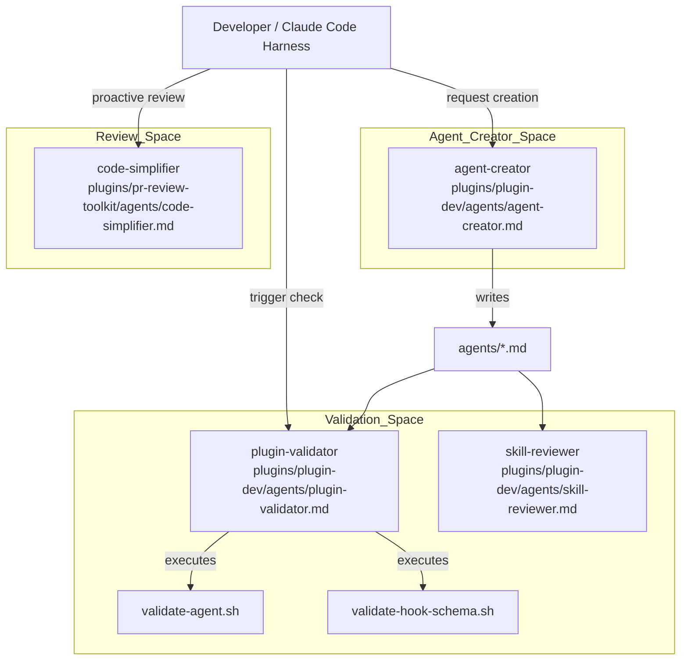
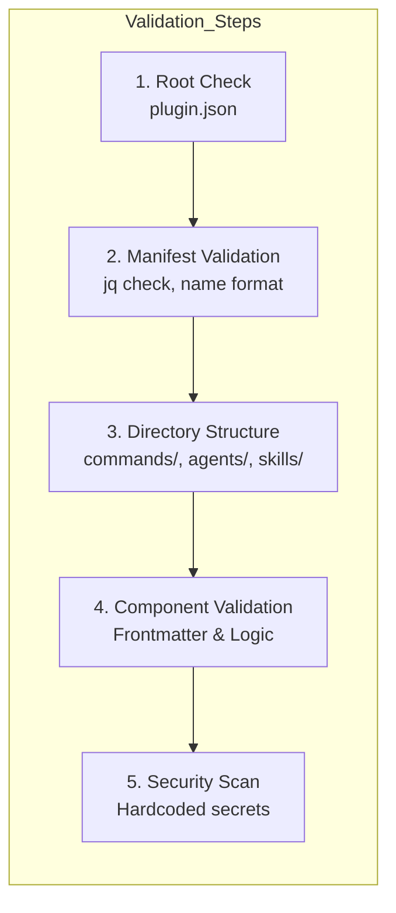

<!-- source: DeepWiki mcp.deepwiki.com · repo anthropics/claude-plugins-official · extra page Development Agent System · fetched 2026-10-26 -->

# Development Agent System

Relevant source files

The following files were used as context for generating this wiki page:

- [plugins/plugin-dev/agents/agent-creator.md](plugins/plugin-dev/agents/agent-creator.md)
- [plugins/plugin-dev/agents/plugin-validator.md](plugins/plugin-dev/agents/plugin-validator.md)
- [plugins/plugin-dev/agents/skill-reviewer.md](plugins/plugin-dev/agents/skill-reviewer.md)
- [plugins/pr-review-toolkit/agents/code-simplifier.md](plugins/pr-review-toolkit/agents/code-simplifier.md)

## Purpose and Scope

The Development Agent System consists of specialized AI agents within the `plugin-dev` and `pr-review-toolkit` directories that automate plugin development best practices, validation, and quality assurance. This system includes the **agent-creator**, **plugin-validator**, and **skill-reviewer** agents, alongside specialized review agents like **code-simplifier**. These agents leverage Claude's capabilities to generate agent configurations, validate plugin structure, and review code quality, ensuring consistency across the plugin ecosystem.

---

## System Architecture

The development agents operate at different stages of the plugin development lifecycle, from initial scaffolding to final code refinement.

### Development Agent Data Flow

Sources: [plugins/plugin-dev/agents/agent-creator.md:1-35](), [plugins/plugin-dev/agents/plugin-validator.md:1-37](), [plugins/plugin-dev/agents/skill-reviewer.md:1-36](), [plugins/pr-review-toolkit/agents/code-simplifier.md:1-41]()

---

## agent-creator: AI-Assisted Agent Generation

The `agent-creator` agent automates the creation of high-performance agent configuration files. It translates user requirements into expert personas with precisely-tuned system prompts and triggering conditions.

### Agent File Structure Generation
The agent follows a strict markdown format with YAML frontmatter:

| Component | Code Entity / Field | Requirements |
|:---|:---|:---|
| **Identifier** | `name` | lowercase, numbers, hyphens only; 3-50 chars [plugins/plugin-dev/agents/agent-creator.md:61-65]() |
| **Triggers** | `description` | Must start with "Use this agent when..." and include `<example>` blocks [plugins/plugin-dev/agents/agent-creator.md:81-82]() |
| **Model** | `model` | Options: `inherit` (recommended), `sonnet`, `haiku` [plugins/plugin-dev/agents/agent-creator.md:103]() |
| **Visual ID** | `color` | Options: `blue`, `cyan`, `green`, `yellow`, `magenta`, `red` [plugins/plugin-dev/agents/agent-creator.md:104-109]() |
| **Tooling** | `tools` | Array of tool names (e.g., `["Read", "Write"]`) [plugins/plugin-dev/agents/agent-creator.md:110]() |

### AI-Assisted Generation Workflow
1. **Extract Core Intent**: Identify fundamental purpose and success criteria [plugins/plugin-dev/agents/agent-creator.md:43]().
2. **Design Expert Persona**: Create an identity with deep domain knowledge [plugins/plugin-dev/agents/agent-creator.md:45]().
3. **Architect Instructions**: Develop a system prompt covering behavioral boundaries, methodologies, and edge cases [plugins/plugin-dev/agents/agent-creator.md:47-52]().
4. **Craft Triggering Examples**: Generate 2-4 `<example>` blocks showing explicit and proactive triggering [plugins/plugin-dev/agents/agent-creator.md:68-74]().

Sources: [plugins/plugin-dev/agents/agent-creator.md:37-141]()

---

## plugin-validator: Structural Verification

The `plugin-validator` agent performs a comprehensive validation process to ensure plugins comply with the Claude Code architecture.

### Validation Pipeline

Sources: [plugins/plugin-dev/agents/plugin-validator.md:49-135]()

### Key Validation Logic
*   **Manifest**: Verifies required `name` (kebab-case), `version` (semver), and `mcpServers` configuration [plugins/plugin-dev/agents/plugin-validator.md:56-64]().
*   **Commands**: Checks `commands/**/*.md` for YAML frontmatter, `description`, and `allowed-tools` array [plugins/plugin-dev/agents/plugin-validator.md:76-83]().
*   **Agents**: Uses `validate-agent.sh` or manual checks for name format (3-50 chars) and the presence of `<example>` blocks [plugins/plugin-dev/agents/plugin-validator.md:86-96]().
*   **Hooks**: Uses `validate-hook-schema.sh` to verify `hooks/hooks.json` event names (e.g., `PreToolUse`, `PostToolUse`, `Stop`) [plugins/plugin-dev/agents/plugin-validator.md:107-115]().

Sources: [plugins/plugin-dev/agents/plugin-validator.md:49-135]()

---

## Specialized Review Agents

The system includes several agents designed for proactive quality analysis of code and skills.

### code-simplifier
Focuses on enhancing code clarity and maintainability while preserving exact functionality.
*   **Triggering**: Automatically invoked after implementing a feature, fixing a bug, or optimizing code [plugins/pr-review-toolkit/agents/code-simplifier.md:4-40]().
*   **Refinement**: Prefers `function` keyword, explicit return types, and avoids nested ternary operators [plugins/pr-review-toolkit/agents/code-simplifier.md:52-65]().
*   **Scope**: Only refines code recently modified in the current session [plugins/pr-review-toolkit/agents/code-simplifier.md:77]().

### skill-reviewer
Analyzes `SKILL.md` files for "Progressive Disclosure" effectiveness and trigger quality.
*   **Description Quality**: Checks for specific trigger phrases and third-person phrasing ("This skill should be used when...") [plugins/plugin-dev/agents/skill-reviewer.md:60-65]().
*   **Structure**: Ensures detailed docs are moved to `references/` and code examples to `examples/` [plugins/plugin-dev/agents/skill-reviewer.md:73-79]().
*   **Content**: Validates word counts (ideally 1,000-3,000 words) and imperative writing style [plugins/plugin-dev/agents/skill-reviewer.md:68-71]().

Sources: [plugins/pr-review-toolkit/agents/code-simplifier.md:43-88](), [plugins/plugin-dev/agents/skill-reviewer.md:38-106]()

---

## Agent Configuration Standards

The Development Agent System enforces visual and behavioral standards across all generated agents.

### UI Color Mapping
| Color | Domain / Purpose | Code Reference |
|:---|:---|:---|
| `blue`/`cyan` | Analysis, Review, Inspection | [plugins/plugin-dev/agents/agent-creator.md:105]() |
| `green` | Generation, Creation | [plugins/plugin-dev/agents/agent-creator.md:106]() |
| `yellow` | Validation, Caution | [plugins/plugin-dev/agents/agent-creator.md:107]() |
| `red` | Security, Critical Issues | [plugins/plugin-dev/agents/agent-creator.md:108]() |
| `magenta` | Transformation, Creative | [plugins/plugin-dev/agents/agent-creator.md:109]() |

### Trigger Scenarios (When to Invoke)
Agents are required to have clear triggering descriptions. The `agent-creator` ensures these include:
*   **Explicit requests**: User directly asks to "create an agent" [plugins/plugin-dev/agents/agent-creator.md:6-13]().
*   **Proactive triggering**: Assistant suggests the agent after relevant work (e.g., after creating a skill) [plugins/plugin-dev/agents/skill-reviewer.md:6-14]().
*   **Implicit needs**: Triggering when the user describes functionality they need [plugins/plugin-dev/agents/agent-creator.md:15-22]().

Sources: [plugins/plugin-dev/agents/agent-creator.md:104-109](), [plugins/plugin-dev/agents/agent-creator.md:4-31](), [plugins/plugin-dev/agents/skill-reviewer.md:4-32]()

---

