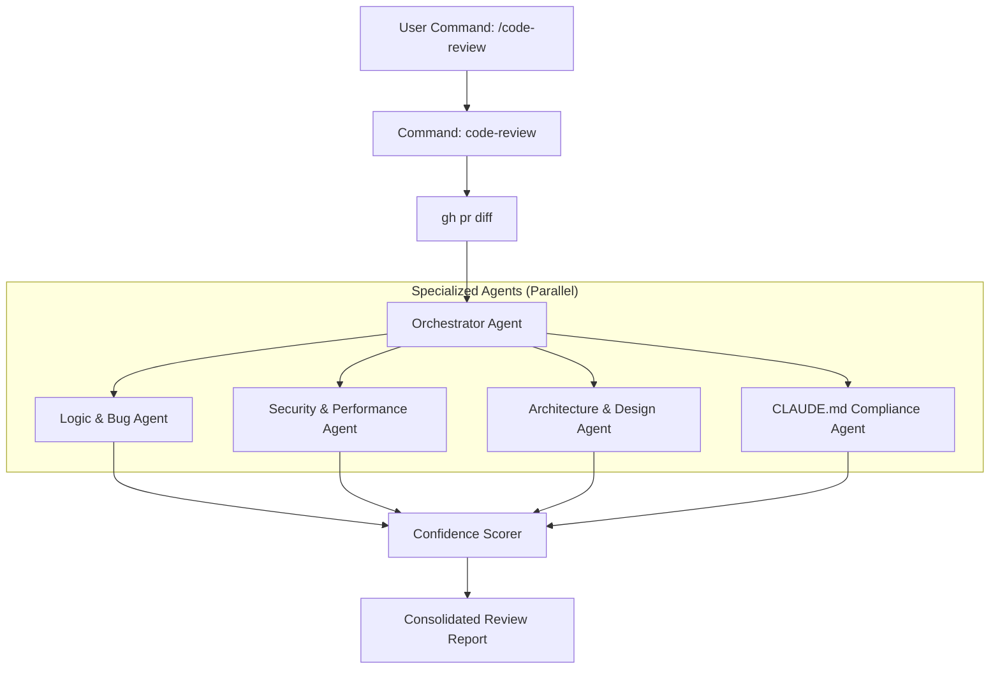
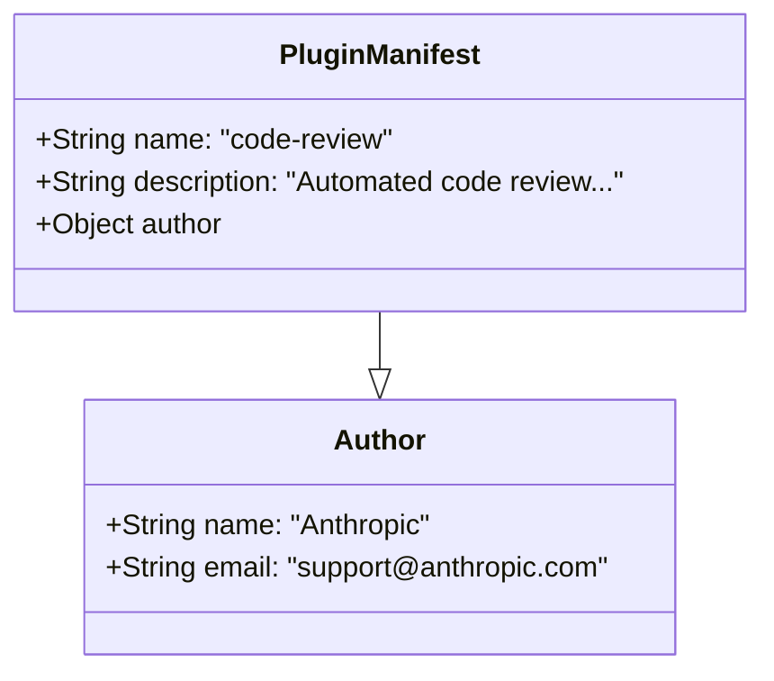

<!-- source: DeepWiki mcp.deepwiki.com · repo anthropics/claude-plugins-official · extra page code-review Plugin · fetched 2026-10-26 -->

# code-review Plugin

Relevant source files

The following files were used as context for generating this wiki page:

- [plugins/agent-sdk-dev/.claude-plugin/plugin.json](plugins/agent-sdk-dev/.claude-plugin/plugin.json)
- [plugins/code-review/.claude-plugin/plugin.json](plugins/code-review/.claude-plugin/plugin.json)
- [plugins/example-plugin/.claude-plugin/plugin.json](plugins/example-plugin/.claude-plugin/plugin.json)
- [plugins/explanatory-output-style/.claude-plugin/plugin.json](plugins/explanatory-output-style/.claude-plugin/plugin.json)
- [plugins/feature-dev/.claude-plugin/plugin.json](plugins/feature-dev/.claude-plugin/plugin.json)
- [plugins/frontend-design/.claude-plugin/plugin.json](plugins/frontend-design/.claude-plugin/plugin.json)
- [plugins/hookify/.claude-plugin/plugin.json](plugins/hookify/.claude-plugin/plugin.json)
- [plugins/learning-output-style/.claude-plugin/plugin.json](plugins/learning-output-style/.claude-plugin/plugin.json)
- [plugins/pr-review-toolkit/.claude-plugin/plugin.json](plugins/pr-review-toolkit/.claude-plugin/plugin.json)

The `code-review` plugin is an automated pull request (PR) analysis system designed to provide high-quality, low-noise feedback on code changes. It utilizes a multi-agent orchestration pattern where specialized subagents analyze the codebase in parallel, applying confidence-based scoring to ensure only high-certainty issues are reported. The plugin also enforces compliance with project-specific `CLAUDE.md` guidelines and integrates with the GitHub CLI (`gh`) for seamless workflow integration.

## Overview and Purpose

The primary goal of the `code-review` plugin is to automate the tedious aspects of code review while maintaining a high bar for accuracy. By employing multiple specialized perspectives, it identifies issues ranging from logic errors and security vulnerabilities to architectural inconsistencies and style violations.

### Key Features
- **Parallel Analysis**: Dispatches distinct agents simultaneously to minimize latency.
- **Confidence Scoring**: Each finding is assigned a confidence score; findings below the quality threshold are discarded to prevent false positives.
- **CLAUDE.md Compliance**: Specifically checks if changes adhere to the rules defined in the repository's `CLAUDE.md` file.
- **Tool Integration**: Uses the GitHub CLI to fetch PR diffs and metadata directly.

Sources: [plugins/code-review/.claude-plugin/plugin.json:1-9]()

## Architecture and Data Flow

The plugin operates by fetching the current state of a PR and piping the diff through an orchestration layer that manages the lifecycle of the specialized agents.

### Logic Flow Diagram
The following diagram illustrates the transition from the Natural Language command to the execution of specialized agent code and GitHub CLI tools.

"Natural Language to Code Entity Space: Review Workflow"

Sources: [plugins/code-review/.claude-plugin/plugin.json:3-3]()

## Specialized Review Agents

The plugin leverages specific personas to ensure comprehensive coverage of the codebase. Each agent is configured with a unique system prompt and set of priorities.

| Agent Persona | Focus Area | Responsibility |
| :--- | :--- | :--- |
| **Logic & Bug Hunter** | Correctness | Identifies off-by-one errors, null pointer risks, and race conditions. |
| **Security & Perf** | Robustness | Scans for OWASP vulnerabilities and inefficient algorithmic complexity. |
| **Architecture Critic** | Maintainability | Ensures changes follow established patterns and don't introduce circular dependencies. |
| **Compliance Officer** | Standards | Validates changes against the local `CLAUDE.md` build commands and style rules. |

### Confidence-Based Filtering
To maintain developer trust, the plugin implements a strict filtering mechanism. Each agent must output its findings in a structured format that includes a `confidence` integer. 

- **High Confidence**: Findings meeting the score threshold are included in the final report.
- **Low Confidence**: Findings below the threshold are logged for internal debugging but suppressed from user output.

Sources: [plugins/code-review/.claude-plugin/plugin.json:3-3]()

## Implementation Details

The plugin is structured as a standard Claude Code plugin, containing a manifest and specialized agent definitions.

### Plugin Manifest
The `plugin.json` defines the identity of the plugin and its authorship.

"Natural Language to Code Entity Space: Plugin Manifest Structure"

Sources: [plugins/code-review/.claude-plugin/plugin.json:1-9]()

### Integration with GitHub CLI
The plugin relies on the environment having the GitHub CLI (`gh`) installed and authenticated. It typically executes the following sequence:
1. `gh pr view --json number,title,body` to gather context.
2. `gh pr diff` to retrieve the raw changes for analysis.
3. Findings are then presented back to the user, who can choose to apply them or use `gh pr comment` to post them to GitHub.

Sources: [plugins/code-review/.claude-plugin/plugin.json:3-3]()

## Comparison with PR Review Toolkit
While the `code-review` plugin is a standalone automation for PRs, it shares conceptual similarities with the `pr-review-toolkit`. However, the `code-review` plugin is optimized for a single-command "audit" experience with high-confidence filtering, whereas the toolkit provides a broader suite of interactive agents for granular tasks like comment analysis and type design.

Sources: [plugins/pr-review-toolkit/.claude-plugin/plugin.json:1-8](), [plugins/code-review/.claude-plugin/plugin.json:1-9]()

---

