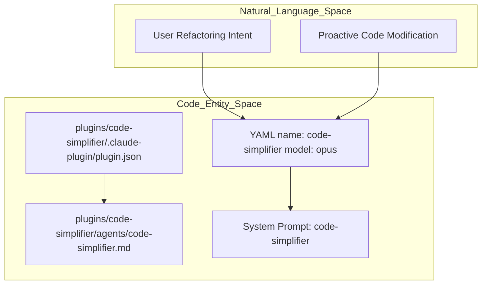
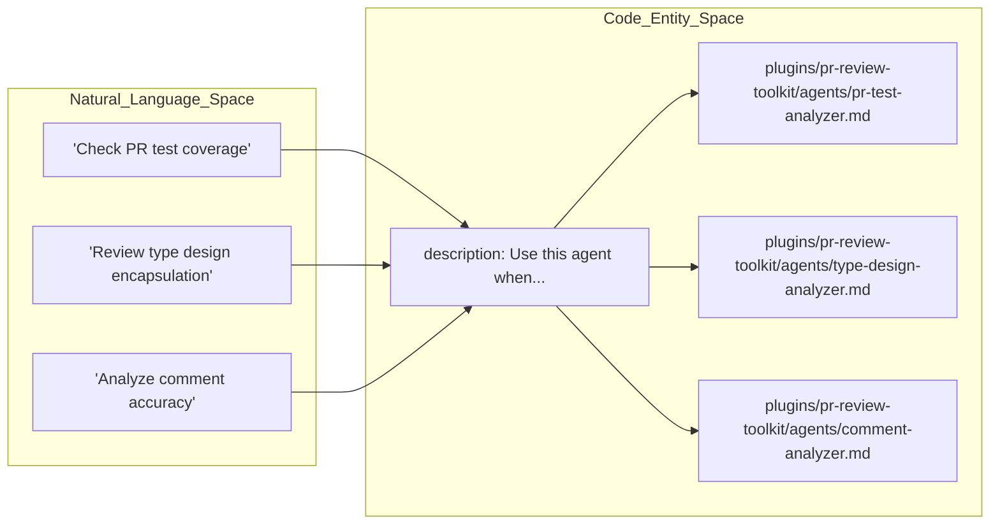
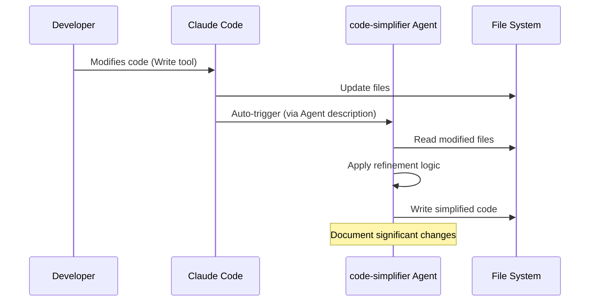

<!-- source: DeepWiki mcp.deepwiki.com · repo anthropics/claude-plugins-official · extra page code-simplifier and PR Review Toolkit · fetched 2026-10-26 -->

# code-simplifier and PR Review Toolkit

Relevant source files

The following files were used as context for generating this wiki page:

- [plugins/code-simplifier/.claude-plugin/plugin.json](plugins/code-simplifier/.claude-plugin/plugin.json)
- [plugins/code-simplifier/agents/code-simplifier.md](plugins/code-simplifier/agents/code-simplifier.md)
- [plugins/hookify/agents/conversation-analyzer.md](plugins/hookify/agents/conversation-analyzer.md)
- [plugins/plugin-dev/skills/agent-development/SKILL.md](plugins/plugin-dev/skills/agent-development/SKILL.md)
- [plugins/plugin-dev/skills/agent-development/examples/agent-creation-prompt.md](plugins/plugin-dev/skills/agent-development/examples/agent-creation-prompt.md)
- [plugins/plugin-dev/skills/agent-development/examples/complete-agent-examples.md](plugins/plugin-dev/skills/agent-development/examples/complete-agent-examples.md)
- [plugins/plugin-dev/skills/agent-development/references/agent-creation-system-prompt.md](plugins/plugin-dev/skills/agent-development/references/agent-creation-system-prompt.md)
- [plugins/plugin-dev/skills/agent-development/references/triggering-examples.md](plugins/plugin-dev/skills/agent-development/references/triggering-examples.md)
- [plugins/pr-review-toolkit/agents/code-reviewer.md](plugins/pr-review-toolkit/agents/code-reviewer.md)
- [plugins/pr-review-toolkit/agents/comment-analyzer.md](plugins/pr-review-toolkit/agents/comment-analyzer.md)
- [plugins/pr-review-toolkit/agents/pr-test-analyzer.md](plugins/pr-review-toolkit/agents/pr-test-analyzer.md)
- [plugins/pr-review-toolkit/agents/type-design-analyzer.md](plugins/pr-review-toolkit/agents/type-design-analyzer.md)

## Purpose and Scope

The `code-simplifier` agent and the `pr-review-toolkit` provide an automated, multi-agent system for enhancing code quality and performing comprehensive Pull Request (PR) reviews. While `code-simplifier` functions as an autonomous refactoring specialist, the `pr-review-toolkit` assembles specialized agents to analyze comments, tests, error handling, type design, and overall code quality.

This documentation covers the architecture of these agents, their triggering mechanisms, and how they integrate into the Claude Code development workflow.

Sources: `[plugins/code-simplifier/.claude-plugin/plugin.json:1-9]()`, `[plugins/code-simplifier/agents/code-simplifier.md:1-52]()`

---

## The PR Review Toolkit

The `pr-review-toolkit` is a comprehensive suite of agents designed for deep analysis of code changes. It moves beyond simple linting to provide architectural and functional insights through 6 specialized personas.

### Specialized Agents in the Toolkit

The toolkit utilizes specialized agents to provide a holistic review:

| Agent Name | Specialization | Key Focus |
|:---|:---|:---|
| `code-reviewer` | General Quality | Adherence to `CLAUDE.md`, precision bug detection (confidence ≥ 80). |
| `comment-analyzer` | Documentation | Accuracy against implementation, assessing "comment rot" and necessity. |
| `pr-test-analyzer` | Testing | Behavioral coverage, critical gaps in error handling, and test quality. |
| `silent-failure-hunter` | Error Handling | Finding unhandled promises, empty catch blocks, and swallowed errors. |
| `type-design-analyzer` | Architecture | Encapsulation, invariant expression, and making illegal states unrepresentable. |
| `code-simplifier` | Refactoring | Clarity, consistency, and removing unnecessary complexity. |

Sources: `[plugins/pr-review-toolkit/agents/code-reviewer.md:8-41]()`, `[plugins/pr-review-toolkit/agents/comment-analyzer.md:8-55]()`, `[plugins/pr-review-toolkit/agents/pr-test-analyzer.md:8-41]()`, `[plugins/pr-review-toolkit/agents/type-design-analyzer.md:8-55]()`, `[plugins/code-simplifier/agents/code-simplifier.md:7-41]()`

---

## code-simplifier Agent

The `code-simplifier` agent is an autonomous code quality improvement system that refines code for clarity and maintainability while preserving exact functionality. It is available both as a standalone plugin and as part of the `pr-review-toolkit`.

### Agent Architecture and Data Flow

The agent follows a structured lifecycle from triggering to file modification. It is configured to use the `opus` model for high-reasoning refactoring tasks.

Title: code-simplifier configuration to execution mapping

Sources: `[plugins/code-simplifier/agents/code-simplifier.md:1-52](), [plugins/code-simplifier/.claude-plugin/plugin.json:1-9]()`

### Core Refinement Principles

The agent's logic is governed by five mandatory principles defined in its system prompt:

1. **Preserve Functionality**: Never change what the code does - only how it does it. All original features, outputs, and behaviors must remain intact.
2. **Apply Project Standards**: Enforces standards from `CLAUDE.md`, including ES modules, `function` keyword preference, explicit return types, and React patterns.
3. **Enhance Clarity**: Reduces nesting, eliminates redundant abstractions, and specifically avoids nested ternary operators in favor of `switch` or `if/else`.
4. **Maintain Balance**: Avoids "over-simplification" that makes code harder to debug or removes helpful abstractions. Prioritizes readability over "fewer lines".
5. **Focus Scope**: Only touches recently modified code unless a broader scope is explicitly requested.

Sources: `[plugins/code-simplifier/agents/code-simplifier.md:11-41]()`

---

## Agent Triggering and Invocation

The agents in this toolkit follow the standard Claude Code agent pattern where triggering is defined in the YAML frontmatter and detailed scenarios are provided in a "When to invoke" section.

### Triggering Mechanisms

Title: Natural Language Space to Code Entity Space for PR Review Agents

Sources: `[plugins/pr-review-toolkit/agents/pr-test-analyzer.md:1-6](), [plugins/pr-review-toolkit/agents/type-design-analyzer.md:1-6](), [plugins/pr-review-toolkit/agents/comment-analyzer.md:1-6]()`

| Agent | Primary Trigger Scenario | Trigger Type |
|:---|:---|:---|
| `code-reviewer` | User signals readiness to open a pull request (Pre-PR sanity check). | Reactive |
| `code-simplifier` | Immediately after code is written or modified. | Proactive |
| `pr-test-analyzer` | Fresh PR thoroughness check after new functionality is added. | Reactive/Proactive |
| `type-design-analyzer` | When a new domain model or type is introduced. | Proactive |

Sources: `[plugins/pr-review-toolkit/agents/code-reviewer.md:10-16]()`, `[plugins/pr-review-toolkit/agents/pr-test-analyzer.md:10-16]()`, `[plugins/pr-review-toolkit/agents/type-design-analyzer.md:10-16]()`, `[plugins/code-simplifier/agents/code-simplifier.md:52]()`, `[plugins/plugin-dev/skills/agent-development/references/triggering-examples.md:9-10]()`

---

## Implementation Details

### Plugin Manifest

The `code-simplifier` follows the standard plugin manifest structure for auto-discovery via `plugins/code-simplifier/.claude-plugin/plugin.json`.

Sources: `[plugins/code-simplifier/.claude-plugin/plugin.json:1-9]()`

### 6-Step Refinement Process

When triggered, the `code-simplifier` executes the following internal workflow:

1. **Identify**: Locates modified code sections in the current session.
2. **Analyze**: Looks for opportunities to improve elegance and consistency.
3. **Apply**: Implements project-specific best practices and coding standards.
4. **Ensure**: Cross-checks that original functionality remains intact.
5. **Verify**: Confirms the result is simpler and more maintainable.
6. **Document**: Summarizes significant changes that affect developer understanding.

Sources: `[plugins/code-simplifier/agents/code-simplifier.md:43-51]()`

---

## Workflow Integration

The toolkit and agent are designed to work within a larger automation pipeline, often triggered proactively after code modification.

Title: Proactive triggering of code-simplifier in the dev loop

Sources: `[plugins/code-simplifier/agents/code-simplifier.md:52](), [plugins/plugin-dev/skills/agent-development/SKILL.md:73-81]()`

### Autonomous Operation

The `code-simplifier` is unique in its proactive nature. It is instructed to "operate autonomously and proactively, refining code immediately after it's written or modified without requiring explicit requests." This allows it to act as a "shadow refactorer" that maintains codebase hygiene in real-time.

Sources: `[plugins/code-simplifier/agents/code-simplifier.md:52-52]()`

### Review Precision and Confidence

The `code-reviewer` agent implements a specific "Issue Confidence Scoring" mechanism to reduce noise. It rates issues from 0-100 and **only reports issues with confidence ≥ 80**. This ensures that the developer is not interrupted by minor nitpicks or false positives.

Sources: `[plugins/pr-review-toolkit/agents/code-reviewer.md:31-41]()`, `[plugins/code-simplifier/agents/code-simplifier.md:52]()`

---

